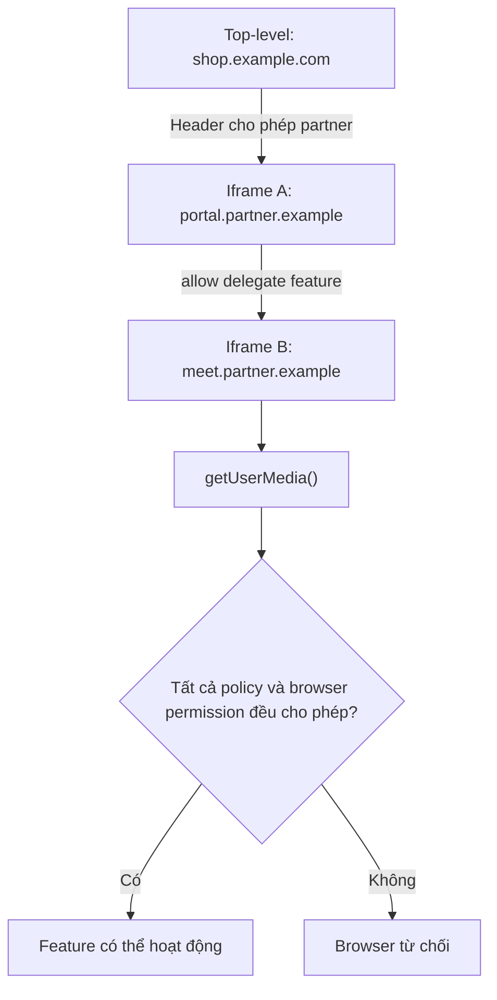

# Iframe permission — delegate browser features có kiểm soát

> **Chương:** Permissions Policy  
> **Mục tiêu:** Hiểu cách document cha cấp hoặc giới hạn quyền sử dụng browser feature cho iframe; phân biệt response header `Permissions-Policy` với thuộc tính `allow`; cấu hình allowlist theo origin cho iframe cùng origin và cross-origin; xử lý nested iframe, sandbox, browser permission và user activation; kiểm chứng việc delegate camera, microphone, geolocation và các feature khác bằng DevTools.

## 1. Iframe permission là gì?

Một trang có thể nhúng nội dung từ ứng dụng khác bằng iframe. Nội dung bên trong iframe là một document riêng, có thể cần sử dụng browser feature như camera, microphone, geolocation, fullscreen hoặc payment.

Ví dụ, một trang họp trực tuyến nhúng widget từ đối tác:

```html
<iframe
  src="https://meet.partner.example/room"
  title="Phòng họp"
></iframe>
```

Nếu widget cần mở camera hoặc microphone, browser phải xác định document trong iframe có được phép sử dụng feature đó hay không. **Permissions Policy** cho phép document cha giới hạn feature và delegate một số feature cho frame con thông qua response header và thuộc tính `allow` của iframe.

Việc delegate không đồng nghĩa browser tự cấp quyền camera/microphone cho người dùng. Browser permission, quyền của hệ điều hành và các điều kiện bảo mật khác vẫn được áp dụng.

## 2. Các lớp điều kiện trước khi iframe dùng được feature

Một iframe chỉ sử dụng được feature khi những lớp liên quan đều cho phép:

1. Browser hỗ trợ API và feature đó.
2. Document chạy trong secure context nếu API yêu cầu.
3. Permissions Policy của document cha cho phép feature được delegate tới iframe.
4. Thuộc tính `allow` của iframe cho phép origin đích sử dụng feature.
5. Policy của document con không tự hạn chế feature đó.
6. Browser permission của người dùng cho phép truy cập.
7. Hệ điều hành và thiết bị cho phép browser sử dụng phần cứng nếu có liên quan.
8. API-specific requirements như user activation hoặc trạng thái trang được đáp ứng.

Ví dụ, người dùng đã cho phép camera trong browser nhưng iframe vẫn không mở được camera nếu response của trang cha đặt `camera=()`. Ngược lại, header và `allow` cho phép camera nhưng người dùng từ chối permission thì API vẫn thất bại.

Không gộp các lớp này thành một trạng thái “đã cấp quyền”. Khi debug, hãy xác định lớp nào đang chặn.

## 3. Permissions Policy kiểm soát điều gì?

Permissions Policy là cơ chế browser thực thi policy của document đối với một số browser feature. Policy có thể:

- Tắt feature hoàn toàn trong document.
- Chỉ cho document cùng origin sử dụng.
- Cho phép một hoặc nhiều origin cụ thể.
- Giới hạn việc delegate feature cho iframe con.

Ví dụ response header khóa camera, microphone và geolocation:

```http
Permissions-Policy: camera=(), microphone=(), geolocation=()
```

Ví dụ chỉ cho phép document cùng origin:

```http
Permissions-Policy: camera=(self), microphone=(self), geolocation=(self)
```

Header được gửi cùng response của document. Nó là policy nền cho document và các browsing context con theo quy tắc kế thừa/delegation.

Tên cũ của cơ chế này là Feature Policy. Header `Feature-Policy` đã lỗi thời; triển khai mới nên dùng `Permissions-Policy` và kiểm tra browser mục tiêu.

## 4. Response header và iframe allow có vai trò khác nhau

Hai cơ chế thường được dùng cùng nhau:

| Cơ chế | Được khai báo ở đâu? | Vai trò |
| --- | --- | --- |
| `Permissions-Policy` | HTTP response header của document | Đặt giới hạn và allowlist feature ở cấp document, bao gồm các frame con |
| `allow` | Thuộc tính trên phần tử `<iframe>` | Delegate hoặc thu hẹp feature cho iframe cụ thể |
| Browser permission | Quyết định của browser/người dùng | Cho phép hoặc từ chối việc sử dụng feature nhạy cảm |

Ví dụ, header của trang cha cho phép camera với chính nó và một origin đối tác:

```http
Permissions-Policy: camera=(self "https://meet.partner.example"), microphone=(self "https://meet.partner.example")
```

Iframe tương ứng:

```html
<iframe
  src="https://meet.partner.example/room"
  allow="camera https://meet.partner.example; microphone https://meet.partner.example"
  title="Phòng họp"
></iframe>
```

Header cho phép origin đối tác nằm trong policy của trang cha; thuộc tính `allow` delegate hai feature đó cho frame cụ thể. Browser permission của người dùng vẫn cần cho phép camera/microphone.

**Thuộc tính `allow` không thể mở rộng quyền vượt quá policy của ancestor.** Nếu header của trang cha đã đặt `camera=()`, iframe không thể tự bật lại camera bằng `allow="camera"`.

## 5. Cú pháp allowlist trong Permissions-Policy header

Header dùng danh sách feature và allowlist:

```http
Permissions-Policy: camera=(self "https://meet.partner.example"), geolocation=(), fullscreen=(self)
```

Các dạng thường gặp:

| Cú pháp | Ý nghĩa |
| --- | --- |
| `()` | Không cho origin nào sử dụng feature |
| `(self)` | Chỉ origin của document hiện tại |
| `(*)` | Cho phép mọi origin trong phạm vi policy |
| `(self "https://partner.example")` | Cho phép document cùng origin và origin đối tác được liệt kê |

Origin trong allowlist phải được chỉ định chính xác, gồm scheme, host và port nếu khác cổng mặc định. Không dùng URL có path như một origin.

Ví dụ:

- `https://meet.partner.example` khác `http://meet.partner.example`.
- `https://meet.partner.example:8443` khác origin dùng port mặc định.
- `https://partner.example.evil.test` không phải `https://partner.example`.

Không phản chiếu origin do client gửi vào header. Hãy cấu hình allowlist từ nguồn tin cậy và review khi thêm đối tác.

## 6. Cú pháp allow trên iframe

Thuộc tính `allow` dùng để đặt policy cho một iframe cụ thể:

```html
<iframe
  src="https://meet.partner.example/room"
  allow="camera https://meet.partner.example; microphone https://meet.partner.example"
  title="Phòng họp"
></iframe>
```

Mỗi directive cách nhau bằng dấu chấm phẩy. Phần đầu là tên feature, phần sau là allowlist cho feature trong iframe.

Với iframe có origin cố định, có thể dùng token `'src'` để giới hạn feature cho origin từ thuộc tính `src` của iframe:

```html
<iframe
  src="https://meet.partner.example/room"
  allow="camera 'src'; microphone 'src'"
  title="Phòng họp"
></iframe>
```

Khi dùng `'src'`, hãy nhớ đây là origin của resource được chỉ định bởi `src` trong ngữ cảnh container policy. Nếu iframe điều hướng hoặc ứng dụng thay đổi đích tải, cần kiểm tra lại policy và hành vi browser.

Không dùng `allow="camera *; microphone *"` nếu widget chỉ cần một origin. Wildcard mở rộng quyền delegate và làm khó kiểm soát nội dung được nhúng.

## 7. Iframe cùng origin và cross-origin

### Iframe cùng origin

Trang cha và iframe cùng scheme, host, port:

```html
<iframe
  src="/tools/camera-preview"
  allow="camera 'src'; microphone 'src'"
  title="Xem trước camera"
></iframe>
```

Policy có thể chỉ cho phép `self` ở header:

```http
Permissions-Policy: camera=(self), microphone=(self)
```

Iframe cùng origin vẫn chịu policy của document cha và policy của chính document con. Cùng origin không có nghĩa mọi feature tự động được cấp.

### Iframe cross-origin

Với đối tác khác origin, header phải cho phép origin đối tác và container policy phải delegate feature:

```http
Permissions-Policy: camera=(self "https://meet.partner.example"), microphone=(self "https://meet.partner.example")
```

```html
<iframe
  src="https://meet.partner.example/room"
  allow="camera https://meet.partner.example; microphone https://meet.partner.example"
  title="Phòng họp đối tác"
></iframe>
```

Chỉ liệt kê origin thực sự cần thiết. Không cho phép tất cả subdomain chỉ vì chúng cùng tổ chức hoặc cùng site.

## 8. Default allowlist của feature

Mỗi Permissions Policy feature có default allowlist được định nghĩa theo feature và tiêu chuẩn. Một số feature mặc định chỉ cho `self`, một số có thể có phạm vi rộng hơn, và một số bị tắt mặc định.

Không giả định mọi feature đều có default giống nhau. Hãy khai báo policy rõ ràng cho feature nhạy cảm mà ứng dụng sử dụng:

```http
Permissions-Policy: camera=(), microphone=(), geolocation=(), payment=()
```

Sau đó mở đúng feature cho đúng origin cần thiết. Cách tiếp cận này giúp giảm phụ thuộc vào default của browser hoặc thay đổi tiêu chuẩn.

Khi cần biết feature cụ thể có hỗ trợ Permissions Policy và default allowlist nào, kiểm tra tài liệu browser hiện hành và thử trên browser mục tiêu.

## 9. Policy được kế thừa qua nested iframe

Một trang có thể nhúng iframe A, rồi iframe A tiếp tục nhúng iframe B. Quyền của B chịu các giới hạn từ chuỗi ancestor và container policy liên quan.

Ví dụ:



Việc iframe A được dùng camera không tự động chứng minh iframe B được dùng camera. Cần kiểm tra policy mà A nhận từ ancestor và cách A delegate tiếp cho B.

Nếu một ancestor đã chặn feature, descendant không thể mở lại quyền bằng thuộc tính `allow` của riêng nó. Mỗi tầng chỉ có thể duy trì hoặc thu hẹp quyền được truyền xuống.

Khi debug nested iframe, kiểm tra từng response header và từng thuộc tính `allow` trên toàn bộ đường đi, không chỉ iframe cuối.

## 10. Permissions Policy không thay browser permission

Permissions Policy là giới hạn do document đặt. Browser permission là quyết định của browser/người dùng.

Ví dụ:

| Header/iframe policy | Browser permission | Kết quả |
| --- | --- | --- |
| Cho phép camera | Granted | API có thể hoạt động nếu các điều kiện khác thỏa |
| Cho phép camera | Denied | Browser từ chối truy cập |
| Chặn camera | Granted | Iframe vẫn bị policy chặn |
| Cho phép camera | Prompt | API có thể yêu cầu người dùng quyết định theo browser |

Một response header không thể tự động cấp camera, microphone hoặc geolocation cho người dùng. Website cũng không được giả định rằng người dùng đã đồng ý chỉ vì iframe được delegate feature.

Hãy giải thích rõ lý do sử dụng feature và chỉ gọi API sau hành động phù hợp của người dùng.

## 11. Camera và microphone trong iframe

Widget video conference có thể cần cả camera và microphone. Parent phải delegate đúng hai feature:

```http
Permissions-Policy: camera=(self "https://meet.partner.example"), microphone=(self "https://meet.partner.example")
```

```html
<iframe
  src="https://meet.partner.example/room"
  allow="camera https://meet.partner.example; microphone https://meet.partner.example"
  title="Cuộc họp"
></iframe>
```

Trong document iframe:

```js
async function startCall() {
  const stream = await navigator.mediaDevices.getUserMedia({
    video: true,
    audio: true,
  });

  document.querySelector("video").srcObject = stream;
  return stream;
}
```

Ứng dụng nên gọi `startCall()` sau khi người dùng bấm “Tham gia với camera và microphone”. Khi rời phòng, dừng mọi track:

```js
function stopCall(stream) {
  if (!stream) return;
  for (const track of stream.getTracks()) {
    track.stop();
  }
}
```

Nếu chỉ cần microphone hoặc camera, chỉ yêu cầu đúng thiết bị cần dùng. Không yêu cầu cả hai theo mặc định.

## 12. Geolocation trong iframe

Geolocation có thể được delegate cho một origin đối tác khi tính năng thực sự cần:

```http
Permissions-Policy: geolocation=(self "https://map.partner.example")
```

```html
<iframe
  src="https://map.partner.example/nearby"
  allow="geolocation https://map.partner.example"
  title="Bản đồ địa điểm gần đây"
></iframe>
```

Trong iframe:

```js
navigator.geolocation.getCurrentPosition(
  (position) => {
    renderNearbyPlaces(position.coords.latitude, position.coords.longitude);
  },
  (error) => {
    showLocationError(error.code);
  },
  { timeout: 10000, maximumAge: 30000 },
);
```

Việc delegate không tự cấp quyền vị trí. Browser vẫn áp dụng permission của người dùng và secure context requirement. Chỉ delegate geolocation khi sản phẩm có mục đích rõ ràng; không cấp cho quảng cáo hoặc widget không cần vị trí.

## 13. Fullscreen, payment và các feature khác

Một số feature khác có thể được kiểm soát bằng Permissions Policy, tùy browser support:

| Feature | Ví dụ use case | Cân nhắc |
| --- | --- | --- |
| `fullscreen` | Video hoặc dashboard trong iframe | Chỉ delegate cho widget cần toàn màn hình |
| `payment` | Luồng thanh toán qua Payment Request API | Xác minh tích hợp và browser support |
| `autoplay` | Media tự phát | Còn phụ thuộc autoplay policy và tương tác người dùng |
| `clipboard-read` / `clipboard-write` | Widget sao chép/dán | API có điều kiện riêng và hỗ trợ khác nhau |
| `usb` | WebUSB | Feature nhạy cảm, không delegate rộng |

Không phải mọi browser feature đều có directive hoặc hỗ trợ giống nhau. Trước khi thêm vào header hoặc iframe attribute, kiểm tra tên feature, cú pháp và browser matrix.

Permissions Policy chỉ là một lớp kiểm soát. Ví dụ cho phép `fullscreen` không bảo đảm mọi lệnh fullscreen sẽ thành công; document vẫn phải thỏa API-specific requirements.

## 14. Iframe sandbox và permission delegation

Thuộc tính `sandbox` giới hạn khả năng của iframe:

```html
<iframe
  src="https://widget.partner.example/"
  sandbox="allow-scripts"
  allow="camera https://widget.partner.example"
  title="Widget cô lập"
></iframe>
```

Sandbox và Permissions Policy giải quyết hai vấn đề khác nhau:

- `sandbox` hạn chế khả năng của browsing context như script, form, popup, navigation và origin behavior.
- `allow` delegate browser feature cho iframe.
- `Permissions-Policy` header đặt giới hạn ở cấp document và ancestor.
- Browser permission vẫn là quyết định riêng.

Một sandboxed iframe không có `allow-same-origin` thường có opaque origin. Điều này có thể ảnh hưởng origin matching, storage và các API. Không thêm `allow-same-origin` chỉ để né lỗi camera hoặc geolocation; đánh giá ranh giới tin cậy của nội dung trước.

Nếu widget cần feature nhạy cảm, hãy thiết kế origin riêng, sandbox tokens tối thiểu và policy delegation rõ ràng. Kiểm tra hành vi thực tế trên browser mục tiêu.

## 15. Khi iframe điều hướng hoặc thay đổi src

Policy của iframe gắn với container và document được tải. Khi ứng dụng thay đổi `src`, redirect hoặc điều hướng frame, origin đích có thể khác origin ban đầu.

Các nguyên tắc:

- Không dùng allowlist rộng chỉ vì iframe có thể điều hướng.
- Chỉ cấp feature cho origin thực sự cần.
- Xác minh redirect và final document origin.
- Khi thay widget hoặc đối tác, review lại header và thuộc tính `allow`.
- Không coi việc iframe ban đầu thuộc origin tin cậy là bảo đảm mọi document sau điều hướng đều tin cậy.

Với nội dung động, hãy tạo iframe theo allowlist đã kiểm duyệt và kiểm soát nguồn URL ở server/configuration. Không lấy origin tùy ý từ query parameter rồi đưa vào allow attribute.

## 16. Cấu hình server response header

### Node.js/Express

Ví dụ trang cha cho phép camera/microphone với chính nó và một widget đối tác:

```js
app.get("/meeting", (req, res) => {
  res.setHeader(
    "Permissions-Policy",
    'camera=(self "https://meet.partner.example"), microphone=(self "https://meet.partner.example"), geolocation=()'
  );

  res.render("meeting");
});
```

Đây là ví dụ minh họa. Nếu ứng dụng đã có middleware security headers, hãy tích hợp directive tại nguồn cấu hình tập trung thay vì ghi đè header ở route khác. Chỉ bật feature cần thiết cho luồng cụ thể.

### Nginx

Ví dụ response header:

```nginx
add_header Permissions-Policy "camera=(self \"https://meet.partner.example\"), microphone=(self \"https://meet.partner.example\"), geolocation=()" always;
```

Kiểm tra escaping và cấu hình kế thừa theo phiên bản Nginx, server block và location. Xác minh response cuối sau reverse proxy/CDN thay vì chỉ xem file cấu hình.

## 17. Ví dụ hoàn chỉnh: trang cha nhúng widget họp

Response header của trang cha:

```http
Permissions-Policy: camera=(self "https://meet.partner.example"), microphone=(self "https://meet.partner.example"), geolocation=()
```

HTML:

```html
<iframe
  id="meeting-widget"
  src="https://meet.partner.example/room"
  allow="camera https://meet.partner.example; microphone https://meet.partner.example"
  title="Widget họp trực tuyến"
></iframe>
```

Widget gọi API sau khi người dùng chọn tham gia:

```js
async function joinMeeting() {
  try {
    const stream = await navigator.mediaDevices.getUserMedia({
      video: true,
      audio: true,
    });

    document.querySelector("#local-preview").srcObject = stream;
    return stream;
  } catch (error) {
    showJoinError(error.name);
    return null;
  }
}
```

Để luồng hoạt động, cần:

1. Trang cha được phục vụ trong secure context.
2. Response header của trang cha cho phép origin widget.
3. Thuộc tính `allow` delegate camera/microphone cho iframe.
4. Document widget không tự chặn feature bằng policy riêng.
5. Browser permission và OS permission cho phép thiết bị.
6. Người dùng chủ động tham gia và API đáp ứng điều kiện runtime.

Khi kết thúc cuộc họp, widget dừng media tracks và giải phóng tài nguyên.

## 18. Bảo mật khi delegate cho đối tác

Cho phép một origin dùng camera hoặc microphone là quyết định có tác động tới quyền riêng tư. Trước khi thêm đối tác vào allowlist:

- Xác minh chủ sở hữu và cách vận hành origin.
- Xác định chính xác feature cần delegate.
- Kiểm tra đối tác có nhúng tiếp iframe khác hay không.
- Đánh giá khả năng redirect, nội dung người dùng và subdomain.
- Chỉ gửi dữ liệu cần thiết cho widget.
- Hiển thị rõ cho người dùng khi camera/microphone/vị trí được sử dụng.
- Có cách dừng feature và rời widget.
- Rà soát lại khi domain hoặc nhà cung cấp thay đổi.

Không delegate camera/microphone cho toàn bộ subdomain nếu chỉ một widget cần. Một origin được phép có thể thay đổi nội dung hoặc bị compromise; quyền càng rộng thì tác động càng lớn.

## 19. Permissions Policy và browser permission trong trạng thái lỗi

Khi API thất bại, nguyên nhân có thể nằm ở nhiều lớp:

| Dấu hiệu | Lớp cần kiểm tra |
| --- | --- |
| Console báo feature bị disallowed by Permissions Policy | Header của ancestor hoặc iframe allow |
| API trả `NotAllowedError` | Browser permission, OS permission, policy hoặc secure context |
| API không tồn tại | Browser support hoặc context |
| Camera không có thiết bị | Thiết bị/driver/hệ điều hành |
| Top-level page dùng được nhưng iframe không dùng được | Delegation hoặc origin allowlist |
| Iframe A dùng được nhưng iframe B không dùng được | Nested policy và allow attribute ở từng tầng |
| Người dùng đã cấp quyền nhưng lần sau bị chặn | Permission bị thu hồi, policy thay đổi hoặc OS setting |

Không chỉ dựa vào tên exception để kết luận. Đọc Console, Network response headers và trạng thái browser site settings.

## 20. Kiểm thử iframe permission bằng DevTools

Thực hành trong staging hoặc lab với các origin do bạn kiểm soát. Dùng thiết bị thử nghiệm; không thu dữ liệu camera/microphone của người khác.

### Bước 1 — Tạo top-level document và iframe

Tạo trang cha tại một origin và widget tại origin khác. Bắt đầu không có thuộc tính `allow`, sau đó thử gọi camera/geolocation từ widget để quan sát hành vi mặc định và lỗi.

### Bước 2 — Kiểm tra response header

Mở DevTools → Network, chọn response của document cha. Xác minh:

- Có header `Permissions-Policy` không.
- Feature có nằm trong allowlist không.
- Origin đối tác có được liệt kê chính xác không.
- Có header trùng hoặc policy khác ở proxy/CDN không.

### Bước 3 — Thêm iframe allow

Thêm:

```html
<iframe
  src="https://meet.partner.example/room"
  allow="camera https://meet.partner.example; microphone https://meet.partner.example"
  title="Meeting lab"
></iframe>
```

Tải lại và thử API sau thao tác người dùng. Nếu browser permission chưa có quyết định, browser có thể hiện prompt theo chính sách của nó.

### Bước 4 — Thử header chặn

Đổi response header thành:

```http
Permissions-Policy: camera=(), microphone=()
```

Giữ nguyên thuộc tính allow của iframe. Xác minh iframe vẫn không dùng được feature vì container không thể vượt policy ancestor.

### Bước 5 — Thử nested iframe

Cho widget A nhúng widget B. Chỉ delegate camera cho A rồi kiểm tra B. Sau đó thêm delegation phù hợp ở A và kiểm tra lại. Quan sát policy phải cho phép qua toàn bộ chuỗi.

### Bước 6 — Thử thu hồi browser permission

Cho phép camera trong site settings, xác nhận widget hoạt động, sau đó thu hồi quyền. Quay lại trang và thử lại; ứng dụng phải xử lý lỗi và không giả định quyền còn tồn tại.

### Bước 7 — Kiểm tra sandbox

Thử iframe có sandbox và không có `allow-same-origin`. Quan sát tác động tới origin/API. Không thêm token rộng chỉ để làm bài test qua; ghi nhận ranh giới bảo mật thay đổi.

## 21. Chẩn đoán lỗi thường gặp

| Hiện tượng | Nguyên nhân có thể | Cách xử lý |
| --- | --- | --- |
| Top-level dùng được camera nhưng iframe không dùng được | Chưa delegate qua header hoặc allow | Kiểm tra cả response header và iframe attribute |
| Iframe allow có camera nhưng vẫn bị chặn | Ancestor policy đặt camera=() hoặc origin không khớp | Sửa allowlist ở tầng ancestor có quyền cấp |
| Đối tác hợp lệ không dùng được feature | Scheme/host/port khác origin khai báo | So sánh origin thực tế và allowlist |
| Nested iframe không dùng được feature | Một tầng trung gian không delegate tiếp | Kiểm tra policy và allow trên từng iframe |
| Người dùng đã cấp camera nhưng API lỗi | Permissions Policy, OS, secure context hoặc thiết bị | Kiểm tra Console, site settings và hệ điều hành |
| Iframe sau redirect bị chặn | Origin cuối không nằm trong allowlist | Kiểm tra final URL và thu hẹp/điều chỉnh origin có chủ đích |
| Sandbox làm API hoạt động khác | Opaque origin hoặc sandbox restriction | Đánh giá sandbox tokens và trust boundary |
| Header thay đổi giữa staging và production | Proxy/CDN thêm hoặc ghi đè header | Kiểm tra response cuối ở Network |
| Feature không nhận diện trong header | Browser không hỗ trợ directive hoặc tên feature sai | Kiểm tra browser support và tên directive chuẩn |

## 22. Những ngộ nhận thường gặp

| Ngộ nhận | Cách hiểu đúng |
| --- | --- |
| “Thêm allow là iframe chắc chắn dùng được camera.” | Ancestor policy, browser permission, secure context, OS và thiết bị vẫn áp dụng. |
| “Header của trang cha có thể được iframe mở rộng.” | Iframe không thể vượt giới hạn của ancestor. |
| “Cùng site đồng nghĩa cùng origin.” | Origin gồm scheme, host, port; subdomain có thể khác origin. |
| “Permissions Policy tự cấp quyền người dùng.” | Nó giới hạn/delegate feature; browser permission là quyết định riêng. |
| “Nếu top-level dùng được thì iframe cũng dùng được.” | Iframe cần delegation phù hợp và chịu policy riêng. |
| “Một iframe được delegate thì mọi iframe lồng bên trong cũng được.” | Mỗi tầng chịu policy kế thừa và container policy của ancestor. |
| “Sandbox và allow làm cùng một việc.” | Sandbox giới hạn browsing context; allow delegate browser feature. |
| “Có thể dùng wildcard để tránh lỗi tích hợp.” | Wildcard mở rộng quyền cho nhiều origin và tăng tác động nếu nội dung bị compromise. |
| “Feature name nào cũng được browser hỗ trợ.” | Directive và default allowlist khác nhau theo feature/browser. |

## 23. Checklist delegate iframe permission

- Xác định feature iframe thực sự cần và lý do nghiệp vụ.
- Dùng response header `Permissions-Policy` để đặt allowlist ở cấp document.
- Dùng thuộc tính `allow` trên đúng iframe để delegate feature cụ thể.
- Cho phép origin chính xác gồm scheme, host và port.
- Không dùng wildcard hoặc cho phép toàn bộ subdomain nếu không cần.
- Nhớ rằng iframe allow không thể vượt policy của bất kỳ ancestor nào.
- Kiểm tra nested iframe và delegation ở từng tầng.
- Đánh giá policy riêng của document con và sandbox/opaque origin.
- Tách delegation khỏi browser permission, OS permission và authorization nghiệp vụ.
- Yêu cầu feature sau hành động rõ ràng của người dùng và giải thích mục đích.
- Dừng media tracks hoặc cleanup tài nguyên khi người dùng kết thúc.
- Kiểm tra redirect/final origin, response headers sau CDN/proxy và browser support.
- Kiểm thử trạng thái granted, denied, prompt, thu hồi quyền và policy bị chặn.
- Rà soát lại allowlist khi thay đối tác, domain hoặc cấu trúc widget.

## 24. Câu hỏi tự kiểm tra

1. Iframe permission delegation giải quyết vấn đề gì?
2. Permissions-Policy response header và iframe allow khác nhau thế nào?
3. Vì sao iframe allow không thể vượt policy của ancestor?
4. Origin trong allowlist gồm những thành phần nào?
5. Vì sao không nên delegate camera/microphone bằng wildcard?
6. Nested iframe phải thỏa điều kiện policy qua những tầng nào?
7. Permissions Policy khác browser permission ra sao?
8. Vì sao camera có thể bị chặn dù browser permission đã granted?
9. Sandbox có thể ảnh hưởng origin và feature trong iframe như thế nào?
10. Khi đối tác redirect sang origin khác, cần kiểm tra điều gì?
11. Làm sao phân biệt lỗi delegation với lỗi thiết bị hoặc OS?
12. Những bước nào cần kiểm thử trong DevTools trước khi phát hành widget?

**Ghi nhớ:** Iframe permission là việc delegate browser feature từ document cha cho document con. Response header `Permissions-Policy` đặt giới hạn ở cấp document và ancestor; thuộc tính `allow` cấp feature cho iframe cụ thể trong giới hạn đó. Origin phải được cho phép chính xác qua toàn bộ chuỗi nested frame. Browser permission, secure context, OS và điều kiện của API vẫn áp dụng. Hãy delegate tối thiểu, kiểm tra response cuối và kiểm thử cả trạng thái cho phép lẫn từ chối trước khi phát hành.
