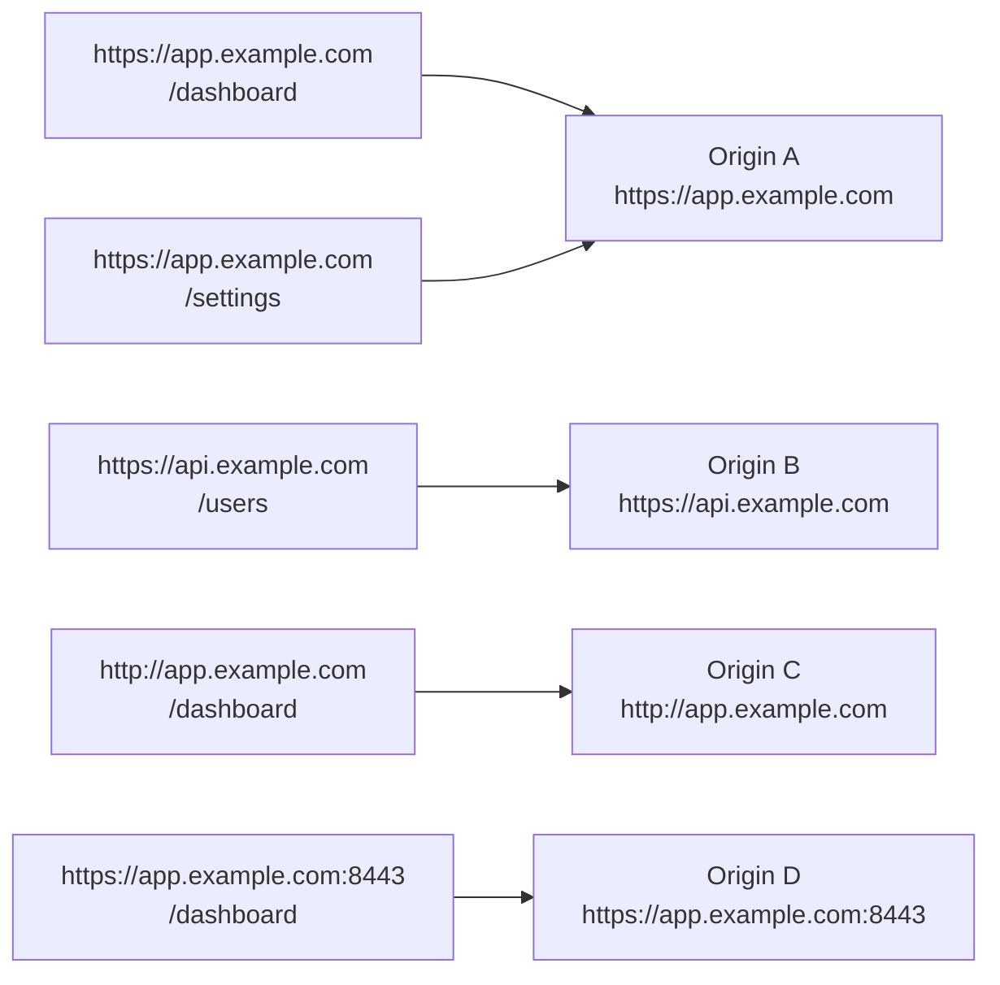

# Origin là gì?

> **Chương:** Origin  
> **Phạm vi module:** SECURITY_APPLICATION_SECURITY_BROWSER_SECURITY — phân tích ranh giới bảo mật giữa trình duyệt, origin, cookie và ứng dụng web để hiểu Same-Origin Policy (SOP), CORS và các cơ chế cách ly; từ đó phòng vệ XSS, CSRF, clickjacking bằng CSP, Trusted Types, security headers và kiểm chứng hành vi thực tế.

## 1. Vì sao cần hiểu origin?

Hãy tưởng tượng bạn đồng thời mở hai tab:

- Một tab là ứng dụng ngân hàng ở `https://bank.example`.
- Tab còn lại là một trang tin ở `https://news.example`.

Cả hai trang đều có thể chạy JavaScript trong trình duyệt của bạn. Nếu mã trên trang tin mặc nhiên được đọc số dư, lịch sử giao dịch hoặc nội dung DOM của ngân hàng, chỉ một trang web độc hại cũng đủ phá vỡ quyền riêng tư của người dùng.

**Origin** là một trong những đơn vị nhận diện ngữ cảnh bảo mật căn bản của nền tảng web. Trình duyệt dùng origin để quyết định những tài liệu, script và tài nguyên nào được xem là **cùng nguồn gốc** (*same-origin*) cho nhiều thao tác nhạy cảm.

Origin giúp trả lời những câu hỏi như:

- Trang A có được đọc DOM của iframe trang B hay không?
- JavaScript có thể đọc dữ liệu do origin khác trả về qua `fetch()` không?
- Hai trang có dùng chung vùng lưu trữ `localStorage` hay không?
- Cửa sổ A phải kiểm tra điều gì khi nhận thông điệp từ cửa sổ B?

Origin **không** tự trả lời người dùng nào có quyền xem đơn hàng hay thực hiện thanh toán. Những quyết định đó vẫn phải được máy chủ xác thực và phân quyền.

### Mục tiêu học tập

Sau bài này, bạn có thể:

1. Định nghĩa origin của URL HTTP(S) dưới dạng bộ ba **scheme, host và port**.
2. Phân loại cặp URL là cùng origin hay khác origin, kể cả khi chỉ khác giao thức, subdomain hoặc cổng.
3. Phân biệt **origin**, **site**, **domain**, **cookie scope**, đường dẫn URL và khái niệm *opaque origin*.
4. Giải thích cách origin tác động đến SOP, CORS, DOM, Web Storage, iframe và `postMessage`.
5. Nhận ra giới hạn của ranh giới origin trong các kịch bản XSS, CSRF, clickjacking và thiết kế nhiều subdomain.
6. Tự kiểm tra origin và hành vi cross-origin bằng JavaScript cùng DevTools.

## 2. Định nghĩa: origin của một URL HTTP(S)

Với URL HTTP hoặc HTTPS thông thường, một origin được xác định bởi bộ ba:

**`Origin = (scheme, host, port)`**

| Thành phần | Ý nghĩa | Ví dụ |
|---|---|---|
| **Scheme** | Giao thức URL; với ứng dụng web thường là `http` hoặc `https` | `https` |
| **Host** | Tên máy chủ, tên miền hoặc địa chỉ IP đã được chuẩn hóa | `app.example.com` |
| **Port** | Cổng dịch vụ; nếu URL không ghi cổng thì dùng cổng mặc định của scheme | `443` cho HTTPS |

Ví dụ:

```text
URL:    https://app.example.com:8443/orders?id=42#details
         │       │               │
         │       │               └── port: 8443
         │       └────────────────── host: app.example.com
         └────────────────────────── scheme: https

Origin: (https, app.example.com, 8443)
Serialized origin: https://app.example.com:8443
```

Các thành phần `/orders` (path), `?id=42` (query) và `#details` (fragment) **không tham gia vào định nghĩa origin**. Hai URL có path hay query khác nhau vẫn có thể cùng origin.

Đối với HTTP(S), hai URL **same-origin** khi cả ba thành phần sau chuẩn hóa đều bằng nhau. Chỉ cần một thành phần khác thì chúng là **cross-origin**.

> **Lưu ý về cách viết:** `https://app.example.com` ngầm dùng cổng `443`. Do đó, URL này cùng origin với `https://app.example.com:443`. Tương tự, `http://app.example.com` mặc định dùng cổng `80`.

### 2.1. Bảng so sánh origin

Lấy `https://app.example.com/dashboard` làm URL gốc:

| URL cần so sánh | Cùng origin? | Lý do |
|---|:---:|---|
| `https://app.example.com/profile` | Có | Chỉ khác path |
| `https://app.example.com/dashboard?tab=2` | Có | Query không tính vào origin |
| `https://app.example.com/dashboard#settings` | Có | Fragment không tính vào origin |
| `https://app.example.com:443/api` | Có | Cùng cổng mặc định HTTPS |
| `http://app.example.com/dashboard` | Không | Khác scheme `http`/`https` |
| `https://api.example.com/dashboard` | Không | Khác host |
| `https://admin.app.example.com` | Không | Khác host, dù là subdomain |
| `https://app.example.com:8443` | Không | Khác port |
| `https://example.com` | Không | Thiếu subdomain `app` |
| `https://app.example.com.evil.test` | Không | Host hoàn toàn khác |

Trình duyệt chuẩn hóa một số đặc điểm của URL trước khi so sánh, chẳng hạn chữ hoa/chữ thường trong tên host, biểu diễn host quốc tế hóa và cổng mặc định. Vì thế, khi lập trình, nên dùng bộ phân tích URL của nền tảng thay vì tự chia chuỗi tại dấu chấm, dấu hai chấm hay dấu gạch chéo.

### 2.2. Minh họa cách các trang được nhóm



Dù các URL có cùng chủ sở hữu nghiệp vụ hoặc cùng máy chủ vật lý, trình duyệt vẫn phân loại chúng theo **scheme + host + port**. “Cùng công ty”, “cùng IP”, “cùng máy chủ” hay “cùng tên miền cấp cao” không tương đương với same-origin.

## 3. Cách xác định origin bằng JavaScript

Đối với URL HTTP(S), thuộc tính `origin` của đối tượng `URL` giúp quan sát giá trị origin đã được nền tảng chuẩn hóa:

```js
const urls = [
  'https://app.example.com/orders',
  'https://app.example.com:443/settings',
  'https://api.example.com/users',
  'http://app.example.com/orders',
  'https://app.example.com:8443/orders',
];

for (const address of urls) {
  const url = new URL(address);
  console.log(address, '=>', url.origin);
}
```

Kết quả tương ứng:

```text
https://app.example.com/orders        => https://app.example.com
https://app.example.com:443/settings  => https://app.example.com
https://api.example.com/users         => https://api.example.com
http://app.example.com/orders         => http://app.example.com
https://app.example.com:8443/orders   => https://app.example.com:8443
```

Để kiểm tra hai URL HTTP(S) có cùng origin:

```js
function isSameOrigin(left, right) {
  const a = new URL(left);
  const b = new URL(right);
  return a.origin === b.origin;
}

console.log(
  isSameOrigin(
    'https://app.example.com/orders',
    'https://app.example.com:443/profile'
  )
); // true

console.log(
  isSameOrigin(
    'https://app.example.com',
    'https://api.example.com'
  )
); // false
```

Trong tài liệu đang mở, `window.location.origin` thường cho biết origin dạng chuỗi của URL HTTP(S) hiện tại:

```js
console.log(window.location.origin);
```

**Giới hạn quan trọng:** ví dụ so sánh chuỗi ở trên phù hợp với URL HTTP(S) thông thường. Đối với `about:blank`, `data:`, `blob:`, URL `file:` hoặc tài liệu bị sandbox, **origin bảo mật thực tế của môi trường thực thi** có những quy tắc đặc biệt; không thể suy hết từ việc cắt chuỗi URL hoặc chỉ nhìn vào `location.origin`.

## 4. Những khái niệm dễ nhầm với origin

### 4.1. Origin khác domain

**Domain** là tên trong hệ thống DNS hoặc một phần host như `example.com`. Origin chứa thêm scheme và port.

`https://example.com` và `http://example.com` có cùng host nhưng **khác origin**. `https://example.com` và `https://example.com:8443` cũng khác origin dù trỏ tới cùng tên miền.

Tên miền cấp cha không tự động trao quyền DOM hoặc `localStorage` cho mọi subdomain.

### 4.2. Origin khác site

**Site** là một nhóm được dùng trong những cơ chế khác, nổi bật là chính sách cookie `SameSite`. Trong cách xác định **schemeful site** hiện đại, hai URL thuộc cùng site khi có cùng scheme và cùng *registrable domain* (miền có thể đăng ký, được xác định với Public Suffix List).

Ví dụ:

| URL A | URL B | Same-origin? | Same-site? |
|---|---|:---:|:---:|
| `https://shop.example.com/cart` | `https://shop.example.com/pay` | Có | Có |
| `https://shop.example.com` | `https://api.example.com` | Không | Có |
| `https://shop.example.com` | `http://shop.example.com` | Không | Không |
| `https://shop.example.com` | `https://other.example.org` | Không | Không |

Với `https://app.example.co.uk`, site dùng registrable domain `example.co.uk`, chứ không đơn giản lấy hai nhãn cuối cùng là `co.uk`.

**Bài học:** một request có thể **cross-origin nhưng same-site**. Vì vậy, thấy cookie `SameSite=Strict` hoặc `SameSite=Lax` không có nghĩa hai trang được đọc DOM của nhau.

### 4.3. Origin khác phạm vi cookie

Cookie có các quy tắc riêng về `Domain`, `Path`, `Secure`, `HttpOnly`, `SameSite` và chính sách third-party/partitioned storage của trình duyệt.

Ví dụ, server `app.example.com` trả:

```http
Set-Cookie: session=opaque_value; Path=/; Secure; HttpOnly; SameSite=Lax
```

Khi không có `Domain`, cookie là **host-only** và được liên kết với host đã thiết lập nó. Nếu server dùng `Domain=example.com`, các subdomain phù hợp có thể nhận cookie này theo quy tắc trình duyệt. Trái lại, `https://app.example.com` và `https://api.example.com` **vẫn khác origin** theo SOP.

Một vài khác biệt cần ghi nhớ:

- Cookie **không được phân tách theo port** như origin. Các ứng dụng chung host nhưng khác port cần lưu ý rủi ro chia sẻ cookie.
- `Path=/admin` **không phải biên bảo mật tương đương origin**; không dùng path để cô lập một ứng dụng kém tin cậy.
- `HttpOnly` giảm khả năng JavaScript đọc trực tiếp cookie; **không** ngăn script XSS thao tác tài liệu hoặc gọi API với phiên có sẵn.
- `SameSite` điều chỉnh việc gửi cookie trong ngữ cảnh same-site/cross-site; **không phải** phép so sánh origin.
- Cookie third-party có thể bị chặn hoặc phân vùng tùy chính sách trình duyệt.

| Câu hỏi | Cơ chế chủ yếu liên quan |
|---|---|
| “Hai URL có cùng nguồn gốc bảo mật không?” | **Origin** |
| “Đây là truy cập same-site hay cross-site?” | **Schemeful site** |
| “Cookie nào sẽ được gửi?” | **Cookie attributes** và browser policy |
| “Người dùng có quyền sửa đơn hàng này không?” | **Xác thực và phân quyền trên server** |

## 5. Origin không phải lúc nào cũng là bộ ba thông thường

Định nghĩa bộ ba rất hữu ích cho HTTP(S), nhưng mô hình của trình duyệt còn có **opaque origin** và một số trường hợp kế thừa origin.

### 5.1. Opaque origin là gì?

**Opaque origin** là origin có danh tính nội bộ riêng, không thể được trình bày như một bộ ba `scheme–host–port` thông thường. Khi cần chuyển thành chuỗi, opaque origin thường được biểu diễn là `null`.

Điều này không có nghĩa mọi tài liệu có giá trị serialized `"null"` đều thuộc cùng một origin hoặc có quyền truy cập lẫn nhau. Hai opaque origins độc lập **không trở thành same-origin** chỉ vì cùng được biểu diễn bằng chuỗi `"null"`.

Những ví dụ thường gặp:

- Tài liệu `data:text/html,...` thường có **opaque origin** mới.
- Iframe có thuộc tính `sandbox` mà **không** có `allow-same-origin` được đặt trong ngữ cảnh origin đặc biệt, bất kể nội dung hiển thị có URL giống trang cha.
- Một số ngữ cảnh đặc biệt khác có origin không thể quy về bộ ba HTTP(S).

Ví dụ:

```html
<iframe
  sandbox="allow-scripts"
  src="https://widgets.example.com/preview">
</iframe>
```

Iframe được cho phép chạy script nhưng thiếu `allow-same-origin` nên không được đối xử như origin thật của URL trong các phép kiểm tra cùng origin thông thường. Cần kiểm tra thêm các hạn chế sandbox và khả năng nhúng của trang đích.

> Không mặc nhiên kết hợp `allow-scripts` với `allow-same-origin` cho **iframe cùng origin chứa nội dung không tin cậy**; tổ hợp này có thể làm suy yếu đáng kể mục tiêu sandbox.

### 5.2. URL đặc biệt và origin kế thừa

| Trường hợp | Cách hiểu đúng |
|---|---|
| `about:blank` | Tài liệu tạo ra theo ngữ cảnh bình thường thường kế thừa origin của môi trường tạo/điều hướng nó; sandbox có thể làm thay đổi kết quả |
| `iframe srcdoc` | Nội dung thường cùng origin với tài liệu nhúng nếu không bị sandbox áp đặt origin riêng |
| `blob:` | URL blob thường mang origin liên quan đến môi trường đã tạo nó; có thêm quy tắc về phân vùng và truy cập |
| `data:` | Tài liệu thường nhận opaque origin mới |
| `file:` | Cách xử lý origin không thống nhất giữa các browser và trường hợp; không xây bảo mật ứng dụng dựa trên giả định mọi file đều cùng origin |

Điều cần nắm là **origin gắn với môi trường thực thi và quy tắc của nền tảng**, không phải lúc nào cũng chỉ là việc đọc text của thanh địa chỉ.

### 5.3. Vì sao phải thận trọng với `Origin: null`?

Trong HTTP request, header `Origin` có thể chứa origin đã được serialize:

```http
Origin: https://app.example.com
```

Ở một số trường hợp, giá trị có thể là:

```http
Origin: null
```

`null` không đồng nghĩa với “request nội bộ an toàn” hay “request không có origin”. Máy chủ không nên tùy tiện cho phép `Access-Control-Allow-Origin: null` cho dữ liệu nhạy cảm, vì có nhiều ngữ cảnh tạo opaque origin ngoài dự đoán của ứng dụng. Header `Origin` cũng **không phải bằng chứng xác thực người dùng** và có thể không hiện diện trong mọi loại request.

## 6. Origin là cơ sở của Same-Origin Policy

**Same-Origin Policy (SOP)** là nhóm quy tắc trình duyệt dùng để giới hạn khả năng một origin đọc hoặc thao tác dữ liệu của origin khác.

Một cách ghi nhớ:

- **Same-origin**: nhiều API cho phép tương tác trực tiếp, tùy các điều kiện khác.
- **Cross-origin**: các thao tác nhạy cảm như truy cập DOM hoặc đọc phản hồi thường bị hạn chế; một số hoạt động như điều hướng, gửi yêu cầu hoặc nhúng tài nguyên vẫn có thể diễn ra.

Đây là sự khác biệt quan trọng giữa **gửi yêu cầu** và **đọc dữ liệu trả về**.

### 6.1. SOP với DOM và iframe

Giả sử trang chính chạy tại `https://app.example.com`:

```html
<iframe id="report" src="https://reports.example.com/dashboard"></iframe>
```

Trong JavaScript của trang chính:

```js
const iframe = document.getElementById('report');

try {
  console.log(iframe.contentWindow.document.body.textContent);
} catch (error) {
  console.error('Không thể đọc DOM cross-origin:', error.name);
}
```

Dù cùng tổ chức sở hữu hai subdomain, origin khác nhau do host khác nhau. Trình duyệt thường chặn truy cập trực tiếp `document.body` của iframe cross-origin, có thể phát sinh `SecurityError`.

Nhưng **SOP không mặc định cấm nhúng iframe**. Muốn ngăn người khác nhúng trang quan trọng, server của trang **bị nhúng** cần trả chính sách như:

```http
Content-Security-Policy: frame-ancestors 'none'
X-Frame-Options: DENY
```

`frame-ancestors` thuộc CSP điều khiển **ai được phép nhúng trang**, còn `frame-src` điều khiển **trang được phép tải iframe từ đâu**. Hai hướng chính sách không giống nhau.

### 6.2. SOP với Web Storage

Đối với giao diện Web Storage thông thường, `localStorage` được gắn với origin của tài liệu. Ví dụ:

```js
// Chạy ở https://app.example.com
localStorage.setItem('theme', 'dark');
```

Đoạn script chạy ở `https://api.example.com` không thể trực tiếp dùng `localStorage` của `https://app.example.com` chỉ vì cùng registrable domain. Các API lưu trữ khác cũng có mô hình keying và partitioning riêng cần kiểm tra.

Không lưu access token hoặc thông tin nhạy cảm vào Web Storage với giả định rằng SOP sẽ chặn được mọi tấn công: **XSS bên trong chính origin hợp lệ** có thể truy cập dữ liệu mà script của ứng dụng truy cập được.

### 6.3. SOP với yêu cầu mạng

Từ `https://app.example.com`, JavaScript gọi:

```js
const res = await fetch('https://api.example.com/me');
const data = await res.json();
```

Yêu cầu trên là **cross-origin**. Browser áp dụng cơ chế Fetch/CORS để xác định mã có thể đọc phản hồi hay không. Yêu cầu mạng có thể đã đến máy chủ dù ứng dụng nhận lỗi CORS ở Console.

Ví dụ API cho phép đúng frontend:

```http
HTTP/1.1 200 OK
Access-Control-Allow-Origin: https://app.example.com
Vary: Origin
Content-Type: application/json

{"name":"An"}
```

Header này không có nghĩa frontend được bỏ qua xác thực hoặc phân quyền; API vẫn phải kiểm tra người dùng và tài nguyên ở server.

## 7. CORS: cho phép đọc phản hồi khi khác origin

**Cross-Origin Resource Sharing (CORS)** là cơ chế cho server bày tỏ chính sách chia sẻ tài nguyên với origin khác và để browser kiểm tra quyền đọc phản hồi trong những yêu cầu thuộc chế độ CORS.

Một số khái niệm:

| Thành phần | Ý nghĩa |
|---|---|
| `Origin` | Header request thể hiện origin của nguồn gửi trong các trường hợp áp dụng |
| `Access-Control-Allow-Origin` | Origin được phép đọc phản hồi; có thể là `*` khi điều kiện cho phép |
| `Access-Control-Allow-Credentials` | Cho phép trình duyệt công khai phản hồi với yêu cầu sử dụng credentials khi các điều kiện đạt |
| `Access-Control-Allow-Methods` | Các method được phép trong preflight |
| `Access-Control-Allow-Headers` | Các request header được phép trong preflight |
| **Preflight** | Request `OPTIONS` để kiểm tra trước một số request cross-origin |

### 7.1. Một ví dụ có preflight

Từ trang `https://app.example.com`:

```js
await fetch('https://api.example.com/orders', {
  method: 'POST',
  headers: { 'Content-Type': 'application/json' },
  body: JSON.stringify({ productId: 10 }),
});
```

Do `Content-Type: application/json` không thuộc nhóm *CORS-safelisted content types*, browser thông thường gửi **preflight**:

```http
OPTIONS /orders HTTP/1.1
Origin: https://app.example.com
Access-Control-Request-Method: POST
Access-Control-Request-Headers: content-type
```

API phản hồi cho phép:

```http
HTTP/1.1 204 No Content
Access-Control-Allow-Origin: https://app.example.com
Access-Control-Allow-Methods: POST
Access-Control-Allow-Headers: Content-Type
Vary: Origin
```

Chỉ khi preflight đáp ứng điều kiện, browser mới gửi request POST thực tế dự kiến. **Không phải mọi request cross-origin đều có preflight**: ví dụ GET thông thường hoặc form theo điều kiện tương ứng có thể được gửi thẳng. Kết quả preflight cũng có thể được cache.

### 7.2. Credentials không đồng nhất với origin

Nếu cần gửi cookie tới API cross-origin:

```js
const res = await fetch('https://api.example.com/me', {
  credentials: 'include',
});
```

Server cần cấu hình CORS tương ứng, điển hình:

```http
Access-Control-Allow-Origin: https://app.example.com
Access-Control-Allow-Credentials: true
Vary: Origin
```

Không kết hợp `Access-Control-Allow-Origin: *` với phản hồi có credentials mà mong browser cho phép JavaScript đọc kết quả. Cookie có thực sự được gửi hay không còn chịu `Domain`, `Path`, `Secure`, `SameSite` và các chính sách trình duyệt.

### 7.3. CORS không phải tường lửa hoặc hệ thống phân quyền

- Chương trình ngoài browser có thể gửi HTTP request tới API mà không chịu quy tắc đọc CORS của JavaScript trong browser.
- Một request cross-origin được gửi không đồng nghĩa mã JavaScript được đọc nội dung phản hồi.
- Header `Origin` không chứng minh người gọi đã đăng nhập.
- Khi server được cấu hình cho phép CORS, nó **không** vì vậy được bỏ qua CSRF, xác thực và phân quyền.
- Chế độ `fetch(..., { mode: 'no-cors' })` không mở khóa dữ liệu: phản hồi thường là **opaque response** và không thể đọc body.

Các quy tắc này đều liên quan đến origin, nhưng mục tiêu từng cơ chế không giống nhau.

## 8. Giao tiếp có kiểm soát giữa hai origin

Đôi khi hai trang ở origin khác nhau thực sự cần gửi thông tin cho nhau, ví dụ ứng dụng nhúng một widget từ đối tác.

`window.postMessage()` cho phép gửi **thông điệp** giữa các cửa sổ mà không trao quyền đọc toàn bộ DOM của nhau.

Trang chính:

```js
const partnerFrame = document.getElementById('partner-frame');
const partnerOrigin = 'https://widget.partner.example';

partnerFrame.contentWindow.postMessage(
  { type: 'REQUEST_HEIGHT' },
  partnerOrigin
);

window.addEventListener('message', (event) => {
  if (event.origin !== partnerOrigin) return;
  if (event.source !== partnerFrame.contentWindow) return;

  if (
    !event.data ||
    event.data.type !== 'HEIGHT' ||
    !Number.isInteger(event.data.value) ||
    event.data.value < 0 ||
    event.data.value > 2000
  ) {
    return;
  }

  partnerFrame.style.height = event.data.value + 'px';
});
```

Bên nhận phải:

1. Kiểm tra `event.origin` theo allowlist **origin đầy đủ**, không so sánh bằng `endsWith('example.com')` dễ nhầm host giả mạo.
2. Khi giao thức yêu cầu, đối chiếu `event.source` với cửa sổ được mong đợi.
3. Kiểm tra kiểu, cấu trúc và giá trị của `event.data` trước khi đưa vào DOM hoặc thực thi nghiệp vụ.
4. Giới hạn thông tin được gửi và dùng `targetOrigin` cụ thể thay cho `'*'` khi chứa dữ liệu nhạy cảm.

Với opaque origin hoặc iframe sandbox, cần thiết kế giao thức tin cậy thận trọng hơn vì origin có thể serialize thành `"null"`. Không coi chuỗi này là danh tính một đối tác xác định.

## 9. Liên hệ origin với XSS, CSRF và clickjacking

Hiểu origin giúp biết **cơ chế nào có thể bảo vệ** và **cơ chế nào không giải quyết đúng vấn đề**.

### 9.1. XSS: script độc chạy với quyền của origin hợp lệ

Ví dụ mã ứng dụng vô tình đưa dữ liệu không tin cậy vào HTML:

```js
// Không an toàn nếu comment có nguồn từ người dùng:
document.getElementById('comment').innerHTML = comment;
```

Khi dữ liệu được diễn giải thành HTML nguy hiểm, script XSS có thể chạy **trong origin của chính ứng dụng**. SOP không thể phân biệt script độc với script ứng dụng dựa trên origin của document vì chúng cùng chạy trong một ngữ cảnh.

Ưu tiên sink văn bản:

```js
document.getElementById('comment').textContent = comment;
```

Nếu thật sự cần hỗ trợ HTML, phải dùng sanitization phù hợp và output encoding theo ngữ cảnh. **CSP** hỗ trợ hạn chế nguồn/thực thi script, **Trusted Types** giúp kiểm soát một số sink DOM nhạy cảm trên trình duyệt hỗ trợ. Đây là phòng vệ bổ sung, không thay mã hóa output và kiểm soát đầu vào.

### 9.2. CSRF: request có thể được gửi dù không được đọc phản hồi

Một trang thuộc origin khác có thể tạo request bằng form, điều hướng hoặc cơ chế được browser cho phép. Khi cookie phiên được gửi kèm và server tin mỗi cookie, nguy cơ CSRF xuất hiện.

Phòng vệ bằng **CSRF token**, kiểm tra `Origin`/`Referer` theo chính sách xác định, cấu hình cookie `SameSite` phù hợp, sử dụng Fetch Metadata như `Sec-Fetch-Site` khi thích hợp và kiểm tra nghiệp vụ ở server. Tránh hành động thay đổi trạng thái thông qua GET.

Lưu ý **cross-origin có thể same-site**. Ví dụ một subdomain kém tin cậy có thể gửi request same-site đến ứng dụng khác. Vì vậy, `SameSite` riêng lẻ không đủ thay thế cơ chế chống CSRF.

### 9.3. Clickjacking: SOP không tự ngăn trang bị nhúng

SOP hạn chế origin khác **đọc DOM** của iframe; nó không mặc nhiên ngăn iframe được **hiển thị**. Một website độc hại có thể lợi dụng iframe để đánh lừa cú nhấp chuột.

Trang cần bảo vệ có thể cấu hình:

```http
Content-Security-Policy: frame-ancestors 'none'
X-Frame-Options: DENY
```

Nếu có nhu cầu nhúng hợp lệ, đặt allowlist framing tương ứng. Browser kiểm tra các header trên **phản hồi của trang bị nhúng**, không phải trên trang đang cố nhúng nó.

### 9.4. Thiết kế origin cho thành phần không tin cậy

Một ứng dụng có thể gồm:

| Thành phần | Ví dụ origin | Nhận xét |
|---|---|---|
| Ứng dụng khách hàng | `https://app.shop.example` | Origin chạy mã giao diện chính |
| API | `https://api.shop.example` | Cross-origin với frontend; cần CORS nếu frontend đọc qua Fetch |
| Quản trị | `https://admin.shop.example` | Origin riêng, vẫn cần kiểm tra quyền server |
| Nội dung upload có thể chứa HTML | `https://uploads.exampleusercontent.test` | Cân nhắc tách site để giảm chia sẻ cookie và bề mặt same-site |
| Dịch vụ thanh toán bên ngoài | `https://pay.partner.example` | Cross-site, tích hợp qua redirect/iframe/message theo thiết kế |

Phân chia origin giúp **giới hạn quyền truy cập DOM và storage**, nhưng không tự bảo đảm mọi ranh giới nghiệp vụ. Tránh chia sẻ cookie rộng không cần thiết và không tải script bên thứ ba trực tiếp nếu chưa đánh giá rủi ro.

Đặc biệt, khi một trang chèn:

```html
<script src="https://cdn.partner.example/widget.js"></script>
```

Script bên ngoài thường **chạy với quyền của document nhúng nó**, chứ không bị giới hạn trong origin `cdn.partner.example`. Muốn cô lập mã/HTML kém tin cậy, cần xem xét iframe ở origin phù hợp, `sandbox`, CSP và giao tiếp có kiểm tra.

## 10. Origin và các cơ chế cách ly nâng cao

Origin là ranh giới logic quan trọng của web, nhưng browser còn có những lớp cách ly khác:

- **Iframe sandbox:** áp thêm quyền hạn lên tài liệu nhúng; thiếu `allow-same-origin` có thể tạo opaque origin cho nội dung iframe.
- **Site Isolation:** một số browser phân tách tiến trình theo site hoặc những quy tắc nội bộ để giảm rủi ro khai thác; mô hình tiến trình không thay định nghĩa same-origin của nền tảng.
- **Cross-Origin-Opener-Policy (COOP):** ảnh hưởng quan hệ giữa các browsing context và `window.opener`.
- **Cross-Origin-Embedder-Policy (COEP)** và **Cross-Origin-Resource-Policy (CORP):** điều chỉnh khả năng nhúng/tải một số tài nguyên xuyên origin, có vai trò trong các cấu hình cách ly mạnh.
- **Origin-Agent-Cluster:** header liên quan đến cách nhóm môi trường thực thi theo origin khi browser hỗ trợ; không thay đổi scheme, host hoặc port của URL.
- **Storage partitioning:** browser có thể dùng thêm khóa phân vùng theo site cấp cao nhất trong các ngữ cảnh bên thứ ba.

Khi cấu hình những header như `COOP`/`COEP` hoặc sandbox, phải kiểm thử tác động đến popup đăng nhập, iframe, CDN và tích hợp đối tác. Không xem chúng là “bật lên là sửa xong mọi lỗi origin”.

## 11. Thực hành: tự quan sát origin trong trình duyệt

Các bài thực hành sau nên làm với trang demo thuộc quyền kiểm soát của bạn, chẳng hạn hai server chạy ở `http://localhost:3000` và `http://localhost:4000`. Không cần triển khai server cụ thể để hiểu quy trình quan sát.

### Bài thực hành A — Phân loại origin bằng Console

**Mục đích:** tự chứng minh port, scheme và host đều tham gia định nghĩa origin.

1. Mở DevTools → **Console** trên một trang HTTP(S) bất kỳ.
2. Chạy đoạn mã sau:

```js
const base = new URL('https://app.example.com:443/orders');

const cases = [
  'https://app.example.com/profile',
  'https://app.example.com:443/profile',
  'https://app.example.com:8443/profile',
  'http://app.example.com/profile',
  'https://api.example.com/profile',
];

console.table(
  cases.map((address) => ({
    address,
    normalizedOrigin: new URL(address).origin,
    sameOrigin: new URL(address).origin === base.origin,
  }))
);
```

3. Đoán trước kết quả rồi đối chiếu bảng. Đặc biệt kiểm tra `https://app.example.com:443` vì đây là trường hợp cổng mặc định.

**Kết quả mong đợi:** chỉ hai URL đầu cùng origin với `base`.

### Bài thực hành B — Cross-origin không có nghĩa là không gửi request

**Mục đích:** phân biệt browser gửi yêu cầu với việc JavaScript được đọc phản hồi.

1. Từ trang ở `http://localhost:3000`, thực hiện `fetch('http://localhost:4000/data')` tới API demo do bạn kiểm soát, chưa trả CORS headers.
2. Quan sát **Console** và **Network**. Request GET thông thường có thể đến server, nhưng JavaScript không được đọc phản hồi nếu thiếu quyền CORS.
3. Đặt `Access-Control-Allow-Origin: http://localhost:3000` trong response của API và chạy lại.
4. Xem thêm request `OPTIONS` khi dùng `POST` với `Content-Type: application/json`. Nếu preflight bị từ chối, request POST thực tế không được gửi.

```js
fetch('http://localhost:4000/data')
  .then((response) => response.json())
  .then((data) => console.log('Đọc dữ liệu thành công:', data))
  .catch((error) => console.error('Không đọc được dữ liệu:', error));
```

**Cần ghi lại:** origin của trang, origin đích, HTTP method, request headers, response headers, request nào đã đến server, mã trạng thái và lỗi Console. Kết luận dựa trên cả Network và server log.

### Bài thực hành C — So sánh origin với cookie và iframe

- Mở hai trang demo trên `localhost` với **khác port**. So sánh `location.origin`, sau đó tìm cookie thuộc host và xác minh port không phải thuộc tính phân tách cookie.
- Nhúng một trang cross-origin trong iframe và thử đọc `contentWindow.document`. Quan sát lỗi bảo mật nếu thao tác bị SOP từ chối.
- Với một trang do bạn kiểm soát, thêm `Content-Security-Policy: frame-ancestors 'none'` ở response của trang bị nhúng rồi thử lại. Xác nhận sự khác biệt giữa **không đọc được DOM** và **không được phép nhúng**.
- Có thể thử iframe với `sandbox` (chỉ trên nội dung demo) để quan sát thay đổi về quyền, nhưng không suy luận chung cho mọi API chỉ từ một kết quả.

**Lưu ý:** một số tính năng xem cookie và secure context coi `localhost` là trường hợp phát triển đặc biệt. Kết quả trên localhost không thay kiểm thử HTTPS trên tên miền triển khai.

## 12. Những lỗi suy luận phổ biến

| Nhận định sai | Điều đúng hơn |
|---|---|
| “Cùng domain là same-origin.” | Cần so sánh **scheme, host và port**; subdomain khác nhau là host khác. |
| “Khác path nghĩa là khác origin.” | Path, query và fragment không thuộc origin. |
| “Cùng IP hoặc cùng server nên truy cập DOM được.” | Ranh giới origin dựa trên URL/ngữ cảnh, không dựa đơn thuần hạ tầng vật lý. |
| “Cookie theo origin nên khác port sẽ tách phiên.” | Cookie không được tách theo port như origin. |
| “SameSite chính là same-origin.” | Site và origin là hai khái niệm riêng. |
| “SOP ngăn mọi request ra origin khác.” | SOP chủ yếu giới hạn thao tác/đọc; nhiều loại request cross-origin vẫn có thể được gửi. |
| “CORS đã bật là API có phân quyền.” | CORS điều khiển đọc phản hồi trong browser; server vẫn phải xác thực, phân quyền. |
| “`Origin: null` có nghĩa nguồn tin cậy.” | Opaque origin có thể serialize thành `null`; không cho phép vô điều kiện. |
| “Nạp script từ CDN sẽ cô lập script trong origin CDN.” | Script trực tiếp thường chạy trong origin của document nhúng. |
| “SOP sẽ tự chặn clickjacking.” | Cần chính sách framing như CSP `frame-ancestors`. |

## 13. Câu hỏi tự kiểm tra và đáp án

**Câu 1.** `https://store.example.com/cart` và `https://store.example.com/checkout?step=2` có cùng origin không?  
**Đáp án:** Có. Chỉ path và query khác nhau.

**Câu 2.** Tại sao `https://app.example.com` và `https://api.example.com` khác origin dù thuộc cùng tổ chức?  
**Đáp án:** Thành phần host khác nhau. Quyền nghiệp vụ hoặc chủ sở hữu không quyết định phép so sánh origin.

**Câu 3.** `https://app.example.com` và `http://app.example.com` có cùng site theo schemeful site không?  
**Đáp án:** Không, vì scheme khác nhau; đồng thời cũng khác origin.

**Câu 4.** Hai server trên `http://localhost:3000` và `http://localhost:4000` có cùng origin không? Cookie có mặc nhiên được phân tách theo port không?  
**Đáp án:** Khác origin do port; cookie không bị phân tách theo port.

**Câu 5.** Một request GET cross-origin xuất hiện ở server log nhưng `fetch()` báo lỗi CORS. Có mâu thuẫn không?  
**Đáp án:** Không. Request có thể đã được gửi nhưng browser không cho JavaScript đọc phản hồi.

**Câu 6.** Hai iframe có serialized origin là `"null"` có đương nhiên same-origin không?  
**Đáp án:** Không. Hai opaque origins có thể khác nhau dù serialize thành chuỗi giống nhau.

**Câu 7.** CSP `frame-ancestors` và CORS khác nhau thế nào?  
**Đáp án:** `frame-ancestors` kiểm soát các trang được phép nhúng tài liệu trong frame; CORS quyết định quyền đọc phản hồi qua giao thức CORS của browser. Cả hai không thay xác thực và phân quyền server.

**Câu 8.** Nếu ứng dụng có XSS, origin vẫn có ích không?  
**Đáp án:** Origin vẫn cách ly trang với các origin khác, nhưng script độc đã chạy **trong origin của ứng dụng** có thể sử dụng nhiều quyền của ứng dụng. Cần phòng XSS bằng xử lý đầu ra an toàn, CSP, Trusted Types khi phù hợp.

## Kết luận

**Origin là đơn vị ranh giới cốt lõi của web platform security.** Với HTTP(S), nó được xác định bởi **scheme + host + port**, không phụ thuộc path, query hay fragment. Từ định nghĩa đó, ta có thể giải thích vì sao subdomain khác là cross-origin, vì sao yêu cầu mạng có thể được gửi nhưng phản hồi bị chặn đọc, và vì sao iframe, storage hoặc API có những quy tắc truy cập khác nhau.

Đồng thời, origin chỉ là **một lớp trong mô hình bảo mật**. Cookie dùng phạm vi riêng; `SameSite` dựa trên site; CORS mở quyền đọc có kiểm soát; SOP không ngăn XSS trong chính origin, không thay chống CSRF và không tự chống clickjacking. Muốn bảo vệ ứng dụng, phải kết hợp thiết kế origin hợp lý, các chính sách browser và kiểm tra xác thực/phân quyền phía server.
