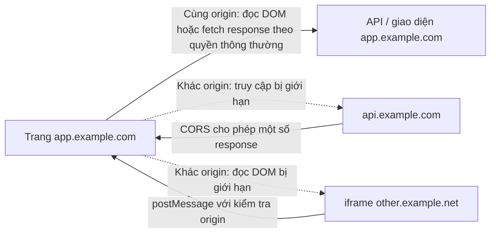

# Same origin: khi nào hai tài nguyên web thuộc cùng một nguồn gốc?

Một ứng dụng web thường gồm trang HTML, JavaScript, API, cookie và tài nguyên được tải từ nhiều địa chỉ. Trình duyệt phải trả lời câu hỏi quan trọng: **mã chạy ở trang A có được đọc dữ liệu hoặc thao tác giao diện của trang B không?** Khái niệm **origin** (nguồn gốc) cung cấp ranh giới để đưa ra phần lớn quyết định đó.

Trong bảo mật ứng dụng web, hiểu chính xác **same origin** (cùng origin) là nền tảng để phân tích Same-Origin Policy (SOP), CORS, hành vi cookie, cách ly iframe và những lớp phòng vệ XSS, CSRF, clickjacking. Bài học dùng ví dụ và thao tác kiểm chứng trong trình duyệt để phân biệt quyền truy cập thực tế với những giả định dễ gây lỗ hổng.

## 1. Mục tiêu học tập

Sau bài này, người học có thể:

1. Xác định origin của một URL và kết luận hai URL có **same origin** hay **cross origin**.
2. Giải thích SOP hạn chế những thao tác nào, những thao tác nào vẫn có thể xảy ra qua ranh giới origin.
3. Phân biệt `origin`, `site`, `host`, phạm vi cookie và phạm vi lưu trữ của trình duyệt.
4. Mô tả vai trò của CORS, `postMessage`, CSP, Trusted Types và security headers khi ứng dụng cần tương tác giữa các origin.
5. Kiểm chứng kết quả bằng DevTools và các thí nghiệm trên môi trường do mình kiểm soát.

## 2. Định nghĩa: origin = scheme + hostname + port

Với các URL HTTP(S) thông thường, origin được xác định bởi **bộ ba**:

```text
origin = (scheme, hostname, effective port)

https://app.example.com:8443/orders?id=42
└─┬──┘ └──────┬───────┘ └┬─┘
 scheme      hostname      port

Path: /orders
Query: ?id=42
```

- **Scheme** cho biết giao thức như `http` hoặc `https`; chỉ đổi scheme cũng có thể đổi origin.
- **Hostname** là tên máy chủ như `app.example.com`; `app.example.com` khác `api.example.com` dù cùng tổ chức hoặc cùng miền cha.
- **Effective port** là cổng thực sự được dùng. Nếu URL bỏ cổng, trình duyệt dùng cổng mặc định theo scheme: `80` cho HTTP và `443` cho HTTPS.

Hai URL được coi là **same origin** khi cả ba thành phần tương ứng bằng nhau. **Đường dẫn, query và fragment không tham gia so sánh origin**. Tên host được chuẩn hóa để so sánh; ví dụ, khác biệt chữ hoa/chữ thường trong hostname không tạo origin mới.

### Bảng so sánh thực tế

Lấy `https://app.example.com/dashboard` làm URL gốc:

| URL còn lại | Same origin? | Lý do |
| --- | --- | --- |
| `https://app.example.com/profile` | Có | Cùng scheme, hostname và cổng mặc định `443`. |
| `https://app.example.com:443/api` | Có | Cổng `443` ghi tường minh bằng cổng HTTPS mặc định. |
| `https://APP.example.com/settings?tab=security#top` | Có | Hostname không phân biệt hoa/thường; path, query và fragment không đổi origin. |
| `http://app.example.com/dashboard` | Không | `http` khác `https`. |
| `https://api.example.com/dashboard` | Không | Khác hostname dù có chung `example.com`. |
| `https://app.example.com:8443/dashboard` | Không | Khác cổng. |
| `https://example.com/dashboard` | Không | Hostname gốc khác `app.example.com`. |
| `https://other.example.net/dashboard` | Không | Khác hostname. |

Có thể tự xác minh trên Console bằng API `URL`:

```js
const base = new URL('https://app.example.com/dashboard');

console.log(base.origin);
// https://app.example.com

console.log(new URL('https://app.example.com:443/profile').origin === base.origin);
// true

console.log(new URL('https://api.example.com/orders').origin === base.origin);
// false

console.log(new URL('https://app.example.com:8443/orders').origin === base.origin);
// false
```

**Lưu ý:** chuỗi `URL.origin` là một cách quan sát hữu ích đối với HTTP(S) thông thường; không nên tự dựng lại thuật toán so sánh origin bằng cách cắt chuỗi URL, vì dễ bỏ sót cổng mặc định, chuẩn hóa hostname và các URL đặc biệt.

## 3. Vì sao trình duyệt cần ranh giới same origin?

Giả sử người dùng đăng nhập `https://bank.example` trong một tab và mở `https://news.example` trong tab khác. Nếu script của trang tin được tự do đọc DOM, phản hồi API hoặc vùng lưu trữ của ngân hàng, chỉ một quảng cáo độc hại cũng có thể đánh cắp dữ liệu nhạy cảm. SOP ngăn nhiều cách đọc và thao tác đó bằng cách ràng buộc quyền truy cập với origin của **môi trường JavaScript đang chạy**.



Trong sơ đồ, SOP là **ranh giới mặc định giữa các môi trường trình duyệt**. Máy chủ vẫn phải xác thực và phân quyền cho từng yêu cầu: việc một script nằm cùng origin với API không có nghĩa người dùng được xem mọi dữ liệu trên API đó.

### Những thao tác thường chịu kiểm soát origin

| Khả năng của JavaScript | Cùng origin | Khác origin |
| --- | --- | --- |
| Đọc/sửa DOM của một iframe hoặc cửa sổ khác | Thông thường được phép, nếu không có chính sách cách ly bổ sung | Bị SOP giới hạn nghiêm ngặt; chỉ có một số thao tác cửa sổ hạn chế được phép. |
| Đọc nội dung phản hồi qua `fetch` hoặc `XMLHttpRequest` | Thông thường được phép; máy chủ vẫn có thể từ chối | Cần thỏa chính sách CORS của máy chủ đích và điều kiện liên quan. |
| Dùng `localStorage` hoặc IndexedDB | Cùng môi trường origin có thể truy cập vùng lưu trữ tương ứng, tùy bối cảnh và chính sách trình duyệt | Không đọc trực tiếp vùng lưu trữ của origin khác. |
| Gửi thông điệp giữa các cửa sổ/iframe | Có thể dùng `postMessage` | Cũng có thể dùng `postMessage`, nhưng cần xác minh nguồn và nội dung. |
| Tải ảnh, stylesheet, điều hướng hoặc gửi form | Có thể | Nhiều kiểu tải/điều hướng/gửi yêu cầu vẫn được cho phép với các hạn chế riêng; SOP không chặn mọi kết nối. |

Không được suy ra rằng **cross origin = không gửi được HTTP request**. SOP chủ yếu bảo vệ khả năng **đọc hoặc can thiệp vào tài nguyên và môi trường của origin khác**. Một số yêu cầu xuyên origin vẫn đến máy chủ; đây là lý do CSRF cần được xử lý riêng.

## 4. Cùng origin không đồng nghĩa cùng site, cùng host hay cùng cookie

Nhiều lỗi thiết kế xuất phát từ việc gộp bốn khái niệm khác nhau:

- **Hostname:** tên máy chủ trong URL, ví dụ `app.example.com`; chỉ trùng hostname chưa đủ để cùng origin nếu khác scheme hoặc port.
- **Origin:** bộ ba scheme, hostname, port; được SOP và nhiều API trình duyệt sử dụng.
- **Site:** trong ngữ cảnh cookie `SameSite` hiện đại, thường dựa trên scheme và miền có thể đăng ký (*registrable domain*, theo danh sách public suffix). Các subdomain như `app.example.com` và `api.example.com` thường **cùng site nhưng khác origin** nếu cùng scheme.
- **Phạm vi cookie:** phụ thuộc hostname/domain, path, các thuộc tính cookie và chính sách trình duyệt; **port không phải ranh giới cô lập cookie**. Cookie host-only trên `app.example.com` có thể được gửi cho các cổng khác của cùng host nếu những điều kiện khác phù hợp.

| Cặp địa chỉ | Same origin | Same site (schemeful) | Điều cần nhớ |
| --- | --- | --- | --- |
| `https://app.example.com` và `https://app.example.com:8443` | Không | Có | Khác cổng là khác origin, nhưng cookie không được phân chia theo cổng. |
| `https://app.example.com` và `https://api.example.com` | Không | Có | CORS có thể cần để frontend đọc API; `SameSite` không phân biệt hai origin này. |
| `https://app.example.com` và `http://app.example.com` | Không | Không | Khác scheme nên khác cả origin và site trong mô hình schemeful SameSite. |
| `https://app.example.com/a` và `https://app.example.com/b` | Có | Có | Path khác không tạo origin mới; path cũng không nên được xem là ranh giới bảo mật giữa các ứng dụng chung origin. |

Ví dụ quan trọng: nếu đặt hai ứng dụng có độ tin cậy khác nhau tại `https://example.com/app-a` và `https://example.com/app-b`, chúng **cùng origin**. Script bị chiếm quyền ở ứng dụng A có thể tác động tới những tài nguyên cùng origin mà trình duyệt cho phép. Muốn có ranh giới origin thực sự, cần cân nhắc tách sang hostname riêng, đồng thời thiết kế cookie, session và API tương ứng.

### Trường hợp origin đặc biệt

Một số tài liệu không có origin HTTP(S) thông thường:

- URL `data:` thường được gán **opaque origin** riêng, không mặc nhiên có cùng origin với trang chứa nó. Khi hiển thị dạng chuỗi, opaque origin thường xuất hiện thành `"null"`; **không được đưa `Origin: null` vào danh sách tin cậy chỉ vì nó trông giống một origin cụ thể**.
- Iframe dùng `sandbox` mà **không** bật `allow-same-origin` có thể nhận opaque origin ngay cả khi URL tải lên có cùng host với trang cha.
- Trang `about:blank` được tạo bởi một trang khác thường kế thừa origin của trang tạo trong những điều kiện thích hợp; bản thân chuỗi `about:blank` không đủ để kết luận.
- Blob URL thường mang origin của môi trường tạo nó; hành vi với nguồn có opaque origin có các quy tắc riêng.
- Cách xử lý origin của `file:` phụ thuộc trình duyệt và môi trường; không dựa vào giả định mọi file cùng thư mục đều cùng origin.

Vì các ngoại lệ đó, hãy thử nghiệm trong trình duyệt đích trước khi dựa vào hành vi origin của tài liệu không phải HTTP(S).

## 5. Đọc và gửi yêu cầu HTTP: SOP khác CORS như thế nào?

Xét ứng dụng ở `https://app.example.com` gọi API ở `https://api.example.com`:

```js
const response = await fetch('https://api.example.com/orders');
const orders = await response.json();
```

Đây là **cross-origin fetch**. Trình duyệt có thể gửi yêu cầu mạng nhưng chỉ cho script đọc response nếu phản hồi đáp ứng quy tắc CORS. Ví dụ khi máy chủ API cho phép đúng origin giao diện:

```http
HTTP/1.1 200 OK
Content-Type: application/json
Access-Control-Allow-Origin: https://app.example.com
Vary: Origin
```

`Access-Control-Allow-Origin` là sự cho phép **đọc response từ trình duyệt** đối với origin cụ thể; nó không xác nhận người dùng nào đang truy cập. API vẫn phải kiểm tra session/token, quyền xem đơn hàng và dữ liệu thuộc người dùng tương ứng.

Nếu yêu cầu cần cookie/credentials xuyên origin, frontend có thể cần `credentials: 'include'`, còn máy chủ trả `Access-Control-Allow-Credentials: true` cùng một origin cụ thể được cấp phép. `Access-Control-Allow-Origin: *` không hợp lệ cho trường hợp chia sẻ response có credentials. Việc cookie có thực sự được gửi còn phụ thuộc `SameSite`, `Secure`, phạm vi cookie và chính sách cookie của trình duyệt.

### Preflight và hiểu đúng lỗi CORS

Một số yêu cầu, chẳng hạn `POST` với `Content-Type: application/json` hoặc custom header, cần trình duyệt gửi **preflight** `OPTIONS` trước khi gửi yêu cầu chính:

```http
OPTIONS /orders HTTP/1.1
Origin: https://app.example.com
Access-Control-Request-Method: POST
Access-Control-Request-Headers: content-type,x-csrf-token
```

Máy chủ phải phản hồi cho phép origin, phương thức và header nếu chúng hợp lệ. Khi preflight thất bại, trình duyệt không gửi yêu cầu chính theo luồng CORS đó. Tuy nhiên, **nhiều yêu cầu đơn giản không cần preflight** và có thể đã được gửi dù JavaScript bị chặn đọc kết quả.

Đặc biệt, `fetch(url, { mode: 'no-cors' })` **không phải cách vượt SOP/CORS**: script thường chỉ nhận một *opaque response*, không đọc được body, status hoặc header theo cách thông thường. Hãy cấu hình CORS đúng nhu cầu, không tắt các kiểm soát một cách tùy tiện.

## 6. Same origin và quyền DOM giữa các iframe/cửa sổ

Giả sử trang chính ở `https://app.example.com` tạo iframe:

```html
<iframe id="details" src="https://app.example.com/order-details"></iframe>
```

Hai trang cùng origin, nên JavaScript phía cha thường có thể truy cập DOM của iframe:

```js
const iframe = document.querySelector('#details');

iframe.addEventListener('load', () => {
  const heading = iframe.contentDocument.querySelector('h1');
  console.log(heading?.textContent);
});
```

Nếu đổi `src` thành `https://other.example.net/page`, việc truy cập `contentDocument` hoặc đọc DOM thường bị SOP chặn. Trình duyệt vẫn có thể cho phép một số thao tác hạn chế với cửa sổ khác origin, như điều hướng trong các điều kiện cụ thể; không xem đó là quyền đọc toàn bộ DOM.

### Giao tiếp hợp lệ giữa hai origin bằng `postMessage`

Khi hai trang cần trao đổi dữ liệu, dùng thông điệp có kiểm soát thay vì tìm cách truy cập DOM khác origin:

```js
// Trang cha: https://app.example.com
const child = document.querySelector('#partner-frame').contentWindow;
child.postMessage({ type: 'PING' }, 'https://partner.example.net');

window.addEventListener('message', (event) => {
  if (event.origin !== 'https://partner.example.net') return;
  if (event.source !== child) return;
  if (typeof event.data !== 'object' || event.data === null) return;
  if (event.data.type !== 'PONG') return;

  console.log('Đã nhận phản hồi từ đối tác được cấp phép');
});
```

Đầu nhận phải kiểm tra **`event.origin`, `event.source` và cấu trúc nội dung** trước khi xử lý dữ liệu hoặc thực hiện hành động nhạy cảm. Đầu gửi nên dùng **`targetOrigin` chính xác**, tránh dùng `'*'` khi biết trước origin đích. `postMessage` cho phép giao tiếp khác origin; chính ứng dụng phải quyết định thông điệp nào đáng tin.

### Iframe sandbox là lớp cách ly bổ sung

```html
<iframe
  src="https://widgets.example.net/preview"
  sandbox="allow-scripts"
  title="Xem trước nội dung bên ngoài"></iframe>
```

Khi thiếu `allow-same-origin`, nội dung trong iframe bị gán opaque origin và bị hạn chế mạnh hơn, kể cả khi URL tình cờ trùng origin với trang cha. Cần đánh giá kỹ các quyền sandbox. Đặc biệt, kết hợp `allow-scripts` và `allow-same-origin` cho nội dung **thật sự cùng origin** có thể làm suy yếu đáng kể mục tiêu cách ly, vì script có khả năng can thiệp vào trạng thái sandbox trong một số tình huống.

## 7. Same origin liên quan gì đến XSS, CSRF và clickjacking?

SOP là một lớp bảo vệ nền tảng, nhưng **không tự ngăn toàn bộ tấn công ứng dụng web**.

### XSS: mã độc chạy ngay trong origin đáng tin

Khi ứng dụng đưa dữ liệu không tin cậy vào `innerHTML` hoặc điểm nhận script/HTML nguy hiểm, một đoạn mã độc có thể chạy **trong chính origin của ứng dụng**. SOP không thể phân biệt script độc hại đó với script hợp pháp chỉ dựa trên origin, nên attacker có thể đọc dữ liệu DOM được phép và thực hiện các yêu cầu cùng origin theo quyền hiện có.

```js
const userComment = new URLSearchParams(location.search).get('comment') ?? '';

// An toàn khi cần hiển thị văn bản thuần:
document.querySelector('#comment').textContent = userComment;

// Nguy hiểm nếu userComment chưa được xử lý như HTML an toàn:
// document.querySelector('#comment').innerHTML = userComment;
```

Giảm rủi ro bằng escaping theo ngữ cảnh, DOM API an toàn, sanitization khi thật sự cần HTML, CSP có cấu hình phù hợp và **Trusted Types** ở các trình duyệt hỗ trợ. Script bên thứ ba được nhúng trực tiếp vào trang cũng có thể chạy với quyền của tài liệu nhúng nó; việc file script được tải từ CDN khác origin **không tự biến nó thành sandbox**.

### CSRF: gửi yêu cầu không đồng nghĩa đọc response

Trang độc hại có thể khiến trình duyệt gửi một số yêu cầu đến ứng dụng mà người dùng đã đăng nhập, kèm cookie trong những điều kiện trình duyệt cho phép. SOP có thể chặn trang độc hại đọc response nhưng **không đủ chứng minh yêu cầu thay đổi trạng thái đã bị ngăn**.

Vì vậy, endpoint thay đổi dữ liệu cần kiểm tra phiên, quyền trên từng tài nguyên, CSRF token phù hợp và có thể đối chiếu `Origin`/Fetch Metadata. Cookie `SameSite` là lớp giảm thiểu bổ sung, nhất là khi phân biệt **cross site** với **cross origin**.

### Clickjacking: SOP không ngăn mọi cách nhúng giao diện

SOP hạn chế script ngoài origin đọc DOM của iframe, nhưng một trang độc hại có thể nhúng giao diện hợp pháp trong iframe và tạo lớp phủ đánh lừa cú nhấp của người dùng. Trang nhạy cảm không cần được nhúng nên áp dụng chính sách chống nhúng:

```http
Content-Security-Policy: frame-ancestors 'none'
X-Frame-Options: DENY
```

Nếu ứng dụng cần nhúng trong portal đối tác, dùng danh sách origin cụ thể cho `frame-ancestors` và kiểm thử từng luồng được phép. `frame-src` điều khiển **iframe mà trang hiện tại được tải**, khác với `frame-ancestors` điều khiển **ai được nhúng trang hiện tại**.

## 8. Không nhầm same-origin với cross-origin isolation

Ngoài SOP còn có các cơ chế giải quyết mục tiêu khác:

| Cơ chế | Câu hỏi nó xử lý | Lưu ý |
| --- | --- | --- |
| **SOP** | Script ở origin này được đọc/thao tác môi trường của origin khác không? | Ranh giới mặc định; không thay phân quyền phía máy chủ. |
| **CORS** | Máy chủ có cho script của origin khác đọc HTTP response không? | Không phải xác thực, phân quyền hay cơ chế chống CSRF hoàn chỉnh. |
| **CSP** | Trang được nạp/thực thi những tài nguyên hoặc hành vi nào? | Giảm bề mặt XSS, điều khiển nhúng; cần cấu hình chính sách thực tế. |
| **Trusted Types** | DOM sink nguy hiểm có nhận dữ liệu thuộc kiểu tin cậy phù hợp không? | Lớp bổ sung cho xử lý đầu ra; phụ thuộc mức hỗ trợ trình duyệt. |
| **COOP / COEP / CORP** | Cửa sổ và tài nguyên có được cách ly/chia sẻ an toàn giữa các ngữ cảnh không? | Dùng cho các yêu cầu cách ly cụ thể; có thể ảnh hưởng popup, đăng nhập và tài nguyên bên thứ ba. |

`document.domain` từng là cách giảm bớt một số hạn chế truy cập DOM giữa các subdomain, nhưng cơ chế này đã bị **deprecated** và không phải giải pháp thiết kế bảo mật mới. Với ứng dụng hiện đại, hãy dùng ranh giới origin rõ ràng cùng CORS hoặc `postMessage` khi thật sự cần chia sẻ.

## 9. Thực hành: kiểm chứng same origin bằng hai cổng cục bộ

Có thể dựng hai máy chủ thử nghiệm độc lập trên máy cá nhân, phục vụ hai trang tối giản tại:

```text
Trang A: http://localhost:3000
Trang B: http://localhost:3001
```

Hai URL có cùng scheme và hostname nhưng **khác port**, nên khác origin. Các phép thử sau cần thực hiện trên môi trường do mình kiểm soát và có thể thay thế cổng bằng bất kỳ cặp cổng thử nghiệm nào đang hoạt động.

### Bước 1: so sánh origin

Mở DevTools Console tại trang A và chạy:

```js
console.log(location.origin);
// http://localhost:3000

console.log(new URL('http://localhost:3001').origin === location.origin);
// false

console.log(new URL('/another-path', location.href).origin === location.origin);
// true
```

**Kỳ vọng:** đổi đường dẫn không đổi origin, còn đổi cổng tạo origin mới.

### Bước 2: quan sát giới hạn DOM

Tạo iframe trỏ đến trang B trong trang A:

```html
<iframe id="other" src="http://localhost:3001" title="Trang thử nghiệm B"></iframe>
```

Sau khi iframe tải xong, thử đọc DOM:

```js
const frame = document.querySelector('#other');

try {
  console.log(frame.contentWindow.document.body.textContent);
} catch (error) {
  console.log(error.name, error.message);
}
```

**Kỳ vọng:** trình duyệt từ chối truy cập DOM khác origin (thường là `SecurityError`). Nếu đổi iframe thành URL cùng origin tại cổng `3000`, việc đọc DOM thường được phép, trừ khi có thêm sandbox hoặc chính sách hạn chế khác.

### Bước 3: quan sát CORS và network

Từ Console trang A, thử:

```js
fetch('http://localhost:3001/data')
  .then((response) => response.text())
  .then(console.log)
  .catch((error) => console.error('Không đọc được response:', error));
```

Nếu server B có endpoint `/data` nhưng **không** trả CORS cho origin A, JavaScript sẽ không đọc được response. Mở **Network** để xem yêu cầu có được gửi hay không, và **Console** để xem lỗi CORS. Sau đó cấu hình server B cho phép đúng origin A qua `Access-Control-Allow-Origin: http://localhost:3000`, rồi thử lại. Lúc này response có thể được đọc nếu yêu cầu thỏa toàn bộ điều kiện CORS.

**Không nhầm kết quả:** lỗi JavaScript không đọc được response không có nghĩa server B không hề nhận request. Và việc bật CORS không chứng minh API đã xác thực/phân quyền đúng.

### Bước 4: quan sát phạm vi lưu trữ

Trên trang A chạy:

```js
localStorage.setItem('origin-demo', 'value-from-3000');
console.log(localStorage.getItem('origin-demo'));
// value-from-3000
```

Mở trang B và đọc cùng key. Trong môi trường thử nghiệm thông thường, trang B **không** đọc được giá trị được lưu tại origin `3000`, bởi `localStorage` có ranh giới origin. Cookie hoạt động khác: **port không phải thành phần cô lập cookie**, nên cần kiểm tra cụ thể các thuộc tính cookie và tránh suy diễn từ kết quả localStorage.

### Bước 5: lưu bằng chứng

Ghi lại URL và cổng thực tế, kết quả Console, header CORS trên response, yêu cầu trong Network và trạng thái dữ liệu phía máy chủ (nếu có thao tác thay đổi). Tối thiểu nên chứng minh được ba điều: **khác cổng là khác origin; SOP ngăn đọc DOM/response khi không được phép; CORS cho phép đọc có điều kiện nhưng không cấp quyền nghiệp vụ**.

## 10. Checklist khi thiết kế ứng dụng nhiều origin

1. **Liệt kê origin** của frontend, API, nơi đăng nhập, iframe và tài nguyên bên thứ ba; xác định thành phần nào có quyền đọc dữ liệu nào.
2. **Tách thành phần có mức độ tin cậy khác nhau** sang origin riêng khi phù hợp; đừng kỳ vọng path hoặc port cô lập cookie như cô lập origin.
3. **Giới hạn CORS** vào các origin, phương thức và header thật sự cần; trả `Vary: Origin` khi response phụ thuộc `Origin`; không phản chiếu origin tùy ý.
4. **Kiểm tra xác thực và phân quyền ở máy chủ** đối với mọi endpoint; bổ sung cơ chế chống CSRF cho hành động thay đổi trạng thái.
5. **Bảo vệ JavaScript chạy trong origin đáng tin:** dùng API DOM an toàn, quản lý script bên thứ ba, CSP và Trusted Types phù hợp.
6. **Kiểm soát thông điệp và nhúng:** kiểm tra `postMessage` và dùng `frame-ancestors`/sandbox đúng mục đích.
7. **Kiểm chứng bằng hành vi thực tế:** xem cả Network, Console, chính sách cookie, khả năng đọc dữ liệu và thay đổi trạng thái trên server.

## 11. Tự kiểm tra kiến thức

1. Vì sao `https://shop.example.com:443/cart` cùng origin với `https://shop.example.com/checkout`, nhưng `https://shop.example.com:8443` lại khác origin?
2. `https://app.example.com` và `https://api.example.com` có thể cùng site nhưng khác origin như thế nào? Điều đó ảnh hưởng gì đến CORS và `SameSite`?
3. Nếu một cross-origin `fetch` báo lỗi CORS, ta có thể kết luận máy chủ chưa nhận request không? Vì sao?
4. Vì sao một đoạn script độc hại chạy từ lỗi XSS trong `app.example.com` vẫn nguy hiểm dù SOP đang được bật?
5. Khi cần truyền dữ liệu giữa iframe đối tác và trang chính, nên dùng API nào, và phải xác minh những thuộc tính nào?
6. Một iframe trỏ tới URL cùng origin với trang cha nhưng có `sandbox` không kèm `allow-same-origin` có còn được xem là cùng origin theo quyền DOM thông thường không?

**Tiêu chí hoàn thành:** người học tự phân loại được cặp URL là same origin/cross origin; giải thích đúng ranh giới DOM, storage và `fetch`; phân biệt origin với site và cookie; đồng thời xác nhận kết quả qua trình duyệt thay vì suy đoán từ tên miền hoặc trạng thái HTTP đơn lẻ.
