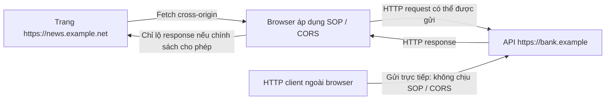

# Cross-origin

> **Chương:** Origin  
> **Module:** SECURITY_APPLICATION_SECURITY_BROWSER_SECURITY — Application Security / Browser Security

Một ứng dụng web hiện đại hiếm khi chỉ gọi một máy chủ. Trang ở `https://app.example.com` có thể cần dữ liệu từ `https://api.example.com`, đăng nhập qua nhà cung cấp danh tính, hiển thị ảnh từ CDN và nhận thông điệp của iframe thanh toán. Các thành phần ấy có thể liên quan đến nhau về nghiệp vụ, nhưng **không tự động thuộc cùng origin**. Trình duyệt sử dụng ranh giới origin để quyết định một tài liệu hoặc script có được đọc, tương tác với tài nguyên khác hay không.

Bài học này giải thích **cross-origin** từ mô hình origin đến hành vi HTTP thực tế: **Same-Origin Policy (SOP)**, **Cross-Origin Resource Sharing (CORS)**, cookie/credentials, iframe, `postMessage`, những cơ chế cách ly tài nguyên và giới hạn của chúng. Mục tiêu cuối cùng là biết thiết kế giao tiếp giữa các origin mà vẫn phòng vệ trước **XSS, CSRF, clickjacking**, thay vì chỉ chỉnh header cho hết lỗi trình duyệt.

## 1. Cross-origin là gì?

**Origin** của một URL HTTP(S) là bộ ba:

\[
\text{origin} = (\text{scheme},\ \text{host},\ \text{port})
\]

Hai địa chỉ **same-origin** khi cả ba thành phần tương đương. Nếu ít nhất một thành phần khác, chúng **cross-origin**. Đường dẫn (path), query và fragment không thuộc bộ ba xác định origin.

Lấy origin của trang hiện tại là `https://app.example.com` (HTTPS dùng cổng mặc định 443):

| Tài nguyên đích | Quan hệ origin | Lý do |
| --- | --- | --- |
| `https://app.example.com/account` | Same-origin | Chỉ khác path |
| `https://app.example.com:443/api` | Same-origin | Cổng 443 là mặc định của HTTPS |
| `https://app.example.com:8443/api` | Cross-origin | Khác cổng |
| `http://app.example.com` | Cross-origin | Khác scheme (`http` so với `https`) |
| `https://api.example.com` | Cross-origin | Khác host/subdomain |
| `https://example.com` | Cross-origin | Host khác dù cùng tên miền đăng ký |
| `https://other.example.net` | Cross-origin | Host khác |

Trong JavaScript, có thể xem origin của trang:

```js
console.log(window.location.origin);
// Ví dụ: "https://app.example.com"
```

Một số URL không có origin thông thường: tài liệu `data:` thường có **opaque origin**; một iframe dùng sandbox không được cấp `allow-same-origin` cũng có thể được đặt vào opaque origin. Các trường hợp kế thừa origin như `about:blank` hoặc `blob:` có quy tắc riêng phụ thuộc cách tài liệu/tài nguyên được tạo. Vì vậy đừng tự suy luận origin của mọi URL chỉ bằng cách cắt chuỗi ở dấu `/`.

**Điểm cần nhớ:** `app.example.com` và `api.example.com` **cross-origin** ngay cả khi cả hai đều do cùng công ty vận hành.

## 2. Cross-origin khác cross-site

Một **site** trong nhiều chính sách web hiện đại thường dựa trên **scheme** và **registrable domain** (tên miền có thể đăng ký, xác định theo *Public Suffix List*). Với `https://app.example.com` và `https://api.example.com`, hai trang thường **same-site** nhưng **cross-origin**.

| Hai địa chỉ | Same-origin? | Same-site theo quy tắc schemeful site? |
| --- | --- | --- |
| `https://app.example.com` và `https://app.example.com/profile` | Có | Có |
| `https://app.example.com` và `https://api.example.com` | Không | Có |
| `https://app.example.com` và `http://api.example.com` | Không | Không, do khác scheme |
| `https://app.example.com` và `https://evil.example.net` | Không | Không |

Khác biệt này ảnh hưởng trực tiếp tới bảo mật:

- **SOP và CORS** sử dụng ranh giới **origin**.
- Cookie **`SameSite`** quan tâm nhiều đến ranh giới **site** và ngữ cảnh request.
- Chính sách **`Domain`** của cookie quyết định host nào nhận cookie; nó không làm các host thành same-origin.
- Một subdomain do bên thứ ba kiểm soát có thể vẫn **same-site** với trang chính. Vì thế `SameSite` **không** phải cơ chế cô lập đáng tin giữa các subdomain của cùng site.

Không nên tự lấy “hai nhãn cuối cùng” của hostname để đoán registrable domain: `co.uk` và các tên miền trong Public Suffix List làm cách đó sai.

## 3. Vì sao browser cần ranh giới origin?

Giả sử người dùng đang đăng nhập ngân hàng ở `https://bank.example` và đồng thời mở một website không đáng tin cậy ở `https://news.example.net`. Nếu JavaScript của website thứ hai được tự do đọc DOM hoặc response phiên ngân hàng, mọi trang vừa mở có thể trở thành công cụ lấy dữ liệu bí mật.

**Same-Origin Policy (SOP)** đặt ra giới hạn chủ yếu với khả năng **đọc và thao tác tài liệu/dữ liệu** giữa các origin trong browser. SOP không hứa chặn mọi request và mọi cách nhúng nội dung cross-origin.



Các hành vi cross-origin cần phân biệt:

| Hành vi | Mặc định hoặc điều kiện thường gặp |
| --- | --- |
| Gửi form HTML tới origin khác | Thường được phép; việc gửi cookie phụ thuộc chính sách cookie |
| Tải ảnh bằng `` từ origin khác | Thường được phép; việc đọc pixel qua canvas bị hạn chế nếu không có CORS |
| Nhúng trang khác bằng `<iframe>` | Thường có thể tải, trừ khi trang đích chống nhúng; parent không tự do đọc DOM cross-origin |
| Tải classic script bằng `<script src>` | Có thể tải cross-origin; script chạy với quyền của trang nhúng, gây rủi ro chuỗi cung ứng |
| Module script tải cross-origin | Thông thường cần CORS phù hợp |
| Đọc response cross-origin bằng `fetch` | Cần browser cho phép qua CORS |
| Đọc `iframe.contentDocument` cross-origin | Bị SOP hạn chế; có thể trao đổi qua `postMessage` có kiểm tra |
| Đọc localStorage của origin khác | Không được phép truy cập trực tiếp qua JavaScript của trang hiện tại |

Vì việc **gửi request** và **đọc response** khác nhau, thông báo “blocked by CORS policy” không đủ để kết luận request chưa tới server hoặc tác vụ chưa chạy.

## 4. CORS: ngoại lệ được kiểm soát đối với SOP

**Cross-Origin Resource Sharing (CORS)** là giao thức trao đổi HTTP header để browser quyết định có cung cấp response cross-origin cho JavaScript hay không. Server đích có thể chấp nhận một số origin được đọc response; browser thực thi chính sách.

Ví dụ frontend ở `https://app.example.com` gọi API ở `https://api.example.com`:

```js
const response = await fetch("https://api.example.com/profile");
const profile = await response.json();
```

Trình duyệt có thể gửi:

```http
GET /profile HTTP/1.1
Host: api.example.com
Origin: https://app.example.com
```

Nếu API cho phép frontend này đọc response, response có thể có:

```http
HTTP/1.1 200 OK
Access-Control-Allow-Origin: https://app.example.com
Vary: Origin
Content-Type: application/json

{"displayName":"Minh"}
```

`Access-Control-Allow-Origin` (ACAO) cho phép **browser cung cấp response cho JavaScript ở origin đã khai báo**. Khi server chọn ACAO động theo `Origin`, `Vary: Origin` giúp cache phân biệt các biến thể response theo nguồn yêu cầu.

Nếu server không trả ACAO hợp lệ, `fetch` cross-origin có thể bị từ chối ở tầng JavaScript, dù Network tab ghi nhận response HTTP. Việc server trả `200 OK` chỉ nói request đã được xử lý; browser có được cho phép **đọc** response là câu chuyện riêng.

### 4.1 CORS request “đơn giản” và preflight

Không phải request cross-origin nào cũng cần preflight. Một số request đáp ứng các điều kiện *CORS-safelisted* (thường được gọi nôm na là **simple request**) có thể được gửi thẳng; CORS được kiểm tra khi response trở về.

Ngược lại, một request như POST JSON thường cần browser hỏi trước bằng **preflight** vì `Content-Type: application/json` không nằm trong danh sách content type được safelist cho request.

```js
await fetch("https://api.example.com/orders", {
  method: "POST",
  headers: { "Content-Type": "application/json" },
  body: JSON.stringify({ productId: "p-123", quantity: 2 })
});
```

Trước request POST, browser có thể gửi:

```http
OPTIONS /orders HTTP/1.1
Host: api.example.com
Origin: https://app.example.com
Access-Control-Request-Method: POST
Access-Control-Request-Headers: content-type
```

Response preflight hợp lệ có thể là:

```http
HTTP/1.1 204 No Content
Access-Control-Allow-Origin: https://app.example.com
Access-Control-Allow-Methods: POST
Access-Control-Allow-Headers: Content-Type
Access-Control-Max-Age: 600
Vary: Origin
```

Sau khi preflight được chấp thuận, browser mới gửi POST thực tế; **response của POST vẫn phải đáp ứng CORS** để script đọc được. `Access-Control-Max-Age` gợi ý thời gian browser có thể lưu kết quả preflight, nhưng giới hạn thực tế tùy browser.

Một header không được safelist, ví dụ `Authorization`, cũng có thể kích hoạt preflight. Đừng dùng preflight như một lớp kiểm soát quyền truy cập: client ngoài browser không cần preflight, và các request không cần preflight vẫn tồn tại.

### 4.2 Những header CORS có vai trò khác nhau

| Header | Ý nghĩa |
| --- | --- |
| `Access-Control-Allow-Origin` | Cho biết origin có thể đọc response theo CORS |
| `Access-Control-Allow-Credentials` | Cho phép cung cấp credentialed response cho JavaScript nếu các điều kiện khác cũng hợp lệ; giá trị hỗ trợ là `true` |
| `Access-Control-Allow-Methods` | Các method được cho phép trong kiểm tra preflight |
| `Access-Control-Allow-Headers` | Các request header được cho phép trong kiểm tra preflight |
| `Access-Control-Max-Age` | Gợi ý thời gian cache kết quả preflight |
| `Access-Control-Expose-Headers` | Bổ sung các response header JavaScript được phép đọc |
| `Vary: Origin` | Giúp cache xử lý response khác nhau theo `Origin` khi cần |

Ví dụ một API trả `X-Request-Id`: để JavaScript cross-origin đọc `response.headers.get("X-Request-Id")`, server thường cần thêm `Access-Control-Expose-Headers: X-Request-Id`. Riêng `Set-Cookie` là response header bị hạn chế truy cập với JavaScript; không thể dùng `Expose-Headers` để đọc nó qua `fetch`.

## 5. Credentials, cookie và sự khác biệt giữa quyền đọc và quyền đăng nhập

`fetch` có thuộc tính `credentials` để kiểm soát việc sử dụng credentials trong giao thức fetch. Với request cross-origin, giá trị mặc định `same-origin` **không tự gắn các cookie cross-origin**. Nếu ứng dụng cần sử dụng cookie phiên, có thể dùng:

```js
const response = await fetch("https://api.example.com/me", {
  credentials: "include"
});
```

Khi browser dùng credentials cho CORS, response cho phép JavaScript đọc cần có, ví dụ:

```http
Access-Control-Allow-Origin: https://app.example.com
Access-Control-Allow-Credentials: true
Vary: Origin
```

**Không thể kết hợp `Access-Control-Allow-Origin: *` với credentialed CORS response** để cấp quyền đọc cho script. Khi dùng credentials, server phải chỉ rõ origin được phép. Nhưng ngay cả cấu hình header hợp lệ cũng không ép browser gửi cookie: cookie còn bị chi phối bởi `Domain`, `Path`, `Secure`, `SameSite`, chính sách third-party cookie và các cơ chế partitioning.

Ví dụ cookie phiên:

```http
Set-Cookie: session=opaque-session-id; Path=/; Secure; HttpOnly; SameSite=Lax
```

- `Secure` yêu cầu truyền cookie qua kênh bảo mật thích hợp.
- `HttpOnly` ngăn JavaScript đọc cookie qua `document.cookie`, **không** ngăn request dùng cookie.
- `SameSite` xét ngữ cảnh **site**, không xét cùng origin; `app.example.com` và `api.example.com` có thể cross-origin mà same-site.
- Cookie host-only không tự gửi sang subdomain khác; `Domain=example.com` có thể mở rộng phạm vi host nhận cookie, nhưng không biến các subdomain thành cùng origin.
- Cookie không được phân tách theo port: hai dịch vụ trên các cổng khác nhau của một host cần tính đến phạm vi cookie chung.

Cross-origin **không đồng nghĩa với third-party**. Hai subdomain thuộc cùng site có thể cross-origin mà vẫn ở ngữ cảnh first-party/same-site đối với nhiều chính sách cookie.

Đừng lưu mật khẩu dịch vụ, private key hoặc API secret vào JavaScript frontend chỉ vì API yêu cầu CORS: người sử dụng có thể đọc mã nguồn và thực hiện request độc lập với browser.

## 6. `fetch` mode: `cors`, `same-origin` và `no-cors`

Chế độ request quyết định browser xử lý cross-origin như thế nào:

| `mode` | Hành vi quan trọng |
| --- | --- |
| `cors` | Cho phép gửi request cross-origin và chỉ cung cấp response cho script nếu đáp ứng CORS |
| `same-origin` | Request tới origin khác bị từ chối; không tự mở quyền cross-origin |
| `no-cors` | Cho phép một số request cross-origin bị giới hạn về method/header, nhưng thường trả **opaque response** không đọc được nội dung |

Ví dụ:

```js
const response = await fetch("https://other.example/data", {
  mode: "no-cors"
});
console.log(response.type);   // "opaque" trong trường hợp cross-origin thông thường
console.log(response.status); // 0: status HTTP thực bị che
```

**`no-cors` không phải cách sửa lỗi CORS**. Nó không cho JavaScript đọc JSON của một API vốn không cấp phép CORS. Opaque response có công dụng trong một số tình huống tải/cache tài nguyên, nhưng không phải dữ liệu có thể xử lý như response thông thường.

Tương tự, một browser extension được cấp quyền đặc biệt, máy chủ proxy hoặc `curl` có thể có khả năng khác JavaScript trên trang web. Không lấy kết quả `curl` làm bằng chứng browser sẽ cho frontend đọc response.

## 7. Những lỗi CORS phổ biến và hệ quả bảo mật

| Cấu hình / suy luận sai | Vấn đề | Hướng sửa |
| --- | --- | --- |
| “CORS chỉ cho phép frontend, vậy API đã bảo mật” | CORS không xác thực user và không cấm HTTP client khác gọi API | Xác thực và phân quyền trên server, từng endpoint/tài nguyên |
| Phản chiếu mọi `Origin` vào ACAO, kèm `Allow-Credentials: true` | Cho website lạ có thể đọc response được xác thực nếu credentials được gửi | Dùng allowlist origin chính xác, hạn chế credentials |
| Dùng `ACAO: *` cho API dùng cookies | Credentialed response không được CORS cho JavaScript đọc | Chọn origin cụ thể nếu thật sự cần chia sẻ credentials |
| Thêm `mode: "no-cors"` | Chỉ nhận opaque response; script vẫn không đọc được JSON | Chỉnh CORS ở server đích hoặc thiết kế proxy server được kiểm soát |
| Dùng `Access-Control-Allow-Methods` để “khóa” DELETE | Browser client khác hoặc HTTP client ngoài browser vẫn có thể gọi DELETE | Phân quyền, chính sách method và xác thực ở server |
| Cho phép `Origin: null` tùy tiện | Opaque origin có thể xuất hiện từ sandbox, `data:` và nhiều tình huống không tin cậy | Không whitelist `null` nếu không có yêu cầu đặc biệt đã phân tích |
| Kiểm tra origin bằng `includes("example.com")` | Có thể khớp `example.com.attacker.test` | So khớp chính xác scheme, host, port của origin được tin cậy |
| Bật CORS cho toàn bộ endpoint nội bộ | Có thể làm lộ phản hồi nhạy cảm cho website không cần thiết | Cấp phép theo nhu cầu cụ thể và phân loại dữ liệu |

Một cách tư duy đúng: **origin được phép CORS là chủ thể được quyền đọc response từ JavaScript trong browser**, nhưng **người dùng/token được quyền truy cập dữ liệu phải được kiểm tra độc lập**.

Header `Origin` do browser gửi giúp server ra quyết định CORS và hỗ trợ các biện pháp chống CSRF, nhưng không phải chứng cứ định danh client đáng tin tuyệt đối: một HTTP client tùy chỉnh có thể tự đặt header này.

## 8. Cross-origin và CSRF: chặn đọc response chưa chắc chặn hành động

Giả sử nạn nhân đăng nhập vào `https://pay.example` bằng cookie phiên. Website khác có thể tạo một form:

```html
<form action="https://pay.example/settings" method="POST">
  <input type="hidden" name="newsletter" value="off">
</form>
```

Browser có thể gửi form cross-origin; việc kèm cookie phụ thuộc bối cảnh và thuộc tính cookie. Nếu server tin mọi request có cookie là ý chí của người dùng, endpoint có nguy cơ **Cross-Site Request Forgery (CSRF)**. Không đọc được response bởi SOP/CORS không đồng nghĩa request không tạo ra tác dụng.

Các cách phòng vệ phù hợp:

1. Áp dụng **CSRF token** gắn với phiên hoặc cơ chế chống CSRF phù hợp đối với thao tác thay đổi trạng thái khi dùng cookie xác thực.
2. Cấu hình `SameSite` đúng theo chức năng và cân nhắc `Origin` / `Referer` hoặc Fetch Metadata (`Sec-Fetch-Site`, …) như lớp kiểm tra bổ sung.
3. Giữ **GET an toàn về mặt nghiệp vụ**: không thực hiện thao tác nhạy cảm chỉ vì người dùng mở một link GET.
4. Xác thực người dùng và **phân quyền tài nguyên** trên server; giới hạn content type/method khi phù hợp.
5. Đánh giá cả trường hợp **cross-origin nhưng same-site** (chẳng hạn subdomain bị chiếm quyền), vì `SameSite` không chặn mọi request cùng site.

Preflight có thể làm một số request từ script không thực hiện được nếu CORS không cho phép; điều đó không thay thế cơ chế chống CSRF cho tất cả loại request, đặc biệt là form HTML và request không cần preflight.

## 9. Cross-origin và XSS: script được phép chạy có những quyền gì?

SOP không phân biệt script “tốt” với script “xấu” khi chúng cùng chạy trong tài liệu thuộc origin ứng dụng. Nếu kẻ tấn công đưa JavaScript vào trang qua **XSS**, mã độc chạy trong ngữ cảnh của origin bị ảnh hưởng và có thể gọi API mà trang bình thường truy cập được.

Ví dụ tạo HTML từ dữ liệu người dùng:

```js
// Không an toàn: dữ liệu không tin cậy thành HTML
result.innerHTML = new URLSearchParams(location.search).get("q") ?? "";

// An toàn hơn khi chỉ cần hiện văn bản
result.textContent = new URLSearchParams(location.search).get("q") ?? "";
```

**CSP** có thể giới hạn nguồn script và kết nối (`script-src`, `connect-src`), **Trusted Types** có thể hạn chế các DOM sink nhận HTML/script không an toàn trong browser hỗ trợ, nhưng không cơ chế nào biến kiểm tra dữ liệu/phân quyền backend thành không cần thiết.

Đặc biệt, một classic script lấy từ CDN khác origin qua `<script src>` có thể **chạy trong origin của trang nhúng**. Vậy ranh giới cross-origin **không** tự sandbox mã script bên thứ ba. Cần kiểm soát dependency, giới hạn nguồn tải, xem xét Subresource Integrity (SRI) khi phù hợp hoặc dùng iframe origin riêng với sandbox thay vì chạy script bên thứ ba trực tiếp trong trang.

## 10. Giao tiếp cross-origin chủ động bằng `postMessage`

Một trang không thể đơn giản đọc DOM của iframe cross-origin, nhưng hai cửa sổ có thể trao đổi thông điệp qua `window.postMessage`.

Ví dụ trang mẹ ở `https://app.example.com` nhúng trang con ở `https://pay.example.net`:

```html
<iframe id="payment" src="https://pay.example.net/checkout"></iframe>
```

Trang mẹ gửi thông điệp đến **origin đích cụ thể**:

```js
const frame = document.querySelector("#payment");
frame.contentWindow.postMessage(
  { type: "CHECKOUT_CONTEXT", cartId: "cart-123" },
  "https://pay.example.net"
);
```

Trang con chỉ xử lý thông điệp từ nguồn đã tin cậy:

```js
window.addEventListener("message", (event) => {
  if (event.origin !== "https://app.example.com") return;
  if (!event.data || event.data.type !== "CHECKOUT_CONTEXT") return;
  if (typeof event.data.cartId !== "string") return;

  // Chỉ dùng cartId làm tham chiếu; quyền truy cập đơn hàng
  // vẫn phải được server kiểm tra ở request tiếp theo.
});
```

Phòng vệ khi dùng `postMessage`:

- **Sender:** đặt `targetOrigin` chính xác thay vì `"*"` nếu biết origin nhận; không đưa secret vào message khi không có bảo đảm về bên nhận.
- **Receiver:** kiểm tra `event.origin`; nếu cần kiểm soát đúng cửa sổ gửi, kiểm tra thêm `event.source`.
- **Payload:** xác thực kiểu, cấu trúc và giá trị trước khi sử dụng; không đưa dữ liệu nhận vào `innerHTML` hoặc thực hiện lệnh theo chuỗi tùy ý.
- **Authorization:** message không chứng minh người gửi có quyền thực hiện nghiệp vụ ở server.

Với tài liệu có opaque origin (chẳng hạn một số trường hợp sandbox), `event.origin` có thể là `"null"`. Không nên coi mọi message có `origin === "null"` là cùng một nguồn đáng tin; phải thiết kế giao thức riêng và giới hạn dữ liệu chia sẻ.

## 11. Cách ly cross-origin ngoài CORS

CORS chủ yếu điều khiển cách chia sẻ response cho JavaScript. Browser còn có những chính sách điều khiển **nhúng**, **nạp tài nguyên** và **liên hệ giữa cửa sổ**:

| Cơ chế | Giải quyết vấn đề | Giới hạn |
| --- | --- | --- |
| `Content-Security-Policy: connect-src` | Giới hạn nơi script được kết nối, như `fetch` và WebSocket, theo CSP | Không thay CORS hay xác thực server |
| `Content-Security-Policy: frame-src` | Giới hạn iframe trang này được tải | Không quyết định ai được nhúng chính trang này |
| `Content-Security-Policy: frame-ancestors` | Giới hạn trang nào được nhúng tài liệu hiện tại; phòng clickjacking | Không bảo vệ API khỏi gọi trực tiếp |
| `X-Frame-Options` | Hỗ trợ chính sách chống nhúng cho browser tương thích | Ít linh hoạt hơn `frame-ancestors` |
| `Cross-Origin-Resource-Policy` (CORP) | Cho tài nguyên chỉ rõ phạm vi được tải theo một số dạng request `no-cors` | Không cấp phép JavaScript đọc JSON thay cho CORS |
| `Cross-Origin-Embedder-Policy` (COEP) | Yêu cầu điều kiện nhúng/tải phù hợp, góp phần tạo môi trường cross-origin isolated | Có thể làm hỏng các tích hợp tài nguyên chưa có header thích hợp |
| `Cross-Origin-Opener-Policy` (COOP) | Tăng tách biệt các browsing context và nhóm cửa sổ | Có thể ảnh hưởng luồng popup đăng nhập/đối tác |
| `iframe sandbox` | Giới hạn khả năng của nội dung nhúng | Các token nới quyền phải được cân nhắc cẩn thận |

Ví dụ một trang không muốn bị nhúng:

```http
Content-Security-Policy: frame-ancestors 'none'
X-Frame-Options: DENY
```

Nếu muốn nhúng nội dung không đáng tin, có thể dùng iframe có `sandbox` và origin riêng. Với iframe **cùng origin**, kết hợp `allow-scripts` và `allow-same-origin` có thể làm suy yếu nghiêm trọng sandbox, bởi script có khả năng tháo sandbox và tải lại trang.

### 11.1 COOP/COEP, CORP và trạng thái cross-origin isolated

Một số tính năng nhạy cảm như `SharedArrayBuffer` trong môi trường web hiện đại có thể yêu cầu tài liệu đạt trạng thái **cross-origin isolated** theo các điều kiện trình duyệt. COOP và COEP thường là thành phần của cấu hình này; CORP hoặc CORS của các subresource có thể cần đáp ứng yêu cầu nạp tương ứng. Vì liên quan đến popup, iframe và tài nguyên bên thứ ba, phải kiểm thử luồng sản phẩm trước khi triển khai.

Không nên nghĩ “cross-origin isolated” đồng nghĩa trang sẽ tự động an toàn trước XSS hoặc server không cần kiểm tra quyền.

### 11.2 Storage và cookie không cùng một mô hình

- `localStorage` và `IndexedDB` được tách theo origin, bên cạnh các cơ chế partitioning có thể áp dụng theo ngữ cảnh browser.
- Cookie sử dụng quy tắc host/domain/path, `Secure`, `SameSite` và chính sách browser; **không** được phân chia theo port giống origin.
- Tài liệu trong iframe cross-origin không có quyền đọc thẳng `localStorage` của trang mẹ; việc trao đổi dữ liệu cần kênh được thiết kế riêng.
- Cơ chế third-party cookie blocking và storage partitioning không đồng nhất trên tất cả browser, phiên bản và chế độ riêng tư. Cần kiểm thử những trình duyệt mục tiêu của sản phẩm.

Phương thức `document.domain` từng được dùng để nới một số hạn chế giữa subdomain, nhưng đã lỗi thời và không phải cách xây dựng giao tiếp cross-origin mới. Hãy dùng API giao tiếp rõ ràng như `postMessage` hoặc API server được xác thực.

## 12. WebSocket và các kênh không phải `fetch`

Cross-origin không chỉ xuất hiện ở HTTP `fetch`. JavaScript trong trang có thể mở kết nối WebSocket tới endpoint thuộc origin khác theo các quy tắc riêng; đây **không** phải CORS fetch thông thường. Trong handshake WebSocket của browser có thể có header `Origin`, và **server WebSocket cần kiểm tra origin được phép** khi thiết kế phiên dựa vào cookie, đồng thời thực hiện xác thực và phân quyền kết nối/thông điệp.

Ví dụ:

```js
const socket = new WebSocket("wss://realtime.example.com/events");
```

Đừng cho rằng cấu hình `Access-Control-Allow-Origin` của REST API tự bảo vệ được WebSocket. Đối với server, mọi kết nối và lệnh trong WebSocket vẫn phải qua kiểm tra danh tính, quyền thao tác và giới hạn tài nguyên phù hợp.

Tương tự, chính sách nhúng ảnh, font, iframe, module script và tải qua Service Worker có những quy tắc khác nhau. Khi gặp lỗi cross-origin, phải xác định **loại tài nguyên và API đang sử dụng** trước khi chọn header.

## 13. Thực hành: nhìn tận mắt request cross-origin và CORS

Bài lab sau chạy **chỉ trên máy của bạn** với Node.js (các module có sẵn, không cần cài package). Nó tạo trang frontend ở `http://localhost:4000` và API ở `http://localhost:3000`. Khác port nên cross-origin, dù cùng host và thường cùng site.

Tạo tệp lab `cors-lab.js`:

```js
const http = require("node:http");

const FRONTEND_ORIGIN = "http://localhost:4000";
const API_PORT = 3000;

const frontendHtml = `<!doctype html>
<html lang="vi">
<meta charset="utf-8">
<title>Cross-origin lab</title>
<button id="blocked">GET không CORS</button>
<button id="allowed">GET có CORS</button>
<button id="opaque">GET no-cors</button>
<button id="posted">POST JSON có preflight</button>
<pre id="output"></pre>
<script>
  const output = document.querySelector("#output");
  async function run(url, options) {
    try {
      const response = await fetch(url, options);
      output.textContent = JSON.stringify({
        type: response.type,
        status: response.status,
        text: response.type === "opaque" ? "(opaque)" : await response.text()
      }, null, 2);
    } catch (error) {
      output.textContent = error.toString();
    }
  }
  document.querySelector("#blocked").onclick = () =>
    run("http://localhost:3000/hello");
  document.querySelector("#allowed").onclick = () =>
    run("http://localhost:3000/hello?allow=1");
  document.querySelector("#opaque").onclick = () =>
    run("http://localhost:3000/hello", { mode: "no-cors" });
  document.querySelector("#posted").onclick = () =>
    run("http://localhost:3000/hello?allow=1", {
      method: "POST",
      headers: { "Content-Type": "application/json" },
      body: JSON.stringify({ message: "demo" })
    });
</script>
</html>`;

http.createServer((req, res) => {
  res.writeHead(200, { "Content-Type": "text/html; charset=utf-8" });
  res.end(frontendHtml);
}).listen(4000, () => console.log("Frontend: http://localhost:4000"));

http.createServer((req, res) => {
  const url = new URL(req.url, "http://localhost:3000");
  const allow = url.searchParams.get("allow") === "1";
  const origin = req.headers.origin;
  console.log(req.method, req.url, "Origin =", origin || "(none)");

  // Lab cố ý để /hello không có ACAO và /hello?allow=1 có ACAO.
  if (allow && origin === FRONTEND_ORIGIN) {
    res.setHeader("Access-Control-Allow-Origin", FRONTEND_ORIGIN);
    res.setHeader("Vary", "Origin");
    res.setHeader("Access-Control-Allow-Methods", "GET, POST, OPTIONS");
    res.setHeader("Access-Control-Allow-Headers", "Content-Type");
  }

  if (req.method === "OPTIONS") {
    res.writeHead(204);
    return res.end();
  }
  res.writeHead(200, { "Content-Type": "application/json; charset=utf-8" });
  res.end(JSON.stringify({ ok: true, method: req.method }));
}).listen(API_PORT, () => console.log("API: http://localhost:3000"));
```

Chạy:

```bash
node cors-lab.js
```

Mở `http://localhost:4000`, bật **DevTools → Network/Console**, rồi thử lần lượt:

| Thao tác | Kết quả kỳ vọng | Điểm cần quan sát |
| --- | --- | --- |
| **GET không CORS** | JavaScript báo lỗi CORS / `TypeError` | API vẫn ghi log GET; server có thể đã xử lý request |
| **GET có CORS** | JavaScript đọc được JSON | Response có ACAO khớp `http://localhost:4000` |
| **GET no-cors** | `type: "opaque"`, `status: 0` | Gửi được request nhưng không đọc được body/status thực |
| **POST JSON có preflight** | JavaScript nhận JSON sau khi được phép | Network có OPTIONS trước POST, cả hai request đều thuộc cùng luồng |

Thực hiện thêm lệnh:

```bash
curl -i http://localhost:3000/hello
```

`curl` vẫn đọc được JSON ở endpoint thiếu ACAO, chứng minh rằng **CORS là chính sách đọc response phía browser**. Thí nghiệm này không có xác thực; **không** được diễn giải rằng API thực tế chỉ cần CORS mà không cần kiểm tra người dùng và quyền trên server.

**Bài mở rộng:**

1. Đổi frontend sang port `4001` nhưng giữ allowlist `http://localhost:4000`. Quan sát việc browser từ chối đọc response dù hostname trùng nhau.
2. Bỏ header `Access-Control-Allow-Headers` ở nhánh cho phép rồi thử POST JSON; tìm lỗi preflight và xác nhận POST không xảy ra nếu preflight thất bại.
3. Sửa `Access-Control-Allow-Origin` thành `*` và thử một request có `credentials: "include"` tới endpoint thật sự có sử dụng credentials trong lab riêng; quan sát yêu cầu ACAO origin cụ thể và ACAC.
4. Thêm một endpoint có phân quyền user cụ thể rồi gọi trực tiếp từ `curl` để xác minh server trả `401`/`403` khi không đủ quyền, **độc lập với CORS**.

## 14. Quy trình chẩn đoán sự cố cross-origin trong sản phẩm

Khi frontend báo CORS error, có thể xử lý theo trình tự sau:

1. **Xác định hai origin** bằng scheme, host và port. Đừng dựa vào tên miền cùng công ty hay chỉ khác subdomain.
2. **Xem Network tab**: có `OPTIONS` preflight không? Request thật đã được gửi chưa? HTTP status, redirect và response header là gì?
3. **Kiểm tra `Origin` và CORS response**: ACAO có khớp origin yêu cầu, method/header có được cho phép, `credentials` có cần ACAC không?
4. **Xem loại request**: `fetch`, form, iframe, image, classic script, module script, WebSocket hay `postMessage` sẽ chịu những chính sách khác nhau.
5. **Kiểm tra cookie** trong Network và Storage nếu liên quan xác thực: cookie có thuộc domain/path, đúng `SameSite`/`Secure`, bị chặn third-party hoặc partition không?
6. **Kiểm tra backend**: endpoint có xác thực, phân quyền từng đối tượng, CSRF protection và logging phù hợp? Một cấu hình CORS “hoạt động” không chứng minh hệ thống an toàn.
7. **Thử trong browser mục tiêu** và môi trường tương tự production (HTTPS, hostname, CDN/cache, redirect và proxy), tránh suy diễn từ một thí nghiệm `localhost`.

### Checklist cho pull request có tích hợp cross-origin

- [ ] Liệt kê origin được phép rõ ràng; không phản chiếu mọi `Origin` khi dùng credentials.
- [ ] CORS không được sử dụng thay authentication/authorization.
- [ ] Endpoint dựa vào cookie có biện pháp chống CSRF phù hợp.
- [ ] `postMessage` kiểm tra `targetOrigin`, `event.origin`, nguồn và dữ liệu nhận.
- [ ] Nội dung bên thứ ba được giới hạn nguồn tải/quyền và không được coi là an toàn chỉ vì khác origin.
- [ ] CSP, iframe policy, COOP/COEP/CORP được kiểm tra với các luồng nhúng/cửa sổ thực tế.
- [ ] Có kiểm chứng cả **request đi tới server** và **quyền JavaScript đọc response**.

## 15. Câu hỏi tự kiểm tra

1. Vì sao `https://app.example.com` và `https://api.example.com` cross-origin nhưng có thể same-site? Điều này ảnh hưởng thế nào đến cookie `SameSite`?
2. `GET` bị browser báo lỗi CORS có thể đã làm thay đổi dữ liệu trên server không? Điều gì quyết định request có được gửi?
3. Vì sao `fetch(..., { mode: "no-cors" })` không giúp đọc JSON từ API thiếu ACAO?
4. Với request POST JSON, browser hỏi gì trong preflight, và server cần cho phép điều gì? Có phải mọi POST đều cần preflight?
5. Tại sao `Access-Control-Allow-Origin: *` không phù hợp để chia sẻ credentialed response?
6. Tại sao `<script src="https://cdn.example.net/lib.js">` có thể là rủi ro dù script lấy từ origin khác?
7. Khi nhận một message cross-origin, kiểm tra `event.origin` có thay được kiểm tra quyền thao tác trên server không?
8. Phân biệt `frame-src`, `frame-ancestors`, CORS và CORP theo điều chúng kiểm soát.

**Kết luận:** Cross-origin là một ranh giới xử lý dữ liệu và tương tác trong **browser**, không phải một hình thức xác thực danh tính hoặc phân quyền API. Thiết kế an toàn cần kết hợp SOP/CORS với xác thực, kiểm tra quyền, chống CSRF, phòng XSS, hạn chế nhúng và kiểm chứng request/response thực tế ở cả browser lẫn server.
