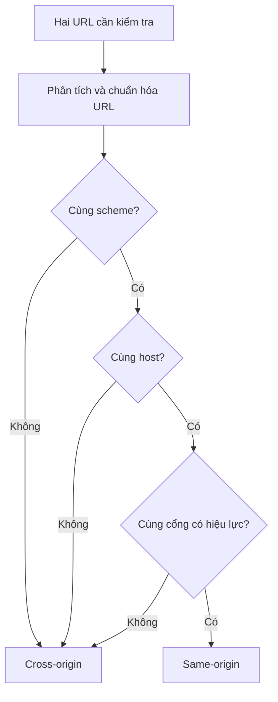
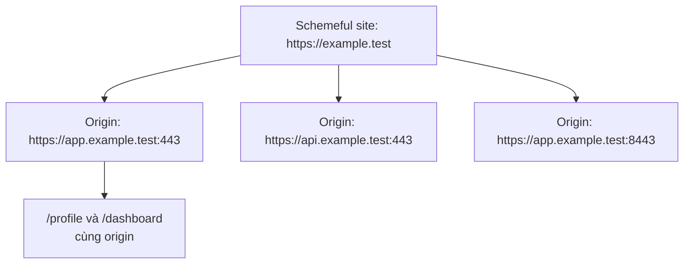

# Origin comparison: cách trình duyệt xác định hai ngữ cảnh có cùng origin hay không

## Mục tiêu học tập

Sau bài học, người học có thể:

1. So sánh chính xác origin của hai URL HTTP(S) dựa trên **scheme, host và port** đã chuẩn hóa.
2. Phân biệt **same-origin**, **cross-origin**, **same-site** và **cross-site**; giải thích vì sao hostname giống nhau hoặc chung domain không đủ để kết luận cùng origin.
3. Nhận biết các trường hợp đặc biệt như `about:blank`, `data:`, `blob:`, `file:` và iframe có `sandbox`, trong đó không thể chỉ so sánh chuỗi URL.
4. Liên hệ kết quả so sánh origin với **Same-Origin Policy (SOP)**, **CORS**, DOM, storage, cookie, `postMessage`, CSRF và một số security header.
5. Viết và kiểm tra mã so sánh origin an toàn; nhận diện lỗi kiểm tra bằng `includes`, `startsWith`, `endsWith` hoặc tin cậy chuỗi `"null"`.

> **Phạm vi:** Bài thuộc chương **Origin** của module **Application Security / Browser Security**, dùng cách xử lý URL và chính sách bảo mật hiện đại của trình duyệt làm nền tảng. Các ví dụ địa chỉ thuộc vùng `.test` chỉ để minh họa, không phải máy chủ công khai. Mục đích cuối cùng là phân định chính xác quyền giữa trình duyệt, origin, cookie và ứng dụng web khi phòng vệ XSS, CSRF, clickjacking và lỗi cấu hình CORS.

## 1. “Cùng origin” nghĩa là gì?

Với URL HTTP(S) thông thường, origin là bộ ba:

```text
origin = (scheme, host, port)

https://shop.example.test:8443/catalog?sort=price#section
  └─scheme─┘ └──────host──────┘ └port┘
```

- **Scheme**: giao thức URL, thường là `http` hoặc `https`. Hai URL khác scheme là khác origin, dù hostname và cổng có thể giống nhau.
- **Host**: tên miền hoặc địa chỉ IP sau khi trình phân tích URL chuẩn hóa. Host bao gồm subdomain; `app.example.test` và `api.example.test` là hai host khác nhau.
- **Port**: cổng có hiệu lực. Cổng mặc định của HTTP là **80**, của HTTPS là **443**; ghi rõ cổng mặc định hoặc bỏ qua cổng ấy dẫn đến cùng origin.

**So sánh origin** trả lời câu hỏi: *Hai tài liệu hoặc tài nguyên có thuộc cùng ranh giới quyền web không?* Trong trường hợp HTTP(S), chúng là **same-origin** khi cả ba thành phần khớp sau khi chuẩn hóa; ngược lại là **cross-origin**.

**Không nằm trong origin:** đường dẫn (`/account`), query (`?tab=orders`), fragment (`#details`), userinfo trong URL và trạng thái DNS/TLS. Hai hostname cùng trỏ về một IP **vẫn có thể khác origin**.

Ví dụ:

```text
A = https://app.example.test:443/dashboard
B = https://APP.EXAMPLE.TEST/settings?theme=dark

A.origin = https://app.example.test
B.origin = https://app.example.test
=> same-origin
```

Hostname được chuẩn hóa chữ hoa/chữ thường; `:443` là cổng mặc định HTTPS. Việc khác đường dẫn và query không làm thay đổi origin.

### Phân biệt origin với URL đầy đủ

Một URL định vị tài nguyên cụ thể. Origin xác định phạm vi bảo mật mà trình duyệt gán cho một nhóm URL. Vì thế `/profile` và `/admin` ở cùng origin **không được browser tách thành hai miền quyền độc lập**: phân quyền giữa chúng phải do máy chủ và ứng dụng thực thi.

## 2. Quy tắc so sánh origin HTTP(S)

Có thể hình dung quá trình như sau:



Đây là mô hình thuận tiện cho **HTTP(S) với tuple origin**. Thuật toán origin tổng quát của nền tảng web còn có **opaque origins** và quan hệ kế thừa origin, sẽ được giải thích ở mục 4.

### Bảng đối chiếu từng thành phần

Lấy `https://app.example.test/dashboard` làm URL gốc:

| URL đem so sánh | Same-origin? | Thành phần quyết định |
| --- | :---: | --- |
| `https://app.example.test/settings` | **Có** | Chỉ khác path |
| `https://app.example.test/dashboard?mode=dark#top` | **Có** | Query và fragment không thuộc origin |
| `https://APP.EXAMPLE.TEST:443/a` | **Có** | Host được chuẩn hóa; HTTPS mặc định port 443 |
| `https://app.example.test:8443/a` | Không | Khác port |
| `http://app.example.test/a` | Không | Khác scheme |
| `https://api.example.test/a` | Không | Khác subdomain/host |
| `https://example.test/a` | Không | Host cha không đồng nhất với subdomain |
| `https://app.example.test.evil.test/a` | Không | Host hoàn toàn khác; chỉ có tiền tố trông giống |
| `https://app.example.test./a` | Không | Dấu chấm cuối có thể giữ lại trong host URL; không tự coi hai origin như nhau |
| `https://user@app.example.test/a` | **Có** | Userinfo không thuộc origin |
| `https://127.0.0.1:443/a` | Không | IP literal khác hostname dù có thể trỏ cùng máy |

> **Lưu ý dấu chấm cuối và DNS:** Hệ thống tên miền có thể phân giải `app.example.test.` và `app.example.test` đến cùng địa chỉ IP, nhưng so sánh host cho origin không đơn thuần dựa vào việc chúng phân giải như nhau. Hãy kiểm tra bằng URL parser của trình duyệt khi nghi ngờ trường hợp chuẩn hóa đặc biệt.

### Trình duyệt chuẩn hóa những gì?

Đối với URL HTTP(S), API `URL` xử lý nhiều chi tiết thay cho lập trình viên:

- **Scheme và hostname:** không phân biệt chữ hoa/thường theo quy tắc URL.
- **Cổng mặc định:** `https://x.test:443` cùng origin với `https://x.test`; `http://x.test:80` cùng origin với `http://x.test`.
- **Tên miền quốc tế:** host có thể được chuẩn hóa bằng IDNA/Punycode; không nên tự viết hàm lowercase rồi so sánh chuỗi nhập thô.
- **Địa chỉ IP:** dạng biểu diễn IP có quy tắc chuẩn hóa riêng, không thể dựa vào so sánh văn bản một cách ngây thơ.

Kết quả `URL.origin` của URL HTTP(S) phản ánh origin **đã tuần tự hóa**. Chẳng hạn `new URL("https://app.example.test:443/a").origin` trả về `"https://app.example.test"`.

## 3. Same-origin khác same-site như thế nào?

**Origin** được dùng trong nhiều kiểm tra quyền JavaScript/DOM và CORS. **Site** là ranh giới rộng hơn thường dùng cho SameSite cookie và nhiều chính sách cách ly trình duyệt. Với URL HTTP(S) thông thường, khái niệm **schemeful site** bao gồm scheme và **registrable domain (eTLD+1)** theo Public Suffix List, không yêu cầu subdomain hay port trùng nhau.

Với URL gốc `https://app.example.test`:

| URL thứ hai | Same-origin | Same-site (schemeful) | Giải thích |
| --- | :---: | :---: | --- |
| `https://app.example.test/a` | Có | Có | Cùng cả origin lẫn site |
| `https://api.example.test/a` | Không | Có | Khác host nhưng cùng `example.test` |
| `https://app.example.test:8443` | Không | Có | Port tham gia origin, thường không tham gia site |
| `http://app.example.test/a` | Không | Không | Schemeful site phân biệt HTTP và HTTPS |
| `https://other.test/a` | Không | Không | Registrable domain khác |



Các điểm quan trọng:

- **Same-origin ⇒ thường same-site** đối với HTTP(S) thông thường; **same-site ⇏ same-origin**.
- Script từ `https://app.example.test` **không tự động** được đọc DOM của `https://api.example.test`, ngay cả khi cookie được xem là same-site.
- Cookie `SameSite=Lax/Strict` dựa trên ngữ cảnh **site**, còn SOP dựa trên **origin**. Chính sách của cookie và quyền đọc DOM trả lời hai câu hỏi khác nhau.
- Một registrable domain không đơn giản luôn là “hai nhãn cuối”. Ví dụ ở nhiều vùng có public suffix nhiều nhãn; phải dùng **Public Suffix List** nếu ứng dụng thật sự cần so sánh site.

**Sai lầm phổ biến:** kiểm tra `hostname.endsWith("example.test")` sẽ nhận nhầm `notexample.test` như domain được phép. Tương tự, `origin.includes("app.example.test")` có thể chấp nhận một URL chứa chuỗi này trong userinfo, path hoặc domain giả mạo. Khi cần kiểm tra **origin**, hãy so sánh origin chuẩn hóa một cách chính xác; khi cần kiểm tra **site**, dùng một thư viện hiểu Public Suffix List.

## 4. Opaque origin và các URL đặc biệt

Không phải mọi document có origin dưới dạng bộ ba `(scheme, host, port)`. Một số context có **opaque origin** — một danh tính bảo mật riêng biệt do trình duyệt tạo, không thể đồng nhất chỉ bằng cách nhìn chuỗi biểu diễn của URL.

| Trường hợp | Đặc điểm origin | Hệ quả khi so sánh |
| --- | --- | --- |
| Document ở HTTP(S) bình thường | Tuple origin | So sánh scheme, host, port |
| `data:text/html,...` | Thường tạo **opaque origin mới** | Không suy ra cùng origin với trang đã tạo URL |
| `about:blank` được tạo bởi một document | Thông thường **kế thừa origin của document tạo ra**, trừ các ràng buộc như sandbox | Không thể suy origin thực của document chỉ từ `new URL("about:blank").origin` |
| `iframe srcdoc` | Thông thường kế thừa origin của trang nhúng khi không bị sandbox cách ly | Tính cùng origin phụ thuộc cách iframe được tạo và chính sách sandbox |
| `blob:` URL | Thường mang origin của môi trường đã tạo blob URL | Xét origin gắn với blob URL, không chỉ lấy tiền tố `blob:` |
| `file:` URL | Hành vi origin có phần phụ thuộc cách triển khai và chính sách bảo mật trình duyệt | Không dựa vào `file:` để thiết kế cơ chế ủy quyền hay kiểm chứng SOP |
| Iframe có `sandbox` nhưng **không** có `allow-same-origin` | Document bị gán opaque origin | Có thể không truy cập được DOM của parent dù nội dung xuất phát cùng máy chủ |

### Vì sao chuỗi `"null"` không định danh origin?

Một opaque origin có thể được **tuần tự hóa** thành chuỗi `"null"` trong một số API, thông điệp và header HTTP. Nhiều opaque origin **khác nhau** cũng có thể cùng được in ra `"null"`, nhưng điều đó **không làm chúng same-origin**.

Ví dụ, hai tài liệu độc lập dùng `data:` thường có opaque origin riêng dù `event.origin` hoặc phần thông tin hiển thị có thể cho thấy cùng một chuỗi `"null"`.

Vì thế:

- Không dùng `new URL(url).origin === "null"` để cho phép một nhóm document cùng truy cập dữ liệu.
- Không tự động thêm `Access-Control-Allow-Origin: null` để “hỗ trợ file hoặc sandbox”; một số ngữ cảnh do kẻ tấn công tạo cũng có serialized origin `null`.
- Khi xét chính xác quyền DOM của `about:blank` hay `srcdoc`, cần biết **document thực tế đã được tạo ở ngữ cảnh nào**, không chỉ địa chỉ được ghi trong thuộc tính `src`.

## 5. Kết quả so sánh origin được áp dụng ở đâu?

So sánh origin là một phần của nhiều cơ chế. **Không phải mọi tính năng browser đều dùng chung một ranh giới**.

| Bề mặt | Ranh giới thường quyết định | Ví dụ |
| --- | --- | --- |
| DOM giữa các frame/window | **SOP: origin**, cùng các ngoại lệ API cụ thể | Trang A không được đọc `iframe.contentWindow.document` của origin B |
| `fetch` và XMLHttpRequest | **CORS** để cho JavaScript đọc phản hồi cross-origin | Server B cần chấp nhận origin A nếu muốn chia sẻ dữ liệu qua CORS |
| `localStorage`, IndexedDB | Thông thường **origin**, có thêm phân vùng lưu trữ tùy trình duyệt/ngữ cảnh | App và API khác subdomain không mặc nhiên cùng storage |
| Cookie | **Domain/host, path, Secure, SameSite**, chính sách third-party/partitioning; **không tách theo port** | Cookie của host có thể áp dụng cho nhiều port nếu các điều kiện khác cho phép |
| `postMessage` | Kênh cross-origin được phép; bên nhận phải **xác thực origin và nguồn gửi** | Iframe khác origin gửi thông điệp cho parent |
| CSRF | Quyền của phiên/credential và xác minh request; kiểm tra `Origin` có thể là một lớp bảo vệ | Request gây thay đổi trạng thái vẫn có thể xảy ra dù JavaScript không đọc được response |
| Clickjacking | Chính sách nhúng như CSP `frame-ancestors`, `X-Frame-Options` | Chặn origin không được phép nhúng trang nhạy cảm |
| XSS | Mã độc chạy trong **origin đã bị chèn** | SOP không tự ngăn script XSS cùng origin đọc dữ liệu ứng dụng |
| Site Isolation | **Site** và các ràng buộc tiến trình của Chromium | Iframe cross-site có thể được tách sang renderer khác |

### SOP và CORS: có thể gửi request nhưng không được đọc response

Giả sử ứng dụng `https://app.example.test` gọi API `https://api.example.test`. Hai địa chỉ là **cross-origin**, dù cùng site:

```js
fetch("https://api.example.test/profile", {
  credentials: "include"
});
```

Nếu server cho phép ứng dụng đọc phản hồi cùng cookie, response CORS thông thường cần một origin được chỉ định cụ thể:

```http
Access-Control-Allow-Origin: https://app.example.test
Access-Control-Allow-Credentials: true
Vary: Origin
```

Điều này **chỉ** là chính sách cho việc chia sẻ phản hồi với JavaScript. Cookie thực tế có được gửi hay không còn phụ thuộc điều kiện cookie và chính sách của trình duyệt. Nếu dùng credentials, `Access-Control-Allow-Origin: *` **không hợp lệ** để cho phép JavaScript đọc phản hồi.

**CORS không phải kiểm soát đăng nhập, phân quyền API hoặc phòng vệ CSRF**. Một số yêu cầu cross-origin có thể đã được gửi đến server trước khi trình duyệt chặn JavaScript đọc kết quả. Server vẫn phải xác thực, phân quyền và kiểm tra request gây thay đổi trạng thái.

### Cookie: cùng site không phải cùng origin

Giả sử hai ứng dụng chạy tại:

```text
https://app.example.test:443
https://admin.example.test:8443
```

Chúng khác origin vì khác host/port. Tuy nhiên, cookie với `Domain=example.test` có thể phù hợp với cả hai host nếu các thuộc tính khác cho phép; cookie **không được phân vùng theo port** theo cách origin phân biệt port. Cookie host-only chỉ áp dụng cho host đã đặt cookie và không tự chia sẻ sang subdomain khác. `HttpOnly` ngăn JavaScript đọc trực tiếp giá trị cookie, nhưng không ngăn trình duyệt tự gửi cookie trong những request đủ điều kiện.

**Hệ quả bảo mật:** Không dùng khác port hoặc khác subdomain như một cơ chế tự đủ để cô lập session. Dùng cookie scope hẹp, `Secure`, `HttpOnly`, `SameSite` thích hợp và kiểm soát yêu cầu tại server.

## 6. So sánh origin an toàn bằng JavaScript

### Dùng URL parser thay vì tự cắt chuỗi

Đoạn mã sau xử lý **URL HTTP(S) tuyệt đối** trong phạm vi so sánh tuple origins:

```js
function areSameHttpOrigin(firstUrl, secondUrl) {
  let a;
  let b;
  try {
    a = new URL(firstUrl);
    b = new URL(secondUrl);
  } catch {
    return false; // URL không hợp lệ
  }

  const supported = new Set(["http:", "https:"]);
  if (!supported.has(a.protocol) || !supported.has(b.protocol)) {
    return false; // Loại bỏ opaque/special schemes khỏi hàm so sánh này
  }

  return a.origin === b.origin;
}

console.log(areSameHttpOrigin(
  "https://app.example.test:443/a",
  "https://APP.EXAMPLE.TEST/b"
)); // true

console.log(areSameHttpOrigin(
  "https://app.example.test",
  "https://api.example.test"
)); // false

console.log(areSameHttpOrigin(
  "https://app.example.test",
  "https://app.example.test:8443"
)); // false

console.log(areSameHttpOrigin(
  "https://app.example.test",
  "https://app.example.test.evil.test"
)); // false
```

**Giới hạn:** Hàm chỉ so sánh origin hai URL HTTP(S) đã phân tích. Nó **không kiểm tra liệu URL có an toàn để server truy cập hay không** (SSRF), không cấp quyền truy cập dữ liệu, không thay thế auth/authz, và không đại diện cho phép so sánh origin của các document đặc biệt có origin kế thừa hoặc opaque.

Nếu cần so sánh URL do người dùng nhập với origin của trang đang chạy, ví dụ:

```js
function isSameOriginNavigation(input) {
  try {
    const target = new URL(input, window.location.href);
    return (target.protocol === "https:" || target.protocol === "http:") &&
      target.origin === window.location.origin;
  } catch {
    return false;
  }
}

isSameOriginNavigation("/account"); // true trên một trang HTTP(S)
isSameOriginNavigation("https://attacker.test/"); // false nếu khác origin
```

`new URL(input, base)` cho phép URL tương đối; hành vi này khác với `new URL(input)` đòi URL tuyệt đối. Với quy tắc chuyển hướng đến một **địa chỉ cho phép cụ thể**, nên cân nhắc allowlist hoặc đường dẫn nội bộ chặt chẽ thay vì chỉ dựa vào quan hệ origin.

### Những kiểu kiểm tra dễ bị vượt qua

```js
const candidate = "https://app.example.test.evil.test/login";

// SAI: xem tiền tố hostname là bằng chứng cùng origin
candidate.startsWith("https://app.example.test"); // true

// SAI: origin xuất hiện ở bất kỳ đâu trong URL không chứng minh nguồn gửi
("https://evil.test/?next=https://app.example.test")
  .includes("https://app.example.test"); // true

// ĐÚNG cho bài toán same-origin HTTP(S)
areSameHttpOrigin(candidate, "https://app.example.test"); // false
```

Không so sánh hostname chỉ bằng việc bỏ qua `http/https`; **scheme là một thành phần bảo mật của origin**. Không coi hai origin giống nhau vì DNS trả về cùng IP, vì cùng chứng chỉ TLS, vì cùng công ty sở hữu domain hoặc vì iframe ở cùng tab.

## 7. So sánh origin trong `postMessage` và cấu hình CORS

### Bên nhận postMessage phải kiểm tra cả origin lẫn cửa sổ gửi

Giả sử trang `https://app.example.test` nhúng một widget được phép tại `https://widget.partner.test`:

```js
// Mã ở trang cha
const widget = document.querySelector("#partner-widget");
const EXPECTED_ORIGIN = "https://widget.partner.test";

widget.contentWindow.postMessage(
  { type: "REQUEST_SUMMARY" },
  EXPECTED_ORIGIN
);

window.addEventListener("message", (event) => {
  if (event.origin !== EXPECTED_ORIGIN) return;
  if (event.source !== widget.contentWindow) return;

  const message = event.data;
  if (!message || message.type !== "SUMMARY") return;
  if (typeof message.total !== "number" || !Number.isFinite(message.total)) return;

  // Chỉ sử dụng trường đã kiểm tra theo schema dự kiến.
  console.log("Tổng:", message.total);
});
```

- **`event.origin`:** browser cung cấp origin của bên gửi khi thông điệp được gửi. So sánh **chính xác** với origin được tin cậy.
- **`event.source`:** xác định window/frame dự kiến, giúp tránh nhận thông điệp từ một cửa sổ khác có cùng origin. Cần lưu ý cửa sổ có thể điều hướng sau thời điểm gửi.
- **`event.data`:** vẫn là dữ liệu không tin cậy; phải xác minh kiểu thông điệp, trường và giá trị trước khi sử dụng.
- **`targetOrigin`:** khi gửi nên ghi origin cụ thể, hạn chế dùng `"*"` vì nội dung nhạy cảm có thể được chuyển đến một đích khác sau điều hướng.

Một iframe sandbox có opaque origin thường được biểu diễn là `event.origin === "null"`; **không chấp nhận mọi sender có origin "null" như một nhóm đáng tin**.

### Server CORS cần allowlist origin chính xác

Ví dụ Java Spring Boot khi thực sự muốn chia sẻ API cho đúng một frontend:

```java
import org.springframework.context.annotation.Bean;
import org.springframework.context.annotation.Configuration;
import org.springframework.web.servlet.config.annotation.CorsRegistry;
import org.springframework.web.servlet.config.annotation.WebMvcConfigurer;

@Configuration
class ApiCorsConfiguration {
    @Bean
    WebMvcConfigurer corsConfigurer() {
        return new WebMvcConfigurer() {
            @Override
            public void addCorsMappings(CorsRegistry registry) {
                registry.addMapping("/api/**")
                    .allowedOrigins("https://app.example.test")
                    .allowedMethods("GET", "POST")
                    .allowedHeaders("Content-Type", "X-CSRF-Token")
                    .allowCredentials(true);
            }
        };
    }
}
```

Đây là ví dụ **CORS**, không phải cấu hình bảo mật đầy đủ cho API. Khi triển khai thật còn cần authentication, authorization, CSRF phù hợp, giới hạn dữ liệu và kiểm tra các endpoint. Nếu server nhận nhiều origin hợp lệ, hãy dùng allowlist rõ ràng và bảo đảm cache phân biệt `Origin` khi phản hồi thay đổi theo origin.

**Không phản chiếu Origin một cách mù quáng**:

```text
Origin: https://evil.test

Access-Control-Allow-Origin: https://evil.test
Access-Control-Allow-Credentials: true
```

Nếu server tự động sao chép origin bất kỳ từ request vào response kèm cho phép credentials, website tấn công có thể được browser cấp quyền đọc những phản hồi cross-origin mà credential của người dùng cho phép truy cập. Origin chỉ là một yếu tố của chính sách chia sẻ; server vẫn phải xác minh quyền đối với dữ liệu.

## 8. Kiểm tra Origin để hỗ trợ chống CSRF

Với các hành động thay đổi trạng thái như thanh toán, đổi email, xóa dữ liệu, server có thể kiểm tra **`Origin` của HTTP request** và từ chối nguồn không nằm trong allowlist của ứng dụng. Tuy nhiên:

1. Không phải mọi request đều có `Origin`; cách xử lý request thiếu header phải có quy tắc rõ ràng cho từng endpoint. Có thể cân nhắc `Referer` như tín hiệu bổ sung với kiểm tra URL chính xác, hoặc từ chối khi không đủ bằng chứng.
2. `Origin: null` **không phải** bằng chứng request xuất phát từ một trang đáng tin.
3. `Sec-Fetch-Site` có thể bổ sung thông tin `same-origin`, `same-site`, `cross-site`, `none` trong những trình duyệt hỗ trợ; **same-site không đồng nghĩa same-origin**.
4. Cookie `SameSite` làm giảm một số CSRF, nhưng không thay thế CSRF token hoặc kiểm tra request phù hợp trong mọi tình huống, đặc biệt khi có subdomain không đáng tin.
5. Không nhầm **kiểm tra header Origin** với **CORS**: request CSRF có thể gây side effect tại server dù trình duyệt không cho script đọc response.

Ví dụ logic khái niệm cho API nhạy cảm:

```text
Nếu request làm thay đổi trạng thái:
    xác thực người dùng
    kiểm tra quyền trên đối tượng/hành động
    kiểm tra CSRF token hoặc cơ chế chống CSRF đã chọn
    kiểm tra Origin / Fetch Metadata khi có thể
    từ chối Origin không nằm trong danh sách đáng tin
    từ chối Origin "null" trừ trường hợp đặc biệt đã thiết kế an toàn
```

**Lưu ý kiến trúc:** Nếu nhiều frontend ở origin khác nhau được phép thao tác trên API, allowlist để chống CSRF phải phản ánh đúng các frontend được cấp quyền. Kiểm tra origin không thay thế token/phiên và kiểm tra quyền của người dùng.

## 9. Thực hành kiểm chứng bằng browser console

### Bài A — So sánh URL mà không cần server thật

Mở DevTools → **Console** trong một trang HTTP(S) bất kỳ và chạy:

```js
const baseline = new URL("https://app.example.test/home");
const cases = [
  "https://app.example.test/a",
  "https://APP.EXAMPLE.TEST:443/a",
  "http://app.example.test/a",
  "https://app.example.test:8443",
  "https://api.example.test/a",
  "https://app.example.test.evil.test/",
  "https://user@app.example.test/path",
  "https://app.example.test./",
  "https://127.0.0.1/"
];

console.table(cases.map((raw) => {
  const url = new URL(raw);
  return {
    input: raw,
    origin: url.origin,
    sameOrigin: url.origin === baseline.origin
  };
}));
```

**Dự kiến:** các URL ở dòng 1, 2 và 7 có cùng origin với baseline; các dòng còn lại khác origin. Hãy đối chiếu `.origin`, `.protocol`, `.hostname` và `.port` khi cần giải thích.

### Bài B — Phân biệt URL.origin với origin thực của document

Trong console, kiểm tra URL không có HTTP(S) tuple origin:

```js
console.table([
  "data:text/plain,hello",
  "about:blank",
  "blob:https://app.example.test/12345678-1234-1234-1234-123456789012"
].map((input) => ({
  input,
  serializedOrigin: new URL(input).origin
})));
```

Sau đó trên một trang HTTP(S) bạn kiểm soát, tạo iframe `srcdoc` bình thường và iframe `srcdoc` có thuộc tính `sandbox` (không có `allow-same-origin`). Dùng DevTools quan sát liệu trang cha có truy cập `contentDocument` được không.

**Câu hỏi cần trả lời:** Vì sao `new URL("about:blank").origin` không đủ để kết luận origin của một document `about:blank` vừa được tạo bởi trang cha? Vì **origin thực của document có thể kế thừa từ ngữ cảnh tạo ra nó**, còn cách tuần tự hóa một URL đứng riêng không mô tả lịch sử tạo document.

### Bài C — Đọc dấu hiệu Same-Origin Policy, CORS và CSRF

Trên môi trường thử nghiệm do bạn kiểm soát, dùng hai origin khác nhau, chẳng hạn hai subdomain hoặc hai port:

1. Nhúng iframe cross-origin và thử đọc `iframe.contentWindow.document.title`; quan sát thông báo `SecurityError` hoặc quyền truy cập bị từ chối.
2. Thực hiện `fetch` cross-origin; xem `Origin`, `Access-Control-Allow-Origin`, `Access-Control-Allow-Credentials` và lỗi CORS trong tab **Network/Console**.
3. So sánh `Sec-Fetch-Site` nếu browser gửi header: `same-origin` hay `same-site`? Hai nhãn có ý nghĩa khác nhau.
4. Nếu request dùng cookie, xem thuộc tính cookie trong **Application → Cookies** và cách browser quyết định gửi cookie; đừng suy rằng mỗi port có cookie riêng.
5. Xác minh server thực sự từ chối thao tác nhạy cảm khi thiếu token CSRF hoặc khi `Origin` không được phép, thay vì chỉ quan sát lỗi CORS ở console.

Ghi kết quả theo bảng:

| Thử nghiệm | Quan hệ origin/site | Tín hiệu quan sát | Cơ chế giải thích |
| --- | --- | --- | --- |
| Cùng host, cùng scheme, khác path | Same-origin, same-site | `URL.origin` giống nhau | Bộ ba origin không xét path |
| Cùng domain gốc, khác subdomain | Cross-origin, same-site | DOM bị SOP chặn | Origin xét đủ hostname |
| Cùng host, khác port | Cross-origin, thường same-site | DOM bị SOP chặn | Origin xét port |
| Cùng host, khác scheme | Cross-origin, cross-site theo schemeful site | Scheme khác | Cả origin và schemeful site xét scheme |
| API cross-origin gửi request nhưng response bị CORS chặn | Cross-origin | Console có lỗi CORS | Chặn JavaScript đọc response, không tự đảo ngược request |

## 10. Ngộ nhận thường gặp

| Ngộ nhận | Phân tích đúng |
| --- | --- |
| “Hai URL cùng domain gốc thì same-origin.” | Khác subdomain đã là cross-origin. |
| “Khác port chỉ là cấu hình server, không ảnh hưởng origin.” | Port là một trong ba thành phần của origin. |
| “HTTP và HTTPS cùng hostname có thể coi là cùng origin.” | Khác scheme nên cross-origin. |
| “Hai site trỏ tới cùng IP có cùng quyền truy cập DOM.” | DNS/IP kết nối không quyết định ranh giới SOP giữa hai hostname khác nhau. |
| “Cookie chỉ được gửi trong cùng origin.” | Cookie áp dụng các quy tắc domain/path/SameSite và không bị tách theo port như origin. |
| “CORS chặn request độc hại gửi đến API.” | CORS chủ yếu kiểm soát quyền đọc response từ JavaScript; server cần chống CSRF và phân quyền. |
| “`event.origin === 'null'` chứng minh hai iframe cùng origin.” | Nhiều opaque origin riêng biệt có cùng chuỗi tuần tự hóa `null`. |
| “So sánh origin bằng `includes()` là đủ.” | Chuỗi có thể xuất hiện trong userinfo, path, query hoặc host giả mạo. |
| “Nếu origin đúng thì dữ liệu nhận từ postMessage luôn hợp lệ.” | Cần kiểm tra thêm `event.source`, loại thông điệp, schema và quyền theo ngữ cảnh. |
| “SOP sẽ ngăn mọi XSS ở ứng dụng.” | XSS chạy trong chính origin bị ảnh hưởng nên cần CSP/Trusted Types, encode đúng ngữ cảnh và sửa lỗi DOM/script injection. |

## 11. Câu hỏi củng cố

**Câu 1.** `https://shop.example.test:443/cart` và `https://SHOP.EXAMPLE.TEST/pay` có cùng origin không?

**Đáp án:** Có. Scheme HTTPS giống nhau, hostname chuẩn hóa giống nhau, cổng mặc định 443 giống nhau; path khác không ảnh hưởng origin.

**Câu 2.** `https://app.example.test` và `https://api.example.test` cùng origin, cùng site hay khác cả hai?

**Đáp án:** Cross-origin nhưng same-site (schemeful) theo registrable domain `example.test`.

**Câu 3.** Vì sao `Access-Control-Allow-Origin: *` không đủ khi JavaScript gọi API với `credentials: "include"`?

**Đáp án:** Trình duyệt không cho phép đọc phản hồi dùng credentials khi CORS trả origin wildcard. Server phải khai báo origin cụ thể được phép và `Access-Control-Allow-Credentials: true`, đồng thời bảo vệ authentication/authorization/CSRF.

**Câu 4.** Hai iframe sandbox khác nhau đều báo serialized origin `"null"`. Chúng có same-origin không?

**Đáp án:** Không thể kết luận từ chuỗi này; opaque origins có danh tính riêng và nhiều origin khác nhau đều có thể tuần tự hóa thành `"null"`.

**Câu 5.** Tại sao xác minh `Origin` trong request nhạy cảm không thể thay hoàn toàn CSRF token và phân quyền?

**Đáp án:** Header có thể thiếu hoặc được gửi trong những ngữ cảnh đặc biệt, còn origin không biểu diễn danh tính và quyền đối với từng hành động/tài nguyên. Cần thiết kế phòng vệ nhiều lớp phía server.

## 12. Tổng kết

Với HTTP(S), **same-origin** nghĩa là **scheme + host + port** khớp sau khi URL được chuẩn hóa. Phân biệt chính xác khái niệm này với **same-site** giúp tránh lỗi khi cấu hình CORS, gửi cookie, chia sẻ storage, giao tiếp `postMessage` và bảo vệ endpoint. Khi document mang opaque origin hoặc có nguồn gốc kế thừa, phải xét **ngữ cảnh tạo document**, không suy diễn từ chuỗi `URL.origin` hay từ serialized origin `"null"`.

Trong thực tế, hãy dùng URL parser, kiểm tra exact origin allowlist khi đúng bài toán, xác minh dữ liệu và quyền ở phía server, kết hợp CSP/Trusted Types để phòng XSS, CSRF token và SameSite cookie để giảm CSRF, cùng `frame-ancestors` để hạn chế clickjacking. **Origin comparison là bước xác định ranh giới tin cậy, không phải một cơ chế xác thực hoặc phân quyền hoàn chỉnh.**

## Tài liệu tham khảo

1. [WHATWG — URL Standard, Origin](https://url.spec.whatwg.org/#origin): mô hình tuple origin, opaque origin và xử lý URL.
2. [WHATWG — HTML Standard, Origin](https://html.spec.whatwg.org/multipage/browsers.html#origin): origin của document, origin kế thừa và quan hệ giữa các ngữ cảnh.
3. [MDN — Same-origin policy](https://developer.mozilla.org/en-US/docs/Web/Security/Same-origin_policy): quy tắc truy cập giữa các origin và các trường hợp đặc biệt.
4. [MDN — Origin](https://developer.mozilla.org/en-US/docs/Glossary/Origin): cách xác định origin HTTP(S).
5. [MDN — Same-site](https://developer.mozilla.org/en-US/docs/Glossary/Site): phân biệt same-site, schemeful site và same-origin.
6. [MDN — Cross-Origin Resource Sharing (CORS)](https://developer.mozilla.org/en-US/docs/Web/HTTP/Guides/CORS): chính sách chia sẻ phản hồi cross-origin và credentials.
7. [MDN — Window.postMessage()](https://developer.mozilla.org/en-US/docs/Web/API/Window/postMessage): `event.origin`, `event.source` và `targetOrigin`.
8. [OWASP — Cross-Site Request Forgery Prevention Cheat Sheet](https://cheatsheetseries.owasp.org/cheatsheets/Cross-Site_Request_Forgery_Prevention_Cheat_Sheet.html): kiểm tra Origin/Referer, Fetch Metadata, cookie SameSite và CSRF token.
