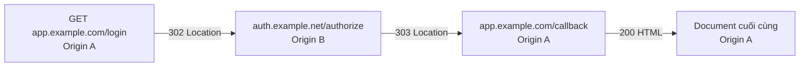

# Origin thay đổi khi redirect

**Chương:** Origin  
**Mô-đun:** `SECURITY_APPLICATION_SECURITY_BROWSER_SECURITY` — bảo mật ứng dụng trên trình duyệt, origin, cookie, Same-Origin Policy (SOP), CORS và các cơ chế cách ly.

Khi trình duyệt truy cập `https://app.example.com/start` rồi nhận HTTP `302 Location: https://login.example.net/sign-in`, **URL cuối cùng có origin khác URL ban đầu**. Tuy nhiên, câu “origin thay đổi khi redirect” cần hiểu theo đúng đối tượng: *origin của tài liệu mới* có thể thay đổi sau điều hướng; *origin của JavaScript đang gọi `fetch`* vẫn là origin của tài liệu chứa script; còn *origin của endpoint cuối chuỗi* là một thuộc tính của URL được truy cập. Lẫn lộn ba ý này sẽ dẫn đến lỗi CORS, cấp quyền sai cho iframe, gửi cookie không như dự kiến và lỗ hổng open redirect.

Bài học đi từ mô hình URL đến cách quan sát thực tế trong DevTools, sau đó vận dụng vào thiết kế phòng vệ XSS, CSRF, clickjacking và luồng đăng nhập.

## 1. Mục tiêu và ví dụ xuyên suốt

Sau bài này, bạn có thể:

1. Tính origin của từng URL trong chuỗi HTTP redirect và giải thích khi nào origin của **document đang hoạt động** thực sự thay đổi.
2. Phân biệt HTTP navigation, iframe navigation, `fetch`/XHR và tải tài nguyên khi đích cuối khác origin.
3. Dự đoán SOP, CORS, cookie, `Origin`/`Referer` và quyền đọc phản hồi sẽ ảnh hưởng ra sao.
4. Nhận diện rủi ro open redirect, chuyển hướng HTTP không an toàn và rò rỉ thông tin xác thực.
5. Kiểm chứng hành vi bằng công cụ Network/Console thay vì suy đoán từ URL đầu tiên.

Ví dụ xuyên suốt có ba endpoint:

- `https://app.example.com`: ứng dụng đang chứa mã JavaScript.
- `https://auth.example.net`: dịch vụ đăng nhập.
- `https://api.example.com`: API dùng bởi ứng dụng.

**Tình huống A — navigation:** người dùng mở `https://app.example.com/login`, server trả `302` đến `https://auth.example.net/sign-in`. Trình duyệt tải và kích hoạt **document mới** tại origin của dịch vụ đăng nhập.

**Tình huống B — fetch:** script đang chạy trên `https://app.example.com` gọi `fetch("/profile")`; server trả `302` đến `https://api.example.com/me`. Script vẫn thuộc `https://app.example.com`. Muốn đọc dữ liệu API đích, kết quả phải thỏa các điều kiện của Fetch/CORS và chính sách credentials.

## 2. Ôn nền tảng: origin là bộ ba scheme + host + port

Với URL HTTP(S), origin thông thường được xác định bằng:

```text
origin = (scheme, hostname, port)
```

Đường dẫn, query và fragment **không nằm trong origin**. Port mặc định của HTTPS là 443, của HTTP là 80.

| URL | Origin | So với `https://app.example.com` |
| --- | --- | --- |
| `https://app.example.com/a` | `https://app.example.com` | Cùng origin |
| `https://app.example.com:443/b?x=1` | `https://app.example.com` | Cùng origin |
| `https://app.example.com:8443/a` | `https://app.example.com:8443` | Khác port |
| `http://app.example.com/a` | `http://app.example.com` | Khác scheme |
| `https://api.example.com/a` | `https://api.example.com` | Khác hostname |
| `https://auth.example.net/a` | `https://auth.example.net` | Khác hostname và site |

**Origin khác site:** `https://app.example.com` và `https://api.example.com` thường **khác origin nhưng cùng site** theo cách tính *schemeful site* dựa trên scheme và registrable domain. CORS thường xét origin; `SameSite` cookie xét quan hệ site. Port không làm một URL thành site khác.

Các trường hợp như `data:`, tài liệu trong sandbox hoặc một số tài liệu đặc biệt có thể có **opaque origin**. Bài này dùng HTTP(S) để giải thích quy tắc phổ biến, rồi nêu ngoại lệ khi cần.

## 3. HTTP redirect thực sự làm gì?

Máy chủ phản hồi bằng mã trạng thái chuyển hướng (thường trong nhóm 3xx) kèm header `Location`:

```http
GET /login HTTP/1.1
Host: app.example.com

HTTP/1.1 302 Found
Location: https://auth.example.net/sign-in
Cache-Control: no-store
```

Trình duyệt quyết định có theo redirect hay không theo loại request, redirect mode, CORS và các chính sách bảo mật áp dụng. Nếu được phép, nó tạo request đến URL mới. Chuỗi có thể có nhiều bước:



Trong ví dụ này, request đã **đi qua** origin B nhưng document cuối được tải tại origin A. Vì thế **“chuỗi redirect có đi qua origin khác”** và **“document cuối cùng khác origin với document ban đầu”** là hai câu hỏi riêng biệt.

### 3.1. Cách tính từng bước

Khi nhận `Location`, trình duyệt phân giải nó dựa trên URL của **phản hồi ở bước hiện tại**; `Location` có thể là URL tuyệt đối hoặc tương đối.

| URL hiện tại | `Location` | URL tiếp theo | Origin thay đổi? |
| --- | --- | --- | --- |
| `https://app.example.com/start` | `/home` | `https://app.example.com/home` | Không |
| `https://app.example.com/start` | `../login` | `https://app.example.com/login` | Không |
| `https://app.example.com/start` | `https://api.example.com/data` | `https://api.example.com/data` | Có |
| `https://app.example.com/start` | `//auth.example.net/login` | `https://auth.example.net/login` | Có |
| `http://app.example.com/a` | `https://app.example.com/a` | `https://app.example.com/a` | Có: scheme |
| `https://app.example.com/start` | `https://app.example.com:8443/x` | `https://app.example.com:8443/x` | Có: port |

Không phải mọi 3xx đều đồng nghĩa trình duyệt chuyển sang URL mới. Chẳng hạn `304 Not Modified` xử lý bộ nhớ đệm, không phải một redirect đến `Location`. Luồng điều hướng thường gặp là `301`, `302`, `303`, `307` và `308`.

### 3.2. Mã redirect ảnh hưởng cả HTTP method và request body

| Status | Mục đích điển hình | Ảnh hưởng đến method |
| --- | --- | --- |
| `301 Moved Permanently` | Chuyển địa chỉ lâu dài | Với POST, trình duyệt có thể chuyển thành GET theo hành vi web tương thích |
| `302 Found` | Chuyển tạm thời | Với POST, trình duyệt thường chuyển thành GET |
| `303 See Other` | Sau thao tác, đi đến tài nguyên để xem kết quả | Chuyển sang GET (trừ trường hợp HEAD) |
| `307 Temporary Redirect` | Chuyển tạm nhưng giữ phương thức | **Giữ method và body** |
| `308 Permanent Redirect` | Chuyển lâu dài nhưng giữ phương thức | **Giữ method và body** |

Rủi ro dễ bỏ sót: một request POST chứa dữ liệu nhạy cảm có thể **giữ body** khi theo `307/308` đến origin khác, nếu việc chuyển hướng/request đó được phép. Không thiết kế endpoint nhận thông tin xác thực rồi chuyển body tùy ý đến URL do người dùng kiểm soát. Với mẫu POST/Redirect/GET, hãy lựa chọn `303` có chủ đích khi phù hợp.

## 4. Ba loại “origin” phải tách bạch

| Đối tượng | Điều xảy ra khi chuỗi redirect đi từ origin A sang B |
| --- | --- |
| **Document top-level** đang điều hướng | Nếu cuối cùng tải và kích hoạt tài liệu ở B, document mới có origin B; document cũ tại A không “biến” thành B |
| **Document bên trong iframe** | Chỉ document của iframe thay đổi theo URL cuối; document trang cha giữ origin của nó |
| **Script đang gọi `fetch`** | Mã JavaScript vẫn thực thi trong document A; URL đích request/response có thể chuyển đến B |
| **Tài nguyên tải về** (ảnh, CSS, script) | URL phản hồi có thể ở B; quyền sử dụng tài nguyên phụ thuộc loại tài nguyên và chính sách tải, không có quy tắc chung rằng mã đó “chạy với origin B” |
| **HTTP `Origin` request header** | Phản ánh ngữ cảnh nguồn và quy tắc của Fetch; không đơn thuần bằng origin của URL đích hoặc origin của URL `Location` |

### 4.1. Điều hướng top-level: document mới có origin đích cuối

Trước chuyển hướng:

```javascript
// JavaScript đang thực thi trong trang https://app.example.com.
console.log(window.location.origin);
// "https://app.example.com"

window.location.assign("/login");
```

Nếu `/login` trả `302` đến `https://auth.example.net/sign-in` và trang đích được tải thành công, thì **script của trang đăng nhập mới** thấy:

```javascript
// Chạy trong document mới của https://auth.example.net.
console.log(window.location.origin);
// "https://auth.example.net"
```

JavaScript ở trang cũ **không được nâng quyền thành origin B**. Navigation thường kết thúc vòng đời document cũ và tạo/kích hoạt document mới; các ngoại lệ như history traversal, BFCache không thay đổi nguyên tắc rằng quyền truy cập phụ thuộc document đang hoạt động.

**SOP sau navigation:** mã B không tự đọc được `localStorage` của A hay DOM đang sống của A. Nếu trình duyệt vẫn còn các cửa sổ có tham chiếu đến nhau, tương tác giữa chúng cũng bị SOP và các cơ chế giới hạn opener chi phối.

### 4.2. Iframe redirect: trang cha không đổi origin

```html
<!-- Chạy tại https://app.example.com -->
<iframe
  id="loginFrame"
  src="https://app.example.com/start-login"
  title="Đăng nhập">
</iframe>
```

Giả sử `/start-login` trả `302` đến `https://auth.example.net/sign-in`:

- Trang cha vẫn ở origin `https://app.example.com`.
- Iframe chứa document cuối ở origin `https://auth.example.net`.
- Mã trang cha không thể đọc `iframe.contentWindow.document.body` của document B do SOP.
- Giá trị thuộc tính `iframe.src` trong HTML có thể vẫn là URL **ban đầu**. Đừng dựa vào thuộc tính đó để kết luận URL cuối của document con.
- Muốn trao đổi trạng thái, hai bên dùng `postMessage` với `targetOrigin` cụ thể và kiểm tra `event.origin`, `event.source`, kiểu dữ liệu.

**Lưu ý với sandbox:** nếu iframe có `sandbox` nhưng **không** có `allow-same-origin`, document cuối có thể nhận *opaque origin* dù URL cuối hiển thị là HTTPS bình thường. Khi đó `event.origin` của message từ iframe có thể là `"null"`. Không suy origin của document trong sandbox chỉ từ URL đã redirect.

### 4.3. Fetch: endpoint đổi origin, JS vẫn thuộc origin ban đầu

Đoạn mã trong trang A:

```javascript
async function loadProfile() {
  try {
    const response = await fetch("/profile", {
      redirect: "follow" // Giá trị mặc định.
    });

    console.log(response.url);        // URL phản hồi cuối, nếu có quyền đọc.
    console.log(response.redirected); // true nếu Fetch đã theo redirect.
    console.log(await response.json());
  } catch (error) {
    console.error("Không thể đọc response:", error);
  }
}
```

Server ở A có thể trả:

```http
HTTP/1.1 302 Found
Location: https://api.example.com/me
```

Nếu redirect được theo và phản hồi cuối thỏa các điều kiện CORS/Fetch, JavaScript ở A đọc được dữ liệu, `response.url` phản ánh URL cuối; **`window.location.origin` vẫn là `https://app.example.com`**. Nếu CORS không cho phép, `fetch` ở chế độ thông thường sẽ bị lỗi ở phía JavaScript. Việc mã JS không đọc được phản hồi **không có nghĩa request chưa từng được gửi**.

Các chế độ `fetch` cần nhớ:

| Tùy chọn | Ý nghĩa trong chuỗi redirect |
| --- | --- |
| `redirect: "follow"` | Tự động theo redirect được phép; là mặc định |
| `redirect: "error"` | Trả lỗi nếu gặp redirect; phù hợp khi ứng dụng không muốn request đổi đích |
| `redirect: "manual"` | Trình duyệt có thể trả `opaqueredirect` thay vì lộ thông tin chuyển hướng cho JS; không phải cách đọc tùy ý `Location` |
| `mode: "cors"` | Cho phép thử request cross-origin nhưng việc JS đọc phản hồi vẫn cần điều kiện CORS |
| `mode: "same-origin"` | Giới hạn request vào cùng origin; redirect ra origin khác không được phép tiếp tục theo chế độ này |
| `credentials: "include"` | Cho phép gửi credentials theo quy tắc cookie/trình duyệt và yêu cầu phản hồi CORS có xử lý credentials phù hợp để JS đọc được |

Tùy chọn `redirect: "manual"` không biến trình duyệt thành một HTTP client không có SOP. Với `opaqueredirect`, JS không có quyền lấy status/`Location` như đang đọc trực tiếp response 302 thông thường. Khi ứng dụng **không muốn** tự động gửi dữ liệu đến URL bất ngờ, nên chủ động kiểm soát URL đích hoặc dùng `redirect: "error"`, thay vì chỉ kiểm tra `response.redirected` **sau khi** redirect đã diễn ra.

## 5. CORS trong chuỗi redirect khác origin

CORS trả lời: **JavaScript ở origin A có được đọc phản hồi từ origin B hay không?** CORS không đổi origin của script, không mở quyền đọc DOM iframe và không thay thế xác thực server.

Giả sử:

```text
Trang chạy JS:           https://app.example.com
GET /download ─302──▶   https://cdn.example.net/file.json
Phản hồi cuối:            200 OK
```

Với một `fetch` CORS được theo redirect thành công, phản hồi cuối cần có chính sách thích hợp, ví dụ:

```http
HTTP/1.1 200 OK
Content-Type: application/json
Access-Control-Allow-Origin: https://app.example.com
Vary: Origin

{"ok":true}
```

Nếu JS gửi cookie cross-origin bằng `credentials: "include"` và các cookie đủ điều kiện được gửi, phản hồi còn phải đáp ứng chính sách CORS credentials, ví dụ `Access-Control-Allow-Credentials: true` và origin được chỉ rõ; **không dùng `Access-Control-Allow-Origin: *` cho response credentials**.

### Đừng xem redirect như cách “né CORS”

- Yêu cầu ban đầu **cùng origin** có thể redirect sang **khác origin**, khiến xử lý CORS áp dụng theo đường đi và phản hồi liên quan.
- Request đến API có thể được gửi đi trước khi JS thất bại vì CORS ở bước nhận phản hồi.
- Request có **preflight** có thêm quy tắc và khác biệt tương thích trình duyệt khi gặp redirect; thử đúng đường đi thực tế thay vì mặc định rằng mọi chuỗi redirect đều hoạt động giống GET đơn giản.
- CORS là cơ chế **quyền đọc phản hồi**, còn quyền thực hiện tác động trên server cần xác thực, phân quyền và chống CSRF.
- Không mở rộng allowlist sang mọi origin chỉ để sửa một lỗi CORS do đích redirect cấu hình sai.

**Cẩn trọng với `no-cors`:** đây không phải phương pháp vượt CORS để đọc JSON. Response cross-origin thường trở thành `opaque`, JS không đọc được body/status như thông thường. Khả năng request đến server vẫn cần được đánh giá về CSRF và tác dụng phụ.

## 6. Cookie và header `Origin` khi redirect

### 6.1. Cookie thuộc từng request URL

Mỗi bước trong chuỗi redirect là một request mới đến một URL. Trình duyệt chọn cookie phù hợp với **host/domain, path, Secure, SameSite, credentials mode và chính sách chặn cookie** tại thời điểm gửi request đó.

```text
A: https://app.example.com/login   --302-->   B: https://auth.example.net/sign-in
       cookie đủ điều kiện cho A                  cookie đủ điều kiện cho B
```

Cookie host-only của A không tự biến thành cookie của B. Ngược lại, hai subdomain thuộc `example.com` có thể cùng nhận một cookie đặt `Domain=example.com` nếu đáp ứng các điều kiện khác, dù chúng khác origin. Port không được dùng để giới hạn phạm vi cookie. Cookie `HttpOnly` không bị JS đọc qua `document.cookie` nhưng vẫn có thể gửi trong request phù hợp.

**SameSite xét site, không xét origin**. Những redirect làm thay đổi quan hệ same-site/cross-site có thể ảnh hưởng việc cookie được gửi, đặc biệt trong các chuỗi điều hướng có nhiều hop. Hành vi cụ thể còn phụ thuộc method, kiểu navigation/subresource, các hạn chế cookie bên thứ ba và trình duyệt. Không suy luận việc cookie có mặt chỉ từ chữ “302”.

Ví dụ cho `fetch` từ A sang B, `credentials` mặc định là `"same-origin"` nên cookie của B thường không được gửi khi request chuyển sang origin khác. `credentials: "include"` cho phép xét gửi cookie cross-origin theo chính sách hiện hành, nhưng không vô hiệu `SameSite` hoặc chặn third-party cookies.

### 6.2. `Set-Cookie` trên phản hồi 3xx

Máy chủ có thể phát `Set-Cookie` ngay trên HTTP redirect response, và trình duyệt có thể xử lý cookie đó nếu các quy tắc hiện hành cho phép. Ví dụ một service đăng nhập thiết lập state/session rồi redirect người dùng đến trang tiếp theo.

JavaScript không được đọc `Set-Cookie` từ Fetch response như một header thông thường. Khi debug cookie, hãy xem **Network → từng hop → Response Headers / Cookies** và chính sách lưu trữ của browser.

### 6.3. Header `Origin` không đơn thuần là hostname ở `Location`

Header request `Origin` (khi được gửi) chỉ nguồn khởi tạo theo các thuật toán của trình duyệt/Fetch. Nó **khác** với:

- origin của URL mà request đang đến;
- origin của URL đích cuối cùng;
- header `Host` hoặc `:authority` dùng để định tuyến request;
- header `Referer`, vốn chứa thông tin referrer phụ thuộc `Referrer-Policy`.

Một số trường hợp chuỗi redirect cross-origin khiến origin của request được xem là **redirect-tainted** và trình duyệt có thể serialize `Origin: null`; đồng thời có những request không gửi `Origin`. Đừng viết rule bảo mật rằng “`Origin` luôn là origin của URL cuối” hay coi `Origin: null` là một bên gửi đáng tin.

Đối với thao tác đổi trạng thái, server nên kiểm tra nguồn request theo chính sách của ứng dụng, kết hợp **session, CSRF token và phân quyền**. `Origin`/`Referer` có thể hỗ trợ chống CSRF, nhưng không phải cơ sở duy nhất để cấp quyền nghiệp vụ.

## 7. Redirect không thay đổi mọi ngữ cảnh thực thi

Một bẫy thường gặp:

```html
<!-- Trang tại https://app.example.com -->
<script src="https://app.example.com/assets/widget.js"></script>
```

Nếu URL script redirect đến `https://cdn.example.net/widget.js`, thì với **classic script** được tải và cho phép thực thi, mã script chạy trong **realm/origin của trang nhúng** (`https://app.example.com`), **không tự trở thành mã bị cách ly dưới origin CDN**. Module script, worker, font, ảnh hoặc các loại tài nguyên khác có quy tắc tải/CORS riêng; không áp dụng máy móc kết luận của classic script cho tất cả.

Hệ quả: một server có khả năng redirect URL script tới nguồn không đáng tin có thể làm thay đổi mã chạy với quyền của ứng dụng nếu trình duyệt và CSP cho phép tải. Cần kiểm soát nguồn script, luồng redirect, dependency và CSP. Muốn giảm quyền nội dung bên thứ ba, thường dùng iframe ở origin tách biệt với sandbox phù hợp; **nhúng bằng `<script>` không tạo sandbox**.

Tương tự, `history.pushState` chỉ đổi URL cùng origin hợp lệ của document hiện có; nó không cho phép đổi origin của một document mà không navigation thực sự. Còn JavaScript `window.location.assign(...)` kích hoạt navigation tương tự về mặt đổi document đích, dù không có HTTP 302 ở bước khởi đầu.

## 8. Lab: redirect từ `localhost:3000` sang `localhost:4000`

Lab sau dùng Node.js và hai HTTP server, không cần cài thư viện. Nó kiểm chứng ba điều:

1. Iframe được tạo ở trang A nhưng redirect đến B ⇒ iframe cuối có origin B, cha vẫn origin A.
2. Fetch ban đầu gọi đường dẫn A nhưng redirect sang B ⇒ đọc được nội dung **chỉ khi** response B cho phép CORS.
3. `response.redirected` và `response.url` mô tả chain đã theo **khi** Fetch thành công; chúng không thay đổi origin của script gọi Fetch.

Hai cổng tạo **hai origin khác nhau nhưng vẫn cùng site localhost**. Đây không phải thí nghiệm đầy đủ về cookie cross-site hay chặn third-party cookies.

Tạo file `origin-redirect-lab.mjs`:

```javascript
import { createServer } from "node:http";

const appHtml = `<!doctype html>
<html lang="vi">
<head><meta charset="utf-8"><title>Origin A</title></head>
<body>
  <h1>Ứng dụng A: localhost:3000</h1>
  <p>Origin trang cha: <code id="origin"></code></p>
  <iframe id="frame" src="/go-frame" title="Redirect iframe"></iframe>
  <p><button id="inspect">Thử đọc DOM iframe</button></p>
  <p>Mở DevTools → Console và Network để xem chuỗi 302 → 200.</p>
  <script>
    document.querySelector("#origin").textContent = location.origin;
    const frame = document.querySelector("#frame");

    document.querySelector("#inspect").onclick = () => {
      try {
        console.log("DOM iframe:", frame.contentWindow.document.body.textContent);
      } catch (error) {
        console.log("SOP chặn đọc DOM iframe:", error.name);
      }
    };

    window.addEventListener("message", event => {
      if (event.source !== frame.contentWindow) return;
      if (event.origin !== "http://localhost:4000") return;
      if (event.data?.type !== "ready") return;
      console.log("Iframe final origin:", event.origin);
    });

    async function check(path) {
      try {
        const response = await fetch(path);
        console.log(path, {
          pageOrigin: location.origin,
          responseUrl: response.url,
          redirected: response.redirected,
          content: await response.text()
        });
      } catch (error) {
        console.log(path, "Fetch không đọc được:", error.name);
      }
    }

    check("/go-cors");
    check("/go-no-cors");
    fetch("/go-cors", { redirect: "error" })
      .catch(error => console.log("redirect:error:", error.name));
  </script>
</body>
</html>`;

const frameHtml = `<!doctype html>
<html lang="vi">
<meta charset="utf-8">
<h2>Iframe B: localhost:4000</h2>
<p>Document này được tải sau redirect.</p>
<script>
  console.log("Origin iframe:", location.origin);
  parent.postMessage({ type: "ready" }, "http://localhost:3000");
</script>`;

function redirect(res, target) {
  res.writeHead(302, {
    Location: target,
    "Cache-Control": "no-store"
  });
  res.end();
}

createServer((req, res) => {
  console.log("[3000]", req.method, req.url);
  if (req.url === "/go-frame") {
    return redirect(res, "http://localhost:4000/frame");
  }
  if (req.url === "/go-cors") {
    return redirect(res, "http://localhost:4000/data-cors");
  }
  if (req.url === "/go-no-cors") {
    return redirect(res, "http://localhost:4000/data-no-cors");
  }
  res.writeHead(200, { "Content-Type": "text/html; charset=utf-8" });
  res.end(appHtml);
}).listen(3000, () => console.log("App: http://localhost:3000"));

createServer((req, res) => {
  console.log("[4000]", req.method, req.url);
  if (req.url === "/frame") {
    res.writeHead(200, { "Content-Type": "text/html; charset=utf-8" });
    return res.end(frameHtml);
  }

  const headers = {
    "Content-Type": "text/plain; charset=utf-8",
    "Cache-Control": "no-store"
  };

  if (req.url === "/data-cors") {
    headers["Access-Control-Allow-Origin"] = "http://localhost:3000";
    headers["Vary"] = "Origin";
  }

  res.writeHead(200, headers);
  res.end("Du lieu tu origin B");
}).listen(4000, () => console.log("Remote: http://localhost:4000"));
```

Chạy:

```bash
node origin-redirect-lab.mjs
```

Mở `http://localhost:3000`, rồi xem **DevTools → Network**, bật **Preserve log** nếu cần quan sát redirect rõ hơn, và xem Console.

| Thao tác/quan sát | Kết quả dự kiến | Lý do |
| --- | --- | --- |
| Trang chính hiển thị `location.origin` | `http://localhost:3000` | Document trang cha vẫn ở origin A |
| Network của iframe | `/go-frame` trả 302 rồi `http://localhost:4000/frame` trả 200 | URL cuối của iframe là B |
| Console từ iframe | `http://localhost:4000` | Document được tải và chạy ở B |
| Click **Thử đọc DOM iframe** | Exception, thường `SecurityError` | SOP chặn A đọc DOM B |
| `fetch("/go-cors")` | Thành công; `response.url` ở cổng 4000, `redirected === true` | B cấp `Access-Control-Allow-Origin` hợp lệ |
| `fetch("/go-no-cors")` | Fetch từ JS bị lỗi CORS; request vẫn thấy trong Network/server log | CORS chặn quyền đọc response |
| `fetch("/go-cors", {redirect: "error"})` | Bị reject khi gặp 302 | Chế độ redirect không cho tự theo |

**Tự mở rộng có kiểm soát:**

1. Đổi `Location` của `/go-frame` thành `/same-origin-page` rồi thêm một HTML page tại server cổng 3000. Khi cả cha và iframe cuối cùng ở cùng origin, quyền DOM khác đi (nếu không có sandbox cản trở).
2. Thêm `sandbox="allow-scripts"` vào iframe có redirect sang B. Dự kiến `postMessage` từ iframe mang `event.origin === "null"` vì sandbox ép opaque origin; điều kiện kiểm tra origin B trong trang cha phải được thiết kế lại. Không tự động chấp nhận mọi message `"null"`.
3. Thêm `mode: "same-origin"` vào `fetch("/go-cors")`. Quan sát lỗi khi redirect rời origin.
4. Thử `redirect: "manual"` rồi xem `response.type` và việc bạn có đọc được `Location` hay không. Đối chiếu hành vi với `redirect: "follow"`.
5. Sau khi kết thúc, dừng Node bằng **Ctrl+C**. Lab chỉ hoạt động trên máy local và không có thông tin đăng nhập thật.

Đừng giải quyết lỗi CORS trong lab bằng `mode: "no-cors"` nếu mục tiêu là đọc body; kết quả thường là response `opaque` không sử dụng được.

## 9. Rủi ro bảo mật khi origin chuyển qua redirect

### 9.1. Open redirect

Một endpoint cho phép người dùng quyết định URL đích tùy ý có thể bị lạm dụng:

```text
https://app.example.com/redirect?next=https://attacker.example/phishing
```

Nạn nhân nhìn thấy liên kết bắt đầu bằng domain tin cậy, nhưng trình duyệt kết thúc ở trang do kẻ tấn công điều khiển. Open redirect còn nguy hiểm hơn nếu được đưa vào luồng OAuth/OIDC hoặc endpoint nhận/gửi dữ liệu nhạy cảm.

Ví dụ thiết kế không an toàn:

```javascript
// Pseudocode server-side, không dùng trong ứng dụng thật.
const next = new URL(request.url).searchParams.get("next");
response.writeHead(302, { Location: next });
response.end();
```

Phòng vệ thường dùng:

- Tốt nhất: redirect theo **tên route nội bộ** hoặc bảng đích định sẵn, thay vì nhận nguyên URL.
- Nếu bắt buộc nhận URL, phân tích URL bằng parser chuẩn; chỉ cho phép scheme, host, port, đường dẫn **theo allowlist chính xác**. Chống URL đánh lừa bằng userinfo, ký tự mã hóa, subdomain giả, URL tương đối bất thường và các cách biểu diễn host khác.
- Không nhúng access token, session token, mật khẩu hoặc bí mật vào URL chuyển hướng. Cần chú ý `Referer` có thể gây lộ thông tin URL tùy policy.
- Với OAuth/OIDC: kiểm tra `redirect_uri` theo đăng ký chặt chẽ, dùng `state` và PKCE phù hợp, bảo vệ callback khỏi open redirect; xác thực ứng dụng và quyền trên server.

Một API trả `302` đến URL không đáng tin không tự động vượt SOP/CORS, nhưng nó có thể khiến request đi đến nơi không mong muốn hoặc đánh lừa người dùng trong navigation. **CORS không là cơ chế chống phishing/open redirect.**

### 9.2. Chuyển hướng sang scheme hoặc host yếu hơn

`https://app.example.com` redirect sang `http://app.example.com` **đổi origin** vì khác scheme và có nguy cơ gửi dữ liệu qua kết nối không mã hóa nếu request được thực hiện. HSTS, chặn mixed content và các chính sách liên quan có thể ảnh hưởng hành vi trong một số tình huống; không nên trông cậy vào chúng để hợp thức hóa việc chủ động phát redirect HTTPS → HTTP.

Nên dùng HTTPS trên tất cả endpoint và kiểm tra đích redirect trước khi gửi response. Không mặc định rằng chuyển từ `https://app.example.com` sang `https://auth.example.net` an toàn chỉ vì cả hai dùng HTTPS: tin cậy đối tác vẫn là vấn đề phân quyền, quản trị và xử lý dữ liệu.

### 9.3. CSRF và redirect

Một endpoint ở A thực hiện thay đổi trạng thái rồi trả 302 không được xem là an toàn chỉ vì response chuyển sang B. Nếu trình duyệt có thể gửi request đến A cùng cookie phiên, thao tác gây tác dụng phụ có thể đã diễn ra **trước** redirect.

Phòng vệ gồm kiểm tra CSRF token hoặc các ràng buộc nguồn phù hợp, cookie `SameSite` theo đặc thù luồng, phân biệt HTTP methods, không thực hiện thao tác thay đổi dữ liệu bằng GET, và kiểm tra xác thực/phân quyền tại thời điểm thao tác. Header `Origin`/`Referer` có giá trị hỗ trợ nhưng cần xử lý các trường hợp thiếu/`null` theo chính sách, không cấp quyền mặc định.

### 9.4. XSS và clickjacking

Redirect từ A đến B không làm vô hiệu XSS trong document A trước khi navigation, cũng không bảo vệ tài liệu B khỏi XSS của chính B. Thực thi JavaScript không đáng tin trong ứng dụng chính vẫn là rủi ro lớn: dùng output encoding, DOM API an toàn, CSP và Trusted Types nơi được hỗ trợ. Với nội dung không tin cậy, cân nhắc iframe origin riêng cùng thuộc tính `sandbox`.

Đối với clickjacking, hãy đặt CSP `frame-ancestors` trên **response của document cần chống bị nhúng**, kể cả URL cuối nhận sau redirect. Header `X-Frame-Options` có thể bổ sung tương thích, nhưng không thay thế chính sách embedding được thiết kế rõ ràng. `frame-src` trên trang cha lại kiểm soát **đích iframe mà cha được nhúng**, là hướng kiểm soát khác.

## 10. Quy trình debug khi gặp vấn đề sau redirect

Khi biểu hiện là “đăng nhập xong mất cookie”, “Fetch chạy nhưng CORS lỗi” hoặc “iframe trước đây đọc được DOM mà nay không đọc được”, kiểm tra theo thứ tự:

1. **Xác định ngữ cảnh:** top-level navigation, iframe, Fetch/XHR, form submit hay tải script? Đừng áp cùng một mô hình quyền cho tất cả.
2. **Xem từng hop trong Network:** URL, 301/302/303/307/308, `Location`, scheme/host/port, method và body; bật Preserve log nếu navigation xóa log cũ.
3. **So origin từng hop:** URL khởi đầu, các URL trung gian và URL cuối. Xác định origin nào thuộc **document**, origin nào chỉ là URL request.
4. **Kiểm tra CORS:** mode, preflight, response header ở đúng endpoint, credentials mode và lỗi trong Console. Không suy “request bị chặn hoàn toàn” chỉ từ lỗi Fetch.
5. **Kiểm tra cookie:** request nào mang cookie nào, có `Set-Cookie` trên 3xx không, `SameSite/Secure/Domain/Path` và hạn chế cookie của trình duyệt.
6. **Kiểm tra header và CSP:** `Origin`, `Referer`, redirect destination, `frame-ancestors`, `frame-src`, CSP và policy sandbox; chú ý URL cuối.
7. **Kiểm tra trên server:** xác thực/phân quyền và CSRF cho request tạo tác dụng phụ **trước cả redirect**, plus log chỉ chứa dữ liệu vận hành cần thiết, không log token bí mật.

### Câu hỏi tự kiểm tra

**Câu 1.** `https://app.example.com/a` trả `302 Location: /b`. Origin của document cuối có đổi không?  
**Trả lời:** Không, nếu URL cuối vẫn ở cùng scheme, host, port và không có cơ chế đặc biệt áp origin khác.

**Câu 2.** Trang A gọi `fetch("/data")`, `/data` chuyển tới `https://api.example.com/me`. API trả 200 nhưng không có header CORS thích hợp. Có thể kết luận request chưa đến API không?  
**Trả lời:** Không. Request GET đơn giản có thể đã đến API; JS không được đọc phản hồi vì CORS.

**Câu 3.** Iframe bắt đầu ở URL cùng origin với trang cha rồi redirect đến origin khác. Cha có tiếp tục đọc được DOM iframe chỉ vì `src` ban đầu cùng origin không?  
**Trả lời:** Không. Quyền truy cập xét document cuối đang hoạt động và các policy liên quan; thuộc tính `src` ban đầu không cấp quyền.

**Câu 4.** Chuyển redirect từ `302` sang `307` có liên quan đến rò rỉ dữ liệu không?  
**Trả lời:** Có. `307` giữ method và body, do đó redirect tới một origin ngoài ý muốn có thể gửi body đến nơi đó nếu request được theo.

**Câu 5.** Có thể coi `Origin: null` là chứng cứ request đến từ origin đăng nhập đã biết không?  
**Trả lời:** Không. `null` có nhiều nguyên nhân, gồm một số ngữ cảnh opaque/redirect-tainted; cần kiểm tra theo giao thức bảo mật của ứng dụng.

## 11. Ghi nhớ cốt lõi

**Redirect chuyển đích request hoặc navigation; nó không tùy ý chuyển quyền của đoạn JavaScript hiện tại.** Đối với navigation, origin của document mới gắn với URL cuối theo quy tắc origin tương ứng. Đối với Fetch, JavaScript vẫn thuộc document gọi nó; SOP/CORS giới hạn quyền đọc phản hồi ở origin đích. Cookie, header `Origin`, method và body có quy tắc riêng trong mỗi hop.

Thiết kế an toàn cần đồng thời **xác thực và phân quyền trên server**, kiểm soát URL redirect, ngăn CSRF, cô lập nội dung ít tin cậy, và áp CSP/Trusted Types/security headers trên đúng document. Khi chưa chắc hành vi thực tế, hãy xem **toàn bộ chuỗi redirect trong Network**, URL cuối và chính sách của từng ngữ cảnh.

### Tài liệu tra cứu

- [MDN — HTTP Redirections](https://developer.mozilla.org/en-US/docs/Web/HTTP/Guides/Redirections)
- [MDN — Same-origin policy](https://developer.mozilla.org/en-US/docs/Web/Security/Same-origin_policy)
- [MDN — Cross-Origin Resource Sharing (CORS)](https://developer.mozilla.org/en-US/docs/Web/HTTP/Guides/CORS)
- [Fetch Standard (WHATWG)](https://fetch.spec.whatwg.org/)
- [MDN — Response.redirected](https://developer.mozilla.org/en-US/docs/Web/API/Response/redirected)

