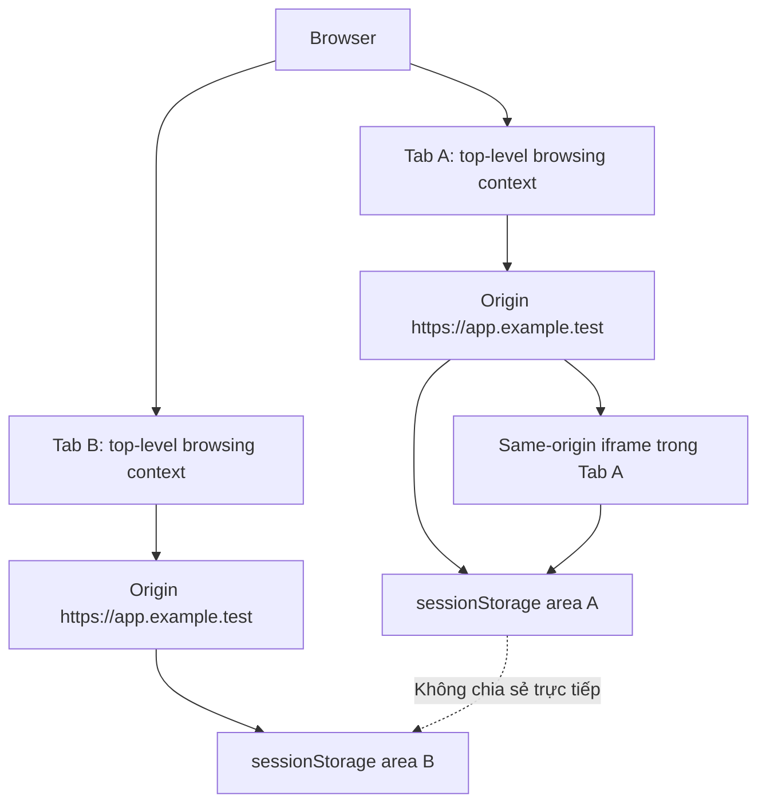

# sessionStorage: lưu dữ liệu tạm theo origin và phiên tab

**Chương:** Storage  
**Mô-đun:** `SECURITY_APPLICATION_SECURITY_BROWSER_SECURITY` — phân tích ranh giới bảo mật giữa trình duyệt, origin, cookie và ứng dụng web để hiểu Same-Origin Policy (SOP), CORS và các cơ chế cách ly; thực hành phòng vệ XSS, CSRF, clickjacking bằng CSP, Trusted Types, security headers và kiểm chứng hành vi thực tế.

`sessionStorage` là Web Storage API cho phép một document lưu các cặp khóa–giá trị dạng chuỗi trong phạm vi **origin và page session của một top-level browsing context**. Trong cách dùng thông thường, dữ liệu được giữ khi người dùng reload hoặc điều hướng trong cùng tab, nhưng không được chia sẻ như một kho lưu trữ chung giữa các tab độc lập. Khi tab/window đóng, page session thường kết thúc và dữ liệu tương ứng bị loại bỏ.

`sessionStorage` phù hợp với trạng thái tạm thời của một luồng giao diện, ví dụ bước hiện tại của wizard, bộ lọc đang dùng, trạng thái form chưa gửi hoặc một mã tương quan không nhạy cảm. Nó không phải nơi lưu bí mật, không phải session đăng nhập phía server và không tạo ra ranh giới bảo mật riêng với JavaScript cùng origin. Nếu ứng dụng có XSS, script độc hại chạy trong origin đó có thể đọc hoặc sửa dữ liệu trong `sessionStorage`.

Bài học tập trung vào cách dùng, vòng đời và ranh giới cô lập của `sessionStorage`, đồng thời đối chiếu với IndexedDB. Điểm cần phân biệt rõ: `sessionStorage` là API đồng bộ, chỉ lưu string và không có transaction hay structured clone; IndexedDB là kho dữ liệu bất đồng bộ, hỗ trợ transaction và structured clone cho dữ liệu có cấu trúc.

## 1. Mục tiêu học tập

Sau bài học, bạn có thể:

1. Giải thích `sessionStorage` được phân vùng theo origin và top-level browsing context.
2. Phân biệt vòng đời của `sessionStorage` với `localStorage`, cookie và IndexedDB.
3. Dùng các thao tác `getItem`, `setItem`, `removeItem`, `clear`, `key` và `length` đúng cách.
4. Xử lý dữ liệu có cấu trúc bằng JSON mà không nhầm nó với structured clone.
5. Giải thích hành vi khi mở tab mới có opener, reload, điều hướng và đóng tab.
6. Hiểu sự kiện `storage` và phạm vi đồng bộ giữa các document.
7. Nhận diện lỗi `SecurityError`, quota, dữ liệu lỗi định dạng và tình huống storage không khả dụng.
8. Đánh giá rủi ro XSS, dữ liệu nhạy cảm, session fixation và giả mạo dữ liệu client.
9. Phân biệt transaction, structured clone và isolation trong IndexedDB với cơ chế của `sessionStorage`.
10. Kiểm thử hành vi storage bằng DevTools, browser test và các trường hợp nhiều tab/iframe.

## 2. sessionStorage hoạt động trong phạm vi nào?

### 2.1. Origin và page session

Một storage area của `sessionStorage` gắn với:

- **Origin:** gồm scheme, host và port. Ví dụ `https://app.example.test` khác `http://app.example.test` và khác `https://app.example.test:8443`.
- **Top-level browsing context:** thường tương ứng với tab/window đang mở trang.
- **Page session:** vòng đời của tab/window đó. Reload và điều hướng trong cùng tab thường giữ page session.

Vì vậy, cùng một origin được mở ở hai tab độc lập thường có hai vùng `sessionStorage` riêng. Thay đổi trong tab A không tự động xuất hiện trong tab B.

Một trang cùng origin được nhúng trong iframe của tab A có thể truy cập storage area thuộc origin đó trong page session của tab A. Nếu có nhiều iframe cùng origin trong cùng top-level browsing context, chúng có thể chia sẻ cùng vùng session storage của origin tương ứng. Quy tắc này vẫn bị giới hạn bởi same-origin policy và các cơ chế partitioning của browser.

Iframe khác origin có storage area gắn với origin của chính nó trong browsing context đó; nó không thể đọc storage area của trang cha. Nếu browser áp dụng third-party storage partitioning, phạm vi lưu trữ còn có thể bị giới hạn theo top-level site.

### 2.2. Sơ đồ phân vùng



Hai tab có cùng URL vẫn có thể có session storage khác nhau. Origin xác định ranh giới theo website; top-level browsing context xác định page session riêng.

### 2.3. So sánh nhanh với localStorage và cookie

| Cơ chế | Phạm vi chia sẻ chính | Vòng đời | Gửi tự động theo HTTP request? |
| --- | --- | --- | --- |
| `sessionStorage` | Origin + top-level browsing context/page session | Thường kết thúc khi tab/window đóng | Không |
| `localStorage` | Origin, dùng chung giữa các tab cùng storage partition | Lưu lâu dài cho đến khi bị xóa/evict | Không |
| Cookie | Domain/path và các thuộc tính cookie; browser áp dụng SameSite/partitioning | Theo expiry/session policy | Có, nếu phù hợp URL và thuộc tính |
| IndexedDB | Origin và storage partition/context của browser | Lưu bền hơn, đến khi xóa/evict | Không |

Không dùng bảng này để suy ra storage là ranh giới bảo mật mạnh. Các API lưu trữ web vẫn chịu ảnh hưởng của origin, browser profile, private browsing, storage partitioning, quota và chính sách người dùng.

### 2.4. Khi nào dữ liệu được giữ hoặc tách?

| Thao tác | Hành vi thông thường |
| --- | --- |
| Reload cùng tab | Giữ dữ liệu |
| Điều hướng sang route cùng origin trong cùng tab | Giữ dữ liệu |
| Điều hướng sang origin khác rồi quay lại trong cùng tab | Vùng storage của origin trước thường vẫn còn trong page session |
| Mở origin đó ở tab độc lập | Storage area riêng |
| Mở tab mới cùng origin bằng opener | Tab mới có thể được khởi tạo bằng bản sao ban đầu của opener's sessionStorage; sau đó hai tab độc lập |
| Đóng tab/window | Page session kết thúc; dữ liệu thường bị xóa |
| Browser restore session sau crash/restart | Hành vi khôi phục phụ thuộc browser; không dựa vào nó như lưu trữ bền vững |

Khi tab mới cùng origin được tạo với opener, browser có thể khởi tạo vùng session storage của tab mới bằng bản sao dữ liệu tại thời điểm mở. Các thay đổi sau đó không đồng bộ giữa hai tab. Thuộc tính `rel="noopener"` hoặc `window.open` với `noopener` loại bỏ quan hệ opener và tránh cơ chế sao chép ban đầu này theo hành vi của browser.


## 3. API và cách thao tác an toàn

### 3.1. Đọc và ghi cặp key–value

`sessionStorage` cung cấp đối tượng `Storage` với các thao tác:

| API | Tác dụng |
| --- | --- |
| `setItem(key, value)` | Ghi giá trị theo key |
| `getItem(key)` | Đọc giá trị; trả `null` nếu key chưa tồn tại |
| `removeItem(key)` | Xóa một key |
| `clear()` | Xóa toàn bộ key trong storage area hiện tại |
| `key(index)` | Lấy key tại vị trí index; trả `null` nếu không có |
| `length` | Số lượng key hiện có |

Ví dụ:

```javascript
sessionStorage.setItem("checkout.step", "shipping");

const currentStep = sessionStorage.getItem("checkout.step");
console.log(currentStep); // "shipping"

sessionStorage.removeItem("checkout.step");
```

Dùng các method thay vì truy cập property như `sessionStorage.foo`. Cách property có thể va chạm với tên method/property có sẵn và làm code khó kiểm soát. `setItem` và `getItem` thể hiện rõ thao tác storage, đồng thời xử lý key động dễ hơn.

Có thể duyệt key bằng `key(index)` kết hợp `length`, nhưng không nên dựa vào thứ tự key như một thứ tự nghiệp vụ. Nếu cần thứ tự, lưu nó thành dữ liệu riêng.

### 3.2. Storage chỉ lưu chuỗi

Web Storage lưu key và value dưới dạng chuỗi. Nếu truyền object trực tiếp:

```javascript
sessionStorage.setItem("profile", { name: "An" });
console.log(sessionStorage.getItem("profile")); // "[object Object]"
```

Object bị chuyển thành string theo quy tắc chuyển đổi thông thường, không được clone thành object. Với dữ liệu đơn giản có cấu trúc JSON, serialize trước khi ghi và parse khi đọc:

```javascript
const draft = {
  step: 2,
  shippingMethod: "express",
  giftWrap: false
};

sessionStorage.setItem("checkout.draft.v1", JSON.stringify(draft));

const raw = sessionStorage.getItem("checkout.draft.v1");
const restored = raw === null ? null : JSON.parse(raw);
```

JSON là định dạng văn bản, không phải structured clone. JSON không giữ nguyên nhiều kiểu dữ liệu như `Date`, `Map`, `Set`, `undefined`, `BigInt` hoặc object có vòng tham chiếu. `JSON.stringify` có thể lỗi với cấu trúc vòng hoặc BigInt; `JSON.parse` có thể ném `SyntaxError` nếu dữ liệu hỏng.

### 3.3. Parse dữ liệu có kiểm tra

Dữ liệu storage có thể cũ, bị sửa trong DevTools hoặc được ghi bởi phiên bản ứng dụng khác. Không parse rồi tin ngay vào shape:

```javascript
function readCheckoutDraft() {
  const raw = sessionStorage.getItem("checkout.draft.v1");
  if (raw === null) return null;

  try {
    const value = JSON.parse(raw);

    if (
      value === null ||
      typeof value !== "object" ||
      !Number.isInteger(value.step) ||
      value.step < 0 ||
      value.step > 5 ||
      typeof value.shippingMethod !== "string"
    ) {
      return null;
    }

    return {
      step: value.step,
      shippingMethod: value.shippingMethod,
      giftWrap: value.giftWrap === true
    };
  } catch {
    return null;
  }
}
```

Ví dụ này chỉ minh họa kiểm tra cấu trúc. Server vẫn phải xác minh lại mọi dữ liệu ảnh hưởng tới giá, quyền, tồn kho, người nhận, thanh toán hoặc trạng thái nghiệp vụ. Giá trị do browser lưu không phải bằng chứng đáng tin cậy.

### 3.4. Namespace và version key

Ứng dụng lớn có thể chia sẻ origin với nhiều route hoặc micro frontend. Dùng prefix và version rõ ràng:

- `app.checkout.draft.v1`
- `app.search.filters.v2`
- `app.onboarding.step.v1`

Không gọi `clear()` nếu chỉ muốn xóa dữ liệu của một tính năng; nó xóa toàn bộ key trong storage area hiện tại, có thể ảnh hưởng module khác cùng origin và tab. Dùng `removeItem` cho key cụ thể hoặc duyệt key theo namespace đã thống nhất.

Khi schema thay đổi, tăng version hoặc viết migration có kiểm tra. Nếu không nhận diện được phiên bản dữ liệu, bỏ draft cũ một cách an toàn và yêu cầu người dùng nhập lại khi cần.

### 3.5. Truy cập storage có thể thất bại

Không giả định đọc `window.sessionStorage` luôn thành công. Browser có thể ném `SecurityError` khi origin không hợp lệ/opaque hoặc khi chính sách browser không cho phép lưu trữ. Ví dụ thường gặp là document trong iframe sandbox không có `allow-same-origin` hoặc một số môi trường hạn chế storage.

Quota có thể bị giới hạn; `setItem` có thể ném `QuotaExceededError`. Dữ liệu lớn cũng khiến thao tác đồng bộ chặn main thread. Nên dùng wrapper có xử lý lỗi:

```javascript
function safeWriteSessionValue(key, value) {
  try {
    window.sessionStorage.setItem(key, value);
    return true;
  } catch (error) {
    if (
      error instanceof DOMException &&
      (error.name === "QuotaExceededError" || error.name === "SecurityError")
    ) {
      return false;
    }
    throw error;
  }
}
```

Nếu lấy storage object ở ngoài khối try, lỗi khi truy cập getter có thể xảy ra trước khi wrapper xử lý. Với code cần chạy trong môi trường hạn chế, lấy object bên trong try và có fallback giao diện phù hợp:

```javascript
function getSessionStorageSafely() {
  try {
    return window.sessionStorage;
  } catch {
    return null;
  }
}
```

Không chuyển sang ghi dữ liệu nhạy cảm vào nơi khác chỉ vì session storage không khả dụng. Hãy xác định tính năng có thể tiếp tục mà không lưu draft hay cần thông báo cho người dùng.


## 4. Storage event và đồng bộ trong cùng page session

Khi một document thay đổi `sessionStorage`, browser có thể phát sự kiện `storage` tới các document khác đang dùng chung storage area. Sự kiện không phát về chính window đã thực hiện thay đổi.

Với `sessionStorage`, phạm vi nhận sự kiện là các same-origin browsing context cùng top-level browsing context, chẳng hạn một iframe cùng origin. Sự kiện không được phát tới tab độc lập khác như cách `localStorage` thường đồng bộ giữa các tab.

Ví dụ:

```javascript
window.addEventListener("storage", event => {
  console.log("Changed key:", event.key);
  console.log("Old value:", event.oldValue);
  console.log("New value:", event.newValue);
  console.log("Changed document:", event.url);
});
```

Các trường thường dùng:

- `key`: key thay đổi; là `null` khi gọi `clear()`.
- `oldValue`: giá trị trước thay đổi; là `null` khi key mới được tạo.
- `newValue`: giá trị mới; là `null` khi key bị xóa hoặc storage bị clear.
- `url`: URL của document tạo thay đổi.
- `storageArea`: storage area liên quan tới sự kiện.

Không dùng sự kiện này như message bus tổng quát. Nó chỉ phản ánh thay đổi storage trong phạm vi được browser chia sẻ; không có bảo đảm đồng bộ cross-tab cho `sessionStorage`. Nếu các tab độc lập cần giao tiếp, cân nhắc BroadcastChannel hoặc cơ chế phía server, với xác thực message và vòng đời phù hợp.

## 5. Ranh giới bảo mật và cô lập dữ liệu

### 5.1. Same-origin là ranh giới truy cập

JavaScript chỉ có thể truy cập storage area khi document có origin phù hợp. Một trang ở `https://attacker.example` không thể trực tiếp đọc `sessionStorage` của `https://app.example` chỉ bằng cách biết URL hoặc tên key.

Nhưng mọi script chạy trong origin ứng dụng — bao gồm script bên thứ ba được tải vào trang, script bị chèn qua XSS hoặc dependency bị xâm phạm — có thể truy cập storage area của origin đó. `sessionStorage` không tạo sandbox riêng giữa các script cùng origin.

### 5.2. XSS có thể đọc và sửa dữ liệu

Nếu attacker thực thi JavaScript trong origin ứng dụng, họ có thể đọc dữ liệu:

```javascript
const draft = sessionStorage.getItem("checkout.draft.v1");
```

Họ cũng có thể ghi đè hoặc xóa dữ liệu:

```javascript
sessionStorage.setItem("checkout.step", "payment");
sessionStorage.removeItem("app.profile.cache.v1");
```

Do đó:

- Không lưu password, access token dài hạn, refresh token, recovery code hoặc dữ liệu thanh toán nhạy cảm.
- Không xem dữ liệu storage là đáng tin; người dùng có thể sửa bằng DevTools hoặc script.
- Encode/validate dữ liệu khi render; dữ liệu được đọc từ storage vẫn có thể chứa payload XSS.
- Phòng vệ XSS bằng output encoding, safe DOM APIs, CSP và Trusted Types khi phù hợp.
- Dùng server để xác thực và phân quyền mọi thao tác nghiệp vụ.

### 5.3. sessionStorage không tự gửi theo request

Khác cookie, dữ liệu trong `sessionStorage` không tự động được browser đính kèm vào HTTP request. Ứng dụng chỉ gửi nó nếu JavaScript chủ động đọc rồi đưa vào URL, body hoặc header.

Điều này có nghĩa `sessionStorage` không có cùng kiểu ambient credential behavior như cookie và không tự tạo một CSRF token được gửi cùng request. Tuy nhiên, nếu ứng dụng lưu CSRF token ở đây rồi JavaScript tự đính kèm token, XSS cùng origin vẫn có thể đọc token và thực hiện request thay mặt người dùng. Hãy thiết kế CSRF defense theo cơ chế xác thực thực tế của ứng dụng.

### 5.4. Không dùng client storage làm nguồn sự thật

Ví dụ, nếu trang lưu giá sản phẩm hoặc quyền người dùng trong `sessionStorage`, attacker có thể sửa giá trị trước khi thao tác tiếp tục. Server phải lấy giá và quyền từ dữ liệu tin cậy phía server, rồi kiểm tra lại khi nhận request.

Storage phù hợp để giữ trạng thái giao diện hoặc draft tạm thời. Nó không thay thế database, server session, transaction nghiệp vụ hay audit log.

### 5.5. Xóa dữ liệu không phải secure erase

`removeItem` và `clear()` xóa key khỏi storage area mà ứng dụng nhìn thấy. Chúng không phải cam kết ghi đè vật lý lên mọi bản sao, cache, backup hoặc dữ liệu khôi phục của browser profile. Vì vậy, đừng lưu dữ liệu mà chính sách yêu cầu phải có khả năng secure erase tuyệt đối.

Khi logout, xóa các key của ứng dụng và revoke session phía server theo thiết kế. Đừng chỉ dựa vào việc đóng tab để thu hồi quyền truy cập tài khoản.

### 5.6. Sandbox và storage partitioning

Một iframe có `sandbox` nhưng không có `allow-same-origin` thường có opaque origin; truy cập Web Storage có thể ném `SecurityError`. Nếu widget cần storage, hãy cấp quyền sandbox tối thiểu và đánh giá rủi ro của việc giữ origin thật.

Browser hiện đại còn có thể partition storage trong third-party context theo top-level site để hạn chế tracking. Vì vậy, không giả định iframe third-party có thể dùng một storage area chung xuyên nhiều website. Hành vi partitioning, quyền truy cập và ngoại lệ phụ thuộc browser. Kiểm thử trên browser/version mục tiêu và không dùng storage third-party làm kênh chia sẻ dữ liệu đáng tin cậy.

## 6. sessionStorage và IndexedDB: transaction, structured clone, isolation

Task về browser storage thường nhắc đến IndexedDB, transaction và structured clone. Đây là các khái niệm quan trọng, nhưng không thuộc API `sessionStorage`.

| Thuộc tính | sessionStorage | IndexedDB |
| --- | --- | --- |
| Kiểu dữ liệu | String key–value | Object store với dữ liệu được structured clone |
| API | Đồng bộ | Bất đồng bộ, dựa trên request/event và Promise wrapper |
| Transaction | Không có transaction API | Có readonly/readwrite/versionchange transaction |
| Dữ liệu phức tạp | Tự serialize, thường dùng JSON | Structured clone hỗ trợ nhiều kiểu dữ liệu |
| Truy vấn | Đọc theo key, duyệt key | Key, index và cursor |
| Phù hợp | State UI tạm thời theo tab | Dữ liệu lớn/có cấu trúc cần lưu bền hơn |
| Phạm vi cô lập | Origin + top-level browsing context | Origin và storage partition/context theo browser |

### 6.1. IndexedDB transaction là gì?

Transaction nhóm nhiều thao tác đọc/ghi trên một hoặc nhiều object store. Các mode chính:

- `readonly`: đọc dữ liệu, không sửa đổi.
- `readwrite`: đọc và ghi dữ liệu.
- `versionchange`: thay đổi schema database, ví dụ tạo object store hoặc index trong `onupgradeneeded`.

Transaction có tính nguyên tử: nếu transaction commit, các thay đổi thuộc transaction được áp dụng; nếu abort, các thay đổi trong transaction bị hủy. Điều này giúp tránh trạng thái ghi một nửa khi nhiều thao tác phải thành công cùng nhau.

Ví dụ:

```javascript
const transaction = db.transaction(
  ["drafts", "metadata"],
  "readwrite"
);

const drafts = transaction.objectStore("drafts");
const metadata = transaction.objectStore("metadata");

drafts.put({
  id: "checkout-1",
  step: 3,
  updatedAt: new Date()
});

metadata.put({
  key: "last-draft",
  value: "checkout-1"
});

transaction.oncomplete = () => {
  console.log("Both writes committed");
};

transaction.onabort = () => {
  console.error("Transaction aborted");
};

transaction.onerror = () => {
  console.error("Transaction error");
};
```

Hai thao tác nằm trong cùng transaction. Nếu transaction abort, cả hai thay đổi không được commit. Đây là bảo đảm mà `sessionStorage` không cung cấp cho một chuỗi nhiều key.

### 6.2. Transaction phải ngắn và gắn với request IndexedDB

IndexedDB transaction có vòng đời do browser quản lý. Khi không còn request đang chờ và event loop rời khỏi các callback liên quan, transaction có thể trở nên inactive/auto-commit. Không giữ transaction mở để chờ network hoặc một Promise không liên quan.

Ví dụ anti-pattern:

```javascript
const tx = db.transaction(["drafts"], "readwrite");
const store = tx.objectStore("drafts");

const response = await fetch("/api/validate");
const result = await response.json();

store.put(result);
```

Trong lúc chờ network, transaction có thể đã inactive hoặc commit. Thực hiện network trước, sau đó mở transaction mới để ghi:

```javascript
const response = await fetch("/api/validate");
const result = await response.json();

const tx = db.transaction(["drafts"], "readwrite");
tx.objectStore("drafts").put(result);
```

Nếu cần nhiều bước phụ thuộc nhau, tổ chức chúng thành các request IndexedDB trong cùng transaction và xử lý trong callback/event của request; không dùng transaction như một khóa kéo dài qua toàn bộ workflow ứng dụng.

### 6.3. Structured clone khác JSON serialization

IndexedDB dùng structured clone algorithm để sao chép dữ liệu vào database. Nó hỗ trợ nhiều kiểu mà JSON không thể biểu diễn nguyên trạng, ví dụ `Date`, `Map`, `Set`, `ArrayBuffer`, typed arrays, `Blob` và một số platform object được hỗ trợ.

Structured clone không phải cơ chế serialize mọi thứ. Function, DOM node và symbol không được clone theo cách thông thường; prototype chain và behavior của custom class không được giữ như một instance sống. Hãy lưu dữ liệu thuần, kiểm tra kiểu và thiết kế schema rõ ràng.

`sessionStorage` không dùng structured clone. Truyền object vào `setItem` sẽ chuyển object thành string; muốn lưu cấu trúc phải serialize, thường là JSON, và chấp nhận các giới hạn của JSON.

### 6.4. Isolation của IndexedDB không tạo ranh giới chống XSS

IndexedDB cũng được phân vùng theo origin và có thể chịu storage partitioning của browser. Script cùng origin có thể mở database và đọc/ghi object store theo quyền của origin đó. Nếu XSS chạy trong ứng dụng, dữ liệu IndexedDB cũng có thể bị truy cập.

Transaction giúp nhất quán dữ liệu giữa các thao tác; nó không xác thực người dùng và không ngăn script độc hại cùng origin. Tách dữ liệu theo object store hoặc database name cũng không tạo security principal riêng.


### 6.5. Mở database và ghi bằng transaction

Ví dụ tối thiểu về schema version 1:

```javascript
function openCheckoutDatabase() {
  return new Promise((resolve, reject) => {
    const request = indexedDB.open("checkout-db", 1);

    request.onupgradeneeded = () => {
      const db = request.result;

      if (!db.objectStoreNames.contains("drafts")) {
        const store = db.createObjectStore("drafts", {
          keyPath: "id"
        });
        store.createIndex("updatedAt", "updatedAt");
      }
    };

    request.onsuccess = () => {
      const db = request.result;
      db.onversionchange = () => db.close();
      resolve(db);
    };

    request.onerror = () => reject(request.error);
    request.onblocked = () => {
      console.warn("Close older tabs using the previous database version");
    };
  });
}

function saveDraft(db, draft) {
  return new Promise((resolve, reject) => {
    const transaction = db.transaction(["drafts"], "readwrite");
    const record = {
      ...draft,
      updatedAt: new Date()
    };

    transaction.objectStore("drafts").put(record);
    transaction.oncomplete = () => resolve();
    transaction.onabort = () => {
      reject(transaction.error || new Error("Transaction aborted"));
    };
  });
}
```

Mở database và cập nhật schema là thao tác bất đồng bộ. `onupgradeneeded` chạy khi tạo database hoặc nâng version; đây là nơi tạo object store và index. Khi version mới cần upgrade, tab cũ đang giữ connection có thể làm request bị blocked. Đóng connection khi nhận `versionchange` để tab khác có thể nâng schema.

Mỗi lần ghi draft, mở transaction mới, thêm request và chờ `transaction.oncomplete` để biết commit thành công. Không coi việc gọi `put` là bằng chứng dữ liệu đã commit. Nếu cần biết một record đã được lưu bền vững, hãy xử lý hoàn tất transaction và các lỗi liên quan.

### 6.6. Transaction scope và isolation

Transaction chỉ bao phủ các object store được liệt kê khi tạo transaction. Một transaction `readwrite` trên cùng object store được browser điều phối để tránh các ghi đồng thời làm hỏng tính nhất quán. Transaction `readonly` có thể chạy song song tùy browser và scope. Không dùng transaction như khóa toàn cục cho mọi database hoặc như cơ chế phân quyền.

Một thao tác có nhiều ghi phụ thuộc nhau nên đặt trong cùng transaction nếu chúng phải cùng thành công hoặc cùng thất bại. Nếu tách thành nhiều transaction, ứng dụng có thể để lại trạng thái một phần khi bước sau lỗi.


## 7. Lab: quan sát sessionStorage giữa tab, opener và iframe

Lab dùng một file HTML được phục vụ qua HTTP local. Hãy dùng cùng một URL và origin cho các trang trong lab, ví dụ `http://localhost:8080/session-storage-lab.html`. Không mở file bằng `file://` vì cách xử lý origin của file URL không phù hợp để kiểm tra ranh giới web storage.

Lab minh họa bốn hành vi:

1. Reload cùng tab giữ dữ liệu.
2. Tab mới mở bằng `window.open` có opener có thể nhận bản sao ban đầu của session storage.
3. Hai tab sau đó hoạt động độc lập, không đồng bộ thay đổi.
4. Same-origin iframe trong tab hiện tại chia sẻ storage area và nhận `storage` event khi iframe thay đổi dữ liệu.

### 7.1. Tạo file HTML

Tạo file `session-storage-lab.html` trong thư mục static của một server local:

```html
<!doctype html>
<html lang="vi">
<head>
  <meta charset="utf-8">
  <meta name="viewport" content="width=device-width, initial-scale=1">
  <title>sessionStorage lab</title>
  <style>
    body { font: 16px system-ui, sans-serif; margin: 2rem; }
    section { border: 1px solid #aaa; padding: 1rem; margin: 1rem 0; }
    button { margin: .25rem; padding: .5rem; }
    pre { white-space: pre-wrap; background: #f4f4f4; padding: .75rem; }
    iframe { width: 100%; height: 180px; border: 1px solid #888; }
  </style>
</head>
<body>
  <h1>sessionStorage lab</h1>

  <section id="parent-ui">
    <h2>Parent tab</h2>
    <p>Current value: <strong id="parent-value"></strong></p>
    <button id="parent-write">Write from parent</button>
    <button id="open-copy">Open child with opener</button>
    <button id="open-noopener">Open child with noopener</button>
    <h3>Same-origin iframe</h3>
    <iframe title="Same-origin session storage frame" src="?role=frame"></iframe>
    <h3>Parent event log</h3>
    <pre id="parent-log"></pre>
  </section>

  <section id="child-ui" hidden>
    <h2>New tab</h2>
    <p>Initial value: <strong id="child-value"></strong></p>
    <button id="child-write">Write from child tab</button>
    <h3>Child event log</h3>
    <pre id="child-log"></pre>
  </section>

  <section id="frame-ui" hidden>
    <h2>Same-origin iframe</h2>
    <p>Current value: <strong id="frame-value"></strong></p>
    <button id="frame-write">Write from iframe</button>
    <h3>Iframe event log</h3>
    <pre id="frame-log"></pre>
  </section>

  <script>
    const role = new URLSearchParams(location.search).get("role") || "parent";
    const key = "lab.session.value";

    function logTo(elementId, message) {
      const element = document.getElementById(elementId);
      element.textContent += message + "\n";
    }

    function showValue(elementId) {
      document.getElementById(elementId).textContent =
        sessionStorage.getItem(key) || "(empty)";
    }

    function writeValue(value, elementId) {
      sessionStorage.setItem(key, value);
      showValue(elementId);
    }

    if (role === "parent") {
      document.getElementById("parent-ui").hidden = false;
      showValue("parent-value");

      document.getElementById("parent-write").addEventListener("click", () => {
        writeValue("parent-" + Date.now(), "parent-value");
      });

      document.getElementById("open-copy").addEventListener("click", () => {
        window.open(location.pathname + "?role=child", "_blank");
      });

      document.getElementById("open-noopener").addEventListener("click", () => {
        window.open(location.pathname + "?role=child", "_blank", "noopener");
      });

      window.addEventListener("storage", event => {
        logTo("parent-log", "storage event: " + event.key +
          " old=" + event.oldValue + " new=" + event.newValue);
        showValue("parent-value");
      });
    }

    if (role === "child") {
      document.getElementById("child-ui").hidden = false;
      showValue("child-value");

      document.getElementById("child-write").addEventListener("click", () => {
        writeValue("child-" + Date.now(), "child-value");
      });

      window.addEventListener("storage", event => {
        logTo("child-log", "storage event: " + event.key);
        showValue("child-value");
      });
    }

    if (role === "frame") {
      document.getElementById("frame-ui").hidden = false;
      showValue("frame-value");

      document.getElementById("frame-write").addEventListener("click", () => {
        writeValue("iframe-" + Date.now(), "frame-value");
      });

      window.addEventListener("storage", event => {
        logTo("frame-log", "storage event: " + event.key +
          " old=" + event.oldValue + " new=" + event.newValue);
        showValue("frame-value");
      });
    }
  </script>
</body>
</html>
```

### 7.2. Chạy thử

1. Phục vụ thư mục bằng static server local, ví dụ server dev sẵn có của dự án hoặc một HTTP server local.
2. Mở `http://localhost:8080/session-storage-lab.html`.
3. Nhấn **Write from parent**, sau đó reload trang. Giá trị parent vẫn còn.
4. Nhấn **Open child with opener**. Tab mới có thể hiển thị giá trị đã tồn tại tại thời điểm được mở.
5. Quay lại parent, ghi giá trị mới. Tab child không tự đổi theo.
6. Ghi giá trị từ child. Parent cũng không tự đổi theo và không nhận `storage` event từ tab child.
7. Nhấn **Write from iframe**. Parent nhận `storage` event và giá trị hiển thị được cập nhật vì iframe cùng origin trong cùng top-level browsing context dùng chung storage area.
8. Nhấn **Open child with noopener**. Tab mới không nhận bản sao storage qua opener; giá trị thường rỗng nếu chưa được ghi trong page session mới.
9. Mở URL trực tiếp trong tab độc lập để so sánh: storage area của tab đó tách biệt.

Popup có thể bị browser chặn nếu `window.open` không xuất phát trực tiếp từ thao tác người dùng. Hãy nhấn nút tương ứng để browser cho phép mở tab.

### 7.3. Kiểm tra origin isolation

Mở cùng file từ một origin khác, ví dụ port khác `http://localhost:8081` nếu server có phục vụ file đó. Port khác tạo origin khác, nên storage area không được chia sẻ. Thử scheme HTTPS và HTTP trên cùng host cũng tạo hai origin khác nhau.

Không dựa vào tên hostname để kết luận hai trang có chung storage. Origin cần khớp scheme, host và port; browser còn có thể áp dụng storage partitioning trong third-party context.

### 7.4. Dọn lab

Đóng các tab thử nghiệm. Xóa file lab khỏi thư mục static nếu không còn dùng. Không đưa dữ liệu thật hoặc token xác thực vào key thử nghiệm.


## 8. Test matrix cho sessionStorage và IndexedDB

Test storage phải chạy trong browser thật vì vòng đời tab, opener, iframe, permission và partitioning là hành vi của browser. Ma trận dưới đây kết hợp kiểm tra API và ranh giới cô lập.

| ID | Tình huống | Kết quả mong đợi |
| --- | --- | --- |
| ST-01 | Ghi key rồi đọc lại trong cùng tab | Nhận đúng string đã ghi |
| ST-02 | Đọc key chưa tồn tại | Trả `null` |
| ST-03 | Reload cùng tab | Giá trị vẫn còn |
| ST-04 | Điều hướng cùng origin trong cùng tab rồi quay lại | Page session giữ storage |
| ST-05 | Mở URL ở tab độc lập | Storage area tách biệt |
| ST-06 | Mở tab bằng `window.open` có opener | Có thể nhận bản sao ban đầu của opener |
| ST-07 | Thay đổi parent sau khi child đã mở | Không tự đồng bộ sang child tab |
| ST-08 | Mở tab bằng `noopener` | Không sao chép storage qua opener |
| ST-09 | Same-origin iframe ghi key | Parent nhận `storage` event |
| ST-10 | Parent ghi key | Iframe cùng storage area nhận `storage` event |
| ST-11 | Tab độc lập thay đổi key | Tab khác không nhận `sessionStorage` event |
| ST-12 | Gọi `clear()` | Xóa toàn bộ key của storage area hiện tại; event có `key=null` ở document khác cùng area |
| ST-13 | Gọi `removeItem` với key không tồn tại | Không phát sinh lỗi |
| ST-14 | JSON bị hỏng | Parse được xử lý bằng try/catch và fallback |
| ST-15 | Truyền object vào `setItem` | Giá trị được chuyển thành string, không structured clone |
| ST-16 | Origin khác scheme hoặc port | Không truy cập storage area của origin kia |
| ST-17 | Sandboxed iframe opaque origin | Có thể ném `SecurityError`; ứng dụng xử lý fallback |
| ST-18 | Storage bị browser policy chặn hoặc quota đầy | Lỗi được xử lý; giao diện vẫn có phương án |
| ST-19 | XSS chạy cùng origin | Script có thể đọc/sửa session storage; xác nhận không có secret |
| ST-20 | Đóng tab/window | Page session kết thúc; không dựa vào storage như dữ liệu bền vững |
| IDB-01 | Hai ghi trong cùng readwrite transaction | Cả hai commit hoặc transaction abort |
| IDB-02 | Một request lỗi khiến transaction abort | Không có thay đổi một phần được commit |
| IDB-03 | Lưu `Date`, `Map`, `Blob` bằng IndexedDB | Structured clone giữ kiểu được hỗ trợ |
| IDB-04 | Lưu function hoặc DOM node bằng IndexedDB | Structured clone thất bại |
| IDB-05 | Tab cũ giữ connection khi nâng schema | Upgrade có thể bị blocked cho đến khi connection cũ đóng |

### 8.1. Kiểm tra bằng DevTools

Trong DevTools → Application/Storage:

1. Chọn đúng origin.
2. Mở Session Storage và kiểm tra key/value của tab hiện tại.
3. Mở tab mới cùng URL và so sánh storage area.
4. Reload tab để xác nhận dữ liệu tạm còn tồn tại.
5. Mở iframe cùng origin và kiểm tra thay đổi từ hai phía.
6. Kiểm tra IndexedDB riêng để xem database, object store và record.
7. Sửa giá trị trong DevTools để xác nhận ứng dụng không tin dữ liệu client.

Tên panel có thể khác giữa Chromium, Firefox và WebKit. Dữ liệu storage được hiển thị trong DevTools có thể bị người dùng chỉnh sửa; đây là hành vi cần tính đến trong threat model.

### 8.2. Kiểm tra storage event

Ghi lại `key`, `oldValue`, `newValue`, `url` và `storageArea` trong listener. Thực hiện ghi từ iframe cùng origin và so sánh với ghi từ tab độc lập.

Không chỉ kiểm tra listener đã được đăng ký. Cần xác nhận đúng browsing context nhận event, vì `sessionStorage` không có cơ chế đồng bộ giữa các tab độc lập.

### 8.3. Kiểm tra IndexedDB transaction

Để kiểm tra atomicity, tạo transaction ghi hai object store, sau đó cố ý tạo request lỗi hoặc gọi `abort()`. Xác nhận cả hai thay đổi không được commit. Chạy thêm một transaction thành công và chỉ cập nhật UI sau sự kiện `complete`.

Với structured clone, lưu và đọc lại một object chứa `Date`, `Map`, `Set`, `ArrayBuffer` hoặc `Blob` được hỗ trợ; so sánh kiểu dữ liệu sau khi đọc. Thử lưu function để xác nhận thao tác không được hỗ trợ thất bại.


## 9. Những ngộ nhận thường gặp

**“sessionStorage được chia sẻ giữa mọi tab cùng origin.”** Sai. Nó được phân vùng theo origin và top-level browsing context. Các tab độc lập thường có storage area riêng.

**“Reload sẽ xóa sessionStorage.”** Sai. Reload và điều hướng trong cùng tab thường giữ page session và dữ liệu.

**“Đóng tab luôn bảo đảm dữ liệu bị xóa vật lý.”** Không thể khẳng định như vậy. Đóng tab kết thúc page session theo mô hình API, nhưng không phải cam kết secure erase khỏi mọi bản sao hoặc trạng thái khôi phục của browser.

**“Tab mới luôn bắt đầu với storage rỗng.”** Chưa chính xác. Tab mới mở có opener có thể được khởi tạo bằng bản sao sessionStorage của opener. Sau đó hai tab độc lập; `noopener` loại bỏ quan hệ opener và cơ chế sao chép ban đầu.

**“sessionStorage lưu được object.”** Sai. Web Storage chỉ lưu chuỗi. Dữ liệu object cần serialize, thường bằng JSON.

**“JSON.stringify tương đương structured clone.”** Sai. JSON là biểu diễn văn bản với tập kiểu dữ liệu hạn chế; structured clone là thuật toán sao chép dữ liệu được IndexedDB và một số API khác sử dụng.

**“sessionStorage có transaction.”** Sai. Web Storage không cung cấp transaction API. Nếu nhiều thay đổi phải nguyên tử, dùng IndexedDB transaction hoặc thiết kế workflow phía server.

**“IndexedDB transaction ngăn XSS.”** Sai. Transaction giúp nhất quán các thao tác dữ liệu; script cùng origin vẫn có thể truy cập database.

**“sessionStorage an toàn vì không gửi tự động theo HTTP request.”** Sai. Không tự gửi như cookie không có nghĩa dữ liệu bí mật. XSS cùng origin có thể đọc; JavaScript cũng có thể tự gửi dữ liệu qua request.

**“CORS cho phép origin khác đọc sessionStorage.”** Sai. CORS không cấp quyền đọc Web Storage. Truy cập storage tuân theo same-origin và các quy tắc partitioning của browser.

**“Dữ liệu trong storage đáng tin vì chính ứng dụng đã ghi.”** Sai. Người dùng, extension hoặc script cùng origin có thể thay đổi dữ liệu. Server phải kiểm tra mọi giá trị ảnh hưởng nghiệp vụ.

**“clear() chỉ xóa key của module đang gọi.”** Sai. Nó xóa toàn bộ key trong storage area hiện tại. Dùng namespace và removeItem khi cần xóa có chọn lọc.

## 10. Checklist sử dụng sessionStorage an toàn

Trước khi đưa tính năng vào production, xác nhận:

1. **Use case:** chỉ lưu state tạm thời theo tab, không dùng làm database hoặc server session.
2. **Data classification:** không lưu password, token dài hạn, recovery code, dữ liệu thanh toán hoặc bí mật.
3. **Origin boundary:** hiểu scheme, host và port; không giả định subdomain hoặc port khác chia sẻ storage.
4. **Tab lifecycle:** kiểm thử reload, điều hướng, tab mới có opener, tab mới `noopener` và đóng tab.
5. **Iframe:** kiểm tra same-origin iframe, cross-origin iframe và sandbox opaque origin.
6. **String serialization:** serialize/parse rõ ràng; kiểm tra JSON parse failure và schema version.
7. **Validation:** coi mọi giá trị storage là dữ liệu không tin cậy; validate trước khi dùng.
8. **Namespace:** dùng prefix và version key để tránh xung đột giữa route hoặc module.
9. **Selective cleanup:** ưu tiên removeItem; chỉ gọi clear khi có quyền sở hữu toàn bộ storage area.
10. **Error handling:** xử lý SecurityError, QuotaExceededError và môi trường storage bị chặn.
11. **Performance:** tránh lưu payload lớn vì Web Storage đồng bộ và có thể block main thread.
12. **XSS defense:** phòng vệ XSS; không render trực tiếp dữ liệu storage vào HTML sink.
13. **Logout/expiry:** xóa key của ứng dụng và revoke session phía server; không dựa vào đóng tab.
14. **Storage event:** không dùng sessionStorage event để đồng bộ giữa các tab độc lập.
15. **IndexedDB:** dùng transaction cho nhóm ghi cần atomicity; chờ transaction complete trước khi báo lưu thành công.
16. **Structured clone:** kiểm tra kiểu dữ liệu được hỗ trợ; không giả định function hoặc DOM node có thể lưu.
17. **Isolation:** nhớ rằng sessionStorage và IndexedDB cùng origin không tạo sandbox riêng chống XSS.
18. **Browser coverage:** kiểm thử trên browser/version mục tiêu, private mode và môi trường storage policy hạn chế.

## 11. Câu hỏi tự kiểm tra

**Câu 1.** sessionStorage được phân vùng theo những yếu tố chính nào?  
**Đáp án:** Origin và top-level browsing context/page session.

**Câu 2.** Hai tab độc lập cùng origin có dùng chung sessionStorage không?  
**Đáp án:** Thông thường không; mỗi tab có storage area riêng.

**Câu 3.** Reload cùng tab có xóa sessionStorage không?  
**Đáp án:** Không. Dữ liệu thường còn trong page session.

**Câu 4.** Tab mới mở với opener có thể nhận gì từ opener?  
**Đáp án:** Một bản sao ban đầu của sessionStorage tại thời điểm mở; các thay đổi sau đó độc lập.

**Câu 5.** sessionStorage lưu kiểu dữ liệu nào?  
**Đáp án:** Key và value dạng chuỗi.

**Câu 6.** Vì sao không thể truyền object trực tiếp vào setItem?  
**Đáp án:** Giá trị được chuyển thành string; Web Storage không dùng structured clone.

**Câu 7.** storage event của sessionStorage có phát tới tab độc lập khác không?  
**Đáp án:** Không. Nó phát tới document khác cùng storage area, chẳng hạn same-origin iframe trong cùng tab.

**Câu 8.** sessionStorage có transaction không?  
**Đáp án:** Không. Transaction là cơ chế của IndexedDB.

**Câu 9.** IndexedDB dùng structured clone để làm gì?  
**Đáp án:** Sao chép dữ liệu có cấu trúc vào/ra database với nhiều kiểu dữ liệu được hỗ trợ, thay vì chỉ chuỗi JSON.

**Câu 10.** Vì sao transaction không ngăn XSS?  
**Đáp án:** Transaction đảm bảo tính nhất quán của thao tác dữ liệu; script độc hại cùng origin vẫn có thể truy cập storage.

**Câu 11.** Khi nào nên dùng IndexedDB thay cho sessionStorage?  
**Đáp án:** Khi cần lưu dữ liệu lớn/có cấu trúc, truy vấn bằng index hoặc nhóm nhiều thao tác cần transaction.

**Câu 12.** Có nên lưu access token dài hạn trong sessionStorage không?  
**Đáp án:** Không nên. XSS cùng origin có thể đọc token; chọn thiết kế xác thực phù hợp và giảm khả năng truy cập token từ JavaScript.

## 12. Ghi nhớ cốt lõi

`sessionStorage` là Web Storage đồng bộ, lưu string theo origin và page session của top-level browsing context. Nó phù hợp với state giao diện tạm thời trong một tab. Reload thường giữ dữ liệu; tab độc lập có storage area riêng; tab mở với opener có thể nhận bản sao ban đầu; same-origin iframe trong cùng tab có thể chia sẻ storage area.

`sessionStorage` không có transaction và không dùng structured clone. Khi cần dữ liệu có cấu trúc hoặc nhiều thao tác ghi phải commit/abort cùng nhau, IndexedDB cung cấp object store, structured clone và transaction bất đồng bộ. Tuy vậy, cả hai vẫn chịu ranh giới origin và không chống được script độc hại chạy cùng origin.

Không lưu bí mật hoặc dữ liệu có thẩm quyền trong client storage. Validate mọi giá trị, phòng vệ XSS, xử lý lỗi/quota, dọn dữ liệu theo namespace và xác minh nghiệp vụ ở server. **Chọn storage theo vòng đời và tính nhất quán cần thiết; đừng nhầm sự tiện lợi của browser storage với một ranh giới bảo mật.**

### Tài liệu tham khảo

- [MDN — Window.sessionStorage](https://developer.mozilla.org/en-US/docs/Web/API/Window/sessionStorage).
- [MDN — Web Storage API](https://developer.mozilla.org/en-US/docs/Web/API/Web_Storage_API).
- [WHATWG — HTML Standard: Web Storage](https://html.spec.whatwg.org/multipage/webstorage.html).
- [MDN — IndexedDB API](https://developer.mozilla.org/en-US/docs/Web/API/IndexedDB_API).
- [MDN — Using IndexedDB](https://developer.mozilla.org/en-US/docs/Web/API/IndexedDB_API/Using_IndexedDB).
- [WHATWG — Structured Data: Structured Clone](https://html.spec.whatwg.org/multipage/structured-data.html#structured-clone).
- [MDN — StorageEvent](https://developer.mozilla.org/en-US/docs/Web/API/StorageEvent).
- [OWASP — HTML5 Security Cheat Sheet](https://cheatsheetseries.owasp.org/cheatsheets/HTML5_Security_Cheat_Sheet.html).

