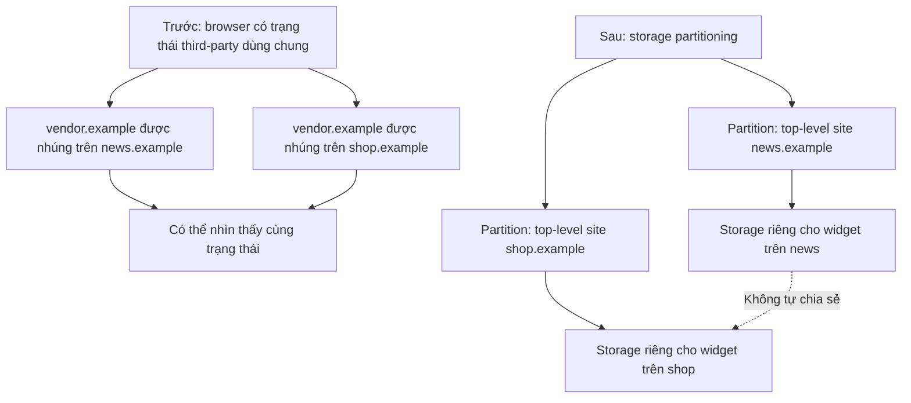

# Phân vùng storage

> **Chương:** Storage  
> **Bài học:** Phân vùng storage — hiểu dữ liệu của nội dung nhúng và xin quyền truy cập storage trong ngữ cảnh third-party  
> **Phạm vi module:** **SECURITY_APPLICATION_SECURITY_BROWSER_SECURITY** — phân tích ranh giới bảo mật giữa trình duyệt, origin, cookie và ứng dụng web để hiểu Same-Origin Policy (SOP), CORS và các cơ chế cách ly; thực hành phòng vệ XSS, CSRF, clickjacking bằng CSP, Trusted Types, security headers và kiểm chứng thực tế.

## Mục tiêu học tập

Sau bài này, bạn có thể:

1. Giải thích storage partitioning và lý do browser phân vùng trạng thái của nội dung third-party.
2. Phân biệt origin, site và top-level site trong việc xác định partition key.
3. Mô tả cách localStorage, IndexedDB, Cache Storage, service worker và cookie có thể bị phân vùng trong embedded contexts.
4. Phân biệt cookie third-party bị chặn với cookie được phân vùng qua CHIPS.
5. Giải thích mục đích, điều kiện và giới hạn của Storage Access API.
6. Dùng `document.hasStorageAccess()` và `document.requestStorageAccess()` trong một iframe.
7. Kết hợp Permissions Policy, iframe `allow` và sandbox token khi delegate quyền.
8. Xử lý user activation, permission prompt, browser heuristics và lỗi request.
9. Thiết kế luồng đăng nhập/nhúng nội dung không phụ thuộc mặc định vào third-party storage.
10. Đánh giá tác động bảo mật, quyền riêng tư và khả năng tương thích khi cấp unpartitioned storage access.

## 1. Storage partitioning là gì?

Một website có thể nhúng nội dung từ website khác bằng iframe, script, ảnh, widget hoặc các tài nguyên khác. Trước đây, một số browser cho phép website third-party dùng chung trạng thái lưu trữ của nó giữa nhiều website top-level. Điều này giúp các luồng đăng nhập và widget hoạt động thuận tiện, nhưng cũng cho phép bên thứ ba liên kết hoạt động của cùng một trình duyệt trên nhiều website.

**Storage partitioning** là cách browser tách trạng thái lưu trữ theo ngữ cảnh top-level, thường kết hợp site đang mở với origin của nội dung nhúng. Vì vậy, cùng một dịch vụ third-party được nhúng trên hai website khác nhau có thể nhìn thấy hai vùng storage độc lập.

Ví dụ:

- `https://news.example` nhúng widget từ `https://comments.vendor`.
- `https://shop.example` cũng nhúng widget từ `https://comments.vendor`.
- Trong mô hình phân vùng, widget ở trang news và widget ở trang shop có thể nhận hai partition storage khác nhau.

Widget không còn mặc nhiên đọc cùng một trạng thái third-party chỉ vì hai trang đều nhúng cùng một origin.

### 1.1. Vì sao browser phân vùng storage?

Phân vùng giúp giảm khả năng một dịch vụ third-party theo dõi người dùng bằng cách đọc cùng một định danh lưu trữ trên nhiều website. Nó cũng giới hạn một số tác động giữa các site: trạng thái do widget tạo trong một top-level site không nhất thiết được chia sẻ với widget đó ở top-level site khác.

Các mục tiêu chính:

- Giảm theo dõi cross-site thông qua cookie và các kho lưu trữ phía client.
- Cô lập trạng thái của iframe và tài nguyên third-party theo ngữ cảnh nhúng.
- Giảm khả năng một website suy ra người dùng đã truy cập website khác thông qua trạng thái dùng chung.
- Tạo ranh giới rõ hơn giữa first-party context và embedded third-party context.

Cách phân vùng cụ thể khác nhau theo browser, phiên bản và loại API. Không nên giả định mọi browser đều dùng cùng một partition key hoặc cùng phạm vi storage.

### 1.2. Trước và sau khi phân vùng



Sơ đồ minh họa nguyên tắc phân vùng. Browser có thể dùng key chi tiết hơn và áp dụng quy tắc riêng cho từng API.

### 1.3. Storage partitioning không phải Same-Origin Policy

Same-Origin Policy (SOP) kiểm soát việc một document truy cập DOM và một số dữ liệu của document khác origin. Storage partitioning kiểm soát cách browser phân chia trạng thái lưu trữ theo ngữ cảnh.

Hai cơ chế bổ sung cho nhau:

- SOP trả lời: document này có thể đọc DOM hoặc storage thuộc origin khác không?
- Storage partitioning trả lời: cùng một origin được nhúng ở các top-level site khác nhau có nhìn thấy cùng vùng trạng thái hay không?
- CORS trả lời: JavaScript có được đọc response cross-origin theo policy của server không?

Một iframe có thể cùng origin với một iframe khác nhưng vẫn nhận partition khác do top-level site khác nhau.

## 2. Origin, site và top-level site

Để hiểu partitioning, cần phân biệt ba khái niệm thường bị nhầm lẫn.

### 2.1. Origin

Origin thông thường được tạo từ:

- Scheme, ví dụ `https`.
- Host, ví dụ `app.example.com`.
- Port, ví dụ `443` hoặc `8443`.

Ví dụ:

| URL | Origin |
|---|---|
| `https://app.example.com` | `https://app.example.com` |
| `https://api.example.com` | `https://api.example.com` |
| `https://app.example.com:8443` | `https://app.example.com:8443` |
| `http://app.example.com` | `http://app.example.com` |

Khác scheme, host hoặc port có thể tạo origin khác.

### 2.2. Site

Trong nhiều quy tắc cookie và browser privacy, khái niệm site dựa trên scheme và registrable domain (thường là eTLD+1), chứ không phải toàn bộ origin.

Ví dụ:

- `https://app.example.com` và `https://api.example.com` khác origin nhưng thường cùng schemeful site `https://example.com`.
- `http://app.example.com` và `https://app.example.com` khác schemeful site vì scheme khác.
- `https://example.net` là site khác `https://example.com`.

Quy tắc tính site có liên quan public suffix list và browser implementation. Không tự tách registrable domain bằng cách lấy hai nhãn cuối của hostname.

### 2.3. Top-level site

**Top-level site** là site của trang đang chiếm top-level browsing context — thường là website người dùng nhìn thấy trên thanh địa chỉ.

Khi `https://news.example` nhúng `https://comments.vendor`, site top-level là `https://news.example`, còn origin của embedded document là `https://comments.vendor`.

Browser có thể dùng cặp thông tin tương tự top-level site và embedded origin làm partition key cho một số kho lưu trữ. Nhờ vậy, cùng `comments.vendor` được nhúng trên `news.example` và `shop.example` có thể nhận vùng storage khác nhau.

### 2.4. Bảng ví dụ

| Trang top-level | Embedded document | Quan hệ | Kết quả partition thường gặp |
|---|---|---|---|
| `https://news.example` | `https://comments.vendor` | Cross-site | Partition theo ngữ cảnh news |
| `https://shop.example` | `https://comments.vendor` | Cross-site | Partition khác ngữ cảnh shop |
| `https://app.example.com` | `https://api.example.com` | Cross-origin nhưng thường same-site | Phụ thuộc API và browser |
| `https://app.example` | `https://app.example/widget` | Same-origin | Dùng storage của origin trong cùng ngữ cảnh |

Đây là mô hình khái quát, không phải bảng cam kết chính xác cho mọi API/browser.

## 3. Những loại storage có thể bị phân vùng

Browser privacy không chỉ liên quan đến cookie. Nhiều API có thể tạo trạng thái lâu dài hoặc trạng thái có thể quan sát được giữa các lần truy cập.

| API / trạng thái | Ví dụ dữ liệu | Tác động của partitioning |
|---|---|---|
| Cookies | Session ID, preference | Cookie third-party có thể bị chặn hoặc phân vùng theo top-level site |
| localStorage | Cấu hình widget, trạng thái đăng nhập phía client | Embedded origin có thể có vùng riêng cho từng top-level site |
| IndexedDB | Cache dữ liệu, offline records | Database có thể được đặt trong storage partition của context |
| Cache Storage | Response được cache bởi ứng dụng | Cache có thể không được chia sẻ giữa các top-level site |
| Service Worker | Offline handler, background fetch | Registration và storage liên quan có thể chịu partitioning |
| BroadcastChannel | Đồng bộ tab/frame | Các context khác partition có thể không cùng kênh |
| SharedWorker | Worker dùng chung giữa document | Khả năng chia sẻ bị giới hạn bởi storage key/context |
| Network state/cache | Một số cache và trạng thái mạng | Có thể được partition để giảm cross-site tracking |

Mức độ và phạm vi áp dụng khác nhau theo browser. Đặc biệt, không nên suy ra rằng Storage Access API sẽ mở unpartitioned access cho tất cả các API trong bảng. API cốt lõi phổ biến nhất tập trung vào quyền truy cập cookie không phân vùng; các phần mở rộng cho loại storage khác phụ thuộc hỗ trợ browser.

### 3.1. Ví dụ localStorage trong iframe

Giả sử widget ở `https://widget.vendor` chạy trên hai trang:

```js
// Chạy bên trong iframe widget
localStorage.setItem('theme', 'dark');
console.log(localStorage.getItem('theme'));
```

Trong mô hình partitioned storage:

- Iframe trên `https://news.example` ghi vào partition của news.
- Iframe trên `https://shop.example` ghi vào partition của shop.
- Widget không mặc nhiên đọc được giá trị `theme` của partition còn lại.

Không dùng ví dụ này để khẳng định mọi browser luôn phân vùng localStorage theo cùng một key. Hãy kiểm tra hành vi trên browser mục tiêu.

### 3.2. Partitioning và eviction

Storage partitioning không có nghĩa browser bảo đảm giữ dữ liệu vô thời hạn. Browser vẫn có thể xóa dữ liệu vì quota, eviction, người dùng xóa site data, chế độ riêng tư hoặc chính sách chống tracking.

Ứng dụng cần xem client storage là dữ liệu có thể mất:

- Có thể đồng bộ trạng thái quan trọng về server.
- Có thể phục hồi session theo quy trình đăng nhập.
- Không lưu secret lâu dài trong storage chỉ vì vùng đó đã được phân vùng.
- Không dựa vào localStorage/IndexedDB như nguồn dữ liệu authorization.

## 4. Cookie third-party và CHIPS

Cookie là phần quan trọng của embedded storage vì nhiều widget và luồng đăng nhập cũ dựa vào cookie của origin third-party.

### 4.1. SameSite=None không bảo đảm cookie sẽ được gửi

Một cookie cross-site thường được khai báo:

```http
Set-Cookie: widget_session=abc; SameSite=None; Secure; Path=/
```

`SameSite=None; Secure` cho phép cookie tham gia các ngữ cảnh cross-site theo quy tắc SameSite, nhưng không buộc browser phải cho phép third-party cookie. Browser có thể chặn third-party cookie theo thiết lập người dùng hoặc chính sách privacy.

Do đó, cookie có thể không được gửi dù header `Set-Cookie` hợp lệ.

### 4.2. CHIPS và thuộc tính Partitioned

**Cookies Having Independent Partitioned State (CHIPS)** cho phép website tạo cookie third-party được phân vùng theo top-level site.

Ví dụ:

```http
Set-Cookie: __Host-widget_session=opaque-id; Secure; HttpOnly; SameSite=None; Path=/; Partitioned
```

Các điểm chính:

- `Partitioned` yêu cầu browser lưu cookie trong partition riêng.
- `Secure` là điều kiện quan trọng của cookie partitioned.
- `SameSite=None` thường cần khi cookie phải được gửi trong iframe cross-site.
- Prefix `__Host-` yêu cầu `Secure`, `Path=/` và không có `Domain`.
- Cookie của widget trong partition `news.example` tách biệt cookie của widget trong partition `shop.example`.

CHIPS hữu ích khi widget cần trạng thái riêng trên từng website nhúng, chẳng hạn giỏ hàng nhúng, widget hỗ trợ hoặc cài đặt của một thành phần bên thứ ba.

### 4.3. CHIPS khác Storage Access API

| Cơ chế | Mục tiêu |
|---|---|
| Partitioned cookie / CHIPS | Cho third-party lưu trạng thái độc lập trong từng top-level site |
| Storage Access API | Xin ngoại lệ để embedded document truy cập cookie không phân vùng trong các điều kiện browser cho phép |
| First-party cookie | Cookie được dùng trong ngữ cảnh first-party của chính site |

Nếu widget chỉ cần một session riêng trên mỗi website nhúng, CHIPS có thể phù hợp hơn. Nếu nhà cung cấp cần nhận diện cùng một phiên first-party đã tạo trước đó — ví dụ luồng đăng nhập SSO — Storage Access API có thể cần thiết.

## 5. Storage Access API là gì?

**Storage Access API** cho phép một document đang được nhúng trong ngữ cảnh third-party yêu cầu browser cấp quyền truy cập storage không phân vùng, phổ biến nhất là cookie first-party của chính origin embedded đó.

Ví dụ, người dùng đã đăng nhập tại `https://identity.example` trong một tab riêng. Sau đó, cùng origin `https://identity.example` được nhúng trong iframe của `https://app.example`. Do storage partitioning hoặc third-party cookie restrictions, iframe có thể không đọc được cookie đăng nhập first-party của identity provider.

Storage Access API cung cấp một luồng có kiểm soát để iframe yêu cầu browser cho phép truy cập cookie không phân vùng. Browser có thể tự quyết định, hiển thị prompt hoặc từ chối theo policy, lịch sử tương tác, cài đặt người dùng và quy tắc riêng của implementation.

### 5.1. Hai phương thức cốt lõi

| API | Mục đích |
|---|---|
| `document.hasStorageAccess()` | Kiểm tra document hiện có quyền truy cập cookie không phân vùng hay không |
| `document.requestStorageAccess()` | Yêu cầu browser cấp quyền truy cập đó |

`hasStorageAccess()` trả về Promise<boolean>. `requestStorageAccess()` trả về Promise và có thể resolve khi quyền được cấp hoặc reject nếu request không được chấp nhận.

API cốt lõi này không phải nút mở khóa toàn bộ localStorage, IndexedDB, Cache Storage và mọi trạng thái browser. Một số browser/phiên bản có phần mở rộng cho các loại storage khác; cần xác minh hỗ trợ cụ thể và không giả định quyền cookie đồng nghĩa mọi API đã được mở.

### 5.2. Storage Access API không phải CORS

CORS cho phép JavaScript ở origin này đọc response từ origin khác theo response headers của server. Storage Access API xử lý quyền truy cập storage/cookie trong embedded context.

Ví dụ:

- `Access-Control-Allow-Origin` không tự cấp cookie third-party.
- `document.requestStorageAccess()` không tự cấp quyền đọc JSON response cross-origin.
- Nếu iframe cần cả cookie và gọi API cross-origin, ứng dụng có thể cần Storage Access API, CORS, credentials mode và authorization phía server cùng lúc.

### 5.3. API chỉ áp dụng trong một ngữ cảnh phù hợp

Luồng phổ biến là document cross-site được nhúng trong iframe. Nếu người dùng truy cập trực tiếp origin của provider ở top-level, đó là first-party context và không cần xin ngoại lệ third-party theo cùng cách.

Không gọi API trên trang top-level với kỳ vọng nó sẽ cấp quyền cho một iframe bất kỳ. Hãy gọi từ document embedded cần quyền và kiểm tra browser support.

## 6. Điều kiện để requestStorageAccess được chấp nhận

Storage Access API là một ngoại lệ có kiểm soát đối với mô hình phân vùng/chặn third-party storage. Vì vậy, browser áp dụng điều kiện chặt và có thể khác nhau giữa các implementation.

Các điều kiện thường cần xem xét:

- Document phải ở secure context theo yêu cầu của browser/API.
- Request thường cần transient user activation, chẳng hạn click/tap trực tiếp.
- Document phải nằm trong ngữ cảnh embedded phù hợp và đang yêu cầu quyền cho chính origin của nó.
- Browser có thể yêu cầu người dùng từng tương tác với provider khi provider được mở ở first-party context.
- Permissions Policy của ancestor không được chặn feature `storage-access`.
- Nếu iframe dùng sandbox, cần token sandbox phù hợp.
- Người dùng hoặc browser settings không được từ chối quyền theo một policy ưu tiên cao hơn.

Không có một quy tắc tương thích duy nhất cho mọi browser. Có browser dùng heuristic hoặc permission prompt; browser khác có thể tự cấp trong một số trường hợp, yêu cầu first-party interaction hoặc từ chối hoàn toàn nếu third-party access bị vô hiệu hóa.

### 6.1. User activation

Gọi `requestStorageAccess()` khi trang vừa tải hoặc từ một timer có thể bị từ chối vì không có user activation hợp lệ.

Thiết kế tốt là giải thích rõ chức năng cần cookie và để người dùng bấm một nút chủ động:

- “Kết nối tài khoản đã đăng nhập”.
- “Tiếp tục với tài khoản của nhà cung cấp”.
- “Cho phép tải phiên đăng nhập từ dịch vụ identity”.

Không gọi request liên tục, không tạo vòng lặp prompt và không giả lập click để vượt qua yêu cầu user activation.

### 6.2. First-party interaction và browser heuristics

Một số browser có thể yêu cầu người dùng đã từng tương tác với website provider khi provider được mở trực tiếp ở top-level. Ví dụ người dùng đã mở trang đăng nhập của provider và đăng nhập trước đó.

Đây là biện pháp chống tracking: một iframe third-party mới xuất hiện trên một website không thể tùy tiện xin quyền đọc định danh first-party của provider mà người dùng chưa từng sử dụng.

Chi tiết về thời gian tương tác, cách ghi nhận và việc cần prompt là browser-specific. Ứng dụng nên xử lý trường hợp request bị từ chối và cung cấp luồng redirect/top-level fallback.

### 6.3. Permission không nhất thiết tồn tại vĩnh viễn

Quyền được cấp có thể có thời hạn hoặc phạm vi khác nhau theo browser, profile, session, cặp top-level/provider và lựa chọn người dùng. Người dùng có thể thay đổi site settings hoặc xóa dữ liệu.

Hãy kiểm tra lại bằng `hasStorageAccess()` khi document cần biết trạng thái. Không lưu một boolean vào localStorage rồi coi đó là bằng chứng quyền vẫn còn hiệu lực ở lần truy cập sau.

## 7. Permissions Policy, iframe allow và sandbox

Có ba lớp cấu hình thường xuất hiện cùng Storage Access API. Chúng có mục đích khác nhau.

### 7.1. Permissions Policy feature storage-access

Feature `storage-access` trong Permissions Policy có thể được dùng để kiểm soát document nào được phép gọi Storage Access API.

Ví dụ response header của parent:

```http
Permissions-Policy: storage-access=(self "https://identity.example")
```

Header này đưa origin identity vào allowlist của feature. Nếu policy hiện tại đã chặn feature, việc child tự gọi API hoặc parent chỉ thêm thuộc tính iframe không thể vượt qua giới hạn đó.

Cần kiểm tra default allowlist và hỗ trợ của browser mục tiêu trước khi triển khai. Không nên đoán rằng feature luôn được phép hoặc luôn bị chặn khi header không có.

### 7.2. Delegate feature qua iframe allow

Parent có thể khai báo:

```html
<iframe
  src="https://identity.example/embed"
  title="Đăng nhập"
  allow="storage-access https://identity.example"
></iframe>
```

Thuộc tính `allow` delegate feature cho browsing context con theo policy của parent. Origin trong allowlist phải khớp origin thực của frame sau redirect.

Nếu iframe nằm nhiều cấp sâu, hãy kiểm tra policy và delegation từ top-level xuống từng ancestor. Một cấp đã chặn feature thì frame con không thể tự mở lại.

### 7.3. Iframe sandbox và allow-storage-access-by-user-activation

Nếu iframe có thuộc tính sandbox, cần thêm token `allow-storage-access-by-user-activation` để cho phép document yêu cầu Storage Access API sau user activation.

Ví dụ:

```html
<iframe
  src="https://identity.example/embed"
  title="Đăng nhập"
  sandbox="allow-scripts allow-same-origin allow-storage-access-by-user-activation"
  allow="storage-access https://identity.example"
></iframe>
```

Token sandbox `allow-storage-access-by-user-activation` không giống feature `storage-access` của Permissions Policy:

- `allow-storage-access-by-user-activation` nới một hạn chế do sandbox áp dụng.
- `allow="storage-access ..."` delegate feature qua Permissions Policy.
- Cả hai vẫn không tự cấp permission; browser tiếp tục xét user activation, heuristic và lựa chọn người dùng.

Chỉ thêm token sandbox khi thật sự cần Storage Access API. Đánh giá riêng rủi ro khi kết hợp `allow-scripts` và `allow-same-origin`, đặc biệt nếu nội dung nhúng cùng origin với parent hoặc không đáng tin cậy.

## 8. Triển khai Storage Access API trong iframe

Luồng triển khai nên kiểm tra trạng thái hiện tại, giải thích lý do cần quyền và chỉ gọi request sau thao tác rõ ràng của người dùng.

### 8.1. Kiểm tra API có được hỗ trợ

Trong document embedded:

```js
const supportsStorageAccess =
  typeof document.hasStorageAccess === 'function' &&
  typeof document.requestStorageAccess === 'function';

console.log({ supportsStorageAccess });
```

Nếu API không được hỗ trợ, ứng dụng cần dùng một luồng thay thế như top-level redirect hoặc đăng nhập qua server. Không giả định mọi browser cung cấp cùng một API hoặc cùng hành vi.

### 8.2. Kiểm tra trạng thái hiện tại

```js
async function checkStorageAccess() {
  if (typeof document.hasStorageAccess !== 'function') {
    return { supported: false, hasAccess: false };
  }

  try {
    return {
      supported: true,
      hasAccess: await document.hasStorageAccess(),
    };
  } catch (error) {
    return {
      supported: true,
      hasAccess: false,
      error,
    };
  }
}

checkStorageAccess().then((result) => {
  console.log('Storage access state:', result);
});
```

`hasStorageAccess()` là bước kiểm tra. Nó không tự mở prompt và không yêu cầu người dùng cấp quyền.

### 8.3. Gọi request trong thao tác người dùng

Ví dụ HTML:

```html
<button id="connect-account" type="button">
  Kết nối tài khoản
</button>
<p id="status" role="status"></p>
```

JavaScript:

```js
const button = document.querySelector('#connect-account');
const status = document.querySelector('#status');

button.addEventListener('click', () => {
  if (typeof document.requestStorageAccess !== 'function') {
    status.textContent = 'Browser không hỗ trợ Storage Access API.';
    return;
  }

  // Gọi trực tiếp trong click handler để giữ user activation.
  document.requestStorageAccess()
    .then(() => {
      status.textContent = 'Browser đã cấp storage access cho document này.';
      button.disabled = true;
    })
    .catch((error) => {
      status.textContent =
        'Không được cấp storage access: ' + error.name;
    });
});
```

Điểm quan trọng là lời gọi `requestStorageAccess()` nằm trực tiếp trong click handler. Không trì hoãn request bằng timer hoặc một chuỗi công việc bất đồng bộ dài trước khi gọi API, vì transient user activation có thể hết hạn.

Trong sản phẩm, chỉ hiển thị nút này khi chức năng thực sự cần cookie first-party của provider. Nêu rõ provider nào sẽ được kết nối và mục đích sử dụng.

### 8.4. Kiểm tra cookie sau khi được cấp quyền

Sau khi Promise resolve, document có thể truy cập cookie không phân vùng theo quyền browser vừa cấp. Tuy nhiên:

- `document.cookie` không hiển thị cookie có `HttpOnly`.
- Cookie vẫn chịu `Secure`, `SameSite`, `Domain`, `Path`, expiry và browser cookie policy.
- Request tới server vẫn cần credentials phù hợp.
- API không bỏ qua authorization hoặc CSRF protection ở server.

Để xác minh session cookie `HttpOnly`, hãy gọi endpoint kiểm tra session của chính provider và quan sát request/response ở server hoặc DevTools. Không in giá trị session cookie ra Console.

### 8.5. Xử lý lỗi và fallback

| Kết quả | Hướng xử lý |
|---|---|
| API không tồn tại | Dùng redirect/top-level flow hoặc phương án tương thích |
| Promise resolve | Cập nhật trạng thái UI và tiếp tục thao tác cần session |
| `NotAllowedError` | Hiển thị hướng dẫn hoặc fallback; không lặp prompt |
| Permission bị browser policy chặn | Kiểm tra Permissions Policy, iframe `allow` và sandbox |
| Không có user activation | Yêu cầu người dùng bấm nút rõ ràng |
| Third-party cookie bị chặn theo policy | Tôn trọng quyết định browser và dùng luồng đăng nhập khác |

Không hiển thị thông báo “đăng nhập thất bại” cho mọi lỗi. Hãy phân biệt người dùng từ chối, browser không hỗ trợ, policy chặn và lỗi mạng.

## 9. Request storage access ảnh hưởng đến luồng ứng dụng thế nào?

Một iframe có thể cần cookie không phân vùng để nhận diện session đã tạo khi người dùng truy cập provider trực tiếp. Ví dụ SSO:

1. Người dùng mở `https://identity.example` ở top-level và đăng nhập.
2. Người dùng truy cập `https://app.example`.
3. Ứng dụng nhúng iframe từ `https://identity.example`.
4. Cookie first-party của identity provider có thể không được gửi trong iframe do third-party cookie policy.
5. Iframe giải thích vì sao cần liên kết session và gọi Storage Access API sau click.
6. Nếu browser cấp quyền, iframe tiếp tục kiểm tra session với identity provider.
7. Nếu browser từ chối, ứng dụng chuyển sang top-level redirect hoặc yêu cầu người dùng đăng nhập theo luồng khác.

### 9.1. Không dùng storage access làm bằng chứng đã đăng nhập

Quyền truy cập cookie không đồng nghĩa người dùng đã đăng nhập. Cookie có thể hết hạn, bị thu hồi hoặc không đại diện cho session hợp lệ.

Sau khi được cấp access:

- Gọi endpoint session của provider.
- Xác minh session ở server.
- Kiểm tra CSRF token hoặc cơ chế bảo vệ tương ứng.
- Chỉ sau khi server xác nhận mới cập nhật trạng thái đăng nhập trong ứng dụng.

### 9.2. Cân nhắc top-level redirect

Nếu browser không cấp storage access, có thể mở provider ở top-level:

- Dùng redirect tới trang đăng nhập/ủy quyền của provider.
- Hoàn tất xác thực trên top-level origin.
- Trả về ứng dụng bằng redirect URI đã đăng ký.
- Xác minh `state`, PKCE và kết quả callback ở server.

Redirect flow thường tương thích hơn với browser privacy controls và không yêu cầu iframe đọc cookie third-party.

### 9.3. Tránh phụ thuộc vào iframe login vô hình

Một iframe ẩn cố đọc cookie provider khi trang tải có thể thất bại vì partitioning, third-party cookie blocking hoặc thiếu user activation. Việc thử lại liên tục cũng tạo trải nghiệm khó hiểu và có thể bị xem là hành vi xin quyền không minh bạch.

Hãy thiết kế giao diện để người dùng biết khi nào họ cần kết nối tài khoản, và cho phép họ tiếp tục bằng luồng top-level nếu browser từ chối.

## 10. Tác động bảo mật khi cấp unpartitioned storage access

Storage Access API có thể làm một embedded document tiếp cận cookie first-party mà trước đó browser không gửi trong ngữ cảnh third-party. Đây là thay đổi có ý nghĩa bảo mật và quyền riêng tư, không chỉ là sửa lỗi đăng nhập.

### 10.1. Có thể khôi phục liên kết hoạt động cross-site

Khi provider nhận lại cookie first-party trong iframe, nó có thể nhận diện cùng một session trên website đang nhúng nó. Đây là mục tiêu hợp lệ với SSO hoặc tích hợp tài khoản, nhưng cũng có thể làm tăng khả năng liên kết hoạt động giữa nhiều site.

Chỉ yêu cầu quyền khi chức năng thực sự cần. Không dùng Storage Access API để phục hồi analytics, quảng cáo hoặc tracking chỉ vì dữ liệu third-party trước đây đã bị phân vùng.

### 10.2. Cookie có thể được gửi cùng request

Sau khi quyền được cấp, request phù hợp tới provider có thể mang cookie không phân vùng. Vì vậy, server phải tiếp tục bảo vệ các thao tác thay đổi trạng thái:

- Dùng CSRF token hoặc cơ chế chống CSRF tương đương.
- Kiểm tra Origin/Referer theo thiết kế ứng dụng.
- Dùng SameSite phù hợp; không xem Storage Access API là lý do bỏ các flag cookie.
- Xác minh authorization cho từng tài nguyên và hành động.
- Không thực hiện giao dịch nhạy cảm chỉ vì request đến từ iframe đã được cấp storage access.

Storage access không đồng nghĩa user intent cho mọi hành động. Một iframe được cấp quyền vẫn có thể bị khai thác qua XSS hoặc nội dung độc hại.

### 10.3. HttpOnly và XSS

Cookie session có `HttpOnly` vẫn không đọc được trực tiếp qua `document.cookie`, kể cả khi iframe có storage access. Tuy nhiên, JavaScript chạy trong document vẫn có thể gửi request mà browser tự đính kèm cookie phù hợp.

Vì vậy:

- Tiếp tục phòng XSS bằng output encoding, sanitization, CSP và Trusted Types khi phù hợp.
- Giới hạn script third-party và kiểm soát dependency.
- Không render dữ liệu message hoặc response không tin cậy vào HTML sink.
- Không cấp quyền storage cho iframe có nội dung hoặc owner chưa được xác minh.

### 10.4. Đừng biến prompt thành một dark pattern

Thông báo xin storage access cần nêu:

- Website/provider nào sẽ được kết nối.
- Vì sao chức năng cần cookie hoặc session.
- Người dùng sẽ nhận được lợi ích gì.
- Điều gì xảy ra nếu họ từ chối.
- Cách tiếp tục bằng redirect hoặc đăng nhập riêng.

Không che nút từ chối, không gọi API lặp lại, không xin quyền khi chưa có hành động rõ ràng và không gắn quyền truy cập với một chức năng không liên quan.

## 11. Chọn giải pháp phù hợp cho embedded storage

Không phải widget nào cũng cần unpartitioned storage. Hãy chọn theo loại trạng thái mà sản phẩm cần.

| Nhu cầu | Giải pháp nên xem xét | Lý do |
|---|---|---|
| Widget chỉ cần nhớ cài đặt riêng trên từng site nhúng | Partitioned local storage hoặc CHIPS | Không cần liên kết trạng thái giữa các site |
| Widget cần cookie/session riêng theo từng top-level site | CHIPS | Cookie được phân vùng, vẫn dùng được trong iframe cross-site ở browser hỗ trợ |
| SSO cần nhận diện session first-party hiện có | Storage Access API hoặc top-level redirect | Cho phép luồng đăng nhập có chủ đích |
| Đăng nhập liên kết hiện đại | FedCM nếu phù hợp với provider/browser | Thiết kế cho identity federation mà không dựa vào third-party cookie tùy tiện |
| Ứng dụng không cần trạng thái trong iframe | Không lưu state ở third-party context | Giảm phụ thuộc vào browser storage behavior |
| Cần dữ liệu nghiệp vụ bền vững | Server-side storage gắn với user/session | Không phụ thuộc quota hoặc eviction phía client |

### 11.1. CHIPS cho trạng thái riêng theo site

Dùng cookie `Partitioned` khi provider cần nhớ trạng thái trong phạm vi từng website nhúng. Ví dụ widget hỗ trợ có thể nhớ phiên widget riêng trên news và shop mà không dùng một định danh third-party chung.

CHIPS không khôi phục cookie first-party unpartitioned đã tạo khi người dùng truy cập provider trực tiếp. Nó giải quyết bài toán khác: cookie third-party nhưng có partition riêng.

### 11.2. Top-level redirect cho đăng nhập

Redirect đưa provider lên top-level, nơi cookie của provider được sử dụng trong first-party context. Sau xác thực, provider chuyển người dùng về callback đã đăng ký.

Với OAuth/OIDC, dùng authorization code flow và PKCE, xác minh state/nonce và đổi code ở backend theo thiết kế. Không đưa access token dài hạn vào URL hoặc fragment để truyền tùy tiện.

### 11.3. FedCM cho identity federation

Federated Credential Management (FedCM) là một API browser hỗ trợ luồng đăng nhập liên kết trong những môi trường và provider tương thích. Nó có thể là lựa chọn phù hợp hơn cho một số trải nghiệm identity thay thế việc nhúng iframe chỉ để đọc third-party cookie.

FedCM có điều kiện triển khai và mức hỗ trợ riêng. Hãy xác minh provider, browser và yêu cầu sản phẩm trước khi chọn.

### 11.4. Token ngắn hạn qua giao thức có kiểm soát

Trong một số kiến trúc, parent có thể xác thực với backend rồi truyền một token ngắn hạn, giới hạn audience và scope cho embedded app qua kênh message đã xác thực.

Nếu dùng `postMessage`:

- So sánh `event.origin` với origin chính xác.
- So sánh `event.source` với đúng iframe.
- Validate schema, nonce, expiry và loại message.
- Chỉ gửi token tối thiểu, thời hạn ngắn và audience cụ thể.
- Không gửi refresh token hoặc session cookie.
- Server vẫn phải xác minh token và authorization.

Không dùng wildcard target origin khi đã biết origin đích.

## 12. Kiểm tra storage partitioning trong DevTools

Hành vi partitioning khó xác định nếu chỉ nhìn vào một iframe. Cần so sánh cùng một embedded origin trên ít nhất hai top-level site.

### 12.1. Kiểm tra cookie

Trong DevTools → Application/Storage → Cookies (tên menu tùy browser):

- Chọn cookie của provider.
- Kiểm tra thuộc tính `Partitioned` nếu browser hiển thị.
- Xem partition key hoặc top-level site nếu DevTools có hỗ trợ.
- Kiểm tra cột blocked reason trong Network nếu cookie không được gửi.
- Phân biệt cookie bị chặn hoàn toàn với cookie được gửi trong partition riêng.

Không phải browser nào cũng hiển thị partition key giống nhau.

### 12.2. Kiểm tra localStorage và IndexedDB

Mở execution context của iframe trong DevTools:

1. Chọn frame cần kiểm tra.
2. Xem origin và context hiện tại.
3. Ghi một giá trị test trong localStorage.
4. Mở cùng widget trên một top-level site khác.
5. So sánh giá trị trong context thứ hai.
6. Kiểm tra IndexedDB database và Cache Storage tương ứng.

Chỉ dùng dữ liệu test. Không đưa session identifier hoặc dữ liệu người dùng thật vào Console.

### 12.3. Kiểm tra request cookie

Trong Network:

- Chọn request tới provider.
- Xem Request Headers và cookie được gửi nếu DevTools cho phép.
- Xem phần Cookies hoặc blocked reasons.
- So sánh trước và sau khi cấp storage access.
- Kiểm tra response server có xác nhận session hợp lệ hay không.

Cookie `HttpOnly` không hiện trong `document.cookie`, nhưng có thể được gửi trong request. Không dùng JavaScript cookie visibility làm phép thử duy nhất.

## 13. Troubleshooting Storage Access API

### 13.1. requestStorageAccess bị reject

Kiểm tra theo thứ tự:

1. API có tồn tại trong browser không?
2. Code có chạy bên trong đúng embedded document không?
3. Request có được gọi trực tiếp từ user activation không?
4. Permissions Policy `storage-access` có chặn không?
5. Iframe có bị sandbox và thiếu token cần thiết không?
6. Provider có đáp ứng first-party interaction hoặc heuristic của browser không?
7. Site settings hoặc privacy mode có chặn quyền không?
8. Người dùng đã từ chối trước đó chưa?

Không chuyển thẳng sang wildcard hoặc nới policy toàn ứng dụng khi chưa xác định nguyên nhân.

### 13.2. hasStorageAccess trả false

`false` có nghĩa document chưa có quyền truy cập cookie không phân vùng theo trạng thái API quan sát được. Nó không nhất thiết có nghĩa mọi storage đều trống hoặc cookie partitioned không tồn tại.

Widget vẫn có thể dùng partition storage riêng của nó. Hãy phân biệt dữ liệu partitioned với cookie first-party mà widget đang xin truy cập.

### 13.3. API resolve nhưng session vẫn không hoạt động

Kiểm tra:

- Cookie có còn hạn và đúng `Domain`/`Path` không?
- Cookie có `Secure` khi dùng HTTPS không?
- `SameSite` có phù hợp với request không?
- Request có credentials mode phù hợp không?
- Response có bị CORS chặn nếu JavaScript cần đọc không?
- Backend có nhận cookie và xác minh session không?
- Cookie có bị browser policy hoặc user settings giới hạn riêng không?

Storage access chỉ xử lý một phần của luồng. Nó không bảo đảm server sẽ chấp nhận session.

### 13.4. localStorage vẫn khác giữa các website

Đây có thể là hành vi đúng. Storage Access API cốt lõi thường tập trung vào cookie không phân vùng. Đừng giả định cấp quyền API sẽ hợp nhất localStorage hoặc IndexedDB của các partition.

Nếu ứng dụng cần đồng bộ dữ liệu, dùng API server hoặc một cơ chế chia sẻ dữ liệu có chủ đích.

## 14. Thực hành A — Quan sát partition giữa hai top-level site

Thực hiện trong môi trường test với hai website top-level và một embedded origin do bạn kiểm soát.

### Bước 1: Tạo widget

Trong widget, ghi một giá trị test:

```js
localStorage.setItem('partition-demo', location.hostname + '-' + Date.now());
console.log(localStorage.getItem('partition-demo'));
```

### Bước 2: Nhúng widget trên hai site

- Nhúng cùng widget vào `https://news.dev.example`.
- Nhúng cùng widget vào `https://shop.dev.example`.

### Bước 3: So sánh

1. Mở news và ghi giá trị localStorage.
2. Mở shop và kiểm tra giá trị tương ứng.
3. Quay lại news và xác minh trạng thái của news vẫn riêng.
4. Kiểm tra cookie/IndexedDB nếu browser hỗ trợ quan sát partition.
5. Ghi nhận browser và phiên bản vì phạm vi partition có thể khác.

Kết quả mong đợi trong browser có partitioning tương ứng: trạng thái widget ở hai top-level site không mặc nhiên được chia sẻ.

## 15. Thực hành B — Kiểm tra Storage Access API

Dùng provider test có cookie first-party không nhạy cảm và iframe cross-site.

1. Mở provider trực tiếp ở top-level, tạo một cookie test.
2. Mở website khác có nhúng provider trong iframe.
3. Kiểm tra `document.hasStorageAccess()` trong iframe.
4. Hiển thị nút “Kết nối tài khoản test”.
5. Gọi `document.requestStorageAccess()` từ click handler.
6. Nếu browser cấp quyền, gọi endpoint test của provider để xác minh session.
7. Nếu browser từ chối, ghi nhận lỗi và dùng redirect fallback.
8. Kiểm tra lại trên browser/profile khác.

Không sử dụng tài khoản production hoặc cookie session thật cho lab.

## 16. Thực hành C — Kiểm tra Permissions Policy và sandbox

Trong môi trường test, lần lượt thử:

- Parent response không giới hạn `storage-access`.
- Parent response có `Permissions-Policy: storage-access=()`.
- Iframe có `allow="storage-access https://identity.dev.example"`.
- Iframe bị sandbox nhưng thiếu `allow-storage-access-by-user-activation`.
- Iframe được thêm token sandbox phù hợp.

Quan sát Console và kết quả Promise. Ghi lại lớp nào đã chặn request. Chỉ thử trên iframe do bạn kiểm soát và dùng provider test.

## 17. Checklist review embedded storage

| Hạng mục | Câu hỏi cần trả lời |
|---|---|
| Context | Trang nào là top-level site? Origin nào được nhúng? |
| Partition | Browser đang phân vùng loại storage nào? |
| Data need | Widget cần trạng thái riêng theo site hay cần cookie first-party dùng chung? |
| CHIPS | Cookie `Partitioned` có giải quyết được nhu cầu không? |
| Storage Access | Có thật sự cần unpartitioned cookie access không? |
| User activation | Request có xuất phát từ thao tác người dùng rõ ràng không? |
| Permission | Có xử lý prompt, từ chối và quyền hết hạn không? |
| Policy | `storage-access` có bị Permissions Policy giới hạn không? |
| iframe | Thuộc tính `allow` có delegate đúng origin không? |
| Sandbox | Có cần `allow-storage-access-by-user-activation` không? |
| Browser | Đã kiểm thử browser, version và privacy settings mục tiêu chưa? |
| CSRF | Request có cookie sau khi cấp access được bảo vệ không? |
| XSS | Embedded code có được tin cậy và giới hạn không? |
| Fallback | Có redirect, FedCM hoặc flow đăng nhập thay thế không? |
| Server | Backend có xác minh session và authorization độc lập không? |
| Privacy | Người dùng có hiểu lý do và phạm vi xin quyền không? |
| Testing | Đã so sánh cùng widget trên hai top-level site chưa? |
| Operations | Có theo dõi lỗi request, cookie blocked và tỷ lệ fallback không? |

## 18. Câu hỏi tự kiểm tra

**1.** Storage partitioning giải quyết vấn đề gì?  
**Đáp án:** Tách trạng thái lưu trữ của embedded/third-party context theo top-level site để giảm việc dùng chung định danh và theo dõi cross-site.

**2.** Origin và site có giống nhau không?  
**Đáp án:** Không. Origin dựa trên scheme, host và port; site thường dựa trên scheme và registrable domain theo quy tắc browser.

**3.** Cùng một widget được nhúng trên hai website có thể dùng chung localStorage không?  
**Đáp án:** Trong browser có storage partitioning tương ứng, hai embedded context có thể nhận partition riêng và không thấy cùng trạng thái.

**4.** SameSite=None; Secure có bảo đảm third-party cookie được gửi không?  
**Đáp án:** Không. Browser vẫn có thể chặn third-party cookie theo privacy policy hoặc thiết lập người dùng.

**5.** CHIPS làm gì?  
**Đáp án:** Cho phép cookie third-party được phân vùng theo top-level site thay vì dùng chung một cookie cross-site.

**6.** Storage Access API cốt lõi thường cấp quyền gì?  
**Đáp án:** Quyền truy cập cookie không phân vùng cho embedded document khi browser chấp thuận; không mặc định mở mọi loại storage.

**7.** hasStorageAccess() có xin quyền không?  
**Đáp án:** Không. Nó chỉ kiểm tra trạng thái truy cập hiện tại.

**8.** Vì sao requestStorageAccess nên được gọi từ click handler?  
**Đáp án:** Browser thường yêu cầu transient user activation và có thể từ chối request không gắn với thao tác người dùng.

**9.** Permissions Policy storage-access khác sandbox token thế nào?  
**Đáp án:** Permissions Policy giới hạn/delegate feature; sandbox token `allow-storage-access-by-user-activation` nới hạn chế sandbox liên quan tới API.

**10.** Cấp storage access có nghĩa người dùng đã đăng nhập không?  
**Đáp án:** Không. Backend vẫn phải xác minh session và quyền của người dùng.

**11.** Vì sao phải giữ CSRF protection sau khi cấp storage access?  
**Đáp án:** Cookie có thể được gửi lại cùng request trong embedded context; server vẫn phải xác minh ý định và quyền thực hiện hành động.

**12.** Khi browser từ chối Storage Access API, có phương án nào?  
**Đáp án:** Dùng top-level redirect, FedCM nếu phù hợp, hoặc thiết kế lại widget để dùng partitioned state như CHIPS.

## Ghi nhớ

**Storage partitioning tách trạng thái của embedded context theo top-level site để giảm việc dùng chung định danh third-party.** Origin, site và top-level site là các khái niệm khác nhau; cookie, localStorage, IndexedDB và các API liên quan có thể chịu partitioning theo quy tắc riêng của browser.

Storage Access API cho embedded document một cách có kiểm soát để yêu cầu cookie không phân vùng, thường sau user activation và có thể cần permission hoặc first-party interaction. Hãy phân biệt `hasStorageAccess()` với `requestStorageAccess()`, cấu hình Permissions Policy/iframe `allow`/sandbox đúng cách và không giả định API mở mọi loại storage. Ưu tiên CHIPS khi widget chỉ cần trạng thái riêng theo từng site; dùng redirect hoặc FedCM khi phù hợp cho đăng nhập. Sau khi cấp access, vẫn giữ CSRF, XSS protection, session validation và server authorization.
