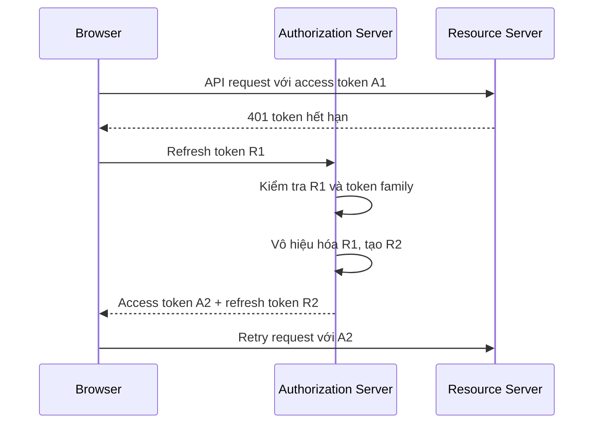

# Token lưu trong localStorage

> **Chương:** Storage security  
> **Chủ đề:** Token lưu trong localStorage  
> **Module:** SECURITY_APPLICATION_SECURITY_BROWSER_SECURITY — phân tích ranh giới bảo mật giữa trình duyệt, origin, cookie và ứng dụng web để hiểu Same-Origin Policy, CORS và các cơ chế cách ly. Thực hành phòng vệ XSS, CSRF, clickjacking bằng CSP, Trusted Types, security headers và kiểm chứng hành vi thực tế.

## Mục tiêu học tập

Sau bài học, bạn có thể:

1. Giải thích phạm vi lưu trữ và đặc tính bảo mật của `localStorage`.
2. Xây dựng threat model cho access token và refresh token được lưu trong browser.
3. So sánh rủi ro XSS và CSRF giữa localStorage, cookie và bộ nhớ ứng dụng.
4. Chọn nơi lưu token theo kiến trúc SPA, BFF và yêu cầu sản phẩm.
5. Thiết kế vòng đời token gồm phát hành, hết hạn, refresh, rotation, phát hiện reuse và logout.
6. Giảm thiểu tác động khi XSS xảy ra bằng cách giới hạn thời gian sống, quyền và phạm vi token.
7. Kiểm thử sự khác nhau giữa JavaScript đọc được localStorage và không đọc được cookie `HttpOnly`.

## 1. localStorage lưu trữ điều gì?

`localStorage` là Web Storage API cho phép JavaScript lưu các cặp key/value dạng chuỗi trong browser. Dữ liệu được giữ lại sau khi reload tab và thường tồn tại qua nhiều phiên browser cho tới khi ứng dụng hoặc người dùng xóa.

Ví dụ:

```js
localStorage.setItem('theme', 'dark');
const theme = localStorage.getItem('theme');
localStorage.removeItem('theme');
```

Storage được phân vùng theo origin: scheme, hostname và port. Ví dụ `https://app.example.test` và `http://app.example.test` có vùng localStorage khác nhau; `https://app.example.test:8443` cũng khác origin mặc định. Các trang cùng origin thường có thể truy cập cùng vùng storage, bất kể path.

Điều đó có nghĩa mọi JavaScript chạy được trong origin ứng dụng có thể đọc và sửa dữ liệu localStorage của origin đó. localStorage không phải kho bí mật được mã hóa và không có thuộc tính tương đương `HttpOnly`.

### 1.1. Các đặc tính quan trọng

| Đặc tính | Ý nghĩa bảo mật |
|---|---|
| API đồng bộ | Đọc/ghi diễn ra đồng bộ trên main thread; tránh lưu dữ liệu lớn |
| Giá trị là chuỗi | Object phải serialize, thường bằng JSON |
| Bền qua reload | Token có thể còn sau khi đóng/mở tab hoặc browser |
| Theo origin | Script cùng origin có thể truy cập vùng lưu trữ |
| Không có HttpOnly | JavaScript cùng origin có thể đọc token |
| Không tự gửi theo request | Ứng dụng thường phải tự gắn token vào header |
| Có thể bị xóa | Người dùng, browser policy hoặc ứng dụng có thể xóa dữ liệu |

localStorage phù hợp với dữ liệu giao diện ít nhạy cảm như theme hoặc lựa chọn hiển thị. Khi lưu bearer token, đặc biệt là refresh token có thời hạn dài, cần đánh giá kỹ hậu quả nếu JavaScript trong origin bị chiếm quyền.

## 2. Threat model: điều gì cần bảo vệ?

Bearer token là credential: bất kỳ ai sở hữu token có thể sử dụng nó trong phạm vi quyền và thời hạn mà server chấp nhận. Nếu access token bị lấy cắp, kẻ tấn công có thể gửi request như người dùng mà không cần biết mật khẩu.

Các tài sản cần bảo vệ:

- Access token dùng gọi API.
- Refresh token dùng xin access token mới.
- Thông tin tài khoản và dữ liệu được API trả về.
- Quyền thao tác như thanh toán, thay đổi email, quản trị hoặc xóa dữ liệu.
- Trạng thái đăng nhập và phiên người dùng trên nhiều tab/thiết bị.

Các tác nhân và đường tấn công:

| Tác nhân/đường tấn công | Khả năng | Tác động có thể có |
|---|---|---|
| Stored/reflected/DOM XSS | Chạy JavaScript trong origin ứng dụng | Đọc token trong localStorage, gửi token ra ngoài hoặc thực hiện hành động bằng quyền người dùng |
| Dependency hoặc tag bên thứ ba bị chiếm | Code bên thứ ba chạy trong trang hoặc chuỗi cung ứng bị xâm phạm | Truy cập dữ liệu mà JavaScript của trang được phép đọc |
| Extension độc hại hoặc browser bị chiếm | Có thể quan sát/chỉnh nội dung trang tùy quyền extension | Lấy token hoặc thao tác trên phiên |
| Thiết bị người dùng bị malware | Đọc dữ liệu browser hoặc điều khiển phiên | Vượt ngoài ranh giới bảo vệ của ứng dụng web |
| CSRF từ website khác | Kích hoạt request từ browser của nạn nhân | Có thể lợi dụng credential được browser tự gửi, tùy cookie và endpoint |
| Log/URL/analytics bị lộ | Token vô tình xuất hiện trong URL, log hoặc telemetry | Token bị thu thập ngoài storage ban đầu |

Threat model thực tế cần xác định attacker có thể chạy script trong origin hay chỉ điều khiển một website khác. Hai tình huống này tạo ra rủi ro XSS và CSRF khác nhau.

### 2.1. XSS là rủi ro lớn nhất của token trong localStorage

Nếu attacker thực thi được JavaScript trong origin, script có thể đọc token:

```js
const token = localStorage.getItem('access_token');
```

Sau đó script có thể gửi token tới server bên ngoài hoặc dùng token để gọi API. Kẻ tấn công có thể tiếp tục sử dụng token sau khi payload XSS đã biến mất, cho tới khi token hết hạn hoặc bị thu hồi.

Đây là điểm khác biệt quan trọng giữa token trong localStorage và cookie `HttpOnly`: JavaScript cùng origin không thể đọc giá trị cookie HttpOnly, nhưng có thể đọc localStorage.

HttpOnly không ngăn XSS thực hiện hành động thay người dùng. Script độc hại vẫn có thể gọi `fetch()` tới API cùng origin; browser tự đính kèm cookie phù hợp. Vì vậy, cookie HttpOnly giảm khả năng đánh cắp credential qua JavaScript, nhưng không biến một ứng dụng đang có XSS thành an toàn.

### 2.2. Token không tự hết nguy hiểm khi xóa khỏi localStorage

Nếu attacker đã sao chép bearer token ra ngoài, việc ứng dụng gọi `localStorage.removeItem()` chỉ xóa bản lưu trong browser hiện tại. Bản sao của attacker vẫn dùng được nếu server chưa hết hạn hoặc thu hồi token.

Do đó, xử lý sự cố token bị lộ cần có bước server-side: revoke refresh token/session, thu hồi token theo cơ chế hỗ trợ, hoặc chờ access token ngắn hạn hết hiệu lực. Xóa storage là một phần của logout phía client, không phải cơ chế thu hồi credential toàn hệ thống.

## 3. XSS và CSRF: localStorage thay đổi điều gì?

Một lý do thường được nêu để lưu access token trong localStorage là browser không tự gửi nó cùng mọi request. Ứng dụng phải chủ động đọc token và gắn vào header `Authorization`.

Ví dụ:

```js
const token = localStorage.getItem('access_token');

const response = await fetch('/api/profile', {
  headers: {
    Authorization: 'Bearer ' + token,
  },
});
```

Một website khác không thể đơn giản khiến browser tự đính kèm giá trị localStorage của origin ứng dụng vào request cross-site. Vì vậy, kiểu CSRF truyền thống dựa trên credential tự động gửi (đặc biệt cookie) thường khó áp dụng với bearer token chỉ được gắn thủ công từ localStorage.

Nhưng đổi lại, bất kỳ JavaScript nào chạy trong origin đều có thể đọc token. Đây là tradeoff:

| Cách xác thực | XSS đọc credential | Browser tự gửi credential | Rủi ro CSRF |
|---|---|---|---|
| Bearer token trong localStorage | Có | Không; ứng dụng tự gắn header | Thấp hơn với CSRF truyền thống, nhưng XSS có thể lấy token |
| Session cookie HttpOnly | Không đọc trực tiếp bằng JavaScript | Có, theo cookie rules | Cần thiết kế CSRF defense |
| Token chỉ trong memory | Script cùng origin vẫn có thể truy cập nếu lấy được reference hoặc điều khiển code | Không | Thường thấp hơn với CSRF truyền thống |
| BFF + session cookie HttpOnly | Không đọc trực tiếp session cookie | Có | BFF cần CSRF defense |

### 3.1. Khi dùng localStorage

- Request chỉ mang token khi code ứng dụng chủ động gắn Authorization.
- Một form hoặc ảnh từ website khác không tự đọc được localStorage của origin ứng dụng.
- CORS không cho website khác đọc response nếu server không cho phép, nhưng CORS không phải cơ chế ngăn mọi request CSRF.
- Nếu XSS chạy trong ứng dụng, script có thể đọc token và gửi request có header Authorization.

### 3.2. Khi dùng cookie

Browser có thể tự đính kèm cookie phù hợp vào request tới website. Đây là hành vi cần thiết cho session cookie nhưng cũng tạo bề mặt CSRF.

Các biện pháp thường phối hợp:

- `SameSite=Lax` hoặc `SameSite=Strict` theo luồng sản phẩm; không coi đây là biện pháp duy nhất cho mọi tình huống.
- CSRF token gắn với session cho các thao tác thay đổi trạng thái.
- Kiểm tra `Origin` và, khi phù hợp, `Referer` ở server.
- Không dùng GET cho thao tác thay đổi trạng thái.
- Giới hạn CORS credentialed origin; CORS không thay thế CSRF token.

### 3.3. XSS có thể vô hiệu hóa nhiều lớp CSRF

Nếu attacker đã chạy script trong origin hợp lệ, script có thể đọc CSRF token trong DOM hoặc lấy token qua endpoint, rồi gửi request cùng origin. Vì vậy, CSRF defense không thay thế XSS prevention.

Output encoding theo đúng context, sanitization HTML khi cần rich text, CSP nghiêm ngặt và Trusted Types giúp giảm khả năng XSS. Cần sửa injection sink và nguồn dữ liệu không tin cậy ở gốc; không chỉ dựa vào việc token được đặt ở storage nào.

## 4. Nên lưu access token và refresh token ở đâu?

Access token và refresh token có vòng đời, quyền và mức độ nhạy cảm khác nhau:

- **Access token:** gửi tới API để truy cập resource; nên có thời hạn ngắn và scope/audience tối thiểu.
- **Refresh token:** dùng xin access token mới; thường có giá trị lâu hơn và có thể duy trì phiên đăng nhập. Nếu bị lộ, attacker có thể lấy access token mới nhiều lần.
- **ID token:** thuộc OpenID Connect, mang thông tin xác thực người dùng cho client. Không dùng ID token thay access token để gọi API.

Không nên áp dụng một quy tắc storage giống nhau cho mọi loại token.

### 4.1. So sánh các lựa chọn

| Vị trí | Ưu điểm | Hạn chế/rủi ro | Trường hợp phù hợp |
|---|---|---|---|
| localStorage | Dễ triển khai, tồn tại qua reload, chia sẻ giữa tab cùng origin | JavaScript cùng origin đọc được; token tồn tại lâu nếu không xóa | Chỉ cân nhắc khi hiểu rõ XSS threat model và không có lựa chọn kiến trúc tốt hơn |
| sessionStorage | Gắn với tab/session page và thường mất khi tab đóng | JavaScript cùng origin vẫn đọc được; không loại bỏ XSS | Dữ liệu tạm theo tab, không phải kho chống XSS |
| JavaScript memory | Không tự tồn tại qua reload; giảm thời gian credential nằm trên đĩa browser | XSS đang chạy vẫn có thể dùng token; reload cần xác thực/refresh lại | SPA giữ access token ngắn hạn trong runtime |
| Cookie HttpOnly; Secure; SameSite | JavaScript không đọc được cookie; browser quản lý truyền cookie | Cookie tự gửi nên cần CSRF defense; cần cấu hình domain/path/SameSite | Session cookie hoặc refresh token trong kiến trúc phù hợp |
| BFF session | Browser chỉ giữ session cookie; access/refresh token ở backend | Cần vận hành backend và quản lý session phía server | Ứng dụng web cần giảm credential lộ cho JavaScript |

sessionStorage và memory có thể giảm độ bền của token sau khi tab đóng/reload, nhưng không tạo ranh giới bảo mật trước XSS. Script độc hại chạy cùng origin vẫn có thể đọc storage hoặc điều khiển request trong phiên hiện tại.

### 4.2. Ưu tiên BFF khi kiến trúc cho phép

Với mô hình Backend for Frontend (BFF):

1. Browser đăng nhập qua backend ứng dụng.
2. Backend giữ access token và refresh token ở phía server.
3. Browser nhận session cookie có HttpOnly, Secure, SameSite và scope phù hợp.
4. JavaScript gọi API của BFF bằng session; BFF gọi resource server với access token.
5. BFF thực hiện refresh/rotation ở server và quản lý logout/revocation.

Mô hình này giảm việc đưa OAuth token vào JavaScript runtime và localStorage. Session cookie vẫn cần CSRF defense, authorization ở backend và XSS prevention.

### 4.3. Nếu SPA buộc phải dùng bearer token

Nếu ứng dụng là public client chạy hoàn toàn trong browser và không có BFF:

- Dùng OAuth 2.0 Authorization Code Flow với PKCE; tránh Implicit Flow cho ứng dụng mới.
- Không nhúng client secret trong JavaScript.
- Ưu tiên giữ access token ngắn hạn trong memory nếu luồng sản phẩm cho phép.
- Hạn chế hoặc tránh lưu refresh token dài hạn trong localStorage.
- Nếu nhà cung cấp identity hỗ trợ refresh token cho public client, kiểm tra rotation, reuse detection và chính sách sender-constrained token phù hợp.
- Giới hạn scope, audience và thời gian sống của token.
- Không coi mã hóa token bằng key nằm trong cùng JavaScript bundle là bảo vệ trước XSS; attacker có thể lấy cả key hoặc gọi hàm giải mã.

## 5. Token lifecycle: từ phát hành đến thu hồi

Storage chỉ là một phần của bảo mật. Token cần một vòng đời có thể dự đoán và được server thực thi.

### 5.1. Phát hành token

Khi phát hành access token, server nên giới hạn:

- `iss`: issuer hợp lệ.
- `aud`: resource server dự kiến.
- `exp`: thời điểm hết hạn.
- `nbf` nếu dùng: thời điểm token bắt đầu có hiệu lực.
- `scope` hoặc quyền: chỉ các thao tác cần thiết.
- `sub`: subject đã xác thực.

Resource server phải xác minh chữ ký hoặc cơ chế xác thực token, issuer, audience, thời hạn và quyền. Client không thể tự xác minh token rồi coi đó là quyết định authorization cuối cùng.

### 5.2. Access token ngắn hạn

Access token ngắn hạn giới hạn thời gian attacker có thể sử dụng một bản token bị đánh cắp. Thời hạn cụ thể phụ thuộc mức rủi ro, trải nghiệm đăng nhập và năng lực revoke của hệ thống.

Không có một con số TTL phù hợp với mọi sản phẩm. Hãy cân nhắc:

- Độ nhạy cảm của API.
- Khả năng refresh và revoke.
- Độ trễ giữa các request.
- Sai lệch đồng hồ giữa client/server.
- Tác động khi người dùng offline hoặc thiết bị sleep.

Token hết hạn phải bị resource server từ chối, không chỉ dựa vào timer ở giao diện.

### 5.3. Refresh token rotation

Khi refresh token được sử dụng, authorization server cấp token mới và vô hiệu hóa token cũ. Server theo dõi token family hoặc trạng thái tương đương để phát hiện token cũ bị dùng lại.

Luồng khái quát:



Nếu server phát hiện refresh token cũ đã bị dùng lại sau rotation, đó có thể là dấu hiệu token bị sao chép. Chính sách phản ứng thường là revoke token family hoặc phiên liên quan, yêu cầu xác thực lại và ghi nhận sự kiện bảo mật.

Rotation cần xử lý race condition: nhiều request đồng thời có thể cùng cố refresh một token. Client nên dùng cơ chế single-flight để chỉ có một refresh đang chạy, các request khác chờ kết quả. Server vẫn phải xử lý an toàn trường hợp request lặp hoặc retry do mạng.

### 5.4. Revoke và logout

Logout phía client thường cần:

1. Xóa access token và dữ liệu phiên khỏi storage/runtime.
2. Gửi yêu cầu logout/revoke tới server nếu kiến trúc hỗ trợ.
3. Xóa hoặc hết hạn session/refresh cookie phía server.
4. Hủy request đang chờ và dữ liệu nhạy cảm trong bộ nhớ giao diện.
5. Đồng bộ trạng thái đăng xuất giữa các tab mà không phát tán token.

Nếu access token là JWT tự chứa và resource server chỉ xác minh chữ ký cùng exp, token có thể tiếp tục hợp lệ tới khi hết hạn trừ khi hệ thống có denylist, token version hoặc cơ chế introspection/revocation. Revoke refresh token ngăn cấp access token mới nhưng không nhất thiết vô hiệu hóa access token đã phát hành.

Vì vậy, access token ngắn hạn và refresh token có rotation/revocation bổ sung cho nhau.

### 5.5. Đồng bộ logout giữa các tab

Ứng dụng có thể phát thông báo trạng thái logout bằng BroadcastChannel hoặc sự kiện storage. Chỉ truyền sự kiện như logout, không truyền access/refresh token:

```js
const channel = new BroadcastChannel('auth-events');

function logoutLocally() {
  localStorage.removeItem('access_token');
  channel.postMessage({ type: 'LOGOUT' });
}

channel.addEventListener('message', (event) => {
  if (event.data?.type === 'LOGOUT') {
    clearInMemorySession();
    showSignedOutState();
  }
});
```

Đây chỉ là đồng bộ giao diện giữa các tab cùng origin. Server vẫn phải thực hiện revoke/session invalidation; tab khác có thể không mở hoặc không nhận được message.

## 6. Các biện pháp giảm thiểu khi vẫn lưu token trong localStorage

Không có cấu hình localStorage nào ngăn JavaScript cùng origin đọc token. Nếu quyết định chấp nhận mô hình này, cần giảm xác suất XSS và giảm giá trị của token bị lộ.

### 6.1. Giảm khả năng XSS

- Encode output theo đúng context HTML text, attribute, URL, JavaScript và CSS.
- Dùng textContent cho text; tránh đưa input không tin cậy vào innerHTML.
- Nếu cần rich text, dùng sanitizer được duy trì và cấu hình allowlist tối thiểu.
- Bật CSP nghiêm ngặt với nonce/hash; tránh unsafe-inline và unsafe-eval nếu không cần.
- Dùng Trusted Types để kiểm soát DOM injection sink trong browser hỗ trợ.
- Kiểm kê dependency, tag manager và script bên thứ ba; chỉ nạp nguồn thực sự cần.
- Kiểm tra message từ iframe bằng origin, source và schema trước khi xử lý.

### 6.2. Giảm giá trị token nếu bị lấy cắp

- Access token có TTL ngắn phù hợp với risk profile.
- Scope và audience tối thiểu; không dùng token có quyền quản trị cho mọi chức năng.
- Refresh token có rotation, reuse detection và revoke.
- Không lưu refresh token dài hạn trong localStorage nếu có thể tránh.
- Yêu cầu re-authentication hoặc step-up authentication cho thao tác nhạy cảm.
- Hỗ trợ revoke phiên theo thiết bị hoặc toàn tài khoản khi có sự cố.
- Theo dõi bất thường ở server mà không ghi token nguyên văn vào log.

### 6.3. Bảo vệ token trong code và vận hành

- Không đặt token trong query string, fragment URL, tên file hoặc route.
- Không ghi token vào console, exception, analytics, crash report hoặc telemetry.
- Không gửi token qua postMessage tới origin chưa xác minh.
- Chỉ gửi bearer token qua HTTPS.
- Không dùng token làm nội dung HTML hoặc đưa vào DOM.
- Không serialize token vào SSR HTML, source map hoặc file cấu hình public.
- Giới hạn quyền truy cập repository/build artifact và rà soát log CI/CD.
- Xóa token khỏi storage khi logout, account switch hoặc session invalidation.

Mã hóa token trước khi ghi vào localStorage không tạo ra bảo vệ đáng tin cậy nếu khóa giải mã cũng nằm trong JavaScript hoặc storage cùng origin. XSS có thể gọi cùng code hoặc lấy khóa. Mã hóa client-side chỉ hữu ích khi khóa nằm ngoài phạm vi attacker đang xét, điều thường không đúng với script chạy trong cùng trang.

## 7. Ví dụ quản lý token tối thiểu

Nếu ứng dụng vẫn dùng localStorage cho access token, gom thao tác vào một module để dễ review và thay thế. Ví dụ dưới đây chỉ minh họa API; không làm localStorage trở thành kho an toàn trước XSS.

```js
const ACCESS_TOKEN_KEY = 'access_token';

export function saveAccessToken(token) {
  if (typeof token !== 'string' || token.length === 0) {
    throw new TypeError('Access token không hợp lệ');
  }
  localStorage.setItem(ACCESS_TOKEN_KEY, token);
}

export function readAccessToken() {
  return localStorage.getItem(ACCESS_TOKEN_KEY);
}

export function clearAccessToken() {
  localStorage.removeItem(ACCESS_TOKEN_KEY);
}

export async function apiFetch(url, options = {}) {
  const token = readAccessToken();
  const headers = new Headers(options.headers || {});

  if (token) {
    headers.set('Authorization', 'Bearer ' + token);
  }

  return fetch(url, {
    ...options,
    headers,
    credentials: 'omit',
  });
}
```

Các điểm cần review:

- Chỉ gọi apiFetch với URL API được kiểm soát; không gửi token tới URL tùy ý.
- credentials: omit thể hiện rõ request bearer không cần cookie. Nếu API có nhu cầu cookie riêng, thiết kế request đó tách biệt và áp dụng CSRF defense.
- Không tự retry vô hạn khi nhận 401. Luồng refresh cần single-flight, giới hạn retry và xử lý logout.
- Module tập trung không ngăn script độc hại cùng origin gọi localStorage trực tiếp; nó chỉ giúp code ứng dụng nhất quán và dễ thay đổi kiến trúc.
- Kiểm tra response, status và lỗi mạng; không coi token hiện diện trong storage là bằng chứng phiên còn hợp lệ.

## 8. Thực hành: localStorage token và HttpOnly cookie

Lab local dùng Node.js built-in, không cần thư viện ngoài. Mục tiêu là quan sát ba hành vi bằng **credential giả, không có giá trị truy cập hệ thống thật**:

1. JavaScript đọc được access token demo trong localStorage.
2. JavaScript không đọc được cookie session có HttpOnly.
3. JavaScript chạy trong cùng origin vẫn có thể gửi request; browser tự đính kèm cookie phù hợp.

Nút “Mô phỏng script XSS” chỉ chạy JavaScript minh họa đã có sẵn trong trang. Lab không khai thác lỗ hổng hay gửi dữ liệu ra ngoài.

### Bước 1 — Tạo file `storage-token-lab.cjs`

```js
const http = require('node:http');

const ACCESS_TOKEN = 'demo-access-token-not-a-real-credential';
const SESSION_ID = 'demo-session-not-a-real-session';
const COOKIE_NAME = 'lab_session';

const html = String.raw`<!doctype html>
<html lang="vi">
<head>
  <meta charset="utf-8">
  <meta name="viewport" content="width=device-width, initial-scale=1">
  <title>Storage token lab</title>
</head>
<body>
  <h1>Token storage lab</h1>
  <p>Chỉ sử dụng credential giả trong môi trường local.</p>
  <button id="read-storage" type="button">Đọc localStorage</button>
  <button id="read-cookie" type="button">Đọc document.cookie</button>
  <button id="bearer-request" type="button">Gọi API bằng Bearer token</button>
  <button id="cookie-request" type="button">Gọi API bằng HttpOnly cookie</button>
  <button id="simulate-xss" type="button">Mô phỏng script XSS</button>
  <button id="logout" type="button">Logout</button>
  <pre id="output"></pre>
  <script>
    const TOKEN_KEY = 'lab_access_token';
    const output = document.querySelector('#output');

    if (!localStorage.getItem(TOKEN_KEY)) {
      localStorage.setItem(TOKEN_KEY, 'demo-access-token-not-a-real-credential');
    }

    function log(message) {
      output.textContent += message + '\n';
    }

    async function callApi(path, options = {}) {
      const response = await fetch(path, {
        ...options,
        cache: 'no-store'
      });
      const body = await response.json();
      log(path + ' -> ' + response.status + ': ' + JSON.stringify(body));
    }

    document.querySelector('#read-storage').addEventListener('click', () => {
      log('localStorage token: ' + localStorage.getItem(TOKEN_KEY));
    });

    document.querySelector('#read-cookie').addEventListener('click', () => {
      log('document.cookie: ' + (document.cookie || '(empty)'));
      log('Cookie HttpOnly không xuất hiện trong document.cookie.');
    });

    document.querySelector('#bearer-request').addEventListener('click', () => {
      const token = localStorage.getItem(TOKEN_KEY);
      return callApi('/api/bearer', {
        headers: { Authorization: 'Bearer ' + token }
      });
    });

    document.querySelector('#cookie-request').addEventListener('click', () => {
      return callApi('/api/cookie', {
        credentials: 'same-origin'
      });
    });

    document.querySelector('#simulate-xss').addEventListener('click', async () => {
      const stolen = localStorage.getItem(TOKEN_KEY);
      log('Script cùng origin đọc được localStorage: ' + stolen);
      log('Script không đọc được HttpOnly cookie qua document.cookie.');
      log('Script vẫn có thể gọi API cùng origin; browser tự gửi cookie.');
      await callApi('/api/cookie-action', {
        method: 'POST',
        credentials: 'same-origin'
      });
    });

    document.querySelector('#logout').addEventListener('click', async () => {
      await callApi('/logout', { method: 'POST' });
      localStorage.removeItem(TOKEN_KEY);
      log('Đã xóa token demo ở localStorage.');
    });
  </script>
</body>
</html>`;

function sendJson(res, status, data, extraHeaders = {}) {
  res.writeHead(status, {
    'Content-Type': 'application/json; charset=utf-8',
    'Cache-Control': 'no-store',
    'X-Content-Type-Options': 'nosniff',
    ...extraHeaders,
  });
  res.end(JSON.stringify(data));
}

function hasSession(req) {
  const cookies = (req.headers.cookie || '').split(';');
  return cookies.some((part) => {
    const [name, ...value] = part.trim().split('=');
    return name === COOKIE_NAME && value.join('=') === SESSION_ID;
  });
}

const server = http.createServer((req, res) => {
  const url = new URL(req.url, 'http://localhost:3000');

  if (req.method === 'GET' && url.pathname === '/') {
    const headers = {
      'Content-Type': 'text/html; charset=utf-8',
      'Cache-Control': 'no-store',
      'X-Content-Type-Options': 'nosniff',
    };
    if (!hasSession(req)) {
      // Lab chạy HTTP trên localhost nên bỏ Secure ở cookie demo.
      // Production phải dùng HTTPS và thêm thuộc tính Secure.
      headers['Set-Cookie'] =
        COOKIE_NAME + '=' + SESSION_ID +
        '; Path=/; HttpOnly; SameSite=Strict';
    }
    res.writeHead(200, headers);
    return res.end(html);
  }

  if (req.method === 'GET' && url.pathname === '/api/bearer') {
    const expected = 'Bearer ' + ACCESS_TOKEN;
    if (req.headers.authorization !== expected) {
      return sendJson(res, 401, { ok: false, reason: 'missing_or_invalid_bearer' });
    }
    return sendJson(res, 200, { ok: true, auth: 'bearer_header' });
  }

  if (req.method === 'GET' && url.pathname === '/api/cookie') {
    if (!hasSession(req)) {
      return sendJson(res, 401, { ok: false, reason: 'missing_session_cookie' });
    }
    return sendJson(res, 200, { ok: true, auth: 'http_only_cookie' });
  }

  if (req.method === 'POST' && url.pathname === '/api/cookie-action') {
    if (!hasSession(req)) {
      return sendJson(res, 401, { ok: false, reason: 'missing_session_cookie' });
    }
    return sendJson(res, 200, {
      ok: true,
      message: 'Same-origin script made an authenticated request',
    });
  }

  if (req.method === 'POST' && url.pathname === '/logout') {
    return sendJson(res, 200, { ok: true, loggedOut: true }, {
      'Set-Cookie':
        COOKIE_NAME + '=; Path=/; HttpOnly; SameSite=Strict; Max-Age=0',
    });
  }

  res.writeHead(404, { 'Content-Type': 'text/plain; charset=utf-8' });
  res.end('Not found');
});

server.listen(3000, 'localhost', () => {
  console.log('Open http://localhost:3000');
});
```

### Bước 2 — Chạy lab

```sh
node storage-token-lab.cjs
```

Mở `http://localhost:3000` trong browser. Nếu cổng 3000 đang được sử dụng, đổi cổng trong `server.listen()` và mở đúng URL mới.

Lab dùng cookie `HttpOnly; SameSite=Strict` để minh họa. Vì server chạy HTTP local, ví dụ bỏ `Secure` để tránh khác biệt xử lý cookie giữa browser; production phải dùng HTTPS và đặt `Secure`.

### Bước 3 — So sánh khả năng đọc credential

1. Nhấn **Đọc localStorage**: trang hiển thị access token giả.
2. Nhấn **Đọc document.cookie**: cookie session không xuất hiện vì có HttpOnly.
3. Nhấn **Gọi API bằng Bearer token**: JavaScript đọc localStorage rồi tự gắn header Authorization; server chấp nhận token demo.
4. Nhấn **Gọi API bằng HttpOnly cookie**: JavaScript không đọc cookie, nhưng browser gửi cookie cùng request same-origin; server chấp nhận session demo.

### Bước 4 — Mô phỏng tác động của XSS

Nhấn **Mô phỏng script XSS**. Lab hiển thị rằng script cùng origin đọc được token localStorage. Script không đọc được cookie HttpOnly, nhưng vẫn gửi được request tới `/api/cookie-action`; browser tự đính kèm cookie.

Kết quả này minh họa hai giới hạn:

- HttpOnly giảm nguy cơ attacker đánh cắp giá trị cookie qua JavaScript.
- HttpOnly không ngăn script XSS thao tác với quyền của phiên hiện tại.

### Bước 5 — Logout

Nhấn **Logout**:

- Server trả cookie hết hạn.
- JavaScript xóa access token demo khỏi localStorage.
- Gọi lại hai API để quan sát cả hai credential đã không còn hợp lệ trong lab.

Lab dùng session cố định để minh họa nên không có database, token rotation hay quản lý phiên production. Không tái sử dụng code xác thực demo này cho ứng dụng thật.

## 9. Ma trận kiểm thử và tình huống vận hành

| Tình huống | Kết quả mong đợi | Điều cần xác minh |
|---|---|---|
| Reload trang khi token nằm trong localStorage | Token vẫn còn | Đây là hành vi persistence, không phải bằng chứng phiên còn hợp lệ |
| Script cùng origin đọc storage | Đọc được token | Xác nhận XSS có thể làm lộ bearer credential |
| JavaScript đọc cookie HttpOnly | Không đọc được giá trị cookie | Kiểm tra document.cookie, nhưng vẫn test request cùng origin |
| Request same-origin dùng cookie | Browser tự gửi cookie phù hợp | Cookie flags và server session validation |
| Website khác kích hoạt request có cookie | Cookie có thể bị giới hạn bởi SameSite và browser rules | Kiểm thử CSRF token, Origin/Referer và endpoint |
| Token hết hạn | API từ chối token | Server xác minh exp; client xử lý 401 có giới hạn |
| Refresh token được dùng hai lần sau rotation | Server phát hiện reuse theo token-family policy | Revoke family/session và yêu cầu xác thực lại |
| Logout trên một tab | Các tab khác chuyển sang trạng thái signed-out | Không phát tán token qua BroadcastChannel/storage event |
| Xóa localStorage sau khi token đã bị sao chép | Bản sao bên ngoài vẫn có thể hoạt động | Cần revoke phía server hoặc chờ access token hết hạn |
| API nhận token sai audience/scope | Server từ chối | Authorization phải được kiểm tra tại resource server |

### 9.1. Xử lý refresh đồng thời

SPA có thể gửi nhiều request khi access token hết hạn. Nếu mọi request cùng refresh một refresh token, rotation có thể khiến các request sau dùng token cũ và bị xem là reuse.

Thiết kế client nên:

- Chỉ có một refresh operation đang chạy tại một thời điểm (single-flight).
- Các request khác chờ kết quả refresh thay vì gửi refresh token riêng.
- Chỉ retry request ban đầu tối đa một lần sau khi refresh thành công.
- Nếu refresh thất bại hoặc bị revoke, xóa state local và yêu cầu đăng nhập lại.
- Không tự động retry các request không idempotent nếu chưa có cơ chế idempotency ở API.

Server cần xác định chính sách xử lý retry mạng và reuse detection để không nhầm retry hợp lệ với token theft, đồng thời không để refresh token cũ tiếp tục sử dụng vô hạn.

### 9.2. Ứng phó khi nghi token bị lộ

1. Thu hồi refresh token hoặc session liên quan ở server.
2. Nếu hệ thống hỗ trợ, revoke access token hoặc tăng token/session version.
3. Buộc xác thực lại trên thiết bị bị ảnh hưởng; cân nhắc logout mọi phiên nếu rủi ro lan rộng.
4. Xóa token phía client, nhưng không coi đây là bước thu hồi duy nhất.
5. Điều tra nguồn XSS, dependency, log hoặc kênh rò rỉ; vá nguyên nhân.
6. Kiểm tra log server theo subject, token ID hoặc session ID đã được thiết kế để tra cứu mà không ghi bearer token nguyên văn.

## 10. Checklist quyết định và triển khai

Trước khi chọn localStorage cho token:

- [ ] Đã xác định token là access token, refresh token hay ID token.
- [ ] Đã đánh giá khả năng XSS và các script/dependency bên thứ ba trong origin.
- [ ] Đã so sánh BFF/session cookie với token trong browser.
- [ ] Không lưu refresh token dài hạn trong localStorage nếu có lựa chọn phù hợp hơn.
- [ ] Access token có TTL, scope và audience tối thiểu.
- [ ] Authorization server có refresh rotation, reuse detection và revoke phù hợp.
- [ ] Client xử lý refresh đồng thời và retry có giới hạn.
- [ ] Token không xuất hiện trong URL, log, analytics, console hoặc error report.
- [ ] Request bearer chỉ gửi qua HTTPS và tới API origin được kiểm soát.
- [ ] XSS defenses gồm output encoding, sanitizer, CSP và Trusted Types khi phù hợp.
- [ ] Nếu dùng cookie, có SameSite và CSRF defense ở server.
- [ ] Logout xóa state client và revoke session/refresh credential phía server.
- [ ] Các tab được đồng bộ logout mà không truyền token.
- [ ] Có quy trình xử lý khi token bị lộ và kiểm thử định kỳ.

## 11. Câu hỏi tự kiểm tra

**1.** Vì sao localStorage không phù hợp để giữ bí mật trước XSS?  
**Trả lời:** JavaScript chạy trong cùng origin có thể đọc và sửa localStorage; API không có cơ chế HttpOnly.

**2.** Vì sao bearer token trong localStorage thường ít chịu CSRF truyền thống hơn cookie?  
**Trả lời:** Browser không tự đính kèm localStorage vào request; ứng dụng phải đọc token và chủ động gắn Authorization header.

**3.** Lưu token trong localStorage có ngăn XSS không?  
**Trả lời:** Không. XSS cùng origin có thể đọc token hoặc dùng token để gọi API.

**4.** Cookie HttpOnly bảo vệ điều gì?  
**Trả lời:** Ngăn JavaScript đọc trực tiếp giá trị cookie; browser vẫn có thể gửi cookie trong request phù hợp.

**5.** XSS có thể làm gì dù session cookie là HttpOnly?  
**Trả lời:** Script vẫn có thể gọi API cùng origin và browser tự đính kèm cookie, nên attacker có thể thao tác trong phiên hiện tại.

**6.** Vì sao refresh token nhạy cảm hơn access token?  
**Trả lời:** Refresh token thường tồn tại lâu hơn và có thể cấp access token mới, kéo dài khả năng sử dụng phiên.

**7.** Refresh token rotation giải quyết vấn đề gì?  
**Trả lời:** Mỗi lần refresh cấp token mới và vô hiệu hóa token cũ; reuse token cũ có thể báo hiệu credential đã bị sao chép.

**8.** Xóa localStorage có thu hồi bản token attacker đã lấy không?  
**Trả lời:** Không. Bản sao vẫn có thể dùng tới khi server hết hạn hoặc thu hồi token.

**9.** CORS có thay thế CSRF token không?  
**Trả lời:** Không. CORS chủ yếu kiểm soát việc script đọc response cross-origin; CSRF defense cần kiểm soát request có credential và hành động thay đổi trạng thái.

**10.** Kiến trúc BFF giảm rủi ro nào?  
**Trả lời:** Access/refresh token được giữ ở backend thay vì đưa vào JavaScript storage; browser chỉ giữ session cookie HttpOnly và vẫn cần CSRF defense.

## Tổng kết

Token trong localStorage dễ triển khai và không tự được browser đính kèm vào request, nên giảm một phần bề mặt CSRF truyền thống. Đổi lại, mọi JavaScript chạy trong origin có thể đọc token; XSS có thể đánh cắp bearer credential và tiếp tục sử dụng ngoài browser. Ưu tiên BFF với session cookie HttpOnly, Secure, SameSite khi kiến trúc cho phép; nếu SPA phải dùng token, giữ access token ngắn hạn trong memory khi phù hợp, hạn chế refresh token bền vững, dùng rotation/reuse detection/revocation và giảm scope. Dù chọn storage nào, vẫn cần phòng chống XSS, kiểm tra authorization ở server và thiết kế CSRF defense đúng với cách credential được gửi.
