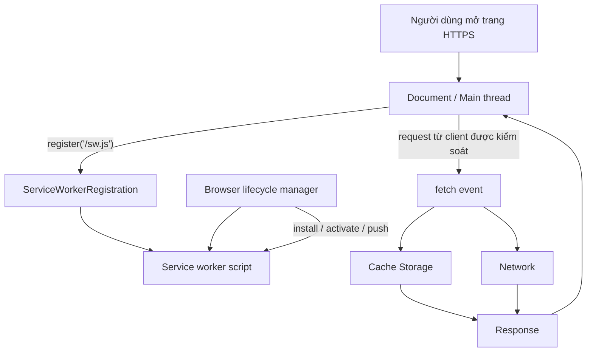
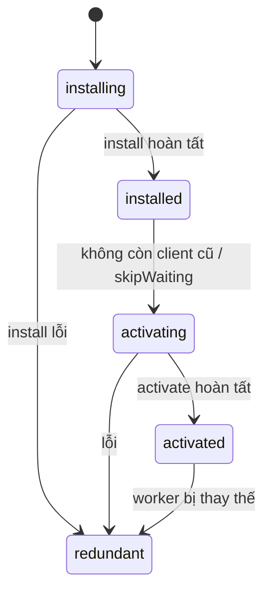

# Service worker là gì?

> **Chương:** Service worker  
> **Mục tiêu:** Hiểu service worker là một worker chạy theo sự kiện, hoạt động độc lập với vòng đời của trang và có thể đứng giữa các request của những client được kiểm soát. Biết cách đăng ký, phạm vi hoạt động, vòng đời install/activate, xử lý fetch, hỗ trợ offline, cập nhật và các ranh giới bảo mật cơ bản.

## 1. Service worker là gì?

**Service worker** là một script JavaScript mà browser chạy trong một worker context riêng, tách khỏi main thread và document của trang web. Nó được đăng ký cho một origin và một phạm vi URL (scope), sau đó có thể nhận các sự kiện từ browser như install, activate, fetch, push hoặc một số sự kiện nền khác.

Service worker thường được dùng để:

- Phục vụ trang hoặc tài nguyên đã lưu khi mạng không khả dụng.
- Kiểm soát cách request được gửi tới network hoặc lấy từ Cache Storage.
- Cập nhật ứng dụng web theo phiên bản.
- Nhận push event và hiển thị notification khi nền tảng hỗ trợ.
- Thực hiện một số tác vụ nền ngắn theo event như Background Sync ở browser hỗ trợ.

Service worker không phải một server luôn chạy. Browser có thể dừng worker khi không còn việc cần xử lý và khởi động lại khi có event phù hợp. Vì vậy, service worker phải được thiết kế theo mô hình **event-driven**: mỗi event bắt đầu một lần thực thi, hoàn thành công việc cần thiết rồi kết thúc.

Service worker cũng không tự động làm website hoạt động offline. Ứng dụng phải chủ động cache tài nguyên và định nghĩa cách phản hồi khi request không thể tới network.

## 2. Service worker nằm ở đâu trong kiến trúc web?

Thông thường, trang đăng ký service worker qua `navigator.serviceWorker.register()`. Browser tải script, tạo registration và quản lý vòng đời của worker.



Service worker có thể quyết định trả response từ cache, lấy response từ network hoặc tạo một response phù hợp. Quyền này chỉ áp dụng trong phạm vi và các client browser đang kiểm soát; nó không biến worker thành proxy tùy ý cho mọi ứng dụng trên thiết bị.

## 3. Service worker khác Web Worker như thế nào?

Cả service worker và dedicated/shared worker đều chạy JavaScript ngoài main thread, nhưng mục đích và vòng đời khác nhau:

| Đặc điểm | Service worker | Dedicated Web Worker |
| --- | --- | --- |
| Quan hệ với document | Được đăng ký theo origin và scope; có thể phục vụ nhiều tab/client phù hợp | Thường gắn với document tạo worker |
| Vòng đời | Event-driven, browser có thể dừng và khởi động lại | Thường tồn tại khi worker/document còn hoạt động |
| Mục đích thường gặp | Network interception, offline, push, background events | Tính toán nền, xử lý dữ liệu |
| Truy cập DOM | Không | Không |
| Giao tiếp | Message với client, event từ browser | Message với document/worker khác |
| Có thể intercept fetch của client | Có, với client được kiểm soát và request thuộc phạm vi | Không có quyền kiểm soát request của document theo cách service worker |

Service worker không có `window`, `document` hoặc DOM. Global scope của nó là `ServiceWorkerGlobalScope`; dùng `self` để truy cập các API và event trong worker.

Worker cũng không dùng được `localStorage` của document. Khi cần lưu trạng thái qua nhiều lần worker được khởi động, hãy chọn IndexedDB hoặc Cache Storage theo loại dữ liệu; không coi biến JavaScript trong worker là nơi lưu trữ bền vững.

## 4. Điều kiện để đăng ký service worker

Service worker yêu cầu **secure context**. Trong môi trường triển khai, trang và script thường phải được phục vụ qua HTTPS. Browser có ngoại lệ cho các địa chỉ phát triển như `localhost` theo quy tắc secure context.

Các điều kiện quan trọng:

- Trang chạy trong secure context.
- Browser hỗ trợ Service Worker API.
- Script service worker được tải từ cùng origin với trang đăng ký.
- Scope được yêu cầu nằm trong phạm vi script được phép kiểm soát.
- Server trả JavaScript hợp lệ và không redirect script sang origin không phù hợp.

Service worker không được đăng ký từ một trang HTTP thông thường trên mạng công cộng. Nó cũng không thể dùng một file script tùy ý từ CDN cross-origin làm service worker của trang.

Kiểm tra hỗ trợ:

```js
if ("serviceWorker" in navigator && window.isSecureContext) {
  console.log("Có thể thử đăng ký service worker.");
} else {
  console.log("Browser hoặc context hiện tại chưa đáp ứng điều kiện.");
}
```

Đăng ký service worker không đồng nghĩa người dùng đã cấp quyền camera, vị trí hay notification. Notification/Push có quy trình permission riêng.

## 5. Origin và scope xác định phạm vi kiểm soát

Service worker gắn với origin của script và một **scope**. Scope là phạm vi URL mà registration có thể kiểm soát.

Ví dụ:

- Trang: `https://app.example.com/shop/products`
- Script: `https://app.example.com/sw.js`
- Scope: `/`

Worker có scope `/` có thể kiểm soát các page client thuộc đường dẫn của origin đó, bao gồm `/shop/`, nếu chúng được đăng ký/điều khiển phù hợp.

Nếu script nằm tại `/shop/sw.js`, scope mặc định thường là `/shop/`. Trang bên ngoài `/shop/` không nằm trong phạm vi mặc định đó.

### Scope không phải origin khác

Một service worker không thể kiểm soát trang trên origin khác. Ví dụ worker của `https://app.example.com` không kiểm soát được `https://payments.example.net`, dù hai trang thuộc cùng một sản phẩm.

Origin vẫn là ranh giới bảo mật. Scope chỉ thu hẹp phạm vi path bên trong origin.

### Service-Worker-Allowed

Theo mặc định, scope không được mở rộng vượt quá thư mục chứa script. Server có thể cho phép phạm vi tối đa rộng hơn bằng response header `Service-Worker-Allowed` trên script worker.

Ví dụ script nằm ở `/assets/sw.js`, nhưng response cho phép scope tối đa là root:

```http
Service-Worker-Allowed: /
```

Khi đó trang có thể đăng ký với scope `/` nếu các điều kiện khác thỏa. Chỉ mở rộng scope khi thực sự cần; worker có quyền kiểm soát càng rộng thì lỗi hoặc script bị xâm phạm càng có tác động lớn.

## 6. Đăng ký service worker từ trang

Ví dụ trang đăng ký một worker ở root:

```js
if ("serviceWorker" in navigator && window.isSecureContext) {
  window.addEventListener("load", async () => {
    try {
      const registration = await navigator.serviceWorker.register(
        "/sw.js",
        { scope: "/" },
      );

      console.log("Service worker scope:", registration.scope);
    } catch (error) {
      console.error("Không thể đăng ký service worker:", error);
    }
  });
}
```

Một số điểm cần hiểu:

- `register()` trả về Promise chứa `ServiceWorkerRegistration`.
- Script URL và trang đăng ký phải cùng origin.
- `scope` có thể được chỉ định; nếu bỏ qua, browser dùng scope mặc định dựa trên thư mục của script.
- Lỗi đăng ký cần được bắt và ghi nhận để ứng dụng có thể tiếp tục hoạt động theo chế độ không có service worker.
- Browser có thể cập nhật script đã đăng ký theo cơ chế update của nó.

Đăng ký thường được gọi sau khi trang đã tải để tránh cạnh tranh với tài nguyên quan trọng trong lần render đầu. Không cần gọi lại `register()` ở mọi thao tác người dùng.

## 7. Vòng đời service worker

Service worker có các trạng thái chính:

| State | Ý nghĩa |
| --- | --- |
| `installing` | Worker mới đang chạy quá trình cài đặt |
| `installed` | Đã cài đặt; có thể đang chờ worker cũ nhường quyền |
| `activating` | Đang chạy quá trình kích hoạt |
| `activated` | Đã active và có thể xử lý event cho client phù hợp |
| `redundant` | Worker không còn được sử dụng, ví dụ cài đặt thất bại hoặc bị thay thế |

Vòng đời khái quát:



Browser quản lý các trạng thái này. Trang không nên giả định worker luôn chạy hoặc luôn active ngay sau khi gọi `register()`.

## 8. Install event: chuẩn bị tài nguyên ban đầu

Event `install` thường chạy khi worker mới được cài hoặc phiên bản script thay đổi. Ứng dụng thường dùng event này để cache các tài nguyên cần cho app shell hoặc trang offline.

```js
const CACHE_NAME = "shop-shell-v1";
const APP_SHELL = [
  "/offline.html",
  "/assets/app.css",
  "/assets/app.js",
];

self.addEventListener("install", (event) => {
  event.waitUntil((async () => {
    const cache = await caches.open(CACHE_NAME);
    await cache.addAll(APP_SHELL);
  })());
});
```

`event.waitUntil()` báo cho browser rằng công việc bất đồng bộ này thuộc vòng đời event và cần được chờ trước khi install hoàn tất. Nếu `cache.addAll()` thất bại, Promise reject và quá trình cài đặt có thể thất bại; worker mới không được kích hoạt như một bản cài đặt thành công.

Chỉ đưa tài nguyên cần thiết và đã kiểm tra vào app shell. Nếu một URL sai hoặc server trả lỗi, toàn bộ bước precache có thể thất bại.

## 9. Waiting và activate event

Nếu một worker cũ đang active và vẫn kiểm soát các client, worker mới sau khi install thành công có thể ở trạng thái **waiting**. Browser trì hoãn activate để tránh thay worker giữa lúc các tab cũ đang dùng phiên bản trước.

Event `activate` thường dùng để:

- Dọn cache của phiên bản cũ.
- Chuyển đổi dữ liệu lưu trữ nếu cần.
- Thiết lập trạng thái cho phiên bản mới.
- Gọi `clients.claim()` nếu muốn worker active nhận quyền kiểm soát các client phù hợp đang mở.

Ví dụ:

```js
const CURRENT_CACHES = new Set([
  "shop-shell-v2",
  "shop-pages-v2",
]);

self.addEventListener("activate", (event) => {
  event.waitUntil((async () => {
    const names = await caches.keys();

    await Promise.all(
      names
        .filter((name) =>
          name.startsWith("shop-") && !CURRENT_CACHES.has(name)
        )
        .map((name) => caches.delete(name)),
    );

    await self.clients.claim();
  })());
});
```

Chỉ xóa cache thuộc namespace của ứng dụng. Không xóa mọi cache origin vì một ứng dụng hoặc module khác trên cùng origin có thể đang sử dụng chúng.

## 10. skipWaiting và clients.claim

Hai API này thường được nhắc tới khi muốn triển khai worker mới nhanh hơn:

- `self.skipWaiting()` yêu cầu worker đang waiting bỏ qua thời gian chờ để tiến tới activate.
- `self.clients.claim()` cho phép worker active nhận quyền kiểm soát các client phù hợp trong scope mà không cần đợi chúng tải lại trang.

Chúng không có cùng tác dụng:

| API | Thời điểm | Tác dụng |
| --- | --- | --- |
| `skipWaiting()` | Thường gọi trong install hoặc từ worker đang chờ | Thúc đẩy worker mới chuyển sang activate |
| `clients.claim()` | Thường gọi trong activate | Nhận quyền kiểm soát các client phù hợp hiện có |

Không gọi `skipWaiting()` theo thói quen nếu ứng dụng có nhiều tab đang chạy phiên bản cũ. Worker mới có thể điều khiển trang đang tải code cũ, tạo trạng thái không tương thích giữa client và worker. Hãy thiết kế versioning và kiểm thử cập nhật trước khi ép activate.

## 11. Fetch event: service worker can thiệp request của client

Khi một page được service worker kiểm soát phát sinh request thuộc phạm vi xử lý, browser có thể phát event `fetch` tới worker. Worker có thể:

- Gọi `fetch(event.request)` để đi tới network.
- Tìm response trong Cache Storage.
- Trả một response đã lưu.
- Tạo response riêng, ví dụ trang offline.
- Chọn chiến lược khác nhau theo loại request.

Ví dụ tối giản:

```js
self.addEventListener("fetch", (event) => {
  if (event.request.method !== "GET") return;

  event.respondWith((async () => {
    try {
      return await fetch(event.request);
    } catch {
      const offlinePage = await caches.match("/offline.html");
      return offlinePage || new Response("Bạn đang offline.", {
        status: 503,
        headers: { "Content-Type": "text/plain; charset=utf-8" },
      });
    }
  })());
});
```

Trong thực tế, cần kiểm tra request URL, method, destination và chính sách cache. Không nên cache hoặc trả một trang offline cho mọi request API một cách tùy tiện.

### Chỉ client được kiểm soát mới có controller

Một trang vừa đăng ký worker lần đầu có thể chưa được worker kiểm soát ngay trong lần tải đó. Kiểm tra:

```js
console.log(navigator.serviceWorker.controller);
```

Nếu giá trị là `null`, trang hiện tại chưa có controller. Trang có thể được kiểm soát sau lần điều hướng tiếp theo hoặc sau khi worker gọi `clients.claim()` trong activate.

## 12. Ví dụ fetch: network-first cho navigation, cache-first cho asset

Một chiến lược phổ biến là:

- Navigation: thử network trước để ưu tiên nội dung mới; nếu offline, trả trang offline.
- Asset có tên/version bất biến: tìm cache trước; nếu chưa có, tải network rồi lưu cache.

```js
const STATIC_CACHE = "shop-static-v1";

self.addEventListener("fetch", (event) => {
  const request = event.request;
  const url = new URL(request.url);

  // Ví dụ này chỉ xử lý GET cùng origin.
  if (request.method !== "GET" || url.origin !== self.location.origin) {
    return;
  }

  if (request.mode === "navigate") {
    event.respondWith((async () => {
      try {
        return await fetch(request);
      } catch {
        const offlinePage = await caches.match("/offline.html");
        return offlinePage || new Response("Bạn đang offline.", {
          status: 503,
          headers: { "Content-Type": "text/plain; charset=utf-8" },
        });
      }
    })());
    return;
  }

  if (url.pathname.startsWith("/assets/")) {
    event.respondWith((async () => {
      const cached = await caches.match(request);
      if (cached) return cached;

      const response = await fetch(request);
      if (response.ok && response.type === "basic") {
        const cache = await caches.open(STATIC_CACHE);
        await cache.put(request, response.clone());
      }
      return response;
    })());
  }
});
```

Ví dụ này giả định tài nguyên trong `/assets/` có URL versioned hoặc được quản lý để không bị stale ngoài ý muốn. Cache-first không phù hợp cho mọi dữ liệu. Trang tài khoản, API cá nhân hóa và dữ liệu thay đổi thường xuyên cần chiến lược riêng.

## 13. Cache Storage và HTTP cache khác nhau

Service worker thường dùng Cache Storage qua `caches.open()`, `cache.match()`, `cache.put()` và `cache.addAll()`.

Cache Storage khác HTTP cache:

| Cache Storage | HTTP cache |
| --- | --- |
| Được code ứng dụng quản lý qua Cache API | Browser quản lý theo HTTP caching semantics |
| App chọn key và thời điểm cập nhật/xóa | Dựa vào response headers như Cache-Control, ETag, Last-Modified |
| Phù hợp app shell, offline và chiến lược cache riêng | Phù hợp caching HTTP thông thường |
| Có thể tồn tại qua nhiều lần mở trang cho tới khi bị xóa/evict | Tuân theo freshness và browser cache policy |

Không giả định Cache API tự áp dụng toàn bộ logic freshness như HTTP cache. Ứng dụng cần thiết kế versioning, invalidation và cleanup rõ ràng.

Browser có quota và có thể xóa dữ liệu lưu trữ khi thiếu dung lượng hoặc theo chính sách người dùng. Cache Storage không phải nơi lưu trữ bền vững duy nhất cho dữ liệu quan trọng.

## 14. Service worker không tự động làm mọi trang offline

Để hỗ trợ offline, ứng dụng phải quyết định:

1. Tài nguyên nào cần precache.
2. Request nào có thể dùng cache.
3. Request nào phải luôn tới network.
4. Khi network lỗi thì hiển thị nội dung gì.
5. Khi có phiên bản mới thì cập nhật cache ra sao.

Ví dụ precache một trang offline:

```js
self.addEventListener("install", (event) => {
  event.waitUntil((async () => {
    const cache = await caches.open("shop-shell-v1");
    await cache.addAll(["/offline.html", "/assets/offline.css"]);
  })());
});
```

Nếu không có fetch handler hoặc không có tài nguyên cache phù hợp, service worker không tự tạo nội dung offline. Nó cũng không thể đảm bảo mọi thao tác nghiệp vụ hoạt động khi mất mạng; ví dụ thanh toán hoặc cập nhật tồn kho thường cần server xác nhận.

## 15. Event-driven: worker có thể bị dừng bất cứ lúc nào

Service worker không được thiết kế để giữ một vòng lặp chạy nền vô hạn. Browser có thể dừng worker sau khi event hoàn tất để tiết kiệm tài nguyên.

Vì vậy:

- Không dùng biến global như bộ nhớ lâu dài giữa các lần event.
- Không dựa vào timer chạy liên tục để đánh thức worker.
- Không giả định worker luôn hoạt động khi không có event.
- Dùng `event.waitUntil()` cho công việc bất đồng bộ gắn với event.
- Dùng `event.respondWith()` cho response của fetch event.
- Lưu trạng thái cần tồn tại vào IndexedDB hoặc storage phù hợp.

Ví dụ biến global:

```js
let requestCount = 0;

self.addEventListener("fetch", () => {
  requestCount += 1;
  console.log(requestCount);
});
```

Biến `requestCount` có thể trở về giá trị ban đầu sau khi browser dừng và khởi động lại worker. Không dùng nó làm bộ đếm chính xác hoặc trạng thái nghiệp vụ.

## 16. Push event và Background Sync

Service worker có thể nhận một số event nền khi browser/nền tảng hỗ trợ.

### Push

Push API cho phép ứng dụng nhận push message qua service worker khi trang không mở. Luồng thường gồm:

1. Ứng dụng giải thích mục đích và xin Notification permission khi phù hợp.
2. Đăng ký push subscription qua Push API.
3. Gửi subscription tới server sau khi xác thực và lưu theo user.
4. Server gửi push message qua push service.
5. Browser đánh thức service worker và phát `push`.
6. Worker có thể hiển thị notification.

Ví dụ:

```js
self.addEventListener("push", (event) => {
  event.waitUntil((async () => {
    let data = { title: "Có cập nhật", body: "Mở ứng dụng để xem." };

    if (event.data) {
      try {
        data = event.data.json();
      } catch {
        // Giữ nội dung fallback nếu payload không phải JSON.
      }
    }

    await self.registration.showNotification(data.title, {
      body: data.body,
    });
  })());
});
```

Payload push phải được xem là input. Giới hạn nội dung hiển thị, không đưa dữ liệu bí mật vào notification và không coi push message là bằng chứng authorization.

### Background Sync

Background Sync cho phép một số ứng dụng trì hoãn công việc mạng đến khi browser xác định có kết nối phù hợp. Hỗ trợ khác nhau giữa browser và platform; không dựa vào nó cho tác vụ quan trọng cần đảm bảo chạy đúng thời điểm.

Background Sync không phải scheduler tổng quát và không bảo đảm browser sẽ chạy tác vụ ngay lập tức. Với giao dịch quan trọng, server phải có cơ chế idempotency, retry và trạng thái giao dịch rõ ràng.

## 17. Giao tiếp giữa page và service worker

Page có thể gửi message tới controller:

```js
if (navigator.serviceWorker.controller) {
  navigator.serviceWorker.controller.postMessage({
    type: "CLEAR_TEMP_STATE",
    version: 1,
  });
}
```

Worker nhận message:

```js
self.addEventListener("message", (event) => {
  const data = event.data;
  if (!data || data.type !== "CLEAR_TEMP_STATE" || data.version !== 1) {
    return;
  }

  event.waitUntil((async () => {
    await caches.delete("shop-temp-v1");
  })());
});
```

Trong triển khai thực tế, validate schema, source client và quyền của thao tác. Không cho message tùy ý xóa toàn bộ cache hoặc thay đổi trạng thái nhạy cảm.

Worker có thể tìm các client qua `clients.matchAll()` và mở trang qua `clients.openWindow()` trong các điều kiện browser cho phép. Những API này phục vụ giao tiếp với browsing context, không cấp quyền đọc DOM của client.

## 18. Service worker và ranh giới bảo mật

Service worker có quyền đáng kể vì nó có thể can thiệp request của client được kiểm soát trong scope. Nếu script bị xâm phạm, attacker có thể:

- Trả nội dung giả từ cache.
- Thay response của trang hoặc tài nguyên.
- Ghi nhận metadata request trong phạm vi worker xử lý.
- Giữ nội dung cũ sau khi ứng dụng đã sửa lỗi trên server.
- Gây lỗi hoặc làm gián đoạn request.

Các biện pháp bảo vệ:

- Chỉ phục vụ worker qua HTTPS.
- Đặt script ở path do ứng dụng kiểm soát và giới hạn scope nhỏ nhất cần thiết.
- Không cho phép người dùng upload hoặc sửa nội dung script worker.
- Bảo vệ pipeline build/deploy và quyền ghi vào thư mục chứa worker.
- Giữ CSP phù hợp, bao gồm kiểm soát worker source theo chính sách của ứng dụng.
- Rà soát cache strategy và xóa cache phiên bản cũ có kiểm soát.
- Không cache API riêng tư hoặc response cá nhân hóa một cách mặc định.
- Xác thực và phân quyền mọi thao tác nghiệp vụ ở server; service worker không phải ranh giới authorization.

Một XSS cùng origin có thể tạo ra tác động kéo dài hơn nếu attacker đăng ký worker trong phạm vi phù hợp. Vì vậy, phòng chống XSS, kiểm soát script và giới hạn scope là các phần quan trọng của bảo mật service worker.

## 19. Không cache dữ liệu nhạy cảm một cách tùy tiện

Cache Storage có thể giữ response qua lần tải trang và có thể tồn tại sau khi browser đóng/mở lại, cho tới khi dữ liệu bị xóa hoặc browser evict. Nếu cache response có thông tin tài khoản hoặc dữ liệu cá nhân, cần đánh giá:

- Response có chứa dữ liệu theo session hoặc user không?
- Cache key có phân biệt đúng user/tenant và biến thể response không?
- Khi logout, dữ liệu cache nào cần xóa?
- Khi đổi tài khoản trên cùng browser profile, cache cũ có thể bị hiển thị không?
- Có thể tránh cache dữ liệu riêng tư bằng network-only không?
- Có cần mã hóa hoặc giảm dữ liệu lưu cục bộ không?

Đặc biệt, không dùng cache chung cho nhiều user chỉ dựa vào URL nếu response thực tế thay đổi theo cookie hoặc authorization header. Cache Storage do ứng dụng quản lý; hãy thiết kế key và cleanup theo threat model.

Với dữ liệu nhạy cảm, cân nhắc không lưu trong Cache Storage. Khi logout, có thể gửi message cho worker để xóa các cache được định danh rõ ràng của ứng dụng, nhưng server vẫn phải thu hồi session/token độc lập.

## 20. Cập nhật service worker và quản lý phiên bản

Khi nội dung script worker thay đổi, browser có thể tải phiên bản mới và chạy install. Nếu worker cũ còn kiểm soát client, worker mới có thể ở waiting.

Quản lý phiên bản cache:

- Đặt tên cache có version như `shop-static-v3`.
- Chỉ xóa cache cũ thuộc namespace của ứng dụng.
- Đảm bảo HTML, worker và asset tương thích trong giai đoạn chuyển tiếp.
- Không ép skipWaiting nếu client cũ không tương thích.
- Kiểm thử update khi có nhiều tab đang mở.
- Có kế hoạch rollback nếu worker mới lỗi.

Ví dụ, nếu worker mới xóa cache cũ nhưng trang cũ vẫn đang chạy và cần asset cũ, ứng dụng có thể gặp lỗi. Hãy phối hợp vòng đời worker và versioning tài nguyên.

## 21. Hạn chế và những điều service worker không làm

Service worker hữu ích nhưng có giới hạn:

- Không truy cập trực tiếp DOM hoặc `window` của trang.
- Không chạy liên tục như một daemon.
- Không đảm bảo event nền được thực thi đúng thời điểm trên mọi browser.
- Không tự làm website offline nếu không có cache/fallback strategy.
- Không vượt qua SOP, CORS, CSP, CORP hoặc quyền server.
- Không thay authentication, authorization hoặc CSRF protection.
- Không bảo đảm dữ liệu Cache Storage tồn tại vĩnh viễn.
- Không thể kiểm soát document ngoài origin/scope.
- Không thay thế server-side processing cho giao dịch quan trọng.

Hỗ trợ API và chính sách nền có thể khác theo browser, hệ điều hành và chế độ tiết kiệm pin. Hãy feature-detect và cung cấp fallback.

## 22. Kiểm thử service worker bằng DevTools

Thực hành trong ứng dụng lab chạy HTTPS hoặc localhost.

### Bước 1 — Kiểm tra đăng ký

Mở DevTools → Application → Service Workers. Xác minh:

- Script URL.
- Scope.
- Trạng thái installing/waiting/activated.
- Worker nào đang kiểm soát trang.

Trong Console:

```js
console.log("supported:", "serviceWorker" in navigator);
console.log("controller:", navigator.serviceWorker.controller);
```

### Bước 2 — Kiểm tra vòng đời

Thay đổi nội dung worker, tải lại trang và quan sát worker mới install. Mở nhiều tab trong cùng scope để thấy worker mới có thể ở waiting cho tới khi client cũ nhường quyền.

### Bước 3 — Kiểm tra fetch

Trong Network, chọn request của trang và asset. Quan sát request được phục vụ từ ServiceWorker, Cache Storage hay network. Bật tùy chọn offline trong DevTools để thử navigation fallback.

### Bước 4 — Kiểm tra cache

Mở Application → Cache Storage. Xác minh cache name, URL được lưu và nội dung response. Thử thay version cache rồi kiểm tra cleanup.

### Bước 5 — Kiểm tra controller

Sau lần đầu đăng ký, kiểm tra `navigator.serviceWorker.controller`. Reload hoặc dùng `clients.claim()` trong lab để quan sát khi trang bắt đầu được kiểm soát.

### Bước 6 — Kiểm tra cập nhật và unregister

Dùng chức năng Update/Unregister trong DevTools để kiểm tra vòng đời. Khi unregister trong lab, kiểm tra cache liên quan riêng vì unregister không tự động xóa mọi Cache Storage entry.

Không dùng thao tác xóa cache hoặc unregister trên production khi chưa hiểu tác động tới người dùng.

## 23. Lỗi thường gặp

| Hiện tượng | Nguyên nhân có thể | Cách xử lý |
| --- | --- | --- |
| `register()` bị từ chối | Không phải secure context, browser không hỗ trợ hoặc script URL sai origin | Kiểm tra HTTPS, feature detection và URL |
| Worker đăng ký được nhưng không kiểm soát trang | Trang nằm ngoài scope hoặc chưa được claim/reload | Kiểm tra scope và controller |
| Worker ở trạng thái waiting | Client cũ vẫn đang được worker trước kiểm soát | Đóng/reload client theo thiết kế update hoặc xử lý skipWaiting có kiểm soát |
| Install thất bại | Một URL trong cache.addAll lỗi hoặc Promise install reject | Kiểm tra Network và danh sách precache |
| Offline vẫn không mở được trang | Không có cache/fallback phù hợp hoặc fetch handler sai | Kiểm tra Cache Storage và fetch event |
| Asset cũ vẫn hiển thị | Cache-first giữ response cũ hoặc version cache không đổi | Version hóa asset/cache và cleanup |
| API bị trả trang offline | Fetch handler intercept quá rộng | Chỉ áp dụng fallback cho navigation hoặc request được chọn |
| Worker không nhận event khi trang mở | Client chưa được kiểm soát hoặc event handler sai | Kiểm tra controller, scope và worker Console |
| Dữ liệu cũ còn sau unregister | Unregister không tự xóa Cache Storage | Xóa cache có chủ đích trong quy trình cleanup |
| Worker bị thay đổi nhưng không update ngay | Browser update lifecycle/cache policy | Dùng update check phù hợp và kiểm tra script response |

## 24. Checklist thiết kế service worker

- Đăng ký trong secure context và dùng script cùng origin.
- Chọn scope nhỏ nhất đủ cho ứng dụng; chỉ mở rộng bằng Service-Worker-Allowed khi có lý do.
- Hiểu rõ installing, waiting, activating, activated và redundant.
- Dùng waitUntil/respondWith đúng event và không giữ worker chạy vô hạn.
- Kiểm tra navigator.serviceWorker.controller trước khi giả định trang được kiểm soát.
- Chọn fetch strategy theo loại request; không cache mọi response.
- Precache các tài nguyên cần thiết và xử lý lỗi cài đặt.
- Version hóa cache và chỉ xóa cache thuộc namespace ứng dụng.
- Thiết kế offline fallback rõ ràng; không giả định service worker tự tạo offline mode.
- Quản lý skipWaiting/clients.claim để tránh trộn phiên bản client-worker.
- Không cache dữ liệu cá nhân hoặc API theo session nếu chưa có chiến lược key/cleanup.
- Bảo vệ script worker khỏi XSS, upload và thay đổi trái phép.
- Xác thực/authorization ở server; không xem service worker là ranh giới quyền.
- Feature-detect Push/Background Sync và cung cấp fallback.
- Kiểm thử nhiều tab, offline, update, logout, cache eviction và browser mục tiêu.

## 25. Câu hỏi tự kiểm tra

1. Service worker là gì và vì sao nó được gọi là event-driven worker?
2. Service worker khác Dedicated Web Worker ở vòng đời và mục đích nào?
3. Vì sao service worker cần secure context và script cùng origin?
4. Scope quyết định những client nào có thể được kiểm soát?
5. Service-Worker-Allowed dùng trong trường hợp nào?
6. Các trạng thái chính trong vòng đời service worker là gì?
7. Install và activate thường dùng để làm gì?
8. skipWaiting khác clients.claim như thế nào?
9. Vì sao trang vừa đăng ký worker có thể chưa có controller?
10. fetch event cho phép worker can thiệp những request nào?
11. Cache Storage khác HTTP cache ra sao?
12. Vì sao service worker không tự động làm website offline?
13. Vì sao không được dựa vào biến global để lưu trạng thái lâu dài?
14. Những rủi ro nào xuất hiện nếu service worker script bị xâm phạm?
15. Vì sao không nên cache dữ liệu cá nhân theo cách dùng chung?

**Ghi nhớ:** Service worker là JavaScript worker chạy theo sự kiện, gắn với một origin và scope, có thể kiểm soát request của các client phù hợp và hỗ trợ cache/offline. Browser quản lý vòng đời và có thể dừng worker khi rảnh; ứng dụng phải dùng install, activate, fetch và Cache Storage có chủ đích. Service worker không có DOM, không chạy liên tục, không tự làm mọi trang offline và không thay authentication/authorization. Giới hạn scope, bảo vệ script, quản lý cache và kiểm thử update là các phần thiết yếu của triển khai an toàn.
