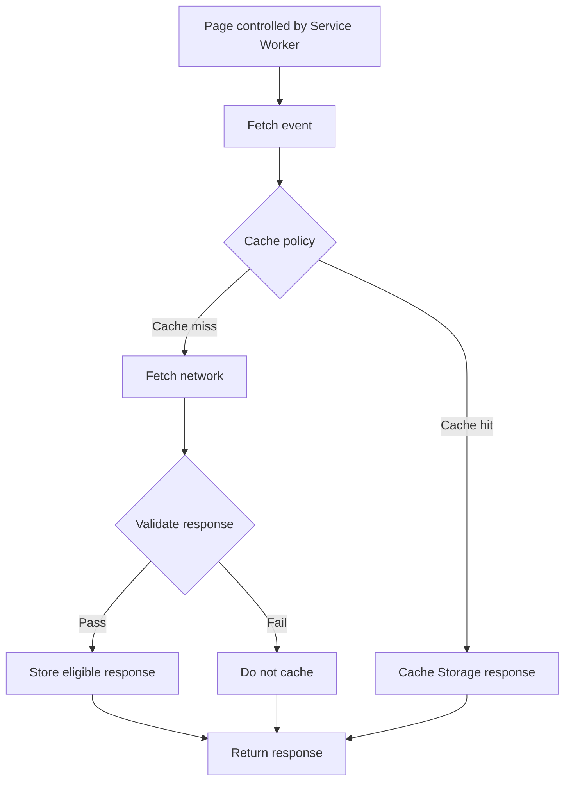

# Đầu độc cache trong Service Worker: nguyên nhân, tác động và phòng vệ

**Chương:** Service worker  
**Mô-đun:** `SECURITY_APPLICATION_SECURITY_BROWSER_SECURITY` — phân tích ranh giới bảo mật giữa trình duyệt, origin, cookie và ứng dụng web để hiểu Same-Origin Policy (SOP), CORS và các cơ chế cách ly; thực hành phòng vệ XSS, CSRF, clickjacking bằng CSP, Trusted Types, security headers và kiểm chứng hành vi thực tế.

**Đầu độc cache trong Service Worker (Service Worker cache poisoning)** xảy ra khi nội dung không đáng tin cậy, sai ngữ cảnh hoặc đã bị thao túng được ghi vào Cache Storage, sau đó Service Worker tiếp tục phân phối nội dung đó cho các request hợp lệ. Một response sai có thể tồn tại lâu hơn request ban đầu, được dùng lại khi người dùng điều hướng hoặc offline, và ảnh hưởng đến nhiều lần mở trang sau đó.

Nguyên nhân thường nằm ở logic cache của ứng dụng: cache key bỏ qua query string hoặc header quan trọng; handler ghi mọi response mà không kiểm tra status, origin, loại nội dung hay trạng thái xác thực; cache cả response cá nhân hóa; hoặc dùng cache chung cho nhiều nhóm tài nguyên. Khi một response độc hại lọt vào cache, chiến lược `cache-first` hoặc fallback offline có thể tiếp tục trả response đó dù server đã được sửa.

Cache poisoning có thể dẫn tới hiển thị nội dung giả, stored XSS khi nội dung HTML/script bị phục vụ trong origin đáng tin, rò rỉ dữ liệu giữa người dùng hoặc tenant, lỗi phiên bản ứng dụng và làm hỏng luồng offline. Mức độ ảnh hưởng phụ thuộc vào loại tài nguyên bị cache và quyền của mã được chạy trong document.

Bài học tập trung vào Cache Storage do Service Worker quản lý, cách request được ghép với cache entry, các lỗi thiết kế thường gặp, cách kiểm tra response trước khi lưu và quy trình phát hiện, làm sạch, cập nhật cache an toàn.

## 1. Mục tiêu học tập

Sau bài học, bạn có thể:

1. Giải thích Service Worker cache poisoning và phân biệt nó với HTTP/proxy cache poisoning.
2. Mô tả cách Service Worker, Cache Storage và fetch event phối hợp để lưu và trả response.
3. Nhận diện cache-key confusion do query string, header `Vary`, method hoặc origin.
4. Phát hiện lỗi khi cache response lỗi, redirect, opaque, dữ liệu cá nhân hóa hoặc nội dung không được kiểm chứng.
5. Giải thích vì sao `Cache-Control: no-store` không tự động ngăn một lệnh `Cache.put()` do ứng dụng gọi.
6. Viết quy tắc cache allowlist theo method, origin, path, content type và chính sách dữ liệu.
7. Quản lý cache version, activation, cleanup và invalidation mà không xóa nhầm cache khác.
8. Kiểm tra cache poisoning bằng DevTools, test matrix và browser automation.
9. Thực hiện lab an toàn mô phỏng cache-key confusion và xác minh cách khắc phục.

## 2. Service Worker và Cache Storage

### 2.1. Service Worker đứng ở đâu trong request flow?

Service Worker là script chạy trong môi trường worker riêng, không có DOM trực tiếp. Sau khi đăng ký, cài đặt và kích hoạt, nó có thể điều khiển các page client nằm trong scope. Khi một client được kiểm soát phát request, Service Worker có thể nhận `fetch` event, gọi network, trả response từ Cache Storage hoặc kết hợp nhiều nguồn.

Cache Storage là API lưu trữ các cặp Request/Response theo origin và storage partition của browser. Ứng dụng chủ động đặt tên cache, thêm request/response và quyết định thời điểm xóa. Browser có thể giới hạn quota hoặc evict dữ liệu; Cache Storage không phải kho lưu trữ vĩnh viễn.

Luồng đơn giản:



Service Worker có thể phục vụ response mà không cần request đi tới server. Vì vậy, nếu cache chứa response sai, việc sửa backend chưa chắc lập tức sửa nội dung đang được browser trả từ cache.

### 2.2. Cache Storage khác HTTP cache

| Đặc điểm | Cache Storage / Service Worker | HTTP browser/proxy cache |
| --- | --- | --- |
| Ai quyết định lưu? | Logic ứng dụng gọi Cache API | Browser hoặc intermediary theo HTTP caching semantics |
| Key và matching | Request/Response cùng tùy chọn `Cache.match` | HTTP cache key và các quy tắc cache HTTP |
| Chiến lược | Do Service Worker lập trình | Do browser/proxy triển khai |
| `Cache-Control` | Cache API không tự áp dụng freshness/no-store khi ứng dụng gọi `put` | Được dùng theo HTTP caching rules |
| Xóa và version | Ứng dụng quản lý tên cache và entry | Theo cơ chế cache của browser/proxy |

Đừng mặc định một response có `Cache-Control: no-store` sẽ không thể xuất hiện trong Cache Storage. Nếu Service Worker gọi `cache.put(request, response.clone())`, ứng dụng phải tự kiểm tra và tôn trọng chỉ thị lưu trữ của server trước khi ghi. Cache API không tự thực thi chính sách HTTP caching thay cho ứng dụng.

### 2.3. Ranh giới origin và scope

Service Worker chỉ được đăng ký từ script cùng origin với document và trong secure context; `localhost` được xem là môi trường đáng tin cho phát triển. Scope xác định những client mà worker có thể điều khiển, không tạo một vùng Cache Storage riêng biệt.

Cache Storage được phân vùng theo origin/storage partition, không phải theo tên Service Worker. Các script cùng origin có thể truy cập Cache Storage của origin đó nếu browser cho phép. Do đó, scope hẹp không phải ranh giới cô lập giữa các ứng dụng cùng origin; tránh coi tên cache bí mật hoặc scope là cơ chế phân quyền.

Một script độc hại chạy cùng origin, ví dụ qua XSS, có thể gọi Cache API để đọc, ghi hoặc xóa cache trong phạm vi origin. Nếu chính Service Worker bị xâm phạm, nó có thể chặn request và phân phối response tùy ý cho các client thuộc scope. Đây là lý do bảo vệ origin, script đăng ký và logic cache đều quan trọng.

## 3. Đầu độc cache diễn ra như thế nào?

### 3.1. Các điều kiện thường gặp

Một cuộc đầu độc cache thường cần ít nhất một trong các điều kiện sau:

- Attacker có thể tác động tới request hoặc response được đưa vào cache, ví dụ thông qua tham số do người dùng kiểm soát, nội dung upload hoặc endpoint bị xâm phạm.
- Cache key không thể hiện đầy đủ những yếu tố làm thay đổi nội dung response.
- Service Worker lưu response mà không kiểm tra nguồn, status, redirect, content type hoặc phân loại dữ liệu.
- Một script cùng origin có thể ghi cache, ví dụ XSS hoặc dependency bị xâm phạm.
- Cache cũ tiếp tục được dùng sau khi nội dung gốc hoặc logic Service Worker đã được sửa.

Kết nối HTTPS đúng cấu hình bảo vệ response khỏi bị sửa trực tiếp trên đường truyền bởi attacker mạng thông thường. Không nên mô tả cache poisoning như thể bất kỳ người ở cùng mạng nào cũng có thể tùy ý ghi Cache Storage của website HTTPS. Cần có đường tác động vào response, cache key hoặc script có quyền ghi cache.

### 3.2. Kịch bản 1: bỏ qua query string trong cache key

Giả sử API trả banner theo query:

- `/api/banner?variant=welcome` trả nội dung chào mừng.
- `/api/banner?variant=untrusted` trả nội dung do người dùng cung cấp hoặc dữ liệu chưa được tin cậy.

Service Worker dùng:

```javascript
const cached = await cache.match(event.request, {
  ignoreSearch: true
});
```

Khi `ignoreSearch: true`, query string không còn tham gia matching. Nếu request `variant=untrusted` được lưu trước, request `variant=welcome` có thể nhận cùng cache entry. Đây là cache-key confusion: hai request khác nhau về ý nghĩa nghiệp vụ bị xem như một key.

Nếu nội dung không tin cậy là HTML hoặc JavaScript được render/thực thi trong origin ứng dụng, tác động có thể nghiêm trọng. Ngay cả khi chỉ là JSON, ứng dụng vẫn có thể hiển thị sai nội dung, dùng nhầm cấu hình hoặc trộn dữ liệu giữa các ngữ cảnh.

### 3.3. Kịch bản 2: cache response không kiểm tra

Một handler đơn giản có thể ghi mọi response:

```javascript
const response = await fetch(event.request);
await cache.put(event.request, response.clone());
return response;
```

Logic này không kiểm tra:

- Response có phải thành công hay không.
- URL cuối cùng sau redirect có còn thuộc origin mong muốn không.
- Response có đúng content type của tài nguyên không.
- Đây có phải nội dung cá nhân hóa hoặc có `Cache-Control: no-store/private` không.
- Request có thuộc danh sách tài nguyên được phép cache không.
- Response có phải opaque, partial hoặc nội dung lỗi do proxy/login page trả về không.

Một response 404, trang login, trang lỗi CDN hoặc nội dung do người dùng kiểm soát có thể bị lưu vào cache của một tài nguyên hợp lệ. Khi backend phục hồi, Service Worker vẫn có thể trả response đã lưu.


### 3.4. Kịch bản 3: thiếu yếu tố phân biệt trong response

Một endpoint có thể trả nội dung khác nhau theo header hoặc trạng thái request:

- `Accept-Language` quyết định ngôn ngữ.
- `Accept` quyết định representation.
- Cookie hoặc Authorization gắn với người dùng đang đăng nhập.
- Header tenant hoặc context do ứng dụng gửi quyết định dữ liệu thuộc tổ chức nào.

Nếu response thay đổi theo header nhưng cache không bảo toàn sự khác biệt đó, một client có thể nhận representation của client khác. HTTP có header `Vary` để mô tả request header nào ảnh hưởng representation. Cache API cũng dùng `Vary` khi matching mặc định; nhưng code có thể vô hiệu hóa bằng `ignoreVary: true`, hoặc server không khai báo đúng `Vary`.

Với response phụ thuộc cookie, authorization, tenant hoặc người dùng, cách an toàn thường là không đưa vào cache dùng chung. Đừng dựa vào một header `Vary` thiếu hoặc sai để cô lập dữ liệu cá nhân.

### 3.5. Kịch bản 4: cache nhầm response xác thực hoặc redirect

Một request lấy JavaScript có thể bị proxy hoặc backend chuyển hướng sang trang đăng nhập. Nếu Service Worker lưu response cuối mà không kiểm tra URL và content type, cache có thể giữ HTML login dưới key của file JavaScript. Người dùng tiếp theo nhận nội dung HTML ở nơi ứng dụng mong JavaScript.

Các tình huống tương tự xảy ra với trang lỗi CDN, trang maintenance, redirect sang host khác hoặc response 200 chứa thông báo lỗi. Chỉ kiểm tra `response.ok` chưa đủ để xác định response đúng ngữ nghĩa: trang login có thể trả 200 và `text/html`.

### 3.6. Kịch bản 5: nội dung do người dùng kiểm soát được lưu như tài nguyên đáng tin

Ứng dụng có thể cache avatar, tài liệu, preview hoặc HTML do người dùng upload. Nếu nội dung được phục vụ cùng origin nhạy cảm, một file HTML/SVG có thể trở thành stored XSS hoặc giao diện giả mạo. Service Worker giữ response đó trong cache và tiếp tục phân phối ngay cả khi người dùng quay lại sau.

Với nội dung upload, tách origin, giới hạn loại file, kiểm tra và tái mã hóa ảnh, dùng `Content-Disposition: attachment` khi phù hợp và không cache nội dung chủ động không tin cậy như app shell. Cache không biến dữ liệu không tin cậy thành dữ liệu an toàn.

### 3.7. Kịch bản 6: cache cũ tiếp tục tồn tại sau khi sửa lỗi

Đổi code Service Worker không tự động xóa mọi Cache Storage entry cũ. Worker mới chỉ được cài và kích hoạt theo lifecycle; các tab đang được worker cũ điều khiển có thể tiếp tục hoạt động cho tới khi chuyển sang worker mới. Cache cũ có thể còn tồn tại nếu activation handler không xóa đúng namespace/version.

Unregister Service Worker cũng không đồng nghĩa xóa Cache Storage. Đây là hai thao tác riêng. Khi ứng phó cache poisoning, cần cập nhật worker, xóa đúng cache bị ảnh hưởng và xác minh client không còn nhận response cũ.

## 4. Cache key và quy tắc matching

### 4.1. Cache API matching mặc định

Cache API so khớp Request với cache entry dựa trên URL và các quy tắc HTTP liên quan, bao gồm `Vary`. Mặc định, query string được giữ nguyên, method không được bỏ qua và `Vary` được xét. Những tùy chọn như `ignoreSearch`, `ignoreMethod` và `ignoreVary` có thể làm thay đổi matching.

Ví dụ:

```javascript
const exact = await cache.match(request);

// Rủi ro nếu query phân biệt nội dung:
const looseQuery = await cache.match(request, {
  ignoreSearch: true
});

// Rủi ro nếu response có Vary:
const looseHeaders = await cache.match(request, {
  ignoreVary: true
});
```

Dùng matching mặc định trừ khi có lý do cụ thể và đã chứng minh các phần bị bỏ qua không ảnh hưởng representation. Không dùng `ignoreSearch: true` cho endpoint có query mang ý nghĩa như user, tenant, locale, version, filter hoặc nội dung. Không dùng `ignoreVary: true` khi server dùng `Vary` để phân biệt representation.

### 4.2. Method và response type

Cache API được thiết kế chủ yếu cho request GET. `Cache.put()` từ chối request có method khác GET; vì vậy không dùng Cache Storage như nơi cache kết quả POST hoặc request thay đổi trạng thái.

Phân biệt các thao tác:

- `cache.add()` và `cache.addAll()` fetch request rồi thêm response thành công; các response không thành công và opaque không được chấp nhận theo quy tắc của API.
- `cache.put()` cho phép ứng dụng tự đưa response vào cache, kể cả một số response mà `add()` sẽ từ chối. Vì vậy, cần tự kiểm tra status, type và nội dung trước khi gọi.
- `Cache.put()` không chấp nhận response status `206 Partial Content`; không cache response range như một file hoàn chỉnh.

Không coi việc `put()` không ném lỗi là bằng chứng nội dung hợp lệ. Validation phải diễn ra trước khi ghi.

### 4.3. Opaque response và tài nguyên cross-origin

Request cross-origin dùng `no-cors` có thể trả opaque response: JavaScript không đọc được status, header hay body. `Cache.put()` có thể lưu opaque response, nhưng ứng dụng không thể xác minh nội dung hoặc status theo cách thông thường.

Tránh cache opaque response cho dữ liệu nhạy cảm hoặc tài nguyên có ảnh hưởng đến logic ứng dụng. Nếu bắt buộc cache một tài nguyên public cross-origin, chỉ làm với origin và đường dẫn đã được kiểm soát, hiểu rõ giới hạn kiểm tra và cân nhắc CORS/SRI hoặc self-host. Không dùng opaque response như bằng chứng server trả nội dung hợp lệ.

### 4.4. Tránh tìm kiếm trên tất cả cache

`caches.match(request)` tìm qua các cache trong Cache Storage của origin. Nếu nhiều phiên bản ứng dụng hoặc module dùng chung origin, một entry cũ trong cache khác có thể được trả ngoài dự kiến.

Ưu tiên mở cache có tên rõ ràng rồi gọi `cache.match(request)` trên đúng cache. Tách namespace cho app shell, static assets và runtime data. Không dùng tên cache do người dùng cung cấp và không dựa vào thứ tự cache để xác định ưu tiên.

### 4.5. Cache key phải phản ánh representation

Trước khi cache một request, hãy trả lời:

1. URL path có xác định duy nhất tài nguyên không?
2. Query string có thay đổi nội dung không?
3. Header nào làm thay đổi representation và server có khai báo `Vary` chính xác không?
4. Response có phụ thuộc cookie, Authorization, tenant hoặc trạng thái đăng nhập không?
5. Request có thể redirect sang host hoặc loại nội dung khác không?
6. Có thể dùng URL asset đã hash theo build thay cho key động không?

Nếu không thể định nghĩa cache key đầy đủ và an toàn, đừng cache response đó. Với API cá nhân hóa, network-only thường đơn giản và an toàn hơn cố gắng tự xây key nhiều chiều.

## 5. Phòng vệ: chỉ cache response đã được phép và kiểm tra

### 5.1. Xây dựng allowlist tài nguyên

Bắt đầu bằng danh sách tài nguyên thực sự cần offline/cache. Thường có thể cache:

- File JavaScript/CSS đã build với tên có content hash.
- Font hoặc ảnh tĩnh do ứng dụng sở hữu.
- App shell đã được kiểm soát phiên bản và không chứa dữ liệu cá nhân.
- Một số tài nguyên public có schema và freshness policy rõ ràng.

Mặc định không cache:

- API trả dữ liệu theo người dùng, tenant, cookie hoặc Authorization.
- HTML trang đăng nhập, tài khoản, thanh toán hoặc trang chứa dữ liệu cá nhân.
- CSRF token, access token, refresh token, session identifier và secret.
- Nội dung upload chưa tin cậy, preview HTML/SVG hoặc response tùy ý từ URL người dùng nhập.
- Response redirect, response lỗi, partial response hoặc opaque response chưa được đánh giá.

Không cache mọi GET chỉ vì method là GET. GET có thể trả dữ liệu cá nhân hóa hoặc nội dung động.

### 5.2. Kiểm tra request trước khi fetch/cache

Trước khi xử lý runtime cache, kiểm tra:

1. Method là GET.
2. Origin là origin dự kiến.
3. Path nằm trong allowlist cụ thể.
4. Query string không mang dữ liệu cần phân biệt hoặc được giữ nguyên trong cache key.
5. Request không thuộc API xác thực, dữ liệu tài khoản hoặc route nghiệp vụ.
6. Destination/resource type phù hợp với loại tài nguyên đang cache.

Không xây cache key bằng cách bỏ query hoặc header để “tăng cache hit” nếu chưa chứng minh chúng không ảnh hưởng nội dung. Dùng tên file đã hash và URL đầy đủ cho static assets.

### 5.3. Kiểm tra response trước khi ghi

Một response chỉ nên được cache khi thỏa các điều kiện theo use case:

- Status chính xác là 200 cho tài nguyên static thông thường.
- `response.type` là `basic` nếu chỉ chấp nhận same-origin response.
- `response.redirected` là false và `response.url` vẫn thuộc origin dự kiến.
- Content-Type khớp loại tài nguyên trong manifest.
- Response không có chỉ thị `no-store`, `private` hoặc `no-cache` nếu ứng dụng chưa tự triển khai quy tắc phù hợp.
- Không phải opaque, partial hoặc error response.
- Request thuộc allowlist và representation có cache key an toàn.

`response.ok` chỉ cho biết status thuộc nhóm 200–299; nó không chứng minh body đúng loại hoặc đúng nội dung. Một trang đăng nhập có thể trả 200 `text/html` cho request đáng lẽ phải là JavaScript.

### 5.4. Tôn trọng Cache-Control trong logic Cache API

Cache Storage không tự thực thi freshness, `max-age`, `no-cache`, `private` hay `no-store` như HTTP cache. Ứng dụng phải đọc và diễn giải response header trước khi gọi `put`, tự đặt TTL hoặc thực hiện revalidation.

Với tài nguyên có `no-store`, không ghi vào Cache Storage. Với `private` hoặc dữ liệu phụ thuộc tài khoản, mặc định không cache; nếu sản phẩm có yêu cầu offline riêng, cần threat model, phân vùng dữ liệu theo tài khoản, purge khi logout/account switch và xác minh quyền truy cập mỗi lần sử dụng. Client storage vẫn có thể bị XSS đọc.

Với `no-cache`, response có thể được lưu nhưng phải revalidate trước khi dùng theo HTTP semantics. Nếu Service Worker không triển khai revalidation, đừng lưu response đó như thể nó còn mới.

### 5.5. Dùng cache riêng và matching mặc định

Đặt tên cache theo ứng dụng, loại dữ liệu và phiên bản:

- `shop-static-v5`
- `shop-shell-v5`
- `shop-public-data-v2`

Dùng `caches.open()` với tên đã định và `cache.match(request)` trên cache cụ thể. Không dùng `caches.match()` toàn cục khi nhiều cache có thể chứa cùng URL. Không dùng tên cache hoặc URL do người dùng cung cấp.

Giữ mặc định `ignoreSearch: false`, `ignoreVary: false` và không bỏ qua method. Nếu response có `Vary`, để Cache API áp dụng matching mặc định. Nếu không thể bảo đảm `Vary` mô tả đầy đủ representation, không cache response đó.

### 5.6. Cache version và cập nhật an toàn

Đặt cache name mới cho mỗi build có thay đổi nội dung hoặc schema cache. Trong `install`, tải và kiểm tra các asset cần precache. Nếu bất kỳ asset bắt buộc nào không hợp lệ, làm install thất bại và giữ worker đang hoạt động trước đó.

Trong `activate`, chỉ xóa các cache cũ thuộc namespace do chính ứng dụng sở hữu. Không xóa tất cả Cache Storage vì cùng origin có thể chứa cache của ứng dụng/module khác. Đừng phụ thuộc vào tên cache để bảo vệ dữ liệu; cùng-origin script vẫn có thể truy cập Cache Storage.

### 5.7. Chọn chiến lược cache theo loại tài nguyên

| Chiến lược | Hành vi | Rủi ro cần kiểm soát |
| --- | --- | --- |
| Cache-first | Trả cache trước, network khi miss | Entry độc hại/cũ có thể được dùng lâu |
| Network-first | Thử network, fallback cache khi lỗi | Có thể ghi response lỗi hoặc redirect nếu không validate |
| Stale-while-revalidate | Trả cache ngay, cập nhật nền | Người dùng vẫn thấy nội dung cũ; cập nhật nền phải được validate |
| Network-only | Luôn đi network | Phù hợp dữ liệu nhạy cảm/dynamic API không cần offline |

Không có chiến lược nào tự động an toàn. Cùng một chiến lược có thể an toàn hoặc nguy hiểm tùy cache key, response validation và loại dữ liệu. Với API cá nhân hóa, network-only thường là lựa chọn mặc định tốt hơn.

### 5.8. Giữ cache tốt khi cập nhật thất bại

Trong stale-while-revalidate, chỉ thay entry cũ sau khi response mới vượt qua validation. Nếu network trả 500, HTML login, redirect hoặc content type sai, giữ bản cache hợp lệ trước đó hoặc trả lỗi theo thiết kế; không ghi response lỗi vào cache chỉ để có một kết quả mới.

Nếu cần TTL, lưu metadata thời điểm ghi hoặc dùng timestamp/version trong manifest. Cache API không tự hết hạn theo `Cache-Control`; ứng dụng phải tự kiểm soát tuổi dữ liệu và xóa entry đã hết hạn.

### 5.9. CSP, SRI và integrity là lớp bổ sung

CSP giới hạn nguồn script/style mà document được phép tải và thực thi. Subresource Integrity (SRI) có thể kiểm tra hash của một số tài nguyên script hoặc stylesheet được tham chiếu bằng thuộc tính `integrity`. Với asset quan trọng, URL có content hash và manifest đáng tin giúp phát hiện sai lệch phiên bản.

Các cơ chế này giảm tác động hoặc phát hiện nội dung bị thay đổi trong một số luồng, nhưng không sửa cache key sai, không tự xóa cache entry độc hại và không bảo vệ mọi response API/HTML. Hãy kết hợp integrity với allowlist, response validation, cache versioning và invalidation. Không xem CSP/SRI là lý do để cache response không được kiểm chứng.
## 6. Ví dụ Service Worker có kiểm tra response

Ví dụ dưới đây chỉ cache một danh sách asset cùng origin đã được build với tên file có content hash. API, route tài khoản, URL có query và response cross-origin không được đưa vào runtime cache. Đây là baseline minh họa; manifest và content type phải khớp build thật của ứng dụng.

```javascript
const STATIC_CACHE = "shop-static-v5";

const STATIC_ASSETS = new Map([
  ["/assets/app.8c31a2.js", "text/javascript"],
  ["/assets/app.8c31a2.css", "text/css"],
  ["/assets/logo.71a9f0.svg", "image/svg+xml"]
]);

async function isCacheableStaticAsset(request, response, expectedType) {
  const requestUrl = new URL(request.url);

  if (request.method !== "GET") return false;
  if (requestUrl.origin !== self.location.origin) return false;
  if (requestUrl.search !== "") return false;

  if (response.status !== 200) return false;
  if (response.type !== "basic") return false;
  if (response.redirected) return false;

  const finalUrl = new URL(response.url);
  if (finalUrl.origin !== self.location.origin) return false;

  const contentType = (response.headers.get("content-type") || "")
    .split(";")[0]
    .trim()
    .toLowerCase();

  if (contentType !== expectedType) return false;

  const cacheControl = response.headers.get("cache-control") || "";
  if (/(?:^|,)\s*(?:no-store|private|no-cache)\b/i.test(cacheControl)) {
    return false;
  }

  const vary = response.headers.get("vary") || "";
  if (vary.split(",").some(value => value.trim() === "*")) {
    return false;
  }

  return true;
}

self.addEventListener("install", event => {
  event.waitUntil((async () => {
    const cache = await caches.open(STATIC_CACHE);

    try {
      for (const [path, expectedType] of STATIC_ASSETS) {
        const request = new Request(path, { cache: "reload" });
        const response = await fetch(request);

        if (!await isCacheableStaticAsset(request, response, expectedType)) {
          throw new Error("Static asset failed cache validation: " + path);
        }

        await cache.put(request, response.clone());
      }
    } catch (error) {
      await caches.delete(STATIC_CACHE);
      throw error;
    }
  })());
});

self.addEventListener("activate", event => {
  event.waitUntil((async () => {
    const cacheNames = await caches.keys();

    await Promise.all(
      cacheNames
        .filter(name =>
          name.startsWith("shop-static-") && name !== STATIC_CACHE
        )
        .map(name => caches.delete(name))
    );

    await self.clients.claim();
  })());
});

self.addEventListener("fetch", event => {
  const request = event.request;
  const url = new URL(request.url);
  const expectedType = STATIC_ASSETS.get(url.pathname);

  // Chỉ cache GET cùng origin, đúng path trong manifest và không có query.
  if (
    request.method !== "GET" ||
    url.origin !== self.location.origin ||
    !expectedType ||
    url.search !== ""
  ) {
    return;
  }

  event.respondWith((async () => {
    const cache = await caches.open(STATIC_CACHE);
    const cached = await cache.match(request);

    if (cached) return cached;

    const response = await fetch(request);

    if (await isCacheableStaticAsset(request, response, expectedType)) {
      await cache.put(request, response.clone());
    }

    return response;
  })());
});
```

Các điểm quan trọng:

- Manifest giới hạn chính xác path và MIME type được cache.
- Matching dùng mặc định; không bỏ query hoặc `Vary`.
- Response redirect, opaque, status khác 200, origin khác hoặc content type sai không được ghi.
- Cache name có version; activation chỉ xóa cache cũ thuộc namespace `shop-static-`.
- API và nội dung cá nhân hóa không được runtime cache trong ví dụ.

Trong ứng dụng thực tế, hãy dùng asset manifest do build pipeline sinh ra. Nếu asset có query version hoặc biến thể theo header, phải thiết kế key và validation tương ứng thay vì bỏ qua các yếu tố đó.

## 7. Vòng đời, cập nhật và làm sạch cache

### 7.1. Install và activate

Trong `install`, Service Worker chuẩn bị tài nguyên cần thiết. Nếu asset bắt buộc không tải được hoặc validation thất bại, có thể làm promise truyền vào `event.waitUntil()` reject để install thất bại. Worker đang active tiếp tục phục vụ client theo lifecycle của browser.

Trong `activate`, dọn cache phiên bản cũ thuộc namespace của ứng dụng. Chỉ xóa cache mà ứng dụng sở hữu; Cache Storage là tài nguyên theo origin và có thể được nhiều phần của cùng website dùng chung.

### 7.2. Update không đồng nghĩa mọi tab đổi ngay

Khi script Service Worker thay đổi, browser tải và cài phiên bản mới theo update lifecycle. Worker mới có thể ở trạng thái waiting khi worker cũ còn điều khiển client. Các tab đang mở có thể tiếp tục dùng worker cũ cho tới khi điều kiện lifecycle cho phép chuyển đổi.

Không dùng `skipWaiting()` và `clients.claim()` một cách máy móc nếu ứng dụng có thay đổi cache schema hoặc API contract không tương thích. Chuyển worker giữa phiên có thể làm một page cũ nhận response từ cache version mới. Thiết kế tương thích ngược hoặc yêu cầu reload có kiểm soát.

### 7.3. Xóa cache khi xử lý sự cố

Có thể xóa một cache cụ thể:

```javascript
await caches.delete("shop-static-v4");
```

Hoặc xóa các cache thuộc namespace của ứng dụng:

```javascript
const names = await caches.keys();

await Promise.all(
  names
    .filter(name => name.startsWith("shop-static-"))
    .map(name => caches.delete(name))
);
```

Không chạy lệnh xóa toàn bộ Cache Storage nếu chưa xác định quyền sở hữu. Một origin có thể chứa cache của app shell, widget, module hoặc ứng dụng khác.

Unregister Service Worker và xóa Cache Storage là hai thao tác riêng. Nếu chỉ gọi `registration.unregister()`, cache entries không tự động bị xóa. Nếu cache độc hại vẫn còn, worker mới hoặc page code khác có thể tiếp tục đọc nó.

### 7.4. Quy trình ứng phó cache poisoning

Khi phát hiện nội dung sai hoặc độc hại được phục vụ từ cache:

1. **Khoanh vùng:** ghi nhận URL, cache name, request key, response headers, browser/version và worker đang điều khiển trang.
2. **Ngừng ghi thêm:** triển khai worker/logic mới để bỏ qua route hoặc tắt runtime caching bị lỗi.
3. **Sửa nguyên nhân:** khắc phục cache key, allowlist, response validation hoặc endpoint tạo nội dung.
4. **Tăng cache version:** phát hành cache name mới và cleanup đúng namespace khi worker mới activate.
5. **Xóa entry bị ảnh hưởng:** xóa đúng cache hoặc request key sau khi đã ngăn worker cũ ghi lại nội dung lỗi.
6. **Làm mới client:** hướng dẫn đóng/mở tab hoặc reload để client chuyển sang worker mới theo lifecycle.
7. **Xác minh:** kiểm tra Cache Storage, Network và response body để chắc chắn nội dung cũ không còn được phân phối.
8. **Điều tra phạm vi:** xác định thời điểm, route, người dùng/tenant có thể bị ảnh hưởng và nguồn response đã bị đưa vào cache.

Nếu Service Worker script hoặc origin bị xâm phạm, xử lý như một sự cố compromise của origin. Xóa cache không đủ nếu mã độc vẫn còn khả năng ghi lại cache.

## 8. Lab: mô phỏng cache-key confusion an toàn

Lab dùng Node.js và Service Worker trên `http://localhost:8080`. Server trả hai chuỗi text vô hại theo query parameter; không có script hoặc HTML do người dùng kiểm soát được thực thi. Mục tiêu là quan sát một request variant bị cache nhầm cho variant khác và thấy Cache API vẫn lưu response có `Cache-Control: no-store` khi code chủ động gọi `cache.put()`.

### 8.1. Tạo file trang thử nghiệm

Tạo file `index.html`:

```html
<!doctype html>
<html lang="vi">
<head>
  <meta charset="utf-8">
  <meta name="viewport" content="width=device-width, initial-scale=1">
  <title>Service Worker cache poisoning lab</title>
</head>
<body>
  <h1>Cache-key confusion lab</h1>
  <p id="status">Registering Service Worker...</p>

  <button id="poison">Request variant=untrusted first</button>
  <button id="welcome">Request variant=welcome</button>
  <button id="clear">Clear demo cache</button>

  <h2>Response</h2>
  <pre id="result">No request yet</pre>
  <h2>Cache inspection</h2>
  <pre id="cache-state">Not checked</pre>

  <script>
    const statusNode = document.querySelector("#status");
    const resultNode = document.querySelector("#result");
    const cacheNode = document.querySelector("#cache-state");
    const cacheName = "demo-vulnerable-v1";

    async function waitForController() {
      if (navigator.serviceWorker.controller) return;
      await new Promise(resolve => {
        navigator.serviceWorker.addEventListener(
          "controllerchange",
          resolve,
          { once: true }
        );
      });
    }

    async function inspectCache() {
      const cache = await caches.open(cacheName);
      const requests = await cache.keys();
      cacheNode.textContent = requests.map(request => request.url).join("\n")
        || "(empty)";
    }

    async function requestVariant(variant) {
      const response = await fetch(
        "/api/banner?variant=" + encodeURIComponent(variant),
        { cache: "no-store" }
      );
      resultNode.textContent =
        "Requested variant: " + variant +
        "\nHTTP status: " + response.status +
        "\nBody: " + await response.text();

      await inspectCache();
    }

    document.querySelector("#poison").addEventListener("click", () => {
      requestVariant("untrusted");
    });

    document.querySelector("#welcome").addEventListener("click", () => {
      requestVariant("welcome");
    });

    document.querySelector("#clear").addEventListener("click", async () => {
      await caches.delete(cacheName);
      resultNode.textContent = "Demo cache cleared";
      await inspectCache();
    });

    (async () => {
      if (!("serviceWorker" in navigator)) {
        statusNode.textContent = "Service Worker is not supported";
        return;
      }

      await navigator.serviceWorker.register("/sw-vulnerable.js");
      await navigator.serviceWorker.ready;
      await waitForController();
      statusNode.textContent = "Page is controlled by the demo Service Worker";
      await inspectCache();
    })().catch(error => {
      statusNode.textContent = "Setup failed: " + error.message;
    });
  </script>
</body>
</html>
```

### 8.2. Tạo Service Worker có lỗi

Tạo file `sw-vulnerable.js`:

```javascript
const CACHE_NAME = "demo-vulnerable-v1";

self.addEventListener("install", event => {
  event.waitUntil(self.skipWaiting());
});

self.addEventListener("activate", event => {
  event.waitUntil(self.clients.claim());
});

self.addEventListener("fetch", event => {
  const request = event.request;
  const url = new URL(request.url);

  if (
    request.method !== "GET" ||
    url.origin !== self.location.origin ||
    url.pathname !== "/api/banner"
  ) {
    return;
  }

  event.respondWith((async () => {
    const cache = await caches.open(CACHE_NAME);

    // LỖI CỐ Ý: bỏ qua query string khi tìm cache entry.
    const cached = await cache.match(request, {
      ignoreSearch: true
    });

    if (cached) return cached;

    const response = await fetch(request);

    // LỖI CỐ Ý: ghi response mà không validate.
    await cache.put(request, response.clone());

    return response;
  })());
});
```

### 8.3. Tạo server Node.js

Tạo file `server.mjs` trong cùng thư mục:

```javascript
import { createServer } from "node:http";
import { readFile } from "node:fs/promises";

const files = new Map([
  ["/", ["index.html", "text/html; charset=utf-8"]],
  ["/index.html", ["index.html", "text/html; charset=utf-8"]],
  ["/sw-vulnerable.js", ["sw-vulnerable.js", "text/javascript; charset=utf-8"]]
]);

const server = createServer(async (req, res) => {
  const url = new URL(req.url, "http://localhost:8080");

  if (req.method === "GET" && url.pathname === "/api/banner") {
    const variant = url.searchParams.get("variant");

    const body = variant === "untrusted"
      ? "DEMO ONLY: untrusted variant was cached first."
      : "WELCOME: this is the expected public banner.";

    res.writeHead(200, {
      "Content-Type": "text/plain; charset=utf-8",
      "Cache-Control": "no-store"
    });
    res.end(body);
    return;
  }

  const file = files.get(url.pathname);
  if (req.method !== "GET" || !file) {
    res.writeHead(404, { "Content-Type": "text/plain; charset=utf-8" });
    res.end("Not found");
    return;
  }

  try {
    const content = await readFile(file[0]);
    res.writeHead(200, {
      "Content-Type": file[1],
      "Cache-Control": "no-cache"
    });
    res.end(content);
  } catch {
    res.writeHead(500, { "Content-Type": "text/plain; charset=utf-8" });
    res.end("Could not read lab file");
  }
});

server.listen(8080, "localhost", () => {
  console.log("Open http://localhost:8080");
});
```

Chạy server:

```bash
node server.mjs
```

### 8.4. Tái hiện lỗi

1. Mở `http://localhost:8080` và chờ trạng thái báo page đã được Service Worker điều khiển.
2. Nhấn **Clear demo cache** để bắt đầu từ cache rỗng.
3. Nhấn **Request variant=untrusted first**. Server trả chuỗi demo `untrusted`; Service Worker lưu response dưới request có query đó.
4. Nhấn **Request variant=welcome**. Request có query khác nhưng `ignoreSearch: true` khiến cache match entry trước đó. Kết quả hiển thị vẫn là chuỗi `untrusted`.
5. Mở DevTools → Application → Cache Storage. Quan sát cache có key request đã được lưu.
6. Response server có `Cache-Control: no-store`, nhưng Cache API vẫn lưu vì Service Worker gọi `cache.put()` trực tiếp.

Lab mô phỏng lỗi key matching và cho thấy chỉ thị HTTP không tự kiểm soát Cache API. Chuỗi `untrusted` chỉ là text demo; không có mã được thực thi.

### 8.5. Khắc phục và kiểm thử lại

Đối với API banner này, cách đơn giản nhất là không cache endpoint động. Thay handler bằng network-only:

```javascript
self.addEventListener("fetch", event => {
  const request = event.request;
  const url = new URL(request.url);

  if (
    request.method === "GET" &&
    url.origin === self.location.origin &&
    url.pathname === "/api/banner"
  ) {
    event.respondWith(fetch(request));
  }
});
```

Cập nhật file worker, mở DevTools → Application → Service Workers và chọn **Update** hoặc **Update on reload**. Reload trang, xóa cache demo cũ rồi thử lại. Hai query phải nhận đúng response riêng từ server và Cache Storage không được thêm entry cho endpoint API.

Nếu nghiệp vụ thực sự cần cache một endpoint public, phải giữ query/header có ý nghĩa trong cache key, validate response và tôn trọng `Cache-Control`. Không dùng `ignoreSearch` chỉ để tăng cache hit.

### 8.6. Dọn lab

Dừng server bằng Ctrl+C. Trong DevTools → Application, unregister Service Worker và xóa cache `demo-vulnerable-v1`. Xóa các file lab nếu không còn dùng. Không chạy lab trên domain production hoặc đưa dữ liệu thật vào endpoint demo.

## 9. Test matrix cho Service Worker cache poisoning

Chạy test trong browser thật trên HTTPS staging hoặc localhost. Mỗi test nên ghi lại request URL, method, initiator, worker version, cache name, response status/type/content type và kết quả render.

| ID | Tình huống | Kết quả mong đợi |
| --- | --- | --- |
| SWC-01 | Hai request cùng path nhưng query khác nhau | Cache matching mặc định phân biệt query |
| SWC-02 | Handler dùng `ignoreSearch: true` cho query có ý nghĩa | Test phát hiện response variant bị dùng nhầm |
| SWC-03 | Response có `Vary: Accept-Language` | Matching mặc định phân biệt request header tương ứng |
| SWC-04 | Handler dùng `ignoreVary: true` | Test phát hiện representation có thể bị trộn |
| SWC-05 | Response có `Cache-Control: no-store`, code gọi `Cache.put()` | Test chứng minh Cache API vẫn lưu nếu ứng dụng không tự chặn |
| SWC-06 | Network trả 404 hoặc 500 | Không ghi response lỗi vào cache |
| SWC-07 | Request asset nhận HTML login với status 200 | Content-Type validation từ chối cache |
| SWC-08 | HTTPS request redirect sang origin khác | Không cache response cuối ngoài origin allowlist |
| SWC-09 | Request cross-origin trả opaque response | Không cache nếu ứng dụng không thể xác minh response |
| SWC-10 | Server trả 206 Partial Content | Không gọi `Cache.put()` cho response partial |
| SWC-11 | API phụ thuộc cookie hoặc Authorization | Network-only; không rò dữ liệu giữa tài khoản |
| SWC-12 | API phụ thuộc tenant hoặc locale | Không trộn representation giữa tenant/locale |
| SWC-13 | XSS cùng origin gọi Cache API | Threat model xác nhận script có thể thao tác cache; không có secret trong cache |
| SWC-14 | Worker mới đổi cache version | Cache cũ thuộc namespace được cleanup khi activate |
| SWC-15 | Cache của module khác cùng origin | Cleanup không xóa cache ngoài namespace sở hữu |
| SWC-16 | Unregister Service Worker | Cache Storage vẫn còn cho tới khi được xóa riêng |
| SWC-17 | Install precache gặp asset sai content type | Install thất bại; cache tạm được dọn |
| SWC-18 | Stale-while-revalidate nhận response lỗi | Entry tốt trước đó không bị thay bằng response lỗi |
| SWC-19 | Offline navigation sau khi cache bị đầu độc | Test phát hiện nội dung cũ vẫn có thể được trả nếu chưa invalidation |
| SWC-20 | Cache name hoặc URL được ghép từ input người dùng | Test xác nhận input không điều khiển namespace/cache key tùy ý |
| SWC-21 | Cache entry có URL đúng nhưng body sai | Integrity/schema validation phát hiện sai nội dung nếu use case yêu cầu |
| SWC-22 | Browser evict cache vì quota | Ứng dụng fallback network và không coi cache là dữ liệu bền vững |

### 9.1. Kiểm tra trong DevTools

Trong Chromium DevTools → Application:

1. Mở **Service Workers**, ghi lại script URL, scope, trạng thái activated/running và client controller.
2. Mở **Cache Storage**, kiểm tra tên cache, request URL và response header/body.
3. Chọn **Update on reload** để quan sát worker update trong môi trường thử nghiệm.
4. Dùng **Unregister** để kiểm tra lifecycle, sau đó kiểm tra Cache Storage riêng để thấy cache không tự bị xóa.
5. Mở **Network**, bật Disable cache cho HTTP cache nếu cần, rồi phân biệt response từ Service Worker với response từ network.
6. Reload offline để xác định response nào đang được phục vụ từ cache.
7. Xóa đúng cache test và lặp lại để xác nhận kết quả có thể tái hiện.

Tên panel và cách hiển thị response source khác nhau giữa browser. Không kết luận cache hit chỉ từ việc trang tải nhanh; kiểm tra request/response và cache entry.

### 9.2. Browser automation

Có thể ghi nhận request và response trong Playwright:

```javascript
const observed = [];

page.on("response", async response => {
  const request = response.request();

  observed.push({
    url: response.url(),
    method: request.method(),
    resourceType: request.resourceType(),
    status: response.status(),
    fromServiceWorker: response.fromServiceWorker()
  });
});

await page.goto("http://localhost:8080");
await page.getByRole("button", {
  name: "Request variant=untrusted first"
}).click();

await page.getByRole("button", {
  name: "Request variant=welcome"
}).click();

const pageText = await page.locator("#result").innerText();
expect(pageText).toContain("WELCOME");
```

Đây là khung test cho phiên bản đã sửa. Với phiên bản có lỗi, assertion cuối cần phát hiện body `untrusted` bị trả nhầm. Hãy reset cache và worker giữa các test để kết quả không phụ thuộc lần chạy trước. Một số API automation có thể báo response từ Service Worker khác nhau theo browser; kết hợp nội dung thực tế và Cache Storage inspection.

### 9.3. Kiểm tra cache key và body

Kiểm tra cả request key lẫn body được lưu. Hai request có URL khác nhau nhưng `ignoreSearch` có thể cùng match; ngược lại, một response sai có thể được lưu dưới đúng URL. Nếu nội dung static có manifest hash, xác minh body hoặc digest theo manifest trước khi phân phối khi yêu cầu integrity cao.

## 10. Những ngộ nhận thường gặp

**“HTTPS bảo đảm Cache Storage không thể bị đầu độc.”** Sai. HTTPS bảo vệ dữ liệu trên đường truyền; response từ server bị xâm phạm, logic cache sai hoặc XSS cùng origin vẫn có thể ghi nội dung không mong muốn.

**“Cache API tự tôn trọng `Cache-Control: no-store`.”** Sai. Khi ứng dụng chủ động gọi `Cache.put()`, phải tự kiểm tra chỉ thị và quyết định có lưu hay không.

**“Cache-first luôn an toàn vì không gọi network.”** Sai. Cache-first có thể giữ response độc hại hoặc lỗi lâu hơn nếu không có versioning, validation và invalidation.

**“Network-first không thể bị đầu độc.”** Sai. Handler có thể lưu response lỗi, redirect hoặc trang login nhận từ network nếu không kiểm tra trước khi ghi.

**“`ignoreSearch: true` chỉ giúp cache hit tốt hơn.”** Sai. Nếu query thay đổi nội dung, bỏ query có thể trộn response giữa người dùng, tenant, locale hoặc variant.

**“`Vary` không liên quan Cache Storage.”** Sai. Cache matching mặc định xét `Vary`; dùng `ignoreVary` hoặc cấu hình `Vary` thiếu có thể làm các representation bị trộn.

**“`Cache.put()` chỉ lưu response 2xx.”** Sai. `put()` cho phép lưu nhiều response mà `add()` từ chối; ứng dụng phải tự validate. `put()` không chấp nhận request method khác GET hoặc response 206.

**“Opaque response luôn an toàn vì JavaScript không đọc được body.”** Sai. Opaque response vẫn có thể được cache và phân phối; không đọc được body cũng có nghĩa ứng dụng không thể xác minh nội dung theo cách thông thường.

**“Unregister worker sẽ xóa cache.”** Sai. Unregister và `caches.delete()` là hai thao tác riêng.

**“Scope của Service Worker cô lập Cache Storage.”** Sai. Scope giới hạn client được điều khiển; Cache Storage được phân vùng theo origin/storage partition và có thể được script cùng origin truy cập.

**“Cache name bí mật bảo vệ dữ liệu.”** Sai. Tên cache không phải quyền truy cập. Không dùng nó làm cơ chế authorization.

**“Response 200 chắc chắn là tài nguyên đúng.”** Sai. Trang login hoặc trang lỗi có thể trả 200. Cần kiểm tra content type, URL cuối, nội dung và allowlist.

## 11. Checklist phòng vệ cache poisoning

Trước khi phát hành, xác nhận:

1. **Inventory:** liệt kê route và asset được cache; giải thích lý do cần offline/cache cho từng loại.
2. **Allowlist:** chỉ cache method, origin, path và resource type đã xác định.
3. **Cache key:** giữ query string và `Vary` mặc định; không bỏ qua thành phần ảnh hưởng representation.
4. **Personal data:** không cache API phụ thuộc cookie, Authorization, user hoặc tenant theo mặc định.
5. **Response validation:** kiểm tra status, type, redirect, final origin và content type trước khi ghi.
6. **Cache directives:** tự tôn trọng `no-store`, `private`, `no-cache` và tự triển khai freshness/revalidation nếu cần.
7. **Opaque/partial:** từ chối opaque response chưa đánh giá và response 206.
8. **Content trust:** không cache upload HTML/SVG hoặc nội dung không tin cậy như app shell; tách origin cho nội dung chủ động.
9. **Versioning:** dùng cache name theo version/build; chỉ cleanup namespace thuộc ứng dụng.
10. **Lifecycle:** kiểm thử install, waiting, activate, client cũ và worker update.
11. **Invalidation:** có quy trình xóa entry/cache bị ảnh hưởng sau khi đã ngăn logic lỗi ghi lại.
12. **Unregister:** hiểu rằng unregister không tự xóa Cache Storage.
13. **XSS defense:** bảo vệ script cùng origin; giả định XSS có thể đọc/ghi Cache Storage.
14. **Server trust:** HTTPS, CSP, dependency integrity và bảo vệ endpoint vẫn cần thiết.
15. **Observability:** ghi nhận worker version, cache version, route và lỗi validation mà không log dữ liệu nhạy cảm.
16. **Regression:** test cache key, response type, offline path và nhiều tài khoản/tenant trong CI.
17. **Quota/eviction:** có fallback khi browser xóa cache; không lưu dữ liệu duy nhất trong Cache Storage.
18. **Ownership:** không xóa cache của widget/module khác cùng origin nếu không có quyền sở hữu.

## 12. Câu hỏi tự kiểm tra

**Câu 1.** Service Worker cache poisoning là gì?  
**Đáp án:** Là việc nội dung sai hoặc không đáng tin bị ghi vào Cache Storage rồi được Service Worker dùng lại cho request sau.

**Câu 2.** Cache Storage khác HTTP cache ở điểm nào?  
**Đáp án:** Cache Storage do ứng dụng chủ động quản lý bằng Cache API; HTTP cache tuân theo caching semantics của browser/intermediary.

**Câu 3.** Vì sao `ignoreSearch: true` có thể gây cache poisoning?  
**Đáp án:** Nó bỏ query string khỏi matching; các request khác ý nghĩa có thể nhận cùng response cache.

**Câu 4.** Cache API có tự tôn trọng `Cache-Control: no-store` khi gọi `cache.put()` không?  
**Đáp án:** Không. Ứng dụng phải tự kiểm tra header trước khi ghi.

**Câu 5.** Vì sao status 200 chưa đủ để cache một JavaScript asset?  
**Đáp án:** Response có thể là HTML login hoặc trang lỗi trả 200; cần kiểm tra content type, URL cuối và allowlist.

**Câu 6.** `Vary` có vai trò gì trong cache matching?  
**Đáp án:** Nó mô tả request header nào làm thay đổi representation; Cache API xét `Vary` khi matching mặc định.

**Câu 7.** Vì sao không nên cache response phụ thuộc cookie hoặc Authorization?  
**Đáp án:** Có thể trộn dữ liệu giữa tài khoản hoặc tenant nếu cache key không phản ánh đúng trạng thái xác thực; dữ liệu cá nhân cũng không phù hợp cache dùng chung.

**Câu 8.** `Cache.put()` có thể lưu opaque response không?  
**Đáp án:** Có thể, nhưng ứng dụng không đọc được status/header/body để xác minh theo cách thông thường; không cache nếu chưa đánh giá rủi ro.

**Câu 9.** Vì sao cần version cache name?  
**Đáp án:** Để phân biệt asset/schema của từng build, kích hoạt cleanup cache cũ và tránh tiếp tục dùng entry đã lỗi thời.

**Câu 10.** Unregister Service Worker có xóa Cache Storage không?  
**Đáp án:** Không. Cần xóa cache riêng bằng Cache API hoặc công cụ quản lý site data.

**Câu 11.** XSS cùng origin có thể làm gì với Cache Storage?  
**Đáp án:** Có thể đọc, ghi hoặc xóa cache trong phạm vi origin, nên XSS có thể tạo hoặc duy trì cache poisoning.

**Câu 12.** Khi phát hiện cache poisoning, nên làm gì trước khi xóa cache?  
**Đáp án:** Ngăn logic worker cũ tiếp tục ghi response sai, phát hành worker đã sửa, sau đó xóa cache/entry bị ảnh hưởng và xác minh client đã chuyển phiên bản.

## 13. Ghi nhớ cốt lõi

Đầu độc cache trong Service Worker xảy ra khi response sai hoặc không đáng tin được ghi vào Cache Storage rồi được tái sử dụng cho request hợp lệ. Nguyên nhân thường là cache key không phản ánh query/header có ý nghĩa, handler lưu response không kiểm tra, dữ liệu cá nhân bị cache hoặc cache cũ không được invalidation sau khi sửa lỗi.

Cache Storage là API do ứng dụng quản lý; nó không tự thực thi `Cache-Control` như HTTP cache. Hãy chỉ cache asset public trong allowlist, giữ query và `Vary` mặc định, kiểm tra status/type/redirect/final origin/content type, từ chối response riêng tư hoặc opaque chưa đánh giá, version cache name và cleanup đúng namespace. API cá nhân hóa nên network-only theo mặc định.

Khi ứng phó sự cố, ngăn worker cũ ghi lại nội dung lỗi, cập nhật logic, tăng cache version, xóa đúng cache và kiểm tra lại response trong browser. **Cache chỉ nên giữ nội dung đã được phép và xác minh; cache hit không phải bằng chứng response đáng tin.**

### Tài liệu tham khảo

- [MDN — Service Worker API](https://developer.mozilla.org/en-US/docs/Web/API/Service_Worker_API).
- [MDN — Cache API](https://developer.mozilla.org/en-US/docs/Web/API/Cache).
- [MDN — Cache.put()](https://developer.mozilla.org/en-US/docs/Web/API/Cache/put).
- [MDN — Cache.match()](https://developer.mozilla.org/en-US/docs/Web/API/Cache/match).
- [MDN — CacheStorage](https://developer.mozilla.org/en-US/docs/Web/API/CacheStorage).
- [MDN — Using Service Workers](https://developer.mozilla.org/en-US/docs/Web/API/Service_Worker_API/Using_Service_Workers).
- [WHATWG — Service Workers](https://w3c.github.io/ServiceWorker/).
- [WHATWG — Fetch Standard: HTTP cache and Cache API](https://fetch.spec.whatwg.org/).
- [OWASP — HTML5 Security Cheat Sheet](https://cheatsheetseries.owasp.org/cheatsheets/HTML5_Security_Cheat_Sheet.html).
