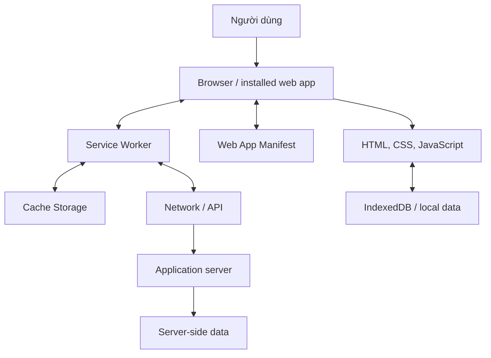
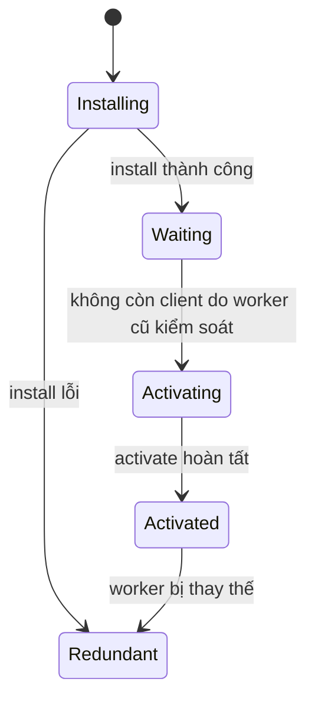

# Progressive Web App

> **Chương:** PWA  
> **Bài học:** Progressive Web App — kiến trúc ứng dụng web có thể cài đặt, hoạt động tin cậy và hỗ trợ offline  
> **Phạm vi module:** **SECURITY_APPLICATION_SECURITY_BROWSER_SECURITY** — phân tích ranh giới bảo mật giữa trình duyệt, origin, cookie và ứng dụng web để hiểu Same-Origin Policy (SOP), CORS và các cơ chế cách ly; thực hành phòng vệ XSS, CSRF, clickjacking bằng CSP, Trusted Types, security headers và kiểm chứng thực tế.

## Mục tiêu học tập

Sau bài này, bạn có thể:

1. Giải thích Progressive Web App (PWA) và các đặc tính khiến ứng dụng web có trải nghiệm gần với ứng dụng cài đặt.
2. Nhận diện các thành phần chính: web app manifest, service worker, HTTPS và ứng dụng web.
3. Cấu hình manifest với `name`, `icons`, `start_url`, `scope` và `display`.
4. Mô tả vòng đời service worker: install, waiting, activate và update.
5. Giải thích service worker kiểm soát request trong phạm vi scope như thế nào.
6. Thiết kế cache/offline strategy phù hợp với từng loại tài nguyên.
7. Tránh cache dữ liệu nhạy cảm, response cá nhân hóa hoặc nội dung không đáng tin cậy.
8. Hiểu giới hạn của install prompt, push notification và permission trong từng browser.
9. Kiểm tra PWA bằng DevTools và xử lý lỗi service worker, manifest, cache.
10. Đánh giá threat model của PWA và triển khai an toàn theo origin, HTTPS, CSP và quy trình release.

## 1. Progressive Web App là gì?

**Progressive Web App (PWA)** là ứng dụng được xây dựng bằng công nghệ web nhưng có thể cung cấp trải nghiệm giống ứng dụng cài đặt: có biểu tượng khởi chạy, cửa sổ riêng, khả năng tải nhanh, lưu tài nguyên để dùng khi mất mạng và tích hợp một số tính năng của thiết bị khi browser hỗ trợ.

PWA không phải một framework hoặc một định dạng file duy nhất. Nó là cách thiết kế và triển khai ứng dụng web dựa trên các nền tảng web chuẩn, thường kết hợp:

- **Web app manifest:** mô tả tên, biểu tượng, URL khởi chạy, phạm vi và cách hiển thị ứng dụng.
- **Service worker:** script chạy trong worker context, có thể nhận sự kiện fetch, quản lý cache và hỗ trợ offline.
- **HTTPS và secure context:** bảo vệ kết nối và cho phép sử dụng các API nhạy cảm.
- **Web application:** giao diện và logic chính được xây bằng HTML, CSS, JavaScript và API web.
- **Storage APIs:** Cache Storage, IndexedDB và các cơ chế lưu dữ liệu phía client.
- **Các API tùy chọn:** Push API, Notifications API, Background Sync hoặc các API thiết bị tùy browser.

Không phải mọi PWA đều cần push notification, background sync hoặc mọi API thiết bị. Chọn khả năng dựa trên nhu cầu sản phẩm và mức hỗ trợ thực tế.

### 1.1. PWA khác website thông thường ở điểm nào?

Một website thông thường có thể hoạt động tốt trên mobile và desktop mà không cần được cài đặt. PWA bổ sung các khả năng để người dùng có thể lưu ứng dụng vào launcher/home screen, mở trong chế độ hiển thị riêng và tiếp tục dùng một phần chức năng khi mạng không sẵn sàng.

| Khía cạnh | Website thông thường | PWA |
|---|---|---|
| Cách truy cập | Mở URL trong browser | Mở URL hoặc launch từ biểu tượng đã cài |
| Manifest | Không bắt buộc | Thường dùng để mô tả ứng dụng và hỗ trợ cài đặt |
| Service worker | Không bắt buộc | Thường dùng cho offline/cache và xử lý request |
| Offline | Phụ thuộc cache browser hoặc logic riêng | Có thể chủ động cung cấp app shell và dữ liệu đã lưu |
| Cửa sổ | Tab/browser UI | Có thể mở dạng standalone/minimal UI nếu nền tảng hỗ trợ |
| Cập nhật | Tải nội dung mới khi truy cập | Service worker và cache cần chiến lược update rõ ràng |
| Permission | Theo từng API/browser | Vẫn theo cùng mô hình permission của browser |

Một website responsive chưa tự động trở thành PWA. Ngược lại, không phải browser nào cũng có cùng tiêu chí hoặc giao diện cài đặt.

### 1.2. Progressive enhancement

PWA nên được xây theo hướng progressive enhancement:

1. Nội dung và chức năng cốt lõi hoạt động khi người dùng truy cập web.
2. Khi browser hỗ trợ manifest và service worker, ứng dụng bổ sung installability và offline.
3. Khi browser hỗ trợ thêm API như Push, Background Sync hoặc Web Share, ứng dụng có thể cung cấp trải nghiệm tương ứng.
4. Nếu API không có hoặc permission bị từ chối, ứng dụng vẫn có luồng thay thế hợp lý.

Không nên khóa toàn bộ chức năng quan trọng sau một API PWA tùy chọn. Kiểm tra capability ở runtime và giải thích rõ tính năng nào cần browser support hoặc permission.

### 1.3. Kiến trúc tổng quan



Manifest mô tả ứng dụng cho browser và hệ điều hành. Service worker xử lý một số sự kiện ở background và có thể phục vụ response từ cache. Dữ liệu nghiệp vụ quan trọng vẫn cần được xác minh và lưu trữ an toàn ở server.

## 2. Các thành phần nền tảng của PWA

### 2.1. Web app manifest

Manifest là một file JSON được liên kết từ document HTML. Nó cung cấp metadata để browser hiểu cách đặt tên, hiển thị và khởi chạy ứng dụng.

Trong HTML:

```html
<link rel="manifest" href="/manifest.webmanifest">
```

Ví dụ manifest:

```json
{
  "id": "/app",
  "name": "Cửa hàng của tôi",
  "short_name": "Cửa hàng",
  "description": "Ứng dụng mua sắm và quản lý đơn hàng",
  "start_url": "/app/",
  "scope": "/app/",
  "display": "standalone",
  "background_color": "#ffffff",
  "theme_color": "#16324f",
  "icons": [
    {
      "src": "/icons/app-192.png",
      "sizes": "192x192",
      "type": "image/png",
      "purpose": "any"
    },
    {
      "src": "/icons/app-512.png",
      "sizes": "512x512",
      "type": "image/png",
      "purpose": "any"
    },
    {
      "src": "/icons/app-maskable-512.png",
      "sizes": "512x512",
      "type": "image/png",
      "purpose": "maskable"
    }
  ]
}
```

Các trường có ý nghĩa:

| Trường | Vai trò |
|---|---|
| `id` | Định danh ứng dụng ổn định khi browser hỗ trợ |
| `name` | Tên đầy đủ hiển thị cho người dùng |
| `short_name` | Tên ngắn dùng ở nơi có không gian hạn chế |
| `description` | Mô tả ứng dụng |
| `start_url` | URL browser mở khi khởi chạy ứng dụng |
| `scope` | Phạm vi URL được xem là thuộc ứng dụng |
| `display` | Chế độ hiển thị như `standalone`, `minimal-ui`, `fullscreen` hoặc `browser` |
| `icons` | Biểu tượng với kích thước, định dạng và purpose |
| `theme_color` | Màu giao diện browser có thể dùng |
| `background_color` | Màu nền lúc khởi tạo/splash trên nền tảng hỗ trợ |

Các trường bắt buộc và tiêu chí cài đặt thay đổi theo browser/platform. Manifest hợp lệ không bảo đảm mọi browser sẽ hiển thị nút Install.

### 2.2. start_url và scope

`start_url` xác định nơi ứng dụng mở khi người dùng launch từ biểu tượng. `scope` xác định các URL được browser xem là thuộc phạm vi ứng dụng đã cài.

Ví dụ:

```json
{
  "start_url": "/app/home",
  "scope": "/app/"
}
```

URL `/app/home` nằm trong scope `/app/`. Một URL như `/admin/` nằm ngoài scope này và có thể mở trong browser UI thông thường tùy nền tảng.

Hãy chọn scope đủ hẹp để phản ánh phần ứng dụng thực sự được thiết kế cho PWA. Không dùng scope rộng hơn cần thiết chỉ để giữ mọi URL trong cửa sổ standalone.

### 2.3. Biểu tượng và maskable icon

Biểu tượng cần rõ ràng ở nhiều kích thước và hình dạng. Maskable icon cho phép hệ điều hành cắt biểu tượng theo hình dạng launcher mà vẫn giữ nội dung quan trọng trong vùng an toàn.

Không dùng hình ảnh không có quyền sử dụng hoặc biểu tượng dễ gây nhầm lẫn với ứng dụng khác. Hãy kiểm tra trên launcher thực tế vì cách crop và hiển thị khác nhau theo nền tảng.

### 2.4. Manifest không phải security policy

Manifest không thay thế CSP, Permissions Policy, CORS hoặc server authorization. Các trường như `start_url`, `scope` và `icons` là metadata ứng dụng; chúng không tự bảo vệ API hoặc dữ liệu.

Nếu một trang nằm trong scope PWA, điều đó không cấp quyền cho trang đọc dữ liệu của origin khác. SOP và các policy browser vẫn áp dụng.

## 3. Service worker là gì?

**Service worker** là một script chạy trong worker context, tách khỏi luồng JavaScript của trang. Nó không có quyền truy cập trực tiếp DOM, nhưng có thể nhận các sự kiện như `install`, `activate`, `fetch`, `message`, `push` và một số sự kiện background khác tùy browser.

Service worker thường được dùng để:

- Precache tài nguyên cần cho app shell.
- Trả response từ Cache Storage khi phù hợp.
- Cung cấp offline fallback.
- Làm mới cache khi có phiên bản ứng dụng mới.
- Nhận push event và hiển thị notification khi browser/platform hỗ trợ.

Service worker không phải một server luôn chạy. Browser có thể dừng worker khi không còn hoạt động và khởi động lại khi có event cần xử lý. Vì vậy, không lưu trạng thái runtime quan trọng chỉ trong biến global của worker.

### 3.1. Điều kiện và ranh giới

Service worker thông thường:

- Phải được đăng ký từ secure context; HTTPS là yêu cầu trong production, còn localhost được browser xem là môi trường phát triển đáng tin cậy.
- Có script URL cùng origin với document đăng ký.
- Chỉ kiểm soát các URL nằm trong scope của registration.
- Chạy trong worker context, không truy cập `window` hoặc DOM.
- Giao tiếp với page qua `postMessage`, MessageChannel hoặc cơ chế phù hợp.
- Bị ràng buộc bởi origin, browser storage policy và lifecycle.

Một service worker không thể đăng ký script tùy ý từ CDN khác origin để kiểm soát trang. CORS không mở rộng quyền origin của service worker.

### 3.2. Đăng ký service worker

Ví dụ:

```js
if ('serviceWorker' in navigator) {
  window.addEventListener('load', async () => {
    try {
      const registration = await navigator.serviceWorker.register('/sw.js', {
        scope: '/',
      });

      console.log('Service worker registered:', registration.scope);
    } catch (error) {
      console.error('Service worker registration failed:', error);
    }
  });
}
```

Đặt script `/sw.js` ở root nếu ứng dụng cần scope `/`. Nếu file nằm trong `/app/sw.js`, scope mặc định thường bị giới hạn trong `/app/`. Header `Service-Worker-Allowed` có thể điều chỉnh scope tối đa trong trường hợp phù hợp, nhưng không nên mở rộng scope tùy tiện.

### 3.3. Service worker không phải nơi lưu secret

Worker có thể truy cập các API storage theo quyền của origin và browser, nhưng code của nó vẫn là code cùng trust boundary với ứng dụng. Nếu attacker khai thác được XSS hoặc kiểm soát được file service worker, họ có thể ảnh hưởng đến request và response trong scope.

Không nhúng private key, API secret, refresh token hoặc credential cố định vào service worker source. Không coi cache hay IndexedDB là vùng an toàn tuyệt đối.

## 4. Vòng đời service worker

Service worker có lifecycle riêng. Browser quản lý quá trình cài đặt, chờ kích hoạt, kích hoạt và cập nhật để tránh nhiều phiên bản worker cùng điều khiển một client theo cách không nhất quán.

### 4.1. Các trạng thái chính

- **Installing:** browser tải và chạy script worker mới; event `install` thường dùng để precache tài nguyên thiết yếu.
- **Installed / waiting:** worker đã cài đặt nhưng có thể phải chờ worker cũ không còn kiểm soát client.
- **Activating:** browser chạy event `activate`; ứng dụng thường dọn cache cũ hoặc chuẩn bị tài nguyên.
- **Activated:** worker có thể kiểm soát các client phù hợp trong scope.
- **Redundant:** worker bị thay thế hoặc cài đặt thất bại và không còn được dùng.

Luồng khái quát:



Một worker mới thường ở trạng thái waiting trong khi trang đang mở vẫn do worker cũ kiểm soát. Đây là cơ chế giúp tránh thay worker giữa chừng khi ứng dụng đang chạy.

### 4.2. Event install và precache

Ví dụ service worker cache một app shell nhỏ:

```js
const CACHE_NAME = 'app-shell-v1';
const APP_SHELL = [
  '/',
  '/offline.html',
  '/styles/app.css',
  '/scripts/app.js',
];

self.addEventListener('install', (event) => {
  event.waitUntil(
    caches.open(CACHE_NAME).then((cache) => cache.addAll(APP_SHELL))
  );
});
```

`event.waitUntil()` giữ quá trình cài đặt chưa hoàn tất cho đến khi Promise thành công. Nếu một tài nguyên bắt buộc không tải được, `addAll()` có thể reject và worker mới không được cài đặt thành công.

Chỉ precache các tài nguyên tĩnh, có phiên bản rõ ràng và cần thiết cho trải nghiệm offline. Không precache trang chứa dữ liệu cá nhân hoặc response phụ thuộc session.

### 4.3. Event activate và dọn cache cũ

Khi worker mới activate, có thể xóa cache do ứng dụng quản lý mà không còn dùng:

```js
const CURRENT_CACHE = 'app-shell-v2';
const APP_CACHES = ['app-shell-v1', 'app-shell-v2'];

self.addEventListener('activate', (event) => {
  event.waitUntil(
    caches.keys().then((names) =>
      Promise.all(
        names
          .filter((name) => APP_CACHES.includes(name) && name !== CURRENT_CACHE)
          .map((name) => caches.delete(name))
      )
    )
  );
});
```

Trong ứng dụng thực tế, dùng prefix hoặc danh sách cache do chính ứng dụng sở hữu. Không xóa mọi cache trong origin một cách mù quáng vì ứng dụng khác hoặc thành phần khác có thể sử dụng chúng.

### 4.4. skipWaiting và clients.claim

`self.skipWaiting()` yêu cầu worker mới bỏ qua trạng thái waiting. `clients.claim()` cho phép worker vừa activate kiểm soát các client đang mở trong scope.

Hai API có thể hữu ích khi triển khai update nhanh, nhưng có rủi ro phiên bản:

- Trang đang chạy JavaScript cũ nhưng request mới đã đi qua worker mới.
- Cache mới có thể không tương thích với HTML hoặc API cũ.
- Người dùng có thể đang nhập form hoặc thực hiện thao tác giữa lúc worker thay thế.

Chỉ dùng skipWaiting có chủ đích. Một cách an toàn hơn là thông báo có phiên bản mới, cho người dùng chọn reload vào thời điểm phù hợp và bảo đảm backend hỗ trợ khoảng thời gian chuyển tiếp giữa client cũ/mới.

## 5. Fetch event và chiến lược cache

Service worker có thể nhận fetch event cho request thuộc phạm vi kiểm soát. Worker có thể gọi `respondWith()` để trả response từ cache, từ network hoặc từ một chiến lược kết hợp.

### 5.1. Cache API không giống HTTP cache

Cache Storage là kho lưu trữ do ứng dụng điều khiển qua Cache API. Nó khác HTTP cache do browser quản lý:

- Ứng dụng chủ động chọn request/response để lưu.
- Cache Storage không tự động áp dụng đầy đủ quy tắc expiry/validation của HTTP cache.
- Ứng dụng cần tự quản lý version, eviction, invalidation và xóa dữ liệu.
- Response có thể tồn tại lâu hơn dự kiến nếu không có cleanup.

Đừng cho rằng `Cache-Control: no-store` tự động xóa mọi response đã được ứng dụng ghi vào Cache Storage. Không chủ động cache response mà chính sách bảo mật yêu cầu không lưu.

### 5.2. Cache-first

Cache-first phù hợp với tài nguyên tĩnh, versioned và ít thay đổi như icon, font hoặc bundle có content hash.

```js
async function cacheFirst(request) {
  const cache = await caches.open('static-v1');
  const cached = await cache.match(request);
  if (cached) return cached;

  const response = await fetch(request);

  if (response.ok && response.type === 'basic') {
    await cache.put(request, response.clone());
  }

  return response;
}
```

Không dùng cache-first cho endpoint trả dữ liệu cá nhân hóa hoặc thông tin cần luôn mới. Với file tĩnh, nên dùng URL có version/hash để nội dung mới có URL mới.

### 5.3. Network-first

Network-first phù hợp với nội dung cần mới khi online nhưng có thể dùng bản gần nhất khi mạng lỗi:

```js
async function networkFirst(request) {
  const cache = await caches.open('pages-v1');

  try {
    const response = await fetch(request);

    if (response.ok && response.type === 'basic') {
      await cache.put(request, response.clone());
    }

    return response;
  } catch {
    return (await cache.match(request)) ||
      (await caches.match('/offline.html'));
  }
}
```

Chỉ cache những trang public, không chứa dữ liệu nhạy cảm. Nếu trang phụ thuộc cookie hoặc session, response cache có thể trở thành dữ liệu stale hoặc bị lộ trong context không mong muốn.

### 5.4. Stale-while-revalidate

Chiến lược stale-while-revalidate trả bản cache ngay nếu có, đồng thời tải bản mới để cập nhật cache cho lần sau. Cách này hữu ích với nội dung public có thể chấp nhận hơi cũ, như danh mục hoặc bài viết.

Không áp dụng một cách máy móc cho số dư tài khoản, trạng thái đơn hàng, quyền truy cập hoặc dữ liệu cần nhất quán tức thời. Giao diện phải cho biết dữ liệu có thể cũ và có cơ chế refresh.

### 5.5. Network-only và cache-only

- **Network-only:** luôn lấy từ mạng; phù hợp với thao tác nhạy cảm hoặc endpoint cần trạng thái hiện tại.
- **Cache-only:** chỉ trả từ cache; phù hợp với asset offline đã precache và có fallback khi thiếu.
- **Không có chiến lược chung:** route và loại dữ liệu khác nhau cần chiến lược riêng.

### 5.6. Bảng chọn chiến lược

| Loại tài nguyên | Chiến lược gợi ý | Lưu ý |
|---|---|---|
| JS/CSS có version hoặc content hash | Cache-first | Đổi URL khi artifact thay đổi |
| Icon, font, ảnh public ổn định | Cache-first hoặc stale-while-revalidate | Có giới hạn dung lượng và dọn cache |
| Trang public cần mới | Network-first hoặc stale-while-revalidate | Cho biết dữ liệu có thể cũ |
| API chứa hồ sơ cá nhân | Network-only hoặc thiết kế cache riêng có kiểm soát | Tránh lưu response nhạy cảm mặc định |
| Thanh toán, đăng xuất, thay đổi quyền | Network-only | Server là nguồn quyết định |
| Offline fallback | Cache-only | Chỉ hiển thị nội dung an toàn, không giả trạng thái giao dịch |

## 6. Kết hợp fetch event với routing rõ ràng

Một service worker nên áp dụng chiến lược theo loại request, thay vì bắt mọi request rồi trả một response cache bất kỳ.

Ví dụ worker chỉ xử lý navigation và asset cùng origin:

```js
const STATIC_CACHE = 'static-v1';
const PAGE_CACHE = 'public-pages-v1';

self.addEventListener('fetch', (event) => {
  const request = event.request;
  const url = new URL(request.url);

  // Không can thiệp request ghi dữ liệu hoặc request cross-origin.
  if (request.method !== 'GET' || url.origin !== self.location.origin) {
    return;
  }

  if (request.mode === 'navigate') {
    event.respondWith(networkFirstNavigation(request));
    return;
  }

  if (url.pathname.startsWith('/assets/')) {
    event.respondWith(cacheFirstAsset(request));
  }
});

async function networkFirstNavigation(request) {
  const cache = await caches.open(PAGE_CACHE);

  try {
    const response = await fetch(request);

    // Chỉ lưu trang public đã được xác định rõ trong ứng dụng.
    if (response.ok && response.type === 'basic') {
      const url = new URL(request.url);
      if (url.pathname.startsWith('/public/')) {
        await cache.put(request, response.clone());
      }
    }

    return response;
  } catch {
    return (await cache.match(request)) ||
      (await caches.match('/offline.html'));
  }
}

async function cacheFirstAsset(request) {
  const cache = await caches.open(STATIC_CACHE);
  const cached = await cache.match(request);
  if (cached) return cached;

  const response = await fetch(request);

  if (response.ok && response.type === 'basic') {
    await cache.put(request, response.clone());
  }

  return response;
}
```

Đây là ví dụ định hướng. Trong sản phẩm, danh sách URL public cần cache phải được kiểm soát cụ thể. Không suy ra một route là public chỉ vì path có từ `/public/`; server vẫn phải bảo đảm route đó không trả dữ liệu riêng tư.

### 6.1. Vì sao chỉ xử lý GET?

GET thường được dùng để đọc tài nguyên. POST, PUT, PATCH và DELETE có thể thay đổi trạng thái; replay hoặc trả response cũ cho các request đó có thể gây sai nghiệp vụ.

Không cache request ghi dữ liệu hoặc giả lập thành công khi offline. Nếu ứng dụng hỗ trợ hàng đợi thao tác offline, phải thiết kế queue riêng với idempotency key, xác thực lại, kiểm tra quyền và xử lý xung đột khi đồng bộ.

### 6.2. Navigation và API là hai loại request khác nhau

Navigation request có thể cần offline fallback để người dùng vẫn mở được app shell. API request chứa thông tin tài khoản hoặc dữ liệu cá nhân cần chính sách khác.

Hãy phân loại theo:

- Method và destination của request.
- URL/path và loại dữ liệu.
- Có credentials hay không.
- Response có phụ thuộc user/session không.
- Có yêu cầu freshness hoặc authorization tức thời không.
- Có thể hiển thị bản stale cho người dùng không.

### 6.3. Không cache response opaque một cách tùy tiện

Request cross-origin ở chế độ `no-cors` có thể trả opaque response. JavaScript không đọc được status/body của response đó. Một số chiến lược cache có thể lưu opaque response, nhưng ứng dụng không thể kiểm tra nội dung trước khi lưu.

Với tài nguyên third-party quan trọng, ưu tiên HTTPS, nguồn tin cậy, URL versioned và SRI khi áp dụng được. Không cache nội dung opaque từ host tùy ý do người dùng cung cấp.

## 7. Offline experience và đồng bộ dữ liệu

Offline không có nghĩa toàn bộ ứng dụng hoạt động như khi online. Cần xác định chức năng nào có thể dùng từ cache và chức năng nào cần server.

### 7.1. App shell

App shell là phần giao diện tối thiểu để ứng dụng khởi động, ví dụ:

- HTML khung ứng dụng.
- CSS và JavaScript cốt lõi.
- Icon, font và tài nguyên tĩnh.
- Trang offline fallback.

Precache app shell giúp ứng dụng mở được khi không có mạng, nhưng nội dung hiển thị có thể chỉ là giao diện và dữ liệu đã lưu trước đó.

### 7.2. Trạng thái offline phải trung thực

Không hiển thị “Đơn hàng đã đặt” hoặc “Thanh toán thành công” chỉ vì thao tác đã được ghi vào local queue. Khi offline, ứng dụng chỉ nên nói thao tác đang chờ gửi hoặc chưa được server xác nhận.

Ví dụ trạng thái:

| Trạng thái | Ý nghĩa |
|---|---|
| Draft / Local only | Dữ liệu mới chỉ có trên thiết bị |
| Pending sync | Đang chờ mạng để gửi |
| Submitted | Server đã nhận request |
| Confirmed | Server đã xử lý và xác nhận |
| Failed / Conflict | Server từ chối hoặc dữ liệu xung đột |

Với giao dịch nhạy cảm, không giả lập kết quả thành công offline.

### 7.3. Background Sync là tùy chọn

Background Sync có thể cho phép browser thử gửi công việc đã đăng ký khi mạng trở lại, nhưng mức hỗ trợ khác nhau và browser có thể giới hạn thời điểm chạy.

Ứng dụng cần có fallback khi API không tồn tại: lưu bản nháp cục bộ, hiển thị nút thử lại và đồng bộ khi trang được mở lại.

Không dựa vào Background Sync như một bảo đảm rằng request sẽ chạy đúng thời điểm hoặc luôn hoàn tất.

### 7.4. Đồng bộ có kiểm soát

Nếu cần queue thao tác offline:

- Dùng idempotency key để tránh gửi trùng.
- Gắn bản ghi với user/account phù hợp và xác minh lại sau đăng nhập.
- Kiểm tra authorization ở server tại thời điểm đồng bộ.
- Xử lý conflict theo version hoặc timestamp có kiểm soát.
- Giới hạn retry và kích thước queue.
- Xóa dữ liệu cục bộ khi logout hoặc khi tài khoản đổi.
- Không giữ dữ liệu nhạy cảm trong queue lâu hơn cần thiết.

Queue phía client không phải bằng chứng giao dịch đã được chấp nhận.

## 8. Installability và trải nghiệm cài đặt

PWA có thể được cài đặt hoặc thêm vào home screen theo khả năng của browser và hệ điều hành. Tiêu chí installability không hoàn toàn giống nhau trên Chrome, Edge, Safari, Android, iOS hoặc các browser khác.

### 8.1. Các yếu tố thường cần có

Một số yếu tố phổ biến:

- Ứng dụng được phục vụ qua HTTPS hoặc môi trường secure tương đương.
- Có web app manifest hợp lệ.
- Manifest có tên, biểu tượng và URL khởi chạy phù hợp.
- Trang có trải nghiệm dùng được trên thiết bị mục tiêu.
- Một số browser yêu cầu service worker hoặc điều kiện tương tác nhất định cho luồng cài đặt cụ thể.

Không dùng một checklist duy nhất như tiêu chuẩn bắt buộc cho mọi nền tảng. Kiểm tra tài liệu và công cụ kiểm tra của browser mục tiêu.

### 8.2. Không giả định luôn có beforeinstallprompt

Một số browser Chromium có thể phát event `beforeinstallprompt` để ứng dụng trì hoãn và hiển thị lời mời cài đặt tùy chỉnh. Event này không phải API phổ quát và không được hỗ trợ đồng nhất trên mọi nền tảng.

Nếu browser không phát event, vẫn có thể hướng dẫn người dùng dùng menu cài đặt hoặc Add to Home Screen của browser.

Ví dụ xử lý theo capability:

```js
let deferredInstallPrompt = null;
const installButton = document.querySelector('#install-app');

window.addEventListener('beforeinstallprompt', (event) => {
  // Chỉ ngăn prompt tự động nếu ứng dụng sẽ hiển thị lời mời riêng.
  event.preventDefault();
  deferredInstallPrompt = event;
  if (installButton) installButton.hidden = false;
});

installButton?.addEventListener('click', async () => {
  if (!deferredInstallPrompt) return;

  const promptEvent = deferredInstallPrompt;
  deferredInstallPrompt = null;
  const choice = await promptEvent.prompt();
  console.log('Install outcome:', choice.outcome);
});
```

Đoạn code chỉ chạy ở browser hỗ trợ event. Giao diện cần có fallback nếu event không xuất hiện và không nên gây áp lực để người dùng cài đặt.

### 8.3. Cài đặt không làm ứng dụng trở thành native app

PWA vẫn chạy theo browser engine và các giới hạn web platform. Cài đặt không tự cấp camera, microphone, location, notification hoặc quyền hệ điều hành khác.

Mỗi API tiếp tục chịu secure context, permission, user activation và browser policy riêng.

## 9. Push notification và permission

Push notification là khả năng tùy chọn của PWA. Thường cần Service Worker, Push API, Notifications API và một subscription được tạo trong browser.

### 9.1. Xin permission đúng thời điểm

Không hỏi quyền notification ngay khi người dùng vừa mở trang nếu họ chưa hiểu giá trị. Hãy giải thích chức năng và yêu cầu sau thao tác rõ ràng, ví dụ khi người dùng chọn “Nhận thông báo đơn hàng”.

Không lặp prompt sau khi người dùng từ chối. Cung cấp đường dẫn tới browser settings nếu người dùng muốn thay đổi quyết định.

### 9.2. Subscription là dữ liệu nhạy cảm

Push subscription thường chứa endpoint và key cần thiết để server gửi push. Xem subscription như dữ liệu định danh nhạy cảm:

- Gửi lên server qua HTTPS.
- Gắn subscription với user/session đã xác thực.
- Cho phép thu hồi khi logout hoặc người dùng tắt notification.
- Không ghi endpoint/key vào log công khai.
- Không tin payload push như một lệnh nghiệp vụ đã được xác thực.

### 9.3. Payload push không phải nguồn sự thật

Push có thể đến trễ, trùng, bị bỏ qua hoặc không được browser giao. Nội dung notification nên là tín hiệu để người dùng mở ứng dụng; khi mở, ứng dụng cần tải trạng thái hiện tại từ server.

Không đặt thông tin quá nhạy cảm trên màn hình khóa hoặc notification preview nếu người dùng có thể chia sẻ thiết bị.

## 10. Threat model và bảo mật PWA

PWA có thể giữ dữ liệu trên thiết bị, phục vụ response từ cache và tiếp tục chạy một phần logic khi offline. Điều này tạo thêm bề mặt cần quản lý so với một trang chỉ tải nội dung từ network.

### 10.1. HTTPS và secure context

- Production phải dùng HTTPS cho document, manifest, service worker và API.
- Redirect HTTP sang HTTPS ở server và triển khai HSTS sau khi kiểm tra toàn bộ hostname.
- Không bỏ qua certificate warning hoặc tắt certificate verification để sửa lỗi service worker.
- Dùng localhost cho development khi cần kiểm tra service worker/secure context.
- Không đưa API secret hoặc private key vào JavaScript chỉ vì app đã cài.

Service worker yêu cầu secure context và script cùng origin. HTTPS bảo vệ đường truyền, nhưng không làm code của ứng dụng trở nên an toàn nếu origin đã bị chiếm quyền.

### 10.2. XSS có thể ảnh hưởng cả app shell và cache

Nếu attacker thực thi được JavaScript trong origin PWA, họ có thể:

- Đọc dữ liệu mà JavaScript của ứng dụng được phép truy cập.
- Gửi request cùng origin và tận dụng cookie mà browser tự đính kèm.
- Ghi dữ liệu giả vào storage hoặc cache mà ứng dụng tin cậy.
- Gửi message tới service worker hoặc điều khiển logic của page trong scope.
- Tạo UI giả để lấy thông tin người dùng.

Service worker không tự ngăn XSS. Hãy dùng output encoding theo context, sanitization cho HTML không tin cậy, tránh DOM sink nguy hiểm, CSP và Trusted Types khi phù hợp.

### 10.3. Giới hạn script và worker bằng CSP

Ví dụ CSP cơ bản cho một ứng dụng PWA:

```http
Content-Security-Policy: default-src 'self'; script-src 'self'; style-src 'self'; img-src 'self' data:; connect-src 'self' https://api.example; worker-src 'self'; manifest-src 'self'; object-src 'none'; base-uri 'self'; frame-ancestors 'none'
```

Ý nghĩa chính:

- `script-src` giới hạn nguồn JavaScript.
- `worker-src` giới hạn nguồn worker/service worker được tạo.
- `connect-src` giới hạn endpoint fetch/XHR/WebSocket.
- `manifest-src` giới hạn nguồn manifest.
- `object-src 'none'` tắt plugin object/embed cũ.
- `frame-ancestors 'none'` ngăn trang bị nhúng nếu sản phẩm không cần embedded mode.

Đây là policy mẫu cần điều chỉnh theo tài nguyên thật. Khi triển khai, bắt đầu bằng Report-Only nếu cần quan sát vi phạm, sau đó chuyển sang enforcement và xử lý các dependency hợp lệ.

### 10.4. Service worker là mã cùng origin và có quyền ảnh hưởng rộng

Một service worker được đăng ký trong scope có thể can thiệp request của các trang trong scope đó. Nếu script worker bị thay đổi hoặc bị chiếm quyền phát hành, attacker có thể phục vụ nội dung giả cho các lần truy cập sau.

Biện pháp:

- Đặt worker script ở đường dẫn scope hẹp nhất đáp ứng ứng dụng.
- Giữ worker nhỏ, dễ review và không tải code thực thi từ URL tùy ý.
- Kiểm soát quyền ghi file worker trong pipeline/CDN.
- Dùng CSP và HTTPS.
- Theo dõi registration, update và cache version.
- Có quy trình thu hồi worker bị lỗi hoặc bị xâm phạm.

Không dùng worker scope `/` nếu ứng dụng chỉ cần kiểm soát `/app/` và có các ứng dụng khác trên cùng origin.

### 10.5. Cache poisoning và response không đáng tin

Không lưu mọi response thành công vào cache. Một response có status 200 vẫn có thể chứa HTML giả, dữ liệu cá nhân hoặc nội dung bị thay đổi.

Trước khi cache, cân nhắc:

- Request có đúng method và URL dự kiến không?
- Response có đúng origin và loại nội dung không?
- Response có phụ thuộc cookie, authorization hoặc user không?
- Nội dung có được xác thực/kiểm tra schema không?
- URL có được tạo từ allowlist hay do user cung cấp?
- Cache key có phân biệt locale, version hoặc biến thể cần thiết không?

Không cache HTML từ nguồn third-party hoặc URL do người dùng nhập chỉ vì response trả status 200. Không biến cache thành kho lưu response chưa xác minh.

### 10.6. Dữ liệu cá nhân và cache

Tránh lưu mặc định:

- Trang hồ sơ, thông tin thanh toán và dữ liệu sức khỏe.
- API response chứa token hoặc dữ liệu xác thực.
- HTML có dữ liệu cá nhân được render server-side.
- Nội dung quản trị hoặc response phụ thuộc quyền người dùng.
- Response có header hoặc chính sách yêu cầu không lưu.

Với response nhạy cảm, ưu tiên network-only và chính sách server phù hợp như `Cache-Control: no-store`. Nếu có yêu cầu offline cho dữ liệu cá nhân, phải có threat model, mã hóa/lifecycle phù hợp, khóa truy cập theo user và quy trình xóa rõ ràng; mã hóa client-side không bảo vệ dữ liệu khỏi XSS đang chạy cùng origin.

### 10.7. Logout và chuyển tài khoản

Khi logout hoặc đổi account trên thiết bị dùng chung:

1. Thu hồi session ở server.
2. Xóa dữ liệu user-specific do ứng dụng sở hữu trong Cache Storage.
3. Xóa IndexedDB/localStorage chứa dữ liệu tài khoản theo quy trình.
4. Hủy hoặc đánh dấu các job đồng bộ đang chờ.
5. Hủy push subscription hoặc gỡ liên kết subscription với tài khoản nếu phù hợp.
6. Chuyển UI về trạng thái signed-out và yêu cầu xác thực lại khi online.

Dùng namespace/prefix cache theo ứng dụng và phiên bản để chỉ xóa dữ liệu mình sở hữu. Không xóa toàn bộ storage của origin một cách tùy tiện.

### 10.8. Offline không được bỏ qua authorization

Cache chỉ là bản sao dữ liệu trên thiết bị. Người dùng có thể chỉnh sửa storage, khôi phục snapshot cũ hoặc dùng client đã bị sửa.

Server phải xác thực lại mọi hành động khi đồng bộ. Không tin vai trò, quyền hoặc trạng thái giao dịch được lưu trong localStorage/IndexedDB. Không cho phép thao tác offline trở thành quyết định cuối cùng đối với thanh toán, phân quyền hoặc dữ liệu quan trọng.

## 11. Storage quota, eviction và partitioning

PWA thường dùng Cache Storage và IndexedDB. Các kho này có quota theo browser, thiết bị, origin và chính sách storage; dung lượng không phải vô hạn.

### 11.1. Dữ liệu có thể bị xóa

Browser có thể eviction dữ liệu do:

- Thiếu dung lượng thiết bị.
- Người dùng xóa site data.
- Chế độ private/incognito.
- Chính sách quản lý storage của browser.
- Dữ liệu của origin không được dùng trong thời gian dài.
- Partition hoặc profile bị xóa.

Không xem Cache Storage là backup. Dữ liệu quan trọng cần có bản server hoặc cơ chế phục hồi.

### 11.2. Kiểm tra quota

Một số browser hỗ trợ StorageManager:

```js
if (navigator.storage?.estimate) {
  const estimate = await navigator.storage.estimate();

  console.log({
    usage: estimate.usage,
    quota: estimate.quota,
  });
}
```

Các con số là ước tính và có thể bao gồm nhiều loại storage của origin. Không dùng chúng để tính chính xác dung lượng còn lại cho một transaction.

### 11.3. Persistent storage

Ứng dụng có thể yêu cầu persistent storage trong browser hỗ trợ:

```js
if (navigator.storage?.persist) {
  const granted = await navigator.storage.persist();
  console.log('Persistent storage granted:', granted);
}
```

Browser có quyền quyết định request có được chấp nhận không. Persistent storage giảm nguy cơ eviction tự động trong một số trường hợp, nhưng không ngăn người dùng xóa dữ liệu hoặc thiết bị bị mất.

### 11.4. Partitioning trong embedded PWA

Khi PWA hoặc widget chạy trong iframe third-party, storage và service worker có thể chịu partitioning theo top-level site tùy browser. Không giả định cùng một origin embedded sẽ có một vùng Cache Storage, IndexedDB hoặc registration dùng chung giữa mọi website.

Storage Access API cũng không tự hợp nhất mọi storage partition. Hãy kiểm tra API và browser cụ thể trước khi thiết kế chia sẻ trạng thái.

## 12. Update, versioning và triển khai

Service worker có cơ chế phát hiện thay đổi script và cài phiên bản mới. Tuy nhiên, chiến lược update cần phối hợp với cache, HTML và API server.

### 12.1. Phát hành artifact bất biến

- Đặt version hoặc content hash trong URL JS/CSS.
- Dùng cache name có version.
- Giữ các asset cần thiết cho worker cũ trong giai đoạn rollout.
- Đảm bảo HTML mới không tham chiếu asset chưa được publish.
- Đảm bảo backend hỗ trợ client cũ trong khoảng thời gian chuyển tiếp.

Không ghi đè nội dung khác nhau vào cùng URL versioned nếu muốn cache hoạt động dự đoán được.

### 12.2. Phát hiện worker mới

Registration có thể kiểm tra update:

```js
const registration = await navigator.serviceWorker.ready;
await registration.update();

if (registration.waiting) {
  console.log('Có service worker mới đang chờ kích hoạt');
}
```

Ứng dụng có thể lắng nghe `updatefound` và quan sát `installing` worker. Chỉ hiển thị thông báo update khi worker mới cài đặt thành công và sẵn sàng.

### 12.3. Thông báo update cho người dùng

Nếu ứng dụng có form hoặc giao dịch đang diễn ra, đừng tự động reload đột ngột. Hiển thị lời mời cập nhật và yêu cầu người dùng hoàn tất hoặc lưu công việc trước khi reload.

Nếu dùng message để yêu cầu worker mới gọi `skipWaiting()`, hãy xác thực message type và chỉ chấp nhận từ client trong ứng dụng. Sau khi worker activate, bảo đảm client reload hoặc tương thích với cache mới.

### 12.4. Rollback

Một bản worker mới có thể gây lỗi offline hoặc phục vụ asset không tương thích. Cần có cách phát hành worker sửa lỗi với cache version mới và quy trình thu hồi phiên bản cũ.

Không dựa vào việc người dùng tự xóa toàn bộ site data để khôi phục ứng dụng. Một trang recovery tối thiểu và hướng dẫn reload có thể hữu ích, nhưng phải tránh làm mất dữ liệu local chưa đồng bộ.

## 13. Kiểm tra PWA bằng DevTools

Trong Chromium DevTools, tab Application thường cung cấp các khu vực kiểm tra manifest, service worker, storage và cache. Tên và khả năng công cụ khác nhau theo browser.

### 13.1. Manifest

Kiểm tra:

- Manifest được tải thành công và JSON hợp lệ.
- `name`, `short_name`, `start_url`, `scope`, `display` có giá trị đúng.
- Icon URL trả đúng MIME type, kích thước và nội dung.
- Start URL nằm trong scope dự kiến.
- Không có lỗi manifest hoặc icon trong Console.

### 13.2. Service worker

Kiểm tra:

- Registration tồn tại và scope đúng.
- Worker đang installing, waiting hay activated.
- Có lỗi script parse, install hoặc activate không.
- Worker nào đang kiểm soát page hiện tại.
- Có worker mới đang chờ và có thông báo update phù hợp không.

DevTools có thể hỗ trợ unregister hoặc bypass worker trong môi trường test. Không unregister service worker production của người dùng để xử lý sự cố.

### 13.3. Cache Storage và offline

Kiểm tra:

- Cache name và version.
- Request URL được lưu.
- Response có đúng loại nội dung.
- Cache cũ có được dọn khi update.
- Trang offline fallback có tải được.
- Dữ liệu nhạy cảm có vô tình nằm trong cache không.

Thử chuyển Network sang Offline để xác minh đúng phần chức năng đã thiết kế cho offline. Sau đó bật lại mạng và kiểm tra dữ liệu đồng bộ.

### 13.4. Network và Console

Tìm:

- Request bị service worker intercept sai.
- API response bị trả từ cache cũ.
- Mixed content hoặc certificate errors.
- CSP violations.
- Storage quota errors.
- Push/notification permission hoặc subscription errors.
- Worker script update không thành công.

Luôn kiểm tra request và response thực tế. Một trang hiện được khi offline không chứng minh mọi thao tác đã được server xác nhận.

## 14. Troubleshooting các lỗi PWA thường gặp

### 14.1. Không thấy tùy chọn cài đặt

Kiểm tra manifest, HTTPS, icon, start URL, scope và tiêu chí installability của browser/platform. Có browser cung cấp mục cài đặt trong menu thay vì event cài đặt do trang điều khiển.

### 14.2. Service worker đăng ký thất bại

Kiểm tra:

1. Trang có secure context không?
2. Worker script URL có cùng origin không?
3. URL có trả JavaScript hợp lệ và status phù hợp không?
4. Có lỗi syntax/runtime trong worker không?
5. Scope có vượt giới hạn đường dẫn không?
6. CSP có chặn worker không?
7. Reverse proxy/CDN có rewrite worker script hoặc MIME type không?

### 14.3. Worker mới không activate

Worker cũ có thể vẫn kiểm soát tab đang mở. Đóng các tab/client liên quan hoặc cung cấp luồng update phù hợp. Kiểm tra event install có bị reject vì precache thiếu một tài nguyên không.

### 14.4. Trang vẫn hiển thị nội dung cũ

Kiểm tra cache name, URL version, worker đang kiểm soát page và thứ tự deploy. Bật Disable cache trong DevTools chỉ ảnh hưởng một số cache của browser; không mặc nhiên xóa Cache Storage do service worker quản lý.

### 14.5. Offline hoạt động nhưng dữ liệu sai

Kiểm tra response cá nhân hóa có bị cache không, cache key có tách user/locale/version không và worker có trả response cũ cho route cần dữ liệu mới không. Khi logout hoặc đổi tài khoản, dọn cache user-specific và yêu cầu xác thực lại.

## 15. Thực hành A — Tạo manifest và kiểm tra installability

Thực hiện trong ứng dụng demo hoặc staging do bạn kiểm soát.

### Bước 1: Tạo manifest

Tạo file `manifest.webmanifest` với các trường:

```json
{
  "id": "/demo",
  "name": "PWA Demo",
  "short_name": "Demo",
  "start_url": "/demo/",
  "scope": "/demo/",
  "display": "standalone",
  "icons": [
    {
      "src": "/demo/icons/icon-192.png",
      "sizes": "192x192",
      "type": "image/png"
    },
    {
      "src": "/demo/icons/icon-512.png",
      "sizes": "512x512",
      "type": "image/png"
    }
  ]
}
```

### Bước 2: Liên kết manifest

Thêm vào phần head:

```html
<link rel="manifest" href="/demo/manifest.webmanifest">
```

### Bước 3: Kiểm tra

1. Mở ứng dụng qua HTTPS hoặc localhost.
2. Mở DevTools → Application → Manifest.
3. Xác minh browser đọc được manifest và icon.
4. Kiểm tra start URL nằm trong scope.
5. Kiểm tra giao diện cài đặt trên browser/platform mục tiêu.
6. Ghi nhận nếu browser dùng menu cài đặt thay cho prompt tùy chỉnh.

Kết quả mong đợi: manifest hợp lệ và browser nhận diện các metadata cần thiết. Không yêu cầu mọi browser phải hiển thị cùng một nút Install.

## 16. Thực hành B — Đăng ký service worker và kiểm tra offline

### Bước 1: Tạo trang offline

Tạo file `offline.html` với nội dung ngắn:

```html
<!doctype html>
<html lang="vi">
<head>
  <meta charset="utf-8">
  <title>Đang offline</title>
</head>
<body>
  <h1>Bạn đang offline</h1>
  <p>Nội dung mới sẽ được tải khi kết nối trở lại.</p>
</body>
</html>
```

### Bước 2: Tạo worker tối thiểu

```js
const CACHE_NAME = 'pwa-lab-v1';
const ASSETS = ['/', '/offline.html'];

self.addEventListener('install', (event) => {
  event.waitUntil(
    caches.open(CACHE_NAME).then((cache) => cache.addAll(ASSETS))
  );
});

self.addEventListener('fetch', (event) => {
  if (event.request.method !== 'GET') return;

  if (event.request.mode === 'navigate') {
    event.respondWith(
      fetch(event.request).catch(async () => {
        return (await caches.match(event.request)) ||
          (await caches.match('/offline.html'));
      })
    );
  }
});
```

### Bước 3: Đăng ký worker

Dùng đoạn đăng ký ở mục 3.2 và xác minh registration có scope đúng.

### Bước 4: Kiểm thử

1. Tải trang khi online để service worker cài đặt và activate.
2. Mở lại trang để worker kiểm soát client.
3. Trong DevTools → Network, bật Offline.
4. Điều hướng tới trang trong scope.
5. Xác minh offline fallback hiển thị.
6. Bật lại mạng và xác minh trang tải được nội dung mới.

Kết quả mong đợi: trang có offline fallback sau khi worker đã cài đặt và cache tài nguyên thành công. Lần truy cập đầu tiên có thể chưa được worker kiểm soát.

## 17. Thực hành C — Xác minh cache không làm lộ dữ liệu giữa tài khoản

Dùng môi trường staging với hai tài khoản test và dữ liệu giả. Không dùng dữ liệu khách hàng thật.

1. Đăng nhập tài khoản A và mở một trang hồ sơ test.
2. Quan sát Network để xác định request và response chứa dữ liệu tài khoản.
3. Kiểm tra service worker có intercept hoặc cache response đó không.
4. Logout tài khoản A.
5. Đăng nhập tài khoản B trên cùng browser profile.
6. Thử mở lại URL hồ sơ khi online và offline.
7. Xác minh dữ liệu A không xuất hiện trong cache hoặc giao diện của B.
8. Nếu phát hiện response cá nhân hóa bị cache, chuyển route sang network-only và dọn cache user-specific theo quy trình.

Kết quả mong đợi: dữ liệu tài khoản không bị chia sẻ qua cache giữa hai phiên. Server vẫn xác minh session và authorization trên mỗi request.

## 18. Thực hành D — Kiểm tra update và worker waiting

1. Đăng ký worker với cache name `pwa-update-v1`.
2. Mở ứng dụng trong một tab và giữ tab đó.
3. Thay đổi nội dung worker và đổi cache name sang `pwa-update-v2`.
4. Reload hoặc gọi update để browser phát hiện script mới.
5. Quan sát worker mới ở trạng thái installing/waiting trong DevTools.
6. Đóng các client do worker cũ kiểm soát hoặc dùng luồng update có thông báo.
7. Xác minh worker mới activate và cache cũ được dọn đúng phạm vi.
8. Kiểm tra page cũ không nhận HTML/JS không tương thích với nhau.

Không bật skipWaiting tự động trong lab production. Thử nghiệm cần cho thấy update có thể chờ client cũ đóng trước khi activate.

## 19. Checklist review Progressive Web App

| Hạng mục | Câu hỏi cần trả lời |
|---|---|
| Manifest | Manifest hợp lệ, có tên, icon, start URL và scope phù hợp? |
| Scope | Scope có hẹp đúng phần ứng dụng cần kiểm soát? |
| Installability | Đã kiểm tra browser và nền tảng mục tiêu thay vì giả định một tiêu chí chung? |
| HTTPS | Document, manifest, worker và API đều dùng HTTPS trong production? |
| Service worker | Script cùng origin, scope đúng và có lifecycle rõ ràng? |
| Precache | Chỉ precache asset tĩnh cần thiết và đã version hóa? |
| Fetch routing | Worker chỉ intercept request cần thiết, không xử lý nhầm request ghi dữ liệu? |
| Cache strategy | Chiến lược cache phù hợp với độ mới và tính nhạy cảm của dữ liệu? |
| Personal data | Không cache response cá nhân hóa mặc định? |
| Logout | Có xóa cache/IndexedDB user-specific và xử lý queue khi đổi tài khoản? |
| Offline | UI phân biệt draft, pending, submitted và confirmed? |
| Sync | Có idempotency, authorization lại và xử lý conflict? |
| Update | Có xử lý worker waiting, tương thích phiên bản và rollback? |
| XSS | Có output encoding, sanitization, CSP và Trusted Types khi phù hợp? |
| CSP | `worker-src`, `script-src`, `connect-src`, `manifest-src` được giới hạn? |
| Permissions | Push/camera/location chỉ xin khi có nhu cầu và user activation phù hợp? |
| Push | Subscription được gắn với user, bảo vệ và thu hồi đúng cách? |
| Storage | Có quota handling, eviction và cơ chế phục hồi dữ liệu? |
| Privacy | Không lưu secret hoặc thông tin nhạy cảm trong cache/client storage không cần thiết? |
| DevTools | Đã kiểm tra manifest, worker, cache, Network và offline behavior? |
| Server | Backend vẫn xác thực session, authorization và trạng thái giao dịch? |

## 20. Câu hỏi tự kiểm tra

**1.** Progressive Web App là gì?  
**Đáp án:** Ứng dụng web sử dụng các khả năng của browser như manifest, service worker và storage để có thể cài đặt, hoạt động offline một phần và cung cấp trải nghiệm gần với ứng dụng.

**2.** Manifest có nhiệm vụ gì?  
**Đáp án:** Mô tả metadata như tên, biểu tượng, start URL, scope và display mode cho browser/platform.

**3.** start_url và scope khác nhau thế nào?  
**Đáp án:** start_url là URL mở khi launch ứng dụng; scope là phạm vi URL được xem là thuộc ứng dụng đã cài.

**4.** Service worker có truy cập DOM không?  
**Đáp án:** Không. Nó chạy trong worker context và giao tiếp với page qua message/API phù hợp.

**5.** Vì sao service worker cần HTTPS?  
**Đáp án:** Service worker là API yêu cầu secure context để browser có thể tin cậy script điều khiển request trong origin.

**6.** Worker mới ở trạng thái waiting có nghĩa gì?  
**Đáp án:** Worker mới đã cài đặt nhưng chờ worker cũ không còn kiểm soát client trước khi activate.

**7.** Cache-first phù hợp với loại tài nguyên nào?  
**Đáp án:** Asset tĩnh, versioned và ít thay đổi như JS/CSS có content hash, icon hoặc font.

**8.** Vì sao không nên cache response hồ sơ cá nhân mặc định?  
**Đáp án:** Cache có thể giữ dữ liệu cũ hoặc làm lộ dữ liệu giữa tài khoản trên thiết bị dùng chung.

**9.** Cache Storage có tự tuân thủ đầy đủ Cache-Control như HTTP cache không?  
**Đáp án:** Không. Ứng dụng chủ động lưu và phải tự quản lý expiry, invalidation và xóa cache.

**10.** PWA có thể xác nhận giao dịch thành công khi offline không?  
**Đáp án:** Không. Client chỉ có thể ghi thao tác chờ đồng bộ; server phải xác nhận kết quả cuối cùng.

**11.** PWA cài đặt có tự cấp quyền notification hoặc camera không?  
**Đáp án:** Không. Từng API vẫn chịu permission, secure context, user activation và browser policy.

**12.** Vì sao XSS đặc biệt nguy hiểm với PWA?  
**Đáp án:** Script cùng origin có thể đọc dữ liệu client, gửi request có cookie và tác động tới logic page/cache trong phạm vi ứng dụng.

## Ghi nhớ

**PWA là ứng dụng web được tăng cường bằng manifest, service worker, cache và các API browser để có thể cài đặt và hoạt động offline một phần.** Manifest mô tả ứng dụng; service worker kiểm soát request trong scope và có lifecycle riêng; Cache Storage giúp phục vụ asset hoặc nội dung đã chọn khi mạng không sẵn sàng.

Khả năng offline cần được thiết kế theo loại dữ liệu. Không cache response cá nhân hóa hoặc giao dịch nhạy cảm một cách mặc định, không coi dữ liệu client là nguồn authorization và không báo giao dịch thành công khi server chưa xác nhận. Hãy dùng HTTPS, CSP, scope hẹp, cache versioning, xử lý logout/update rõ ràng và kiểm tra manifest, worker, cache, quota bằng DevTools. Việc cài PWA không bỏ qua SOP, CORS, permission, XSS, CSRF hoặc các ranh giới bảo mật khác của browser.
