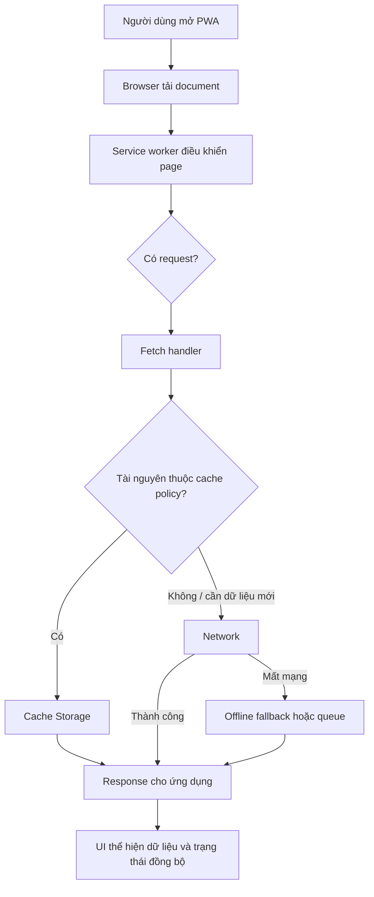

# Offline mode: thiết kế PWA hoạt động khi mất kết nối

Offline mode cho phép một Progressive Web App (PWA) tiếp tục cung cấp những chức năng đã được chuẩn bị trước khi thiết bị mất mạng. Trình duyệt không tự biến toàn bộ website thành ứng dụng offline: ứng dụng phải chủ động lưu app shell và tài nguyên cần thiết, định nghĩa cách xử lý request khi không có mạng, quản lý phiên bản cache và thiết kế luồng đồng bộ dữ liệu khi kết nối trở lại.

Service worker là thành phần chính điều phối request của PWA. Nó có thể nhận sự kiện fetch, trả response từ Cache Storage hoặc thử gọi mạng. Tuy nhiên, dữ liệu offline vẫn chịu quota và eviction của browser, còn các thao tác cần quyền hoặc dữ liệu mới từ server có thể không thực hiện được khi mất kết nối. Ứng dụng phải thể hiện rõ chức năng nào dùng được offline, dữ liệu nào đã lưu và thao tác nào đang chờ đồng bộ.

Bài học thuộc chương **PWA**, theo đề bài **Offline mode**, trong phạm vi **SECURITY_APPLICATION_SECURITY_BROWSER_SECURITY**: phân tích ranh giới bảo mật giữa trình duyệt, origin, cookie và ứng dụng web để hiểu Same-Origin Policy, CORS và các cơ chế cách ly; thực hành phòng vệ XSS, CSRF, clickjacking bằng CSP, Trusted Types, security headers và kiểm chứng hành vi thực tế.

## 1. Mục tiêu học tập

Sau bài học, người học có thể:

1. Giải thích vai trò của service worker trong kiến trúc PWA offline.
2. Mô tả vòng đời install, waiting, activate và fetch.
3. Chọn chiến lược cache phù hợp cho app shell, tài nguyên tĩnh, navigation và API.
4. Xây dựng offline fallback và phân biệt lỗi mạng với response HTTP lỗi.
5. Thiết kế UX thể hiện trạng thái offline, dữ liệu cũ và thao tác chờ đồng bộ.
6. Quản lý cập nhật service worker, version cache và tránh xóa nhầm cache đang dùng.
7. Hiểu quota, eviction và persistence của dữ liệu offline.
8. Thiết kế outbox/sync queue có retry, idempotency và xử lý xung đột.
9. Ngăn cache làm lộ dữ liệu riêng tư giữa người dùng hoặc sau logout.
10. Kiểm thử online/offline, service worker và Cache Storage bằng DevTools.

## 2. Offline mode là gì?

Offline mode là khả năng ứng dụng tiếp tục thực hiện một tập chức năng xác định khi không thể kết nối server. PWA có thể hiển thị giao diện, mở nội dung đã lưu, cho phép tạo bản nháp hoặc xếp hàng thao tác để gửi sau. Khả năng thực tế phụ thuộc dữ liệu đã có trong browser và logic ứng dụng.

Không nên hiểu offline mode là:

- Toàn bộ website tự hoạt động mà không cần chuẩn bị.
- Mọi API đều có thể trả dữ liệu mới khi mất mạng.
- Mọi thao tác ghi đã được server xác nhận.
- Cache sẽ tồn tại vĩnh viễn.
- Service worker có thể chạy nền liên tục hoặc đồng bộ ngay lập tức trên mọi browser.

Một ứng dụng offline tốt xác định rõ chức năng nào hoạt động tại chỗ, chức năng nào chỉ đọc dữ liệu đã cache và chức năng nào cần mạng.

### Ví dụ phân loại chức năng

| Chức năng | Khi offline | Điều kiện |
| --- | --- | --- |
| Mở app shell và trang trợ giúp đã lưu | Có thể | HTML/CSS/JS đã được precache. |
| Xem danh sách đã đồng bộ trước đó | Có thể | Dữ liệu được lưu trong IndexedDB hoặc cache phù hợp. |
| Tạo bản nháp | Có thể | Ứng dụng lưu cục bộ và thông báo trạng thái chưa đồng bộ. |
| Tìm kiếm trên dữ liệu đã tải | Có thể | Dữ liệu cần tìm đã có ở local. |
| Tải dữ liệu mới từ server | Không | Cần kết nối. |
| Thanh toán hoặc xác nhận giao dịch | Không thể xác nhận offline | Server phải xử lý và trả kết quả cuối cùng. |
| Gửi biểu mẫu | Có thể xếp hàng | Cần queue bền vững, retry và xử lý xung đột. |

## 3. Kiến trúc offline của PWA

Một PWA offline thường có bốn phần:

1. **Document/app shell:** HTML, CSS, JavaScript và giao diện tối thiểu để mở ứng dụng.
2. **Service worker:** nhận request trong scope, chọn cache hoặc network và cung cấp fallback.
3. **Storage:** Cache Storage cho response/tài nguyên, IndexedDB cho dữ liệu có cấu trúc và hàng đợi đồng bộ.
4. **Application logic:** quyết định chức năng nào được phép offline, dữ liệu nào đã cũ và khi nào đồng bộ.



Service worker hoạt động như một network proxy do ứng dụng kiểm soát trong phạm vi đăng ký. Nó không thay thế server và không có quyền truy cập tùy ý vào mọi tab/origin.

### Điều kiện và scope

Service worker yêu cầu secure context. Production phải dùng HTTPS với certificate hợp lệ; localhost thường được xem là môi trường đáng tin cậy để phát triển.

Scope mặc định của registration thường bắt đầu từ thư mục chứa script. Ví dụ đăng ký /app/sw.js mặc định có scope /app/. Muốn kiểm soát toàn site, script thường được đặt tại root /sw.js và đăng ký với scope /, đồng thời server phải cho phép scope đó.

Không đăng ký worker ở một path rộng hơn mức cần thiết. Worker có thể xử lý request của các trang trong scope và vì vậy cần review kỹ mã fetch/cache.

## 4. Vòng đời service worker

Service worker có vòng đời riêng, khác vòng đời document:

| Trạng thái/sự kiện | Vai trò |
| --- | --- |
| install | Worker mới tải script và chuẩn bị tài nguyên cần thiết. |
| waiting | Worker mới chờ worker cũ không còn kiểm soát client, trừ khi có cơ chế skip waiting. |
| activate | Worker mới trở thành active và có thể dọn cache phiên bản cũ. |
| fetch | Worker đang kiểm soát client nhận request và có thể trả response. |

### Đăng ký service worker

Ví dụ đăng ký sau khi trang tải:

```js
if ('serviceWorker' in navigator && window.isSecureContext) {
  window.addEventListener('load', async () => {
    try {
      const registration = await navigator.serviceWorker.register(
        '/sw.js',
        { scope: '/' }
      );

      console.log('Service worker scope:', registration.scope);
    } catch (error) {
      console.error('Service worker registration failed:', error);
    }
  });
}
```

Registration thành công không có nghĩa trang hiện tại lập tức được worker mới điều khiển. Trang đầu tiên có thể chưa có controller cho tới lần điều hướng sau hoặc khi worker claim client theo lifecycle.

Kiểm tra:

```js
console.log({
  supported: 'serviceWorker' in navigator,
  controller: navigator.serviceWorker.controller?.scriptURL ?? null
});
```

### install: precache tài nguyên cốt lõi

Trong sự kiện install, worker có thể tải trước app shell:

```js
const SHELL_CACHE = 'pwa-shell-v1';
const APP_SHELL = [
  '/',
  '/index.html',
  '/offline.html',
  '/styles.css',
  '/app.js'
];

self.addEventListener('install', (event) => {
  event.waitUntil(
    caches.open(SHELL_CACHE).then((cache) => {
      return cache.addAll(APP_SHELL);
    })
  );
});
```

cache.addAll() thất bại nếu một tài nguyên trong danh sách không tải thành công theo yêu cầu của API. Khi install thất bại, worker mới không được activate. Vì vậy, chỉ đưa vào precache các tài nguyên bắt buộc, có URL và response ổn định.

Không precache một danh sách quá lớn hoặc chứa response cá nhân theo phiên. App shell nên nhỏ, có thể mở giao diện offline và giải thích rõ giới hạn.

### waiting và skipWaiting

Worker mới thường chờ worker cũ ngừng kiểm soát các client hiện tại. Cách này giảm nguy cơ một trang đang chạy mã cũ nhưng request lại được xử lý bởi worker mới có cache/schema không tương thích.

self.skipWaiting() yêu cầu worker mới bỏ qua giai đoạn chờ. Chỉ dùng khi ứng dụng có cơ chế đảm bảo tương thích giữa page và worker hoặc đã thông báo để người dùng tải lại. Nếu áp dụng không cẩn thận, một phiên đang mở có thể bị thay đổi cách xử lý request giữa chừng.

### activate: dọn cache phiên bản cũ

Ví dụ dọn cache có prefix do ứng dụng sở hữu:

```js
const SHELL_CACHE = 'pwa-shell-v2';
const RUNTIME_CACHE = 'pwa-runtime-v2';

self.addEventListener('activate', (event) => {
  event.waitUntil(
    caches.keys().then((names) => {
      const obsolete = names.filter((name) => {
        return name.startsWith('pwa-') &&
          name !== SHELL_CACHE &&
          name !== RUNTIME_CACHE;
      });

      return Promise.all(
        obsolete.map((name) => caches.delete(name))
      );
    }).then(() => self.clients.claim())
  );
});
```

Ví dụ này chỉ xóa cache có prefix pwa- và giữ hai cache phiên bản hiện tại. Không dùng logic xóa tất cả cache của origin nếu nhiều ứng dụng/module cùng dùng Cache Storage.

clients.claim() cho worker active bắt đầu kiểm soát các client đủ điều kiện trong scope. Hãy đảm bảo page và worker mới tương thích trước khi claim.

## 5. Chiến lược cache cho offline

Không có một chiến lược cache phù hợp với mọi request. Chọn dựa trên tính mới của dữ liệu, mức nhạy cảm và yêu cầu offline.

### Cache-first

Ưu tiên cache, chỉ gọi mạng khi cache miss. Phù hợp với tài nguyên tĩnh có version/hash như icon, font hoặc bundle.

```js
async function cacheFirst(request, cacheName) {
  const cache = await caches.open(cacheName);
  const cached = await cache.match(request);
  if (cached) return cached;

  const response = await fetch(request);
  if (response.ok && response.type === 'basic') {
    await cache.put(request, response.clone());
  }
  return response;
}
```

Ưu điểm là phản hồi nhanh và hoạt động offline nếu tài nguyên đã cache. Nhược điểm là có thể phục vụ tài nguyên cũ nếu cache version không được quản lý.

### Network-first

Ưu tiên mạng, fallback sang cache khi network lỗi. Phù hợp với trang hoặc dữ liệu cần mới hơn nhưng có bản đọc gần nhất.

```js
async function networkFirst(request, cacheName) {
  try {
    const response = await fetch(request);

    if (response.ok) {
      const cache = await caches.open(cacheName);
      await cache.put(request, response.clone());
    }

    return response;
  } catch {
    const cached = await caches.match(request);
    if (cached) return cached;
    throw new Error('Network unavailable and no cached response.');
  }
}
```

Không lưu response chỉ vì response.ok. Với dữ liệu riêng tư, cần kiểm tra loại request, URL, cache policy và session trước khi cache. Ví dụ trên chỉ là khung cho tài nguyên được phép cache; không dùng trực tiếp cho mọi API.

### Stale-while-revalidate

Trả cache ngay nếu có, đồng thời thử lấy bản mới từ mạng để cập nhật cache cho lần sau. Phù hợp với dữ liệu công khai có thể chấp nhận hơi cũ.

```js
async function staleWhileRevalidate(request, cacheName) {
  const cache = await caches.open(cacheName);
  const cached = await cache.match(request);

  const refresh = fetch(request).then(async (response) => {
    if (response.ok) {
      await cache.put(request, response.clone());
    }
    return response;
  });

  if (cached) {
    refresh.catch(() => {});
    return cached;
  }

  return refresh;
}
```

Nếu dùng chiến lược này cho nội dung có phiên bản hoặc quyền truy cập thay đổi, UI cần thể hiện dữ liệu có thể cũ và có cơ chế refresh.

### Network-only và cache-only

| Chiến lược | Hành vi | Trường hợp dùng |
| --- | --- | --- |
| Network-only | Chỉ gọi mạng, không fallback cache | Thanh toán, thao tác cần xác nhận server, dữ liệu không được phép cũ. |
| Cache-only | Chỉ đọc cache | App shell hoặc nội dung offline đã precache. |

Các thao tác tài chính, phân quyền, đổi mật khẩu hoặc xác nhận giao dịch không được báo thành công chỉ vì đã ghi một bản ghi vào cache cục bộ.

### Bảng chọn chiến lược

| Loại request | Chiến lược thường phù hợp | Lưu ý |
| --- | --- | --- |
| JS/CSS/font có content hash | Cache-first | Đổi URL khi build mới. |
| App shell | Precache/cache-first | Có offline fallback tối thiểu. |
| Navigation | Network-first | Fallback sang offline page khi network lỗi. |
| Nội dung công khai thay đổi thường xuyên | Stale-while-revalidate hoặc network-first | Hiển thị thời điểm cập nhật. |
| API riêng tư | Network-only theo mặc định | Chỉ cache offline khi có threat model và cleanup riêng. |
| POST/PUT/DELETE | Không cache response như GET | Có thể đưa thao tác vào outbox có kiểm soát. |

## 6. Fetch handler và offline fallback

Fetch handler nhận request từ client trong scope. Hãy chỉ xử lý request mà ứng dụng hiểu rõ; tránh cache mọi GET hoặc mọi response một cách tự động.

Ví dụ service worker tối giản:

```js
const SHELL_CACHE = 'pwa-shell-v1';
const RUNTIME_CACHE = 'pwa-runtime-v1';
const STATIC_PATHS = new Set([
  '/styles.css',
  '/app.js',
  '/logo.svg'
]);

self.addEventListener('install', (event) => {
  event.waitUntil(
    caches.open(SHELL_CACHE).then((cache) => {
      return cache.addAll([
        '/',
        '/index.html',
        '/offline.html',
        '/styles.css',
        '/app.js',
        '/logo.svg'
      ]);
    })
  );
});

self.addEventListener('activate', (event) => {
  event.waitUntil(
    caches.keys().then((names) => {
      return Promise.all(
        names
          .filter((name) =>
            name.startsWith('pwa-') &&
            name !== SHELL_CACHE &&
            name !== RUNTIME_CACHE
          )
          .map((name) => caches.delete(name))
      );
    }).then(() => self.clients.claim())
  );
});

self.addEventListener('fetch', (event) => {
  const request = event.request;
  const url = new URL(request.url);

  if (request.method !== 'GET' || url.origin !== self.location.origin) {
    return;
  }

  if (request.mode === 'navigate') {
    event.respondWith(
      fetch(request).catch(async () => {
        const offlinePage = await caches.match('/offline.html');
        return offlinePage || Response.error();
      })
    );
    return;
  }

  if (STATIC_PATHS.has(url.pathname)) {
    event.respondWith((async () => {
      const cached = await caches.match(request);
      if (cached) return cached;

      const response = await fetch(request);
      if (response.ok && response.type === 'basic') {
        const cache = await caches.open(RUNTIME_CACHE);
        await cache.put(request, response.clone());
      }
      return response;
    })());
  }
});
```

Đây là ví dụ nền tảng cho tài nguyên cùng origin. Trong production, cần bổ sung logging an toàn, chiến lược cập nhật và xử lý lỗi phù hợp với ứng dụng. Nếu ứng dụng là SPA, có thể fallback navigation về index.html đã precache để router xử lý đường dẫn; nếu là multi-page app, một offline.html riêng thường dễ kiểm soát hơn.

### Chỉ cache request phù hợp

Ví dụ trên bỏ qua:

- Request không phải GET.
- Request cross-origin.
- API không nằm trong allowlist.
- Response không phải basic same-origin hoặc không thành công.

Đây là các giới hạn có chủ đích. Request cross-origin cần đánh giá CORS, response type và quyền chia sẻ trước khi cache. Không lưu response opaque của bên thứ ba một cách tùy tiện; ứng dụng khó kiểm tra nội dung và trạng thái của response đó.

### Lỗi mạng khác response HTTP lỗi

fetch() thường resolve với một Response ngay cả khi server trả 404 hoặc 500. Promise chỉ reject trong những trường hợp lỗi mạng/không thể thực hiện request. Vì vậy, catch() trong navigation fallback thường xử lý lỗi kết nối; nó không tự thay trang 404 bằng offline page nếu server trả 404.

Nếu muốn fallback cho một status cụ thể, hãy kiểm tra response.status và quyết định rõ theo loại route. Không biến mọi lỗi server thành thông báo “bạn đang offline”.

## 7. Navigation fallback và UX offline

Navigation là request tải document khi người dùng nhập URL, refresh hoặc mở liên kết. Khi mất mạng, nếu document chưa có trong cache, browser có thể hiển thị lỗi mạng mặc định.

Một offline page nên:

- Nói rõ ứng dụng đang offline.
- Phân biệt dữ liệu đã lưu với dữ liệu mới chưa tải được.
- Cung cấp nút thử lại khi kết nối trở lại.
- Cho phép truy cập các chức năng local thực sự hỗ trợ offline.
- Không giả vờ giao dịch hoặc thao tác server đã hoàn tất.

### Trạng thái kết nối

Browser cung cấp navigator.onLine và các sự kiện online/offline:

```js
function updateNetworkHint() {
  const online = navigator.onLine;
  document.documentElement.dataset.network =
    online ? 'online' : 'offline';
}

window.addEventListener('online', updateNetworkHint);
window.addEventListener('offline', updateNetworkHint);
updateNetworkHint();
```

navigator.onLine chỉ là tín hiệu gợi ý. Thiết bị có thể kết nối Wi-Fi nhưng không truy cập Internet, captive portal hoặc server ứng dụng đang lỗi. Request thực tế và kết quả đồng bộ mới cho biết dịch vụ có thể dùng được hay không.

Không dùng một cờ online để quyết định thao tác đã thành công. Hãy xử lý lỗi mạng trên từng request.

### Thể hiện độ mới của dữ liệu

Với dữ liệu được phục vụ từ cache, UI nên hiển thị thời điểm cập nhật gần nhất hoặc nhãn “Đã lưu trên thiết bị”. Với thao tác đang chờ đồng bộ, hiển thị trạng thái pending và cho phép xem/xử lý lỗi.

Người dùng cần biết:

- Dữ liệu có thể cũ tới thời điểm nào.
- Nội dung nào chỉ tồn tại trên thiết bị hiện tại.
- Thao tác nào chưa được server xác nhận.
- Điều gì sẽ xảy ra nếu họ đăng xuất, xóa site data hoặc đổi thiết bị.

## 8. Lưu dữ liệu offline và Storage API

PWA thường dùng Cache Storage cho tài nguyên và IndexedDB cho dữ liệu có cấu trúc. Browser quản lý dung lượng theo origin/storage bucket và có thể áp dụng quota, eviction hoặc persistent storage.

### Đo usage và quota

```js
async function readStorageEstimate() {
  if (!navigator.storage?.estimate) return null;

  const estimate = await navigator.storage.estimate();
  return {
    usage: estimate.usage ?? 0,
    quota: estimate.quota ?? 0,
    usageDetails: estimate.usageDetails ?? null
  };
}

console.log(await readStorageEstimate());
```

Giá trị là ước lượng, có thể không có breakdown. Quota thay đổi theo browser, thiết bị, profile và dung lượng còn lại.

### Persistent storage

Ứng dụng có thể hỏi browser về persistence:

```js
async function requestPersistence() {
  if (!navigator.storage?.persisted ||
      !navigator.storage?.persist) {
    return false;
  }

  if (await navigator.storage.persisted()) {
    return true;
  }

  return navigator.storage.persist();
}
```

Browser có thể từ chối. Persistent storage chủ yếu giảm nguy cơ browser tự động eviction vì áp lực dung lượng; nó không ngăn người dùng xóa dữ liệu, ứng dụng xóa, profile bị reset hoặc thiết bị hỏng.

### Phân loại dữ liệu offline

| Dữ liệu | Nơi lưu thường phù hợp | Chính sách |
| --- | --- | --- |
| App shell và asset có version | Cache Storage | Precache, đổi cache version theo build. |
| Danh mục công khai | Cache Storage hoặc IndexedDB | Có TTL và thời điểm cập nhật. |
| Bản nháp người dùng | IndexedDB | Có ownership, export/recovery và cleanup. |
| Outbox thao tác chưa gửi | IndexedDB | Idempotency, retry, conflict handling và trạng thái rõ. |
| Credential | Cookie/session architecture phù hợp | Không lưu token dài hạn trong cache hoặc Web Storage. |
| Dữ liệu cá nhân | Hạn chế lưu; nếu cần phải có policy riêng | Phân tách account, expiry, logout cleanup và threat model. |

Không dựa vào eviction để xóa dữ liệu hết hạn. Ứng dụng cần tự quản lý TTL và cleanup.

## 9. Đồng bộ thao tác khi kết nối trở lại

Một PWA có thể cho phép người dùng tạo bản nháp hoặc xếp hàng một thao tác khi offline. Ứng dụng cần phân biệt **đã lưu cục bộ** với **đã được server chấp nhận**.

### Outbox pattern

Outbox là danh sách thao tác chờ gửi, thường lưu trong IndexedDB:

```js
const pendingOperation = {
  id: crypto.randomUUID(),
  type: 'note-update',
  createdAt: Date.now(),
  payload: {
    noteId: 'note-123',
    text: 'Bản nháp offline'
  },
  status: 'pending'
};
```

Ví dụ chỉ minh họa cấu trúc. Payload thật cần được kiểm soát quyền riêng tư, ownership, schema version và thời hạn lưu. Không đưa credential vào outbox.

### Background Sync

Một số browser hỗ trợ Background Sync qua service worker:

```js
if ('serviceWorker' in navigator) {
  const registration = await navigator.serviceWorker.ready;

  if ('sync' in registration) {
    await registration.sync.register('notes-outbox');
  } else {
    console.log('Background Sync không được hỗ trợ.');
  }
}
```

Trong service worker:

```js
self.addEventListener('sync', (event) => {
  if (event.tag === 'notes-outbox') {
    event.waitUntil(syncPendingNotes());
  }
});
```

Background Sync không được hỗ trợ đồng đều và browser quyết định khi nào chạy. Không xem đây là lịch chạy nền chắc chắn hoặc cơ chế đảm bảo thao tác được gửi ngay khi mạng trở lại.

Ứng dụng cần fallback: khi người dùng mở lại app hoặc có sự kiện online, thử đồng bộ outbox. Mỗi lần retry phải an toàn và có thể lặp lại.

### Idempotency và chống gửi trùng

Một request có thể được gửi nhiều lần nếu client mất kết nối trước khi nhận response. Server nên hỗ trợ idempotency key hoặc operation ID để một thao tác không bị áp dụng hai lần.

Quy trình:

1. Tạo operation ID ổn định khi ghi vào outbox.
2. Gửi operation ID cùng request.
3. Server lưu kết quả xử lý theo ID.
4. Nếu client retry, server trả kết quả đã xử lý thay vì thực hiện lần nữa.
5. Client chỉ đánh dấu synced sau khi nhận xác nhận phù hợp.

### Conflict handling

Trong thời gian offline, dữ liệu server có thể đã được người khác sửa. Khi đồng bộ:

- Dùng version/ETag hoặc revision để phát hiện thay đổi.
- Xác định thao tác nào có thể merge tự động.
- Với xung đột không thể merge, yêu cầu người dùng chọn hoặc xem bản so sánh.
- Không âm thầm ghi đè dữ liệu mới hơn.
- Lưu trạng thái conflict để người dùng có thể xử lý sau.

### Không queue mọi request

Không đưa thanh toán, chuyển tiền, đổi quyền, xóa tài khoản hoặc hành động không thể lặp vào queue chung mà không có thiết kế nghiệp vụ và server-side idempotency. Một số hành động cần người dùng xác nhận lại khi online vì giá, trạng thái tồn kho hoặc quyền có thể đã thay đổi.

## 10. Cập nhật PWA và version cache

PWA offline có thể tiếp tục chạy phiên bản cũ trong thời gian dài. Cần quản lý tương thích giữa:

- HTML/JavaScript đang mở trong tab.
- Service worker đang active.
- Cache app shell.
- IndexedDB schema.
- API/backend version.

### Versioned cache

Đặt version trong cache name:

```js
const SHELL_CACHE = 'app-shell-v12';
const DATA_CACHE = 'app-data-v4';
```

Khi build mới, worker mới precache tài nguyên mới. Trong activate, xóa cache cũ theo prefix mà ứng dụng sở hữu. Không xóa database người dùng như một phần cleanup cache nếu không có migration/backup riêng.

### Cập nhật IndexedDB có kế hoạch

Nếu schema IndexedDB thay đổi, dùng version upgrade và xử lý versionchange ở các tab đang mở. Không để worker mới giả định schema đã nâng trong khi tab cũ còn ghi dữ liệu theo cấu trúc cũ.

Migration phải:

- Có version nguồn/đích rõ ràng.
- Có transaction và xử lý lỗi.
- Giữ dữ liệu quan trọng hoặc có backup/export.
- Tương thích với worker/page cũ trong giai đoạn chuyển tiếp nếu cần.
- Có recovery path nếu migration bị gián đoạn.

### Thông báo cập nhật

Nếu worker mới đang waiting, ứng dụng có thể thông báo “Có bản cập nhật, tải lại để áp dụng”. Khi người dùng đồng ý, ứng dụng có thể yêu cầu worker waiting skip waiting rồi reload theo quy trình đã kiểm thử.

Không tự động reload khi người dùng đang nhập biểu mẫu hoặc thao tác chưa lưu. Trước khi chuyển phiên bản, lưu bản nháp và thông báo rõ.

## 11. Bảo mật và quyền riêng tư của offline data

Offline mode làm dữ liệu tồn tại lâu hơn trên thiết bị. Điều này hữu ích khi mất mạng nhưng mở rộng thời gian và bề mặt truy cập nếu thiết bị dùng chung hoặc profile bị xâm nhập.

### Không cache dữ liệu riêng tư theo mặc định

Service worker có thể cache response API nếu code yêu cầu. Tránh cache mọi GET, vì GET có thể trả profile, đơn hàng, thông tin tài khoản hoặc dữ liệu theo tenant.

Với response riêng tư:

- Ưu tiên network-only nếu chức năng không cần offline.
- Nếu cần offline, lưu dữ liệu có chọn lọc trong IndexedDB với ownership/account scope rõ.
- Không dùng cache key chỉ dựa vào URL nếu response phụ thuộc session.
- Xác minh session hiện tại trước khi hiển thị dữ liệu offline.
- Xóa dữ liệu của account cũ khi logout hoặc đổi tài khoản.
- Đặt TTL và có quy trình xóa dữ liệu hết mục đích.

### Cache poisoning

Nếu worker cache response mà không kiểm tra URL, method, status và nguồn, dữ liệu không mong muốn có thể tồn tại và được phục vụ cho người dùng sau đó. Chỉ cache allowlist tài nguyên đã xác định; không cache response lỗi hoặc response không tin cậy một cách tùy tiện.

### Không coi offline authorization là nguồn sự thật

Khi offline, browser không thể hỏi backend xem quyền vừa bị thu hồi hay tài khoản vừa bị khóa. Dữ liệu cache có thể phản ánh trạng thái cũ. Với thao tác nhạy cảm, yêu cầu online và xác minh quyền ở server trước khi thực hiện.

Nếu cho phép đọc dữ liệu offline, giải thích rằng dữ liệu là bản đã đồng bộ trước đó và có thể không còn mới hoặc không còn được cấp quyền trên server.

### Logout và xóa dữ liệu offline

Khi logout hoặc đổi tài khoản:

1. Revoke session ở backend khi có kết nối.
2. Expire session cookie theo scope.
3. Xóa record/cache riêng tư thuộc account hiện tại.
4. Dừng outbox và không gửi thao tác của account cũ dưới phiên mới.
5. Reset UI và state trong memory ở mọi tab.
6. Kiểm tra service worker không trả response riêng tư cũ.

Không xóa app shell công khai nếu người dùng vẫn cần mở trang đăng nhập offline; chỉ xóa nhóm dữ liệu riêng tư theo thiết kế.

### CSP và service worker

Dùng CSP phù hợp để giới hạn nguồn script và worker. Directive worker-src có thể kiểm soát nguồn worker được tạo bởi document. Service worker script cũng cần được phục vụ từ origin/scope hợp lệ và phải được review như mã có quyền xử lý request trong scope.

Không cho phép script bên thứ ba không cần thiết chỉ để hỗ trợ offline. Một script chạy trong origin có thể đọc dữ liệu mà origin được phép truy cập và ảnh hưởng logic cache.

## 12. Thực hành: xây dựng và kiểm tra PWA offline

Thực hành trên localhost hoặc HTTPS staging do người học kiểm soát. Dùng dữ liệu giả. Không cache dữ liệu tài khoản thật và không thử nghiệm bằng cách tắt mạng trên hệ thống production.

### 12.1. Chuẩn bị cấu trúc

Tạo các file:

```text
/index.html
/styles.css
/app.js
/offline.html
/sw.js
```

Trong index.html, thêm nội dung và đăng ký worker:

```html
<!doctype html>
<html lang="vi">
<head>
  <meta charset="utf-8">
  <meta name="viewport" content="width=device-width, initial-scale=1">
  <title>PWA offline lab</title>
  <link rel="stylesheet" href="/styles.css">
</head>
<body>
  <main>
    <h1>PWA offline lab</h1>
    <p id="network-status">Đang kiểm tra kết nối...</p>
    <button id="save-note">Lưu bản nháp thử nghiệm</button>
    <p id="save-status"></p>
  </main>
  <script src="/app.js"></script>
</body>
</html>
```

Trong offline.html, tạo trang fallback ngắn:

```html
<!doctype html>
<html lang="vi">
<meta charset="utf-8">
<meta name="viewport" content="width=device-width, initial-scale=1">
<title>Đang offline</title>
<h1>Bạn đang offline</h1>
<p>Trang này chưa có dữ liệu mới. Hãy kết nối lại và thử tải lại.</p>
</html>
```

### 12.2. Đăng ký worker và lưu bản nháp

Trong app.js:

```js
const networkStatus = document.querySelector('#network-status');
const saveStatus = document.querySelector('#save-status');

function renderNetworkStatus() {
  networkStatus.textContent = navigator.onLine
    ? 'Có kết nối mạng (cần kiểm tra request thực tế).'
    : 'Đang offline.';
}

window.addEventListener('online', renderNetworkStatus);
window.addEventListener('offline', renderNetworkStatus);
renderNetworkStatus();

document.querySelector('#save-note').addEventListener('click', () => {
  try {
    localStorage.setItem(
      'pwa-lab:draft',
      'Bản nháp offline thử nghiệm'
    );
    saveStatus.textContent =
      'Đã lưu trên thiết bị; chưa gửi lên server.';
  } catch {
    saveStatus.textContent =
      'Không thể lưu bản nháp trên thiết bị.';
  }
});

if ('serviceWorker' in navigator && window.isSecureContext) {
  window.addEventListener('load', async () => {
    try {
      await navigator.serviceWorker.register('/sw.js', {
        scope: '/'
      });
    } catch (error) {
      console.error('Không đăng ký được service worker:', error);
    }
  });
}
```

Bản nháp mẫu chỉ dùng localStorage để minh họa. Ứng dụng thực tế nên chọn storage và TTL theo loại dữ liệu; bản nháp quan trọng cần recovery/export hoặc đồng bộ.

### 12.3. Viết service worker

Trong sw.js:

```js
const SHELL_CACHE = 'pwa-lab-shell-v1';
const RUNTIME_CACHE = 'pwa-lab-runtime-v1';
const PRECACHE = [
  '/',
  '/index.html',
  '/offline.html',
  '/styles.css',
  '/app.js'
];
const STATIC_PATHS = new Set([
  '/styles.css',
  '/app.js'
]);

self.addEventListener('install', (event) => {
  event.waitUntil(
    caches.open(SHELL_CACHE).then((cache) => {
      return cache.addAll(PRECACHE);
    })
  );
});

self.addEventListener('activate', (event) => {
  event.waitUntil(
    caches.keys().then((names) => {
      return Promise.all(
        names
          .filter((name) =>
            name.startsWith('pwa-lab-') &&
            name !== SHELL_CACHE &&
            name !== RUNTIME_CACHE
          )
          .map((name) => caches.delete(name))
      );
    }).then(() => self.clients.claim())
  );
});

self.addEventListener('fetch', (event) => {
  const request = event.request;
  const url = new URL(request.url);

  if (request.method !== 'GET' ||
      url.origin !== self.location.origin) {
    return;
  }

  if (request.mode === 'navigate') {
    event.respondWith(
      fetch(request).catch(async () => {
        return (await caches.match('/offline.html')) ||
          Response.error();
      })
    );
    return;
  }

  if (STATIC_PATHS.has(url.pathname)) {
    event.respondWith((async () => {
      const cached = await caches.match(request);
      if (cached) return cached;

      const response = await fetch(request);
      if (response.ok && response.type === 'basic') {
        const cache = await caches.open(RUNTIME_CACHE);
        await cache.put(request, response.clone());
      }
      return response;
    })());
  }
});
```

Mã lab chỉ cache app shell và hai tài nguyên tĩnh được allowlist. Không thêm API riêng tư vào STATIC_PATHS.

### 12.4. Cài đặt và kiểm tra lần đầu

1. Chạy local server và mở trang qua localhost hoặc HTTPS.
2. Mở DevTools → **Application** → **Service Workers**.
3. Xác nhận registration có scope / và worker chuyển sang activated/running.
4. Mở **Application** → **Cache Storage**, xác nhận cache pwa-lab-shell-v1 có app shell.
5. Reload trang để worker bắt đầu kiểm soát client.
6. Kiểm tra navigator.serviceWorker.controller trong Console.

Nếu worker không điều khiển trang ngay lần đầu, reload và kiểm tra trạng thái lifecycle. Không đăng ký thêm nhiều worker ở scope khác nhau chỉ để thử lại.

### 12.5. Kiểm tra offline

1. Mở DevTools → **Network** và bật **Offline** hoặc dùng Application panel để mô phỏng offline.
2. Reload trang.
3. Xác nhận navigation thất bại ở mạng nhưng offline fallback được trả từ cache.
4. Kiểm tra CSS/JS vẫn tải từ Cache Storage.
5. Nhấn nút lưu bản nháp và xác nhận UI ghi rõ dữ liệu mới chỉ lưu trên thiết bị.
6. Tắt mô phỏng offline và reload để trở lại online.

DevTools Offline mô phỏng mất kết nối ở browser; nó không mô phỏng mọi lỗi DNS, captive portal, server timeout hoặc mạng chập chờn. Cần kiểm tra thêm bằng cách ngắt kết nối trong môi trường lab nếu phù hợp.

### 12.6. Kiểm tra cập nhật worker

Thay một dòng trong app.js, tăng cache version trong sw.js, sau đó reload. Quan sát worker mới ở trạng thái installing/waiting/activated. Kiểm tra cache cũ được xóa sau khi worker mới activate.

Nếu tab cũ vẫn mở, quan sát worker mới có chờ không. Thử đóng tab cũ hoặc áp dụng luồng thông báo update; không ép skipWaiting mà chưa kiểm tra tương thích.

### 12.7. Kiểm tra quota và persistence

Trong Console:

```js
const estimate = await navigator.storage.estimate();
const persisted = navigator.storage.persisted
  ? await navigator.storage.persisted()
  : null;

console.log({
  usage: estimate.usage,
  quota: estimate.quota,
  persisted
});
```

Ghi lại kết quả. Nếu thử navigator.storage.persist(), chấp nhận rằng browser có thể từ chối. Không cố ghi lượng dữ liệu lớn để làm đầy ổ đĩa; dùng dữ liệu lab nhỏ và quan sát quota estimate.

### 12.8. Bằng chứng cần lưu

| Bằng chứng | Điều cần xác nhận |
| --- | --- |
| Registration | Worker đăng ký đúng scope và được activate. |
| Precache | App shell và offline page nằm trong Cache Storage. |
| Controller | Trang được service worker điều khiển sau lifecycle phù hợp. |
| Offline navigation | Mất mạng vẫn hiển thị offline fallback. |
| Static assets | CSS/JS allowlist tải từ cache. |
| Offline UX | Bản nháp ghi rõ chỉ lưu local, chưa đồng bộ. |
| Update | Cache version cũ được dọn theo prefix của ứng dụng. |
| Storage | Có usage/quota và persistence state nếu browser hỗ trợ. |

## 13. Những lỗi thường gặp

| Hiện tượng | Nguyên nhân có thể | Cách kiểm tra |
| --- | --- | --- |
| Service worker không đăng ký | Không secure context, script sai path hoặc scope không hợp lệ | Kiểm tra HTTPS/localhost, Console và response /sw.js. |
| Worker active nhưng page không có controller | Trang chưa được claim hoặc chưa reload sau registration | Kiểm tra lifecycle và navigator.serviceWorker.controller. |
| Offline reload vẫn lỗi | Document/offline page chưa precache hoặc fetch handler không xử lý navigation | Kiểm tra Cache Storage và request mode. |
| CSS/JS không tải offline | URL không nằm trong precache/allowlist hoặc cache version sai | Kiểm tra Network và cache key. |
| API trả dữ liệu cũ | Dùng cache-first cho dữ liệu cần mới | Chọn network-first hoặc stale-while-revalidate và hiển thị freshness. |
| Worker mới chờ mãi | Tab cũ còn được worker cũ kiểm soát | Kiểm tra clients và thiết kế thông báo update. |
| Dữ liệu mất sau một thời gian | Browser eviction, người dùng xóa site data hoặc quota | Kiểm tra quota/persistence; có backup/sync cho dữ liệu quan trọng. |
| Bản nháp gửi trùng | Retry không có idempotency key | Dùng operation ID và deduplication phía server. |
| Dữ liệu user A hiện cho user B | Cache/IndexedDB không gắn account lifecycle | Cleanup khi logout/đổi account và kiểm tra ownership. |
| Navigator báo online nhưng request lỗi | navigator.onLine chỉ là tín hiệu thô | Xử lý lỗi thực tế trên từng request. |
| Offline page hiện khi server trả 500 | Logic fallback xử lý status sai | Phân biệt network rejection với HTTP response lỗi. |

## 14. Checklist production

| Hạng mục | Câu hỏi rà soát | Kết quả mong đợi |
| --- | --- | --- |
| Secure context | PWA và service worker có chạy trên HTTPS không? | Certificate hợp lệ; localhost chỉ dùng cho development. |
| Scope | Worker có scope tối thiểu cần thiết không? | Không kiểm soát route ngoài phạm vi ứng dụng. |
| Precache | App shell có nhỏ, ổn định và đủ để mở offline không? | Install thất bại rõ nếu tài nguyên bắt buộc thiếu. |
| Strategy | Mỗi request đã có cache strategy phù hợp chưa? | GET tĩnh, navigation, API và thao tác ghi được phân loại. |
| Private data | Có cache response theo session/user không? | Không cache mặc định; có ownership, TTL và cleanup nếu bắt buộc. |
| Navigation | Offline fallback có thông báo rõ giới hạn không? | Không giả vờ dữ liệu mới hoặc giao dịch đã hoàn tất. |
| Freshness | UI có thể hiện dữ liệu cache cũ không? | Có timestamp/trạng thái đồng bộ. |
| Storage | Có theo dõi usage/quota và eviction không? | Có recovery cho dữ liệu chưa đồng bộ. |
| Persistence | Có giả định persistent storage không thể bị xóa không? | Có backup/export và xử lý khi browser từ chối. |
| Sync queue | Có idempotency, retry và conflict handling không? | Server deduplicate; client chỉ đánh dấu synced sau xác nhận. |
| Update | Page, worker, cache và IndexedDB schema có tương thích không? | Có versioning, waiting/update UX và migration. |
| Logout | Cache và outbox có được dọn khi đổi account không? | Dữ liệu account cũ không xuất hiện trong phiên mới. |
| CSP | Nguồn worker/script có được giới hạn không? | CSP phù hợp; dependency được review. |
| Observability | Có log lỗi offline mà không ghi dữ liệu nhạy cảm không? | Có request ID/trạng thái, không log credential/payload riêng tư. |

## 15. Câu hỏi tự kiểm tra

1. Vì sao PWA không tự hoạt động offline nếu chưa precache hoặc lưu dữ liệu cần thiết?
2. Service worker khác document JavaScript thông thường ở vòng đời và vai trò xử lý request như thế nào?
3. Install, waiting và activate có ý nghĩa gì?
4. Cache-first, network-first và stale-while-revalidate phù hợp với loại dữ liệu nào?
5. Vì sao fetch promise không reject chỉ vì server trả 404 hoặc 500?
6. Tại sao navigator.onLine không đủ để kết luận API đang truy cập được?
7. Vì sao không cache mọi GET response của API?
8. Outbox cần idempotency và conflict handling để tránh vấn đề nào?
9. Persistent storage có ngăn người dùng hoặc browser xóa dữ liệu không?
10. Làm thế nào kiểm thử service worker, offline fallback, cache version và quota bằng DevTools?

**Tiêu chí hoàn thành:** người học có thể đăng ký và kiểm tra service worker, precache app shell, chọn cache strategy theo loại request, xây dựng navigation fallback và UX offline rõ ràng, quản lý version/update, hiểu quota/persistence, thiết kế sync queue có idempotency, đồng thời ngăn dữ liệu riêng tư bị cache hoặc hiển thị sai giữa các tài khoản.
