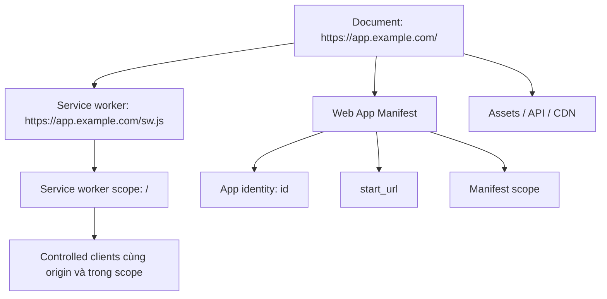

# Origin requirement — ranh giới origin trong Progressive Web App

> **Chương:** PWA  
> **Mục tiêu:** Hiểu vì sao Progressive Web App cần một origin đáng tin cậy; phân biệt secure context với same-origin; nắm các ràng buộc origin của Web App Manifest, `start_url`, `scope`, `id` và service worker; biết cách dùng tài nguyên cross-origin qua CORS mà không nhầm rằng CORS mở rộng quyền kiểm soát origin; triển khai, di chuyển domain và kiểm thử PWA bằng DevTools.

## 1. Vì sao PWA có yêu cầu về origin?

Progressive Web App (PWA) là ứng dụng web sử dụng các khả năng của nền tảng browser để mang lại trải nghiệm gần với ứng dụng cài đặt: có thể cài lên thiết bị, mở trong cửa sổ riêng, lưu tài nguyên, hỗ trợ một số trải nghiệm offline và tích hợp với hệ điều hành khi browser hỗ trợ.

Các khả năng này cần một ranh giới bảo mật ổn định. Browser phải biết:

- Trang nào đang đại diện cho ứng dụng.
- Manifest nào mô tả ứng dụng và biểu tượng nào thuộc ứng dụng.
- Service worker nào được phép kiểm soát trang.
- Những URL nào nằm trong phạm vi điều hướng của ứng dụng.
- Dữ liệu lưu trữ, cache và quyền nào thuộc về website nào.

Origin là một phần cốt lõi của ranh giới đó. Một PWA không thể dùng script từ website tùy ý để kiểm soát trang của mình, cũng không thể mở rộng quyền service worker sang domain khác chỉ bằng cách khai báo trong manifest.

Ví dụ, các URL sau có origin khác nhau:

- `https://app.example.com`
- `https://static.example.com`
- `https://app.example.com:8443`
- `http://app.example.com`

Dù các URL có thể thuộc cùng một tổ chức hoặc cùng site, browser vẫn áp dụng origin boundary khi xử lý service worker, DOM, storage và nhiều API khác.

## 2. Origin gồm những thành phần nào?

Với URL HTTP(S), origin là bộ ba:

1. **Scheme:** `https` hoặc `http`.
2. **Host:** hostname hoặc địa chỉ IP.
3. **Port:** cổng hiệu lực của kết nối.

Ví dụ:

| URL | Origin | So với `https://app.example.com` |
| --- | --- | --- |
| `https://app.example.com/home` | `https://app.example.com` | Cùng origin |
| `https://app.example.com:443` | `https://app.example.com` | Cùng origin; 443 là cổng mặc định |
| `http://app.example.com` | `http://app.example.com` | Khác origin do scheme |
| `https://app.example.com:8443` | `https://app.example.com:8443` | Khác origin do port |
| `https://static.example.com` | `https://static.example.com` | Khác origin do host |

Path, query và fragment không thuộc origin. Vì vậy, `https://app.example.com/pwa/` và `https://app.example.com/admin/` cùng origin nhưng có thể thuộc các scope service worker khác nhau.

Kiểm tra origin trong browser:

```js
console.log(location.origin);
console.log(location.protocol);
console.log(location.host);
```

Không nhầm **same-origin** với **same-site**. Hai subdomain có thể same-site nhưng khác origin. Cookie SameSite hoặc một số chính sách privacy có thể dùng khái niệm site; service worker và SOP vẫn dựa trên origin.

## 3. Secure context: PWA cần kết nối an toàn

Các khả năng quan trọng của PWA, đặc biệt Service Worker API, yêu cầu **secure context**. Trong môi trường triển khai thông thường, website phải được phục vụ qua HTTPS với certificate hợp lệ.

HTTPS bảo vệ:

- Tính bí mật của dữ liệu trên đường truyền.
- Tính toàn vẹn của response.
- Danh tính server theo cơ chế xác thực TLS.
- Điều kiện an toàn để browser bật các API nhạy cảm.

Ví dụ một trang HTTPS:

```text
https://app.example.com/
```

thường đáp ứng điều kiện secure context nếu certificate và chuỗi TLS hợp lệ.

Browser cũng xem một số địa chỉ phát triển như `http://localhost` và loopback là potentially trustworthy theo quy tắc secure context. Ngoại lệ này giúp chạy ứng dụng local; nó không có nghĩa mọi website HTTP đều an toàn.

Kiểm tra:

```js
console.log(window.isSecureContext);
```

Nếu kết quả là `false`, service worker có thể không khả dụng. Hãy kiểm tra scheme, certificate, proxy và môi trường chạy.

## 4. Secure context khác same-origin

Hai khái niệm này trả lời hai câu hỏi khác nhau:

| Khái niệm | Câu hỏi |
| --- | --- |
| Secure context | Context có đáp ứng điều kiện bảo mật của browser để dùng các API yêu cầu môi trường an toàn không? |
| Same-origin | Hai URL có cùng scheme, host và port không? |

Ví dụ:

- `https://app.example.com` và `https://cdn.example.net` đều có thể là secure context nhưng khác origin.
- `http://localhost:3000` có thể được browser xem là secure context trong phát triển, nhưng khác origin với `https://app.example.com`.
- `https://app.example.com` và `https://app.example.com:8443` đều an toàn qua HTTPS nhưng khác origin.

HTTPS không làm các subdomain trở thành cùng origin. Ngược lại, hai trang cùng origin trên một môi trường HTTP không mặc nhiên đáp ứng secure-context requirement của các API PWA.

## 5. Origin của PWA và các thành phần chính

Một PWA thường có nhiều thành phần:



Mỗi thành phần có quy tắc riêng:

- Document cung cấp origin của ứng dụng đang chạy.
- Manifest mô tả metadata và danh tính ứng dụng cài đặt.
- `start_url` xác định URL khởi chạy được manifest đề xuất.
- Manifest `scope` xác định phạm vi điều hướng được xem là thuộc app.
- Service worker script và registration có ràng buộc same-origin.
- Service worker scope xác định những client URL có thể được worker kiểm soát.
- Tài nguyên CDN/API có thể ở origin khác nhưng vẫn chịu CORS, CSP và các policy tương ứng.

Không coi manifest scope và service worker scope là cùng một cấu hình. Chúng có mục đích và cơ chế kiểm tra riêng.

## 6. Web App Manifest có thể được tải từ đâu?

Trang thường liên kết manifest bằng:

```html
<link rel="manifest" href="/manifest.webmanifest">
```

Manifest thường được đặt cùng origin để dễ triển khai và tránh cấu hình CORS. Việc fetch manifest có cơ chế CORS; nếu manifest được đặt ở origin khác, server cần trả CORS response phù hợp để browser có thể đọc manifest.

Ví dụ manifest từ CDN:

```html
<link
  rel="manifest"
  href="https://static.example.net/app.webmanifest"
  crossorigin="anonymous"
>
```

CDN phải cho phép origin của document qua CORS. Nếu manifest cần credentials cross-origin, thuộc tính và response cần được cấu hình theo credentialed CORS; chỉ dùng khi có lý do rõ ràng.

Điều quan trọng: **tải được manifest cross-origin không có nghĩa ứng dụng có thể dùng service worker cross-origin**. Manifest fetch và service worker registration là hai quy trình khác nhau.

## 7. Origin requirement của start_url

Manifest member `start_url` xác định URL browser nên mở khi người dùng khởi chạy ứng dụng đã cài. URL này được resolve theo URL của manifest.

Ví dụ:

```json
{
  "start_url": "/app/",
  "display": "standalone"
}
```

Với document tại `https://app.example.com`, start URL trên trỏ tới `https://app.example.com/app/`.

Theo quy tắc xử lý manifest, `start_url` phải cùng origin với document đã liên kết manifest. Nếu URL được resolve sang origin khác, browser bỏ qua giá trị không hợp lệ và dùng URL thay thế theo quy tắc manifest, thay vì cho manifest chuyển app sang một origin tùy ý.

Ví dụ không phù hợp:

```json
{
  "start_url": "https://other.example.net/app/",
  "display": "standalone"
}
```

Không dùng `start_url` để mở một website khác như thể đó là cùng PWA. Nếu ứng dụng cần chuyển sang dịch vụ khác, hãy dùng điều hướng web thông thường và thiết kế trải nghiệm phù hợp với ranh giới origin.

## 8. Manifest scope và origin

Manifest member `scope` xác định phạm vi URL mà browser xem là nằm trong phạm vi điều hướng của PWA. Nó được resolve theo URL của manifest và phải cùng origin với `start_url` hợp lệ.

Ví dụ:

```json
{
  "id": "/shop-app",
  "start_url": "/app/",
  "scope": "/app/",
  "display": "standalone"
}
```

Trong ví dụ này:

- `start_url` là `https://app.example.com/app/`.
- `scope` là `https://app.example.com/app/`.
- Các navigation trong phạm vi này có thể được browser xử lý như navigation thuộc app theo manifest.

Nếu scope khác origin với start URL hoặc không hợp lệ, browser có thể bỏ qua và dùng scope mặc định theo quy tắc manifest. Hãy đặt scope rõ ràng và kiểm tra giá trị đã resolve trong DevTools.

### Scope không phải quyền truy cập

Manifest scope không cấp quyền đọc URL hoặc dữ liệu ngoài origin. Nó cũng không phải service worker scope.

Ví dụ:

- Manifest scope `/app/` ảnh hưởng cách browser phân loại navigation của PWA.
- Service worker scope `/app/` ảnh hưởng client URL nào worker có thể kiểm soát.

Hai scope nên được thiết kế tương thích, nhưng thay đổi một scope không tự động thay đổi scope còn lại.

## 9. Manifest id và danh tính cài đặt

Manifest member `id` cung cấp định danh ổn định cho web app. Nếu không khai báo `id`, browser có thể suy ra định danh từ `start_url` theo quy tắc manifest.

Ví dụ:

```json
{
  "id": "/shop-pwa",
  "start_url": "/app/",
  "scope": "/app/",
  "display": "standalone"
}
```

Định danh này giúp browser nhận diện ứng dụng qua những lần cập nhật manifest, ngay cả khi start URL thay đổi trong phạm vi phù hợp.

`id` phải đáp ứng quy tắc URL và origin của manifest. Nếu khai báo ID ở origin khác hoặc giá trị không hợp lệ, browser có thể bỏ qua và dùng định danh mặc định. Hãy giữ ID ổn định sau khi phát hành; thay đổi ID có thể khiến browser xem ứng dụng như một app khác tùy nền tảng.

Không dùng ID để vượt qua origin boundary hoặc hợp nhất hai website khác origin thành một ứng dụng duy nhất.

## 10. Service worker script phải cùng origin

Service worker được đăng ký từ document bằng:

```js
const registration = await navigator.serviceWorker.register("/sw.js", {
  scope: "/",
});
```

Script service worker phải cùng origin với document thực hiện registration. Ví dụ:

- Document: `https://app.example.com`
- Script hợp lệ: `https://app.example.com/sw.js`
- Script không hợp lệ: `https://cdn.example.net/sw.js`

Việc CDN trả CORS header không làm script service worker cross-origin trở thành hợp lệ. CORS cho phép một số request cross-origin đọc response; nó không mở rộng quyền đăng ký worker qua origin.

Nếu muốn phân phối worker qua CDN, hãy thiết kế deployment sao cho URL cuối được phục vụ dưới origin ứng dụng, ví dụ reverse proxy cùng origin, và xác minh redirect/response cuối theo quy tắc service worker.

## 11. Service worker scope và script location

Theo mặc định, scope tối đa của service worker bị giới hạn bởi thư mục chứa script. Ví dụ:

| Script URL | Scope mặc định lớn nhất |
| --- | --- |
| `/sw.js` | `/` |
| `/app/sw.js` | `/app/` |
| `/app/workers/sw.js` | `/app/workers/` |

Nếu script ở `/assets/sw.js` nhưng cần kiểm soát `/`, server có thể trả header `Service-Worker-Allowed` để cho phép scope rộng hơn:

```http
Service-Worker-Allowed: /
```

Sau đó đăng ký:

```js
await navigator.serviceWorker.register("/assets/sw.js", {
  scope: "/",
});
```

Chỉ mở rộng scope khi cần thiết. Worker ở root có thể kiểm soát nhiều route hơn, do đó một lỗi trong worker có thể ảnh hưởng nhiều phần của ứng dụng.

## 12. Manifest scope và service worker scope phải được phối hợp

Ví dụ ứng dụng được đặt dưới path `/portal/`:

Manifest:

```json
{
  "id": "/portal-pwa",
  "start_url": "/portal/",
  "scope": "/portal/",
  "display": "standalone"
}
```

Đăng ký worker:

```js
await navigator.serviceWorker.register("/portal/sw.js", {
  scope: "/portal/",
});
```

Hai scope trong ví dụ cùng giới hạn vào `/portal/`, nhưng vẫn được browser xử lý độc lập:

- Manifest scope định nghĩa navigation thuộc app.
- Service worker scope xác định client URL worker có thể kiểm soát.

Nếu manifest scope rộng hơn service worker scope, một số navigation có thể thuộc PWA nhưng không được worker kiểm soát. Nếu service worker scope rộng hơn manifest scope, worker có thể kiểm soát client nằm ngoài vùng điều hướng được app manifest mô tả. Hãy chọn hai phạm vi có chủ đích.

## 13. Subdomain là origin khác

Một tổ chức có thể triển khai:

- `https://app.example.com` — PWA chính.
- `https://api.example.com` — API.
- `https://cdn.example.com` — tài nguyên tĩnh.
- `https://admin.example.com` — trang quản trị.

Các host này khác origin dù cùng registrable domain. Service worker của app không thể đăng ký để kiểm soát document ở api, cdn hoặc admin subdomain.

PWA vẫn có thể gọi API hoặc tải tài nguyên từ subdomain khác nếu cơ chế phù hợp cho phép:

- Fetch API cần CORS để JavaScript đọc response cross-origin.
- CSP cần cho phép host ở directive phù hợp.
- CORP/COEP có thể ảnh hưởng cách tải tài nguyên no-CORS.
- Cookie có Domain rộng có thể được gửi tới nhiều subdomain theo cookie rules; điều này không làm chúng same-origin.

Không dùng cookie Domain hoặc CORS để giả lập một origin duy nhất. Mỗi subdomain cần được xem là trust boundary riêng trong thiết kế bảo mật.

## 14. CORS không mở rộng service worker origin

Ví dụ API ở origin khác:

```js
const response = await fetch("https://api.example.com/profile", {
  credentials: "include",
});

if (!response.ok) {
  throw new Error("Không tải được profile.");
}

const profile = await response.json();
```

API cần cấu hình CORS phù hợp, chẳng hạn:

```http
Access-Control-Allow-Origin: https://app.example.com
Access-Control-Allow-Credentials: true
Vary: Origin
```

CORS cho phép script của PWA đọc response theo policy. Nó không:

- Cho phép app đăng ký service worker từ API origin.
- Cho phép app đọc DOM của trang API.
- Thay authorization hoặc CSRF protection.
- Làm storage của hai origin trở thành chung.
- Cho phép manifest đổi start_url sang origin tùy ý.

Khi request dùng cookie credentials, cookie attributes và browser privacy controls vẫn áp dụng. Server phải kiểm tra session và quyền truy cập độc lập.

## 15. Tài nguyên cross-origin trong PWA

PWA có thể tải script, ảnh, font, media hoặc dữ liệu từ CDN khác origin. Mỗi loại tài nguyên có quy tắc riêng:

| Tài nguyên | Cơ chế cần xem xét |
| --- | --- |
| Fetch/XHR tới API | CORS và authorization |
| Module script | CORS |
| Classic script từ CDN | CSP; SRI; CORS nếu cần CORS mode/error detail |
| Font cross-origin | CORS |
| Ảnh chỉ hiển thị | CSP `img-src`; CORP nếu cần giới hạn no-CORS |
| Ảnh dùng trong canvas | CORS và thuộc tính `crossorigin` |
| Resource trong COEP `require-corp` | CORS hoặc CORP opt-in phù hợp |

Ví dụ CSP:

```http
Content-Security-Policy: default-src 'self'; script-src 'self' https://cdn.example.com; img-src 'self' https://cdn.example.com; connect-src 'self' https://api.example.com; font-src 'self' https://fonts.example.net
```

CSP allowlist chỉ cho phép document tải từ nguồn được nêu. Nó không tự cấp CORS permission; server tài nguyên vẫn phải trả CORS header khi request mode yêu cầu.

## 16. Redirect không làm mất ranh giới origin

Một URL có thể redirect sang host hoặc scheme khác. Không nên giả định URL ban đầu quyết định origin cuối cùng của document hoặc resource.

Ví dụ:

```text
https://app.example.com/start
  -> 302 https://login.example.net/
```

Sau redirect, document cuối có origin của URL đích. Quyền truy cập DOM, storage, service worker và API được xác định theo origin hiện tại và các policy liên quan.

Đối với service worker script, phải đảm bảo script được phục vụ đúng origin và không dựa vào redirect sang CDN cross-origin. Với manifest, kiểm tra URL cuối và quy tắc xử lý từng member. Với start_url, scope và app identity, kiểm tra origin sau khi URL được resolve.

Không dùng redirect để lách quy tắc same-origin. Hãy giữ các URL cốt lõi của PWA ổn định trên origin ứng dụng.

## 17. Mixed content và HTTPS của mọi tài nguyên

Một PWA được mở qua HTTPS vẫn có thể tham chiếu tài nguyên HTTP. Đây là mixed content:

```html

```

Browser có thể tự nâng cấp một số tài nguyên thụ động sang HTTPS và chặn các loại mixed content khác. Nếu host không hỗ trợ HTTPS hoặc certificate lỗi, resource có thể không tải được.

PWA nên:

- Dùng HTTPS cho document, manifest, service worker và tài nguyên cần thiết.
- Sửa URL HTTP trong HTML, CSS, manifest, API và CMS.
- Cấu hình CSP `upgrade-insecure-requests` như lớp hỗ trợ migration nếu phù hợp.
- Dùng HSTS cho host thuộc quyền quản lý sau khi xác minh toàn bộ HTTPS.

Không xem việc trang chính có biểu tượng khóa là bằng chứng mọi resource của PWA đều tải an toàn.

## 18. Origin ảnh hưởng storage và quyền của PWA

Các vùng lưu trữ browser như Cache Storage, IndexedDB và localStorage được phân vùng theo origin; một số ngữ cảnh nhúng còn chịu storage partitioning theo top-level site.

Hệ quả:

- `https://app.example.com` và `https://static.example.com` không chia sẻ localStorage/IndexedDB chỉ vì cùng site.
- Cùng hostname nhưng khác port cũng là origin khác và có storage boundary riêng.
- Chuyển từ HTTP sang HTTPS tạo origin khác; dữ liệu origin HTTP không tự xuất hiện trong HTTPS origin.
- Chuyển PWA sang domain mới không tự chuyển service worker registration, Cache Storage, IndexedDB hoặc permission.
- Browser permission thường gắn với site/origin và feature theo browser policy; không giả định quyền ở domain cũ tự áp dụng cho domain mới.

Không dùng storage như nơi chia sẻ bí mật giữa các origin. Nếu cần trao đổi dữ liệu, dùng API server có authorization hoặc một giao thức cross-origin được thiết kế rõ ràng.

## 19. Đổi domain hoặc chuyển PWA sang origin mới

Giả sử PWA chuyển từ `https://old.example.com` sang `https://app.example.net`. Đây là thay đổi origin, không chỉ là đổi hostname hiển thị.

Những thứ cần lập kế hoạch:

- Đăng ký service worker mới trên origin mới.
- Phát hành manifest mới với start_url, scope và id phù hợp.
- Kiểm tra browser có xem app mới là ứng dụng cài đặt riêng hay không.
- Chuyển dữ liệu server-side qua quy trình xác thực; không thể đọc trực tiếp storage của origin cũ từ origin mới.
- Xử lý Cache Storage/IndexedDB cũ ở origin cũ theo khả năng và vòng đời browser.
- Yêu cầu người dùng đăng nhập lại nếu session không được chuyển theo cơ chế an toàn.
- Kiểm tra cookie Domain, redirect, OAuth redirect URI, CORS allowlist và CSP.
- Thông báo hướng dẫn cập nhật PWA đã cài nếu nền tảng không tự thay đổi shortcut/app identity.

Không cố sao chép dữ liệu origin cũ bằng cách nới SOP hoặc mở rộng CORS. CORS không cho phép đọc localStorage/IndexedDB của origin khác.

## 20. Ví dụ cấu hình PWA cùng origin

Giả sử ứng dụng chạy ở `https://app.example.com`.

HTML:

```html
<link rel="manifest" href="/manifest.webmanifest">
<script>
  if ("serviceWorker" in navigator && window.isSecureContext) {
    navigator.serviceWorker.register("/sw.js", { scope: "/" })
      .catch((error) => console.error("SW registration failed", error));
  }
</script>
```

Manifest:

```json
{
  "id": "/shop-pwa",
  "name": "Shop Example",
  "short_name": "Shop",
  "start_url": "/app/",
  "scope": "/app/",
  "display": "standalone",
  "icons": [
    {
      "src": "/icons/icon-192.png",
      "sizes": "192x192",
      "type": "image/png"
    },
    {
      "src": "/icons/icon-512.png",
      "sizes": "512x512",
      "type": "image/png"
    }
  ]
}
```

Đăng ký worker với scope tương ứng:

```js
await navigator.serviceWorker.register("/sw.js", {
  scope: "/app/",
});
```

Trong ví dụ này:

- Document, manifest, start_url và service worker script cùng origin.
- Manifest scope và service worker scope cùng giới hạn vào `/app/`.
- Icon được tải từ cùng origin.
- API/CDN có thể ở origin khác nhưng cần policy phù hợp.

Lưu ý: ví dụ minh họa quan hệ origin/scope; điều kiện cài đặt cụ thể còn tùy browser, nền tảng và các tiêu chí PWA hiện hành.

## 21. Ví dụ: manifest ở CDN, app và service worker ở origin chính

Trong một số kiến trúc, manifest được phục vụ từ CDN:

```html
<link
  rel="manifest"
  href="https://static.example.net/app.webmanifest"
  crossorigin="anonymous"
>
```

CDN cần trả CORS cho document origin:

```http
Access-Control-Allow-Origin: https://app.example.com
Vary: Origin
Content-Type: application/manifest+json
```

Manifest vẫn cần các URL cốt lõi hợp lệ theo quy tắc origin:

```json
{
  "id": "https://app.example.com/shop-pwa",
  "start_url": "https://app.example.com/app/",
  "scope": "https://app.example.com/app/",
  "display": "standalone"
}
```

Service worker vẫn phải được đăng ký từ origin app:

```js
await navigator.serviceWorker.register("/sw.js", {
  scope: "/app/",
});
```

Không suy luận rằng vì manifest được tải từ CDN nên service worker cũng có thể đặt ở CDN. Mỗi cơ chế có quy tắc riêng; hãy xác minh origin của manifest document, start_url, scope, id và worker script.

## 22. Kiểm thử origin requirement bằng DevTools

Thực hành trong môi trường HTTPS staging hoặc localhost. Dùng các hostname do bạn kiểm soát; không thay đổi cấu hình production để thử nghiệm.

### Bước 1 — Xác định origin của document

Trong Console:

```js
console.log(location.origin);
console.log(window.isSecureContext);
```

Ghi lại scheme, host, port và trạng thái secure context.

### Bước 2 — Kiểm tra manifest

Mở DevTools → Application → Manifest. Kiểm tra:

- URL của manifest.
- `id`, `start_url`, `scope` sau khi browser resolve.
- Icon URL và lỗi tải icon.
- Cảnh báo origin hoặc member không hợp lệ.

Nếu manifest ở CDN, kiểm tra CORS response của CDN trong Network.

### Bước 3 — Kiểm tra service worker

Mở Application → Service Workers. Xác minh:

- Script URL có cùng origin với trang không.
- Scope có đúng path dự kiến không.
- Worker ở trạng thái installing, waiting hay activated.
- Trang có controller hay chưa.

Trong Console:

```js
console.log(navigator.serviceWorker.controller);
```

### Bước 4 — Thử sai origin

Trong lab, thử đăng ký worker bằng URL CDN cross-origin. Xác minh browser từ chối registration. Sau đó đặt script dưới origin ứng dụng qua reverse proxy thử nghiệm và xác minh registration theo origin hợp lệ.

### Bước 5 — Thử khác scheme/port/subdomain

Chạy các trang lab ở:

- HTTPS cùng host, port mặc định.
- HTTPS cùng host, port khác.
- HTTPS subdomain khác.
- HTTP hostname không phải localhost.

So sánh `location.origin`, secure context và khả năng đăng ký worker. Không đồng nhất cùng site với cùng origin.

### Bước 6 — Kiểm tra storage boundary

Mở hai origin lab khác nhau và ghi dữ liệu thử nghiệm vào localStorage hoặc IndexedDB. Xác minh origin còn lại không đọc trực tiếp được dữ liệu. Không dùng dữ liệu thật.

### Bước 7 — Kiểm tra điều hướng ngoài scope

Mở một URL nằm ngoài manifest scope và một URL nằm ngoài service worker scope. Quan sát browser xử lý navigation của PWA và request có được worker kiểm soát hay không.

## 23. Chẩn đoán lỗi thường gặp

| Hiện tượng | Nguyên nhân có thể | Cách xử lý |
| --- | --- | --- |
| Service worker API không khả dụng | Trang không ở secure context hoặc browser không hỗ trợ | Dùng HTTPS/localhost và feature detection |
| Worker registration bị từ chối | Script khác origin hoặc scope không hợp lệ | Đưa script về origin ứng dụng và kiểm tra scope |
| Worker không kiểm soát trang | Trang nằm ngoài worker scope hoặc chưa được claim/reload | Kiểm tra registration.scope và controller |
| Manifest không tải được từ CDN | Thiếu CORS hoặc sai MIME/URL | Cấu hình CORS và Content-Type phù hợp |
| start_url bị browser bỏ qua | URL khác origin với document hoặc URL không hợp lệ | Dùng start_url cùng origin và kiểm tra URL đã resolve |
| Manifest scope không như dự kiến | Khác origin với start_url hoặc giá trị không hợp lệ | Dùng scope cùng origin và path đúng |
| PWA mở sai đường dẫn | start_url/scope không tương thích với deployment path | Kiểm tra base path và URL resolve |
| CDN script tải được nhưng worker không đăng ký | CORS không thay same-origin requirement của service worker | Phục vụ worker qua origin ứng dụng |
| Chuyển HTTP sang HTTPS làm mất dữ liệu local | Scheme thay đổi origin | Thiết kế migration có xác thực và đồng bộ server-side |
| Chuyển domain làm app xuất hiện như app khác | Origin hoặc manifest id thay đổi | Giữ identity ổn định khi phù hợp và lập kế hoạch migration |
| API subdomain bị CORS block | API không cho origin PWA đọc response | Cấu hình allowlist CORS và credentials đúng |
| Resource HTTP không tải | Mixed content bị auto-upgrade hoặc chặn | Phục vụ tài nguyên qua HTTPS và sửa URL gốc |

## 24. Những ngộ nhận thường gặp

| Ngộ nhận | Cách hiểu đúng |
| --- | --- |
| “PWA chỉ cần HTTPS là mọi thành phần cùng origin.” | HTTPS tạo secure context; subdomain và port khác vẫn là origin khác. |
| “Manifest ở CDN thì service worker cũng có thể ở CDN.” | Manifest fetch có thể dùng CORS; service worker script phải cùng origin với document đăng ký. |
| “CORS cho phép worker cross-origin.” | CORS không mở rộng same-origin requirement của service worker. |
| “Manifest scope là service worker scope.” | Hai scope khác nhau và được browser xử lý độc lập. |
| “Same-site nghĩa là same-origin.” | Subdomain có thể cùng site nhưng khác origin. |
| “start_url có thể mở app trên domain tùy ý.” | start_url phải thỏa origin requirement của manifest; URL khác origin bị bỏ qua theo quy tắc xử lý. |
| “Đổi domain chỉ cần redirect.” | Storage, worker registration, permission và app identity gắn với origin; cần migration riêng. |
| “localhost HTTP chứng minh production HTTP được phép.” | Localhost là ngoại lệ secure-context cho phát triển, không áp dụng cho host HTTP công cộng. |
| “CORS cho phép đọc storage origin cũ.” | CORS không thay SOP đối với localStorage/IndexedDB. |
| “Một PWA có thể điều khiển toàn bộ subdomain.” | Service worker chỉ kiểm soát client cùng origin và nằm trong scope hợp lệ. |

## 25. Checklist origin requirement cho PWA

- Phục vụ PWA production qua HTTPS với certificate hợp lệ.
- Dùng localhost/loopback chỉ cho phát triển theo secure-context rules.
- Kiểm tra scheme, host và port của document trước khi đăng ký worker.
- Đặt service worker script cùng origin với document đăng ký.
- Chọn service worker scope nhỏ nhất đủ dùng; kiểm tra Service-Worker-Allowed nếu cần mở rộng.
- Giữ manifest URL, start_url, scope và id hợp lệ theo quy tắc origin.
- Nếu manifest ở CDN, cấu hình CORS và kiểm tra response cuối.
- Không suy luận manifest CORS cho phép service worker cross-origin.
- Phân biệt manifest scope với service worker scope.
- Kiểm tra origin của từng subdomain API/CDN/admin và cấu hình CORS/CSP/CORP riêng.
- Không dùng cookie Domain hoặc CORS để giả lập same-origin.
- Phục vụ tài nguyên qua HTTPS và xử lý mixed content.
- Lập kế hoạch khi đổi scheme, host hoặc port vì storage, worker và app identity có thể thay đổi.
- Kiểm thử manifest, registration, controller, navigation scope và storage trên browser mục tiêu.

## 26. Câu hỏi tự kiểm tra

1. Origin được tạo thành từ những thành phần nào?
2. Secure context khác same-origin như thế nào?
3. Vì sao localhost HTTP có thể được xem là secure context trong phát triển?
4. Manifest cross-origin cần điều kiện gì để được fetch?
5. Vì sao manifest tải được từ CDN không đồng nghĩa worker có thể đăng ký từ CDN?
6. start_url phải đáp ứng origin requirement nào?
7. Manifest scope và service worker scope khác nhau ra sao?
8. Service-Worker-Allowed dùng để làm gì?
9. Vì sao subdomain khác vẫn là origin khác dù cùng site?
10. CORS có thể và không thể giải quyết những gì trong PWA?
11. Điều gì xảy ra với storage và service worker khi đổi domain?
12. Cần kiểm tra những mục nào trong DevTools để chẩn đoán lỗi origin?

**Ghi nhớ:** PWA dựa vào origin ổn định và secure context để browser xác định danh tính ứng dụng, phạm vi manifest, service worker và dữ liệu lưu trữ. HTTPS là điều kiện an toàn nhưng không làm các subdomain hoặc port khác trở thành same-origin. Manifest có thể được fetch cross-origin khi CORS cho phép, nhưng start_url, scope và service worker vẫn phải tuân theo các ràng buộc origin riêng. Hãy phối hợp manifest scope với worker scope, kiểm tra response cuối và lập kế hoạch riêng khi thay đổi scheme, host hoặc port.
