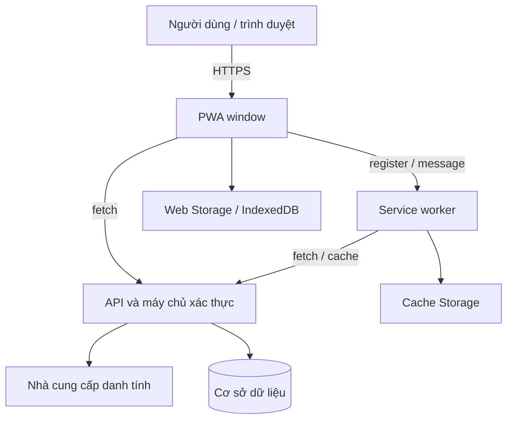

# PWA security review

## Mục tiêu bài học

Sau bài này, bạn có thể:

- Lập threat model cho một Progressive Web App (PWA), xác định tài sản, điểm vào và ranh giới tin cậy.
- Rà soát manifest, service worker, cache, storage, thông điệp giữa các context và luồng cập nhật để tìm lỗi bảo mật.
- Đánh giá CSP, security headers, quyền trình duyệt, xác thực, điều hướng và xử lý dữ liệu offline.
- Kiểm thử các tình huống như cache lộ dữ liệu giữa tài khoản, service worker cũ tiếp tục điều khiển trang, XSS tồn tại qua lần tải lại và thông điệp không đáng tin cậy.
- Ghi nhận phát hiện có bằng chứng, mức độ ảnh hưởng, điều kiện khai thác và biện pháp khắc phục có thể xác minh.

## 1. Mục đích và phạm vi của security review

PWA vẫn là ứng dụng web chạy trong mô hình bảo mật của trình duyệt. Việc được cài lên màn hình chính, chạy trong cửa sổ `standalone` hoặc có service worker không tạo ra một sandbox tin cậy mới cho mã ứng dụng. PWA vẫn chịu ảnh hưởng của Same-Origin Policy, CSP, cookie, quyền trình duyệt, CORS, xác thực phía máy chủ và các rủi ro XSS/CSRF như một website thông thường.

Tuy vậy, PWA có một số thành phần làm thay đổi bề mặt tấn công:

- Trình duyệt có thể đánh thức service worker để xử lý sự kiện nền dù không có tab đang mở; worker cũng kiểm soát request của các trang trong scope khi được kích hoạt.
- Cache API và IndexedDB có thể giữ dữ liệu sau khi người dùng đóng ứng dụng, đăng xuất hoặc chuyển tài khoản.
- Cơ chế cập nhật service worker có thể khiến mã cũ tiếp tục điều khiển trang trong một khoảng thời gian.
- Ứng dụng đã cài có thể dùng notification, push, background sync hoặc các quyền khác nếu nền tảng hỗ trợ.
- Manifest, shortcut, start URL và điều hướng ngoài scope ảnh hưởng cách người dùng khởi chạy và di chuyển giữa các trang.

Security review cần xem xét cả mã chạy trong trang, mã chạy trong worker, máy chủ, cấu hình triển khai và cách dữ liệu đi qua các vùng lưu trữ. Một checklist chỉ kiểm tra manifest hoặc điểm Lighthouse sẽ bỏ sót các rủi ro chính.

## 2. Lập threat model trước khi kiểm tra

Trước tiên, mô tả hệ thống bằng sơ đồ đơn giản. Ví dụ một PWA quản lý công việc có thể có các thành phần:



Các thành phần trong sơ đồ chỉ là ví dụ. Hãy thay bằng kiến trúc thực tế, bao gồm CDN, hệ thống phân tích, push service, iframe, thư viện bên thứ ba và các origin API khác nếu có.

### 2.1. Xác định tài sản cần bảo vệ

Liệt kê dữ liệu và chức năng có giá trị đối với người dùng hoặc tổ chức:

- Cookie phiên, access token, refresh token và trạng thái xác thực.
- Hồ sơ, thông tin liên hệ, dữ liệu công việc, bản nháp và file đã tải xuống.
- Hàng đợi thao tác offline chưa đồng bộ lên máy chủ.
- Quyền quản trị, quyền theo tenant và khả năng thực hiện giao dịch.
- Nội dung notification, subscription push và thông tin thiết bị.
- Mã nguồn ứng dụng, script, manifest, service worker và tài nguyên được cache.

Phân loại dữ liệu theo mức nhạy cảm, chủ sở hữu và thời hạn lưu giữ. Dữ liệu công khai có thể được cache lâu hơn dữ liệu riêng tư. Dữ liệu của tài khoản A không được tái sử dụng cho tài khoản B chỉ vì cả hai dùng cùng một trình duyệt.

### 2.2. Xác định kẻ tấn công và đường tấn công

Threat model nên xem xét ít nhất các tình huống sau:

- Kẻ tấn công gửi liên kết độc hại khiến người dùng mở ứng dụng hoặc đăng nhập qua một URL được tạo sẵn.
- Nội dung do người dùng nhập bị lưu trữ và trở thành stored XSS khi ứng dụng mở lại, kể cả khi đang offline.
- Thư viện bên thứ ba hoặc dependency bị xâm nhập và chạy mã trong origin của PWA.
- Người dùng dùng chung thiết bị; tài khoản cũ đã logout nhưng cache, tab hoặc worker vẫn giữ dữ liệu.
- Kẻ tấn công kiểm soát mạng không an toàn hoặc một endpoint/CDN được cấu hình sai, tìm cách thay script hay response.
- Một iframe, tab, worker hoặc cửa sổ cùng origin gửi thông điệp không đúng định dạng hoặc không đúng trạng thái.
- Người dùng cấp quyền notification, camera, microphone hoặc vị trí mà không hiểu mục đích.

Rà soát cần chỉ rõ điều kiện khai thác. Ví dụ, “XSS” cần mô tả được nguồn dữ liệu không tin cậy, sink nguy hiểm và cách payload thực thi; “cache leak” cần xác định response nào được lưu, key cache nào được dùng và tài khoản khác có thể đọc lại bằng cách nào.

## 3. Kiểm tra origin, manifest và điều hướng

Manifest mô tả cách nhận diện và khởi chạy PWA. Các field như `id`, `start_url`, `scope`, `shortcuts` và `display` không phải cơ chế phân quyền. Hãy kiểm tra:

| Thành phần | Câu hỏi security review |
| --- | --- |
| `id` | Có ổn định và thuộc đúng ứng dụng không? Việc thay đổi URL có vô tình tạo ra một danh tính cài đặt khác không? |
| `start_url` | Có chứa token, mã reset, thông tin cá nhân hoặc tham số có thể bị ghi vào log không? Có redirect đến URL không tin cậy không? |
| `scope` | Có bao phủ đúng các route của ứng dụng không? Có hiểu nhầm scope là quyền truy cập hoặc ranh giới bảo mật không? |
| `shortcuts` | URL đích có thuộc ứng dụng và có kiểm tra quyền như route thông thường không? |
| `icons` và manifest URL | Có được phục vụ từ origin tin cậy qua HTTPS và đúng content type không? Có thể bị thay thế qua pipeline/CDN không? |
| Liên kết ngoài scope | Ứng dụng xử lý external navigation và callback đăng nhập ra sao? Có mở trang không tin cậy trong ngữ cảnh dễ gây nhầm lẫn không? |

Không đưa bearer token, mã khôi phục hoặc dữ liệu nhạy cảm vào `start_url`, shortcut URL hay query string. URL có thể được lưu trong lịch sử, access log, analytics, screenshot hoặc header `Referer` tùy chính sách. Nếu cần tham số điều hướng, chỉ dùng giá trị không nhạy cảm và kiểm tra allowlist ở máy chủ.

Kiểm tra mọi redirect sau đăng nhập, callback OAuth/OIDC và deep link. Máy chủ phải đối chiếu redirect URI với danh sách cho phép chính xác. `scope` của manifest không ngăn open redirect, không giới hạn endpoint API và không thay thế authorization.

PWA cần được phục vụ qua HTTPS. Hãy kiểm tra HSTS trên domain production, redirect HTTP sang HTTPS, certificate, mixed content và mọi host phụ dùng để tải script hoặc API. Không đưa tài nguyên thực thi qua HTTP chỉ vì trang chính dùng HTTPS.

## 4. Rà soát service worker

Service worker có quyền kiểm soát đáng kể đối với request trong scope. Nếu script worker bị xâm nhập, mã độc có thể tiếp tục can thiệp request và response ở những lần truy cập sau. Do đó, service worker là thành phần có rủi ro cao và cần được review như một entry point quan trọng.

### 4.1. Script, scope và nguồn cung cấp

Kiểm tra các điểm sau:

- Script được tải từ HTTPS và đúng origin dự kiến; đường dẫn đăng ký không bị ghép từ input người dùng.
- Scope đăng ký hẹp nhất có thể, chỉ bao phủ ứng dụng cần điều khiển.
- Không dùng `Service-Worker-Allowed` để mở rộng scope quá mức nếu không có yêu cầu kiến trúc rõ ràng.
- Các dependency được import bằng `importScripts()` hoặc module import có nguồn gốc, phiên bản và quy trình cập nhật được kiểm soát.
- Pipeline build/deploy bảo vệ file worker, manifest và bundle; quyền ghi CDN/object storage được giới hạn.
- Không cho phép nội dung do người dùng tải lên được thực thi như script hoặc được phục vụ từ cùng origin dưới đường dẫn có thể bị worker kiểm soát.

Service worker cùng origin có thể truy cập các tài nguyên và API trong phạm vi quyền của origin. Nếu attacker đạt được XSS trên origin, worker không phải lớp bảo vệ chống lại attacker đó. Ngược lại, việc thay thế worker script có thể tạo ảnh hưởng kéo dài hơn một lần tải trang.

### 4.2. Cập nhật và vòng đời worker

Trình duyệt có cơ chế phát hiện worker script mới và cài đặt worker mới. Worker mới thường chờ worker cũ không còn điều khiển client trước khi kích hoạt, trừ khi ứng dụng chủ động thay đổi quy trình bằng `skipWaiting()` và `clients.claim()`.

Review cần xác minh:

- Ứng dụng có kiểm soát phiên bản cache và tương thích giữa worker với phiên bản trang đang mở không.
- `skipWaiting()` có thể khiến trang đang chạy mã cũ nhận worker mới hay không; nếu có, giao thức giữa hai phiên bản có an toàn không.
- Khi kích hoạt worker mới, cache cũ được xóa có chọn lọc và chỉ sau khi xác định không còn được phiên bản đang chạy sử dụng.
- Worker có thể rollback hoặc khôi phục phiên bản ổn định khi bản deploy mới gặp lỗi không.
- Người dùng được thông báo và có hướng dẫn reload khi cập nhật làm thay đổi giao diện hoặc schema dữ liệu.

Ví dụ quản lý cache theo phiên bản:

```js
const CURRENT_CACHE = "portal-shell-v5";
const OWNED_CACHE_PREFIX = "portal-shell-";

self.addEventListener("install", (event) => {
  event.waitUntil((async () => {
    const cache = await caches.open(CURRENT_CACHE);
    await cache.addAll([
      "/portal/",
      "/portal/app-shell.html",
      "/portal/assets/app.css",
      "/portal/assets/app.js"
    ]);
  })());
});

self.addEventListener("activate", (event) => {
  event.waitUntil((async () => {
    const names = await caches.keys();
    await Promise.all(names
      .filter((name) =>
        name.startsWith(OWNED_CACHE_PREFIX) && name !== CURRENT_CACHE
      )
      .map((name) => caches.delete(name)));
    await self.clients.claim();
  })());
});
```

Đây là ví dụ minh họa cho cache shell do worker sở hữu. Trong ứng dụng thực tế, chỉ xóa cache sau khi xác nhận quy tắc tương thích và tên prefix không trùng với ứng dụng khác cùng origin. Nếu worker dùng `skipWaiting()`, cần thêm cơ chế thông báo/reload có kiểm soát và kiểm tra rằng trang cũ không tiếp tục dùng schema hoặc asset không tương thích.

### 4.3. Xử lý fetch và navigation fallback

Một service worker thường xử lý cả navigation request và request tài nguyên. Rà soát các trường hợp:

- Không trả app shell cho API, endpoint đăng nhập, callback OAuth hoặc URL tải file riêng tư chỉ vì request không có trong cache.
- Không cache response `401`, `403`, response redirect nhạy cảm hoặc response chứa dữ liệu theo session như tài nguyên công khai.
- Không dùng cache-first cho endpoint cá nhân nếu cache key không phân biệt tài khoản và tenant.
- Có fallback offline rõ ràng; không biến lỗi mạng thành một response giả khiến ứng dụng hiểu nhầm dữ liệu đã được lưu thành công.
- Kiểm tra method, URL, query, header `Vary` và trạng thái response khi dùng `cache.match()`/`cache.put()`.
- Không chuyển tiếp request có header xác thực đến origin không tin cậy.

Ví dụ chỉ xử lý navigation trong scope và không áp dụng fallback cho endpoint API:

```js
self.addEventListener("fetch", (event) => {
  const request = event.request;
  const url = new URL(request.url);

  if (request.method !== "GET" || url.origin !== self.location.origin) {
    return;
  }

  if (url.pathname.startsWith("/portal/api/")) {
    // API có chính sách mạng và cache riêng.
    return;
  }

  if (request.mode === "navigate" && url.pathname.startsWith("/portal/")) {
    event.respondWith((async () => {
      try {
        return await fetch(request);
      } catch {
        const cache = await caches.open("portal-shell-v5");
        return (await cache.match("/portal/app-shell.html")) ||
          new Response("Không thể kết nối. Vui lòng thử lại.", {
            status: 503,
            headers: { "Content-Type": "text/plain; charset=utf-8" }
          });
      }
    })());
  }
});
```

Ví dụ trên chỉ minh họa quy tắc điều hướng. Nếu ứng dụng cần offline API, hãy thiết kế riêng từng endpoint, xác định dữ liệu nào được phép lưu, thời hạn và cách đồng bộ; không mở rộng fallback tổng quát sang API bằng cách bỏ qua kiểm tra quyền.

## 5. Rà soát Cache Storage và dữ liệu offline

Cache API và IndexedDB có thể tồn tại lâu sau khi trang đóng. Một lỗi phân vùng cache có thể làm lộ dữ liệu giữa tài khoản, tenant hoặc người dùng chung thiết bị.

Hãy lập danh mục cache và dữ liệu offline:

| Loại dữ liệu | Câu hỏi cần trả lời |
| --- | --- |
| App shell, CSS, JavaScript, font, icon | Có phải tài nguyên công khai, không chứa dữ liệu theo người dùng không? Có versioning và kiểm soát nguồn phát hành không? |
| API công khai | Cache key và thời hạn có phù hợp với `Cache-Control`, `Vary` và thay đổi dữ liệu không? |
| API riêng tư | Vì sao cần cache? Có thể tránh lưu không? Nếu cần offline, cache được phân biệt theo account/tenant và xóa khi logout như thế nào? |
| Bản nháp và hàng đợi offline | Có owner ID, tenant ID, thời hạn, trạng thái đồng bộ và quy tắc xung đột không? |
| File người dùng | Có kiểm tra loại file, quyền truy cập, thời hạn và cách xóa không? |

Các biện pháp review quan trọng:

- Chỉ cache tài nguyên được allowlist rõ ràng. Không dùng quy tắc “cache mọi response thành công”.
- Không lưu dữ liệu nhạy cảm trong Cache API nếu không có nhu cầu sản phẩm được phê duyệt và threat model cụ thể.
- Nếu phải lưu dữ liệu riêng tư offline, phân vùng record/cache theo tài khoản và tenant; kiểm tra quyền sở hữu khi đọc, ghi và đồng bộ.
- Xóa cache và dữ liệu offline khi logout, chuyển tài khoản, chuyển tenant hoặc khi retention hết hạn.
- Không coi `Cache-Control: no-store` là biện pháp ngăn service worker tự gọi `cache.put()`. Worker cần tự tuân thủ chính sách cache.
- Không coi mã hóa phía client là ranh giới bảo vệ khỏi XSS nếu khóa có thể được mã độc lấy từ cùng context.

Mã hóa dữ liệu offline có thể giảm rủi ro khi dữ liệu bị sao chép khỏi thiết bị trong một số threat model. Tuy nhiên, nếu ứng dụng tự giải mã bằng khóa đang có sẵn trong JavaScript hoặc storage mà cùng origin truy cập được, XSS có thể đọc dữ liệu hoặc gọi logic giải mã. Hãy ưu tiên giảm dữ liệu lưu, thời gian lưu ngắn và kiểm soát quyền ở máy chủ.

## 6. Rà soát xác thực, phiên và logout

PWA có thể được mở từ icon sau nhiều giờ hoặc nhiều ngày. Không giả định rằng giao diện đang hiển thị đồng nghĩa session còn hợp lệ. Máy chủ phải kiểm tra session và quyền trên mọi request riêng tư.

Review luồng xác thực:

1. Cookie phiên có `Secure`, `HttpOnly` và `SameSite` phù hợp; domain/path được giới hạn theo kiến trúc.
2. Endpoint thay đổi trạng thái có biện pháp chống CSRF phù hợp với cách xác thực.
3. Access token/refresh token không được lưu lâu trong `localStorage` nếu không có threat model và biện pháp giảm thiểu rõ ràng.
4. Token không xuất hiện trong URL, log, notification hoặc dữ liệu cache công khai.
5. Refresh token rotation, thu hồi session và xử lý reuse được triển khai ở máy chủ theo mô hình xác thực.
6. Khi logout, máy chủ thu hồi phiên và gửi cookie hết hạn; client xóa state, storage và cache riêng tư do ứng dụng quản lý.
7. Tab khác và service worker nhận thông báo kết thúc phiên, dừng đồng bộ cũ và không hiển thị dữ liệu cũ.
8. API từ chối request dùng session hết hạn ngay cả khi một tab cũ vẫn mở hoặc thiết bị đang offline.

Thông điệp logout giữa các tab có thể dùng `BroadcastChannel` hoặc sự kiện `storage`, nhưng đây chỉ là tín hiệu đồng bộ UI. Script độc hại cùng origin cũng có thể gửi thông điệp. Không dùng message này làm bằng chứng xác thực hoặc làm cơ chế thu hồi session thay cho máy chủ.

## 7. Rà soát thông điệp giữa page, worker và iframe

Các API như `postMessage`, `MessageChannel`, `BroadcastChannel` và message event của service worker tạo ra đường trao đổi dữ liệu giữa nhiều context. Mọi message phải được xem là input không tin cậy, kể cả khi nó đến từ một tab cùng origin.

Với `window.postMessage`, luôn chỉ định `targetOrigin` cụ thể thay vì `"*"` khi biết origin đích. Ở phía nhận, kiểm tra `event.origin`, `event.source` và schema dữ liệu. Không chuyển message trực tiếp vào `innerHTML`, `eval`, URL điều hướng hoặc câu lệnh không được kiểm tra.

Ví dụ:

```js
const TRUSTED_ORIGIN = "https://portal.example.com";
const trustedFrame = document.querySelector("#trusted-frame");

window.addEventListener("message", (event) => {
  if (event.origin !== TRUSTED_ORIGIN) return;
  if (event.source !== trustedFrame?.contentWindow) return;

  const message = event.data;
  if (!message || message.type !== "resize" ||
      !Number.isFinite(message.height)) {
    return;
  }

  const height = Math.max(100, Math.min(message.height, 1200));
  trustedFrame.style.height = `${height}px`;
});
```

Với service worker message, kiểm tra `event.source` là client mà ứng dụng dự kiến, xác minh URL/origin và xác thực cấu trúc dữ liệu trước khi thực hiện thao tác. Không cho message tùy ý yêu cầu xóa database, thay đổi cấu hình hoặc tải URL tùy ý.

`BroadcastChannel` chỉ giới hạn theo cơ chế cùng origin/partition của trình duyệt; nó không phân biệt người dùng đã đăng nhập. Mọi script chạy được trong origin có thể tham gia channel nếu biết tên. Vì vậy, channel không phải vùng bí mật và không được dùng để truyền token hoặc dữ liệu nhạy cảm không cần thiết.

## 8. CSP, security headers và nội dung được thực thi

PWA vẫn cần các biện pháp bảo vệ XSS và clickjacking. CSP phải phù hợp với cách tải script, worker, API, manifest, font, ảnh và kết nối của ứng dụng. Ví dụ header khởi đầu cho một ứng dụng tự host phần lớn tài nguyên:

```http
Content-Security-Policy: default-src 'self'; base-uri 'self'; object-src 'none'; script-src 'self'; style-src 'self'; img-src 'self' data:; font-src 'self'; connect-src 'self' https://api.example.com; manifest-src 'self'; worker-src 'self'; frame-ancestors 'none'; form-action 'self'; upgrade-insecure-requests
X-Content-Type-Options: nosniff
Referrer-Policy: strict-origin-when-cross-origin
Strict-Transport-Security: max-age=31536000; includeSubDomains
Permissions-Policy: camera=(), microphone=(), geolocation=()
```

Đây là cấu hình minh họa, cần điều chỉnh theo origin API, CDN, đăng nhập liên kết, chức năng nhúng và yêu cầu thực tế. Không sao chép nguyên xi nếu ứng dụng có inline script/style hoặc cần frame từ nhà cung cấp danh tính. Hãy dùng nonce hoặc hash cho inline script cần thiết và tránh thêm `'unsafe-inline'`/`'unsafe-eval'` chỉ để làm hết lỗi. HSTS `includeSubDomains` chỉ phù hợp khi mọi subdomain đã sẵn sàng HTTPS.

Các điểm cần kiểm tra:

- `script-src` và `worker-src` giới hạn nguồn mã được thực thi và worker được tạo.
- `manifest-src` giới hạn nguồn manifest trong các trình duyệt hỗ trợ directive.
- `connect-src` giới hạn fetch, XHR, WebSocket và các kết nối tương ứng.
- `frame-ancestors` ngăn trang bị nhúng trái phép; directive này cần gửi bằng HTTP header.
- `base-uri`, `object-src` và `form-action` giảm một số đường khai thác qua base tag, plugin và form.
- Trusted Types có thể được áp dụng để giảm DOM XSS tại các sink nguy hiểm trong ứng dụng tương thích.
- CSP report-only có thể dùng để quan sát vi phạm trước khi bật enforce, nhưng report cần được lọc và bảo vệ khỏi dữ liệu nhạy cảm.

Nếu PWA tải script từ CDN, hãy kiểm tra quyền ghi, quy trình deploy, pin phiên bản và cơ chế xác minh nội dung. Subresource Integrity hữu ích cho một số thẻ script/style tĩnh, nhưng không phải tham số thay thế để xác minh script service worker đăng ký động. Cần bảo vệ nguồn worker bằng pipeline và quyền triển khai.

## 9. Rà soát quyền trình duyệt, notification và push

Việc cài đặt PWA không tự cấp quyền camera, microphone, vị trí hoặc notification. Ứng dụng cần xin quyền đúng thời điểm và giải thích mục đích. Security review cần kiểm tra:

- Chỉ yêu cầu quyền khi người dùng chủ động dùng tính năng cần quyền.
- Có xử lý trường hợp người dùng từ chối, thu hồi hoặc trình duyệt không hỗ trợ API.
- Permissions Policy giới hạn iframe và tính năng không cần thiết.
- Không coi `navigator.permissions.query()` là bằng chứng quyền sẽ luôn được cấp hoặc không thay đổi.
- Không đưa thông tin nhạy cảm vào title/body của notification vì nội dung có thể xuất hiện trên màn hình khóa hoặc thiết bị dùng chung.
- Push subscription được gắn với tài khoản ở máy chủ, có xác minh quyền sở hữu và có thể thu hồi khi logout hoặc xóa thiết bị.
- Push payload không được tin cậy chỉ vì nó đến qua push service; kiểm tra cấu trúc và không thực thi HTML/URL tùy ý.
- Khi xử lý `notificationclick`, chỉ điều hướng đến URL nội bộ đã allowlist; không dùng URL từ payload mà không xác minh.

Ví dụ xử lý click với URL nội bộ được giới hạn:

```js
self.addEventListener("notificationclick", (event) => {
  event.notification.close();

  event.waitUntil((async () => {
    const target = new URL("/portal/notifications", self.location.origin);
    const windows = await self.clients.matchAll({
      type: "window",
      includeUncontrolled: true
    });

    const existing = windows.find((client) =>
      new URL(client.url).origin === self.location.origin &&
      new URL(client.url).pathname.startsWith("/portal/")
    );

    if (existing) {
      await existing.navigate(target.href);
      await existing.focus();
    } else {
      await self.clients.openWindow(target.href);
    }
  })());
});
```

Ví dụ cố định URL đích trong code để tránh điều hướng đến địa chỉ tùy ý từ payload. Ứng dụng có thể dùng một route nội bộ khác, nhưng cần xác minh route và quyền phía máy chủ trước khi hiển thị nội dung.

## 10. Rà soát dependency, build và triển khai

PWA thường có nhiều tài nguyên chạy phía client. Một dependency độc hại có thể thực thi trong origin của ứng dụng và truy cập những dữ liệu mà ứng dụng truy cập được. Hãy kiểm tra:

- Danh sách dependency trực tiếp/gián tiếp, phiên bản, nguồn package và lịch sử cập nhật.
- Lockfile có được commit và build có tái lập từ cùng dependency graph không.
- Script build, plugin bundler, code generation và workflow CI có quyền truy cập secret hoặc quyền ghi production quá rộng không.
- Bundle production có source map công khai chứa thông tin nội bộ hoặc source code nhạy cảm không.
- File manifest, worker, HTML shell và asset có được phát hành đồng bộ theo một release có kiểm soát không.
- CDN có cache nhầm HTML/manifest/worker giữa các môi trường hoặc phục vụ response cũ không.
- Quyền ghi bucket, CDN purge, DNS và certificate được giới hạn, có audit log và quy trình rollback không.
- Không đưa secret phía máy chủ vào biến môi trường được bundle vào JavaScript.

Đặc biệt kiểm tra service worker và manifest sau deploy. Worker cũ có thể cache HTML tham chiếu đến bundle đã bị xóa, hoặc worker mới có thể kỳ vọng schema IndexedDB mà trang cũ chưa hỗ trợ. Một release cần có chiến lược tương thích và rollback, không chỉ upload các file riêng lẻ.

## 11. Quy trình security review và bằng chứng

Một review có thể tổ chức theo các bước sau:

1. **Thu thập kiến trúc:** ghi origin, route, API, worker, cache, storage, dependency, iframe, push provider và quyền trình duyệt.
2. **Lập danh mục dữ liệu:** xác định dữ liệu công khai/riêng tư, chủ sở hữu, nơi lưu, thời hạn và cách xóa.
3. **Review cấu hình:** kiểm tra HTTPS, manifest, CSP, security headers, CORS, cookie, service worker scope và quyền triển khai.
4. **Review code:** đọc fetch handler, cache strategy, message handler, notification click, authentication, logout, offline queue và update lifecycle.
5. **Kiểm thử động:** dùng DevTools và tài khoản thử để kiểm tra cache, storage, điều hướng, quyền và hành vi khi offline.
6. **Đánh giá tác động:** ghi điều kiện khai thác, dữ liệu bị ảnh hưởng, phạm vi người dùng, khả năng tồn tại qua reload/logout và mức độ dễ khai thác.
7. **Xác minh sửa lỗi:** lặp lại test tái hiện, kiểm tra regression và lưu bằng chứng sau khắc phục.

Mỗi phát hiện nên có tối thiểu các trường:

| Trường | Nội dung cần ghi |
| --- | --- |
| ID và tiêu đề | Mã duy nhất và mô tả lỗi ngắn, cụ thể. |
| Thành phần | URL, route, worker, cache, API hoặc cấu hình liên quan. |
| Điều kiện khai thác | Tài khoản, trạng thái đăng nhập, thao tác người dùng và điều kiện mạng cần có. |
| Bằng chứng | Request/response đã ẩn token, log, ảnh DevTools, bước tái hiện hoặc đoạn code liên quan. |
| Tác động | Tài sản bị ảnh hưởng, mức độ lộ dữ liệu hoặc quyền có thể bị chiếm. |
| Mức độ | Critical/High/Medium/Low theo chính sách tổ chức và khả năng khai thác thực tế. |
| Khắc phục | Thay đổi cụ thể, người phụ trách và tiêu chí hoàn thành. |
| Retest | Bằng chứng lỗi đã được khắc phục và không tái xuất hiện. |

Không ghi token, cookie, dữ liệu cá nhân hoặc payload chứa bí mật vào báo cáo. Hãy che giá trị nhạy cảm nhưng vẫn giữ đủ bằng chứng để người khác xác minh.

## 12. Ma trận kiểm thử thực tế

| Kịch bản | Cách kiểm tra | Kết quả mong đợi |
| --- | --- | --- |
| Đổi tài khoản A sang B trên cùng thiết bị | Đăng nhập A, tạo dữ liệu offline, logout, đăng nhập B và kiểm tra Cache Storage/IndexedDB. | B không đọc hoặc hiển thị dữ liệu của A; dữ liệu riêng tư được dọn theo chính sách. |
| Tab cũ còn mở khi logout | Mở hai tab, logout ở một tab, thử dùng tab còn lại và gọi API riêng tư. | Tab cũ reset state; máy chủ từ chối session đã thu hồi. |
| Worker mới cập nhật khi trang cũ đang mở | Mở nhiều tab, deploy worker mới và quan sát waiting/activate/client control. | Không trộn asset/schema không tương thích; người dùng được xử lý theo quy trình update. |
| Stored XSS trong dữ liệu offline | Lưu chuỗi HTML/script thử nghiệm vào bản nháp, chuyển offline, tải lại và mở bản nháp. | Nội dung được render an toàn; không có script thực thi. |
| API riêng tư bị đưa vào cache | Theo dõi fetch và Cache Storage sau khi mở màn hình riêng tư. | Response không được lưu trái chính sách; tài khoản khác không thể nhận lại response. |
| Message giả mạo | Gửi message sai origin, sai source hoặc schema sai vào handler. | Handler bỏ qua message; không thay đổi trạng thái hoặc điều hướng. |
| Notification chứa URL ngoài | Tạo payload thử có URL ngoài origin rồi kích hoạt click. | Ứng dụng chỉ mở route nội bộ đã cho phép. |
| Quyền bị thu hồi | Cấp quyền rồi thu hồi trong cài đặt trình duyệt; thử lại tính năng. | Ứng dụng phát hiện lỗi quyền và cung cấp trạng thái/đường khôi phục phù hợp. |
| CSP vi phạm | Thử tải script từ origin không được phép trong môi trường kiểm thử. | Trình duyệt chặn theo policy; báo cáo vi phạm không làm lộ bí mật. |
| Mất mạng và đồng bộ lại | Tạo thao tác offline, ngắt mạng, khôi phục mạng và đồng bộ. | Không gửi lặp giao dịch ngoài ý muốn; kiểm tra quyền và xử lý xung đột ở máy chủ. |

## 13. Những lỗi review thường gặp

| Nhận định sai | Vì sao nguy hiểm | Cách đánh giá đúng |
| --- | --- | --- |
| “PWA đã cài nên an toàn hơn website.” | Cửa sổ standalone không tạo ra ranh giới bảo mật mới. | Đánh giá như ứng dụng web cùng origin, cộng thêm rủi ro worker và offline storage. |
| “Manifest scope bảo vệ route.” | Scope chỉ ảnh hưởng điều hướng trong cửa sổ ứng dụng. | Xác thực và ủy quyền mọi route/API ở máy chủ. |
| “Service worker chỉ cache file tĩnh.” | Fetch handler có thể can thiệp request và response trong scope. | Review toàn bộ event handler, import, update và cache strategy. |
| “Logout xóa token là đủ.” | Cache, IndexedDB, tab khác và worker vẫn có thể giữ dữ liệu. | Kiểm tra toàn bộ vòng đời dữ liệu và thu hồi session phía máy chủ. |
| “Dữ liệu offline đã mã hóa nên XSS không đọc được.” | Mã cùng origin có thể gọi logic giải mã hoặc lấy khóa đang dùng. | Giảm dữ liệu, giới hạn retention và đánh giá vị trí/khả năng truy cập khóa. |
| “BroadcastChannel là kênh tin cậy.” | Mọi script cùng origin có thể tham gia channel. | Xem message là input không tin cậy, kiểm tra schema và không truyền bí mật. |
| “Lighthouse xanh nghĩa là đã qua security review.” | Audit không bao phủ toàn bộ logic, dữ liệu và điều kiện khai thác. | Kết hợp review code, cấu hình, kiểm thử động và retest có bằng chứng. |

## 14. Bài thực hành

Chọn một PWA demo hoặc môi trường staging được phép kiểm thử. Không dùng tài khoản hoặc dữ liệu production thật cho các payload thử nghiệm.

1. Vẽ sơ đồ các origin, trang, API, service worker, Cache Storage, IndexedDB, iframe và nhà cung cấp bên thứ ba.
2. Lập danh sách tài sản và phân loại dữ liệu theo tài khoản, tenant, độ nhạy cảm và thời hạn lưu giữ.
3. Kiểm tra manifest, HTTPS, redirect, CSP, security headers, cookie và scope của service worker.
4. Đọc fetch handler và xác định mọi route có thể được cache. Kiểm tra riêng API, response đăng nhập, response lỗi và navigation fallback.
5. Kiểm thử đổi tài khoản, logout đa tab, cập nhật worker và hoạt động offline; lưu bằng chứng trong DevTools.
6. Thử message sai schema và notification click với URL không được phép. Xác nhận handler từ chối input.
7. Tạo một phát hiện có mức độ, bước tái hiện, tác động và biện pháp khắc phục. Sau khi sửa, chạy lại đúng test đã tái hiện.

Hoàn thành bài thực hành khi bạn có thể giải thích được PWA đang tin cậy thành phần nào, dữ liệu đi qua những ranh giới nào, service worker và cache có thể làm rủi ro kéo dài ra sao, và mỗi phát hiện được xác minh bằng bằng chứng nào. Một PWA chỉ nên được xem là sẵn sàng phát hành sau khi các rủi ro phù hợp với mức chấp nhận của tổ chức và các biện pháp bảo vệ đã được kiểm chứng trên nền tảng mục tiêu.
