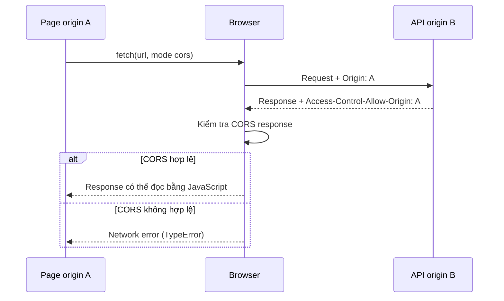

# Mode cors

## 1. Fetch mode cors là gì?

Fetch API cho phép JavaScript gửi request và nhận response thông qua `fetch()`. Thuộc tính `mode` của Request xác định browser áp dụng chế độ request nào đối với ranh giới origin. Với `mode: "cors"`, browser cho phép request tới origin khác theo cơ chế Cross-Origin Resource Sharing (CORS). JavaScript chỉ được đọc response nếu server đích trả các CORS response header phù hợp.

Ví dụ trang ở `https://app.example.com` gọi API ở `https://api.example.net`:

```js
const response = await fetch("https://api.example.net/profile", {
  mode: "cors"
});

if (!response.ok) {
  throw new Error("API trả HTTP " + response.status);
}

const profile = await response.json();
```

Trong ví dụ này, `app.example.com` và `api.example.net` khác origin. Browser gửi request theo CORS protocol. Server API phải cho phép origin của ứng dụng đọc response bằng `Access-Control-Allow-Origin`. Nếu kiểm tra CORS thất bại, JavaScript thường chỉ nhận một lỗi mạng tổng quát, dù request có thể đã tới server.

Đối với `fetch()`, mode mặc định thường là `cors`. Viết rõ `mode: "cors"` giúp tài liệu và code thể hiện ý định, nhưng không phải bước bắt buộc cho mọi lời gọi fetch.

CORS là cơ chế do browser thực thi để kiểm soát việc script đọc response cross-origin. Nó không phải cơ chế xác thực người dùng, không thay thế authorization ở server và cũng không phải firewall ngăn mọi request cross-origin.

### Kết quả học tập

Sau bài này, người học có thể:

1. Giải thích ý nghĩa của `Request.mode = "cors"` và quan hệ với origin.
2. Phân biệt same-origin request, CORS request và `no-cors`.
3. Hiểu simple/CORS-safelisted request và preflight `OPTIONS`.
4. Đọc request/response header trong CORS flow.
5. Cấu hình credentials và response header exposure đúng cách.
6. Xây dựng allowlist origin an toàn ở server.
7. Chẩn đoán CORS error, redirect, preflight và lỗi credentials.
8. Kiểm thử Fetch và XMLHttpRequest với hai origin local.

## 2. Origin và lý do cần CORS

Một origin được xác định bởi ba thành phần: scheme, host và port. Chỉ cần một thành phần khác là origin đã khác.

| URL A | URL B | Quan hệ |
| --- | --- | --- |
| `https://app.example.com/a` | `https://app.example.com/b` | Same-origin |
| `https://app.example.com` | `http://app.example.com` | Cross-origin: khác scheme |
| `https://app.example.com` | `https://api.example.com` | Cross-origin: khác host |
| `https://app.example.com:443` | `https://app.example.com:8443` | Cross-origin: khác port |
| `http://localhost:8000` | `http://localhost:8001` | Cross-origin: khác port |

Same-Origin Policy (SOP) hạn chế script ở một origin đọc dữ liệu từ origin khác. Nếu không có CORS, một website bất kỳ có thể thử dùng browser của người dùng truy cập API của website khác và đọc dữ liệu riêng tư trong phiên đăng nhập. CORS cho phép server chỉ định origin nào được phép đọc response cross-origin.

### 2.1. CORS là sự phối hợp giữa browser và server

CORS không phải request header mà JavaScript có thể tùy ý đặt để tự cấp quyền. Browser tự thêm `Origin` trong các request thuộc CORS protocol và kiểm tra response header do server trả về.

Luồng cơ bản:



Server không “gửi quyền” cho một script cụ thể. Nó trả metadata cho browser biết response có được expose cho origin gọi hay không. Browser là bên thực thi quy tắc đó.

### 2.2. Same-origin request không cần ACAO

Nếu trang `https://app.example.com` gọi `fetch("/api/profile")`, request cùng origin. Browser không cần `Access-Control-Allow-Origin` để JavaScript đọc response. CORS header không phải header bắt buộc cho mọi API.

Nếu cùng endpoint được gọi từ `https://admin.example.com`, request trở thành cross-origin và cần CORS policy phù hợp nếu JavaScript muốn đọc response.

### 2.3. Origin header

Ví dụ request:

```http
GET /profile HTTP/1.1
Host: api.example.net
Origin: https://app.example.com
Accept: application/json
```

`Origin` biểu diễn origin khởi tạo request. Nó không chứa path. JavaScript không được tự đặt `Origin` bằng Fetch headers vì đây là header do browser kiểm soát. Server không nên tin `Origin` như bằng chứng xác thực danh tính; nó chỉ là một tín hiệu để áp dụng policy CORS/CSRF.

## 3. Cách dùng mode cors trong Fetch

### 3.1. Request cross-origin cơ bản

```js
async function loadCatalog() {
  const response = await fetch("https://api.example.net/catalog", {
    method: "GET",
    mode: "cors"
  });

  if (!response.ok) {
    throw new Error("HTTP " + response.status);
  }

  return response.json();
}
```

Nếu server cho phép origin hiện tại, Fetch trả về Response có thể đọc. Nếu server không trả header CORS phù hợp, Promise reject với `TypeError` hoặc lỗi fetch tổng quát. JavaScript không được đọc status/body của response bị CORS chặn.

### 3.2. Mode cors không ép mọi request thành cross-origin

Nếu URL đích cùng origin, request vẫn được xử lý như same-origin. CORS chỉ trở thành vấn đề khi request đi qua ranh giới origin.

### 3.3. So sánh ba mode thường gặp

| Mode | Same-origin URL | Cross-origin URL | JavaScript đọc response |
| --- | --- | --- | --- |
| `cors` | Cho phép theo quy tắc same-origin | Gửi theo CORS; server cần cho phép | Có nếu CORS thành công |
| `same-origin` | Cho phép | Bị chặn | Chỉ với same-origin response |
| `no-cors` | Có thể gửi | Chỉ cho phép một tập request hạn chế; response opaque | Không đọc được body/header/status như response thường |

`no-cors` không phải cách bỏ qua CORS. Nó giới hạn method/header và trả về opaque response đối với request cross-origin. Nếu ứng dụng cần JSON từ API khác origin, hãy dùng `cors` và cấu hình server đúng.

Với request cross-origin ở mode `no-cors`, method bị giới hạn trong GET, HEAD hoặc POST và request header phải thuộc CORS-safelisted request-header set. JavaScript không thể dùng mode này để gửi tùy ý PUT/DELETE hoặc header Authorization rồi đọc response. Opaque response cũng không cho ứng dụng biết server trả HTTP 200, 403 hay 500.

### 3.4. Xem mode và response type

```js
const request = new Request("https://api.example.net/catalog", {
  mode: "cors"
});

console.log(request.mode); // "cors"

const response = await fetch(request);
console.log(response.type); // "cors" nếu CORS request thành công
```

Response same-origin thường có type `basic`; response cross-origin thành công qua CORS có type `cors`. Với `no-cors`, response cross-origin thường là `opaque`, có status hiển thị là `0` và không expose headers/body cho JavaScript.

## 4. CORS-safelisted request và preflight

Browser không gửi preflight cho mọi CORS request. Một số request đơn giản, đáp ứng các điều kiện safelist của Fetch/CORS, có thể được gửi trực tiếp. Những request không đáp ứng điều kiện này cần một request kiểm tra trước gọi là **preflight**.

### 4.1. Request đơn giản (CORS-safelisted)

Các điều kiện gồm method thuộc `GET`, `HEAD` hoặc `POST`, các request header nằm trong safelist và giá trị header đáp ứng giới hạn của chuẩn. Một số ví dụ thường gặp:

```js
fetch("https://api.example.net/search?q=browser", {
  method: "GET",
  mode: "cors"
});
```

```js
fetch("https://api.example.net/feedback", {
  method: "POST",
  mode: "cors",
  headers: {
    "Content-Type": "application/x-www-form-urlencoded"
  },
  body: "rating=5"
});
```

Các giá trị `Content-Type` thường thuộc safelist là `application/x-www-form-urlencoded`, `multipart/form-data` và `text/plain`, với điều kiện đáp ứng giới hạn cú pháp của chuẩn. `application/json` không thuộc nhóm này.

Tên “simple request” là cách gọi phổ biến trong tài liệu CORS. Trong chuẩn Fetch hiện nay, nên hiểu chính xác là request đáp ứng CORS-safelisted method/header/value constraints.

### 4.2. Khi nào browser gửi preflight?

Ví dụ request dùng `PUT`, `Content-Type: application/json` và header tùy chỉnh:

```js
await fetch("https://api.example.net/profile", {
  method: "PUT",
  mode: "cors",
  headers: {
    "Content-Type": "application/json",
    "X-Client-Version": "2"
  },
  body: JSON.stringify({ displayName: "Lan" })
});
```

Browser sẽ gửi preflight `OPTIONS` trước request thực tế. Preflight hỏi server xem origin, method và các header dự định dùng có được phép hay không.

### 4.3. Ví dụ preflight request

```http
OPTIONS /profile HTTP/1.1
Host: api.example.net
Origin: https://app.example.com
Access-Control-Request-Method: PUT
Access-Control-Request-Headers: content-type,x-client-version
```

Đây là request do browser tạo. Ứng dụng không cần tự viết một lệnh `OPTIONS` trước mỗi fetch.

### 4.4. Ví dụ preflight response

```http
HTTP/1.1 204 No Content
Access-Control-Allow-Origin: https://app.example.com
Access-Control-Allow-Methods: GET, POST, PUT
Access-Control-Allow-Headers: Content-Type, X-Client-Version
Access-Control-Max-Age: 600
Vary: Origin
```

Nếu preflight thành công, browser mới gửi request thực tế. Nếu không, request thực tế sẽ không được gửi trong luồng preflight đó và JavaScript nhận lỗi fetch.

### 4.5. Preflight không phải authorization

Preflight chỉ xác nhận browser có thể tiếp tục request theo CORS policy. Server vẫn phải xác thực session/token và kiểm tra quyền trên request thực tế. Không xem việc cho phép `PUT` trong preflight là cho phép mọi người dùng sửa mọi tài nguyên.

Đặc biệt, request CORS-safelisted có thể được gửi mà không có preflight. Nếu server dựa vào CORS như biện pháp CSRF duy nhất, một website khác vẫn có thể gửi một số request thay mặt người dùng dù không đọc được response. CSRF cần được bảo vệ riêng.

### 4.6. Preflight cache

`Access-Control-Max-Age` cho browser biết thời gian có thể cache kết quả preflight. Browser có thể áp dụng giới hạn tối đa riêng, nên giá trị lớn không bảo đảm được giữ nguyên. Preflight cache không giống HTTP response cache và không có nghĩa dữ liệu API được cache.

## 5. CORS response headers quan trọng

### 5.1. Access-Control-Allow-Origin

Header này cho biết origin nào được phép đọc response:

```http
Access-Control-Allow-Origin: https://app.example.com
```

Với tài nguyên công khai không dùng credentials, server có thể trả:

```http
Access-Control-Allow-Origin: *
```

Không dùng `*` cho response cần credentials. Nếu server chọn origin động từ allowlist, phải trả đúng origin được phép và thêm `Vary: Origin` để cache trung gian không dùng response của origin này cho origin khác.

### 5.2. Access-Control-Allow-Methods

```http
Access-Control-Allow-Methods: GET, POST, PUT, DELETE
```

Header này cho biết method được phép trong CORS/preflight. Nó không thay thế kiểm tra method ở application route. Server vẫn phải kiểm tra route, principal, CSRF và quyền nghiệp vụ.

### 5.3. Access-Control-Allow-Headers

```http
Access-Control-Allow-Headers: Content-Type, Authorization, X-Request-ID
```

Header này cho biết request header nào có thể được gửi trong request cần preflight. Chỉ cho phép các header mà client thực sự cần. Không mở rộng vô điều kiện chỉ để làm request hết lỗi. Với `Authorization`, nên liệt kê rõ tên header thay vì dựa vào wildcard.

Đặc biệt, `Authorization` là header cần được nêu rõ trong allowlist; không dựa vào `Access-Control-Allow-Headers: *` để cấp quyền cho nó. Khi request dùng credentials, wildcard trong các CORS allowlist header cũng không có semantics rộng như nhiều người thường giả định.

### 5.4. Access-Control-Max-Age

```http
Access-Control-Max-Age: 600
```

Giá trị tính bằng giây, là thời gian browser có thể cache kết quả preflight thành công. Thay đổi policy trên server có thể không có hiệu lực ngay với preflight đã được cache; khi kiểm thử, cân nhắc cache preflight và browser cache.

### 5.5. Access-Control-Expose-Headers

JavaScript chỉ đọc được một tập response header safelisted theo mặc định. Nếu cần đọc header tùy chỉnh, server phải expose:

```http
Access-Control-Expose-Headers: ETag, X-Request-ID, X-RateLimit-Remaining
```

Ví dụ:

```js
const response = await fetch("https://api.example.net/items", {
  mode: "cors"
});

console.log(response.headers.get("ETag"));
console.log(response.headers.get("X-Request-ID"));
```

Nếu thiếu `Access-Control-Expose-Headers`, header có thể xuất hiện trong DevTools nhưng `response.headers.get()` trả `null` cho JavaScript.

### 5.6. CORS header trên response lỗi

CORS được kiểm tra trên response mà browser định expose, không chỉ response 2xx. Nếu API trả 401, 403, 404 hoặc 500 nhưng thiếu `Access-Control-Allow-Origin` phù hợp, JavaScript có thể chỉ nhận lỗi CORS tổng quát thay vì đọc status và error body. Hãy áp dụng CORS policy nhất quán cho các response của route được phép, kể cả lỗi, đồng thời không làm lộ thông tin nhạy cảm trong error payload.

## 6. Credentials trong CORS

### 6.1. Fetch credentials mode

Fetch có thuộc tính `credentials` với ba giá trị:

| Giá trị | Hành vi |
| --- | --- |
| `omit` | Không gửi credentials và không dùng response credentials |
| `same-origin` | Gửi credentials cho same-origin request; đây là mặc định |
| `include` | Cho phép gửi credentials cả với cross-origin request, nếu các chính sách khác cho phép |

Credentials gồm cookie, HTTP authentication và TLS client certificate theo ngữ cảnh của Fetch. `mode: "cors"` và `credentials` giải quyết hai câu hỏi khác nhau: mode điều khiển CORS behavior; credentials điều khiển việc gửi credentials.

Ví dụ gọi API cần cookie cross-origin:

```js
const response = await fetch("https://api.example.net/account", {
  mode: "cors",
  credentials: "include"
});
```

### 6.2. Server phải cho phép credentials

Response cần có origin cụ thể và `Access-Control-Allow-Credentials: true`:

```http
Access-Control-Allow-Origin: https://app.example.com
Access-Control-Allow-Credentials: true
Vary: Origin
```

Không thể kết hợp `Access-Control-Allow-Origin: *` với request credentials mode `include` để expose response. Browser sẽ chặn response CORS nếu wildcard được dùng trong trường hợp này.

### 6.3. Cookie vẫn chịu SameSite và chính sách privacy

`credentials: "include"` không bảo đảm mọi cookie đều được gửi. Cookie còn chịu các điều kiện như:

- `Secure`, `Domain`, `Path` và `SameSite`.
- Cookie có hết hạn hoặc bị xóa không.
- Chính sách chặn third-party cookie của browser.
- Storage partitioning và privacy controls của nền tảng.
- Cookie có thực sự thuộc host nhận request không.

Hai origin khác nhau có thể vẫn same-site. Ngược lại, request cross-site có thể bị hạn chế cookie dù fetch đã dùng `credentials: "include"`.

### 6.4. Không phản chiếu Origin một cách mù quáng

Một cấu hình nguy hiểm là luôn lấy bất kỳ giá trị `Origin` nào rồi trả lại nguyên giá trị đó trong `Access-Control-Allow-Origin`, đồng thời bật credentials. Điều này có thể cho website không tin cậy đọc dữ liệu riêng tư của người dùng.

Dùng allowlist origin chính xác, bao gồm scheme, host và port. Không dùng kiểm tra chuỗi kiểu `endsWith("example.com")` nếu không phân tích ranh giới hostname; `evil-example.com` hoặc `example.com.attacker.test` có thể vượt qua logic yếu.

## 7. CORS và XMLHttpRequest

XMLHttpRequest không có tùy chọn `mode` giống Fetch. Browser tự áp dụng CORS khi XHR gửi request cross-origin. Với request cần credentials cross-origin, dùng `withCredentials = true`.

```js
const xhr = new XMLHttpRequest();

xhr.open("GET", "https://api.example.net/profile");
xhr.withCredentials = true;

xhr.onload = () => {
  if (xhr.status >= 200 && xhr.status < 300) {
    console.log(xhr.responseText);
  } else {
    console.error("HTTP", xhr.status);
  }
};

xhr.onerror = () => {
  console.error("Network error hoặc CORS failure");
};

xhr.send();
```

Mặc định `withCredentials` là `false` cho cross-origin XHR. Nếu không cần cookie/HTTP authentication cross-origin, giữ mặc định. Nếu bật, server phải trả `Access-Control-Allow-Credentials: true` và `Access-Control-Allow-Origin` cụ thể, không phải `*`.

### 7.1. So sánh Fetch và XHR

| Khả năng | Fetch | XMLHttpRequest |
| --- | --- | --- |
| Chọn mode | `RequestInit.mode` như `cors`, `same-origin`, `no-cors` | Không có `mode` property tương đương |
| CORS cross-origin | Browser tự thực thi | Browser tự thực thi |
| Credentials cross-origin | `credentials: "include"` | `withCredentials = true` |
| Đọc response | Promise và Response API | `response`, `responseText`, event |
| Lỗi CORS | Promise reject, thường là `TypeError` | `error` event; chi tiết bị giới hạn |
| Preflight | Browser tự gửi khi cần | Browser tự gửi khi cần |

CORS là policy của browser cho cả Fetch và XHR. Đổi từ Fetch sang XHR không giải quyết lỗi CORS nếu server vẫn không cho phép origin.

## 8. Những giới hạn và hiểu nhầm quan trọng

### 8.1. CORS không ngăn server nhận request

Với request đơn giản, browser có thể gửi request trước rồi mới kiểm tra response. Nếu response không có ACAO phù hợp, JavaScript không đọc được response, nhưng hành động phía server có thể đã xảy ra.

Do đó, không dựa vào CORS để chống CSRF. Dùng CSRF token, kiểm tra `Origin`/`Referer` theo thiết kế, `SameSite` cookie và Fetch Metadata phù hợp.

### 8.2. CORS không thay authentication/authorization

Một origin được CORS allow không có nghĩa mọi người dùng ở origin đó có quyền truy cập mọi record. Server phải kiểm tra session/token, tenant, resource ownership và quyền nghiệp vụ trên từng request.

### 8.3. CORS không phải cách để đọc response opaque

`no-cors` có thể cho phép một số request hạn chế, nhưng response cross-origin là opaque. JavaScript không đọc được status/body/headers. Đừng dùng `no-cors` cho API JSON hoặc để né cấu hình CORS.

### 8.4. Redirect có thể làm CORS phức tạp

Nếu API redirect sang origin khác, response cuối và chuỗi redirect vẫn phải tuân theo quy tắc Fetch/CORS. Request đã preflight có thể gặp hạn chế khi redirect, tùy loại request và browser. API nên tránh redirect không cần thiết cho endpoint CORS; dùng URL cuối ổn định và kiểm tra redirect chain trong Network.

### 8.5. Origin null

Một số document có thể tạo opaque origin và gửi `Origin: null`, ví dụ một số sandboxed iframe hoặc tài liệu có scheme đặc biệt. Không thêm `null` vào allowlist rộng chỉ để sửa lỗi. Chỉ hỗ trợ trường hợp có yêu cầu cụ thể và đã phân tích threat model.
## 9. Cấu hình CORS phía server

### 9.1. Nguyên tắc allowlist

Một policy tốt cần:

- So khớp origin chính xác theo scheme, host và port.
- Chỉ cho phép method cần thiết.
- Chỉ cho phép request header cần thiết.
- Chỉ bật credentials khi thực sự cần.
- Expose đúng response header mà client cần.
- Trả Vary: Origin nếu response phụ thuộc Origin.
- Xử lý preflight OPTIONS mà không yêu cầu session cookie, vì preflight thường không mang credentials.
- Vẫn xác thực và authorize request thực tế.

Không dùng Access-Control-Allow-Origin wildcard cùng credentials. Không phản chiếu Origin tùy ý. Không coi preflight thành công là quyền truy cập dữ liệu.

### 9.2. Node.js HTTP server tối giản

Ví dụ sau minh họa allowlist và preflight cho một API. Trong production, kết hợp với authentication, authorization, CSRF và logging phù hợp.

```js
const http = require("node:http");

const allowedOrigins = new Set([
  "http://127.0.0.1:8000",
  "https://app.example.com"
]);

function applyCors(req, res) {
  const origin = req.headers.origin;

  if (!origin || !allowedOrigins.has(origin)) {
    return false;
  }

  res.setHeader("Access-Control-Allow-Origin", origin);
  res.setHeader("Vary", "Origin");
  res.setHeader("Access-Control-Allow-Methods", "GET, POST, PUT, OPTIONS");
  res.setHeader(
    "Access-Control-Allow-Headers",
    "Content-Type, X-Client-Version"
  );
  res.setHeader("Access-Control-Expose-Headers", "ETag, X-Request-ID");

  return true;
}

http.createServer((req, res) => {
  const allowed = applyCors(req, res);

  if (req.method === "OPTIONS") {
    if (!allowed) {
      res.writeHead(403);
      res.end();
      return;
    }

    res.writeHead(204);
    res.end();
    return;
  }

  if (req.url === "/api/message" && req.method === "GET") {
    if (!allowed) {
      res.writeHead(403);
      res.end("Origin not allowed");
      return;
    }

    res.writeHead(200, {
      "Content-Type": "application/json; charset=utf-8"
    });
    res.end(JSON.stringify({ message: "CORS request succeeded" }));
    return;
  }

  if (req.url === "/api/message" && req.method === "PUT") {
    if (!allowed) {
      res.writeHead(403);
      res.end("Origin not allowed");
      return;
    }

    let body = "";
    req.on("data", chunk => {
      body += chunk;
      if (body.length > 10000) req.destroy();
    });

    req.on("end", () => {
      res.writeHead(200, {
        "Content-Type": "application/json; charset=utf-8",
        "ETag": '"message-v2"',
        "X-Request-ID": "demo-request-001"
      });
      res.end(JSON.stringify({ saved: true, received: body }));
    });
    return;
  }

  res.writeHead(404);
  res.end("Not found");
}).listen(8001, "127.0.0.1", () => {
  console.log("CORS API: http://127.0.0.1:8001");
});
```

Ví dụ không bật credentials. Trong hệ thống thật, không dùng kiểm tra CORS thay cho authorization; route PUT cần xác thực người dùng, kiểm tra quyền sửa record và bảo vệ CSRF nếu cookie được gửi tự động.

### 9.3. Express middleware

Ví dụ với Express:

```js
const allowedOrigins = new Set([
  "https://app.example.com",
  "https://admin.example.com"
]);

function corsAllowlist(req, res, next) {
  const origin = req.get("Origin");

  if (origin && allowedOrigins.has(origin)) {
    res.set("Access-Control-Allow-Origin", origin);
    res.vary("Origin");
    res.set("Access-Control-Allow-Methods", "GET, POST, PUT, OPTIONS");
    res.set(
      "Access-Control-Allow-Headers",
      "Content-Type, Authorization, X-Request-ID"
    );
    res.set("Access-Control-Expose-Headers", "ETag, X-Request-ID");
  }

  if (req.method === "OPTIONS") {
    if (!origin || !allowedOrigins.has(origin)) {
      return res.sendStatus(403);
    }
    return res.sendStatus(204);
  }

  next();
}

app.use(corsAllowlist);
```

Middleware cần chạy trước middleware có thể từ chối preflight vì thiếu cookie. Tuy nhiên, request thực tế vẫn phải qua authentication và authorization. Không bỏ qua xác thực cho GET/POST/PUT chỉ vì origin được allow.

### 9.4. Lưu ý khi cấu hình reverse proxy

Reverse proxy hoặc CDN có thể thêm, xóa hoặc ghi đè response header. Hãy kiểm tra response cuối mà browser nhận được. Tránh để proxy và application cùng thêm nhiều giá trị Access-Control-Allow-Origin khác nhau. Nếu có nhiều origin được phép, dùng allowlist rõ ràng và bảo đảm cache phân biệt response theo Origin bằng Vary: Origin.

## 10. Chẩn đoán CORS bằng DevTools

### 10.1. Network panel

Mở DevTools → Network, bật Preserve log và gửi lại request. Kiểm tra:

1. Request URL, scheme, host và port.
2. Request header Origin.
3. Có request OPTIONS preflight không.
4. Access-Control-Request-Method và Access-Control-Request-Headers.
5. Status của preflight.
6. Response header Access-Control-Allow-Origin.
7. Access-Control-Allow-Methods và Access-Control-Allow-Headers.
8. Access-Control-Allow-Credentials nếu dùng credentials.
9. Response header cuối của request thực tế.
10. Redirect chain và response cuối.

### 10.2. Console

Browser thường ghi thông báo cụ thể hơn JavaScript, ví dụ thiếu ACAO, wildcard không hợp lệ khi credentials được bật hoặc method/header không được phép. Đọc Console cùng Network; không chỉ nhìn TypeError: Failed to fetch.

### 10.3. Phân biệt các nhóm lỗi

| Dấu hiệu | Nguyên nhân thường gặp | Cách kiểm tra |
| --- | --- | --- |
| Không có OPTIONS, request GET bị CORS block | Response GET thiếu ACAO hoặc origin không được allow | Kiểm tra response thực tế |
| OPTIONS trả 401/403 | Auth middleware chặn preflight hoặc origin không hợp lệ | Cho phép preflight policy trước auth; xác minh allowlist |
| Preflight trả 204 nhưng actual request không có ACAO | Header chỉ được thêm cho OPTIONS | Thêm CORS header vào response thực tế |
| Access-Control-Allow-Origin wildcard với credentials include | Wildcard không hợp lệ cho credentialed response | Trả origin cụ thể và ACAC true |
| Method/header bị từ chối | ACA-Methods/ACA-Headers thiếu giá trị cần thiết | So sánh với Access-Control-Request-* |
| JavaScript không đọc được ETag | Header chưa được expose | Thêm Access-Control-Expose-Headers |
| Request HTTPS bị mixed content block | URL đích HTTP từ secure page | Sửa endpoint sang HTTPS; CORS không xử lý |
| Server log có request nhưng JavaScript báo CORS | Server đã xử lý nhưng response không được expose | Kiểm tra response CORS và tác động nghiệp vụ |
| Request bị redirect sang host khác | Origin/response cuối không thỏa CORS | Kiểm tra từng hop và URL đích cuối |

### 10.4. Lỗi CORS trông giống lỗi mạng

JavaScript thường không được biết chi tiết vì sao browser chặn response. fetch() reject với lỗi tổng quát; cần dùng DevTools, server log và kiểm tra endpoint để xác định nguyên nhân. Không hiển thị nguyên văn thông tin nội bộ hoặc header nhạy cảm từ server cho người dùng cuối.

## 11. Thực hành: Fetch mode cors giữa hai origin local

Lab tạo hai server:

- Trang frontend: http://127.0.0.1:8000.
- API: http://127.0.0.1:8001.

Khác port nghĩa là khác origin. Lab cho phép origin frontend, kiểm tra GET CORS request và preflight cho PUT với JSON/custom header.

### 11.1. Tạo API server

Tạo file api-server.js:

```js
const http = require("node:http");

const allowedOrigins = new Set(["http://127.0.0.1:8000"]);

function setCors(req, res) {
  const origin = req.headers.origin;

  if (!origin || !allowedOrigins.has(origin)) {
    return false;
  }

  res.setHeader("Access-Control-Allow-Origin", origin);
  res.setHeader("Vary", "Origin");
  res.setHeader("Access-Control-Allow-Methods", "GET, PUT, OPTIONS");
  res.setHeader("Access-Control-Allow-Headers", "Content-Type, X-Client-Tag");
  res.setHeader("Access-Control-Expose-Headers", "X-Request-ID, ETag");
  return true;
}

http.createServer((req, res) => {
  const allowed = setCors(req, res);

  if (req.method === "OPTIONS") {
    res.writeHead(allowed ? 204 : 403);
    res.end();
    return;
  }

  if (!allowed) {
    res.writeHead(403);
    res.end("Origin not allowed");
    return;
  }

  if (req.url === "/api/message" && req.method === "GET") {
    res.writeHead(200, {
      "Content-Type": "application/json; charset=utf-8",
      "X-Request-ID": "cors-get-001",
      "ETag": '"message-v1"'
    });
    res.end(JSON.stringify({ message: "GET CORS thành công" }));
    return;
  }

  if (req.url === "/api/message" && req.method === "PUT") {
    let body = "";

    req.on("data", chunk => {
      body += chunk;
      if (body.length > 10000) req.destroy();
    });

    req.on("end", () => {
      res.writeHead(200, {
        "Content-Type": "application/json; charset=utf-8",
        "X-Request-ID": "cors-put-001",
        "ETag": '"message-v2"'
      });
      res.end(JSON.stringify({
        saved: true,
        received: JSON.parse(body || "{}")
      }));
    });
    return;
  }

  res.writeHead(404);
  res.end("Not found");
}).listen(8001, "127.0.0.1", () => {
  console.log("API listening at http://127.0.0.1:8001");
});
```

### 11.2. Tạo frontend server

Tạo file app-server.js:

```js
const http = require("node:http");

const html = String.raw`<!doctype html>
<meta charset="utf-8">
<title>Fetch mode cors lab</title>
<h1>Fetch mode cors lab</h1>
<button id="get" type="button">GET CORS</button>
<button id="put" type="button">PUT with preflight</button>
<pre id="result">Chưa chạy</pre>
<script>
  const api = "http://127.0.0.1:8001/api/message";
  const result = document.querySelector("#result");

  document.querySelector("#get").addEventListener("click", async () => {
    try {
      const response = await fetch(api, { mode: "cors" });
      const data = await response.json();

      result.textContent = JSON.stringify({
        type: response.type,
        status: response.status,
        requestId: response.headers.get("X-Request-ID"),
        etag: response.headers.get("ETag"),
        data
      }, null, 2);
    } catch (error) {
      result.textContent = error.name + ": " + error.message;
    }
  });

  document.querySelector("#put").addEventListener("click", async () => {
    try {
      const response = await fetch(api, {
        method: "PUT",
        mode: "cors",
        headers: {
          "Content-Type": "application/json",
          "X-Client-Tag": "cors-lab"
        },
        body: JSON.stringify({ note: "cors test" })
      });

      result.textContent = JSON.stringify({
        type: response.type,
        status: response.status,
        data: await response.json()
      }, null, 2);
    } catch (error) {
      result.textContent = error.name + ": " + error.message;
    }
  });
</script>`;

http.createServer((_req, res) => {
  res.writeHead(200, {
    "Content-Type": "text/html; charset=utf-8",
    "Cache-Control": "no-store"
  });
  res.end(html);
}).listen(8000, "127.0.0.1", () => {
  console.log("App listening at http://127.0.0.1:8000");
});
```

### 11.3. Chạy lab

Mở hai terminal tại thư mục chứa file:

```powershell
node api-server.js
node app-server.js
```

Mở http://127.0.0.1:8000.

- Nhấn GET CORS: request GET được gửi trực tiếp; response có type cors.
- Nhấn PUT with preflight: browser gửi OPTIONS trước, sau đó mới gửi PUT nếu preflight hợp lệ.
- Trong Network, kiểm tra OPTIONS có Access-Control-Request-Method: PUT và header content-type, x-client-tag.
- Kiểm tra response OPTIONS có ACAO, ACA-Methods và ACA-Headers phù hợp.
- Kiểm tra response PUT có ACAO và JavaScript đọc được JSON.
- Xóa origin khỏi allowlist rồi thử lại; browser không expose response cho frontend.
- Xóa Access-Control-Expose-Headers rồi thử GET; X-Request-ID và ETag không còn đọc được qua JavaScript dù vẫn có thể thấy trong Network.

Lab không bật credentials. Để thử credentialed CORS, cần cấu hình cookie hợp lệ và server trả origin cụ thể cùng Access-Control-Allow-Credentials: true; không thay wildcard bằng cách phản chiếu mọi origin.

## 12. Ma trận kiểm thử

| Mã | Trường hợp | Kết quả mong muốn |
| --- | --- | --- |
| CORS-01 | Same-origin fetch với mode cors | Đọc response, không cần ACAO |
| CORS-02 | Cross-origin GET được allow | Response type cors và JavaScript đọc được |
| CORS-03 | Cross-origin response thiếu ACAO | Fetch reject; JavaScript không đọc body |
| CORS-04 | Origin không nằm trong allowlist | Server không expose response |
| CORS-05 | Request GET safelisted | Không cần preflight trong điều kiện header/value hợp lệ |
| CORS-06 | Request PUT | Browser gửi OPTIONS trước |
| CORS-07 | Content-Type application/json | Thường kích hoạt preflight |
| CORS-08 | Custom request header | Header phải được cho phép trong ACA-Headers |
| CORS-09 | Preflight OPTIONS trả 401 | Kiểm tra middleware auth đang chặn preflight |
| CORS-10 | ACA-Methods thiếu PUT | Preflight thất bại; PUT không được gửi |
| CORS-11 | ACA-Headers thiếu X-Client-Tag | Preflight thất bại |
| CORS-12 | Credentials include với ACAO wildcard | Browser chặn expose response |
| CORS-13 | Credentials include, ACAO cụ thể và ACAC true | CORS có thể thành công nếu cookie/policy khác cho phép |
| CORS-14 | Third-party cookie bị browser chặn | Include không bảo đảm cookie được gửi |
| CORS-15 | Custom response header chưa expose | JavaScript đọc header trả null |
| CORS-16 | no-cors cross-origin | Response opaque; không đọc được status/body |
| CORS-17 | same-origin mode gọi cross-origin | Request bị chặn |
| CORS-18 | API redirect sang origin khác | Kiểm tra CORS trên redirect/final response |
| CORS-19 | Origin null | Không allow rộng; chỉ xử lý nếu có use case được đánh giá |
| CORS-20 | Dynamic ACAO nhưng thiếu Vary Origin | Kiểm tra nguy cơ cache dùng nhầm response giữa origin |
| CORS-21 | Simple request gây thay đổi trạng thái | CSRF defense vẫn cần dù response không đọc được |
| CORS-22 | XHR cross-origin với withCredentials | Server cần ACAO cụ thể và ACAC true |

## 13. Những sai lầm thường gặp

| Nhận định sai | Cách hiểu đúng |
| --- | --- |
| Thêm mode cors tự cấp quyền cross-origin | Server phải trả CORS response header phù hợp |
| CORS chặn mọi request từ website khác | Simple request có thể được gửi; CORS chủ yếu kiểm soát việc đọc response |
| CORS thay thế CSRF protection | CSRF cần token/origin/SameSite/Fetch Metadata phù hợp |
| no-cors giúp đọc API bị CORS chặn | Response opaque, JavaScript không đọc được |
| Access-Control-Allow-Origin wildcard luôn an toàn | Không dùng wildcard cho credentialed response |
| credentials include đảm bảo cookie được gửi | SameSite và third-party cookie policy vẫn áp dụng |
| Preflight thành công nghĩa người dùng được phép sửa dữ liệu | Server vẫn phải xác thực và authorize request thật |
| Chỉ thêm ACAO vào OPTIONS là đủ | Response thực tế cũng cần header CORS phù hợp |
| CORS chỉ có ở Fetch | XMLHttpRequest cũng chịu CORS |
| Chuyển fetch sang XHR sửa được CORS | Browser thực thi cùng policy cho cả hai |
| CORS error đồng nghĩa server không nhận request | Request simple có thể đã được xử lý trước khi response bị chặn |
| Origin là bằng chứng xác thực | Origin chỉ là tín hiệu policy; không thay authentication |
| Có thể dùng regex hostname đơn giản | So khớp origin chính xác, không cho phép domain giả dạng |
| Mọi response header đều đọc được từ JS | Header tùy chỉnh cần Access-Control-Expose-Headers |

## 14. Checklist triển khai mode cors

- [ ] Xác định chính xác origin frontend và API (scheme, host, port).
- [ ] Dùng mode cors cho request cross-origin cần đọc response.
- [ ] Không dùng no-cors như cách sửa lỗi CORS.
- [ ] Chỉ cho phép origin nằm trong allowlist chính xác.
- [ ] Trả ACAO trên cả preflight và response thực tế khi cần.
- [ ] Cho phép method/header tối thiểu và xử lý OPTIONS trước middleware yêu cầu credentials.
- [ ] Không dùng ACAO wildcard khi credentials mode là include.
- [ ] Bật ACAC chỉ khi cần credentials; xác minh cookie SameSite/third-party policy.
- [ ] Thêm Vary: Origin khi ACAO phụ thuộc Origin.
- [ ] Expose đúng response header client cần đọc.
- [ ] Giữ authentication, authorization và CSRF defense độc lập với CORS.
- [ ] Kiểm tra redirect, CDN, reverse proxy và duplicate CORS headers.
- [ ] Dùng DevTools Network/Console để kiểm tra preflight và response cuối.
- [ ] Kiểm thử cả Fetch và XMLHttpRequest trên browser mục tiêu.

### Ghi nhớ

**mode: cors cho phép Fetch thực hiện request cross-origin theo CORS protocol; server quyết định response có được browser expose cho origin gọi hay không.** Request safelisted có thể được gửi trực tiếp, còn request cần preflight phải được server cho phép method và headers trước khi browser gửi request thật. Credentials cần cấu hình origin cụ thể và Access-Control-Allow-Credentials: true, đồng thời cookie vẫn chịu SameSite và privacy policy. CORS không thay authentication, authorization hay CSRF defense. Hãy dùng allowlist origin chính xác, kiểm tra cả OPTIONS lẫn response cuối và xác minh hành vi bằng DevTools.
