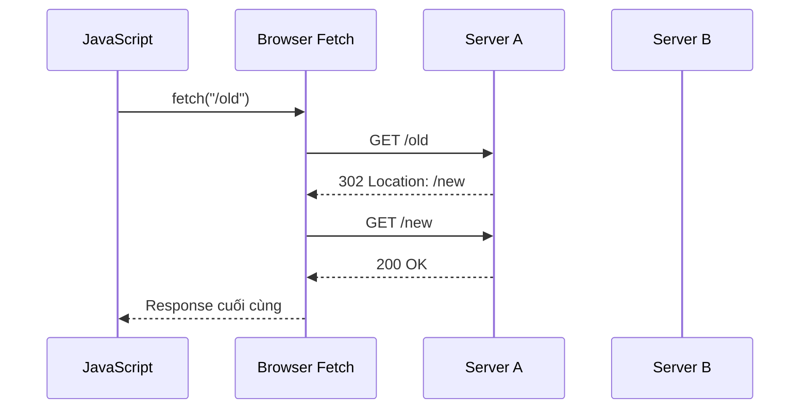

# Request redirect mode: kiểm soát cách Fetch xử lý chuyển hướng HTTP

Khi một endpoint trả response chuyển hướng HTTP, trình duyệt có thể tự gửi request tiếp theo tới URL trong header Location. Fetch API cho phép ứng dụng chọn hành vi này bằng thuộc tính redirect của Request, với ba giá trị: follow, error và manual. Lựa chọn này ảnh hưởng tới việc request có được tự động đi tiếp hay không và JavaScript có nhận được response cuối cùng hay một kết quả bị giới hạn.

Redirect mode thường bị nhầm với request mode như cors/no-cors, credentials mode hoặc thao tác điều hướng trang. Đây là các cơ chế riêng. redirect điều khiển cách Fetch xử lý response chuyển hướng; nó không bỏ qua Same-Origin Policy, CORS, cookie policy hay kiểm tra quyền ở server.

Bài học thuộc chương **Fetch và XMLHttpRequest**, theo đề bài **Request redirect mode**, trong phạm vi **SECURITY_APPLICATION_SECURITY_BROWSER_SECURITY**: phân tích ranh giới bảo mật giữa trình duyệt, origin, cookie và ứng dụng web để hiểu Same-Origin Policy, CORS và các cơ chế cách ly; thực hành phòng vệ XSS, CSRF, clickjacking bằng CSP, Trusted Types, security headers và kiểm chứng hành vi thực tế.

## 1. Mục tiêu học tập

Sau bài học, người học có thể:

1. Giải thích redirect HTTP và vai trò của header Location.
2. Phân biệt follow, error và manual trong Fetch API.
3. Thiết lập redirect mode bằng fetch() và Request().
4. Đọc response.redirected, response.url và hiểu giới hạn của response opaqueredirect.
5. Phân biệt redirect mode với request mode, credentials mode và navigation.
6. Mô tả ảnh hưởng của các status 301, 302, 303, 307 và 308 lên method/body.
7. Giải thích redirect mode tương tác với CORS, credentials và cross-origin redirect như thế nào.
8. Hiểu vì sao XMLHttpRequest không có tùy chọn redirect mode tương đương.
9. Nhận diện open redirect, redirect downgrade và lỗi redirect trong luồng xác thực/API.
10. Kiểm chứng hành vi bằng DevTools và một endpoint lab do mình kiểm soát.

## 2. Redirect HTTP hoạt động như thế nào?

Một redirect là response HTTP báo cho client rằng tài nguyên hoặc thao tác cần được chuyển tới một URL khác. Server thường gửi status 3xx cùng header Location.

Ví dụ response:

```http
HTTP/1.1 302 Found
Location: /account/current
Cache-Control: no-store
```

Nếu request ban đầu là GET tới /account, browser nhận 302 và có thể gửi request tiếp theo tới /account/current. URL trong Location có thể là đường dẫn tương đối hoặc URL tuyệt đối. Với URL tương đối, client phân giải nó dựa trên URL của response redirect.

### Một redirect chain



Trong chế độ follow, Fetch tự xử lý redirect chain và JavaScript thường nhận response cuối cùng. JavaScript không nhận từng response 3xx như một chuỗi callback riêng.

### Redirect khác với điều hướng trang

Có hai tình huống cần phân biệt:

- **Fetch request:** JavaScript gọi fetch() hoặc XMLHttpRequest để lấy dữ liệu. Redirect mode của Request áp dụng cho Fetch API.
- **Navigation:** người dùng bấm link, submit form hoặc trang gán location để điều hướng document. Browser quản lý redirect của navigation theo quy tắc điều hướng riêng.

Không thể đặt redirect mode cho một thẻ a hoặc một lần gán location bằng cách thêm tùy chọn fetch. Nếu cần kiểm soát điều hướng, phải thiết kế URL và luồng navigation phù hợp.

## 3. Ba giá trị của Request.redirect

Fetch định nghĩa ba giá trị:

| Giá trị | Hành vi | Kết quả JavaScript thường thấy |
| --- | --- | --- |
| follow | Tự động theo redirect và xử lý response tiếp theo. Đây là mặc định. | Nhận response cuối cùng nếu toàn bộ chuỗi hợp lệ. |
| error | Nếu gặp redirect, Fetch kết thúc bằng network error. | Promise fetch reject, thường quan sát được TypeError. |
| manual | Không tự động theo redirect theo cách follow. Browser trả response lọc opaqueredirect cho redirect response. | Không đọc được status, Location header hoặc body của redirect response. |

Thuộc tính Request.redirect là read-only khi đọc từ một Request đã tạo. Chọn giá trị bằng RequestInit khi gọi fetch() hoặc tạo Request.

### 3.1. follow

follow là mặc định. Ví dụ:

```js
const response = await fetch('/legacy-profile');

console.log({
  status: response.status,
  redirected: response.redirected,
  finalUrl: response.url
});

const data = await response.json();
console.log(data);
```

Nếu /legacy-profile trả redirect hợp lệ tới /api/profile, browser theo redirect và response cuối cùng có thể là 200. response.redirected cho biết request đã đi qua redirect; response.url cho biết URL cuối cùng của response khi thông tin đó được phép hiển thị.

follow phù hợp với nhiều request thông thường, chẳng hạn endpoint cũ chuyển sang endpoint mới hoặc URL tài nguyên được chuẩn hóa. Tuy nhiên, không nên mặc định mọi endpoint API đều được phép redirect.

### 3.2. error

error yêu cầu Fetch thất bại nếu response gặp redirect:

```js
try {
  const response = await fetch('/api/profile', {
    redirect: 'error'
  });

  const profile = await response.json();
  renderProfile(profile);
} catch (error) {
  console.error('Request không hoàn tất:', error);
  showMessage('Không thể tải dữ liệu theo endpoint đã cấu hình.');
}
```

Nếu server trả 301, 302, 303, 307 hoặc 308, fetch() reject thay vì tự gửi request tới URL tiếp theo. JavaScript không nhận được một Response thông thường để đọc status hoặc Location.

Chế độ này hữu ích khi API contract yêu cầu endpoint trả response trực tiếp, ví dụ endpoint JSON không được chuyển sang trang đăng nhập HTML hoặc một host khác. Nó giúp phát hiện redirect ngoài dự kiến bằng cách làm request thất bại rõ ràng.

**Giới hạn:** request ban đầu vẫn được gửi tới endpoint. error chỉ ngăn Fetch tiếp tục theo redirect sau khi nhận redirect response; nó không ngăn request đầu tiên và không thay thế xác thực, authorization hay CSRF protection.

### 3.3. manual

manual cho phép ứng dụng yêu cầu chế độ xử lý redirect thủ công:

```js
const response = await fetch('/lab/redirect', {
  redirect: 'manual'
});

console.log({
  type: response.type,
  status: response.status,
  location: response.headers.get('Location')
});
```

Trong browser, nếu request gặp redirect, response thường là một **opaqueredirect filtered response**. Các đặc điểm quan trọng:

- response.type là opaqueredirect.
- response.status là 0.
- Header bị che, nên đọc Location trả về null.
- Body không thể đọc và thường có giá trị null.

Đây là giới hạn bảo mật có chủ đích. JavaScript trong trang không được cung cấp trực tiếp URL redirect của một response theo cách có thể làm lộ thông tin cross-origin hoặc phá vỡ chính sách Fetch.

Nếu request không gặp redirect, manual không có nghĩa mọi response đều biến thành opaqueredirect; response thông thường vẫn có thể được trả về theo request mode và quy tắc lọc response tương ứng.

### Manual không phải cách đọc Location

Một hiểu lầm phổ biến là đặt redirect: manual rồi đọc:

```js
const response = await fetch('/lab/redirect', {
  redirect: 'manual'
});

const destination = response.headers.get('Location');
```

Trong browser, cách này không cung cấp URL đích của redirect. Với response opaqueredirect, header Location bị ẩn. Nếu ứng dụng cần biết URL đích để hiển thị hoặc quyết định, hãy thiết kế endpoint API riêng trả dữ liệu đích đã được server xác thực và cho phép đọc theo CORS phù hợp; đừng dựa vào redirect response bị lọc.

## 4. Cấu hình redirect mode

### Truyền trực tiếp vào fetch()

```js
const response = await fetch('/api/data', {
  method: 'GET',
  redirect: 'follow'
});
```

Nếu không truyền redirect, mặc định là follow.

### Tạo Request trước

```js
const request = new Request('/api/data', {
  method: 'GET',
  credentials: 'same-origin',
  redirect: 'error'
});

console.log(request.redirect); // error

const response = await fetch(request);
```

Request có thể được tạo một lần với các thuộc tính cần thiết rồi truyền cho fetch(). Thuộc tính redirect được cố định theo cấu hình lúc tạo Request; muốn thay đổi, tạo Request mới hoặc truyền một RequestInit phù hợp.

### Kiểm tra cấu hình hiện tại

```js
const request = new Request('/api/report', {
  redirect: 'manual'
});

console.log(request.redirect);
```

Kết quả là giá trị redirect đã cấu hình. Việc đọc thuộc tính này không dự đoán server có redirect hay không và không cho biết URL đích.

## 5. Các status redirect và method/body

Không phải mọi status 3xx đều có cùng ý nghĩa với method và body. Fetch áp dụng quy tắc chuyển method khi theo redirect:

| Status | Ý nghĩa thường gặp | Quy tắc method trong Fetch |
| --- | --- | --- |
| 301 Moved Permanently | Tài nguyên được chuyển vĩnh viễn. | Nếu request là POST, method được đổi thành GET và body bị loại bỏ. |
| 302 Found | Chuyển hướng tạm thời. | Nếu request là POST, method được đổi thành GET và body bị loại bỏ. |
| 303 See Other | Chuyển tới tài nguyên khác để lấy kết quả. | Method khác GET/HEAD được đổi thành GET và body bị loại bỏ. |
| 307 Temporary Redirect | Chuyển hướng tạm thời, giữ method. | Giữ method và body. |
| 308 Permanent Redirect | Chuyển hướng vĩnh viễn, giữ method. | Giữ method và body. |

Các quy tắc trên mô tả hành vi Fetch khi follow redirect. Client có thể không theo redirect nếu redirect mode là error/manual hoặc có lỗi khác.

### Vì sao 307/308 quan trọng với request ghi?

Giả sử client gửi:

```js
await fetch('/api/submit', {
  method: 'POST',
  headers: {
    'Content-Type': 'application/json'
  },
  body: JSON.stringify({ item: 'demo' }),
  redirect: 'follow'
});
```

Nếu endpoint trả 307 hoặc 308, Fetch giữ POST và body khi gửi tới URL mới. Với 301/302, POST được chuyển thành GET; với 303, method không phải GET/HEAD được chuyển thành GET.

Nếu body là stream không thể phát lại, Fetch có thể không thực hiện được redirect cần gửi lại body và request sẽ thất bại. Không thiết kế API ghi dựa vào giả định mọi request body đều có thể replay.

### Không dùng redirect như cơ chế retry giao dịch

Server có thể đã nhận và xử lý request đầu tiên trước khi gửi redirect response. Redirect không chứng minh thao tác ban đầu chưa xảy ra. Với thao tác tạo đơn, thanh toán hoặc cập nhật dữ liệu, cần idempotency key và xác nhận trạng thái từ server.

## 6. Redirect mode khác các Request mode khác

Request có nhiều thuộc tính điều khiển các khía cạnh khác nhau:

| Thuộc tính | Giá trị ví dụ | Câu hỏi nó trả lời |
| --- | --- | --- |
| mode | cors, same-origin, no-cors | Request được phép đi tới origin nào và response được lọc ra sao? |
| redirect | follow, error, manual | Xử lý response redirect thế nào? |
| credentials | omit, same-origin, include | Khi nào gửi credential như cookie và xử lý credential trong response? |
| cache | default, no-store, reload, force-cache | Browser tương tác với HTTP cache thế nào? |
| method | GET, POST, PUT, DELETE | Request sử dụng HTTP method nào? |

Ví dụ:

```js
const response = await fetch('https://api.example.test/profile', {
  mode: 'cors',
  credentials: 'include',
  redirect: 'error',
  cache: 'no-store'
});
```

Trong ví dụ này:

- mode cors áp dụng quy tắc CORS cho request cross-origin.
- credentials include yêu cầu Fetch dùng credential theo quy tắc cookie/credential của browser.
- redirect error làm request thất bại nếu gặp redirect.
- cache no-store điều khiển tương tác với HTTP cache theo Fetch cache mode.

Các thuộc tính này không thay thế nhau. redirect: 'error' không biến request thành same-origin, không bỏ qua CORS và cũng không tắt cookie của request ban đầu.

### no-cors không phải cách né redirect/CORS

Request mode no-cors tạo ra response opaque với khả năng đọc rất hạn chế. Nó không cho phép JavaScript đọc tùy ý response cross-origin và không phải cách thay thế CORS. Opaque response khác opaqueredirect: loại đầu liên quan response no-cors, loại sau liên quan redirect mode manual.

## 7. Redirect và CORS

Redirect mode không làm mất hiệu lực CORS. Nếu một Fetch cross-origin được cấu hình mode cors, browser vẫn áp dụng CORS cho response theo Fetch/CORS rules. Redirect sang origin khác có thể làm thay đổi nơi request tới và có thể dẫn tới lỗi CORS nếu chuỗi chuyển hướng hoặc response cuối không đáp ứng các yêu cầu cần thiết.

Ví dụ:

```text
https://app.example.test
    -> fetch("https://api.example.test/v1/profile")
    -> 302 Location: https://identity.example.test/profile
    -> response cuối từ identity.example.test
```

Ứng dụng phải kiểm tra Console và Network để xác định redirect chain có được browser chấp nhận và response cuối có được phép chia sẻ cho origin gọi hay không.

### Redirect không phải CORS preflight bypass

Một request có thể cần preflight vì method hoặc header không thuộc nhóm simple request. Việc endpoint redirect không làm request trở thành simple request và không bỏ qua preflight/CORS. Một số redirect chain kết hợp preflight/cross-origin có khác biệt hỗ trợ giữa browser; cần thử trên browser mục tiêu thay vì giả định mọi chuỗi đều hoạt động như nhau.

### CORS credentialed request

Nếu dùng credentials include cho cross-origin request, server cần cấu hình CORS credential phù hợp, bao gồm Access-Control-Allow-Credentials: true và Access-Control-Allow-Origin cụ thể thay vì wildcard. Cookie còn phụ thuộc Domain, Path, Secure, SameSite và chính sách third-party cookie của browser.

Redirect tới origin khác không có nghĩa cookie của origin đầu tiên sẽ được gửi nguyên trạng tới đích. Browser đánh giá cookie theo URL đích và cookie policy. Authorization header cũng không nên được giả định sẽ được giữ qua redirect cross-origin; Fetch loại bỏ thông tin Authorization khi chuyển sang origin khác theo quy tắc redirect.

### Không dùng redirect để né CORS

Nếu API cần cho frontend đọc dữ liệu, cấu hình CORS ở endpoint thực sự phục vụ dữ liệu và thiết kế URL rõ ràng. Redirect tới một host khác không làm host đích tự động được phép chia sẻ response.

## 8. Redirect và credentials

Credential trong Fetch có thể gồm cookie và các thông tin xác thực do browser quản lý. Cần phân biệt credential mode với header Authorization do ứng dụng tự thêm.

### Cookie được đánh giá lại theo URL đích

Cookie được gửi theo quy tắc Domain/host-only, Path, Secure, SameSite, expiry và partitioning. Khi redirect thay đổi URL hoặc origin, browser áp dụng các quy tắc này cho request tiếp theo.

Không đặt session ID, access token hoặc dữ liệu bí mật trong query string để “chuyển” chúng qua redirect. URL có thể xuất hiện trong history, log server, proxy, analytics và header Referer tùy policy.

### Authorization header và cross-origin redirect

Ví dụ client tự thêm Authorization:

```js
await fetch('https://api.example.test/resource', {
  headers: {
    Authorization: 'Bearer demo-token'
  },
  redirect: 'follow'
});
```

Nếu request bị redirect sang origin khác, Fetch loại bỏ Authorization header trước khi gửi request tới origin mới theo quy tắc redirect. Đây là biện pháp giảm nguy cơ gửi credential của host ban đầu tới host khác.

Không dựa vào cơ chế này để bảo vệ mọi loại secret. Không nhúng credential vào URL hoặc body của một request có thể bị chuyển hướng tới host không đáng tin. Server phải xác thực và giới hạn redirect target.

### Redirect không phải biện pháp CSRF

redirect: 'error' chỉ kiểm soát việc Fetch tiếp tục theo redirect. Nó không ngăn request đầu tiên được gửi và không phải CSRF defense. Nếu browser tự đính kèm cookie cho request, ứng dụng vẫn cần SameSite phù hợp, CSRF token, kiểm tra Origin/Referer khi thích hợp và authorization phía server.

## 9. Manual mode và response opaqueredirect

Manual mode có giới hạn quan trọng cần hiểu rõ để tránh thiết kế sai.

### Vì sao browser che Location?

Header Location có thể trỏ tới origin khác. Nếu JavaScript luôn được phép đọc redirect response cross-origin, ứng dụng có thể vô tình làm lộ thông tin về hệ thống nội bộ hoặc tài nguyên mà response được bảo vệ. Fetch vì vậy cung cấp một filtered response với type opaqueredirect.

### Quan sát response

```js
const response = await fetch('/lab/redirect', {
  redirect: 'manual'
});

console.log(response.type); // opaqueredirect khi có redirect
console.log(response.status); // 0
console.log(response.headers.get('Location')); // null
console.log(response.body); // null
```

Không dùng response.status === 302 để phát hiện redirect ở manual mode trong browser. Status bị che thành 0.

### Khi ứng dụng cần biết đích redirect

Hãy tạo một endpoint JSON có contract riêng, ví dụ:

```http
HTTP/1.1 200 OK
Content-Type: application/json
Cache-Control: no-store

{"nextUrl":"/account/overview"}
```

Frontend đọc nextUrl như dữ liệu, sau đó chỉ điều hướng nếu URL đã được kiểm tra theo allowlist phù hợp. Server không nên trả một URL tùy ý do người dùng cung cấp rồi để client điều hướng mà không xác thực.

Đối với redirect cross-origin, server nên trả một identifier hoặc đích đã xác thực theo policy nghiệp vụ. Không phản chiếu tham số next/returnUrl chưa kiểm tra.

### Manual trong Service Worker

Service worker cũng có thể quan sát Fetch event và gọi fetch() với Request. Tuy nhiên, redirect response ở manual mode vẫn bị giới hạn bởi filtered response; worker không thể dựa vào nó để đọc Location header đã bị che. Nếu worker cần điều phối điều hướng, hãy thiết kế response/route của ứng dụng rõ ràng hoặc tạo Response.redirect() theo đích đã được xác thực.

## 10. XMLHttpRequest xử lý redirect thế nào?

XMLHttpRequest (XHR) không cung cấp tùy chọn redirect mode tương đương Request.redirect. Browser tự xử lý redirect theo quy tắc của XHR/Fetch network layer. JavaScript thường nhận response cuối cùng nếu request thành công và có thể đọc URL cuối cùng qua responseURL.

Ví dụ:

```js
const xhr = new XMLHttpRequest();

xhr.open('GET', '/legacy-profile');
xhr.onload = () => {
  console.log({
    status: xhr.status,
    finalUrl: xhr.responseURL,
    responseText: xhr.responseText
  });
};

xhr.onerror = () => {
  console.error('XHR network/CORS error');
};

xhr.send();
```

responseURL cho biết URL cuối cùng sau redirect theo thông tin browser cung cấp; nó không cung cấp toàn bộ redirect chain hoặc cho phép chặn follow bằng một thuộc tính redirect.

### So sánh Fetch và XHR

| Khả năng | Fetch | XMLHttpRequest |
| --- | --- | --- |
| Cấu hình redirect follow/error/manual | Có qua RequestInit.redirect | Không có API tương đương. |
| Hành vi mặc định | follow | Browser tự theo redirect. |
| Kiểm tra URL cuối | response.url | responseURL |
| Biết có redirect | response.redirected | Không có cờ redirected chuẩn tương đương; có thể so sánh URL nếu phù hợp. |
| Đọc redirect Location cross-origin | Bị giới hạn; manual trả opaqueredirect | Không có cơ chế manual redirect để đọc từng hop. |

Nếu cần fail khi API redirect, Fetch với redirect: 'error' là lựa chọn trực tiếp hơn. Với XHR, server/API contract và kiểm tra URL cuối/response content là các cách phát hiện gián tiếp; chúng không biến XHR thành manual redirect client.

## 11. Response.redirect() không phải Request.redirect

Hai API có tên gần giống nhưng nhiệm vụ khác nhau:

- Request.redirect là chế độ xử lý redirect của request: follow, error hoặc manual.
- Response.redirect(url, status) tạo một redirect Response, thường dùng trong service worker hoặc code tạo response.

Ví dụ:

```js
const redirectResponse = Response.redirect(
  '/account/overview',
  302
);

console.log(redirectResponse.status);
```

Đoạn code tạo response redirect với header Location tương ứng. Nó không cấu hình cách một fetch() khác xử lý redirect.

Trong service worker, có thể trả Response.redirect() từ fetch handler để browser tiếp tục xử lý redirect. Đích phải được xác thực và nằm trong phạm vi ứng dụng mong muốn; không chuyển tiếp URL tùy ý từ query parameter.

## 12. Rủi ro bảo mật liên quan redirect

Redirect là hành vi hợp lệ của HTTP nhưng có thể tạo rủi ro nếu target hoặc luồng xác thực không được kiểm soát.

### 12.1. Open redirect

Open redirect xảy ra khi ứng dụng nhận một URL đích từ input không tin cậy rồi chuyển hướng người dùng tới URL đó mà không kiểm tra.

Ví dụ thiết kế nguy hiểm:

```text
/login?returnUrl=https://attacker.example/fake-login
```

Kẻ tấn công có thể gửi link mang hostname đáng tin của ứng dụng nhưng sau đó đưa người dùng tới trang giả mạo. Open redirect cũng có thể hỗ trợ phishing hoặc làm hỏng luồng OAuth nếu redirect URI validation yếu.

Biện pháp:

- Ưu tiên route/path nội bộ thay vì URL tuyệt đối do người dùng nhập.
- Parse URL và xác thực origin/host theo allowlist.
- Từ chối scheme không phải HTTPS trong môi trường production.
- Không dùng kiểm tra chuỗi kiểu startsWith(domain) để xác thực hostname.
- Chuẩn hóa URL trước khi so sánh và kiểm tra cả username/password component nếu URL tuyệt đối được chấp nhận.
- Với OAuth/OIDC, đăng ký redirect URI chính xác và kiểm tra tại authorization server.

### 12.2. Redirect sang HTTP

Một trang HTTPS bị chuyển hướng xuống HTTP có thể làm lộ dữ liệu trên đường truyền và gây mixed content/downgrade tùy loại request. Không dùng redirect mode để coi một redirect downgrade là an toàn.

Biện pháp:

- Chỉ cấu hình URL HTTPS trong ứng dụng.
- Dùng HSTS cho hostname đủ điều kiện.
- Kiểm tra redirect chain trong DevTools và server logs.
- Không chuyển credential hoặc dữ liệu nhạy cảm sang endpoint HTTP.

### 12.3. Redirect sang trang đăng nhập thay vì JSON

API hết session có thể trả 302 tới trang login. Với fetch mặc định follow, frontend có thể nhận HTML trang đăng nhập rồi lỗi khi parse JSON. Với redirect: 'error', request reject ngay khi gặp redirect, giúp phát hiện contract sai rõ hơn.

Thiết kế tốt hơn là API trả status phù hợp như 401/403 và payload lỗi JSON theo contract. Frontend sau đó chủ động điều hướng người dùng nếu cần.

### 12.4. Redirect chain dài hoặc vòng lặp

Redirect loop hoặc chain quá dài có thể làm request thất bại và gây chậm. Browser áp dụng giới hạn cho số lần redirect; ứng dụng không nên phụ thuộc vào con số cụ thể.

Theo dõi Network để tìm chuỗi lặp, canonical URL sai, HTTP/HTTPS redirect ngược nhau hoặc middleware xác thực liên tục chuyển hướng.

### 12.5. Lộ dữ liệu qua URL

Không đặt token, password, mã reset hoặc PII vào query string chỉ để chuyển qua redirect. URL có thể bị ghi vào log, lịch sử browser, hệ thống analytics hoặc Referer tùy chính sách. Dùng cookie/session hoặc cơ chế trao đổi server-side phù hợp.

### 12.6. Redirect không thay authorization

Server phải kiểm tra quyền trên từng request tới endpoint đích. Việc người dùng được redirect từ trang A sang trang B không chứng minh họ có quyền đọc dữ liệu ở B. Không tin tham số redirect hoặc trạng thái UI như bằng chứng authorization.

## 13. Chọn redirect mode theo use case

| Use case | Cấu hình gợi ý | Lý do |
| --- | --- | --- |
| Tải tài nguyên URL cũ có redirect hợp lệ | follow | Browser nhận tài nguyên cuối cùng. |
| API JSON contract không được redirect | error | Fail rõ khi auth middleware hoặc proxy trả 3xx ngoài dự kiến. |
| Ứng dụng muốn kiểm soát redirect flow | manual chỉ khi chấp nhận response bị lọc | Không thể đọc Location trong browser; cần API metadata riêng. |
| Navigation tới trang khác | Dùng link/form/location | Redirect mode của Fetch không áp dụng cho navigation. |
| XHR legacy | Browser tự follow; kiểm tra responseURL/contract | XHR không có redirect mode. |
| POST thay đổi dữ liệu | Thiết kế API trả response trực tiếp | Tránh method/body transformation và gửi lại ngoài ý muốn. |

Không có một cấu hình tốt cho mọi endpoint. Đặt redirect policy theo contract của từng request và kiểm thử các status 3xx mà server/proxy/auth layer có thể trả.

## 14. Thực hành: kiểm tra redirect mode bằng DevTools

Thực hành trên localhost hoặc HTTPS staging do người học kiểm soát. Chỉ dùng dữ liệu giả và endpoint lab. Không thử redirect credential tới host bên ngoài.

### 14.1. Chuẩn bị endpoint lab

Tạo ba endpoint:

| Endpoint | Response |
| --- | --- |
| /lab/final | Trả JSON gồm URL và method nhận được. |
| /lab/redirect | Trả 302 với Location trỏ tới /lab/final. |
| /lab/redirect-307 | Trả 307 với Location trỏ tới /lab/final. |

Ví dụ header cho endpoint redirect:

```http
HTTP/1.1 302 Found
Location: /lab/final
Cache-Control: no-store
```

Với endpoint 307, đổi status thành 307 Temporary Redirect. Endpoint final nên trả JSON và ghi lại method/body giả để quan sát kết quả. Không ghi credential hoặc PII.

### 14.2. Thử follow

```js
const response = await fetch('/lab/redirect', {
  redirect: 'follow'
});

console.log({
  status: response.status,
  redirected: response.redirected,
  url: response.url
});

console.log(await response.json());
```

Quan sát Network: request tới /lab/redirect nhận 302, sau đó browser gửi request tới /lab/final. JavaScript nhận response cuối cùng.

### 14.3. Thử error

```js
try {
  await fetch('/lab/redirect', {
    redirect: 'error'
  });
  console.log('Không có redirect');
} catch (error) {
  console.log('Fetch reject khi gặp redirect:', error.name);
}
```

Quan sát Network và Console. Xác nhận endpoint ban đầu vẫn được gọi, nhưng request không tiếp tục tới /lab/final.

### 14.4. Thử manual

```js
const response = await fetch('/lab/redirect', {
  redirect: 'manual'
});

console.log({
  type: response.type,
  status: response.status,
  location: response.headers.get('Location'),
  body: response.body
});
```

Trong browser, xác nhận response opaqueredirect, status 0 và Location không đọc được. Không coi null là server không gửi Location; header đã bị browser lọc.

### 14.5. So sánh 302 với 307

Gửi POST với payload giả:

```js
async function testPostRedirect(path) {
  const response = await fetch(path, {
    method: 'POST',
    headers: {
      'Content-Type': 'application/json'
    },
    body: JSON.stringify({ value: 'demo-only' }),
    redirect: 'follow'
  });

  return response.json();
}

console.log(await testPostRedirect('/lab/redirect'));
console.log(await testPostRedirect('/lab/redirect-307'));
```

So sánh method/body mà /lab/final nhận được. Với 302, POST được chuyển thành GET và body bị bỏ. Với 307, POST và body được giữ nếu body có thể phát lại.

### 14.6. Kiểm tra XHR

```js
const xhr = new XMLHttpRequest();
xhr.open('GET', '/lab/redirect');
xhr.onload = () => {
  console.log({
    status: xhr.status,
    responseURL: xhr.responseURL,
    body: xhr.responseText
  });
};
xhr.onerror = () => console.error('XHR failed');
xhr.send();
```

Quan sát XHR tự theo redirect và responseURL trỏ tới URL cuối. Xác nhận XHR không có tùy chọn redirect mode.

### 14.7. Bằng chứng cần lưu

| Bằng chứng | Điều cần xác nhận |
| --- | --- |
| Network redirect chain | Có response 3xx và request tiếp theo khi follow. |
| follow result | response.redirected và response.url phản ánh kết quả cuối. |
| error result | fetch reject và không có request follow tới endpoint cuối. |
| manual result | response.type là opaqueredirect; status/headers/body bị giới hạn. |
| 302 POST | Method chuyển thành GET theo Fetch redirect rules. |
| 307 POST | Method/body được giữ nếu có thể replay. |
| XHR | Tự follow và cung cấp responseURL cuối, không có redirect mode. |

## 15. Những lỗi thường gặp

| Hiện tượng | Nguyên nhân có thể | Cách xử lý |
| --- | --- | --- |
| fetch trả HTML thay vì JSON | API redirect sang trang login rồi follow | API trả 401/403 JSON; frontend điều hướng theo contract. |
| fetch reject với TypeError | redirect mode error gặp 3xx hoặc lỗi mạng/CORS khác | Kiểm tra Network và Console để phân biệt nguyên nhân. |
| Manual status bằng 0 | Response là opaqueredirect và bị lọc | Không đọc Location; dùng endpoint metadata riêng. |
| Location là null trong manual | Header bị browser che | Đây là hành vi dự kiến, không kết luận server thiếu header. |
| POST thành GET sau redirect | Status 301/302/303 áp dụng quy tắc đổi method | Dùng endpoint không redirect hoặc 307/308 khi semantics yêu cầu giữ method. |
| POST 307 thất bại | Body stream không thể replay hoặc lỗi khác | Thiết kế body có thể replay và API ghi idempotent. |
| Cross-origin redirect lỗi CORS | Response/redirect chain không đáp ứng CORS hoặc credentials policy | Kiểm tra từng host, ACAO, ACAC, cookie và Console. |
| XHR không chặn được redirect | XHR không có redirect mode | Sửa API contract hoặc chuyển request phù hợp sang Fetch. |
| Redirect tới host lạ | Open redirect hoặc cấu hình server/proxy sai | Allowlist đích ở server; không phản chiếu URL tùy ý. |
| Request đầu tiên vẫn được gửi với error | error chỉ ngăn bước follow | Không dùng redirect error như cách ngăn request đầu hoặc CSRF. |

## 16. Checklist production

| Hạng mục | Câu hỏi rà soát | Kết quả mong đợi |
| --- | --- | --- |
| API contract | Endpoint JSON có redirect ngoài dự kiến không? | API trả JSON/status 401/403 rõ ràng thay vì redirect login HTML. |
| Redirect mode | Request có cần follow, error hay manual không? | Cấu hình theo use case và contract. |
| Manual | Có giả định đọc được Location từ opaqueredirect không? | Dùng endpoint metadata riêng nếu cần biết đích. |
| Method/body | Server dùng 301/302/303 hay 307/308 cho request ghi? | Semantics được chọn có chủ đích; thao tác ghi có idempotency. |
| CORS | Redirect chain có cross-origin không? | Kiểm tra CORS và credential policy trên browser mục tiêu. |
| Credentials | Cookie/Authorization có thể tới host nào sau redirect? | Scope cookie hẹp; không nhúng secret vào URL; kiểm tra cross-origin. |
| Open redirect | returnUrl/next có được xác thực không? | Chỉ allowlist origin/route hợp lệ. |
| Downgrade | HTTPS request có thể bị redirect xuống HTTP không? | Redirect chain giữ HTTPS; HSTS phù hợp. |
| XHR | Có phụ thuộc XHR nhưng cần chặn redirect không? | Dùng API contract hoặc Fetch khi cần redirect mode. |
| Observability | Có log redirect chain và status mà không lộ token/PII không? | Theo dõi host/status; che query và credential. |
| CSRF | Có nhầm redirect error với CSRF defense không? | Có SameSite/CSRF token/Origin validation và server authorization. |
| Testing | Đã kiểm thử follow/error/manual và 302/307 chưa? | Có bằng chứng DevTools trên browser mục tiêu. |

## 17. Câu hỏi tự kiểm tra

1. Request.redirect có ba giá trị nào và giá trị mặc định là gì?
2. follow khác error ở kết quả Promise và response mà JavaScript nhận như thế nào?
3. Vì sao manual mode trong browser trả opaqueredirect thay vì cho đọc Location?
4. response.redirected và response.url cho biết điều gì sau khi follow?
5. Redirect mode khác mode cors/no-cors và credentials như thế nào?
6. 301/302/303 khác 307/308 về method và body ra sao?
7. Vì sao redirect: 'error' không ngăn request đầu tiên tới server?
8. Redirect cross-origin có bỏ qua CORS hoặc tự động gửi cookie của origin cũ không?
9. XMLHttpRequest xử lý redirect ra sao và có thuộc tính nào để xem URL cuối?
10. Vì sao manual mode không phải giải pháp phát hiện open redirect?

**Tiêu chí hoàn thành:** người học có thể chọn redirect mode phù hợp cho từng Fetch request, giải thích kết quả follow/error/manual và giới hạn opaqueredirect, phân tích method/body theo status 3xx, phân biệt Fetch với XHR, đồng thời đánh giá tác động tới CORS, credentials, open redirect, downgrade và CSRF bằng thực hành DevTools.
