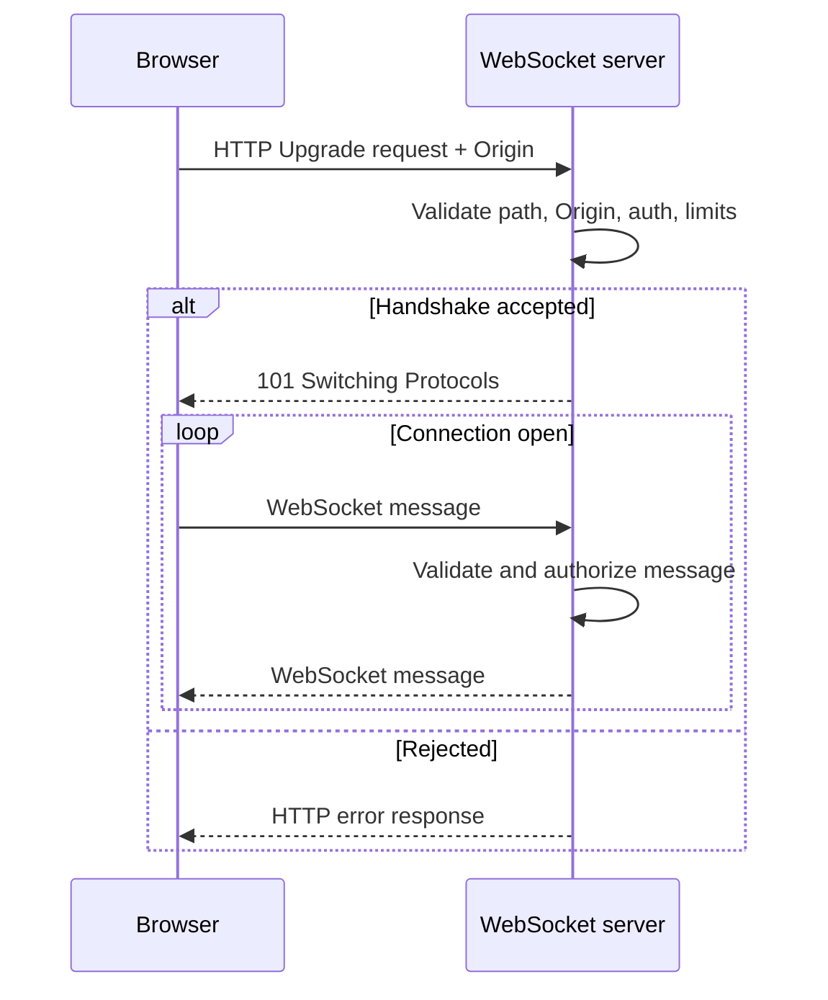

# WebSocket security

> **Chương:** WebSocket  
> **Bài học:** WebSocket security — bảo vệ kết nối hai chiều, handshake, message và phiên người dùng  
> **Phạm vi module:** **SECURITY_APPLICATION_SECURITY_BROWSER_SECURITY** — phân tích ranh giới bảo mật giữa trình duyệt, origin, cookie và ứng dụng web để hiểu Same-Origin Policy (SOP), CORS và các cơ chế cách ly; thực hành phòng vệ XSS, CSRF, clickjacking bằng CSP, Trusted Types, security headers và kiểm chứng thực tế.

## Mục tiêu học tập

Sau bài này, bạn có thể:

1. Mô tả WebSocket handshake và quá trình chuyển từ HTTP sang kết nối hai chiều.
2. Phân biệt WebSocket với HTTP fetch, CORS và Same-Origin Policy.
3. Xác thực chính xác header Origin ở handshake và phòng chống Cross-Site WebSocket Hijacking (CSWSH).
4. Thiết lập WSS/TLS, kiểm tra chứng thư và cấu hình proxy an toàn.
5. Thiết kế authentication cho kết nối và authorization riêng cho từng message/action.
6. Kiểm tra dữ liệu message theo schema, giới hạn kích thước và từ chối input không hợp lệ.
7. Kiểm soát rate, connection count, heartbeat, timeout và backpressure.
8. Bảo vệ session khi đăng nhập, logout, hết hạn token hoặc đổi quyền.
9. Giới hạn WebSocket bằng CSP `connect-src` và quản lý subprotocol.
10. Kiểm thử, ghi log và xử lý sự cố mà không làm lộ token hoặc dữ liệu nhạy cảm.

## 1. WebSocket là gì và ranh giới bảo mật nằm ở đâu?

**WebSocket** là giao thức truyền thông hai chiều trên một kết nối được duy trì giữa client và server. Sau khi thiết lập kết nối, cả hai phía có thể chủ động gửi message mà không cần tạo một HTTP request riêng cho từng message.

WebSocket thường được dùng cho chat, thông báo trực tiếp, bảng điều khiển thời gian thực, cộng tác nhiều người và cập nhật trạng thái. Khả năng giữ kết nối lâu dài làm thay đổi cách thiết kế bảo mật: server phải quản lý danh tính, quyền, trạng thái và giới hạn tài nguyên trong suốt vòng đời kết nối.

Một WebSocket an toàn cần bảo vệ nhiều lớp:

- **Transport:** mã hóa và xác thực server bằng TLS qua `wss://`.
- **Handshake:** kiểm tra request mở kết nối, Origin, path, subprotocol và xác thực ban đầu.
- **Session:** gắn connection với user/session, theo dõi expiry và thu hồi.
- **Message:** xác thực schema, loại message, quyền thực hiện và kích thước.
- **Resource:** giới hạn số connection, tốc độ message, thời gian nhàn rỗi và bộ nhớ.
- **Operations:** giám sát, logging có kiểm soát, cập nhật và đóng kết nối an toàn.

Chỉ mã hóa kết nối không bảo đảm ứng dụng an toàn. Một connection WSS vẫn có thể bị lạm dụng nếu server chấp nhận Origin không tin cậy, bỏ qua authorization hoặc xử lý message không kiểm tra.

### 1.1. WebSocket hoạt động khác HTTP request thông thường

Với HTTP, client gửi request và server trả response. Với WebSocket, client khởi tạo handshake qua HTTP, sau đó hai bên trao đổi frame theo giao thức WebSocket trên kết nối đã nâng cấp.



Handshake là điểm kiểm tra quan trọng, nhưng không phải lần kiểm tra duy nhất. User có thể logout, quyền có thể thay đổi và message có thể yêu cầu hành động khác nhau trong khi socket vẫn mở.

### 1.2. HTTP Upgrade handshake

Với WebSocket chạy trên HTTP/1.1, browser thường gửi request tương tự:

```http
GET /realtime HTTP/1.1
Host: app.example
Upgrade: websocket
Connection: Upgrade
Sec-WebSocket-Key: <random-base64-value>
Sec-WebSocket-Version: 13
Origin: https://app.example
Cookie: session=<browser-managed-session>
Sec-WebSocket-Protocol: app-events-v2
```

Server chấp nhận handshake bằng response `101 Switching Protocols` cùng các header WebSocket cần thiết, bao gồm `Sec-WebSocket-Accept` được tính từ key của request.

HTTP/2 và HTTP/3 có cơ chế mở WebSocket qua extended CONNECT thay vì HTTP/1.1 Upgrade. Hạ tầng proxy/load balancer phải hỗ trợ đúng chế độ đang sử dụng. Không giả định mọi kết nối đều nhìn thấy nguyên văn request HTTP/1.1 như ví dụ.

### 1.3. Handshake không phải authorization cho mọi hành động

Handshake có thể xác định user và chấp nhận connection. Nhưng sau khi kết nối mở, client có thể gửi nhiều loại message:

- Đọc dữ liệu của một phòng chat.
- Gửi tin nhắn vào phòng.
- Thêm hoặc xóa thành viên.
- Thay đổi cấu hình.
- Yêu cầu dữ liệu của một tenant khác.

Quyền kết nối không đồng nghĩa quyền thực hiện tất cả hành động. Server phải kiểm tra authorization cho từng loại message và từng tài nguyên đích.

## 2. Origin, SOP và CORS với WebSocket

Một nhầm lẫn phổ biến là cho rằng WebSocket được bảo vệ bằng CORS giống `fetch()`. Cơ chế này không hoạt động theo cách đó.

### 2.1. WebSocket không dùng CORS response header như fetch

Browser WebSocket API không thực hiện CORS preflight thông thường và server không dùng `Access-Control-Allow-Origin` làm cơ chế cấp quyền đọc WebSocket như đối với fetch/XHR.

Trong handshake từ browser, header `Origin` cho server biết trang khởi tạo kết nối thuộc origin nào. Server cần kiểm tra header này bằng allowlist chính xác trước khi chấp nhận kết nối.

Không thêm `Access-Control-Allow-Origin: *` với hy vọng bảo vệ WebSocket. Header đó không thay thế kiểm tra Origin ở WebSocket handshake.

### 2.2. Origin gồm scheme, host và port

Ví dụ các origin khác nhau:

| Origin trang | Có khớp `https://app.example`? |
|---|---|
| `https://app.example` | Có |
| `http://app.example` | Không, scheme khác |
| `https://app.example:8443` | Không, port khác |
| `https://admin.example` | Không, host khác |
| `https://app.example.attacker.invalid` | Không, hostname khác |

Hãy parse và so sánh origin chuẩn hóa. Không dùng kiểm tra chuỗi con, suffix không có dấu phân cách hoặc regex quá rộng.

### 2.3. Kiểm tra Origin ở server

Ví dụ logic khái quát trong Node.js:

```js
const allowedOrigins = new Set([
  'https://app.example',
  'https://admin.example',
]);

function isAllowedWebSocketOrigin(origin) {
  if (typeof origin !== 'string' || origin === 'null') {
    return false;
  }

  try {
    const parsed = new URL(origin);

    // Chỉ cho phép HTTPS và origin nằm trong allowlist chính xác.
    return parsed.protocol === 'https:' &&
      allowedOrigins.has(parsed.origin);
  } catch {
    return false;
  }
}
```

Trong handler handshake, từ chối request nếu Origin không hợp lệ. Không tự động phản chiếu Origin do client gửi vào response hoặc thêm Origin chưa biết vào allowlist.

Một số client không phải browser có thể không gửi Origin hoặc có thể tự đặt header đó. Vì vậy, Origin validation là lớp chống lạm dụng từ browser context, không phải bằng chứng xác thực danh tính cho mọi loại client. Client native, service hoặc script vẫn cần authentication riêng.

### 2.4. Origin khác với Host và địa chỉ IP

- `Origin` cho biết origin của trang khởi tạo request trong browser.
- `Host`/`:authority` xác định host đích mà request hướng tới.
- IP là địa chỉ mạng của client hoặc server, không phải danh tính origin web.

Không suy ra Origin hợp lệ chỉ vì request đến từ IP nội bộ hoặc có Host đúng. Reverse proxy có thể thay đổi thông tin kết nối; server cần biết header nào do proxy đáng tin cậy tạo và header nào do client kiểm soát.

## 3. Cross-Site WebSocket Hijacking (CSWSH)

**Cross-Site WebSocket Hijacking (CSWSH)** xảy ra khi một website độc hại mở WebSocket tới server của ứng dụng nạn nhân bằng browser của người dùng, và browser tự đính kèm cookie session phù hợp. Nếu server không kiểm tra Origin và không có bảo vệ phù hợp, website độc hại có thể sử dụng kết nối dưới danh tính người dùng.

Đây là vấn đề đặc biệt quan trọng khi WebSocket dùng cookie-based authentication.

### 3.1. Kịch bản tấn công

Giả sử người dùng đã đăng nhập `https://app.example`. Sau đó họ mở `https://attacker.invalid`. Trang độc hại chạy:

```js
const socket = new WebSocket('wss://app.example/realtime');

socket.addEventListener('open', () => {
  socket.send(JSON.stringify({
    type: 'account.read',
  }));
});

socket.addEventListener('message', (event) => {
  // Nếu server trả dữ liệu nhạy cảm, trang độc hại có thể đọc message.
  console.log(event.data);
});
```

Nếu browser gửi cookie session tới `app.example` và server chấp nhận handshake mà không kiểm tra Origin, socket có thể được tạo trong session của người dùng. Website attacker không cần đọc DOM của `app.example`; nó giao tiếp với WebSocket endpoint và đọc những message server gửi về kết nối đó.

### 3.2. Phòng chống CSWSH

- Kiểm tra `Origin` bằng allowlist chính xác tại handshake.
- Từ chối Origin thiếu, `null` hoặc không nằm trong allowlist đối với browser endpoint yêu cầu Origin.
- Dùng cookie `Secure`, `HttpOnly` và `SameSite` phù hợp.
- Không dựa riêng vào SameSite cookie; browser và deployment có thể có ngoại lệ hoặc cấu hình khác.
- Yêu cầu authentication hợp lệ và kiểm tra session ở server.
- Authorization cho từng message và tài nguyên.
- Hạn chế endpoint WebSocket chỉ dành cho đúng ứng dụng và use case.
- Theo dõi các handshake bị từ chối và mẫu Origin bất thường.

Cookie `SameSite=Lax` hoặc `Strict` có thể giảm việc cookie được gửi trong một số cross-site context, nhưng không thay thế Origin validation. Nếu sản phẩm cần cookie `SameSite=None`, kiểm tra Origin càng quan trọng.

### 3.3. Origin validation không thay thế authentication

Origin cho biết trang nào khởi tạo kết nối, không cho biết người dùng là ai. Nhiều người dùng có thể cùng truy cập một origin hợp lệ. Một client ngoài browser có thể tự đặt Origin header.

Do đó, thiết kế đúng cần đồng thời:

1. Kiểm tra Origin để ngăn browser page không tin cậy.
2. Xác thực user/session bằng credential hợp lệ.
3. Kiểm tra quyền của user trên từng hành động.
4. Giới hạn tài nguyên và message để chống lạm dụng.

## 4. Authentication cho WebSocket

Authentication trả lời câu hỏi “kết nối này thuộc user hoặc service nào?”. Browser WebSocket API có một số giới hạn khác với fetch: constructor `new WebSocket()` không cung cấp tùy chọn để đặt tùy ý header `Authorization`.

Hãy chọn cách xác thực phù hợp với kiến trúc và không đưa credential dài hạn vào URL.

### 4.1. Cookie session

Nếu ứng dụng đã dùng session cookie cùng origin, browser có thể tự gửi cookie phù hợp trong handshake.

Cookie session nên có các thuộc tính phù hợp:

```http
Set-Cookie: __Host-session=<opaque-session-id>; Secure; HttpOnly; SameSite=Lax; Path=/
```

- `Secure`: chỉ gửi qua kết nối bảo mật.
- `HttpOnly`: JavaScript không đọc trực tiếp được cookie.
- `SameSite`: giảm việc gửi cookie trong một số cross-site context.
- `__Host-`: yêu cầu `Secure`, `Path=/` và không có `Domain`, giúp giới hạn cookie vào host.

Server xác minh session trong handshake và gắn principal vào connection. Vẫn phải kiểm tra Origin để chống CSWSH; HttpOnly không ngăn browser tự gửi cookie và không thay thế kiểm tra Origin.

### 4.2. Vé kết nối ngắn hạn (single-use ticket)

Với kiến trúc cần token riêng cho WebSocket, một mô hình thường dùng là:

1. Page gọi HTTPS endpoint đã xác thực để xin ticket kết nối.
2. Server tạo ticket ngẫu nhiên, thời hạn rất ngắn, dùng một lần và gắn với user, audience, quyền và endpoint.
3. Browser mở WebSocket và gửi ticket theo cơ chế đã thiết kế.
4. WebSocket server đổi ticket thành session connection, đánh dấu ticket đã dùng và từ chối replay.

Browser WebSocket API không cho đặt header tùy ý. Một số hệ thống truyền ticket trong query string hoặc gửi message xác thực đầu tiên sau handshake. Cả hai cách đều cần kiểm soát:

- Ticket phải ngắn hạn, một lần, giới hạn audience và không có quyền rộng.
- Nếu ticket nằm trong URL, proxy, load balancer, APM và access log phải redact query parameter đó.
- Không dùng access token hoặc refresh token dài hạn trong URL.
- Nếu gửi ticket ở message đầu tiên, connection chưa xác thực phải ở trạng thái pending, không được nhận dữ liệu hoặc thực hiện hành động trước khi xác thực xong.
- Đặt timeout ngắn cho trạng thái pending và đóng socket nếu không xác thực thành công.
- Bảo vệ endpoint cấp ticket khỏi CSRF nếu nó dùng cookie session.

Ví dụ ticket trong URL chỉ để minh họa luồng và cần redact log:

```js
const ticket = await fetch('/api/realtime-ticket', {
  method: 'POST',
  credentials: 'same-origin',
  headers: {
    'Content-Type': 'application/json',
    'X-CSRF-Token': csrfToken,
  },
  body: JSON.stringify({ purpose: 'notifications' }),
}).then((response) => {
  if (!response.ok) throw new Error('Ticket request failed');
  return response.json();
});

const socket = new WebSocket(
  'wss://app.example/realtime?ticket=' + encodeURIComponent(ticket.value)
);
```

Trong production, xác minh rằng ticket không xuất hiện trong log, trace, error report hoặc telemetry. Nếu hệ thống không thể bảo đảm điều đó, chọn một cách truyền credential khác phù hợp hơn.

### 4.3. Xác thực bằng message đầu tiên

Một lựa chọn là mở socket trước, sau đó gửi token/ticket ở message đầu tiên. Cách này tránh đặt credential trên URL, nhưng tạo một giai đoạn connection chưa xác thực.

Trong giai đoạn này:

- Không gửi dữ liệu ứng dụng tới client.
- Không cho phép subscribe, publish hoặc gọi business action.
- Chỉ nhận một message xác thực có schema và kích thước giới hạn.
- Dùng timeout ngắn.
- Giới hạn số kết nối pending theo IP và theo tài nguyên.
- Đóng connection nếu credential sai, hết hạn hoặc được dùng lại.

Không xem socket là authenticated chỉ vì TCP/WebSocket handshake đã thành công.

### 4.4. Không dùng subprotocol như nơi chứa access token

`Sec-WebSocket-Protocol` dùng để thương lượng subprotocol, ví dụ phiên bản message schema hoặc giao thức ứng dụng. Không nên dùng nó như một kênh credential tổng quát: giá trị có thể bị ghi log, phản chiếu trong response hoặc xử lý bởi proxy theo cách không dự kiến.

Chọn subprotocol không chứa bí mật:

```js
const socket = new WebSocket(
  'wss://app.example/realtime',
  ['app-events-v2']
);
```

Server chỉ chấp nhận các subprotocol được hỗ trợ và trả lại một protocol phù hợp trong handshake.

### 4.5. Kiểm tra session trong suốt vòng đời

Session có thể hết hạn hoặc bị thu hồi khi socket vẫn đang mở. Server cần:

- Gắn connection với session ID hoặc principal đã xác thực.
- Theo dõi thời hạn token/session.
- Đóng hoặc hạ quyền connection khi session bị thu hồi.
- Xử lý logout từ các tab hoặc thiết bị khác.
- Kiểm tra lại quyền trước các thao tác nhạy cảm.
- Không giữ principal cũ vô thời hạn sau khi user bị khóa hoặc đổi vai trò.

Có thể dùng session registry, pub/sub hoặc cơ chế revocation phù hợp để thông báo cho các node WebSocket đang giữ connection.

## 5. Authorization cho từng message

Authorization trả lời câu hỏi “principal này được phép làm gì với tài nguyên nào?”. Đây là kiểm tra bắt buộc ở server, kể cả khi handshake đã xác thực thành công.

### 5.1. Không tin user ID hoặc role do client gửi

Message không nên được quyền quyết định danh tính dựa trên `userId`, `role`, `tenantId` do client cung cấp.

Ví dụ message nguy hiểm:

```json
{
  "type": "invoice.read",
  "userId": "user-admin",
  "tenantId": "tenant-other",
  "invoiceId": "inv-123"
}
```

Server phải lấy principal từ session đã xác thực, sau đó kiểm tra user có quyền đọc invoice đó trong tenant tương ứng không. Các trường client gửi chỉ là tham số yêu cầu, không phải bằng chứng quyền.

### 5.2. Tách message type và handler

Dùng allowlist message type:

```js
const handlers = {
  'chat.send': handleChatSend,
  'chat.subscribe': handleChatSubscribe,
  'presence.update': handlePresenceUpdate,
};

async function handleMessage(connection, message) {
  const handler = handlers[message.type];

  if (!handler) {
    throw new Error('Unsupported message type');
  }

  return handler(connection.principal, message);
}
```

Mỗi handler cần thực hiện authorization theo tài nguyên và hành động. Không để client chọn tên hàm, tên event nội bộ hoặc method tùy ý rồi dispatch trực tiếp.

### 5.3. Kiểm tra quyền trên tài nguyên đích

Ví dụ khi subscribe room:

1. Xác định principal từ connection.
2. Parse room ID và kiểm tra định dạng.
3. Tải membership/ACL từ nguồn tin cậy.
4. Xác minh principal được phép tham gia room.
5. Chỉ sau đó mới thêm connection vào subscription group.
6. Kiểm tra quyền tương tự khi gửi message hoặc lấy lịch sử.

Không dùng việc user đã được phép subscribe một room làm bằng chứng rằng họ có quyền quản trị room hoặc xóa thành viên.

### 5.4. Tenant isolation

Trong ứng dụng multi-tenant, mọi message cần được kiểm tra tenant context. Không tin `tenantId` trong payload. Lấy tenant từ session hoặc xác minh quan hệ giữa principal và tenant mà request muốn truy cập.

Kiểm tra authorization ở mọi đường dẫn: subscribe, publish, broadcast, private reply, history, presence và administrative event. Một lỗi ở broadcast fan-out có thể làm lộ message cho nhiều connection khác tenant.

### 5.5. Quyền có thể thay đổi trong khi socket đang mở

Khi user bị xóa khỏi room, đổi role hoặc bị khóa, server phải cập nhật hoặc thu hồi quyền của các connection liên quan. Không giả định quyền tại thời điểm handshake còn đúng mãi.

Có thể kiểm tra quyền ở mỗi message hoặc dùng cache ACL có thời hạn ngắn và cơ chế invalidation rõ ràng. Với hành động nhạy cảm, kiểm tra trực tiếp nguồn quyền có thẩm quyền.

## 6. Xác thực và giới hạn message payload

Message WebSocket là dữ liệu không tin cậy, kể cả khi connection đã xác thực. Client có thể bị sửa, bị XSS hoặc là một chương trình tự viết.

### 6.1. Kiểm tra schema và kiểu dữ liệu

Ví dụ message schema:

```json
{
  "type": "chat.send",
  "requestId": "req-8f13",
  "roomId": "room-42",
  "text": "Xin chào"
}
```

Server cần kiểm tra:

- Message parse được theo định dạng đã chọn.
- `type` nằm trong allowlist.
- `requestId` đúng kiểu và có giới hạn độ dài.
- `roomId` đúng format và tồn tại.
- `text` là string, có giới hạn độ dài và không vượt quota.
- Không có field ngoài schema nếu protocol yêu cầu strict validation.
- Các field được kiểm tra theo ngữ cảnh nghiệp vụ, không chỉ theo JSON syntax.

JSON parse thành công không đồng nghĩa message hợp lệ.

### 6.2. Giới hạn kích thước trước khi xử lý

Đặt giới hạn cho frame/message ở server hoặc WebSocket library, trước khi parse toàn bộ payload nếu có thể. Giới hạn cần dựa trên chức năng thật; message chat vài KB không cần chấp nhận payload hàng chục MB.

Giới hạn thêm:

- Số message mỗi giây trên connection.
- Số byte mỗi giây trên connection.
- Số connection đồng thời theo IP, user và tenant.
- Số subscription/room mỗi connection.
- Độ sâu và độ phức tạp của JSON.
- Thời gian xử lý tối đa cho từng handler.

Không chỉ giới hạn ở frontend. Client có thể bỏ qua mọi kiểm tra giao diện.

### 6.3. Kiểm tra JSON an toàn

Ví dụ xử lý message:

```js
function parseClientMessage(raw, maxBytes = 16 * 1024) {
  if (typeof raw !== 'string') {
    throw new Error('Text messages are required');
  }

  if (new TextEncoder().encode(raw).byteLength > maxBytes) {
    throw new Error('Message too large');
  }

  let message;

  try {
    message = JSON.parse(raw);
  } catch {
    throw new Error('Invalid JSON');
  }

  if (!message || typeof message !== 'object' || Array.isArray(message)) {
    throw new Error('Message must be an object');
  }

  if (typeof message.type !== 'string' ||
      message.type.length > 64) {
    throw new Error('Invalid message type');
  }

  return message;
}
```

Đây chỉ là bước parse và kiểm tra sơ bộ. Mỗi message type vẫn cần schema đầy đủ, validation field, authorization và giới hạn nghiệp vụ.

### 6.4. Output encoding và XSS

Nếu server phát lại message do user gửi, client phải render nội dung như text hoặc sanitize theo context. Không đưa message vào `innerHTML` một cách trực tiếp.

Ví dụ:

```js
messageElement.textContent = receivedMessage.text;
```

WebSocket không tự loại bỏ HTML hoặc JavaScript độc hại trong payload. Nếu message chứa rich text, dùng parser/sanitizer được thiết kế cho định dạng đó và áp dụng CSP/Trusted Types khi phù hợp.

## 7. Giới hạn tài nguyên và chống DoS

WebSocket giữ kết nối mở lâu dài. Một client độc hại có thể tạo nhiều connection, gửi message liên tục, gửi payload lớn hoặc khiến server giữ queue/buffer tăng không giới hạn.

### 7.1. Giới hạn connection

Đặt giới hạn phù hợp cho:

- Số handshake mới mỗi IP trong một khoảng thời gian.
- Số connection đang mở theo IP, account và tenant.
- Số connection chưa xác thực.
- Số connection trên mỗi user/session.
- Tổng connection trên mỗi node và toàn cluster.

Không chỉ dùng IP làm định danh vì nhiều người dùng có thể đi qua NAT/proxy chung. Kết hợp IP với user/session sau khi xác thực và có ngoại lệ rõ ràng cho hạ tầng tin cậy.

### 7.2. Rate limit message và byte

Giới hạn message rate, byte rate và chi phí xử lý theo loại message. Một message `chat.send` có thể rẻ, trong khi message tìm kiếm hoặc export dữ liệu có thể tốn CPU/DB hơn nhiều.

Có thể dùng token bucket hoặc leaky bucket theo connection, principal và tenant. Với broadcast, giới hạn cả số recipient và kích thước payload. Khi vượt ngưỡng, từ chối message hoặc đóng connection theo policy; không để client làm đầy hàng đợi của server.

### 7.3. Giới hạn payload và thời gian xử lý

- Đặt `maxPayload` ở WebSocket server/library.
- Giới hạn số phần tử trong array, độ sâu JSON và độ dài string.
- Timeout cho handshake, authentication pending và message handler.
- Giới hạn số subscription và room trên mỗi connection.
- Hủy công việc khi connection đã đóng nếu có thể.
- Không thực hiện công việc CPU nặng đồng bộ trong event loop.

Kiểm tra kích thước ở application sau khi toàn bộ payload đã được nhận có thể quá muộn nếu library đã cấp phát nhiều bộ nhớ. Ưu tiên giới hạn tại tầng protocol/library.

### 7.4. Backpressure và queue

Nếu server gửi nhanh hơn client nhận, queue có thể tăng và tiêu thụ bộ nhớ. Server cần:

- Theo dõi buffered amount hoặc queue length.
- Giới hạn bytes đang chờ gửi.
- Bỏ message realtime cũ nếu nghiệp vụ cho phép.
- Gộp nhiều cập nhật thành một message.
- Ngắt client chậm khi vượt ngưỡng.
- Không giữ vô hạn lịch sử message trong bộ nhớ connection.

Ở browser, `WebSocket.bufferedAmount` cho biết số byte đang chờ gửi từ client. Client nên tạm dừng hoặc giảm tốc độ gửi khi giá trị này tăng quá ngưỡng. Đây là kiểm soát bổ sung; server vẫn phải có giới hạn độc lập.

### 7.5. Heartbeat và idle timeout

Server có thể dùng WebSocket Ping/Pong control frames để phát hiện connection chết hoặc mạng đã ngắt. Browser tự xử lý Pong ở tầng protocol; JavaScript trong browser không trực tiếp tạo hoặc nhận control Ping/Pong qua WebSocket API chuẩn.

Nếu cần heartbeat ở tầng ứng dụng, định nghĩa message riêng như `heartbeat.ping` và `heartbeat.pong`, giới hạn tần suất và không để message này thay thế kiểm tra session.

Đặt idle timeout hợp lý, nhưng tránh đóng connection đang hoạt động chỉ vì proxy có timeout ngắn hơn. Cấu hình heartbeat, proxy idle timeout và client reconnect thành một chính sách nhất quán.

## 8. WSS, TLS và hạ tầng mạng

### 8.1. Dùng WSS trong production

`wss://` là WebSocket chạy qua TLS. TLS bảo vệ confidentiality và integrity trên đường truyền, đồng thời xác thực server bằng certificate.

Trong production:

- Chỉ cung cấp endpoint WSS.
- Dùng certificate hợp lệ và gia hạn tự động.
- Không cho client bỏ qua lỗi certificate.
- Chuyển hướng/loại bỏ endpoint WS không mã hóa ở hạ tầng phù hợp.
- Không để mixed content: trang HTTPS không nên kết nối tới endpoint WS không mã hóa.

WSS không xác minh quyền user và không ngăn CSWSH. Nó bảo vệ transport, còn Origin/authentication/authorization vẫn là trách nhiệm của ứng dụng.

### 8.2. Reverse proxy và load balancer

Nếu WebSocket đi qua proxy, proxy phải hỗ trợ upgrade hoặc extended CONNECT theo phiên bản HTTP. Với HTTP/1.1, cần chuyển tiếp đúng các header upgrade/connection theo cấu hình của sản phẩm proxy.

Kiểm tra:

- Idle timeout và maximum connection duration.
- Connection draining khi deploy.
- TLS termination và kết nối proxy-to-backend.
- Sticky session hoặc shared session state nếu kiến trúc cần.
- Header forwarding và trust boundary.
- Giới hạn connection/request ở edge.
- Không bật buffering không phù hợp với stream hai chiều.

Không tin `X-Forwarded-For`, `X-Forwarded-Proto` hoặc header tự khai báo từ client nếu request chưa đi qua proxy tin cậy đã cấu hình. Chỉ lấy forwarded metadata từ đúng proxy hop.

### 8.3. CSP connect-src

CSP `connect-src` kiểm soát các URL mà script có thể kết nối bằng WebSocket, fetch, XHR, EventSource và một số API khác.

Ví dụ:

```http
Content-Security-Policy: default-src 'self'; script-src 'self'; connect-src 'self' https://api.example wss://realtime.example; object-src 'none'; base-uri 'self'; frame-ancestors 'none'
```

Nếu ứng dụng dùng WebSocket cùng host, có thể khai báo nguồn WSS tương ứng theo CSP/browser mục tiêu. Hãy thử trên browser thực tế vì cách diễn giải scheme source và port cần chính xác.

`connect-src` giới hạn nơi JavaScript được phép kết nối; nó không xác thực user và không thay thế kiểm tra Origin ở server.

### 8.4. Security headers liên quan

Ngoài CSP, xem xét:

- HSTS để ép browser dùng HTTPS cho host đã khai báo.
- `X-Content-Type-Options: nosniff` cho tài nguyên HTTP phù hợp.
- `frame-ancestors` trong CSP để giới hạn website có thể nhúng trang.
- Cookie flags `Secure`, `HttpOnly`, `SameSite`.
- Chính sách CORS riêng cho HTTP API mà ứng dụng gọi.

Không có một response header HTTP chung nào thay thế authorization cho message WebSocket sau khi handshake đã hoàn tất.

## 9. Subprotocol, compression và format message

### 9.1. Thương lượng subprotocol

Subprotocol xác định định dạng hoặc ngữ nghĩa message mà hai bên hiểu. Ví dụ `app-events-v2` có thể đại diện schema phiên bản 2.

Server cần:

- Allowlist subprotocol hỗ trợ.
- Từ chối protocol không phù hợp nếu ứng dụng yêu cầu protocol cụ thể.
- Không phản chiếu chuỗi subprotocol tùy ý vào response.
- Duy trì tương thích trong rollout giữa client và server version.
- Không đặt credential hoặc dữ liệu nhạy cảm vào subprotocol.

### 9.2. Cân nhắc permessage-deflate

Extension `permessage-deflate` có thể giảm băng thông nhưng tiêu thụ CPU/bộ nhớ và trong một số thiết kế có thể tạo rủi ro side-channel khi dữ liệu bí mật và dữ liệu do attacker kiểm soát được nén trong cùng context.

Chỉ bật compression khi có nhu cầu đo được. Đánh giá dữ liệu nào cùng được nén, kiểm tra cấu hình context takeover và cân nhắc tắt compression cho endpoint mang secret hoặc payload nhạy cảm.

### 9.3. Message protocol có version

Định nghĩa message envelope rõ ràng, ví dụ:

```json
{
  "version": 2,
  "type": "chat.send",
  "requestId": "req-8f13",
  "payload": {
    "roomId": "room-42",
    "text": "Xin chào"
  }
}
```

Server nên từ chối version không hỗ trợ, message type không hợp lệ và field không đúng schema. Có thể dùng request ID để liên kết response và chống xử lý trùng theo nghiệp vụ, nhưng request ID không phải credential hay bằng chứng authorization.

## 10. Đóng kết nối và quản lý vòng đời

Connection lâu dài cần được đóng khi không còn hợp lệ hoặc khi server cần thu hồi tài nguyên.

### 10.1. Close code

Dùng close code chuẩn phù hợp và reason ngắn, không chứa thông tin nội bộ:

| Code | Ý nghĩa thường dùng |
|---|---|
| `1000` | Normal Closure |
| `1001` | Going Away |
| `1002` | Protocol Error |
| `1003` | Unsupported Data |
| `1008` | Policy Violation |
| `1009` | Message Too Big |
| `1011` | Internal Error |

Một số code được dành riêng và không được gửi trực tiếp trong close frame. Kiểm tra RFC và thư viện server trước khi chọn code. Không gửi stack trace, token, session ID hoặc lý do xác thực chi tiết trong close reason.

### 10.2. Reconnect có kiểm soát

Client có thể reconnect khi mạng gián đoạn. Dùng exponential backoff với jitter, giới hạn số lần retry và reset backoff sau khi kết nối ổn định.

Không reconnect liên tục với tốc độ cao khi server đang quá tải hoặc đã từ chối authentication. Xử lý close code và trạng thái ứng dụng để phân biệt lỗi tạm thời với lỗi policy/credential.

### 10.3. Logout, revoke và deploy

Khi logout, token hết hạn, user bị khóa hoặc server deploy:

- Thu hồi connection gắn với session/user nếu cần.
- Xóa subscription và membership runtime.
- Hủy timer, queue và task nền của connection.
- Gửi close code phù hợp và reason không nhạy cảm.
- Cho client reconnect sau khi xác thực lại.
- Không giữ connection cũ khi quyền đã bị thu hồi.

## 11. Ví dụ server: kiểm tra handshake trước khi upgrade

Ví dụ sau minh họa cấu trúc với Node.js và thư viện `ws`. Các hàm xác thực session, kiểm tra quyền và rate limiter là thành phần của ứng dụng, cần được triển khai theo hệ thống thực tế.

```js
import { WebSocket, WebSocketServer } from 'ws';

const wss = new WebSocketServer({
  noServer: true,
  maxPayload: 16 * 1024,
  perMessageDeflate: false,
});

const allowedOrigins = new Set([
  'https://app.example',
]);

function rejectUpgrade(socket, status, reason) {
  if (socket.destroyed) return;

  socket.end(
    'HTTP/1.1 ' + status + ' ' + reason + '\r\n' +
    'Connection: close\r\n' +
    'Content-Length: 0\r\n' +
    '\r\n'
  );
}

server.on('upgrade', async (request, socket, head) => {
  try {
    const url = new URL(request.url, 'https://app.example');

    if (url.pathname !== '/realtime') {
      rejectUpgrade(socket, 404, 'Not Found');
      return;
    }

    const origin = request.headers.origin;
    if (!origin || !allowedOrigins.has(origin)) {
      rejectUpgrade(socket, 403, 'Forbidden');
      return;
    }

    const principal = await authenticateSession(request);
    if (!principal) {
      rejectUpgrade(socket, 401, 'Unauthorized');
      return;
    }

    if (!await mayOpenRealtime(principal)) {
      rejectUpgrade(socket, 403, 'Forbidden');
      return;
    }

    wss.handleUpgrade(request, socket, head, (ws) => {
      ws.principal = principal;
      wss.emit('connection', ws, request);
    });
  } catch {
    rejectUpgrade(socket, 400, 'Bad Request');
  }
});
```

Các điểm cần giữ:

- Kiểm tra path và Origin trước khi upgrade.
- Xác thực session ở server, không lấy user ID từ query string.
- Kiểm tra quyền mở realtime endpoint.
- Cấu hình giới hạn payload ngay ở WebSocket server.
- Tắt compression nếu chưa có nhu cầu hoặc chưa đánh giá rủi ro.
- Không trả chi tiết exception nội bộ cho client.

Đây là skeleton để minh họa thứ tự kiểm tra. Trong ứng dụng thật, cần xử lý socket đã đóng, giới hạn handshake theo IP, kiểm tra subprotocol, timeout authentication và tích hợp session revocation.

### 11.1. Xử lý message sau khi kết nối

Ví dụ khái quát:

```js
wss.on('connection', (ws) => {
  ws.on('message', async (data, isBinary) => {
    try {
      if (isBinary) {
        ws.close(1003, 'Unsupported data');
        return;
      }

      const message = parseClientMessage(data.toString());

      if (!messageRateLimiter.allow(ws.principal.id)) {
        ws.close(1008, 'Rate limit exceeded');
        return;
      }

      await dispatchAuthorizedMessage(ws.principal, message, ws);
    } catch (error) {
      // Log metadata đã redact; không log raw payload hoặc token.
      auditWebSocketFailure({
        userId: ws.principal?.id,
        category: classifyWebSocketError(error),
      });

      if (ws.readyState === WebSocket.OPEN) {
        ws.send(JSON.stringify({
          type: 'error',
          code: 'MESSAGE_REJECTED',
        }));
      }
    }
  });
});
```

Hàm `dispatchAuthorizedMessage` phải thực hiện schema validation và authorization theo từng message type, resource và tenant. Không để một hàm tổng quát tự động thực thi method dựa trên dữ liệu client.

## 12. Logging, monitoring và incident response

WebSocket có thể tồn tại nhiều giờ. Log chỉ ghi lúc handshake là không đủ để phát hiện lạm dụng message hoặc connection bị giữ sau khi session thu hồi.

### 12.1. Ghi log những gì?

Có thể ghi:

- Thời điểm mở/đóng connection.
- Origin đã được kiểm tra (theo chính sách log).
- Kết quả authentication và lý do phân loại ở mức tổng quát.
- Principal ID dạng nội bộ phù hợp, không ghi credential.
- Số message/byte, loại message và latency theo nhóm.
- Close code, timeout, rate-limit event.
- Số connection theo node, user và tenant.
- Kết quả authorization deny theo action/resource category.

### 12.2. Không ghi log dữ liệu nhạy cảm

Không ghi:

- Cookie session, access token, refresh token hoặc ticket.
- Raw query string có thể chứa credential.
- Nội dung chat, payload cá nhân hoặc file trừ khi có lý do nghiệp vụ và chính sách lưu trữ rõ ràng.
- Header xác thực đầy đủ.
- Stack trace hoặc thông tin nội bộ trong message trả về client.

Nếu cần điều tra message, ghi request ID, type, kích thước, outcome và correlation ID thay vì raw payload. Redact tại edge, proxy, APM và application; chỉ redact ở logger cuối cùng là chưa đủ.

### 12.3. Chỉ số nên theo dõi

- Handshake success/reject theo Origin và endpoint.
- Connection count và connection duration.
- Pending unauthenticated connections.
- Message rate, byte rate và payload-size distribution.
- Authorization deny và schema-validation failures.
- Close code distribution.
- Event-loop lag, CPU, memory, queue/buffer growth.
- Reconnect rate và proxy timeout.
- Session revocation propagation delay.

Tạo cảnh báo cho spike bất thường, nhưng tránh alert theo từng message lỗi đơn lẻ nếu nó tạo quá nhiều noise.

### 12.4. Khi phát hiện lạm dụng

1. Xác định endpoint, Origin, principal, node và loại message bị ảnh hưởng.
2. Giới hạn hoặc chặn handshake/message theo policy.
3. Thu hồi session/ticket liên quan nếu có dấu hiệu bị lộ.
4. Đóng connection đang hoạt động của principal bị ảnh hưởng.
5. Kiểm tra fan-out và dữ liệu đã được gửi cho recipient nào.
6. Bảo toàn log đã redact và trace cần thiết.
7. Sửa lỗi authorization/validation và kiểm thử regression trước khi mở lại traffic.

## 13. Troubleshooting lỗi WebSocket security

### 13.1. Handshake bị 403

Kiểm tra:

- Origin có đúng scheme, host và port không?
- Origin có nằm trong allowlist chính xác của môi trường không?
- Proxy có thay đổi hoặc bỏ header không?
- Có request từ browser extension, sandboxed frame hoặc `Origin: null` không?
- Endpoint có nhầm giữa hostname public và hostname nội bộ không?

Không giải quyết bằng cách cho phép mọi Origin. Hãy xác định chính xác trang hợp lệ và cập nhật allowlist có review.

### 13.2. Handshake 401 hoặc 403 dù user đã đăng nhập

Kiểm tra cookie có được gửi không, session có hết hạn không, path/domain/SameSite có phù hợp không và proxy có chuyển tiếp cookie không. Nếu dùng ticket, kiểm tra expiry, audience, one-time use và clock skew.

Không đưa token dài hạn vào query string để thử nhanh trên production.

### 13.3. Kết nối mở nhưng message bị từ chối

Handshake chỉ xác thực connection. Kiểm tra schema message, message type, resource ACL, tenant context, subscription permission và session expiry. Đọc error code tổng quát cùng audit event ở server.

### 13.4. Kết nối thường xuyên bị đóng

Kiểm tra heartbeat, idle timeout, proxy timeout, load balancer draining, network switching và client reconnect policy. Đối chiếu close code và thời gian sống của connection.

### 13.5. Client không thể kết nối từ trang HTTPS

Kiểm tra URL có dùng `wss://` không, certificate có hợp lệ không, CSP `connect-src` có cho phép endpoint không và proxy có hỗ trợ WebSocket upgrade/extended CONNECT không.

### 13.6. Message bị trễ hoặc memory tăng

Kiểm tra backpressure, queue length, tốc độ consumer, broadcast fan-out, message size, compression và số subscription. Hạ tốc độ gửi hoặc đóng client chậm theo policy thay vì tăng buffer vô hạn.

## 14. Thực hành A — Kiểm tra Origin allowlist và CSWSH

Thực hiện trên hai origin test do bạn kiểm soát, không dùng session hoặc dữ liệu người dùng thật.

### Bước 1: Tạo hai trang

- Ứng dụng WebSocket: `https://app.dev.example`.
- Trang không tin cậy dùng để kiểm thử: `https://attacker.dev.example`.

Ứng dụng mở endpoint `wss://app.dev.example/realtime` bằng cookie session test.

### Bước 2: Chỉ cho phép Origin ứng dụng

Server chỉ chấp nhận:

```text
https://app.dev.example
```

Từ trang ứng dụng, mở WebSocket và xác minh handshake thành công.

### Bước 3: Thử từ trang test không tin cậy

Từ `https://attacker.dev.example`, thử mở cùng endpoint. Quan sát server từ chối handshake vì Origin không nằm trong allowlist.

### Bước 4: Kiểm tra trường hợp sai

Thử các giá trị trong môi trường kiểm thử:

- `http://app.dev.example`.
- `https://app.dev.example:8443`.
- `https://app.dev.example.attacker.invalid`.
- `null` hoặc Origin bị thiếu.

Kết quả mong đợi: chỉ exact origin được phê duyệt mới được chấp nhận. Không dùng wildcard để làm cho lab pass.

## 15. Thực hành B — Kiểm tra authentication và authorization theo message

Dùng hai tài khoản test với quyền khác nhau và hai room/tenant giả lập.

1. Đăng nhập tài khoản A và mở WebSocket.
2. Xác minh server gắn principal A vào connection.
3. Gửi message subscribe vào room A mà user được phép truy cập.
4. Gửi message subscribe vào room B mà user không được phép truy cập.
5. Thay `userId` hoặc `tenantId` trong payload thành giá trị của tài khoản khác.
6. Xác minh server vẫn dùng principal đã xác thực và từ chối hành động ngoài quyền.
7. Thu hồi membership của A khi socket vẫn mở rồi thử gửi message tiếp.
8. Xác minh quyền bị cập nhật hoặc connection bị đóng theo policy.

Kết quả mong đợi: authentication xác định danh tính; authorization được kiểm tra cho từng action/resource và có hiệu lực khi quyền thay đổi.

## 16. Thực hành C — Kiểm tra payload, rate limit và backpressure

Trong staging:

1. Gửi message JSON hợp lệ và xác minh server xử lý đúng.
2. Gửi JSON sai cú pháp, thiếu field, message type không biết và field sai kiểu.
3. Gửi message vượt giới hạn byte đã cấu hình.
4. Gửi message nhanh hơn rate limit trong khoảng thời gian test.
5. Mô phỏng client nhận chậm để quan sát queue/buffer.
6. Xác minh server từ chối hoặc đóng connection theo policy, không tăng memory vô hạn.
7. Kiểm tra log chỉ chứa metadata đã redact, không có raw token hoặc payload nhạy cảm.

Không thực hiện stress test trên production. Dùng dữ liệu giả, giới hạn tải và theo dõi tài nguyên staging.

## 17. Thực hành D — Kiểm tra TLS, CSP và session revoke

1. Mở ứng dụng qua HTTPS.
2. Xác minh client kết nối bằng `wss://` và certificate hợp lệ.
3. Thử CSP `connect-src` không cho phép endpoint rồi quan sát browser chặn kết nối.
4. Thêm chính xác endpoint WSS vào policy và xác minh kết nối hoạt động.
5. Mở socket bằng session test.
6. Logout hoặc revoke session ở server.
7. Xác minh server đóng socket hoặc từ chối các message tiếp theo.
8. Kiểm tra client reconnect yêu cầu xác thực mới và không dùng lại ticket cũ.

## 18. Checklist review WebSocket security

| Hạng mục | Câu hỏi cần trả lời |
|---|---|
| Transport | Production chỉ dùng WSS và certificate được xác minh? |
| Handshake | Path, method, version, Origin và subprotocol được kiểm tra? |
| Origin | Allowlist exact scheme/host/port; từ chối Origin lạ, null hoặc thiếu theo policy? |
| CSWSH | Cookie session được bảo vệ và Origin validation được thực hiện ở server? |
| Authentication | Connection được gắn principal đã xác minh? |
| Ticket | Ticket ngắn hạn, one-time, audience-bound và log đã redact? |
| Session | Expiry, logout, revoke và account lock có đóng/hạ quyền connection? |
| Authorization | Mỗi message/action/resource được kiểm tra quyền? |
| Tenant | Không tin tenant ID do client gửi; broadcast/fan-out được cô lập? |
| Schema | Message type, field, type, length và version được validate? |
| Payload | Có giới hạn max frame/message ở protocol/library? |
| Rate | Có giới hạn handshake, connection, message và byte rate? |
| Backpressure | Queue/buffer có giới hạn và xử lý slow consumer? |
| Heartbeat | Ping/Pong, idle timeout và proxy timeout tương thích? |
| Compression | permessage-deflate đã được đánh giá theo payload và secret? |
| CSP | connect-src chỉ cho endpoint WebSocket cần thiết? |
| Proxy | Upgrade/extended CONNECT, TLS termination và forwarded headers được cấu hình tin cậy? |
| Logging | Không log cookie, token, ticket, raw payload hoặc query secret? |
| Monitoring | Có metric handshake, close code, latency, rate limit và resource? |
| Testing | Đã thử Origin sai, CSWSH, authz deny, payload lớn, rate và revoke? |
| Recovery | Có quy trình đóng connection, thu hồi credential và rollback? |

## 19. Câu hỏi tự kiểm tra

**1.** WebSocket khác HTTP request thông thường ở điểm nào?  
**Đáp án:** Sau handshake, WebSocket duy trì kết nối hai chiều để client và server gửi message trên cùng connection.

**2.** WebSocket handshake HTTP/1.1 thường trả status nào khi thành công?  
**Đáp án:** `101 Switching Protocols`.

**3.** WebSocket có dùng CORS preflight như fetch không?  
**Đáp án:** Không. Server cần tự kiểm tra Origin trong handshake; `Access-Control-Allow-Origin` không thay thế cơ chế này.

**4.** Origin được tạo từ những thành phần nào?  
**Đáp án:** Scheme, host và port.

**5.** CSWSH là gì?  
**Đáp án:** Website độc hại mở WebSocket tới server bằng browser của người dùng và lợi dụng cookie/session tự động được gửi nếu server không kiểm tra Origin và xác thực phù hợp.

**6.** Origin validation có thay authentication không?  
**Đáp án:** Không. Origin xác định trang khởi tạo trong browser; server vẫn phải xác thực user hoặc client.

**7.** Vì sao không nên đưa access token dài hạn vào URL WebSocket?  
**Đáp án:** URL có thể xuất hiện trong proxy, access log, telemetry và hệ thống giám sát, làm lộ credential.

**8.** Handshake đã authenticated có nghĩa mọi message đều được phép không?  
**Đáp án:** Không. Server phải authorization theo từng message, action và tài nguyên.

**9.** Vì sao phải kiểm tra tenant/resource ID từ nguồn tin cậy?  
**Đáp án:** Client có thể sửa payload để truy cập dữ liệu của user hoặc tenant khác.

**10.** WebSocket có thể bị DoS bằng cách nào?  
**Đáp án:** Tạo quá nhiều connection, gửi message/payload lớn, gửi quá nhanh hoặc làm queue/buffer tăng không giới hạn.

**11.** CSP directive nào giới hạn nơi script có thể mở WebSocket?  
**Đáp án:** `connect-src`.

**12.** Vì sao phải đóng socket khi session bị revoke?  
**Đáp án:** Connection dài hạn có thể giữ principal hoặc quyền cũ sau khi session đã hết hiệu lực.

## Ghi nhớ

**WebSocket security cần kiểm tra cả handshake lẫn mọi message trong suốt vòng đời connection.** Dùng WSS để bảo vệ transport, exact Origin allowlist để chống CSWSH từ browser context, authentication để xác định principal và authorization riêng cho từng action/resource. CORS response header không thay thế kiểm tra Origin của WebSocket handshake.

Xem mọi message là input không tin cậy: kiểm tra schema, kích thước, quyền và tốc độ. Giới hạn connection, queue, heartbeat và thời gian xử lý để chống DoS; quản lý logout, session revoke, proxy timeout và update rõ ràng. Giới hạn endpoint bằng CSP `connect-src`, redact credential trong log và kiểm thử Origin sai, tenant isolation, payload lớn, rate limit cùng session revocation trên staging.
