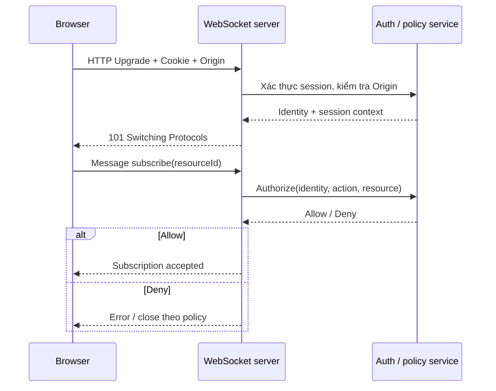

# Authorization

## Mục tiêu bài học

Sau bài này, bạn có thể:

- Phân biệt xác thực danh tính trong quá trình WebSocket handshake với việc cấp quyền cho từng thao tác sau khi kết nối.
- Chọn cách xác thực phù hợp cho WebSocket trên trình duyệt, nơi API `WebSocket` không cho đặt tùy ý HTTP header như `Authorization`.
- Phòng chống Cross-Site WebSocket Hijacking (CSWSH) bằng kiểm tra `Origin`, cookie phù hợp và kiểm soát phiên.
- Thiết kế authorization theo user, resource, action và tenant cho từng message, subscription và lần gửi dữ liệu.
- Xử lý hết hạn session, thu hồi quyền, logout, reconnect và kết nối WebSocket kéo dài.
- Kiểm thử các trường hợp truy cập trái phép và ghi nhận bằng chứng bằng DevTools cùng log phía server.

## 1. Authentication và authorization trong WebSocket

WebSocket bắt đầu bằng một HTTP opening handshake. Nếu server chấp nhận yêu cầu nâng cấp giao thức, kết nối chuyển sang trao đổi frame hai chiều. Sau bước này, ứng dụng có thể gửi nhiều message qua cùng một kết nối trong thời gian dài.

Hai câu hỏi bảo mật cần được xử lý riêng:

- **Authentication (xác thực):** kết nối thuộc về người dùng, dịch vụ hoặc client nào? Server xác định danh tính và session bằng cách nào?
- **Authorization (ủy quyền):** danh tính đó được phép thực hiện hành động nào, trên resource nào, trong tenant nào và ở thời điểm nào?

Một handshake hợp lệ chỉ cho biết server chấp nhận kết nối và có thể đã xác định danh tính. Điều đó không đồng nghĩa người dùng được phép đọc mọi room, subscribe mọi channel, gửi mọi lệnh hoặc truy cập mọi đối tượng mà client nêu trong message.

Ví dụ, người dùng có thể được phép mở WebSocket để nhận thông báo cá nhân nhưng không có quyền subscribe vào `admin-events`. Người dùng thuộc tenant A có thể được phép đọc ticket của tenant A nhưng không được đổi `tenantId` trong message để đọc ticket của tenant B. Server phải kiểm tra quyền cho từng thao tác và từng resource, không dựa vào việc kết nối đã được chấp nhận.

## 2. Các giai đoạn của một kết nối có bảo vệ

Một quy trình an toàn thường có các bước:

1. Trình duyệt mở kết nối `wss://` đến endpoint dự kiến.
2. Server kiểm tra endpoint, `Origin`, chính sách kết nối và xác thực session hoặc ticket.
3. Server nâng cấp kết nối sau khi handshake vượt qua các kiểm tra bắt buộc.
4. Mỗi message được parse, kiểm tra schema, xác định action/resource và kiểm tra quyền ở server.
5. Mỗi lần subscribe hoặc tham gia room đều được authorize riêng.
6. Khi gửi dữ liệu đến client, server kiểm tra client còn quyền nhận dữ liệu đó.
7. Khi session hết hạn, người dùng logout hoặc quyền thay đổi, server dừng thao tác liên quan và đóng hoặc cập nhật kết nối.



Sơ đồ mô tả một luồng dùng cookie session. Nếu hệ thống xác thực sau khi kết nối, handshake chỉ tạo trạng thái chưa xác thực; server phải giới hạn trạng thái đó và yêu cầu một message xác thực trước khi chấp nhận bất kỳ action nghiệp vụ nào.

## 3. Xác thực trong WebSocket handshake

### 3.1. Dùng session cookie

Với ứng dụng web cùng site, một cách phổ biến là dùng session cookie bảo mật. Trình duyệt có thể tự gửi cookie phù hợp trong WebSocket handshake theo quy tắc cookie và chính sách quyền riêng tư của nó. Cookie session nên được cấu hình tối thiểu theo nhu cầu:

```http
Set-Cookie: __Host-session=opaque-session-id; Path=/; Secure; HttpOnly; SameSite=Lax
```

Tiền tố `__Host-` yêu cầu cookie được đặt từ secure origin, có `Path=/` và không có thuộc tính `Domain`. `HttpOnly` ngăn JavaScript đọc cookie; `Secure` giới hạn việc gửi qua HTTPS/WSS. `SameSite` giúp giảm một số request cross-site mang cookie, nhưng không nên dùng nó làm biện pháp duy nhất chống CSWSH. Chọn `Lax` hay `Strict` theo luồng điều hướng và đăng nhập của ứng dụng; không nới lỏng sang `None` nếu không có nhu cầu và kiểm soát bổ sung.

Server cần xác minh session ở thời điểm handshake, kiểm tra session còn hiệu lực và ánh xạ session sang identity cùng tenant context. Không tin một `userId` do client gửi trong query hoặc message để xác định chủ sở hữu kết nối.

### 3.2. Giới hạn của WebSocket API trên trình duyệt

API WebSocket gốc của trình duyệt nhận URL và danh sách subprotocol:

```js
const socket = new WebSocket(
  "wss://app.example.com/realtime",
  ["app-events-v1"]
);
```

API này không có tham số để ứng dụng tùy ý đặt HTTP header `Authorization` hoặc header tùy chỉnh trong opening handshake. Vì vậy, ví dụ sau không phải cú pháp hợp lệ của WebSocket API trình duyệt:

```js
// Không được WebSocket API trong trình duyệt hỗ trợ.
const socket = new WebSocket("wss://app.example.com/realtime", {
  headers: { Authorization: "Bearer token" }
});
```

Một số thư viện WebSocket phía server hoặc môi trường Node.js cho phép cấu hình header; điều đó không có nghĩa API trình duyệt cũng có khả năng này. Khi thiết kế client web, hãy chọn phương thức xác thực phù hợp với giới hạn của trình duyệt.

### 3.3. Ticket ngắn hạn dùng một lần

Nếu không thể hoặc không muốn dựa vào cookie session trực tiếp, ứng dụng có thể gọi một HTTPS endpoint đã xác thực để lấy ticket WebSocket ngắn hạn. Ticket cần:

- Có thời hạn rất ngắn và chỉ sử dụng một lần.
- Được ràng buộc với user, tenant, mục đích và endpoint dự kiến.
- Bị tiêu thụ nguyên tử ở server để hai kết nối không thể dùng lại cùng ticket.
- Không cấp quyền rộng hơn nhu cầu của kết nối.
- Không xuất hiện trong log, analytics hoặc thông báo lỗi; log reverse proxy cần che query chứa ticket.

Ví dụ client:

```js
async function connectRealtime() {
  const response = await fetch("/api/realtime-ticket", {
    method: "POST",
    credentials: "same-origin",
    headers: {
      "Content-Type": "application/json",
      "X-CSRF-Token": readCsrfToken()
    },
    body: JSON.stringify({ purpose: "notifications" })
  });

  if (!response.ok) {
    throw new Error("Cannot obtain a WebSocket ticket.");
  }

  const { ticket } = await response.json();
  const url = new URL("/realtime", location.origin);
  url.protocol = url.protocol === "https:" ? "wss:" : "ws:";
  url.searchParams.set("ticket", ticket);

  return new WebSocket(url, ["app-events-v1"]);
}
```

Đoạn code minh họa một lựa chọn, không phải lý do để bỏ qua bảo vệ endpoint cấp ticket. Endpoint HTTPS phải xác thực session, chống CSRF phù hợp và chỉ cấp ticket sau khi kiểm tra người dùng có quyền dùng chức năng realtime. Vì ticket nằm trong URL, server và hạ tầng cần redact query string khỏi access log, trace và telemetry. Ticket dùng một lần và hết hạn nhanh giúp giảm hậu quả khi bị lộ, nhưng không loại bỏ hoàn toàn rủi ro từ URL logging.

Không nên đặt access token dài hạn hoặc refresh token vào query string. URL có thể xuất hiện trong log proxy, APM, lịch sử công cụ debug và báo cáo lỗi. Tránh dùng query token sống lâu để xác thực WebSocket.

### 3.4. Không dùng subprotocol như một nơi chứa bí mật

Tham số thứ hai của `WebSocket` dành cho tên subprotocol, ví dụ `app-events-v1`. Server có thể chọn một subprotocol trong handshake để thống nhất định dạng message. Không nên nhét bearer token vào subprotocol: giá trị này tham gia handshake, có thể được ghi log và không phải cơ chế quản lý credential chuyên dụng.

## 4. Chống Cross-Site WebSocket Hijacking (CSWSH)

CSWSH xảy ra khi một website độc hại khiến trình duyệt của nạn nhân mở WebSocket đến một ứng dụng khác và browser tự gửi cookie session của ứng dụng đích. Nếu server chấp nhận kết nối mà không xác minh nguồn khởi tạo, trang độc hại có thể dùng kết nối đó để thực hiện hành động dưới danh tính của nạn nhân. Nếu server gửi dữ liệu riêng tư qua kết nối, trang độc hại còn có thể nhận dữ liệu đó.

WebSocket handshake không dùng CORS preflight và không được bảo vệ chỉ bằng `Access-Control-Allow-Origin`. Server phải tự áp dụng chính sách cho WebSocket endpoint.

### 4.1. Kiểm tra Origin ở server

Trình duyệt gửi header `Origin` trong WebSocket handshake. Với endpoint chỉ phục vụ ứng dụng web đã biết, server nên so khớp chính xác với allowlist origin:

```js
const allowedOrigins = new Set([
  "https://app.example.com",
  "https://admin.example.com"
]);

function isAllowedBrowserOrigin(request) {
  const origin = request.headers.origin;
  return typeof origin === "string" && allowedOrigins.has(origin);
}
```

Không dùng kiểm tra chuỗi kiểu `origin.endsWith("example.com")`; cách đó có thể chấp nhận host giả như `attackerexample.com` hoặc subdomain không được kiểm soát. Hãy parse/so khớp origin chính xác gồm scheme, hostname và port. Không phản chiếu origin bất kỳ về phía client rồi coi đó là xác thực.

Header `Origin` là tín hiệu quan trọng cho browser client, nhưng không phải bằng chứng danh tính phổ quát. Client ngoài trình duyệt có thể tự tạo header này. Server vẫn phải xác thực credential độc lập. Nếu endpoint phục vụ cả browser lẫn service client, hãy xác định chính sách rõ cho client không gửi `Origin` và dùng credential/mTLS hoặc cơ chế tương ứng để xác thực chúng.

### 4.2. Kết hợp cookie và SameSite

Cookie `SameSite=Lax` hoặc `Strict` có thể ngăn cookie được gửi trong nhiều ngữ cảnh cross-site, tùy cách khởi tạo kết nối và chính sách trình duyệt. Cookie `SameSite=None` có thể được gửi trong ngữ cảnh cross-site nếu đáp ứng yêu cầu `Secure` và không bị chính sách third-party cookie chặn. Vì hành vi phụ thuộc trình duyệt, site relationship và cấu hình cookie, hãy coi SameSite là lớp phòng vệ bổ sung.

Đối với endpoint xác thực bằng cookie:

- Kiểm tra `Origin` trước khi nâng cấp kết nối.
- Xác thực session cookie và kiểm tra trạng thái session ở server.
- Dùng `SameSite` phù hợp và không đặt cookie rộng hơn domain cần thiết.
- Không chấp nhận `Origin: null` hoặc origin vắng mặt cho browser endpoint nếu không có yêu cầu được thiết kế rõ.
- Không dựa vào CORS response header để bảo vệ WebSocket.

## 5. Xác thực sau khi kết nối

Một số hệ thống thiết lập WebSocket trước, sau đó gửi message đầu tiên để xác thực. Cách này có thể dùng khi hạ tầng không thuận tiện xác thực credential ở handshake, nhưng tạo ra trạng thái kết nối chưa xác thực. Server phải áp dụng giới hạn nghiêm ngặt:

- Chỉ chấp nhận một loại message `authenticate` trong giai đoạn này.
- Đặt timeout ngắn; nếu không xác thực thành công, đóng kết nối.
- Giới hạn kích thước và số lượng message trước xác thực.
- Không cho phép subscribe, publish, request dữ liệu hoặc gọi action nghiệp vụ trước khi xác thực.
- Không ghi credential hoặc payload bí mật vào log.
- Sau xác thực, gắn identity vào context do server quản lý; không lấy lại identity từ các field do client gửi ở mỗi message.

Ví dụ luồng message:

```json
{
  "type": "authenticate",
  "ticket": "short-lived-single-use-ticket"
}
```

Server xác minh ticket, tiêu thụ ticket một lần, tạo session context và chỉ sau đó mới chấp nhận message nghiệp vụ. Nếu ticket sai, hết hạn hoặc đã dùng, server đóng kết nối theo policy. Ticket không được cấp quyền vĩnh viễn; quyền của identity vẫn phải được kiểm tra cho từng action.

## 6. Authorization cho từng message

Sau khi xác thực, mọi message vẫn là input không tin cậy. Client có thể sửa JavaScript, gửi frame thủ công, replay message hoặc thay ID trong payload. Server cần xác định action, resource và principal từ context đáng tin cậy rồi thực hiện authorization.

Một message nghiệp vụ có thể có cấu trúc:

```json
{
  "type": "ticket.update",
  "requestId": "req-8f3a",
  "ticketId": "ticket-1042",
  "changes": {
    "status": "in_progress"
  }
}
```

Server không được tin `userId`, `role`, `tenantId`, `isAdmin` hoặc quyền do client đưa vào message. Những giá trị này phải lấy từ session context hoặc dữ liệu quyền phía server. `ticketId` chỉ là định danh đối tượng; biết ID không có nghĩa có quyền truy cập.

Quy trình kiểm tra một message:

1. Kiểm tra frame text/binary, giới hạn kích thước và parse an toàn.
2. Kiểm tra schema, loại message, kiểu dữ liệu và các trường bắt buộc.
3. Xác định action từ allowlist server-side, ví dụ `ticket.read`, `ticket.update` hoặc `notifications.subscribe`.
4. Lấy principal, tenant và session từ context gắn với kết nối.
5. Tải resource từ server và xác định owner/tenant/state thực tế.
6. Kiểm tra quyền trên action và resource theo policy hiện hành.
7. Thực hiện thay đổi trong transaction nếu cần, kiểm tra lại các điều kiện nghiệp vụ và chống replay/idempotency khi phù hợp.
8. Chỉ gửi kết quả hoặc broadcast đến những client đã được phép nhận dữ liệu.

Ví dụ minh họa với thư viện `ws` trong Node.js:

```js
async function handleMessage(connection, rawMessage) {
  if (!connection.principal) {
    throw new Error("UNAUTHENTICATED");
  }

  const message = JSON.parse(rawMessage.toString());
  validateMessageSchema(message);

  if (message.type === "ticket.read") {
    const ticket = await ticketRepository.findById(message.ticketId);
    if (!ticket) throw new Error("NOT_FOUND");

    await policy.require({
      principal: connection.principal,
      action: "ticket.read",
      resource: ticket
    });

    connection.socket.send(JSON.stringify({
      type: "ticket.data",
      requestId: message.requestId,
      ticket: toClientTicket(ticket)
    }));
    return;
  }

  throw new Error("UNSUPPORTED_MESSAGE");
}
```

`connection.principal` phải do server thiết lập sau khi xác thực, không được gán từ payload của client. `validateMessageSchema`, `ticketRepository`, `policy` và `toClientTicket` là các thành phần của ứng dụng cần triển khai. Trong production, xử lý lỗi có kiểm soát, tránh trả chi tiết nội bộ và không để exception chưa được bắt làm dừng tiến trình.

## 7. Authorization cho room, channel và subscription

Nhiều ứng dụng realtime cho phép client subscribe room hoặc channel. Đây là một hành động cần authorization riêng. Không nên cho client tự tham gia room chỉ bằng cách gửi tên room.

Ví dụ request:

```json
{
  "type": "room.subscribe",
  "roomId": "tenant-17:orders"
}
```

Server cần:

- Xác định room từ dữ liệu server, không dùng chuỗi client gửi như bằng chứng quyền.
- Xác minh principal thuộc tenant tương ứng và có quyền subscribe loại sự kiện đó.
- Kiểm tra resource đang hoạt động và người dùng còn được phép xem.
- Gắn subscription vào context server-side và lưu metadata để có thể thu hồi.
- Kiểm tra quyền trước khi broadcast; không chỉ kiểm tra lúc subscribe một lần rồi để kết nối tồn tại vô thời hạn.
- Xóa subscription khi logout, session hết hạn, rời tenant hoặc quyền bị thu hồi.

Với room nhiều tenant, namespace có thể giúp tổ chức dữ liệu nhưng không phải cơ chế bảo vệ. Ví dụ `tenant-17:orders` không an toàn nếu client có thể tự chọn `tenant-18:orders` và server không kiểm tra membership.

Khi broadcast, hãy lọc người nhận theo quyền hiện tại. Một user có thể bị xóa khỏi dự án trong lúc socket vẫn mở; nếu server tiếp tục phát sự kiện của dự án cho socket đó, kiểm tra quyền ban đầu đã trở nên lỗi thời.

## 8. Authorization theo tenant và resource ownership

Ứng dụng đa tenant cần kiểm tra tenant ở server trên mọi thao tác. Không dùng tenant ID từ message làm nguồn chân lý. Có thể dùng tenant context trong session sau khi người dùng chọn tenant, nhưng server vẫn phải xác minh người dùng còn là thành viên và quyền chưa bị thu hồi.

Một policy có thể xét nhiều điều kiện:

| Thành phần | Ví dụ câu hỏi |
| --- | --- |
| Principal | Người dùng hoặc service nào đang thực hiện thao tác? |
| Action | Có quyền `document.read`, `document.update` hay `room.subscribe` không? |
| Resource | Đối tượng có tồn tại, thuộc owner nào và có trạng thái gì? |
| Tenant | Resource có thuộc tenant đang được phép truy cập không? |
| Context | Session còn hiệu lực? MFA có bắt buộc? Kết nối có vượt rate limit không? |
| Time/state | Tài nguyên có đang khóa, đã đóng hoặc quá thời hạn thao tác không? |

Ví dụ, quyền `document.update` có thể yêu cầu user là thành viên tenant chứa document và có role editor trên workspace đó. Một role `editor` ở tenant A không tự động cấp quyền chỉnh sửa document của tenant B.

Kiểm tra quyền cần gắn với truy vấn dữ liệu khi có thể. Thay vì tải một object bất kỳ theo ID rồi tin rằng client sẽ không sửa ID, hãy giới hạn truy vấn theo tenant/user và tiếp tục kiểm tra action. Cách này giúp giảm lỗi IDOR/BOLA (Insecure Direct Object Reference / Broken Object Level Authorization).

## 9. Quản lý session, hết hạn và thu hồi quyền

WebSocket là kết nối dài hạn. Một session có thể hết hạn hoặc quyền người dùng có thể thay đổi trong khi kết nối vẫn đang mở. Nếu chỉ xác thực ở handshake, kết nối có thể tiếp tục hoạt động với quyền cũ.

Hệ thống nên có chiến lược vòng đời rõ ràng:

- Theo dõi thời điểm hết hạn session và đóng kết nối hoặc yêu cầu xác thực lại khi đến hạn.
- Khi logout hoặc thu hồi session, server tìm các kết nối gắn với session đó và đóng chúng.
- Khi người dùng bị xóa khỏi tenant/project/room, thu hồi subscription liên quan ngay hoặc trong thời gian giới hạn được xác định.
- Khi role/permission thay đổi, cập nhật policy context và đánh giá lại các subscription/connection đang tồn tại.
- Không cho phép reconnect tự động dùng mã xác thực cũ đã hết hạn hoặc bị thu hồi.
- Nếu cần refresh credential, dùng HTTPS endpoint để cấp ticket mới và giới hạn quyền, thời gian sống.
- Khi server khởi động lại hoặc connection mất, client phải xác thực và subscribe lại theo policy mới; không tin trạng thái cũ lưu ở client.

Một cách triển khai là lưu chỉ mục từ session ID hoặc user ID đến danh sách socket ở server/distributed connection registry. Khi session bị thu hồi, server gửi close frame đến các kết nối tương ứng. Với hệ thống nhiều node, sự kiện logout và thay đổi quyền cần được phát qua cơ chế phân phối nội bộ để mọi node cập nhật kết nối do nó quản lý.

Không chỉ đóng kết nối khi logout mà bỏ qua dữ liệu đã gửi trước đó. Dữ liệu đã đến client không thể bị thu hồi khỏi bộ nhớ, screenshot hoặc log của client. Vì vậy, chỉ gửi những dữ liệu người dùng được phép nhận và giới hạn độ nhạy cảm của payload realtime.

## 10. Bảo vệ message và connection khỏi lạm dụng

Authorization đúng vẫn cần đi kèm kiểm soát input và tài nguyên. WebSocket cho phép client gửi nhiều frame liên tục, nên một kết nối hợp lệ có thể bị lạm dụng để gây quá tải hoặc tạo side effect lặp.

Áp dụng các kiểm soát sau:

- Giới hạn frame/message size, số message mỗi giây, số connection theo user/IP và số subscription mỗi connection.
- Parse JSON an toàn, validate schema, từ chối field không hỗ trợ và giới hạn độ sâu/cỡ collection.
- Kiểm tra binary message theo định dạng và giới hạn kích thước; không tin MIME type do client khai báo.
- Dùng request ID và idempotency key cho thao tác có side effect để giảm xử lý lặp khi reconnect hoặc retry.
- Áp dụng rate limit riêng cho login/authenticate, subscribe, publish và action nhạy cảm.
- Có timeout cho handshake, trạng thái chưa xác thực và request nghiệp vụ chưa hoàn thành.
- Quản lý backpressure; nếu client không đọc kịp, giới hạn buffer hoặc đóng kết nối thay vì giữ bộ nhớ vô hạn.
- Dùng ping/pong hoặc heartbeat theo thư viện để phát hiện connection chết và dọn tài nguyên.
- Tránh gửi stack trace, SQL error, session ID hoặc policy nội bộ qua error message cho client.

Khi gửi event cho nhiều người nhận, kiểm tra quyền tại điểm publish và/hoặc điểm fan-out. Không dùng một lần kiểm tra quyền của người gửi để suy ra tất cả người nhận đều có quyền xem payload.

## 11. Ví dụ kiểm soát handshake với Node.js và `ws`

Đoạn ví dụ sau minh họa cách kiểm tra origin và session trước khi nâng cấp kết nối. Các hàm đọc cookie, xác thực session và policy cần được cung cấp bởi ứng dụng:

```js
import { WebSocketServer } from "ws";

const allowedOrigins = new Set([
  "https://app.example.com"
]);

const wss = new WebSocketServer({ noServer: true, maxPayload: 64 * 1024 });

httpServer.on("upgrade", async (request, socket, head) => {
  try {
    const origin = request.headers.origin;
    if (!origin || !allowedOrigins.has(origin)) {
      socket.end("HTTP/1.1 403 Forbidden\r\nConnection: close\r\n\r\n");
      return;
    }

    const session = await authenticateSessionFromCookie(request.headers.cookie);
    if (!session || session.revoked || session.expiresAt <= Date.now()) {
      socket.end("HTTP/1.1 401 Unauthorized\r\nConnection: close\r\n\r\n");
      return;
    }

    wss.handleUpgrade(request, socket, head, (ws) => {
      ws.principal = {
        userId: session.userId,
        tenantId: session.activeTenantId,
        sessionId: session.id
      };
      wss.emit("connection", ws, request);
    });
  } catch {
    socket.destroy();
  }
});
```

Đây là khung tích hợp, không phải server hoàn chỉnh. Trong thực tế cần xử lý lỗi socket, timeout, cookie parsing an toàn, session lookup, proxy trust và việc đóng kết nối khi session bị thu hồi. Nếu endpoint chấp nhận client không phải trình duyệt, cần một nhánh xác thực riêng có chủ đích; không bỏ qua `Origin` cho mọi request chỉ vì một số client không gửi header này.

Sau handshake, handler message vẫn phải gọi policy cho từng action/resource. Thuộc tính `ws.principal` chỉ là identity context đã được server thiết lập; quyền có thể thay đổi theo thời gian và cần được kiểm tra lại.

## 12. Kiểm thử authorization

Kiểm thử cần tập trung vào những gì server thực sự cho phép, không chỉ xem giao diện có ẩn nút hay không. Dùng tài khoản thử thuộc các role và tenant khác nhau.

| Kịch bản | Cách kiểm tra | Kết quả mong đợi |
| --- | --- | --- |
| Không có session | Mở WebSocket đến endpoint mà không gửi credential. | Server từ chối handshake hoặc giữ trạng thái chưa xác thực với timeout và giới hạn chặt. |
| Session hết hạn/đã thu hồi | Dùng cookie session hết hạn hoặc logout rồi thử mở kết nối mới. | Server từ chối kết nối. |
| Origin không được phép | Từ trang lab ở origin khác, mở WebSocket đến endpoint cookie-authenticated. | Server từ chối trước khi nâng cấp kết nối. |
| Origin giả hoặc thiếu | Thử origin gần giống allowlist, `null` hoặc thiếu header. | Server áp dụng policy chính xác; không chấp nhận bằng so khớp chuỗi lỏng. |
| User A đọc resource của B | Kết nối bằng A rồi gửi `ticket.read` với ID của B. | Server trả lỗi không tiết lộ dữ liệu hoặc từ chối theo policy. |
| Thay tenant ID | Giữ session tenant A nhưng gửi `tenantId` của B. | Server dùng tenant context đáng tin cậy và từ chối truy cập B. |
| Subscribe room quản trị | User thường gửi message subscribe room admin. | Không tạo subscription và không nhận event quản trị. |
| Quyền bị thu hồi khi đang kết nối | Mở socket, sau đó gỡ user khỏi project hoặc hạ role. | Subscription bị thu hồi và các thao tác tiếp theo bị từ chối. |
| Replay action | Gửi lại cùng message thay đổi trạng thái nhiều lần. | Idempotency hoặc kiểm tra state ngăn side effect lặp ngoài ý muốn. |
| Flood message | Gửi frame lớn hoặc nhiều message liên tục. | Server áp dụng giới hạn, giữ tài nguyên ổn định và đóng kết nối lạm dụng. |
| Reconnect sau logout | Logout, để client tự reconnect bằng credential cũ. | Kết nối mới bị từ chối; client cần xác thực lại. |
| Broadcast nhầm tenant | Phát event tenant A trong khi socket của tenant B đang subscribe. | Chỉ client được phép của tenant A nhận event. |

### 12.1. Quan sát bằng DevTools

Trong Chrome/Edge DevTools, mở Network và lọc theo WS. Chọn kết nối để xem request handshake, status `101 Switching Protocols` khi thành công, request headers, response headers và danh sách frame. Hãy lưu ý:

- Network panel hiển thị được handshake và frame để debug; điều đó không có nghĩa client được quyền đọc cookie `HttpOnly`.
- Kiểm tra `Origin`, cookie có được gửi hay không, status khi bị từ chối và các frame subscribe/action.
- Không chia sẻ HAR hoặc ảnh chụp có chứa cookie, ticket, session ID hay dữ liệu cá nhân.
- Đối chiếu log server để biết action nào được authorize/deny, nhưng log phải che credential và payload nhạy cảm.

## 13. Những lỗi thường gặp

| Lỗi | Hậu quả | Cách khắc phục |
| --- | --- | --- |
| Chỉ xác thực ở handshake rồi tin mọi message | User hợp lệ có thể gọi action hoặc đọc resource ngoài quyền. | Authorize từng action/resource và subscription. |
| Tin `userId`, `role` hoặc `tenantId` từ payload | Client có thể giả danh hoặc đổi tenant. | Lấy principal/tenant từ context phía server và kiểm tra membership. |
| Cho phép mọi `Origin` khi dùng cookie session | Website độc hại có thể tạo kết nối dưới session của nạn nhân (CSWSH). | Allowlist origin chính xác trước khi upgrade, kết hợp cookie phù hợp. |
| Nghĩ CORS header bảo vệ WebSocket | WebSocket handshake không dựa vào CORS preflight như Fetch/XHR. | Thực hiện kiểm tra Origin và authentication ngay ở WebSocket server. |
| Đặt access token dài hạn trong URL | Token có thể lọt vào log, trace hoặc telemetry. | Dùng cookie bảo mật hoặc ticket ngắn hạn một lần và redact log. |
| Cho client tự chọn room/channel | Có thể đọc event của user hoặc tenant khác. | Authorize từng subscription và kiểm tra người nhận khi broadcast. |
| Không kiểm tra quyền khi session thay đổi | Kết nối dài hạn tiếp tục dùng quyền đã bị thu hồi. | Theo dõi session/permission và đóng hoặc cập nhật socket/subscription. |
| Chỉ ẩn nút trên giao diện | Client có thể tự tạo message và bỏ qua UI. | Thực thi authorization ở server cho mọi message. |

## 14. Bài thực hành

Xây dựng một WebSocket endpoint thử nghiệm cho ứng dụng thông báo có hai tenant và ít nhất hai role. Dùng tài khoản giả, dữ liệu giả và môi trường local/staging.

1. Thiết lập endpoint `wss://` hoặc HTTPS local phù hợp; ghi lại origin được phép.
2. Xác thực session ở handshake và kiểm tra `Origin` theo allowlist chính xác.
3. Tạo hai loại message: `notifications.subscribe` và `ticket.read`. Không cho client gửi role hoặc user ID để tự xác định quyền.
4. Thiết lập policy theo tenant và resource ownership. Kiểm tra user tenant A không thể đọc ticket hoặc subscribe room của tenant B.
5. Thu hồi session hoặc role trong khi socket đang mở; xác nhận server đóng kết nối hoặc từ chối thao tác tiếp theo.
6. Thử kết nối từ origin không được phép, không có session, session hết hạn và ticket đã dùng.
7. Thử message sai schema, frame quá lớn và flood; xác nhận giới hạn hoạt động.
8. Ghi lại request handshake, frame, quyết định allow/deny và bằng chứng đã che thông tin nhạy cảm.

Hoàn thành bài thực hành khi bạn chứng minh được server xác định danh tính ở đâu, quyền được kiểm tra cho từng hành động và resource như thế nào, kết nối bị thu hồi ra sao khi session hoặc role thay đổi, và một trang ở origin không được phép không thể sử dụng cookie của người dùng để chiếm WebSocket session.
