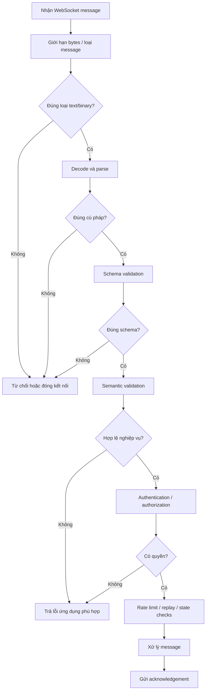

# Kiểm tra payload message: xác thực dữ liệu trao đổi qua WebSocket

WebSocket duy trì một kết nối hai chiều để client và server trao đổi message sau khi handshake hoàn tất. Kết nối đã được thiết lập không có nghĩa mọi message gửi qua đó đều đáng tin cậy. Client có thể bị sửa bằng DevTools, script cùng origin có thể bị khai thác qua XSS, và bất kỳ client tùy chỉnh nào cũng có thể gửi message sai cấu trúc, quá lớn hoặc yêu cầu hành động mà người gửi không được phép thực hiện.

**Kiểm tra payload message** là quá trình xác nhận từng message đáp ứng hợp đồng dữ liệu, giới hạn tài nguyên và quy tắc nghiệp vụ trước khi ứng dụng xử lý. Server phải thực hiện validation độc lập cho mọi message; kiểm tra ở client chỉ giúp giao diện thân thiện hơn. Một message hợp lệ về JSON vẫn có thể không hợp lệ về quyền, trạng thái hoặc nghiệp vụ.

Bài học thuộc chương **WebSocket**, theo đề bài **Kiểm tra payload message**, trong phạm vi **SECURITY_APPLICATION_SECURITY_BROWSER_SECURITY**: phân tích ranh giới bảo mật giữa trình duyệt, origin, cookie và ứng dụng web để hiểu Same-Origin Policy, CORS và các cơ chế cách ly; thực hành phòng vệ XSS, CSRF, clickjacking bằng CSP, Trusted Types, security headers và kiểm chứng hành vi thực tế.

## 1. Mục tiêu học tập

Sau bài học, người học có thể:

1. Phân biệt WebSocket handshake, frame và message.
2. Xây dựng message envelope có type, version, request ID và payload rõ ràng.
3. Kiểm tra text message, JSON và binary payload trước khi xử lý.
4. Dùng schema validation để giới hạn field, kiểu dữ liệu, độ dài và giá trị.
5. Bổ sung validation ngữ nghĩa, authentication và authorization cho từng message.
6. Giới hạn kích thước, tốc độ, độ sâu và chi phí xử lý để giảm nguy cơ DoS.
7. Xử lý message lỗi bằng close code phù hợp mà không tiết lộ dữ liệu nội bộ.
8. Tránh XSS khi hiển thị nội dung nhận từ WebSocket.
9. Thiết kế idempotency, sequence và chống replay cho message thay đổi trạng thái.
10. Kiểm thử payload hợp lệ, sai schema, quá lớn, sai quyền và binary bằng DevTools.

## 2. WebSocket message là ranh giới dữ liệu không tin cậy

WebSocket bắt đầu bằng HTTP handshake, sau đó chuyển sang giao thức WebSocket để trao đổi frame. Một message có thể gồm một hoặc nhiều frame; thư viện WebSocket thường ghép các fragment thành message trước khi đưa dữ liệu lên API ứng dụng.

Trong browser, sự kiện message cung cấp dữ liệu đã được browser giải mã theo loại message:

- Text message thường xuất hiện dưới dạng JavaScript string.
- Binary message xuất hiện dưới dạng Blob hoặc ArrayBuffer tùy binaryType.

Ở server, thư viện có thể cung cấp Buffer hoặc kiểu byte tương đương và một cờ cho biết message là binary. Chi tiết phụ thuộc thư viện, nhưng ứng dụng cần xác định rõ protocol đang chấp nhận text, binary hay cả hai.

### Handshake không validate payload

Handshake có thể xác thực người dùng, kiểm tra Origin và quyết định chấp nhận kết nối. Sau khi kết nối mở, mỗi message vẫn là input mới và phải được kiểm tra:

1. Message có đúng loại được hỗ trợ không?
2. Payload có đúng định dạng và schema không?
3. Kích thước và cấu trúc có nằm trong giới hạn không?
4. Người dùng hiện tại có được phép thực hiện hành động không?
5. Trạng thái nghiệp vụ có cho phép hành động ở thời điểm này không?

Không suy luận rằng kết nối đã authenticated thì mọi message từ kết nối đó đều hợp lệ. Quyền có thể khác nhau theo room, resource, tenant hoặc hành động.

### Frame khác message

Frame là đơn vị truyền ở tầng giao thức. Message là dữ liệu ứng dụng nhận được sau khi các frame liên quan được ghép lại. Giới hạn payload nên được áp dụng ở tầng WebSocket server/thư viện trước khi ứng dụng parse hoặc cấp phát thêm bộ nhớ.

Không tự viết bộ ghép fragment nếu thư viện WebSocket đã đảm nhiệm việc đó. Dùng thư viện được duy trì và cấu hình giới hạn message rõ ràng.

## 3. Thiết kế hợp đồng message

Một protocol dễ kiểm tra nên có envelope thống nhất. Ví dụ:

```json
{
  "type": "chat.send",
  "version": 1,
  "requestId": "req_7f82a9c4",
  "payload": {
    "text": "Xin chào"
  }
}
```

Các field có vai trò riêng:

| Field | Mục đích | Quy tắc nên áp dụng |
| --- | --- | --- |
| type | Phân biệt loại hành động/message | Chỉ nhận giá trị trong allowlist. |
| version | Phiên bản schema/protocol | Chỉ hỗ trợ version đã triển khai. |
| requestId | Liên kết request/response và chống xử lý trùng | Có độ dài/format giới hạn; duy nhất trong phạm vi phù hợp. |
| payload | Dữ liệu riêng của message type | Schema cụ thể theo type. |

Không nhận userId, role, tenantId hoặc quyền hạn từ payload để quyết định danh tính. Server phải lấy principal từ session đã xác thực trên connection và kiểm tra resource access ở phía server.

### Dùng discriminated message types

Thay vì một object lớn với nhiều field tùy chọn, định nghĩa từng message type:

```json
{
  "type": "presence.update",
  "version": 1,
  "requestId": "req_7f82a9c5",
  "payload": {
    "status": "away"
  }
}
```

Ví dụ hai loại message:

- chat.send: payload có text.
- presence.update: payload có status.

Mỗi type chỉ nhận những field cần thiết. Cách này giảm ambiguity và giúp server dễ áp dụng validation/authorization riêng cho từng hành động.

### Versioning và unknown fields

Protocol cần quy định cách xử lý version không hỗ trợ và field lạ:

- Từ chối version không hỗ trợ bằng lỗi protocol/application phù hợp.
- Với message nhạy cảm, ưu tiên từ chối field không được định nghĩa bằng additionalProperties: false.
- Nếu cần backward compatibility, định nghĩa rõ field mở rộng nào được phép và cách bỏ qua.
- Không âm thầm diễn giải field lạ thành hành động hoặc quyền mới.

Không thay đổi ý nghĩa một field cũ giữa các version mà không có migration/compatibility plan.

## 4. Các lớp kiểm tra payload

Validation nên được thực hiện theo thứ tự từ rẻ và giới hạn tài nguyên trước, tới kiểm tra ngữ nghĩa và quyền sau:



Các lớp có thể được tổ chức khác nhau trong code, nhưng không nên bỏ qua giới hạn bytes, schema và authorization.

### 4.1. Giới hạn kích thước trước khi parse

Payload lớn có thể tiêu thụ bộ nhớ và CPU trong quá trình nhận, giải mã, parse hoặc validate. Cấu hình max message size tại WebSocket server/thư viện là lớp bảo vệ đầu tiên.

Sau đó, ứng dụng có thể kiểm tra lại byte length theo giới hạn riêng của từng message type. Dùng byte length thay vì chỉ dùng số ký tự vì UTF-8 có thể dùng nhiều byte cho một ký tự.

### 4.2. Kiểm tra cú pháp

Với text protocol dùng JSON, parse có thể thất bại:

```js
function parseJsonMessage(raw) {
  try {
    return { ok: true, value: JSON.parse(raw) };
  } catch {
    return { ok: false, reason: 'invalid-json' };
  }
}
```

Không gửi nguyên exception hoặc stack trace về client. Ghi log mã lỗi và request/connection ID đã được làm sạch, không ghi payload nhạy cảm.

### 4.3. Schema validation

Schema xác nhận cấu trúc, kiểu dữ liệu, field bắt buộc, độ dài, miền giá trị và field bổ sung. JSON Schema là một lựa chọn phổ biến; có thể dùng validator như Ajv để compile schema và kiểm tra từng message.

Ví dụ schema cho hai message type:

```js
const messageSchema = {
  oneOf: [
    {
      type: 'object',
      additionalProperties: false,
      required: ['type', 'version', 'requestId', 'payload'],
      properties: {
        type: { const: 'chat.send' },
        version: { const: 1 },
        requestId: {
          type: 'string',
          minLength: 8,
          maxLength: 64,
          pattern: '^[A-Za-z0-9_-]+$'
        },
        payload: {
          type: 'object',
          additionalProperties: false,
          required: ['text'],
          properties: {
            text: {
              type: 'string',
              minLength: 1,
              maxLength: 2000
            }
          }
        }
      }
    },
    {
      type: 'object',
      additionalProperties: false,
      required: ['type', 'version', 'requestId', 'payload'],
      properties: {
        type: { const: 'presence.update' },
        version: { const: 1 },
        requestId: {
          type: 'string',
          minLength: 8,
          maxLength: 64,
          pattern: '^[A-Za-z0-9_-]+$'
        },
        payload: {
          type: 'object',
          additionalProperties: false,
          required: ['status'],
          properties: {
            status: {
              enum: ['online', 'away']
            }
          }
        }
      }
    }
  ]
};
```

Compile schema bằng Ajv:

```js
const Ajv = require('ajv');
const ajv = new Ajv({ allErrors: true });
const validateMessage = ajv.compile(messageSchema);

function validateSchema(message) {
  const valid = validateMessage(message);
  if (valid) return { ok: true };

  return {
    ok: false,
    errors: (validateMessage.errors || []).map((item) => ({
      path: item.instancePath,
      keyword: item.keyword
    }))
  };
}
```

Schema trên đặt giới hạn cho requestId, text và status, đồng thời từ chối field không được định nghĩa. Trong production, có thể tách schema thành module riêng và compile một lần lúc khởi động thay vì compile lại cho mỗi message.

Không đưa nguyên message hoặc dữ liệu người dùng vào error log. Nếu cần chẩn đoán, log path/keyword và correlation ID đã được kiểm soát.

### 4.4. Semantic validation

Một message có thể đúng schema nhưng sai nghiệp vụ. Ví dụ:

- chat.send có text hợp lệ nhưng room đã đóng.
- presence.update yêu cầu status hợp lệ nhưng người dùng đã hết session.
- order.cancel có ID đúng format nhưng đơn hàng đã hoàn tất.
- cursor.move có tọa độ hợp lệ về kiểu số nhưng nằm ngoài vùng cho phép.

Semantic validation cần kiểm tra trạng thái hiện tại, giới hạn nghiệp vụ, quan hệ giữa các field và dữ liệu authoritative từ server.

### 4.5. Authorization theo từng message

Authentication ở handshake xác định connection thuộc người dùng nào. Authorization phải kiểm tra người đó có được phép thực hiện hành động trên resource cụ thể hay không.

Ví dụ, không tin roomId do client gửi chỉ vì nó là string hợp lệ. Server phải xác minh principal thuộc room đó trước khi broadcast message.

## 5. Kiểm tra text message trong browser

Browser WebSocket API nhận message qua event:

```js
const socket = new WebSocket('wss://chat.example.test/ws');
socket.binaryType = 'arraybuffer';

socket.addEventListener('message', (event) => {
  console.log(typeof event.data, event.data);
});
```

Text frame thường cung cấp string. Binary frame sẽ được biểu diễn theo binaryType. Ứng dụng cần kiểm tra kiểu dữ liệu trước khi parse.

### Giới hạn byte và parse JSON

Ví dụ client xử lý text JSON:

```js
const MAX_MESSAGE_BYTES = 64 * 1024;

function getTextByteLength(value) {
  return new TextEncoder().encode(value).byteLength;
}

function parseIncomingText(raw) {
  if (typeof raw !== 'string') {
    return { ok: false, reason: 'unexpected-message-type' };
  }

  if (getTextByteLength(raw) > MAX_MESSAGE_BYTES) {
    return { ok: false, reason: 'message-too-large' };
  }

  try {
    return { ok: true, value: JSON.parse(raw) };
  } catch {
    return { ok: false, reason: 'invalid-json' };
  }
}
```

Giới hạn ở client giúp tránh xử lý payload không cần thiết, nhưng message đã được browser nhận và chuyển tới JavaScript trước khi handler chạy. Vì vậy, giới hạn bắt buộc phải được áp dụng ở server/network library trước khi parse và cấp phát dữ liệu lớn.

### Validate message nhận được

```js
socket.addEventListener('message', (event) => {
  const parsed = parseIncomingText(event.data);

  if (!parsed.ok) {
    console.warn('Rejected server message:', parsed.reason);
    return;
  }

  const message = parsed.value;
  if (!validateServerMessage(message)) {
    console.warn('Server message did not match the client schema.');
    return;
  }

  handleServerMessage(message);
});
```

validateServerMessage đại diện cho validator đã compile theo schema mà client hỗ trợ. Client validation giúp tránh lỗi UI và dữ liệu sai định dạng; server vẫn là nơi quyết định message có được chấp nhận hay không.

### Không đưa message text thẳng vào HTML

Payload có thể chứa HTML hoặc script. Khi hiển thị chat message, dùng text sink:

```js
function appendChatText(container, text) {
  const item = document.createElement('p');
  item.textContent = text;
  container.append(item);
}
```

Không gán dữ liệu message vào innerHTML hoặc template HTML không được sanitize. JSON parsing và schema validation không tự ngăn XSS; một string hợp lệ vẫn có thể chứa markup nguy hiểm.

## 6. Kiểm tra message gửi đi từ client

Client nên validate trước khi gửi để cải thiện UX, nhưng không được coi đó là security boundary.

```js
const MAX_OUTBOUND_BYTES = 16 * 1024;
const MAX_BUFFERED_BYTES = 256 * 1024;

function sendChatMessage(socket, text, requestId) {
  const message = {
    type: 'chat.send',
    version: 1,
    requestId,
    payload: { text }
  };

  if (typeof text !== 'string' ||
      text.length < 1 ||
      text.length > 2000) {
    throw new TypeError('Message text is outside allowed limits.');
  }

  const raw = JSON.stringify(message);
  const byteLength = new TextEncoder().encode(raw).byteLength;

  if (byteLength > MAX_OUTBOUND_BYTES) {
    throw new RangeError('Message is too large.');
  }

  if (socket.readyState !== WebSocket.OPEN) {
    throw new Error('WebSocket is not open.');
  }

  if (socket.bufferedAmount > MAX_BUFFERED_BYTES) {
    throw new Error('WebSocket send queue is full.');
  }

  socket.send(raw);
}
```

bufferedAmount là lượng dữ liệu đã được xếp hàng để gửi nhưng chưa truyền xong. Giới hạn queue giúp client tránh tiếp tục đẩy message khi mạng chậm. Server vẫn phải áp dụng rate limit và giới hạn message độc lập.

Không lấy requestId hoặc user identity từ dữ liệu không tin cậy để cấp quyền. Request ID chỉ dùng tương quan/deduplication; server phải xác thực và kiểm tra nó trong phạm vi phù hợp.

## 7. Kiểm tra binary payload

WebSocket có thể gửi binary data dưới dạng ArrayBuffer, TypedArray hoặc Blob. Nếu protocol chỉ chấp nhận JSON text, server nên từ chối binary message thay vì cố đoán cách decode.

Nếu ứng dụng cần binary protocol, hãy định nghĩa rõ:

- Magic bytes hoặc protocol identifier.
- Version.
- Message type.
- Độ dài từng phần và byte order.
- Giới hạn kích thước tổng và từng field.
- Cách xử lý byte dư, thiếu hoặc trường không hỗ trợ.
- Cách kiểm tra nội dung thực tế như ảnh, âm thanh hoặc file.

### Đọc binary an toàn

Ví dụ client nhận ArrayBuffer và kiểm tra kích thước trước khi decode:

```js
const MAX_BINARY_BYTES = 64 * 1024;

function inspectBinaryMessage(data) {
  if (!(data instanceof ArrayBuffer)) {
    return { ok: false, reason: 'expected-array-buffer' };
  }

  if (data.byteLength > MAX_BINARY_BYTES) {
    return { ok: false, reason: 'message-too-large' };
  }

  if (data.byteLength < 4) {
    return { ok: false, reason: 'header-too-short' };
  }

  const view = new DataView(data);
  const protocolVersion = view.getUint8(0);
  const messageType = view.getUint8(1);
  const payloadLength = view.getUint16(2, false);

  if (protocolVersion !== 1) {
    return { ok: false, reason: 'unsupported-version' };
  }

  if (payloadLength !== data.byteLength - 4) {
    return { ok: false, reason: 'invalid-payload-length' };
  }

  return {
    ok: true,
    messageType,
    payload: new Uint8Array(data, 4, payloadLength)
  };
}
```

Đây là format minh họa: một byte version, một byte type và hai byte payload length theo big-endian. Protocol thực tế cần quy định rõ giới hạn và semantics của từng message type.

### Kiểm tra file/image payload

Nếu binary message chứa file hoặc ảnh:

- Không tin filename, MIME type hoặc kích thước do client khai báo.
- Kiểm tra magic bytes và parse bằng thư viện phù hợp.
- Giới hạn kích thước sau giải nén và số lượng phần tử.
- Cân nhắc ảnh có kích thước pixel rất lớn dù file nén nhỏ.
- Không thực thi hoặc deserialize định dạng có khả năng chạy code.
- Lưu file ngoài web root hoặc trong object storage với quyền truy cập phù hợp.

Một payload nén nhỏ có thể bung ra rất lớn. Giới hạn byte truyền tải không thay thế giới hạn kích thước sau giải nén hoặc chi phí parse.

## 8. Validation phía server là bắt buộc

Client có thể bị sửa, bỏ qua hoặc thay thế hoàn toàn. Người dùng có thể gửi WebSocket message bằng script riêng, công cụ kiểm thử hoặc một client không phải browser. Vì vậy, mọi quy tắc bảo mật phải được kiểm tra ở server.

Ví dụ Node.js với thư viện ws:

```js
const { WebSocketServer, WebSocket } = require('ws');
const Ajv = require('ajv');

const MAX_MESSAGE_BYTES = 64 * 1024;
const wss = new WebSocketServer({
  port: 8080,
  maxPayload: MAX_MESSAGE_BYTES,
  perMessageDeflate: false
});

const ajv = new Ajv({ allErrors: true });
const validateMessage = ajv.compile(messageSchema);

function closeWithPolicyError(socket, code, reason) {
  if (socket.readyState === WebSocket.OPEN) {
    socket.close(code, reason);
  }
}

wss.on('connection', (socket, request) => {
  const principal = getAuthenticatedPrincipal(request);

  if (!principal) {
    closeWithPolicyError(socket, 1008, 'Authentication required');
    return;
  }

  socket.on('message', async (data, isBinary) => {
    if (isBinary) {
      closeWithPolicyError(socket, 1003, 'Text messages only');
      return;
    }

    if (data.length > MAX_MESSAGE_BYTES) {
      closeWithPolicyError(socket, 1009, 'Message too large');
      return;
    }

    let raw;
    try {
      raw = new TextDecoder('utf-8', {
        fatal: true
      }).decode(data);
    } catch {
      closeWithPolicyError(socket, 1007, 'Invalid UTF-8 data');
      return;
    }

    let message;
    try {
      message = JSON.parse(raw);
    } catch {
      closeWithPolicyError(socket, 1008, 'Invalid JSON message');
      return;
    }

    if (!validateMessage(message)) {
      closeWithPolicyError(socket, 1008, 'Invalid message schema');
      return;
    }

    try {
      const allowed = await authorizeMessage(principal, message);
      if (!allowed) {
        closeWithPolicyError(socket, 1008, 'Message not permitted');
        return;
      }

      await handleMessage(principal, message);
    } catch {
      closeWithPolicyError(socket, 1011, 'Message processing failed');
    }
  });
});
```

Đây là khung minh họa cho Node.js và ws; getAuthenticatedPrincipal, authorizeMessage và handleMessage là phần ứng dụng phải triển khai. Trong cấu hình production, authentication phải được hoàn tất theo handshake/session policy và principal cần gắn với connection một cách đáng tin cậy. Không lấy principal từ field do client gửi. Ví dụ tách kết quả không có quyền (1008) khỏi lỗi xử lý nội bộ (1011).

maxPayload giới hạn message ở tầng thư viện trước khi callback ứng dụng xử lý. Kiểm tra data.length là lớp phòng thủ bổ sung. Nếu dùng thư viện khác, tìm tùy chọn tương đương để giới hạn message trước khi parse.

perMessageDeflate: false tắt nén message trong ví dụ. Chỉ bật compression khi đã đánh giá CPU/memory cost, kích thước sau giải nén và rủi ro liên quan dữ liệu bí mật; không bật theo thói quen cho mọi kết nối.

### Kiểm tra UTF-8 và JSON

Với text message, dữ liệu phải là văn bản hợp lệ theo protocol. Ví dụ dùng TextDecoder ở chế độ fatal để từ chối chuỗi byte UTF-8 sai. Nếu thư viện server đã xác minh UTF-8 ở tầng protocol, vẫn cần xử lý lỗi parse JSON và schema.

Không chuyển binary thành string một cách mù quáng. Một binary payload có thể chứa byte không hợp lệ hoặc dữ liệu không thuộc text protocol.

## 9. Validation ngữ nghĩa, quyền và trạng thái

Schema chỉ trả lời dữ liệu có đúng hình dạng không. Server còn phải xác minh message có được phép trong ngữ cảnh hiện tại không.

Ví dụ chat.send:

1. Principal đã authenticated và session chưa hết hạn.
2. Principal là thành viên room được yêu cầu.
3. Room còn hoạt động và người dùng không bị mute/ban.
4. Text đáp ứng giới hạn nghiệp vụ và rate limit.
5. Request ID chưa được xử lý trước đó trong phạm vi deduplication.
6. Server gắn sender identity từ principal, không lấy tên/role do client tự khai báo.

### Không tin ID do client gửi

ID có format hợp lệ không đồng nghĩa người dùng có quyền truy cập resource đó. Với mọi roomId, documentId, accountId hoặc tenantId, server phải kiểm tra ownership/membership theo principal đã xác thực.

### Không tin timestamp và role từ payload

Client có thể sửa timestamp, role, price, balance hoặc trạng thái. Nếu nghiệp vụ cần thời điểm, server tạo timestamp. Nếu cần role, server đọc từ session/database. Nếu cần giá hoặc số dư, server lấy từ dữ liệu authoritative.

### Idempotency và replay

Một client có thể gửi lại cùng message do retry, reconnect hoặc cố tình replay. Với message thay đổi trạng thái:

- Dùng request ID/idempotency key có uniqueness trong phạm vi người dùng/hành động.
- Lưu kết quả xử lý hoặc trạng thái đã tiêu thụ ở server.
- Kiểm tra sequence/version nếu protocol yêu cầu thứ tự.
- Đặt TTL cho bảng deduplication và giới hạn số lượng ID giữ lại.
- Không dùng request ID làm secret hoặc bằng chứng authorization.

### State machine

Một message hợp lệ có thể không hợp lệ ở trạng thái hiện tại. Ví dụ order.confirm chỉ được phép khi order đang ở trạng thái pending. Kiểm tra transition ở server và thực hiện update trong transaction để tránh race condition.

## 10. Giới hạn tài nguyên và chống DoS

Validation không chỉ là kiểu dữ liệu. Payload có thể đúng schema nhưng quá tốn tài nguyên.

### Giới hạn cần có

| Giới hạn | Ví dụ kiểm soát | Mục đích |
| --- | --- | --- |
| Message bytes | Giới hạn tổng message ở server | Ngăn payload quá lớn. |
| Field length | maxLength cho text/ID | Tránh chuỗi khổng lồ. |
| Array/object size | maxItems, maxProperties | Giảm chi phí duyệt và lưu. |
| Nesting depth | Giới hạn độ sâu parser/schema hoặc format riêng | Tránh object lồng quá sâu. |
| Numeric range | minimum/maximum, finite number | Ngăn giá trị ngoài miền và overflow nghiệp vụ. |
| Message rate | Token bucket theo connection/user/IP | Ngăn spam và CPU exhaustion. |
| Concurrent work | Giới hạn tác vụ đang xử lý | Tránh hàng đợi không giới hạn. |
| Send queue | Kiểm tra bufferedAmount và backpressure server | Tránh tích lũy dữ liệu chờ gửi. |
| Decompression | Giới hạn sau giải nén và cân nhắc tắt compression | Giảm nguy cơ payload nén phình lớn. |

### Tránh validator tốn kém

- Compile schema một lần, tái sử dụng.
- Tránh regex phức tạp có thể gây catastrophic backtracking.
- Không parse payload nhiều lần.
- Không thực hiện truy vấn database không giới hạn cho mỗi field.
- Dùng giới hạn độ sâu/kích thước trước khi chạy logic nghiệp vụ.
- Đặt timeout hoặc budget cho tác vụ bất đồng bộ.

### Rate limit theo hành động

Không nhất thiết mọi message type có cùng giới hạn. presence.update có thể được coalesce và giới hạn chặt; chat.send có quota theo người dùng/room; message điều khiển có thể cần giới hạn riêng.

Rate limit phải được áp dụng ở server. Client throttle chỉ giảm request vô tình, không ngăn client độc hại.

## 11. Xử lý lỗi và WebSocket close code

Server có thể trả lỗi ứng dụng trong một message envelope hoặc đóng kết nối nếu payload vi phạm protocol/policy nghiêm trọng. Chọn hành vi nhất quán:

| Close code | Tên chuẩn | Khi nào cân nhắc |
| --- | --- | --- |
| 1002 | Protocol Error | Vi phạm giao thức WebSocket. |
| 1003 | Unsupported Data | Server không chấp nhận loại dữ liệu, ví dụ chỉ nhận text nhưng client gửi binary. |
| 1007 | Invalid frame payload data | Dữ liệu payload không hợp lệ theo encoding/format. |
| 1008 | Policy Violation | Message vi phạm policy/schema/quy tắc sử dụng. |
| 1009 | Message Too Big | Message vượt giới hạn kích thước. |
| 1011 | Internal Error | Server gặp lỗi nội bộ khiến không thể xử lý tiếp. |

Close reason nên ngắn và không chứa stack trace, query, token, PII hoặc chi tiết schema nội bộ. Một số close code được dành riêng và không được ứng dụng gửi tùy ý; chỉ dùng code hợp lệ theo WebSocket protocol.

### Lỗi nghiệp vụ không phải lúc nào cũng cần đóng socket

Với một message hợp lệ về cấu trúc nhưng bị từ chối do thiếu quyền hoặc trạng thái nghiệp vụ, server có thể trả lỗi ứng dụng:

```json
{
  "type": "error",
  "version": 1,
  "requestId": "req_7f82a9c4",
  "payload": {
    "code": "NOT_ALLOWED",
    "message": "Thao tác không được phép."
  }
}
```

Không tiết lộ tài nguyên có tồn tại hay không nếu điều đó tạo rủi ro enumeration. Dùng error code ổn định cho client và thông tin chi tiết trong log server đã kiểm soát.

### Tránh phản hồi lỗi tạo vòng lặp

Nếu client gửi message lỗi rồi server trả một error message có schema lỗi, client có thể trả lỗi tiếp và tạo vòng lặp. Định nghĩa rõ error envelope, giới hạn lỗi lặp và không phản hồi vô hạn cho message lỗi.

## 12. Kiểm tra payload không đồng nghĩa sanitize nội dung

Schema validation kiểm tra hình dạng dữ liệu. Nó không làm chuỗi trở nên an toàn để đưa vào HTML, SQL, shell hoặc log.

Ví dụ text sau vẫn là string hợp lệ:

```text

```

Nếu ứng dụng đưa chuỗi này vào innerHTML, có thể tạo DOM XSS. Khi hiển thị text message, dùng textContent hoặc framework escaping mặc định. Nếu sản phẩm cần hỗ trợ rich text/HTML, dùng sanitizer được duy trì với allowlist chặt và không tự viết regex để lọc HTML.

Các nguyên tắc:

- Validate theo schema và nghiệp vụ ở server.
- Encode/escape khi output theo đúng context.
- Không dùng JSON parse như biện pháp chống XSS.
- Không ghép message vào SQL/command/log mà không dùng API parameterized/structured.
- Không merge object không tin cậy vào object quyền hạn hoặc cấu hình nhạy cảm.
- Với object có field động, kiểm soát key nguy hiểm và chỉ cho phép property đã định nghĩa.

## 13. Kiểm tra message theo loại nội dung

### Chat/text

- Giới hạn độ dài theo byte và ký tự.
- Quy định empty string, whitespace và Unicode normalization nếu nghiệp vụ cần.
- Giới hạn tần suất gửi.
- Lưu sender identity từ principal.
- Escape khi render.

### Presence/typing

- Chỉ nhận enum trạng thái được hỗ trợ.
- Không nhận user ID tùy ý để thay đổi presence của người khác.
- Coalesce cập nhật liên tục và rate limit.
- Hết hạn trạng thái presence theo server TTL.

### Command/event

- Dùng allowlist type.
- Kiểm tra authorization và state transition.
- Có request ID/idempotency cho hành động ghi.
- Không thực thi tên hàm hoặc command tùy ý lấy từ payload.

### Binary/file

- Chỉ nhận binary khi protocol yêu cầu.
- Giới hạn tổng bytes và kích thước sau giải nén.
- Kiểm tra magic bytes, cấu trúc và nội dung thực tế.
- Không tin filename/MIME do client cung cấp.
- Lưu file với quyền truy cập riêng và không phục vụ trực tiếp từ web root nếu chưa kiểm soát.

## 14. Thực hành: kiểm tra payload WebSocket

Thực hành trên localhost hoặc môi trường lab/staging được cho phép. Dùng tài khoản, room và nội dung giả; không gửi payload thử nghiệm tới WebSocket production.

### 14.1. Tạo message hợp lệ

Trong Console của trang lab:

```js
const socket = new WebSocket('ws://localhost:8080');

socket.addEventListener('open', () => {
  const message = {
    type: 'chat.send',
    version: 1,
    requestId: 'req_demo_0001',
    payload: {
      text: 'Xin chào từ lab'
    }
  };

  socket.send(JSON.stringify(message));
});
```

Quan sát server nhận text message, parse JSON, schema validation thành công và xử lý theo principal đã xác thực.

### 14.2. Thử sai schema

Gửi message thiếu field bắt buộc:

```js
socket.send(JSON.stringify({
  type: 'chat.send',
  version: 1,
  requestId: 'req_demo_0002',
  payload: {}
}));
```

Kỳ vọng: schema validator từ chối vì payload thiếu text. Server không gọi handler nghiệp vụ.

### 14.3. Thử field không được phép

```js
socket.send(JSON.stringify({
  type: 'chat.send',
  version: 1,
  requestId: 'req_demo_0003',
  userId: 'another-user',
  payload: {
    text: 'Payload có field ngoài schema'
  }
}));
```

Kỳ vọng: validator từ chối userId vì envelope không cho phép field này. Danh tính người gửi luôn được xác định từ principal trên server.

### 14.4. Thử message type không hỗ trợ

```js
socket.send(JSON.stringify({
  type: 'admin.deleteAll',
  version: 1,
  requestId: 'req_demo_0004',
  payload: {}
}));
```

Kỳ vọng: server từ chối type không nằm trong allowlist. Không có handler động nào được gọi dựa trên chuỗi type tùy ý.

### 14.5. Thử JSON sai cú pháp

```js
socket.send('{"type":"chat.send",');
```

Kỳ vọng: parse thất bại, server không tiếp tục schema hoặc business handler. Server có thể đóng kết nối với close code phù hợp theo policy.

### 14.6. Thử payload quá lớn

```js
const oversized = {
  type: 'chat.send',
  version: 1,
  requestId: 'req_demo_0005',
  payload: {
    text: 'x'.repeat(100000)
  }
};

socket.send(JSON.stringify(oversized));
```

Kỳ vọng: giới hạn message size ở server chặn payload trước khi ứng dụng parse/validate sâu. Không cần thử kích thước gây cạn bộ nhớ; dùng giới hạn lab nhỏ và xác nhận close/error behavior.

### 14.7. Thử sai quyền

Đăng nhập bằng tài khoản lab A, gửi message tới room mà A không thuộc về. Đổi roomId trong payload không được cấp quyền. Kỳ vọng: server kiểm tra membership và từ chối, dù payload đúng schema.

### 14.8. Thử binary

Nếu server chỉ nhận text, gửi một ArrayBuffer:

```js
const bytes = new Uint8Array([1, 2, 3, 4]);
socket.send(bytes);
```

Kỳ vọng: server từ chối binary bằng policy rõ ràng, ví dụ close code 1003. Nếu protocol hỗ trợ binary, chạy riêng bài test version/header/length và payload parser.

### 14.9. Kiểm tra UI chống XSS

Gửi một text giả lập chứa chuỗi HTML:

```js
socket.send(JSON.stringify({
  type: 'chat.send',
  version: 1,
  requestId: 'req_demo_0006',
  payload: {
    text: ''
  }
}));
```

Kỳ vọng: message được hiển thị như text thuần, không tạo element ảnh hoặc thực thi event handler. Dùng textContent trong renderer của lab.

### 14.10. Kiểm tra rate limit và replay

Gửi một số lượng nhỏ message liên tiếp trong môi trường lab để quan sát giới hạn tần suất. Gửi lại cùng request ID cho một thao tác ghi và xác nhận server deduplicate hoặc trả kết quả đã xử lý. Không chạy flood test hoặc stress test trên môi trường dùng chung nếu chưa có phạm vi kiểm thử được duyệt.

### 14.11. Bằng chứng cần lưu

| Bằng chứng | Điều cần xác nhận |
| --- | --- |
| Valid message | Message hợp lệ đi qua schema và handler. |
| Invalid schema | Thiếu field/field lạ bị từ chối. |
| Unknown type | Type không nằm trong allowlist không được thực thi. |
| Invalid JSON | Parser dừng trước business logic. |
| Oversized payload | Server giới hạn bytes và xử lý message quá lớn. |
| Authorization | User không thể gửi tới room/resource ngoài quyền. |
| Binary handling | Binary được từ chối hoặc parse theo protocol đã định nghĩa. |
| XSS rendering | Nội dung message được hiển thị như text. |
| Rate/replay | Có rate limit và deduplication cho hành động cần thiết. |

## 15. Những lỗi thường gặp

| Hiện tượng | Nguyên nhân có thể | Cách xử lý |
| --- | --- | --- |
| Chỉ validate ở browser | Client có thể bị sửa hoặc bỏ qua | Validate độc lập tại server. |
| JSON parse thành công nhưng handler lỗi | Chưa schema/semantic validation | Kiểm tra type, field, miền giá trị và trạng thái nghiệp vụ. |
| Message có userId/role tùy ý | Tin danh tính/quyền từ payload | Lấy principal từ session và authorize từng action. |
| Payload lớn làm CPU/memory tăng | Không có max payload hoặc giới hạn cấu trúc | Giới hạn tại thư viện trước parse, rồi giới hạn field/depth/rate. |
| String hợp lệ gây XSS | Nhầm schema validation với output sanitization | Dùng textContent/escaping theo context. |
| Cache/queue chứa message cũ | Không quản lý lifecycle và replay | Dùng expiry, request ID, sequence và cleanup. |
| Binary bị parse như UTF-8 | Không kiểm tra message type | Tách text/binary protocol và validate header/length. |
| Validator chạy chậm | Compile schema mỗi message hoặc regex tốn kém | Compile một lần, giới hạn input và tránh regex nguy hiểm. |
| Client gửi lại thao tác | Retry không idempotent | Dùng idempotency key và deduplication phía server. |
| Close reason tiết lộ nội bộ | Trả stack trace/schema detail cho client | Dùng reason chung, log chi tiết ở server đã kiểm soát. |

## 16. Checklist production

| Hạng mục | Câu hỏi rà soát | Kết quả mong đợi |
| --- | --- | --- |
| Protocol | Message envelope có type/version/requestId rõ không? | Contract được version hóa và tài liệu hóa. |
| Message size | Có giới hạn bytes ở WebSocket server không? | Payload bị chặn trước khi parse. |
| Type | Server có allowlist message type không? | Không dispatch theo tên hàm/command tùy ý. |
| Schema | Có required, type, enum, length, range và additionalProperties policy không? | Validator compile một lần và tái sử dụng. |
| Semantic | Có kiểm tra trạng thái và quan hệ giữa field không? | Message đúng schema nhưng sai nghiệp vụ bị từ chối. |
| Authentication | Principal có được gắn từ handshake/session đã xác thực không? | Không lấy user/role từ payload. |
| Authorization | Mỗi message có kiểm tra quyền trên resource không? | Membership/ownership được xác minh server-side. |
| Binary | Protocol có định nghĩa version, length, type và parser an toàn không? | Binary sai format bị từ chối sớm. |
| Rate limit | Có quota theo user/connection/type không? | Message flood và tác vụ đồng thời được giới hạn. |
| Replay | Hành động ghi có request ID/idempotency và sequence khi cần không? | Retry không gây áp dụng trùng. |
| Output | Message có được encode khi render không? | Không đưa untrusted string vào HTML sink. |
| Errors | Close code và error envelope có nhất quán không? | Không tiết lộ token, PII hoặc stack trace. |
| Observability | Có log correlation ID, type và kết quả validation mà không log payload nhạy cảm không? | Có thể điều tra mà không tạo thêm data leak. |
| Testing | Có test valid, malformed, oversized, unauthorized, binary và replay không? | Có bằng chứng từ lab/staging. |

## 17. Câu hỏi tự kiểm tra

1. Vì sao handshake thành công không có nghĩa các WebSocket message sau đó đều đáng tin?
2. Frame khác message ở tầng giao thức như thế nào?
3. Vì sao cần message envelope có type, version và request ID?
4. Schema validation khác semantic validation và authorization ra sao?
5. Vì sao server phải giới hạn message size trước khi parse JSON?
6. Browser WebSocket API biểu diễn text và binary message như thế nào?
7. Vì sao additionalProperties: false hữu ích với message nhạy cảm?
8. Vì sao JSON schema hợp lệ không ngăn XSS khi render nội dung?
9. Close code 1003, 1007, 1008 và 1009 thường dùng trong tình huống nào?
10. Làm thế nào kết hợp authentication, authorization, rate limit và idempotency để xử lý message an toàn?

**Tiêu chí hoàn thành:** người học có thể định nghĩa message contract, kiểm tra text/JSON/binary, giới hạn payload và chi phí xử lý, xác minh schema/ngữ nghĩa/quyền ở server, xử lý lỗi đúng cách, tránh XSS khi render và kiểm chứng các trường hợp hợp lệ, sai cấu trúc, quá lớn, sai quyền và replay trong môi trường lab.
