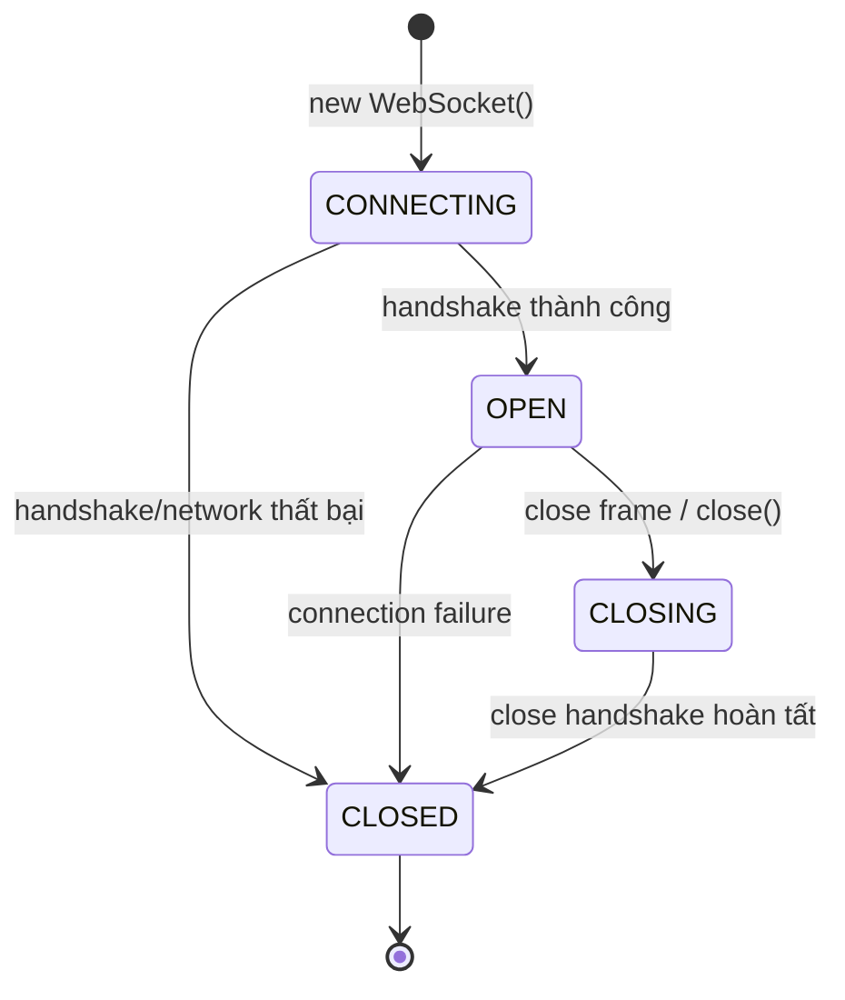
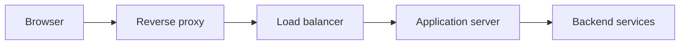

# Connection lifetime — quản lý vòng đời kết nối WebSocket

> **Chương:** WebSocket  
> **Mục tiêu:** Hiểu vòng đời của một kết nối WebSocket từ handshake đến đóng kết nối; đọc các trạng thái và sự kiện trong browser API; phân biệt đóng có trật tự với mất kết nối bất thường; quản lý idle timeout, heartbeat, reconnect và graceful shutdown; xử lý session/authentication trên kết nối dài hạn; bảo vệ handshake trước Cross-Site WebSocket Hijacking (CSWSH) và kiểm thử bằng DevTools.

## 1. Connection lifetime là gì?

WebSocket tạo một kênh giao tiếp hai chiều giữa client và server. Sau khi handshake thành công, hai phía có thể gửi message qua cùng một kết nối mà không phải tạo một HTTP request mới cho từng message.

**Connection lifetime** là toàn bộ khoảng thời gian từ lúc ứng dụng bắt đầu mở WebSocket cho tới khi kết nối đóng. Trong khoảng thời gian đó, ứng dụng phải quản lý:

- Handshake và xác thực ban đầu.
- Trạng thái kết nối và việc gửi/nhận message.
- Idle timeout của server, proxy, load balancer hoặc mạng.
- Heartbeat để phát hiện kết nối đã mất.
- Network change, tab suspension và thiết bị sleep.
- Reconnect, backoff và phục hồi trạng thái ứng dụng.
- Session hết hạn, logout, thu hồi quyền và graceful shutdown.

Một kết nối WebSocket có thể tồn tại lâu, nhưng không nên giả định nó tồn tại vĩnh viễn. Browser, hệ điều hành, mạng và hạ tầng trung gian đều có thể đóng kết nối.

## 2. Các giai đoạn trong vòng đời

Một kết nối thường đi qua các giai đoạn:

1. Ứng dụng tạo đối tượng WebSocket với URL ws hoặc wss.
2. Browser mở kết nối mạng và thực hiện handshake.
3. Server xác minh handshake, chấp nhận protocol và trả response nâng cấp.
4. Kết nối chuyển sang trạng thái OPEN.
5. Hai phía trao đổi message và có thể gửi heartbeat.
6. Một phía bắt đầu close handshake hoặc kết nối bị lỗi.
7. Kết nối chuyển qua CLOSING rồi CLOSED.
8. Ứng dụng quyết định có cần tạo kết nối mới hay không.



Reconnect là một kết nối mới với handshake mới. WebSocket không tự khôi phục TCP connection đã mất và cũng không tự phát lại message ứng dụng chưa được xác nhận.

## 3. Bốn trạng thái trong browser WebSocket API

Thuộc tính `readyState` cho biết trạng thái hiện tại:

| Hằng số | Giá trị | Ý nghĩa |
| --- | ---: | --- |
| `WebSocket.CONNECTING` | 0 | Đang mở kết nối, handshake chưa hoàn tất |
| `WebSocket.OPEN` | 1 | Kết nối sẵn sàng gửi và nhận message |
| `WebSocket.CLOSING` | 2 | Đang thực hiện quá trình đóng |
| `WebSocket.CLOSED` | 3 | Kết nối đã đóng hoặc không thể mở |

Ví dụ:

```js
const socket = new WebSocket("wss://chat.example.com/ws");

console.log(socket.readyState);

socket.addEventListener("open", () => {
  console.log("WebSocket is open:", socket.readyState);
});

socket.addEventListener("close", (event) => {
  console.log("WebSocket is closed:", event.code, event.reason);
});
```

Không gọi `send()` khi socket chưa OPEN. Nếu cần gửi sau khi kết nối thành công, hãy đợi event `open` và vẫn kiểm tra trạng thái trước mỗi lần gửi.

## 4. Handshake và thời điểm kết nối bắt đầu

Browser API tạo kết nối:

```js
const socket = new WebSocket("wss://chat.example.com/realtime", [
  "chat-v2",
]);
```

Với WebSocket truyền thống qua HTTP/1.1, browser gửi handshake có các header như `Upgrade`, `Connection`, `Sec-WebSocket-Key`, `Sec-WebSocket-Version` và `Origin`. Server chấp nhận bằng response nâng cấp giao thức và có thể chọn subprotocol.

Sau khi handshake thành công, browser phát event `open`. Nếu handshake bị từ chối, lỗi mạng xảy ra hoặc policy không cho phép kết nối, event `open` không chạy; ứng dụng thường nhận event `error` và sau đó là `close`.

Không phải mọi lỗi handshake đều được JavaScript cung cấp chi tiết. Browser cố ý giới hạn thông tin lỗi để tránh làm lộ dữ liệu mạng hoặc bảo mật.

HTTP/2 có cơ chế mở rộng để bootstrap WebSocket qua extended CONNECT theo tiêu chuẩn riêng. Khi vận hành, không giả định mọi proxy hoặc server hỗ trợ cùng một kiểu handshake; kiểm tra cấu hình hạ tầng và browser thực tế.

## 5. Sự kiện open, message, error và close

Browser WebSocket API cung cấp các sự kiện chính:

| Event | Khi nào xảy ra | Công việc thường làm |
| --- | --- | --- |
| `open` | Handshake thành công | Đánh dấu online, gửi subscribe/auth message nếu thiết kế yêu cầu |
| `message` | Nhận message | Parse, validate schema và cập nhật giao diện |
| `error` | Có lỗi liên quan kết nối | Ghi nhận lỗi tổng quát, chờ close để quyết định reconnect |
| `close` | Kết nối đóng | Đọc code/reason/wasClean, cleanup và quyết định retry |

Ví dụ:

```js
const socket = new WebSocket("wss://chat.example.com/ws");

socket.addEventListener("open", () => {
  updateConnectionStatus("connected");
});

socket.addEventListener("message", (event) => {
  handleIncomingMessage(event.data);
});

socket.addEventListener("error", () => {
  updateConnectionStatus("connection error");
});

socket.addEventListener("close", (event) => {
  updateConnectionStatus("disconnected");
  console.log({
    code: event.code,
    reason: event.reason,
    wasClean: event.wasClean,
  });
});
```

Event `error` không phải nơi đáng tin cậy để lấy nguyên nhân chi tiết. Dùng `close` cùng log phía server, proxy và network để chẩn đoán.

## 6. Đóng kết nối có trật tự

Ứng dụng có thể chủ động đóng:

```js
if (socket.readyState === WebSocket.OPEN) {
  socket.close(1000, "User left the room");
}
```

Lệnh `close()` bắt đầu quá trình đóng WebSocket. Hai phía có thể trao đổi close control frame để hoàn tất handshake đóng, sau đó browser phát event `close`.

Một số điểm cần nhớ:

- `close()` không đồng nghĩa TCP socket biến mất ngay lập tức.
- Dữ liệu đã được xếp hàng trước khi gọi close có thể vẫn được gửi trước close frame theo quy tắc API.
- Nếu socket còn CONNECTING, gọi close sẽ làm quá trình kết nối thất bại/đóng.
- Gọi close nhiều lần trên socket đang CLOSING hoặc CLOSED không tạo một kết nối mới.
- Reconnect phải tạo đối tượng WebSocket mới.

Không dựa vào việc gọi close để đảm bảo server đã lưu mọi thay đổi nghiệp vụ. Nếu cần xác nhận, ứng dụng phải dùng acknowledgment message trước khi đóng.

## 7. Close code và reason

Close frame có thể chứa status code và reason để mô tả lý do đóng. Browser cung cấp chúng qua `CloseEvent`.

Một số code thường gặp:

| Code | Ý nghĩa |
| ---: | --- |
| 1000 | Normal Closure |
| 1001 | Going Away |
| 1002 | Protocol Error |
| 1003 | Unsupported Data |
| 1007 | Invalid frame payload data |
| 1008 | Policy Violation |
| 1009 | Message Too Big |
| 1011 | Server Error |
| 1012 | Service Restart |
| 1013 | Try Again Later |
| 1006 | Abnormal Closure, giá trị tổng hợp trong API khi không nhận được close frame hợp lệ |

Các giá trị 1005, 1006 và 1015 được dành riêng cho mục đích báo trạng thái cục bộ; không gửi chúng như close code trên wire. Code 1004 cũng được dành riêng. Code trong dải 3000–4999 dành cho ứng dụng hoặc thư viện theo quy tắc đăng ký/phân bổ.

Browser JavaScript có ràng buộc riêng khi gọi `socket.close(code, reason)`: nếu truyền code, code phải là 1000 hoặc thuộc dải 3000–4999; giá trị khác gây `InvalidAccessError`. Vì vậy, client thường dùng 1000 cho đóng bình thường hoặc mã ứng dụng trong dải 3000–4999. Server vẫn có thể gửi các code giao thức hợp lệ khác tới client.

Reason được mã hóa UTF-8 và giới hạn tối đa 123 byte trong close control frame. Không đưa token, session ID, dữ liệu cá nhân hoặc thông tin nội bộ vào reason; nội dung có thể xuất hiện trong log và DevTools.

## 8. wasClean và đóng bất thường

Event `close` có thuộc tính:

- `code`: close code được nhận hoặc giá trị tổng hợp.
- `reason`: reason do phía gửi close frame cung cấp, nếu có.
- `wasClean`: cho biết kết nối đã đóng theo quy trình đóng sạch của WebSocket.

Ví dụ:

```js
socket.addEventListener("close", (event) => {
  if (event.wasClean) {
    console.log("Kết nối đóng có trật tự:", event.code);
  } else {
    console.log("Kết nối mất bất thường:", event.code);
  }
});
```

Code 1006 thường xuất hiện khi browser không nhận được close frame hợp lệ, ví dụ TCP reset, mất mạng hoặc proxy đóng socket đột ngột. 1006 không phải code mà server gửi trong close frame.

Không coi mọi lần `wasClean === false` là lỗi ứng dụng. Mất mạng, laptop sleep, đổi Wi-Fi hoặc thiết bị chuyển mạng có thể làm kết nối bị ngắt ngoài ý muốn.

## 9. Graceful shutdown ở server

Server có thể cần đóng kết nối khi:

- Deploy phiên bản mới.
- Restart process hoặc node.
- Bảo trì hệ thống.
- Thu hồi session hoặc quyền truy cập.
- Client không còn được phép sử dụng kênh.

Một quy trình graceful shutdown:

1. Ngừng nhận kết nối mới trên instance sắp dừng.
2. Gửi thông báo ứng dụng như `server_restarting` nếu protocol hỗ trợ.
3. Cho client thời gian lưu trạng thái cần thiết hoặc chuyển sang node khác.
4. Gửi close frame với code phù hợp, ví dụ 1012 khi service restart.
5. Chờ một khoảng drain có giới hạn.
6. Đóng socket còn lại khi hết thời gian.

Không chờ vô hạn vì một client có thể treo hoặc không phản hồi. Cần giới hạn thời gian drain và theo dõi số connection còn mở.

## 10. Idle timeout ở proxy và hạ tầng

Kết nối WebSocket thường đi qua nhiều lớp:



Mỗi lớp có thể có idle timeout hoặc giới hạn thời gian riêng. Nếu không có dữ liệu trong khoảng thời gian cấu hình, proxy/load balancer/NAT có thể đóng kết nối dù ứng dụng vẫn nghĩ socket còn mở.

Những nguyên nhân thường gặp:

- Reverse proxy timeout ngắn hơn thời gian sống của kết nối.
- Load balancer có idle timeout.
- NAT hoặc firewall xóa state của kết nối lâu không có traffic.
- Server restart hoặc scale down instance.
- Mạng di động chuyển giữa Wi-Fi và cellular.
- Thiết bị sleep hoặc browser đưa tab vào chế độ tiết kiệm tài nguyên.

Không đặt timeout bằng 0 hoặc vô hạn một cách máy móc. Hãy xác định yêu cầu nghiệp vụ, giới hạn của từng lớp và chi phí giữ connection.

## 11. Heartbeat bằng Ping/Pong control frame

WebSocket protocol định nghĩa control frame Ping và Pong. Server thường gửi Ping định kỳ; browser WebSocket implementation tự động phản hồi Pong theo protocol.

Ping/Pong hữu ích để:

- Phát hiện peer hoặc đường mạng không còn phản hồi.
- Tạo traffic định kỳ giúp một số proxy/NAT không xem connection là idle.
- Đo thời gian round-trip ở server.
- Dọn connection đã chết khỏi bảng quản lý.

Browser WebSocket API không cung cấp phương thức JavaScript để gửi hoặc nhận Ping/Pong control frame trực tiếp. Ứng dụng frontend không gọi được `socket.ping()`; browser tự xử lý Pong khi nhận Ping.

Do đó, heartbeat control frame thường được triển khai ở server. Server gửi Ping, chờ Pong trong thời gian giới hạn và đóng connection nếu không nhận phản hồi.

Không nhầm Ping/Pong control frame với message ứng dụng có nội dung chuỗi `ping` hoặc `pong`. Hai loại này có semantics và khả năng quan sát khác nhau.

## 12. Heartbeat ở tầng ứng dụng

Khi cần client JavaScript chủ động báo rằng ứng dụng vẫn hoạt động, có thể định nghĩa application-level heartbeat message:

```js
function sendHeartbeat(socket) {
  if (socket.readyState !== WebSocket.OPEN) return false;

  socket.send(JSON.stringify({
    type: "heartbeat",
    sentAt: Date.now(),
  }));

  return true;
}
```

Server phản hồi bằng message ứng dụng:

```json
{
  "type": "heartbeat_ack",
  "serverTime": 1795000000000
}
```

Application heartbeat có thể giúp phát hiện tình trạng ứng dụng, đồng bộ trạng thái hoặc đo latency. Nó không thay thế hoàn toàn protocol Ping/Pong vì message có thể bị xếp hàng, xử lý chậm hoặc bị ảnh hưởng bởi event loop.

Chọn chu kỳ heartbeat dựa trên idle timeout nhỏ nhất của hạ tầng và khả năng tiết kiệm pin. Không gửi quá dày gây tốn pin, băng thông và tài nguyên server.

## 13. Heartbeat và tab background

Timer JavaScript có thể bị throttle khi tab ở background. Trên thiết bị di động, browser có thể suspend page hoặc hệ điều hành có thể sleep ứng dụng.

Hệ quả:

- Heartbeat từ client có thể đến trễ.
- Client có thể bỏ lỡ khoảng timeout dù mạng vẫn tốt.
- Socket có thể bị đóng khi thiết bị sleep.
- Khi người dùng quay lại, trạng thái kết nối cũ có thể không còn đúng.

Thiết kế client nên:

- Xem event close là tín hiệu chính để bắt đầu reconnect.
- Khi tab visible trở lại, kiểm tra readyState và trạng thái ứng dụng.
- Không xem timer heartbeat bị trễ đơn lẻ là bằng chứng chắc chắn server đã chết.
- Dùng timeout có biên độ phù hợp với browser/mobile lifecycle.
- Tránh reconnect liên tục khi thiết bị đang offline.

```js
document.addEventListener("visibilitychange", () => {
  if (document.visibilityState === "visible") {
    if (!socket || socket.readyState === WebSocket.CLOSED) {
      reconnectIfNeeded();
    }
  }
});
```

Đoạn code trên là minh họa; hàm reconnect phải bảo đảm không tạo nhiều socket đồng thời.

## 14. Reconnect không phải tiếp tục connection cũ

Khi kết nối đóng, ứng dụng tạo WebSocket mới:

```js
function createSocket() {
  const socket = new WebSocket("wss://chat.example.com/ws");
  return socket;
}
```

Kết nối mới có handshake mới và có thể được server định tuyến tới một instance khác. Ứng dụng phải khôi phục những trạng thái cần thiết, ví dụ:

- Xác thực lại session hoặc access token.
- Subscribe lại room/channel.
- Đồng bộ cursor hoặc sequence number.
- Tải lại snapshot nếu message bị bỏ lỡ.
- Gửi acknowledgment/resume token theo protocol của ứng dụng.

WebSocket transport không tự đảm bảo exactly-once delivery cho message nghiệp vụ. Nếu cần độ tin cậy, protocol ứng dụng phải có message ID, sequence, acknowledgment, retry và idempotency.

## 15. Exponential backoff và jitter

Reconnect ngay lập tức trong vòng lặp có thể tạo bão kết nối khi server đang lỗi. Dùng exponential backoff để tăng khoảng chờ:

```js
function retryDelay(attempt) {
  const base = 500;
  const cap = 30000;
  const ceiling = Math.min(cap, base * (2 ** attempt));
  return Math.random() * ceiling;
}
```

Đây là full jitter: chọn thời gian ngẫu nhiên từ 0 tới giới hạn tăng dần. Jitter giúp các client không cùng reconnect tại một thời điểm sau khi server phục hồi.

Quy tắc triển khai:

- Reset attempt counter sau khi kết nối ổn định theo ngưỡng phù hợp.
- Giới hạn delay tối đa.
- Dừng retry khi người dùng logout hoặc đóng tính năng.
- Tạm dừng hoặc giãn retry khi browser báo offline.
- Không retry vô hạn với lỗi authentication/policy cần người dùng xử lý.
- Tránh nhiều thành phần cùng tạo reconnect cho một endpoint.

## 16. Phân loại close code để quyết định retry

Không phải mọi close code đều nên retry:

| Code/nhóm | Hành động gợi ý |
| --- | --- |
| 1000 Normal Closure | Thường không retry nếu người dùng đã rời hoặc thao tác kết thúc |
| 1001 Going Away | Có thể kết nối lại nếu ứng dụng vẫn cần realtime |
| 1006 Abnormal Closure | Có thể retry với backoff và kiểm tra network |
| 1008 Policy Violation | Không retry mù quáng; cần xử lý policy/auth/input |
| 1009 Message Too Big | Không gửi lại cùng payload; giảm kích thước hoặc sửa protocol |
| 1011 Server Error | Có thể retry với backoff |
| 1012 Service Restart | Có thể reconnect sau delay |
| 1013 Try Again Later | Tăng delay và thử lại sau |
| Mã ứng dụng 3000–4999 | Diễn giải theo protocol được tài liệu hóa |

Close code 1006 là giá trị tổng hợp ở client, không phải code server chủ động gửi. Với code ứng dụng, cần thống nhất ý nghĩa giữa client và server.

Ví dụ quy ước nội bộ:

- 4001: session hết hạn, cần refresh hoặc đăng nhập lại.
- 4003: không còn quyền tham gia channel, không retry tự động.
- 4008: rate limit, chờ theo chính sách server.

Đây chỉ là mã ứng dụng minh họa; cần tài liệu hóa để không xung đột với quy ước khác của hệ thống.

## 17. Quản lý session trên kết nối dài hạn

WebSocket handshake xác thực ban đầu không có nghĩa session được xác minh lại cho mọi message. Kết nối có thể tồn tại lâu hơn thời hạn access token hoặc session cookie.

Các tình huống cần xử lý:

- Session hết hạn trong khi socket vẫn OPEN.
- Người dùng logout ở một tab khác.
- Admin thu hồi session hoặc quyền truy cập.
- Người dùng bị gỡ khỏi room/channel.
- Token được rotate hoặc tài khoản bị khóa.

Server nên:

1. Gắn connection với danh tính/session đã xác thực tại handshake.
2. Theo dõi thời hạn session và trạng thái thu hồi.
3. Kiểm tra authorization cho từng thao tác/message nhạy cảm.
4. Đóng hoặc cập nhật connection khi session bị thu hồi.
5. Không tin rằng socket OPEN đồng nghĩa người dùng vẫn có quyền.

Client nên xử lý code/reason ứng dụng cho session hết hạn, thực hiện refresh theo flow an toàn nếu được phép và không lặp reconnect vô hạn với credential cũ.

## 18. Authentication trong handshake

Browser WebSocket constructor không cho ứng dụng tùy ý thêm header `Authorization` vào handshake như Fetch. Những cách xác thực phổ biến gồm:

- Cookie phiên được browser gửi theo cookie rules của URL và context.
- Token ngắn hạn, một lần, được cấp qua một endpoint HTTPS đã xác thực.
- Subprotocol dùng để thương lượng protocol ứng dụng; không nên biến nó thành nơi nhét bí mật tùy tiện.

Không đặt access token dài hạn hoặc session secret trong query string:

```js
// Tránh: token có thể xuất hiện trong URL, logs và telemetry.
new WebSocket("wss://chat.example.com/ws?token=secret");
```

URL có thể được ghi trong reverse proxy logs, monitoring, crash reports hoặc hệ thống quan sát. Nếu phải dùng token cho handshake, ưu tiên token ngắn hạn, dùng một lần, giới hạn audience/scope và tránh log giá trị.

Cookie authentication cũng cần bảo vệ CSWSH; browser có thể tự gửi cookie trong handshake nếu cookie policy cho phép.

## 19. Cross-Site WebSocket Hijacking (CSWSH)

Một website độc hại có thể thử mở WebSocket tới server của một ứng dụng mà người dùng đã đăng nhập. Nếu browser tự đính kèm cookie phiên và server không kiểm tra nguồn khởi tạo, server có thể coi kết nối là người dùng hợp lệ.

Đây là dạng Cross-Site WebSocket Hijacking (CSWSH). CORS response headers không phải cơ chế bảo vệ handshake WebSocket tương đương Fetch CORS.

Biện pháp phòng vệ:

- Xác minh header `Origin` ở server bằng allowlist chính xác cho browser client.
- Dùng cookie SameSite phù hợp và hiểu giới hạn third-party cookie.
- Xác thực handshake và gắn connection với session.
- Có thể yêu cầu CSRF-style token ngắn hạn trong bước xác thực ứng dụng nếu kiến trúc cần.
- Kiểm tra authorization cho từng channel và message.
- Dùng WSS để bảo vệ kết nối trên đường truyền.

`Origin` trong handshake do browser gửi và JavaScript trang không thể tùy ý sửa header này qua WebSocket constructor. Tuy nhiên, client không phải browser có thể tự tạo header Origin; vì vậy Origin check không thay authentication và authorization.

Không dùng `Access-Control-Allow-Origin` để nghĩ rằng WebSocket đã được bảo vệ. WebSocket handshake không dựa trên cơ chế CORS response sharing như Fetch.

## 20. WSS, certificate và connection lifetime

Trong production, dùng `wss://` để mã hóa kết nối bằng TLS:

```js
const socket = new WebSocket("wss://realtime.example.com/events");
```

TLS bảo vệ tính bí mật và toàn vẹn của dữ liệu trên đường truyền, đồng thời xác thực server theo certificate. Nó không xác thực quyền nghiệp vụ của từng message.

Khi certificate hết hạn, hostname không khớp hoặc TLS handshake lỗi, WebSocket không thể mở. Browser có thể chỉ cung cấp lỗi tổng quát cho JavaScript; cần kiểm tra certificate, Network và log hạ tầng.

Không dùng ws:// cho dữ liệu nhạy cảm trên mạng công cộng. Nếu trang HTTPS kết nối WebSocket không an toàn, browser có thể chặn như mixed content.

## 21. Message queue, backpressure và tuổi thọ connection

Kết nối OPEN không có nghĩa ứng dụng có thể gửi message vô hạn. Nếu producer gửi nhanh hơn consumer/network xử lý, dữ liệu có thể tích tụ trong buffer.

Browser cung cấp `bufferedAmount` để quan sát số byte đang chờ gửi:

```js
function sendIfBufferIsSmall(socket, payload) {
  const MAX_BUFFERED_BYTES = 256 * 1024;

  if (socket.readyState !== WebSocket.OPEN) return false;
  if (socket.bufferedAmount > MAX_BUFFERED_BYTES) return false;

  socket.send(payload);
  return true;
}
```

Giới hạn trong ví dụ là chính sách ứng dụng, không phải giới hạn chuẩn. Khi buffer tăng:

- Giảm tốc độ gửi hoặc coalesce các update có thể gộp.
- Bỏ các dữ liệu realtime cũ không còn giá trị nếu protocol cho phép.
- Áp dụng queue có giới hạn.
- Ngắt kết nối client không thể theo kịp theo chính sách rõ ràng.

Không xếp hàng vô hạn trong memory để chờ reconnect. Chỉ lưu các message có semantics retry rõ ràng và có idempotency.

## 22. Giới hạn thời gian sống và tái xác thực

Một số hệ thống chủ động giới hạn tuổi thọ connection để:

- Xoay vòng session hoặc token.
- Phân phối lại connection giữa các server.
- Triển khai phiên bản mới.
- Giải phóng tài nguyên và tránh connection treo.
- Áp dụng thay đổi authorization.

Có thể gửi thông điệp sắp hết phiên:

```json
{
  "type": "session_expiring",
  "expiresAt": 1795000000000
}
```

Client có thể hiển thị thông báo hoặc thực hiện refresh theo flow đã thiết kế. Server phải xác minh token/session mới và cập nhật identity gắn với connection hoặc yêu cầu kết nối lại.

Không gia hạn session chỉ vì socket vẫn gửi heartbeat. Heartbeat chứng minh peer/network còn phản hồi, không chứng minh người dùng còn được xác thực hoặc được phép thao tác.

## 23. Proxy và server phải hỗ trợ nâng cấp WebSocket

Reverse proxy cần chuyển tiếp đúng handshake và duy trì kết nối hai chiều. Với HTTP/1.1, cấu hình thường cần chuyển tiếp header Upgrade/Connection và dùng HTTP version phù hợp tới upstream.

Ví dụ cấu hình Nginx minh họa:

```nginx
location /ws/ {
    proxy_pass http://websocket_backend;
    proxy_http_version 1.1;
    proxy_set_header Upgrade $http_upgrade;
    proxy_set_header Connection "upgrade";
    proxy_set_header Host $host;
    proxy_read_timeout 75s;
    proxy_send_timeout 75s;
}
```

Giá trị timeout là ví dụ; phải phối hợp với heartbeat interval và timeout của load balancer, firewall, ingress và server. Nếu proxy timeout ngắn hơn heartbeat interval, connection vẫn có thể bị đóng khi idle.

Không giả định cấu hình HTTP proxy thông thường tự hỗ trợ WebSocket. Kiểm tra cả handshake, idle behavior, graceful drain và connection distribution.

## 24. Ví dụ client quản lý connection và reconnect

Một client có thể đóng gói trạng thái và retry trong một lớp nhỏ:

```js
class RealtimeConnection {
  constructor(url) {
    this.url = url;
    this.socket = null;
    this.attempt = 0;
    this.retryTimer = null;
    this.stableTimer = null;
    this.stopped = false;
  }

  connect() {
    if (this.stopped) return;
    if (this.socket &&
        (this.socket.readyState === WebSocket.CONNECTING ||
         this.socket.readyState === WebSocket.OPEN)) {
      return;
    }

    const socket = new WebSocket(this.url);
    this.socket = socket;

    socket.addEventListener("open", () => {
      this.onStatus("connected");
      this.resubscribe(socket);
      this.stableTimer = setTimeout(() => {
        this.attempt = 0;
        this.stableTimer = null;
      }, 10000);
    });

    socket.addEventListener("message", (event) => {
      this.onMessage(event.data);
    });

    socket.addEventListener("close", (event) => {
      if (this.socket === socket) this.socket = null;
      if (this.stableTimer !== null) clearTimeout(this.stableTimer);
      this.stableTimer = null;
      this.onStatus("disconnected");

      if (!this.stopped && this.shouldRetry(event)) {
        this.scheduleReconnect();
      }
    });

    socket.addEventListener("error", () => {
      this.onStatus("error");
    });
  }

  scheduleReconnect() {
    if (this.retryTimer !== null || this.stopped) return;

    const cap = 30000;
    const ceiling = Math.min(cap, 500 * (2 ** this.attempt));
    const delay = Math.random() * ceiling;
    this.attempt += 1;

    this.retryTimer = setTimeout(() => {
      this.retryTimer = null;
      this.connect();
    }, delay);
  }

  shouldRetry(event) {
    // Chỉ retry các trường hợp tạm thời đã được ứng dụng cho phép.
    return [1001, 1006, 1011, 1012, 1013].includes(event.code);
  }

  resubscribe(socket) {
    socket.send(JSON.stringify({ type: "subscribe", channel: "updates" }));
  }

  onStatus(status) {
    console.log("Connection:", status);
  }

  onMessage(data) {
    console.log("Message:", data);
  }

  stop() {
    this.stopped = true;
    if (this.retryTimer !== null) clearTimeout(this.retryTimer);
    if (this.stableTimer !== null) clearTimeout(this.stableTimer);
    this.retryTimer = null;
    this.stableTimer = null;

    if (this.socket &&
        this.socket.readyState < WebSocket.CLOSING) {
      this.socket.close(1000, "Client stopped");
    }
  }
}
```

Đây là ví dụ khung để minh họa lifecycle, không phải thư viện production hoàn chỉnh. Ứng dụng thực cần bổ sung xử lý offline/online, giới hạn retry, refresh authentication, unsubscribe, cleanup khi component unmount, xác nhận subscription và tránh gửi message khi socket đang đóng.

## 25. Kiểm thử connection lifetime bằng DevTools

Thực hành trên staging hoặc môi trường lab do bạn kiểm soát. Không dùng session thật hoặc gửi dữ liệu nhạy cảm.

### Bước 1 — Quan sát handshake

Mở DevTools → Network → WS, khởi tạo WebSocket và chọn request. Kiểm tra:

- URL ws/wss.
- Status handshake và response protocol.
- Request Origin.
- Subprotocol nếu có.
- Thời điểm kết nối chuyển sang OPEN.

### Bước 2 — Gửi và nhận message

Mở tab Messages/Frames của WebSocket request. Gửi message thử nghiệm và quan sát thứ tự, payload, thời điểm gửi/nhận.

### Bước 3 — Đóng bình thường

Gọi `socket.close(1000, "test complete")`. Quan sát close frame nếu DevTools hiển thị, CloseEvent code/reason/wasClean và trạng thái readyState.

### Bước 4 — Mô phỏng mất mạng

Dùng Network throttling hoặc offline mode, đổi mạng hoặc dừng server lab. Quan sát event error/close, code 1006 nếu browser tổng hợp bất thường và hành vi reconnect.

### Bước 5 — Kiểm tra idle timeout

Để kết nối không có traffic lâu hơn timeout thử nghiệm của proxy/server. Sau đó thêm server Ping/Pong hoặc application heartbeat và so sánh.

### Bước 6 — Kiểm tra tab background

Đưa tab xuống background hoặc sleep thiết bị thử nghiệm. Quay lại và xác minh ứng dụng kiểm tra socket, reconnect và đồng bộ trạng thái.

### Bước 7 — Kiểm tra session expiry

Cho session thử nghiệm hết hạn hoặc thu hồi ở server. Xác minh server ngừng cho phép thao tác, gửi close phù hợp và client không reconnect bằng credential cũ vô hạn.

### Bước 8 — Kiểm tra Origin validation

Thử mở WebSocket từ một origin lab không nằm trong allowlist. Xác minh server từ chối handshake trước khi tạo session realtime.

## 26. Chẩn đoán lỗi thường gặp

| Hiện tượng | Nguyên nhân có thể | Cách xử lý |
| --- | --- | --- |
| Socket ở CONNECTING mãi | Handshake bị treo, proxy không nâng cấp hoặc network lỗi | Kiểm tra Network handshake, proxy và timeout |
| Không có event open | Handshake bị từ chối, TLS/CSP/network error | Kiểm tra Console, certificate và server log |
| Event error không có chi tiết | Browser giới hạn thông tin lỗi WebSocket | Dùng close event và log server/proxy |
| Đóng với code 1006 | Mất mạng, TCP reset, proxy/server đóng đột ngột | Kiểm tra hạ tầng và reconnect có backoff |
| Kết nối idle tự đóng | Proxy/load balancer/NAT timeout | Đồng bộ timeout và heartbeat |
| Tab background mất socket | Timer throttle hoặc thiết bị sleep | Kiểm tra khi visible và reconnect có kiểm soát |
| Reconnect tạo nhiều socket | Nhiều timer hoặc component cùng quản lý | Dùng single owner, timer duy nhất và cleanup |
| Server nhận message sau khi client gọi close | Message đã được xếp hàng trước close | Dùng acknowledgment nếu cần xác nhận xử lý |
| User logout nhưng socket vẫn hoạt động | Server không thu hồi connection/session | Kiểm tra session và authorization trong thời gian sống |
| Browser gửi cookie tới WebSocket cross-site | Cookie policy cho phép và server thiếu Origin validation | Kiểm tra Origin allowlist, SameSite và CSWSH |
| Kết nối bị proxy đóng sau deploy | Instance drain không graceful | Ngừng nhận mới, thông báo client và đóng có thời hạn |
| Buffer tăng liên tục | Producer gửi nhanh hơn consumer/network | Giới hạn bufferedAmount, queue và rate |

## 27. Những ngộ nhận thường gặp

| Ngộ nhận | Cách hiểu đúng |
| --- | --- |
| “WebSocket luôn tồn tại cho tới khi tab đóng.” | Proxy, network, server và browser có thể đóng kết nối bất cứ lúc nào. |
| “close() đóng TCP ngay lập tức.” | close bắt đầu WebSocket closing handshake; việc đóng hoàn tất sau quy trình protocol. |
| “1006 là code server gửi.” | 1006 là giá trị tổng hợp khi kết nối đóng bất thường mà không nhận close frame hợp lệ. |
| “Browser JavaScript có thể gửi Ping control frame.” | WebSocket browser API không cung cấp ping/pong control-frame methods. |
| “Heartbeat chứng minh session còn hợp lệ.” | Heartbeat chỉ chứng minh một peer/network còn phản hồi; authorization phải kiểm tra riêng. |
| “CORS bảo vệ WebSocket handshake.” | Server cần xác minh Origin và authentication; CORS response headers không thay thế kiểm tra này. |
| “OPEN nghĩa người dùng còn quyền.” | Session có thể hết hạn hoặc bị thu hồi trong khi socket vẫn mở. |
| “Reconnect tự khôi phục message bị mất.” | Ứng dụng cần sequence, acknowledgment, replay hoặc resync protocol. |
| “Retry ngay khi close là tốt nhất.” | Exponential backoff và jitter giúp tránh reconnect storm. |
| “TLS là đủ để bảo vệ WebSocket.” | WSS bảo vệ transport; server vẫn cần authn, authz, validation và giới hạn tài nguyên. |

## 28. Checklist quản lý connection lifetime

- Dùng wss trong production và xác minh certificate/hostname.
- Xác minh Origin trong handshake bằng allowlist chính xác cho browser client.
- Xác thực session khi handshake và kiểm tra authorization cho từng thao tác.
- Theo dõi trạng thái CONNECTING, OPEN, CLOSING và CLOSED.
- Xử lý open, message, error và close; không dựa vào error event để lấy chi tiết.
- Dùng close code/reason có quy ước; không gửi code reserved và không đặt bí mật trong reason.
- Phối hợp idle timeout của server, proxy, load balancer và NAT.
- Dùng Ping/Pong ở server hoặc application heartbeat theo nhu cầu; nhớ browser API không expose ping control frame.
- Tính đến timer throttling, tab background, thiết bị sleep và network change.
- Reconnect bằng socket mới, exponential backoff và jitter; chỉ có một retry timer.
- Phân loại close code; không retry mù quáng với lỗi policy hoặc authentication.
- Thiết kế resubscribe, sequence, acknowledgment và idempotency nếu cần phục hồi message.
- Thu hồi connection khi session hết hạn hoặc quyền bị thu hồi.
- Giới hạn message size, bufferedAmount, connection count, rate và thời gian xử lý.
- Drain connection có thời hạn khi deploy/restart.
- Kiểm thử handshake, idle timeout, mất mạng, tab background, session expiry và Origin validation.

## 29. Câu hỏi tự kiểm tra

1. Các giai đoạn chính trong vòng đời WebSocket là gì?
2. CONNECTING, OPEN, CLOSING và CLOSED có ý nghĩa nào?
3. Vì sao close() không đảm bảo server đã xử lý mọi message?
4. wasClean và code 1006 cho biết điều gì?
5. Vì sao 1006 không được gửi trong close frame?
6. Browser JavaScript có thể tự gửi Ping control frame không?
7. Server Ping/Pong và application heartbeat khác nhau như thế nào?
8. Idle timeout ở proxy/load balancer ảnh hưởng connection ra sao?
9. Vì sao tab background hoặc thiết bị sleep có thể gây false timeout?
10. Exponential backoff và jitter giải quyết vấn đề gì?
11. Vì sao socket OPEN không có nghĩa session còn hợp lệ?
12. CSWSH xảy ra khi nào và server phải kiểm tra điều gì?
13. Vì sao CORS không thay thế Origin validation cho WebSocket?
14. Làm sao phục hồi trạng thái ứng dụng sau khi reconnect?
15. bufferedAmount giúp phát hiện vấn đề gì?

**Ghi nhớ:** WebSocket là kết nối dài hạn nhưng không tồn tại vĩnh viễn. Browser và server quản lý các trạng thái CONNECTING, OPEN, CLOSING, CLOSED; close handshake có thể hoàn tất sạch hoặc bị ngắt bất thường. Hãy phối hợp idle timeout với heartbeat, reconnect có backoff/jitter, quản lý session trong suốt connection lifetime và xác minh Origin ở handshake để phòng CSWSH. Reconnect tạo connection mới; việc phục hồi message và quyền truy cập phải được thiết kế ở tầng ứng dụng.
