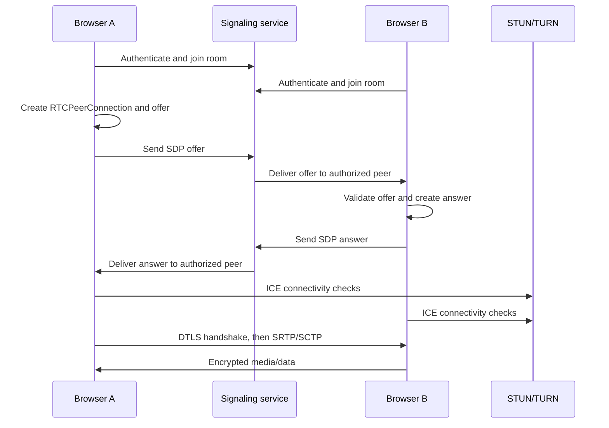

# WebRTC security: bảo vệ media, signaling và kết nối ngang hàng

**Chương:** WebRTC  
**Mô-đun:** `SECURITY_APPLICATION_SECURITY_BROWSER_SECURITY` — phân tích ranh giới bảo mật giữa trình duyệt, origin, cookie và ứng dụng web để hiểu Same-Origin Policy (SOP), CORS và các cơ chế cách ly; thực hành phòng vệ XSS, CSRF, clickjacking bằng CSP, Trusted Types, security headers và kiểm chứng hành vi thực tế.

**WebRTC security** là tập hợp biện pháp bảo vệ ứng dụng giao tiếp thời gian thực khi trình duyệt truy cập camera/microphone, thiết lập kết nối media hoặc data channel với peer khác, và trao đổi thông tin kết nối qua một signaling service. WebRTC cung cấp các cơ chế mã hóa media/data ở tầng truyền tải như DTLS-SRTP, nhưng không tự xây dựng toàn bộ hệ thống xác thực người gọi, phân quyền phòng họp, bảo vệ signaling hay quản lý khóa end-to-end cho ứng dụng.

Một triển khai an toàn phải bảo vệ nhiều lớp: quyền truy cập thiết bị, origin và iframe, signaling qua HTTPS/WSS, xác thực danh tính peer, kiểm soát SDP/ICE candidate, cấu hình STUN/TURN, quyền truy cập phòng, giới hạn tài nguyên và vòng đời của media track. Chỉ bật HTTPS hoặc dùng `RTCPeerConnection` không đủ để chứng minh cuộc gọi an toàn.

Bài học tập trung vào mô hình đe dọa và các ranh giới bảo mật của WebRTC trong trình duyệt. Bạn sẽ phân biệt mã hóa transport với xác thực peer và end-to-end encryption, nhận diện rò rỉ IP qua ICE, bảo vệ signaling/TURN, giới hạn quyền camera/microphone trong iframe và kiểm tra cách ứng dụng dọn kết nối khi người dùng rời phòng.

## 1. Mục tiêu học tập

Sau bài học, bạn có thể:

1. Mô tả các thành phần chính của WebRTC: `getUserMedia`, `MediaStream`, `RTCPeerConnection`, SDP, ICE, STUN, TURN và DataChannel.
2. Giải thích vì sao WebRTC cần secure context và quyền truy cập thiết bị.
3. Phân biệt browser permission, Permissions Policy, xác thực người dùng và authorization ở signaling server.
4. Giải thích vai trò của DTLS, SRTP và SCTP trong bảo vệ media/data.
5. Nhận diện giới hạn của mã hóa transport khi dùng SFU và khi cần E2EE.
6. Bảo vệ signaling channel, room membership, SDP và ICE candidate khỏi giả mạo hoặc phát lại.
7. Đánh giá nguy cơ lộ địa chỉ IP, cấu hình ICE relay-only và quản lý TURN credential.
8. Thiết lập Permissions Policy cho camera, microphone và display capture trong iframe.
9. Giảm rủi ro XSS, CSRF, resource exhaustion và truy cập media kéo dài sau khi rời phòng.
10. Kiểm thử luồng WebRTC bằng DevTools, ma trận test và lab local.

## 2. Kiến trúc và luồng kết nối WebRTC

### 2.1. Các thành phần chính

| Thành phần | Vai trò | Điểm cần bảo vệ |
| --- | --- | --- |
| `getUserMedia()` | Yêu cầu camera/microphone và trả `MediaStream` | Consent, secure context, quyền và vòng đời track |
| `getDisplayMedia()` | Yêu cầu chia sẻ màn hình/cửa sổ/tab | User activation, chọn nguồn chia sẻ và dừng chia sẻ |
| `RTCPeerConnection` | Quản lý kết nối peer, media và ICE | Peer identity, cấu hình ICE, state và cleanup |
| SDP offer/answer | Thỏa thuận codec, media section, fingerprint và ICE parameters | Signaling integrity, room authorization, input validation |
| ICE candidate | Mô tả đường kết nối có thể dùng | IP privacy, candidate injection, giới hạn và kiểm soát |
| STUN | Giúp peer khám phá địa chỉ/port reflexive qua NAT | Không phải relay, không mã hóa hay xác thực ứng dụng |
| TURN | Relay packet khi kết nối trực tiếp không khả thi | Credential ngắn hạn, quota, abuse và chi phí |
| DataChannel | Truyền dữ liệu qua SCTP trên DTLS | Xác thực peer, giới hạn message và backpressure |
| Signaling server | Chuyển offer/answer/candidate và quản lý phòng | Authentication, authorization, rate limit và audit |

WebRTC không quy định một giao thức signaling duy nhất. Ứng dụng thường dùng HTTPS API hoặc WebSocket bảo mật (`wss:`) để trao đổi offer, answer, ICE candidate và sự kiện phòng. Vì signaling do ứng dụng thiết kế, ứng dụng cũng phải tự xác thực người gửi, kiểm tra quyền tham gia phòng và ràng buộc mọi message với đúng cuộc gọi.

### 2.2. Sơ đồ thiết lập kết nối



Signaling server chuyển thông tin để hai browser tìm đường kết nối. STUN/TURN hỗ trợ ICE connectivity checks; media/data sau khi thiết lập được bảo vệ bằng cơ chế mật mã của WebRTC. Signaling server không mặc nhiên trở thành bên xác thực danh tính peer chỉ vì nó chuyển SDP.

### 2.3. Các lớp bảo mật phải phối hợp

1. **Browser và origin:** chỉ trang hợp lệ được phép yêu cầu thiết bị; iframe cần delegation đúng.
2. **Identity và signaling:** người dùng được xác thực; room membership và peer identity được server kiểm tra.
3. **ICE và network path:** candidate và TURN được quản lý; giảm lộ IP theo yêu cầu riêng tư.
4. **Transport encryption:** DTLS bảo vệ handshake và khóa; SRTP bảo vệ media; SCTP chạy trên DTLS cho DataChannel.
5. **Application layer:** kiểm soát quyền trong phòng, nội dung chat/data, recording, screen sharing và E2EE nếu cần.
6. **Lifecycle và operations:** revoke, stop tracks, đóng peer connection, thu hồi TURN credentials và giám sát lạm dụng.

## 3. Secure context và quyền truy cập thiết bị

### 3.1. HTTPS là điều kiện cơ bản

Các API truy cập media như `getUserMedia()` chỉ hoạt động trong secure context ở môi trường production. Trang HTTP thông thường không được phép truy cập camera/microphone; `localhost` và loopback là ngoại lệ đáng tin cậy thường dùng khi phát triển. HTTPS bảo vệ kết nối browser tới server khỏi bị đọc/sửa trên đường truyền và cho phép browser áp dụng các quyền nhạy cảm.

Kiểm tra bằng:

```javascript
if (!window.isSecureContext) {
  throw new Error("WebRTC media requires a secure context");
}

if (!navigator.mediaDevices?.getUserMedia) {
  throw new Error("getUserMedia is unavailable in this browser/context");
}
```

`isSecureContext` là kiểm tra điều kiện môi trường, không phải phép kiểm tra danh tính website hoặc độ tin cậy của ứng dụng. HTTPS cũng không bảo vệ ứng dụng khỏi XSS, signaling server bị xâm phạm hoặc peer độc hại.

### 3.2. Permission prompt không phải authorization

Khi gọi `getUserMedia()`, browser có thể hiển thị prompt xin quyền camera/microphone. Người dùng có thể cho phép, từ chối hoặc thay đổi quyết định sau đó. Trạng thái permission còn phụ thuộc browser, hệ điều hành, profile và policy của tổ chức.

Cần phân biệt:

- **Browser permission:** người dùng/browser có cho phép trang truy cập thiết bị không.
- **Permissions Policy:** document/iframe có được phép yêu cầu feature không.
- **Authentication:** người dùng đang kết nối là tài khoản nào.
- **Authorization:** tài khoản có quyền vào phòng, bật recording, mời peer hoặc chia sẻ màn hình không.

Có permission camera không có nghĩa người dùng được vào phòng họp. Đăng nhập thành công cũng không có nghĩa mọi iframe nhúng trong trang được phép mở camera.

### 3.3. Yêu cầu tối thiểu và giải phóng track

Chỉ yêu cầu thiết bị khi tính năng cần bắt đầu. Tránh xin camera/microphone ngay khi tải landing page. Chọn constraint tối thiểu phù hợp:

```javascript
const stream = await navigator.mediaDevices.getUserMedia({
  audio: {
    echoCancellation: true,
    noiseSuppression: true
  },
  video: {
    width: { ideal: 1280 },
    height: { ideal: 720 }
  }
});
```

Khi người dùng tắt camera/microphone hoặc rời cuộc gọi, dừng các track:

```javascript
function stopMediaStream(stream) {
  for (const track of stream.getTracks()) {
    track.stop();
  }
}
```

Chỉ ẩn phần tử video hoặc detach `srcObject` không đồng nghĩa camera/microphone đã dừng. Track còn hoạt động có thể tiếp tục giữ thiết bị bận và thu media. Dùng UI trạng thái rõ ràng, cập nhật khi `mute`, `unmute`, `ended` và xử lý trường hợp permission bị thu hồi.

### 3.4. Device ID và fingerprinting

`enumerateDevices()` có thể cung cấp danh sách thiết bị; thông tin nhạy cảm thường bị giới hạn cho tới khi người dùng cấp quyền. Device ID có thể được phân vùng hoặc thay đổi theo browser/profile và không nên dùng làm định danh người dùng ổn định. Không gửi danh sách thiết bị, label hoặc thông tin phần cứng lên analytics nếu không có mục đích và cơ sở phù hợp.

Tránh ghi raw device ID, địa chỉ IP, SDP hoặc ICE candidate vào log công khai. Những giá trị này có thể tiết lộ thông tin thiết bị, mạng nội bộ hoặc cấu trúc cuộc gọi.


## 4. Signaling: xác thực peer và bảo vệ SDP

### 4.1. Signaling không được WebRTC tự định nghĩa

WebRTC không quyết định ứng dụng phải dùng WebSocket, HTTP polling hay giao thức nào để trao đổi SDP/ICE. Điều này có nghĩa ứng dụng phải thiết kế signaling như một API bảo mật thông thường:

- Chỉ kết nối signaling qua HTTPS/WSS.
- Xác thực session hoặc access token tại server.
- Kiểm tra người gửi có quyền tham gia đúng room/call hay không.
- Chỉ chuyển message tới peer có quan hệ trong cuộc gọi đã được cấp phép.
- Ràng buộc message với room ID, call ID, sender ID và loại message.
- Áp dụng rate limit, kích thước tối đa, timeout và audit.
- Không tin room ID, peer ID hoặc role do client tự khai báo.

Một kết nối WSS được mã hóa không có nghĩa mọi message đều hợp lệ. Server vẫn phải kiểm tra quyền và trạng thái cuộc gọi trước khi relay offer, answer, ICE candidate, yêu cầu recording hoặc lệnh điều khiển.

### 4.2. Xác thực và phân quyền theo room

Mỗi lần client join room, server nên kiểm tra danh tính, trạng thái tài khoản, quyền truy cập phòng, thời gian hiệu lực của lời mời và giới hạn số peer. Không cho client tự chọn sender ID của người khác hoặc phát message tới room bất kỳ.

Ví dụ schema message có thể gồm:

```json
{
  "type": "ice-candidate",
  "roomId": "call-7f21",
  "callId": "session-42",
  "senderId": "user-18",
  "targetId": "user-29",
  "candidate": {
    "candidate": "candidate:...",
    "sdpMid": "0",
    "sdpMLineIndex": 0
  }
}
```

Đây chỉ là cấu trúc minh họa. Server phải lấy sender identity từ session đã xác thực thay vì tin trường `senderId` trong payload. `roomId`, `callId` và `targetId` phải được đối chiếu với state phía server. Không relay candidate nếu peer không còn trong cuộc gọi hoặc không được phép nhận message.

### 4.3. SDP và ICE candidate là input không tin cậy

SDP chứa thông tin media section, codec, fingerprint, ICE username fragment/password và thuộc tính khác. ICE candidate có thể chứa địa chỉ mạng, port, protocol và candidate type. Không render SDP/candidate trực tiếp vào HTML, log công khai hoặc trang quản trị mà không encode và giới hạn kích thước.

Các biện pháp:

1. Kiểm tra message type và schema trước khi xử lý.
2. Giới hạn kích thước SDP và candidate theo giới hạn sản phẩm.
3. Giới hạn số candidate, tần suất và thời gian signaling.
4. Chỉ chuyển candidate trong đúng call/room đã xác thực.
5. Không tự viết parser SDP đơn giản bằng regex để “xác minh” mọi trường; dùng API WebRTC và validation ở lớp signaling phù hợp.
6. Không sửa hoặc xóa fingerprint/ICE credential tùy tiện vì có thể làm hỏng handshake.
7. Xử lý duplicate, stale message và candidate đến sau khi peer connection đã đóng.

Browser sẽ parse SDP theo quy tắc WebRTC, nhưng điều đó không thay thế authorization của ứng dụng. Một SDP hợp lệ về cú pháp vẫn có thể được gửi bởi người không có quyền vào phòng.

### 4.4. Chống replay và race condition

Message cũ có thể được phát lại sau khi một cuộc gọi đã kết thúc hoặc khi room ID được tái sử dụng. Dùng call ID/nonce hoặc generation ID duy nhất, timestamp có giới hạn và trạng thái server để từ chối message stale. Không chỉ dựa vào timestamp do client gửi; server cần kiểm soát vòng đời call.

Khi peer reconnect, tạo hoặc xác nhận đúng generation của peer connection. Candidate thuộc offer cũ không được áp dụng vào connection mới. Nếu signaling có thể nhận message không đúng thứ tự, ứng dụng cần queue candidate cho tới khi remote description phù hợp được thiết lập, sau đó loại bỏ candidate hết hạn.

### 4.5. CSRF và WebSocket origin

Nếu signaling dùng cookie session, các endpoint HTTP tạo room/join/recording phải có CSRF defense phù hợp. WebSocket handshake cũng cần kiểm tra `Origin`, xác thực cookie/token và authorization. Không coi `Origin` là danh tính người dùng; nó chỉ là tín hiệu để giới hạn website nào được phép mở kết nối trong bối cảnh browser.

Không dựa vào CORS để bảo vệ WebSocket. CORS không thay thế kiểm tra `Origin` và authentication ở WebSocket server. Không cho phép wildcard origin cùng credential trong thiết kế signaling nhạy cảm.

## 5. Mã hóa: DTLS, SRTP và DataChannel

### 5.1. DTLS-SRTP bảo vệ media trên đường truyền

Trong WebRTC, DTLS được dùng để thiết lập khóa và xác thực fingerprint certificate của peer theo thông tin trao đổi trong signaling. SRTP sử dụng khóa được thiết lập để mã hóa và bảo vệ tính toàn vẹn của media packet. Nhờ vậy, media không được gửi dưới dạng RTP thuần trên đường truyền WebRTC tiêu chuẩn.

Tuy nhiên, cần phân biệt:

- DTLS bảo vệ handshake và thiết lập khóa giữa hai đầu transport.
- SRTP bảo vệ packet audio/video trên đường truyền.
- SDP mang fingerprint certificate; ứng dụng cần bảo đảm SDP đến từ peer đã được xác thực.
- Mã hóa transport không tự xác định người đang ở đầu bên kia là tài khoản nào.

Nếu attacker có thể thay SDP/fingerprint trong signaling mà không bị phát hiện, họ có thể thử đưa hai phía tới peer giả. Vì vậy, bảo mật signaling và binding danh tính là phần thiết yếu của mô hình xác thực WebRTC.

### 5.2. DataChannel dùng DTLS và SCTP

DataChannel truyền dữ liệu qua SCTP trên DTLS. Transport này được mã hóa và bảo vệ toàn vẹn giữa các đầu DTLS, nhưng ứng dụng vẫn phải xác thực quyền gửi/nhận và kiểm tra nội dung message.

Không giả định DataChannel tự mã hóa end-to-end qua SFU trong mọi kiến trúc. Nếu server relay/terminate DataChannel hoặc ứng dụng dùng một dịch vụ trung gian đọc payload, cần hiểu chính xác nơi kết thúc DTLS và nơi dữ liệu được giải mã.

Giới hạn kích thước message, queue và tốc độ gửi. Dùng `bufferedAmount`/`bufferedAmountLowThreshold` để điều tiết producer; nếu nhận JSON, validate schema và không render message bằng HTML sink.

### 5.3. Xác thực peer khác mã hóa

Mã hóa đảm bảo dữ liệu được bảo vệ trên một kết nối tới endpoint đã thương lượng. Nó không tự chứng minh endpoint thuộc đúng người dùng mà UI đang hiển thị. Ứng dụng cần gắn peer connection với danh tính đã xác thực trong signaling và có thể hiển thị xác minh bổ sung khi use case yêu cầu, ví dụ safety number hoặc xác nhận qua kênh độc lập.

Với cuộc gọi nhạy cảm, tránh hiển thị tên do peer tự gửi mà chưa đối chiếu server. Một attacker có thể đăng nhập bằng tài khoản khác, chiếm token hoặc tham gia nhầm room; DTLS vẫn có thể mã hóa kết nối tới attacker đó.

### 5.4. SFU, MCU và giới hạn transport encryption

Trong kiến trúc mesh, mỗi browser có thể thiết lập kết nối trực tiếp với các peer khác. Trong kiến trúc SFU, mỗi client thường gửi media lên Selective Forwarding Unit, và SFU chuyển tiếp packet tới các client khác. DTLS-SRTP thường kết thúc ở từng leg client–SFU; SFU có thể giải mã media ở tầng transport để xử lý/forward hoặc tạo bản mã mới cho leg tiếp theo, tùy implementation.

Do đó, SRTP giữa client và SFU không tự động có nghĩa media được mã hóa end-to-end giữa các người tham gia. SFU có thể có khả năng truy cập nội dung media tùy kiến trúc, tính năng recording, transcoding và implementation.

MCU thường trộn hoặc xử lý media tập trung, nên media phải được giải mã ở điểm xử lý đó. Đánh giá kiến trúc và hợp đồng dịch vụ để biết server có thể xem, ghi hoặc xử lý nội dung gì.

### 5.5. E2EE với encoded transforms

Nếu yêu cầu SFU không thể đọc nội dung media, ứng dụng có thể triển khai thêm lớp E2EE ở media frame bằng WebRTC Encoded Transform/Insertable Streams khi browser hỗ trợ. Khi đó, client mã hóa frame trước khi đưa vào transport và giải mã sau khi nhận; SFU chỉ forward ciphertext ở tầng ứng dụng.

E2EE không tự xuất hiện chỉ vì dùng WebRTC. Ứng dụng cần thiết kế:

- Key generation và phân phối khóa cho đúng thành viên.
- Xác thực danh tính và chống thay thế khóa qua signaling.
- Re-key khi thành viên join/leave hoặc bị revoke.
- Nonce, counter và chống replay.
- Xử lý thiết bị mới, reconnect, multi-device và khôi phục session.
- Khả năng tương thích browser, codec, simulcast/SVC và recording.
- Chính sách cho metadata, timing, routing và traffic analysis.

E2EE media không tự mã hóa metadata như danh sách thành viên, địa chỉ IP, room ID, thời điểm gọi hoặc kích thước packet. Nó cũng không ngăn endpoint bị xâm phạm, malware, screen capture từ người nhận hoặc XSS đọc media trước khi mã hóa/sau khi giải mã. Đừng quảng cáo E2EE nếu key management và identity verification chưa được thiết kế, kiểm thử và audit.

## 6. ICE, IP privacy và TURN

### 6.1. Candidate types

ICE thu thập nhiều loại candidate để tìm đường kết nối:

| Candidate | Ý nghĩa | Thông tin có thể lộ |
| --- | --- | --- |
| Host | Địa chỉ interface cục bộ | Có thể tiết lộ topology mạng nếu browser/implementation công bố |
| Server-reflexive (srflx) | Địa chỉ public mapping được STUN quan sát | Có thể tiết lộ public IP và port |
| Peer-reflexive (prflx) | Địa chỉ peer được phát hiện trong connectivity checks | Thông tin đường kết nối phát sinh trong quá trình ICE |
| Relay | Địa chỉ relay do TURN cấp | Peer thấy địa chỉ relay; TURN server vẫn xử lý traffic và biết client kết nối tới nó |

Browser hiện đại có thể dùng mDNS host candidate để tránh gửi địa chỉ IP cục bộ dạng rõ tới peer trong một số tình huống. Hành vi phụ thuộc browser, cấu hình và phiên bản. Không giả định mDNS che mọi địa chỉ IP: server-reflexive candidate vẫn có thể tiết lộ public IP khi dùng đường trực tiếp.

### 6.2. Khi nào IP có thể bị lộ?

ICE candidate thường được chuyển qua signaling tới peer. Nếu ứng dụng cho phép kết nối trực tiếp, peer có thể quan sát candidate cần thiết để thiết lập đường truyền. Điều này có thể tiết lộ public IP, port, loại NAT hoặc gợi ý về mạng. Một số candidate host còn có thể cho biết thông tin mạng cục bộ nếu browser không che bằng mDNS.

IP address là dữ liệu có thể liên kết tới vị trí gần đúng, ISP, mạng doanh nghiệp hoặc danh tính trong một số ngữ cảnh. Không log candidate nguyên văn vào analytics hoặc expose cho người dùng không cần thiết. Đặt retention và access control cho signaling logs.

### 6.3. Relay-only policy

Nếu sản phẩm cần hạn chế peer nhìn thấy địa chỉ IP trực tiếp, có thể yêu cầu ICE chỉ dùng relay candidate:

```javascript
const pc = new RTCPeerConnection({
  iceServers: [
    {
      urls: ["turn:turn.example.test:3478?transport=udp"],
      username: shortLivedUsername,
      credential: shortLivedCredential
    }
  ],
  iceTransportPolicy: "relay"
});
```

`iceTransportPolicy: "relay"` buộc ICE sử dụng relay candidate theo cấu hình được browser chấp nhận. Điều này có thể giảm việc peer nhìn thấy địa chỉ mạng trực tiếp của nhau, nhưng có giới hạn:

- TURN server vẫn thấy địa chỉ IP của client kết nối tới relay.
- Signaling service và hạ tầng mạng có thể xử lý metadata kết nối.
- Relay-only tăng chi phí băng thông, độ trễ và phụ thuộc vào TURN availability.
- Nếu TURN credential hoặc server bị lộ/lạm dụng, attacker có thể tiêu thụ tài nguyên relay.
- Phải kiểm thử browser, IPv4/IPv6, UDP/TCP/TLS và mạng doanh nghiệp thực tế.

Không quảng bá relay-only như ẩn danh hoàn toàn. Nó thay đổi địa chỉ mà peer nhận được, không xóa mọi dấu vết mạng.

### 6.4. TURN credential phải ngắn hạn

Không nhúng TURN static secret vào JavaScript hoặc mobile/web bundle. Client có thể đọc mọi secret được phát hành trong bundle. Dùng TURN REST-style credential hoặc cơ chế tương đương do backend cấp, với username/credential có expiry ngắn và ràng buộc quota.

Backend chỉ cấp credential cho người dùng đã xác thực và có quyền vào cuộc gọi. Cấu hình quota theo user/room, giới hạn số allocation và bandwidth, rate limit cấp credential, theo dõi bất thường và rotate secret ở server. Không ghi password TURN vào log, telemetry hoặc URL public.

### 6.5. Cấu hình STUN/TURN và kiểm tra đường truyền

STUN giúp khám phá mapping; nó không relay media và không xác thực peer. TURN relay media khi direct path không khả thi hoặc khi policy yêu cầu relay-only. Cấu hình nhiều URL transport phù hợp để hỗ trợ mạng chặn UDP:

```javascript
const iceServers = [
  { urls: ["stun:stun.example.test:3478"] },
  {
    urls: [
      "turn:turn.example.test:3478?transport=udp",
      "turns:turn.example.test:5349?transport=tcp"
    ],
    username: shortLivedUsername,
    credential: shortLivedCredential
  }
];
```

Địa chỉ server trong ví dụ là placeholder. Production cần dùng domain và certificate hợp lệ của tổ chức, giới hạn nguồn truy cập, theo dõi allocation và thử nghiệm qua NAT/firewall khác nhau. Không dùng TURN public không rõ chủ sở hữu cho cuộc gọi nhạy cảm.

### 6.6. Không sửa candidate bằng regex

Không lọc IP bằng cách thay chuỗi trong SDP hoặc candidate text rồi tiếp tục dùng như bình thường. SDP có cấu trúc và candidate có ngữ nghĩa ICE; chỉnh sai có thể làm mất đường kết nối hoặc làm hỏng fingerprint/credentials. Dùng cấu hình ICE được browser hỗ trợ, chính sách relay và signaling authorization. Nếu cần chính sách candidate nâng cao, triển khai ở tầng ICE server/infra hoặc API được đặc tả hỗ trợ.

## 7. Permissions Policy và iframe

### 7.1. Giới hạn camera, microphone và display capture

Trang có thể đặt response header để kiểm soát document và iframe được phép yêu cầu các feature:

```http
Permissions-Policy: camera=(), microphone=(), display-capture=()
```

Nếu ứng dụng họp cần camera/microphone ở top-level document:

```http
Permissions-Policy: camera=(self), microphone=(self), display-capture=(self)
```

Nếu một widget cùng origin hoặc origin đối tác cần camera/microphone, chỉ ủy quyền cho origin cụ thể và đặt `allow` tương ứng trên iframe:

```http
Permissions-Policy: camera=(self "https://meet-widget.example.test"), microphone=(self "https://meet-widget.example.test"), display-capture=(self)
```

```html
<iframe
  src="https://meet-widget.example.test/call"
  title="Cuộc gọi"
  allow="camera; microphone">
</iframe>
```

Ví dụ trên minh họa delegation; policy của ancestor, container policy và policy của document con đều phải cho phép. `allow` không tự cấp permission cho người dùng. Browser vẫn hiển thị prompt hoặc áp dụng permission state và secure-context requirement.

### 7.2. Iframe sandbox và quyền thiết bị

`sandbox` có thể tạo opaque origin nếu không có `allow-same-origin`, làm một số API/storage không khả dụng. Đừng thêm token sandbox một cách máy móc chỉ để khắc phục lỗi WebRTC. Đánh giá script, origin, form, navigation và media permissions riêng; cấp quyền tối thiểu cho widget cần thiết.

Không nhúng cuộc gọi nhạy cảm từ origin không kiểm soát. Nếu buộc phải dùng third-party widget, xác minh nhà cung cấp, scope quyền, policy header, nguồn script và cách widget xử lý media.

### 7.3. UI và quyền chia sẻ màn hình

`getDisplayMedia()` phải được gọi trong ngữ cảnh có transient user activation, chẳng hạn thao tác nhấn nút, và yêu cầu người dùng chọn nguồn chia sẻ qua UI của browser. Không thể âm thầm chọn một cửa sổ tùy ý chỉ bằng JavaScript. Khi người dùng dừng chia sẻ từ browser chrome, track có thể phát sự kiện `ended`; ứng dụng phải cập nhật trạng thái cuộc gọi và ngừng gửi track tương ứng.

Không giả định `getDisplayMedia()` có cùng permission persistence như camera/microphone. Mỗi lần chia sẻ có thể yêu cầu hành động người dùng theo browser và API policy hiện hành. Hãy kiểm tra browser support và hành vi trên thiết bị mục tiêu.

## 8. Bảo vệ ứng dụng quanh WebRTC

### 8.1. XSS có thể chiếm quyền trong cuộc gọi

XSS cùng origin có thể gọi API media nếu browser permission và policy cho phép, đọc dữ liệu signaling, thao tác peer connection mà ứng dụng tạo, gửi DataChannel message và lấy dữ liệu trước/sau khi mã hóa E2EE ở endpoint. XSS cũng có thể hiển thị UI giả để lừa người dùng bật camera, chia sẻ màn hình hoặc tham gia phòng giả.

Phòng vệ:

- Dùng output encoding và safe DOM API; không đưa tên peer, chat message, SDP hoặc lỗi signaling vào `innerHTML`.
- Dùng CSP với nonce/hash cho script; tránh `unsafe-inline` và `unsafe-eval` khi có thể.
- Dùng Trusted Types cho DOM injection sink ở ứng dụng hỗ trợ.
- Giảm third-party script và kiểm soát dependency bằng pin version/SRI phù hợp.
- Tách origin cho nội dung upload và preview không tin cậy.
- Không để token signaling hoặc TURN secret trong URL, DOM hay log.
- Giới hạn quyền media theo trang/iframe và chỉ xin permission khi người dùng bắt đầu tính năng.

### 8.2. CSP cho signaling

CSP có thể giới hạn nơi trang kết nối tới signaling API và WebSocket:

```http
Content-Security-Policy:
  default-src 'self';
  script-src 'self' 'nonce-random-per-response';
  connect-src 'self' https://api.example.test wss://signal.example.test;
  frame-ancestors 'self';
  object-src 'none';
  base-uri 'self'
```

Đây là ví dụ minh họa; nonce phải được sinh ngẫu nhiên theo từng response và được gắn đúng vào script được phép. `connect-src` giúp giới hạn fetch/XHR/WebSocket tới signaling endpoint, nhưng không phải firewall cho mọi ICE/DTLS/TURN packet của WebRTC. Không dùng CSP như thay thế network policy, ICE configuration hoặc authorization.

### 8.3. CORS, SOP và WebSocket

CORS kiểm soát JavaScript có được đọc response HTTP cross-origin hay không. Nó không xác thực người tham gia phòng và không cấp quyền dùng camera/microphone. SOP hạn chế truy cập dữ liệu giữa origin, nhưng XSS trong origin ứng dụng vẫn có thể thao tác các object WebRTC của trang.

WebSocket không dùng cơ chế CORS preflight như fetch. Signaling server cần kiểm tra `Origin`, authentication, CSRF risk khi dùng cookie, authorization và message schema. Không phản chiếu `Origin` tùy ý thành allowlist response.

### 8.4. CSRF và lệnh điều khiển cuộc gọi

Các endpoint như tạo phòng, mời peer, bật recording, cấp TURN credential, kick participant hoặc kết thúc cuộc gọi có thể thay đổi trạng thái và cần authorization. Nếu xác thực bằng cookie, bảo vệ CSRF bằng token, SameSite phù hợp, kiểm tra Origin/Referer theo thiết kế và xác thực lại hành động nhạy cảm.

Không dùng một room ID khó đoán làm cơ chế authorization. Không cho client gọi endpoint recording chỉ vì họ biết call ID. Server phải kiểm tra role/permission tại thời điểm thực hiện hành động.

### 8.5. DataChannel và dữ liệu ứng dụng

DataChannel nhận dữ liệu từ peer; peer có thể độc hại hoặc gửi message malformed/khổng lồ. Xác thực message theo schema, giới hạn kích thước, tần suất, queue và loại message. Nếu payload là JSON, parse trong try/catch và validate field/type/range; không thực thi nội dung như code và không render trực tiếp thành HTML.

Với file transfer, giới hạn tổng dung lượng, loại file, số chunk, timeout và quota; kiểm tra digest hoặc integrity theo giao thức ứng dụng. Không tin filename, MIME type hoặc metadata do peer gửi. Quét file ở server nếu file được upload vào hệ thống.

### 8.6. Resource exhaustion và abuse

WebRTC tiêu thụ CPU, memory, socket, băng thông và relay quota. Attacker có thể tạo nhiều room, gửi candidate liên tục, mở nhiều peer connection, gửi DataChannel message lớn hoặc buộc TURN relay hoạt động lâu.

Biện pháp ở server và client:

- Giới hạn số room, participant và peer connection theo user/IP/account tier.
- Rate limit join/leave, signaling message, candidate và cấp TURN credential.
- Giới hạn bitrate, resolution, frame rate và số track theo use case.
- Đặt timeout cho offer chưa hoàn tất, ICE gathering và peer không hoạt động.
- Đóng connection khi người dùng rời phòng, session hết hạn hoặc bị revoke.
- Theo dõi TURN allocation, egress bandwidth, số candidate và lỗi kết nối.
- Có quota, cảnh báo chi phí và cơ chế chặn abuse theo tài khoản.

Không tin client tự khai báo số peer hoặc bitrate. Enforce giới hạn quan trọng ở server, SFU và TURN infrastructure.

### 8.7. Security headers và quyền nhúng

Một baseline cần cân nhắc:

| Header | Mục đích |
| --- | --- |
| `Permissions-Policy` | Giới hạn camera, microphone và display capture |
| `Content-Security-Policy` | Giới hạn script và signaling endpoints |
| `frame-ancestors` trong CSP | Giới hạn website được phép nhúng ứng dụng |
| `Referrer-Policy` | Hạn chế URL nhạy cảm bị gửi qua Referer |
| `Strict-Transport-Security` | Buộc browser dùng HTTPS sau khi đã nhận policy HSTS an toàn |

Không sao chép một header mẫu mà không kiểm thử ứng dụng. Nếu cuộc gọi cần được nhúng trong một portal, cấu hình `frame-ancestors` và Permissions Policy phải khớp origin portal; nếu không cần nhúng, từ chối framing để giảm clickjacking.

### 8.8. Recording, consent và dữ liệu riêng tư

Recording có thể được thực hiện ở client hoặc server/SFU. Browser permission cho camera/microphone không đồng nghĩa người dùng đã đồng ý ghi lại, lưu trữ hoặc chia sẻ cuộc gọi. Ứng dụng cần thông báo rõ khi recording bắt đầu/dừng, ai có quyền bật, ai có thể xem bản ghi, thời gian lưu và cách yêu cầu xóa theo chính sách.

Không để client tự quyết định recording authorization bằng một cờ UI. Server phải kiểm tra role và quyền ở thời điểm bắt đầu recording, ghi audit event và áp dụng access control cho file/bản ghi. Nếu sản phẩm tuyên bố E2EE, phải giải thích recording được xử lý thế nào: server không thể âm thầm ghi plaintext nếu server không có khóa giải mã; recording có thể cần client recorder được cấp quyền hoặc một luồng khóa riêng được thiết kế minh bạch.

Giảm dữ liệu telemetry: chỉ thu thông tin cần cho chất lượng cuộc gọi như trạng thái kết nối, packet loss hoặc round-trip time; tránh thu raw audio/video, SDP, candidate, IP và device label. Đặt retention, quyền truy cập và redaction cho log signaling/TURN.

## 9. Lifecycle: dừng media và đóng kết nối

### 9.1. Khi người dùng rời cuộc gọi

Rời UI hoặc điều hướng khỏi trang không phải lúc nào cũng là quy trình cleanup đầy đủ. Ứng dụng nên có hàm kết thúc cuộc gọi tập trung:

```javascript
function endCall({ peerConnection, localStream, dataChannel, videoElements }) {
  if (dataChannel && dataChannel.readyState !== "closed") {
    dataChannel.close();
  }

  if (peerConnection) {
    peerConnection.getSenders().forEach(sender => {
      try {
        sender.replaceTrack(null);
      } catch {
        // Peer connection may already be closed.
      }
    });

    peerConnection.close();
  }

  if (localStream) {
    for (const track of localStream.getTracks()) {
      track.stop();
    }
  }

  for (const video of videoElements) {
    video.pause();
    video.srcObject = null;
  }
}
```

Trong ứng dụng thật, đồng thời xóa reference tới stream/peer, hủy timer, abort request signaling, xóa listener và thông báo server rời room. Không chỉ gọi `pc.close()` rồi để track camera/microphone tiếp tục chạy.

### 9.2. Permission revoke và track ended

Người dùng có thể thu hồi permission trong browser/OS, rút thiết bị hoặc dừng screen sharing từ browser chrome. Theo dõi `track.onended`, `track.onmute` và `track.onunmute`; cập nhật UI và trạng thái gửi media. Nếu camera bị mất, không tự mở lại hoặc đổi sang thiết bị khác mà không tuân theo consent và hành động người dùng cần thiết.

### 9.3. Reconnect và cleanup server-side

Khi mạng rớt, client có thể reconnect signaling hoặc ICE. Server cần hết hạn room membership cũ, thu hồi quyền nếu session bị logout và ngăn peer cũ tiếp tục gửi candidate. Không giữ TURN credential lâu hơn thời gian cần thiết. Khi cuộc gọi kết thúc, xóa state, recording authorization và tài nguyên relay theo retention policy.

### 9.4. Page lifecycle và background

Tab có thể bị background, freeze hoặc discard. Không dựa vào `beforeunload` làm cơ chế cleanup duy nhất; event này không luôn chạy và không đảm bảo network request hoàn tất. Dùng signaling heartbeat/lease và timeout server-side để phát hiện client biến mất. Khi trang trở lại foreground, kiểm tra trạng thái room/peer trước khi tiếp tục gửi media.

## 10. Lab local: kiểm tra permission và DataChannel loopback

Lab dùng một trang HTML chạy trên `http://localhost:8080`. Localhost được browser xem là secure context trong môi trường phát triển, vì vậy có thể thử media permission mà không cần certificate public. Lab không kết nối peer ngoài máy, không gửi media lên server và không cần STUN/TURN.

Mục tiêu:

- Kiểm tra secure context và sự hiện diện của WebRTC API.
- Yêu cầu camera/microphone sau thao tác người dùng và dừng track.
- Thiết lập hai `RTCPeerConnection` trong cùng một trang để kiểm tra DataChannel được mã hóa qua DTLS.
- Quan sát trạng thái connection và đóng tài nguyên đúng cách.

### 10.1. Tạo trang lab

Tạo file `webrtc-security-lab.html`:

```html
<!doctype html>
<html lang="vi">
<head>
  <meta charset="utf-8">
  <meta name="viewport" content="width=device-width, initial-scale=1">
  <title>WebRTC security lab</title>
  <style>
    body { font: 16px system-ui, sans-serif; max-width: 850px; margin: 2rem auto; padding: 0 1rem; }
    button { margin: .25rem; padding: .6rem .9rem; }
    video { width: min(100%, 420px); background: #222; }
    pre { white-space: pre-wrap; overflow-wrap: anywhere; background: #f4f4f4; padding: 1rem; }
    section { border: 1px solid #aaa; padding: 1rem; margin: 1rem 0; }
  </style>
</head>
<body>
  <h1>WebRTC security lab</h1>
  <p id="environment"></p>

  <section>
    <h2>Camera and microphone</h2>
    <button id="request-media">Request camera and microphone</button>
    <button id="stop-media">Stop local media</button>
    <video id="preview" autoplay muted playsinline></video>
    <pre id="media-state">No media requested</pre>
  </section>

  <section>
    <h2>Local DataChannel loopback</h2>
    <button id="connect">Create local peer connection</button>
    <button id="send" disabled>Send test message</button>
    <button id="close" disabled>Close peer connections</button>
    <pre id="peer-state">Not connected</pre>
  </section>

  <section>
    <h2>Event log</h2>
    <pre id="log"></pre>
  </section>

  <script>
    const environment = document.querySelector("#environment");
    const preview = document.querySelector("#preview");
    const mediaState = document.querySelector("#media-state");
    const peerState = document.querySelector("#peer-state");
    const logNode = document.querySelector("#log");

    let localStream = null;
    let leftPeer = null;
    let rightPeer = null;
    let dataChannel = null;
    let receivedChannel = null;

    function log(message) {
      logNode.textContent += message + "\n";
    }

    environment.textContent =
      "Secure context: " + window.isSecureContext +
      " | RTCPeerConnection: " + Boolean(window.RTCPeerConnection) +
      " | getUserMedia: " + Boolean(navigator.mediaDevices?.getUserMedia);

    document.querySelector("#request-media").addEventListener("click", async () => {
      try {
        if (!window.isSecureContext) {
          throw new Error("Open this lab on localhost or HTTPS");
        }

        localStream = await navigator.mediaDevices.getUserMedia({
          audio: true,
          video: true
        });

        preview.srcObject = localStream;
        mediaState.textContent = localStream.getTracks().map(track =>
          track.kind + ": " + track.label + " (" + track.readyState + ")"
        ).join("\n");

        log("Media permission granted; local tracks are active.");
      } catch (error) {
        mediaState.textContent = error.name + ": " + error.message;
        log("getUserMedia failed: " + error.name);
      }
    });

    document.querySelector("#stop-media").addEventListener("click", () => {
      if (localStream) {
        for (const track of localStream.getTracks()) {
          track.stop();
        }
        localStream = null;
      }

      preview.pause();
      preview.srcObject = null;
      mediaState.textContent = "Local media stopped";
      log("All local media tracks stopped.");
    });

    function waitForIceGatheringComplete(peer) {
      if (peer.iceGatheringState === "complete") {
        return Promise.resolve();
      }

      return new Promise((resolve, reject) => {
        const timeoutId = setTimeout(() => {
          peer.removeEventListener("icegatheringstatechange", onChange);
          reject(new Error("ICE gathering timed out"));
        }, 15000);

        const onChange = () => {
          if (peer.iceGatheringState === "complete") {
            clearTimeout(timeoutId);
            peer.removeEventListener("icegatheringstatechange", onChange);
            resolve();
          }
        };

        peer.addEventListener("icegatheringstatechange", onChange);
      });
    }

    function waitForChannelOpen(channel) {
      if (channel.readyState === "open") return Promise.resolve();

      return new Promise((resolve, reject) => {
        const timeoutId = setTimeout(() => {
          reject(new Error("DataChannel open timed out"));
        }, 10000);

        channel.addEventListener("open", () => {
          clearTimeout(timeoutId);
          resolve();
        }, { once: true });

        channel.addEventListener("error", () => {
          clearTimeout(timeoutId);
          reject(new Error("DataChannel error"));
        }, { once: true });
      });
    }

    document.querySelector("#connect").addEventListener("click", async () => {
      try {
        leftPeer = new RTCPeerConnection({ iceServers: [] });
        rightPeer = new RTCPeerConnection({ iceServers: [] });

        const localLeftPeer = leftPeer;
        const localRightPeer = rightPeer;
        localLeftPeer.onconnectionstatechange = () => {
          peerState.textContent =
            "Left: " + localLeftPeer.connectionState +
            "\nRight: " + localRightPeer.connectionState;
        };

        rightPeer.ondatachannel = event => {
          receivedChannel = event.channel;
          receivedChannel.onmessage = message => {
            log("Remote DataChannel received: " + message.data);
          };
        };

        dataChannel = leftPeer.createDataChannel("security-lab");
        dataChannel.onopen = () => log("Local DataChannel is open.");
        dataChannel.onclose = () => log("Local DataChannel closed.");

        const offer = await leftPeer.createOffer();
        await leftPeer.setLocalDescription(offer);
        await waitForIceGatheringComplete(leftPeer);

        await rightPeer.setRemoteDescription(leftPeer.localDescription);
        const answer = await rightPeer.createAnswer();
        await rightPeer.setLocalDescription(answer);
        await waitForIceGatheringComplete(rightPeer);

        await leftPeer.setRemoteDescription(rightPeer.localDescription);
        await waitForChannelOpen(dataChannel);

        document.querySelector("#send").disabled = false;
        document.querySelector("#close").disabled = false;
        document.querySelector("#connect").disabled = true;
        peerState.textContent =
          "Left: " + leftPeer.connectionState +
          "\nRight: " + rightPeer.connectionState +
          "\nDataChannel: " + dataChannel.readyState;

        log("Local peer connection established.");
      } catch (error) {
        log("Peer setup failed: " + error.name + " " + error.message);
        closePeers();
      }
    });

    document.querySelector("#send").addEventListener("click", () => {
      if (dataChannel?.readyState === "open") {
        dataChannel.send("Hello through a local WebRTC DataChannel");
        log("Sent a test message.");
      }
    });

    function closePeers() {
      if (dataChannel && dataChannel.readyState !== "closed") {
        dataChannel.close();
      }
      if (receivedChannel && receivedChannel.readyState !== "closed") {
        receivedChannel.close();
      }
      if (leftPeer) leftPeer.close();
      if (rightPeer) rightPeer.close();

      dataChannel = null;
      receivedChannel = null;
      leftPeer = null;
      rightPeer = null;

      document.querySelector("#send").disabled = true;
      document.querySelector("#close").disabled = true;
      document.querySelector("#connect").disabled = false;
      peerState.textContent = "Peer connections closed";
      log("Peer connections and DataChannels closed.");
    }

    document.querySelector("#close").addEventListener("click", closePeers);
    window.addEventListener("pagehide", () => {
      if (localStream) {
        for (const track of localStream.getTracks()) track.stop();
      }
      closePeers();
    });
  </script>
</body>
</html>
```

### 10.2. Phục vụ file trên localhost

Trong thư mục chứa HTML, tạo `server.mjs`:

```javascript
import { createServer } from "node:http";
import { readFile } from "node:fs/promises";

const server = createServer(async (request, response) => {
  const url = new URL(request.url, "http://localhost:8080");

  if (
    request.method !== "GET" ||
    !["/", "/webrtc-security-lab.html"].includes(url.pathname)
  ) {
    response.writeHead(404);
    response.end("Not found");
    return;
  }

  try {
    const html = await readFile("./webrtc-security-lab.html");
    response.writeHead(200, {
      "Content-Type": "text/html; charset=utf-8",
      "Cache-Control": "no-store"
    });
    response.end(html);
  } catch {
    response.writeHead(500);
    response.end("Lab file not found");
  }
});

server.listen(8080, "localhost", () => {
  console.log("Open http://localhost:8080");
});
```

Chạy:

```bash
node server.mjs
```

### 10.3. Thực hiện và quan sát

1. Mở `http://localhost:8080` trong browser hỗ trợ WebRTC.
2. Xác nhận trang báo `Secure context: true`.
3. Nhấn **Request camera and microphone**. Browser hiển thị permission prompt; cho phép trong môi trường test và quan sát video preview.
4. Nhấn **Stop local media**. Đèn camera/microphone cần tắt theo hành vi thiết bị/browser; UI báo track đã dừng.
5. Nhấn **Create local peer connection**. Hai peer connection trong cùng trang trao đổi SDP và ICE local; không cấu hình STUN/TURN.
6. Khi DataChannel mở, nhấn **Send test message** và xác nhận peer còn lại nhận được message.
7. Nhấn **Close peer connections**. Connection và DataChannel chuyển sang trạng thái đóng.
8. Reload trang và kiểm tra không còn preview/track do lần chạy trước để lại.

Nếu không có camera/microphone, bỏ qua bước media và vẫn thử DataChannel. Nếu ICE local không hoàn tất do browser policy hoặc môi trường máy, ghi nhận lỗi và thử browser khác trong support matrix. Lab này không xác nhận signaling server, TURN relay hoặc E2EE của sản phẩm.

### 10.4. Kiểm tra Permissions Policy bằng iframe

Trong môi trường test, có thể tạo trang cha gửi:

```http
Permissions-Policy: camera=(), microphone=()
```

Sau đó nhúng lab bằng iframe và thử gọi `getUserMedia()`. Browser phải áp dụng policy của ancestor và từ chối feature dù người dùng đã từng cấp quyền ở một ngữ cảnh khác. Nếu muốn kiểm tra delegation, dùng origin test riêng, allowlist đúng origin và thuộc tính `allow` trên iframe; không mở wildcard cho camera/microphone.

### 10.5. Dọn lab

Dừng Node server bằng Ctrl+C. Dừng media tracks, đóng peer connections và đóng tab. Thu hồi site permission nếu không còn cần. Xóa các file lab khỏi thư mục test khi hoàn tất. Không dùng camera thật hoặc dữ liệu cuộc gọi thật trong môi trường demo nếu không cần thiết.

## 11. Kiểm thử WebRTC security

### 11.1. Ma trận kiểm thử

Chạy kiểm thử trên browser/version thuộc support matrix, staging HTTPS và các mạng khác nhau. Ghi nhận kết quả mà không lưu raw SDP, candidate, IP hoặc media content vào log không cần thiết.

| ID | Tình huống | Kết quả mong đợi |
| --- | --- | --- |
| RTC-01 | Mở trang production qua HTTP | Media API không khả dụng; UI giải thích cần secure context |
| RTC-02 | Mở trang qua HTTPS hợp lệ | Secure context được xác nhận |
| RTC-03 | Người dùng từ chối camera/microphone | Ứng dụng xử lý lỗi, không lặp prompt vô hạn |
| RTC-04 | Browser permission đã bị revoke | UI cập nhật trạng thái; không giả định track còn hoạt động |
| RTC-05 | Permissions Policy chặn camera/microphone | Iframe không thể dùng feature dù user permission tồn tại |
| RTC-06 | Iframe được allowlist đúng origin | Chỉ frame được ủy quyền có thể yêu cầu feature theo policy |
| RTC-07 | Client chưa đăng nhập gửi join room | Signaling server từ chối |
| RTC-08 | User đăng nhập nhưng không thuộc room gửi SDP | Server từ chối relay |
| RTC-09 | Payload giả mạo senderId/targetId | Server dùng identity từ session và kiểm tra membership |
| RTC-10 | Phát lại ICE candidate của call cũ | Message bị từ chối theo call/generation state |
| RTC-11 | SDP hoặc candidate vượt kích thước/nhịp cho phép | Server từ chối và rate limit |
| RTC-12 | Signaling dùng WebSocket từ Origin không được phép | Handshake bị từ chối |
| RTC-13 | Signaling cookie endpoint bị CSRF | CSRF defense ngăn thay đổi trạng thái trái phép |
| RTC-14 | DTLS fingerprint bị thay trong signaling test | Kết nối không được xác nhận tới peer mong đợi |
| RTC-15 | TURN credential hết hạn | Không cấp allocation mới; client lấy credential mới sau authorization |
| RTC-16 | Client cấu hình relay-only | Candidate được dùng là relay; xác nhận peer không nhận direct candidate theo thiết kế |
| RTC-17 | Mạng chặn UDP | TURN TCP/TLS fallback hoạt động nếu đã cấu hình |
| RTC-18 | DataChannel nhận JSON malformed hoặc message lớn | Schema/size limit từ chối; UI không crash |
| RTC-19 | XSS cùng origin trong môi trường test | Threat model xác nhận script có thể thao tác peer/media; CSP/XSS defense phát hiện hoặc ngăn injection |
| RTC-20 | Người dùng rời cuộc gọi | Local tracks dừng, DataChannel/peer đóng, signaling membership hết hạn |
| RTC-21 | Tab bị discard hoặc mất mạng | Server lease/heartbeat dọn peer stale |
| RTC-22 | Nhiều room/peer connection bất thường | Rate limit/quota/monitoring hạn chế resource exhaustion |
| RTC-23 | SFU recording hoặc transcoding bật | Quyền, thông báo, retention và access control được áp dụng |
| RTC-24 | Sản phẩm tuyên bố E2EE | Kiểm tra key distribution, re-key, membership change và xác minh peer; SFU không đọc được media payload theo thiết kế |
| RTC-25 | Candidate/SDP xuất hiện trong log | Log được redacted hoặc giới hạn quyền và retention |

### 11.2. DevTools và công cụ browser

**Chromium:**

- Mở `chrome://webrtc-internals` trước khi bắt đầu cuộc gọi để quan sát PeerConnection, ICE state, candidate pair và thống kê.
- DevTools → Network → WS để xem signaling WebSocket, handshake, frame và close code.
- DevTools → Application/Storage → Site settings để kiểm tra quyền camera/microphone theo origin.
- Console để xem lỗi permission, ICE, DTLS hoặc policy; nội dung thông báo phụ thuộc browser.

**Firefox:**

- Dùng `about:webrtc` để xem PeerConnection, ICE candidate, codec và thống kê.
- Kiểm tra site permissions trong Page Info/Settings.
- Dùng Network Monitor để kiểm tra signaling.

Không chia sẻ ảnh/chụp hoặc log của WebRTC internals nếu chứa public/private IP, candidate, SDP, TURN username hoặc thông tin cuộc gọi. Redact trước khi gửi ticket hoặc đưa vào hệ thống log tập trung.

### 11.3. Kiểm tra thống kê connection

```javascript
async function summarizePeerConnection(pc) {
  const stats = await pc.getStats();
  const summary = [];

  for (const report of stats.values()) {
    if (report.type === "candidate-pair" && report.state === "succeeded") {
      summary.push({
        type: report.type,
        state: report.state,
        nominated: report.nominated,
        currentRoundTripTime: report.currentRoundTripTime
      });
    }

    if (report.type === "transport") {
      summary.push({
        type: report.type,
        dtlsState: report.dtlsState,
        iceState: report.iceState
      });
    }
  }

  return summary;
}
```

Ví dụ chỉ trả một số trường trạng thái, không đưa địa chỉ candidate hoặc certificate fingerprint vào telemetry thông thường. Schema Stats thay đổi theo browser và phiên bản; kiểm tra field tồn tại trước khi dùng trong monitoring production.

### 11.4. Signaling integration test

Một integration test nên xác minh server authorization độc lập với browser media:

1. Tạo hai user test và một room có quyền truy cập rõ ràng.
2. Xác thực cả hai user và join đúng room.
3. Gửi offer/answer và candidate hợp lệ; xác nhận chỉ peer được phép nhận message.
4. Thử client thứ ba không thuộc room; server phải từ chối.
5. Thử senderId giả, targetId ngoài room, call ID cũ và candidate vượt giới hạn; server phải từ chối.
6. Thu hồi membership giữa cuộc gọi; server không relay message mới và hết hạn TURN credential theo policy.

Test server không thay thế test browser. Cần kiểm tra riêng permission, ICE, DTLS, media track và UI trên browser thật.

## 12. Những ngộ nhận thường gặp

**“WebRTC tự xác thực đúng người đang gọi.”** Sai. DTLS xác thực certificate fingerprint theo SDP, nhưng ứng dụng phải bảo vệ signaling và gắn peer connection với danh tính đã xác thực.

**“Media WebRTC luôn được mã hóa end-to-end qua SFU.”** Sai. DTLS-SRTP thường kết thúc ở từng leg client–SFU. SFU có thể truy cập media ở tầng transport; cần thêm E2EE ở frame và key management nếu yêu cầu SFU không đọc được nội dung.

**“HTTPS bảo vệ cả signaling và mọi ICE packet.”** Sai. HTTPS bảo vệ kết nối tới web/signaling endpoint; WebRTC media/data dùng DTLS-SRTP/DTLS riêng và cần cấu hình ICE/network phù hợp.

**“STUN relay media.”** Sai. STUN giúp khám phá địa chỉ mapping; TURN mới relay packet.

**“Relay-only làm người dùng ẩn danh.”** Sai. Nó giảm việc peer thấy IP trực tiếp; TURN server, signaling service và hạ tầng mạng vẫn xử lý metadata/địa chỉ kết nối.

**“Camera permission nghĩa là ứng dụng được quyền ghi âm hoặc recording.”** Sai. Browser permission cho phép truy cập thiết bị; recording và quyền lưu nội dung là nghiệp vụ riêng cần authorization, thông báo và retention policy.

**“Có `allow="camera; microphone"` là chắc chắn iframe dùng được.”** Sai. Policy của ancestor và response của child cũng phải cho phép; user permission và secure context vẫn áp dụng.

**“CORS bảo vệ WebSocket signaling.”** Sai. WebSocket server phải tự kiểm tra Origin, authentication, authorization và CSRF risk khi dùng cookie.

**“Room ID khó đoán là đủ để bảo vệ cuộc gọi.”** Sai. Server phải xác thực user và kiểm tra membership/role cho từng hành động.

**“Đóng RTCPeerConnection là camera đã tắt.”** Sai. Dừng local MediaStream tracks riêng; đóng peer connection và giải phóng media resources.

**“Không lưu SDP vào log là đủ bảo vệ riêng tư.”** Chưa đủ. ICE candidate, IP, TURN username, room metadata, device ID và thống kê cũng có thể nhạy cảm.

**“E2EE ngăn được XSS trên endpoint.”** Sai. XSS có thể đọc media trước khi mã hóa hoặc sau khi giải mã, thao tác UI và truy cập khóa ở endpoint.

## 13. Checklist triển khai WebRTC security

Trước khi phát hành, xác nhận:

1. **Secure context:** mọi route production dùng HTTPS hợp lệ; localhost chỉ dành cho phát triển.
2. **Permission UX:** chỉ xin camera/microphone khi cần; giải thích mục đích và xử lý denied/revoked.
3. **Permissions Policy:** giới hạn camera, microphone và display capture; chỉ ủy quyền iframe origin cần thiết.
4. **Iframe security:** kiểm tra ancestor policy, `allow`, sandbox và CSP `frame-ancestors`.
5. **Signaling transport:** dùng HTTPS/WSS; xác thực session và kiểm tra Origin.
6. **Room authorization:** kiểm tra membership, role, peer target và trạng thái call ở server.
7. **Message validation:** validate SDP/candidate schema, size, rate, generation và call ID.
8. **Replay protection:** từ chối message cũ, duplicate hoặc thuộc peer connection đã đóng.
9. **DTLS fingerprint:** giữ integrity của SDP/signaling và binding tới peer identity.
10. **ICE privacy:** đánh giá host/srflx/relay candidate, mDNS và relay-only theo yêu cầu.
11. **TURN credentials:** cấp ngắn hạn từ backend; không nhúng static secret vào bundle.
12. **TURN abuse:** giới hạn allocation, bandwidth, thời gian và số credential.
13. **Transport encryption:** hiểu rõ DTLS-SRTP, SCTP/DTLS và điểm kết thúc encryption.
14. **SFU/E2EE:** công bố rõ server có thể truy cập media hay không; audit key distribution nếu tuyên bố E2EE.
15. **DataChannel:** giới hạn message/queue, validate schema và không render nội dung bằng HTML sink.
16. **XSS/CSP:** bảo vệ script, dependency, DOM sink và token signaling.
17. **CSRF:** bảo vệ endpoint tạo room, recording, invite, TURN credential và lệnh thay đổi trạng thái.
18. **Recording:** thông báo, consent, authorization, access control và retention.
19. **Resource limits:** giới hạn peer, bitrate, resolution, room, candidate rate và connection timeout.
20. **Cleanup:** stop tracks, close DataChannel/PeerConnection, revoke room membership và dọn server state.
21. **Observability:** redacted log; không thu raw SDP/candidate/IP nếu không có nhu cầu được phê duyệt.
22. **Browser coverage:** test Chromium, Firefox, WebKit và mạng NAT/firewall trong support matrix.
23. **Incident response:** có cách revoke TURN credentials, đóng room, vô hiệu hóa worker/client và điều tra media/signaling abuse.

## 14. Câu hỏi tự kiểm tra

**Câu 1.** WebRTC media API cần điều kiện môi trường nào trong production?  
**Đáp án:** Secure context, thường là HTTPS với certificate hợp lệ.

**Câu 2.** Signaling có được WebRTC tự định nghĩa không?  
**Đáp án:** Không. Ứng dụng tự chọn giao thức và phải tự xác thực, phân quyền, bảo vệ message.

**Câu 3.** DTLS-SRTP làm nhiệm vụ gì?  
**Đáp án:** DTLS thiết lập khóa/bảo vệ transport; SRTP mã hóa và bảo vệ tính toàn vẹn của media packet.

**Câu 4.** Vì sao SDP cần được bảo vệ trong signaling?  
**Đáp án:** SDP mang fingerprint và thông tin ICE; bị thay thế có thể làm sai peer hoặc đường kết nối được thương lượng.

**Câu 5.** STUN và TURN khác nhau thế nào?  
**Đáp án:** STUN giúp khám phá network mapping; TURN relay packet khi direct connection không khả thi hoặc policy yêu cầu.

**Câu 6.** Relay-only có che mọi địa chỉ IP không?  
**Đáp án:** Không. Peer có thể chỉ thấy relay address, nhưng TURN/signaling/network infrastructure vẫn thấy địa chỉ kết nối.

**Câu 7.** Vì sao không nhúng TURN static secret vào frontend bundle?  
**Đáp án:** Người dùng có thể đọc bundle; secret bị lộ sẽ cho phép lạm dụng relay và phát sinh chi phí.

**Câu 8.** `Permissions-Policy` và browser permission khác nhau thế nào?  
**Đáp án:** Policy giới hạn document được yêu cầu feature; browser permission phản ánh quyết định/quyền của người dùng.

**Câu 9.** SFU có luôn bảo đảm E2EE không?  
**Đáp án:** Không. DTLS-SRTP thường kết thúc ở SFU; muốn SFU không đọc media cần thêm E2EE và quản lý khóa.

**Câu 10.** Đóng PeerConnection có dừng camera không?  
**Đáp án:** Không nhất thiết. Phải dừng các local MediaStream tracks.

**Câu 11.** WebSocket signaling có được bảo vệ chỉ bằng CORS không?  
**Đáp án:** Không. Server cần kiểm tra Origin, authentication, authorization và CSRF risk.

**Câu 12.** Vì sao cần call ID/generation ID?  
**Đáp án:** Để từ chối SDP/ICE message cũ hoặc bị phát lại sau reconnect hay sau khi call đã kết thúc.

**Câu 13.** E2EE có ngăn XSS đọc media trên endpoint không?  
**Đáp án:** Không. Endpoint vẫn nhìn thấy media trước khi mã hóa và sau khi giải mã.

**Câu 14.** Khi nào cần dùng TURN relay-only?  
**Đáp án:** Khi yêu cầu riêng tư/network policy cần hạn chế peer thấy địa chỉ IP trực tiếp, đồng thời chấp nhận chi phí/độ trễ và đã kiểm thử hạ tầng TURN.

## 15. Ghi nhớ cốt lõi

WebRTC bảo vệ media/data trên transport bằng DTLS-SRTP và DataChannel chạy trên DTLS, nhưng không tự xác thực người dùng hoặc thiết kế signaling. Ứng dụng phải xác thực room membership, ràng buộc SDP/ICE với call generation, kiểm tra message, bảo vệ WSS và giới hạn lạm dụng.

ICE có thể tiết lộ thông tin mạng; STUN khám phá mapping, TURN relay traffic. Relay-only có thể giảm việc peer nhìn thấy IP trực tiếp nhưng không tạo ẩn danh. TURN credential cần ngắn hạn và được cấp từ backend.

Camera/microphone cần secure context và browser permission; Permissions Policy giới hạn document/iframe được phép yêu cầu feature. Khi rời cuộc gọi, dừng local tracks, đóng DataChannel/PeerConnection và dọn state server. Nếu dùng SFU, DTLS-SRTP giữa client và SFU chưa đồng nghĩa E2EE; cần key management và encoded-frame encryption được thiết kế rõ ràng.

**Bảo mật WebRTC là bảo vệ toàn bộ cuộc gọi: thiết bị, danh tính, signaling, đường truyền, media, dữ liệu và vòng đời kết nối.**

### Tài liệu tham khảo

- [MDN — WebRTC API](https://developer.mozilla.org/en-US/docs/Web/API/WebRTC_API).
- [MDN — WebRTC connectivity](https://developer.mozilla.org/en-US/docs/Web/API/WebRTC_API/Connectivity).
- [MDN — getUserMedia()](https://developer.mozilla.org/en-US/docs/Web/API/MediaDevices/getUserMedia).
- [MDN — RTCPeerConnection](https://developer.mozilla.org/en-US/docs/Web/API/RTCPeerConnection).
- [MDN — WebRTC protocols](https://developer.mozilla.org/en-US/docs/Web/API/WebRTC_API/Protocols).
- [W3C — WebRTC 1.0](https://www.w3.org/TR/webrtc/).
- [W3C — Media Capture and Streams](https://www.w3.org/TR/mediacapture-streams/).
- [IETF RFC 8825 — Overview: Real-Time Protocols for Browser-Based Applications](https://www.rfc-editor.org/rfc/rfc8825).
- [IETF RFC 8827 — WebRTC Security Architecture](https://www.rfc-editor.org/rfc/rfc8827).
- [IETF RFC 8826 — WebRTC Security Considerations](https://www.rfc-editor.org/rfc/rfc8826).
- [IETF RFC 8445 — Interactive Connectivity Establishment (ICE)](https://www.rfc-editor.org/rfc/rfc8445).
- [IETF RFC 8489 — Session Traversal Utilities for NAT (STUN)](https://www.rfc-editor.org/rfc/rfc8489).
- [IETF RFC 8656 — Traversal Using Relays around NAT (TURN)](https://www.rfc-editor.org/rfc/rfc8656).
- [OWASP — HTML5 Security Cheat Sheet](https://cheatsheetseries.owasp.org/cheatsheets/HTML5_Security_Cheat_Sheet.html).
- [OWASP — WebSocket Security Cheat Sheet](https://cheatsheetseries.owasp.org/cheatsheets/WebSocket_Security_Cheat_Sheet.html).
