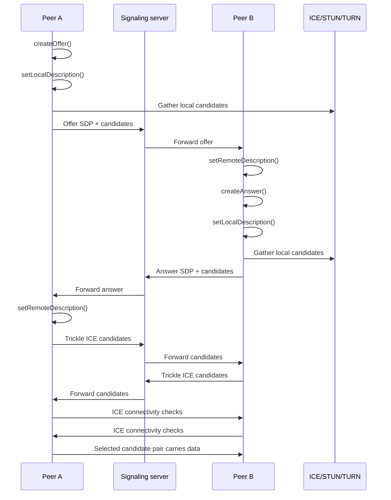

# ICE candidate trong WebRTC

## 1. ICE candidate là gì?

**ICE candidate** là một địa chỉ và thông tin truyền tải mà một thiết bị có thể dùng để thử thiết lập kết nối WebRTC với peer khác. Candidate mô tả một đường đi tiềm năng qua mạng: địa chỉ IP, port, transport protocol và loại candidate. Browser thu thập các candidate, trao đổi chúng qua signaling, kiểm tra các cặp candidate rồi chọn đường truyền hoạt động được.

ICE là viết tắt của **Interactive Connectivity Establishment**. Nó giải quyết bài toán hai thiết bị có thể nằm sau NAT, firewall hoặc nhiều lớp mạng khác nhau. Hai peer không thể chỉ đoán địa chỉ của nhau rồi kết nối trực tiếp; chúng cần thu thập các địa chỉ có thể sử dụng và kiểm tra đường truyền thực tế.

Một candidate không bảo đảm kết nối sẽ thành công. Nó chỉ là một khả năng để ICE agent thử. Candidate pair phải vượt qua connectivity checks thì mới có thể được chọn làm đường truyền.

Ví dụ cấu hình STUN và TURN cho một peer connection:

```js
const pc = new RTCPeerConnection({
  iceServers: [
    { urls: 'stun:stun.example.net:3478' },
    {
      urls: 'turn:turn.example.net:3478?transport=udp',
      username: 'short-lived-user',
      credential: 'short-lived-credential'
    }
  ]
});
```

STUN giúp peer khám phá địa chỉ được NAT ánh xạ ra bên ngoài và hỗ trợ connectivity checks. TURN cung cấp địa chỉ relay khi hai peer không thể truyền trực tiếp. ICE phối hợp các candidate đó để tìm đường truyền phù hợp.

**Nguyên tắc:** ICE candidate là dữ liệu mạng cần được trao đổi và kiểm tra trong một phiên WebRTC. Candidate không phải danh tính người dùng, không chứng minh peer đáng tin và không thay thế xác thực signaling, DTLS hoặc quyền truy cập ứng dụng.

Bài viết thuộc chương **WebRTC** của module **SECURITY_APPLICATION_SECURITY_BROWSER_SECURITY**. Nội dung kết nối ICE candidate với STUN, TURN, SDP, signaling, NAT, candidate pair, quyền riêng tư địa chỉ IP và bảo vệ kết nối WebRTC.

Sau bài học, bạn có thể:

- Giải thích ICE candidate và vai trò của ICE trong thiết lập kết nối WebRTC.
- Phân biệt host, server-reflexive, peer-reflexive và relay candidate.
- Hiểu STUN, TURN và vì sao STUN không phải media relay.
- Theo dõi quá trình gathering và trạng thái ICE.
- Phân biệt non-trickle ICE với trickle ICE.
- Giải thích candidate pair, connectivity check, nomination và selected pair.
- Xử lý candidate event và gửi candidate qua signaling an toàn.
- Nhận diện tác động của NAT, firewall, VPN và TURN tới khả năng kết nối.
- Đánh giá rủi ro lộ địa chỉ IP và lựa chọn relay-only khi cần.
- Thực hành quan sát candidate và kết nối data channel trên localhost.

## 2. ICE nằm ở đâu trong quá trình WebRTC?

WebRTC cần một kênh signaling để hai peer trao đổi thông tin ban đầu. Signaling thường do ứng dụng tự xây dựng bằng WebSocket, HTTP hoặc một cơ chế truyền tin khác. WebRTC không bắt buộc một giao thức signaling cụ thể.

Một luồng thiết lập kết nối thường gồm:

1. Ứng dụng tạo `RTCPeerConnection` với cấu hình ICE server.
2. Một peer tạo offer SDP và gọi `setLocalDescription()`.
3. Browser thu thập ICE candidate.
4. Offer và candidate được gửi qua signaling tới peer còn lại.
5. Peer kia gọi `setRemoteDescription()`, tạo answer và gửi lại.
6. Hai bên trao đổi candidate theo signaling.
7. ICE kiểm tra candidate pair và chọn đường truyền.
8. Khi transport kết nối, media hoặc data channel có thể truyền qua kết nối đã thiết lập.



Sơ đồ minh họa signaling và ICE có thể diễn ra xen kẽ. Với trickle ICE, candidate được chuyển ngay khi phát hiện, không cần đợi toàn bộ quá trình gathering kết thúc.

### 2.1. ICE, STUN và TURN khác nhau

| Thành phần | Vai trò | Không làm gì |
|---|---|---|
| ICE | Thu thập, kiểm tra và chọn đường truyền giữa hai peer | Không phải signaling server |
| STUN | Giúp phát hiện địa chỉ reflexive qua NAT và hỗ trợ connectivity checks | Không chuyển tiếp media như TURN |
| TURN | Cấp relay address và chuyển tiếp packet khi đường trực tiếp không hoạt động | Không phải nơi xác thực tài khoản ứng dụng |
| SDP | Mô tả media/data channel, codec, transport và thông tin ICE cần trao đổi | Không phải giao thức signaling bắt buộc |
| Signaling | Chuyển offer, answer và candidate giữa các peer | Không tự kiểm tra đường mạng có kết nối được hay không |

STUN server có thể giúp một peer biết địa chỉ public mapping mà NAT đang sử dụng. Nhưng việc biết địa chỉ đó không bảo đảm peer còn lại có thể gửi packet tới được. Connectivity checks của ICE mới xác minh đường truyền.

TURN relay nhận packet từ một peer rồi chuyển tiếp tới peer kia. Vì vậy, TURN tăng khả năng kết nối trong mạng bị hạn chế, đổi lại tiêu tốn băng thông và tài nguyên relay.

### 2.2. Candidate không phải một kết nối đã thành công

Ví dụ browser thu được một host candidate và một server-reflexive candidate. Điều đó không có nghĩa cả hai địa chỉ đều có thể được peer kia truy cập.

Một số nguyên nhân khiến candidate không hoạt động:

- NAT không cho phép packet đi vào theo mapping đã tạo.
- Firewall chặn UDP hoặc port cần thiết.
- Mạng doanh nghiệp giới hạn traffic peer-to-peer.
- Hai peer nằm sau symmetric NAT hoặc CGNAT.
- VPN thay đổi interface và route.
- Candidate đã cũ vì mạng thay đổi.
- Peer nhận candidate sau khi ICE generation đã được restart.

ICE cần kiểm tra candidate pair và có thể chọn TURN relay nếu các đường trực tiếp thất bại.

## 3. Các loại ICE candidate

ICE định nghĩa một số loại candidate. Mỗi loại đại diện cho một cách peer có thể được định tuyến tới.

### 3.1. Host candidate

**Host candidate** đại diện cho địa chỉ trên một network interface của thiết bị, ví dụ interface Wi-Fi, Ethernet hoặc loopback.

Ví dụ minh họa:

```text
candidate:1 1 udp 2122260223 192.168.1.25 54000 typ host
```

Địa chỉ ở đây chỉ là ví dụ. Browser hiện đại có thể che địa chỉ local bằng hostname mDNS dạng ngẫu nhiên kết thúc bằng `.local` để giảm việc website và peer khác quan sát trực tiếp địa chỉ IP nội bộ.

Host candidate thường cho phép kết nối trực tiếp trong cùng LAN hoặc giữa các interface có route phù hợp. Tuy nhiên, firewall local hoặc policy của browser vẫn có thể ảnh hưởng.

### 3.2. Server-reflexive candidate (srflx)

**Server-reflexive candidate** là địa chỉ mapping mà peer quan sát được từ bên ngoài NAT, thường nhờ STUN.

Ví dụ minh họa:

```text
candidate:2 1 udp 1686052607 203.0.113.20 62000 typ srflx raddr 192.168.1.25 rport 54000
```

- Địa chỉ và port sau transport là mapping quan sát được từ bên ngoài.
- `raddr` và `rport` có thể mô tả related address/port của base candidate.
- Browser có thể ẩn hoặc làm mờ một số thông tin địa chỉ vì quyền riêng tư.

Server-reflexive candidate hữu ích khi NAT tạo mapping có thể được peer khác sử dụng. Tuy nhiên, NAT mapping có thể phụ thuộc đích và chính sách firewall; candidate srflx không bảo đảm kết nối trực tiếp thành công.

### 3.3. Peer-reflexive candidate (prflx)

**Peer-reflexive candidate** có thể được phát hiện trong quá trình connectivity checks khi ICE agent nhận packet từ một địa chỉ được quan sát nhưng chưa có candidate tương ứng trong danh sách ban đầu.

Nó phản ánh địa chỉ mà peer thực sự quan sát được trong quá trình kiểm tra. Peer-reflexive candidate có thể giúp ICE thích nghi với hành vi NAT hoặc mapping khác với dự đoán ban đầu.

Ứng dụng thường không tự tạo loại candidate này. ICE agent xử lý nó như một phần của quá trình connectivity checks.

### 3.4. Relay candidate

**Relay candidate** là địa chỉ được TURN server cấp sau khi peer tạo allocation. Peer gửi packet tới TURN server; TURN chuyển tiếp packet tới peer còn lại.

Ví dụ minh họa:

```text
candidate:4 1 udp 16777215 198.51.100.40 50000 typ relay raddr 192.168.1.25 rport 54000
```

Relay candidate có thể giúp kết nối khi NAT hoặc firewall ngăn đường trực tiếp. Đổi lại:

- Traffic phải đi qua TURN server.
- TURN server tiêu thụ băng thông và chi phí.
- Độ trễ có thể tăng do thêm một hop.
- Server relay nhìn thấy metadata mạng cần thiết để chuyển tiếp packet.
- TURN credential cần được bảo vệ và cấp theo thời hạn phù hợp.

### 3.5. Bảng so sánh

| Candidate type | Nguồn tạo | Đường truyền | Điểm cần lưu ý |
|---|---|---|---|
| host | Interface local | Trực tiếp qua địa chỉ host | Có thể tiết lộ thông tin mạng nội bộ; browser có thể dùng mDNS |
| srflx | STUN quan sát NAT mapping | Trực tiếp qua mapping NAT | Không bảo đảm mapping có thể truy cập từ peer |
| prflx | Phát hiện trong connectivity checks | Đường trực tiếp được quan sát thực tế | ICE agent tự phát hiện |
| relay | TURN allocation | Qua TURN server | Tăng độ tin cậy kết nối nhưng tốn relay bandwidth |

Candidate type không phải thứ tự bảo đảm thành công. ICE sử dụng priority và connectivity checks để đánh giá nhiều candidate pair. Trong một số mạng, relay candidate là đường duy nhất hoạt động.

## 4. Cấu trúc một candidate

Một candidate thường được biểu diễn dưới dạng dòng SDP bắt đầu bằng `a=candidate:`. Ví dụ rút gọn:

```text
a=candidate:842163049 1 udp 1677729535 192.0.2.10 54400 typ host
```

Các trường thường gặp:

| Trường | Ý nghĩa |
|---|---|
| Foundation | Nhóm candidate có đặc tính nền tảng tương tự để ICE tối ưu kiểm tra |
| Component | Thành phần transport; với RTCP mux hiện đại thường chỉ còn component RTP |
| Transport | Protocol như UDP hoặc TCP |
| Priority | Giá trị ưu tiên candidate do ICE agent tính |
| Address | IP hoặc hostname đại diện địa chỉ candidate |
| Port | Port transport |
| Type | host, srflx, prflx hoặc relay |
| Related address/port | Địa chỉ và port liên quan, thường xuất hiện ở srflx/relay |
| TCP type | Thông tin kiểu TCP candidate nếu transport là TCP |

Trong JavaScript, browser cung cấp thông tin candidate qua `RTCIceCandidate`:

```js
pc.addEventListener('icecandidate', (event) => {
  const candidate = event.candidate;

  if (candidate) {
    console.log({
      type: candidate.type,
      protocol: candidate.protocol,
      sdpMid: candidate.sdpMid,
      sdpMLineIndex: candidate.sdpMLineIndex,
      usernameFragment: candidate.usernameFragment
    });
  }
});
```

Không cần log toàn bộ candidate string trong telemetry thông thường. Candidate có thể chứa IP, port và thông tin mạng riêng tư; chỉ ghi các trường cần thiết để chẩn đoán.

### 4.1. Priority

ICE candidate có priority để agent sắp xếp thứ tự ưu tiên kiểm tra. Công thức trong ICE dùng type preference, local preference và component ID:

```text
priority =
  2^24 × type preference
  + 2^8 × local preference
  + (256 - component ID)
```

Giá trị cụ thể do ICE agent và browser tính theo quy tắc ICE. Ứng dụng thường không cần tự tính hoặc sửa candidate priority.

Priority của candidate pair là một phép tính khác, có liên quan tới vai trò controlling/controlled và priority của hai candidate. Candidate có priority cao hơn không có nghĩa chắc chắn sẽ là đường truyền cuối cùng; connectivity checks và nomination mới xác định pair được chọn.

### 4.2. Foundation

Foundation giúp ICE gom các candidate có đặc tính nền tảng tương tự để tránh lặp lại các connectivity checks không cần thiết. Nó không phải ID người dùng, session token hoặc định danh thiết bị.

Không dùng foundation để xác thực peer hoặc liên kết candidate với tài khoản. Việc gắn candidate vào phiên phải dựa trên danh tính và quyền truy cập của signaling session.

## 5. STUN server và TURN server

### 5.1. Cấu hình iceServers

Cấu hình server được truyền khi tạo `RTCPeerConnection`:

```js
const pc = new RTCPeerConnection({
  iceServers: [
    {
      urls: 'stun:stun.example.net:3478'
    },
    {
      urls: [
        'turn:turn.example.net:3478?transport=udp',
        'turns:turn.example.net:5349?transport=tcp'
      ],
      username: 'temporary-user',
      credential: 'temporary-password'
    }
  ]
});
```

`iceServers` có thể chứa nhiều STUN/TURN server và URL transport khác nhau. Browser sẽ sử dụng chúng trong quá trình gathering và connectivity checks theo khả năng hỗ trợ.

Tên miền trong ví dụ là placeholder. Ứng dụng thực tế cần triển khai hoặc thuê STUN/TURN service phù hợp, kiểm tra credential và khả năng kết nối từ các mạng mục tiêu.

### 5.2. STUN không phải relay

STUN giúp peer khám phá địa chỉ mapping và thực hiện một số phép kiểm tra. Nó không chuyển tiếp media/data liên tục giữa hai peer như TURN.

Nếu hai peer không thể gửi packet trực tiếp qua NAT/firewall, chỉ thêm STUN server có thể vẫn không đủ. TURN cung cấp đường relay để kết nối có thể thành công.

### 5.3. TURN credential

Không nhúng credential TURN dài hạn hoặc secret quản trị vào JavaScript client. Người dùng có thể xem source, bundle và network traffic.

Mô hình thường dùng:

1. Client xác thực với backend qua HTTPS.
2. Backend xác minh user và quyền tham gia phiên.
3. Backend cấp TURN credential ngắn hạn hoặc credential có thời hạn.
4. Client dùng credential đó trong `iceServers`.
5. TURN server giới hạn quota, thời gian và tài nguyên theo credential.

Credential ngắn hạn giảm nguy cơ bị lạm dụng khi bị lộ. TURN server vẫn cần rate limit, monitoring và giới hạn bandwidth.

## 6. ICE gathering và icecandidate event

### 6.1. Trạng thái gathering

`RTCPeerConnection.iceGatheringState` phản ánh quá trình thu thập candidate:

| State | Ý nghĩa |
|---|---|
| `new` | Chưa bắt đầu gathering |
| `gathering` | Đang thu thập candidate |
| `complete` | Đã hoàn tất gathering cho ICE generation hiện tại |

Khi page gọi `setLocalDescription()` sau khi tạo offer hoặc answer, browser bắt đầu quá trình ICE gathering. Candidate có thể xuất hiện theo thời gian khi browser tìm được host, srflx hoặc relay address.

### 6.2. Lắng nghe candidate

Ví dụ:

```js
pc.addEventListener('icecandidate', (event) => {
  if (event.candidate === null) {
    console.log('ICE gathering hoàn tất.');
    return;
  }

  const candidate = event.candidate;

  console.log('Candidate type:', candidate.type);
  console.log('Transport:', candidate.protocol);

  // Gửi candidate qua signaling tới đúng peer của phiên.
});
```

`event.candidate` có thể là một candidate object hoặc `null` khi gathering hoàn tất. Một số event còn chứa candidate object với trường `candidate` là chuỗi rỗng để biểu thị end-of-candidates cho một transport/generation. Khi dùng trickle ICE, ứng dụng cần giữ đúng marker này nếu browser phát ra nó.

### 6.3. Theo dõi iceGatheringState

```js
pc.addEventListener('icegatheringstatechange', () => {
  console.log('Gathering state:', pc.iceGatheringState);
});
```

Sự kiện state change hữu ích để cập nhật giao diện chẩn đoán. Không cần chờ gathering complete nếu ứng dụng dùng trickle ICE và signaling đã sẵn sàng chuyển candidate từng phần.

### 6.4. Candidate generation

Khi ICE restart xảy ra, peer tạo ICE credentials mới và bắt đầu một generation mới. Candidate cũ thuộc generation trước không nên được áp dụng nhầm vào phiên ICE mới.

Candidate object có thể cung cấp `usernameFragment` (ufrag). Khi signaling nhiều message bất đồng bộ, hãy gắn candidate với phiên và generation phù hợp để bỏ qua candidate đến muộn từ phiên cũ.

## 7. Trickle ICE và non-trickle ICE

### 7.1. Non-trickle ICE

Với non-trickle ICE, peer chờ tới khi gathering hoàn tất rồi mới gửi SDP đầy đủ cho peer còn lại.

Quy trình:

1. Tạo offer.
2. Gọi `setLocalDescription()`.
3. Chờ `iceGatheringState` thành `complete`.
4. Gửi `localDescription` qua signaling.
5. Peer nhận gọi `setRemoteDescription()`.
6. Peer tạo answer và cũng chờ gathering hoàn tất trước khi gửi.

Cách này dễ hiểu và phù hợp với lab, nhưng tăng thời gian thiết lập vì phải chờ tất cả candidate trước khi bắt đầu trao đổi.

Hàm chờ gathering:

```js
function waitForIceGatheringComplete(pc) {
  if (pc.iceGatheringState === 'complete') {
    return Promise.resolve();
  }

  return new Promise((resolve) => {
    const checkState = () => {
      if (pc.iceGatheringState !== 'complete') return;

      pc.removeEventListener('icegatheringstatechange', checkState);
      resolve();
    };

    pc.addEventListener('icegatheringstatechange', checkState);
    checkState();
  });
}
```

### 7.2. Trickle ICE

Với trickle ICE, peer gửi offer/answer ngay khi local description đã được thiết lập, sau đó gửi từng candidate khi browser phát hiện.

Lợi ích:

- Hai peer có thể bắt đầu connectivity checks sớm.
- Không cần chờ toàn bộ gathering hoàn tất.
- Có thể giảm thời gian thiết lập cuộc gọi.
- Candidate tốt có thể được kiểm tra trong khi candidate khác vẫn đang được thu thập.

Trickle ICE yêu cầu signaling xử lý được nhiều message candidate và có thể nhận candidate trước hoặc sau SDP tùy thời điểm. Ứng dụng cần quản lý thứ tự, phiên và generation.

### 7.3. Gửi candidate qua signaling

Ví dụ phía gửi:

```js
pc.addEventListener('icecandidate', ({ candidate }) => {
  signalServer.send(JSON.stringify({
    type: 'ice-candidate',
    sessionId,
    targetPeerId,
    candidate: candidate ? candidate.toJSON() : null
  }));
});
```

Ví dụ phía nhận:

```js
async function handleRemoteCandidate(message) {
  if (message.sessionId !== currentSessionId) return;
  if (message.fromPeerId !== expectedPeerId) return;

  await pc.addIceCandidate(message.candidate);
}
```

Đây là pseudo-code minh họa; ứng dụng cần định nghĩa schema message và transport signaling của riêng mình. Chỉ nhận candidate từ peer đã được xác thực và gắn với đúng phòng/phiên.

Nếu candidate đến trước khi remote description được thiết lập, có thể đưa vào queue tạm. Sau khi `setRemoteDescription()` thành công, xử lý queue theo đúng thứ tự. Khi ICE generation thay đổi, loại bỏ candidate cũ không còn phù hợp.

### 7.4. End-of-candidates

Khi gathering hoàn tất, browser có thể phát event với `candidate === null`. Với từng transport, end-of-candidates cũng có thể được biểu diễn bằng candidate object có chuỗi candidate rỗng.

Khi dùng trickle ICE, đừng bỏ marker này một cách tùy tiện. Remote ICE agent có thể cần biết không còn candidate nào nữa cho generation/transport tương ứng để hoàn tất checklist.

### 7.5. Khi nào chọn loại nào?

| Tiêu chí | Non-trickle ICE | Trickle ICE |
|---|---|---|
| Độ phức tạp signaling | Đơn giản hơn | Cần xử lý candidate message riêng |
| Thời gian thiết lập | Có thể chậm hơn vì chờ gathering | Thường nhanh hơn vì kiểm tra sớm |
| Phù hợp | Lab, hệ thống signaling đơn giản | Ứng dụng gọi thoại/video thời gian thực |
| Candidate đến muộn | Thường đã có trong SDP đầy đủ | Phải quản lý queue, session và generation |

## 8. Candidate pair và connectivity checks

### 8.1. Candidate pair là gì?

Một **candidate pair** gồm một local candidate và một remote candidate. ICE tạo các cặp phù hợp rồi kiểm tra xem hai địa chỉ có thể trao đổi packet hay không.

Ví dụ:

```text
Local candidate:  host  192.168.1.25:54000
Remote candidate: srflx 203.0.113.20:62000
Pair:             local host ↔ remote srflx
```

Đây chỉ là ví dụ minh họa. Một peer có thể có nhiều candidate, nên số candidate pair ban đầu có thể lớn. ICE dùng foundation, priority và checklist để tổ chức việc kiểm tra.

### 8.2. Connectivity checks

ICE agent gửi STUN Binding request qua candidate pair và chờ phản hồi. Khi phản hồi hợp lệ, pair có thể được đánh dấu succeeded. Nếu timeout hoặc lỗi, pair có thể failed.

Một số trạng thái pair thường thấy trong thống kê:

- `frozen`: chưa được đưa vào kiểm tra.
- `waiting`: sẵn sàng kiểm tra.
- `in-progress`: connectivity check đang diễn ra.
- `succeeded`: check thành công.
- `failed`: check thất bại.

Candidate pair thành công vẫn chưa nhất thiết được chọn cuối cùng. ICE còn thực hiện nomination theo vai trò controlling/controlled.

### 8.3. Controlling và controlled

Trong một phiên ICE, hai agent có vai trò controlling hoặc controlled. Controlling agent quyết định candidate pair nào được nominate làm đường truyền sử dụng; controlled agent phối hợp chấp nhận nomination.

Vai trò được xác định trong ICE protocol bằng tie-breaker và thông tin trao đổi giữa hai agent. Ứng dụng không nên tự gán vai trò dựa vào việc ai gọi trước hoặc ai là caller trong UI.

### 8.4. Selected candidate pair

Khi pair được nominate và chọn, ICE sử dụng đường truyền đó cho transport tương ứng. Pair được chọn có thể thay đổi nếu mạng đổi, kết nối mất hoặc ICE restart.

Có thể kiểm tra thống kê qua `getStats()`. Cách đọc selected pair nên dựa trên transport report và `selectedCandidatePairId` khi browser cung cấp:

```js
async function inspectSelectedPair(pc) {
  const stats = await pc.getStats();
  let selectedPair = null;

  for (const report of stats.values()) {
    if (
      report.type === 'transport' &&
      report.selectedCandidatePairId
    ) {
      selectedPair = stats.get(report.selectedCandidatePairId);
      break;
    }
  }

  if (!selectedPair) {
    console.log('Chưa có selected candidate pair.');
    return;
  }

  const local = stats.get(selectedPair.localCandidateId);
  const remote = stats.get(selectedPair.remoteCandidateId);

  console.log({
    pairState: selectedPair.state,
    nominated: selectedPair.nominated,
    localType: local?.candidateType,
    remoteType: remote?.candidateType,
    protocol: local?.protocol
  });
}
```

Các field của WebRTC stats có thể khác theo browser/version. Không log địa chỉ IP/port ra telemetry công khai nếu không cần; thông tin đó có thể nhận diện mạng hoặc thiết bị.

## 9. ICE connection state và xử lý mạng thay đổi

### 9.1. iceConnectionState

`pc.iceConnectionState` phản ánh trạng thái ICE transport:

| State | Ý nghĩa khái quát |
|---|---|
| `new` | ICE chưa bắt đầu kiểm tra |
| `checking` | Đang kiểm tra candidate pair |
| `connected` | Đã có pair hoạt động |
| `completed` | Gathering và kiểm tra cần thiết đã hoàn tất |
| `disconnected` | Kết nối tạm thời bị gián đoạn hoặc mất connectivity |
| `failed` | ICE không tìm được đường truyền hoạt động |
| `closed` | Peer connection đã đóng |

`connectionState` là trạng thái tổng hợp của các transport trong peer connection; nó không hoàn toàn đồng nghĩa với `iceConnectionState`.

Lắng nghe thay đổi:

```js
pc.addEventListener('iceconnectionstatechange', () => {
  console.log('ICE state:', pc.iceConnectionState);
});

pc.addEventListener('connectionstatechange', () => {
  console.log('Peer connection state:', pc.connectionState);
});
```

### 9.2. disconnected không luôn là failed

Trạng thái disconnected có thể tạm thời xuất hiện khi chuyển Wi-Fi, đổi interface hoặc mạng bị gián đoạn. Ứng dụng có thể chờ một khoảng ngắn và quan sát trạng thái trước khi kết thúc phiên.

Nếu ICE chuyển sang failed, ứng dụng có thể cần thực hiện ICE restart hoặc yêu cầu người dùng kết nối lại. Không hiển thị lỗi cuối cùng chỉ vì một lần chuyển disconnected ngắn.

### 9.3. ICE restart

ICE restart tạo ICE credentials mới và bắt đầu gathering/checks cho generation mới. API thường dùng:

```js
async function restartIce(pc) {
  pc.restartIce();

  const offer = await pc.createOffer();
  await pc.setLocalDescription(offer);

  // Gửi offer mới qua signaling.
  // Peer từ xa cần setRemoteDescription và trả answer.
}
```

ICE restart cần signaling để trao đổi offer/answer mới. Chỉ gọi `restartIce()` không tự hoàn thành thương lượng với peer còn lại.

Khi restart, candidate cũ có thể vẫn đến muộn qua signaling. Gắn candidate với ICE username fragment/generation và session để không thêm nhầm candidate cũ vào trạng thái mới.

## 10. NAT, firewall và lý do cần TURN

### 10.1. NAT và mapping

NAT cho phép nhiều thiết bị trong mạng riêng chia sẻ địa chỉ public. Khi một thiết bị gửi packet ra ngoài, NAT tạo mapping giữa địa chỉ/port nội bộ và địa chỉ/port bên ngoài.

ICE cần tìm candidate mà peer khác có thể sử dụng. STUN giúp quan sát mapping, nhưng mapping có thể phụ thuộc destination và chính sách NAT.

### 10.2. Symmetric NAT và CGNAT

Với một số loại NAT, mapping quan sát từ STUN server có thể không dùng được khi peer khác gửi packet tới. CGNAT còn đặt thiết bị sau nhiều lớp NAT do ISP quản lý.

Khi direct connectivity thất bại, TURN relay thường là phương án đáng tin cậy hơn. Không có một chiến lược STUN duy nhất bảo đảm kết nối trực tiếp trên mọi mạng.

### 10.3. Firewall và transport

Một số mạng chặn UDP hoặc chỉ cho phép traffic qua proxy/TCP/TLS. TURN có thể được cấu hình với nhiều transport/port để tăng khả năng kết nối, tùy dịch vụ và browser.

Ví dụ URL TURN qua TCP/TLS:

```text
turn:turn.example.net:3478?transport=tcp
turns:turn.example.net:5349?transport=tcp
```

Hãy kiểm tra khả năng kết nối từ mạng doanh nghiệp, mạng di động, VPN và Wi-Fi công cộng. Không giả định UDP luôn được phép.

### 10.4. Chi phí của relay

Relay làm tăng khả năng kết nối nhưng mọi packet đi qua TURN server. Khi có nhiều cuộc gọi đồng thời, bandwidth TURN có thể là phần chi phí lớn.

Theo dõi:

- Số phiên cần relay.
- Băng thông vào/ra của TURN.
- Thời gian thiết lập kết nối.
- Tỷ lệ connectivity check thất bại.
- Vị trí địa lý và độ trễ relay.
- TURN allocation và credential bất thường.

## 11. Quyền riêng tư địa chỉ IP và candidate filtering

### 11.1. Candidate có thể tiết lộ thông tin mạng

Candidate có thể chứa địa chỉ host hoặc public mapping. Tùy browser và chính sách privacy, peer hoặc ứng dụng có thể quan sát một số thông tin mạng của thiết bị.

Các loại thông tin có thể lộ:

- IP private của interface local nếu không được che.
- Public IP mapping từ NAT qua srflx candidate.
- IP của TURN server khi dùng relay.
- Port và transport protocol.
- Thông tin về nhiều interface hoặc network path.

Browser hiện đại thường áp dụng các biện pháp như mDNS host candidate obfuscation và giới hạn truy cập theo permission/policy. Hành vi khác nhau theo browser, phiên bản và môi trường.

### 11.2. mDNS host candidate

Thay vì gửi địa chỉ IP nội bộ trực tiếp, browser có thể công bố hostname mDNS ngẫu nhiên dạng `random-name.local` trong candidate host. Peer trên mạng có thể phân giải hostname theo cơ chế phù hợp nếu được phép, trong khi ứng dụng không nhận được IP local theo cách trực tiếp như trước.

mDNS obfuscation giảm lộ địa chỉ nội bộ, nhưng không che mọi loại địa chỉ candidate và không làm WebRTC trở thành ẩn danh.

### 11.3. Relay-only policy

Nếu ứng dụng cần hạn chế việc peer nhìn thấy candidate trực tiếp, có thể đặt:

```js
const pc = new RTCPeerConnection({
  iceTransportPolicy: 'relay',
  iceServers: [
    {
      urls: 'turn:turn.example.net:3478?transport=udp',
      username: 'temporary-user',
      credential: 'temporary-credential'
    }
  ]
});
```

Với policy relay, ICE chỉ sử dụng relay candidate theo cấu hình. Điều này có thể giảm việc lộ địa chỉ mạng của client cho peer, nhưng:

- TURN server vẫn nhìn thấy địa chỉ nguồn cần thiết để relay.
- Kết nối phụ thuộc TURN server và credential hợp lệ.
- Chi phí và độ trễ có thể tăng.
- Nếu TURN không khả dụng, kết nối có thể thất bại.
- Relay-only không thay thế bảo vệ signaling hoặc xác thực người dùng.

Chọn policy theo threat model và yêu cầu sản phẩm. Không tuyên bố relay-only làm người dùng ẩn danh tuyệt đối.

### 11.4. Không lọc candidate bằng chuỗi tùy tiện

Không nên viết logic xóa candidate chỉ bằng cách parse chuỗi SDP theo regex đơn giản. Candidate có thể có nhiều transport, IPv4/IPv6, mDNS, extension attribute và generation khác nhau. Việc sửa SDP không đúng có thể làm hỏng connectivity checks hoặc tạo lỗi khó chẩn đoán.

Ưu tiên dùng API và policy của browser như `iceTransportPolicy`, cấu hình TURN và signaling authorization. Nếu cần lọc ở tầng ứng dụng, phải hiểu chuẩn candidate và kiểm thử với browser/network mục tiêu.

## 12. Bảo mật signaling và candidate

### 12.1. Candidate không phải bằng chứng danh tính

Một candidate chỉ mô tả đường truyền. Nó không chứng minh người gửi là user đã đăng nhập hoặc là peer được phép tham gia cuộc gọi.

Signaling server cần:

- Xác thực user trước khi tham gia room/session.
- Kiểm tra user có quyền gửi message tới peer đích.
- Gắn candidate với session ID và peer ID đã xác thực phía server.
- Chỉ chuyển tiếp tới thành viên của đúng phiên.
- Kiểm tra kích thước, schema và tốc độ message.
- Từ chối candidate đến từ user đã rời phiên hoặc generation cũ.

Không tin `fromPeerId` do client tự khai báo nếu server chưa xác minh quan hệ đó.

### 12.2. Dùng signaling qua kênh bảo mật

Dùng HTTPS/WSS để bảo vệ signaling message trên đường truyền. Nếu signaling bị sửa, attacker có thể thay offer/answer, candidate hoặc thông tin phiên và gây kết nối tới endpoint không mong muốn.

TLS bảo vệ kênh truyền tới signaling server; server vẫn phải xác thực session, kiểm tra quyền và tránh phát tán message sang sai room.

### 12.3. Validate candidate message

Ví dụ kiểm tra envelope message trước khi gọi addIceCandidate:

```js
async function receiveCandidate(message, context) {
  if (!message || typeof message !== 'object') return;
  if (message.type !== 'ice-candidate') return;
  if (message.sessionId !== context.sessionId) return;
  if (message.fromPeerId !== context.expectedPeerId) return;
  if (message.generation !== context.generation) return;

  const candidate = message.candidate;

  if (candidate !== null) {
    if (
      typeof candidate !== 'object' ||
      typeof candidate.candidate !== 'string' ||
      candidate.candidate.length > 4096
    ) {
      throw new TypeError('ICE candidate không hợp lệ');
    }
  }

  await context.peerConnection.addIceCandidate(candidate);
}
```

Đây chỉ là kiểm tra envelope và kiểu dữ liệu tối thiểu; không thay thế xác thực signaling server hoặc kiểm tra đầy đủ của browser. Candidate có thể là marker end-of-candidates với chuỗi rỗng; không loại bỏ marker đó nếu giao thức signaling sử dụng nó.

### 12.4. Chống injection và lạm dụng

Candidate string là input không tin cậy. Không đưa trực tiếp candidate vào HTML, log viewer hoặc câu lệnh shell. Khi hiển thị thông tin chẩn đoán, dùng text node và chỉ hiển thị trường cần thiết.

Signaling server nên giới hạn:

- Số candidate mỗi phiên.
- Kích thước mỗi message.
- Tần suất message theo user/session.
- Số peer và số session đồng thời.
- Thời gian tồn tại của room và candidate queue.
- Quyền gửi message sau khi phiên đã đóng.

### 12.5. ICE không thay thế DTLS và xác thực ứng dụng

ICE tìm đường truyền. DTLS thiết lập transport bảo mật cho WebRTC; media thường được bảo vệ bằng SRTP, còn data channel chạy trên SCTP over DTLS.

SDP chứa DTLS fingerprint dùng để liên kết transport với certificate của peer. Ứng dụng phải bảo vệ signaling để fingerprint và mô tả phiên không bị thay thế bởi attacker. Xác thực người dùng và quyền tham gia cuộc gọi vẫn là trách nhiệm của ứng dụng.

## 13. Chẩn đoán ICE bằng getStats và DevTools

### 13.1. Xem gathering state và connection state

```js
console.log({
  gathering: pc.iceGatheringState,
  iceConnection: pc.iceConnectionState,
  connection: pc.connectionState
});
```

Nếu gathering vẫn là `gathering` quá lâu, kiểm tra STUN/TURN server, DNS, firewall và network route. Nếu gathering complete nhưng ICE failed, candidate đã thu thập có thể không tạo được pair hoạt động.

### 13.2. Xem candidate pair

`getStats()` có thể cung cấp candidate-pair, local-candidate, remote-candidate và transport reports. Tìm selected pair qua `selectedCandidatePairId` khi có:

```js
const stats = await pc.getStats();

for (const report of stats.values()) {
  if (report.type === 'candidate-pair') {
    console.log({
      state: report.state,
      nominated: report.nominated,
      bytesSent: report.bytesSent,
      bytesReceived: report.bytesReceived,
      currentRoundTripTime: report.currentRoundTripTime
    });
  }
}
```

Stats có thể chứa địa chỉ IP, port và metadata mạng. Không gửi toàn bộ stats tới analytics hoặc log công khai nếu không có nhu cầu và kiểm soát quyền riêng tư phù hợp.

### 13.3. Phân biệt lỗi signaling và lỗi ICE

| Hiện tượng | Nguyên nhân có thể | Kiểm tra |
|---|---|---|
| Không nhận offer/answer | Signaling server, room membership hoặc message routing lỗi | WebSocket/HTTP, session ID, peer ID |
| setRemoteDescription reject | SDP không hợp lệ, thứ tự signaling sai hoặc session không khớp | SDP, signaling state và Console |
| Gathering không có candidate | Secure context/API config, ICE server DNS hoặc network issue | iceGatheringState, iceServers, browser logs |
| Có candidate nhưng không có pair thành công | NAT/firewall chặn đường truyền | Candidate types, TURN reachability, connectivity checks |
| ICE failed chỉ trên một số mạng | UDP bị chặn, symmetric NAT hoặc CGNAT | Thử TURN TCP/TLS và mạng khác |
| Pair connected rồi disconnected | Mạng đổi, Wi-Fi/VPN chuyển, packet loss | iceConnectionState và stats |
| Relay candidate không xuất hiện | TURN URL/credential/DNS/firewall sai | TURN server logs và credential expiry |
| Chỉ relay mới kết nối | Direct path bị NAT/firewall ngăn | Giữ TURN làm fallback hoặc relay-only theo threat model |

### 13.4. Dùng công cụ chẩn đoán browser

Trong Chromium-based browser, trang nội bộ WebRTC diagnostics có thể cung cấp event log và thống kê peer connection. Tên và vị trí công cụ khác theo browser/version. Kết hợp:

- DevTools Console.
- Network tab để kiểm tra signaling.
- WebRTC internals/diagnostics để xem ICE state và candidate pair.
- Log STUN/TURN server.
- Kiểm thử từ nhiều loại mạng.

Không công khai dump SDP hoặc candidate đầy đủ trong bug report vì có thể chứa địa chỉ mạng và fingerprint transport. Hãy redaction thông tin nhạy cảm trước khi chia sẻ.

## 14. Lab local: quan sát ICE candidate và data channel

Lab tạo hai RTCPeerConnection trong cùng một trang và kết nối chúng bằng SDP trao đổi trực tiếp trong JavaScript. Không cần signaling server hoặc STUN/TURN bên ngoài. Cấu hình không dùng ICE server nên lab chủ yếu quan sát host candidate và connectivity trên máy local.

### 14.1. Tạo file ice-lab.html

```html
<!doctype html>
<html lang="vi">
<head>
  <meta charset="utf-8">
  <meta name="viewport" content="width=device-width, initial-scale=1">
  <title>ICE candidate lab</title>
</head>
<body>
  <h1>ICE candidate lab</h1>
  <p id="status" aria-live="polite">Chưa bắt đầu.</p>
  <button id="start">Tạo kết nối local</button>
  <button id="send" disabled>Gửi message</button>
  <button id="close" disabled>Đóng peer connection</button>
  <pre id="log"></pre>

  <script>
    let pc1;
    let pc2;
    let channel;

    const status = document.getElementById("status");
    const output = document.getElementById("log");
    const sendButton = document.getElementById("send");
    const closeButton = document.getElementById("close");

    function log(message, detail) {
      const line = detail === undefined
        ? message
        : message + " " + JSON.stringify(detail);
      output.textContent += line + "\n";
    }

    function observeCandidates(label, pc) {
      pc.addEventListener("icecandidate", ({ candidate }) => {
        if (candidate === null) {
          log(label + ": gathering complete");
          return;
        }

        // Chỉ hiển thị type/protocol; không in địa chỉ IP hoặc candidate string.
        log(label + ": candidate", {
          type: candidate.type,
          protocol: candidate.protocol
        });
      });

      pc.addEventListener("icegatheringstatechange", () => {
        log(label + ": gathering state", pc.iceGatheringState);
      });

      pc.addEventListener("iceconnectionstatechange", () => {
        log(label + ": ICE state", pc.iceConnectionState);
      });

      pc.addEventListener("connectionstatechange", () => {
        log(label + ": connection state", pc.connectionState);
      });
    }

    function waitForGatheringComplete(pc) {
      if (pc.iceGatheringState === "complete") {
        return Promise.resolve();
      }

      return new Promise((resolve) => {
        const check = () => {
          if (pc.iceGatheringState !== "complete") return;
          pc.removeEventListener("icegatheringstatechange", check);
          resolve();
        };

        pc.addEventListener("icegatheringstatechange", check);
        check();
      });
    }

    document.getElementById("start").addEventListener("click", async () => {
      document.getElementById("start").disabled = true;
      output.textContent = "";

      try {
        pc1 = new RTCPeerConnection({ iceServers: [] });
        pc2 = new RTCPeerConnection({ iceServers: [] });

        observeCandidates("Peer A", pc1);
        observeCandidates("Peer B", pc2);

        channel = pc1.createDataChannel("demo");

        channel.addEventListener("open", () => {
          status.textContent = "Data channel đã mở.";
          sendButton.disabled = false;
          closeButton.disabled = false;
          log("Data channel open");
        });

        channel.addEventListener("message", (event) => {
          log("Peer A nhận:", event.data);
        });

        pc2.addEventListener("datachannel", (event) => {
          const remoteChannel = event.channel;

          remoteChannel.addEventListener("open", () => {
            log("Remote data channel open");
          });

          remoteChannel.addEventListener("message", (messageEvent) => {
            log("Peer B nhận:", messageEvent.data);
          });
        });

        const offer = await pc1.createOffer();
        await pc1.setLocalDescription(offer);
        await waitForGatheringComplete(pc1);

        await pc2.setRemoteDescription(pc1.localDescription);

        const answer = await pc2.createAnswer();
        await pc2.setLocalDescription(answer);
        await waitForGatheringComplete(pc2);

        await pc1.setRemoteDescription(pc2.localDescription);

        status.textContent =
          "SDP đã trao đổi. Đang chờ ICE connectivity và data channel.";
        closeButton.disabled = false;
      } catch (error) {
        status.textContent = "Lab thất bại: " + error.name;
        log("Error:", error.message);
        document.getElementById("start").disabled = false;
      }
    });

    sendButton.addEventListener("click", () => {
      if (channel && channel.readyState === "open") {
        channel.send("Xin chào từ Peer A");
        log("Đã gửi message.");
      }
    });

    closeButton.addEventListener("click", () => {
      channel?.close();
      pc1?.close();
      pc2?.close();

      sendButton.disabled = true;
      closeButton.disabled = true;
      document.getElementById("start").disabled = false;
      status.textContent = "Đã đóng peer connection.";
      log("Connections closed");
    });
  </script>
</body>
</html>
```

### 14.2. Phục vụ trang trên localhost

Có thể dùng static server bất kỳ. Ví dụ tạo `server.mjs`:

```js
import { createServer } from "node:http";
import { readFile } from "node:fs/promises";

const html = await readFile(
  new URL("./ice-lab.html", import.meta.url)
);

createServer((req, res) => {
  if (req.url !== "/" && req.url !== "/ice-lab.html") {
    res.writeHead(404).end("Not found");
    return;
  }

  res.writeHead(200, {
    "Content-Type": "text/html; charset=utf-8",
    "Cache-Control": "no-store"
  });
  res.end(html);
}).listen(8080, "127.0.0.1", () => {
  console.log("Open http://127.0.0.1:8080");
});
```

Chạy:

```bash
node server.mjs
```

Mở `http://127.0.0.1:8080` trong browser. Loopback thường được xem là potentially trustworthy để thử WebRTC API trong môi trường phát triển.

### 14.3. Quan sát kết quả

1. Mở DevTools Console và Network.
2. Bấm **Tạo kết nối local**.
3. Quan sát candidate type và protocol được log; lab không in IP/port.
4. Quan sát gathering chuyển từ new sang gathering rồi complete.
5. Quan sát ICE state chuyển qua checking và connected/completed nếu browser thiết lập được đường local.
6. Khi data channel mở, bấm **Gửi message**.
7. Xác nhận message được nhận qua peer còn lại.
8. Bấm **Đóng peer connection** để đóng channel và hai connection.
9. Chạy lại để quan sát quá trình gathering mới.

Lab dùng hai peer connection trong cùng browser và không cấu hình STUN/TURN. Vì vậy, nó không mô phỏng đầy đủ NAT traversal giữa hai mạng Internet. Để thử srflx/relay, cần STUN/TURN server do bạn quản lý hoặc được cấp quyền sử dụng, rồi thử từ hai mạng khác nhau.

### 14.4. Thử relay policy trong môi trường được phép

Khi có TURN server riêng và credential ngắn hạn, có thể thay cấu hình peer connection bằng:

```js
const pc = new RTCPeerConnection({
  iceTransportPolicy: "relay",
  iceServers: [
    {
      urls: "turn:turn.example.net:3478?transport=udp",
      username: "temporary-user",
      credential: "temporary-credential"
    }
  ]
});
```

Khi relay policy được bật, browser chỉ sử dụng relay candidate. Nếu TURN không truy cập được hoặc credential hết hạn, kết nối có thể thất bại. Không đưa credential thật vào source control hoặc bài lab công khai.

## 15. Những hiểu lầm phổ biến

| Nhận định sai | Cách hiểu đúng |
|---|---|
| "Có candidate nghĩa là đã kết nối." | Candidate chỉ là đường đi tiềm năng; ICE phải kiểm tra candidate pair. |
| "STUN chuyển tiếp media." | STUN hỗ trợ discovery/checks; TURN mới relay traffic. |
| "Chỉ cần STUN là WebRTC luôn kết nối được." | NAT/firewall có thể ngăn direct path; cần TURN fallback. |
| "Host candidate luôn lộ IP LAN." | Browser có thể che host address bằng mDNS và policy privacy. |
| "srflx candidate bảo đảm peer truy cập được." | NAT mapping có thể không tương thích với đường packet từ peer. |
| "relay candidate nghĩa là client ẩn danh." | Peer có thể chỉ thấy relay address, nhưng TURN server vẫn thấy metadata kết nối. |
| "Candidate priority cao nhất luôn thắng." | Connectivity checks và nomination quyết định pair thực sự được chọn. |
| "ICE gathering complete nghĩa là kết nối thành công." | Gathering chỉ hoàn tất việc thu thập candidate; connectivity state là bước khác. |
| "ICE restart chỉ cần gọi restartIce." | Cần tạo offer mới và trao đổi SDP qua signaling với peer còn lại. |
| "Signaling là một phần bắt buộc của WebRTC protocol." | WebRTC không quy định một giao thức signaling cụ thể; ứng dụng tự xây dựng. |
| "Candidate là danh tính peer." | Candidate chỉ mô tả endpoint; xác thực peer cần signaling và DTLS fingerprint/session security. |
| "Có HTTPS là candidate không thể bị sửa." | HTTPS bảo vệ kênh tới signaling server; server vẫn cần auth, authorization và validation. |
| "Unregister hoặc đóng page tự dọn mọi TURN allocation ngay lập tức." | Transport teardown và timeout phụ thuộc browser/TURN server; cần theo dõi allocation và timeout. |
| "Relay-only loại bỏ mọi rủi ro IP privacy." | Relay-only giảm lộ địa chỉ trực tiếp cho peer nhưng TURN server vẫn xử lý địa chỉ nguồn. |

## 16. Checklist review ICE candidate

Trước khi phát hành tính năng WebRTC:

1. **ICE servers:** Có STUN/TURN server phù hợp với mạng mục tiêu không?
2. **TURN fallback:** Kết nối có hoạt động khi direct candidate thất bại không?
3. **Credential:** TURN credential có thời hạn ngắn, scope/quota phù hợp và không hardcode secret dài hạn không?
4. **Signaling:** Offer, answer và candidate có đi qua HTTPS/WSS không?
5. **Authentication:** Server có xác minh peer, room và quyền tham gia trước khi chuyển candidate không?
6. **Session binding:** Candidate có gắn với session ID, peer ID và ICE generation/ufrag không?
7. **Ordering:** Có queue candidate đến trước remote description không?
8. **End-of-candidates:** Có xử lý marker end-of-candidates đúng không?
9. **Restart:** Có xử lý candidate cũ sau ICE restart không?
10. **Privacy:** Candidate/IP có bị log hoặc gửi analytics không cần thiết không?
11. **Relay policy:** Có yêu cầu relay-only cho threat model cụ thể không, và đã tính chi phí/độ trễ chưa?
12. **Candidate parsing:** Có tránh sửa SDP/candidate bằng regex tùy tiện không?
13. **Network coverage:** Đã thử Wi-Fi, mạng di động, VPN, mạng doanh nghiệp và CGNAT chưa?
14. **Diagnostics:** Có theo dõi gathering state, ICE state, selected pair và lỗi TURN không?
15. **Transport security:** Có dựa vào DTLS-SRTP/DTLS và signaling integrity đúng cách không?
16. **Rate limiting:** Có giới hạn candidate message, kích thước và tốc độ gửi không?
17. **Cleanup:** Có đóng peer connection, channel và dọn session/room khi kết thúc không?

## 17. Câu hỏi ôn tập

1. ICE candidate là gì và tại sao candidate chưa đồng nghĩa kết nối thành công?
2. Bốn loại candidate host, srflx, prflx và relay khác nhau ra sao?
3. STUN và TURN có vai trò gì trong ICE?
4. Vì sao STUN không thể thay thế TURN trong mọi mạng?
5. Candidate line thường chứa những trường nào?
6. Foundation và priority được dùng để làm gì?
7. iceGatheringState có những trạng thái nào?
8. Trickle ICE khác non-trickle ICE ở cách trao đổi candidate ra sao?
9. Vì sao candidate có thể đến trước remote description?
10. Candidate pair là gì và connectivity check hoạt động như thế nào?
11. Controlling agent và controlled agent khác nhau ở điểm nào?
12. Selected candidate pair được xác định ra sao?
13. Vì sao disconnected chưa chắc phải kết thúc phiên ngay?
14. ICE restart cần trao đổi thông tin gì qua signaling?
15. mDNS host candidate giúp giảm rủi ro quyền riêng tư nào?
16. iceTransportPolicy relay có ưu điểm và giới hạn gì?
17. Vì sao candidate message phải được gắn với session và peer đã xác thực?
18. ICE khác DTLS-SRTP và xác thực ứng dụng như thế nào?

**Đáp án định hướng:** (1) Candidate là endpoint tiềm năng; pair phải vượt qua connectivity checks. (2) Host từ interface local; srflx từ NAT mapping qua STUN; prflx được phát hiện trong checks; relay do TURN cấp. (3) STUN hỗ trợ discovery/checks; TURN relay packet. (4) NAT/firewall có thể chặn đường trực tiếp dù đã biết mapping. (5) Foundation, component, transport, priority, address, port, type và extension tùy trường hợp. (6) Foundation nhóm candidate tương tự; priority hỗ trợ sắp xếp kiểm tra. (7) new, gathering, complete. (8) Non-trickle đợi gathering hoàn tất; trickle gửi candidate khi phát hiện. (9) Message bất đồng bộ có thể tới trước SDP do timing của signaling. (10) Pair gồm local và remote candidate; ICE gửi STUN connectivity checks. (11) Controlling agent quyết định nomination; controlled agent phối hợp chấp nhận. (12) ICE checks, nomination và role quyết định pair được chọn. (13) Có thể là gián đoạn mạng tạm thời. (14) Offer/answer mới với ICE credentials/generation mới và candidate mới. (15) Giảm việc lộ IP private trực tiếp qua host candidate. (16) Chỉ dùng relay candidate, giảm lộ địa chỉ trực tiếp cho peer nhưng tăng latency/chi phí và phụ thuộc TURN. (17) Tránh candidate injection, nhầm phiên hoặc gửi candidate sang peer không được phép. (18) ICE tìm đường; DTLS-SRTP bảo vệ transport/media; ứng dụng xác thực user và quyền tham gia.

## 18. Tài liệu tham khảo

- [RFC 8445 — Interactive Connectivity Establishment (ICE)](https://www.rfc-editor.org/rfc/rfc8445): Quy trình ICE, candidate, checklist, roles và nomination.
- [RFC 8838 — Trickle ICE](https://www.rfc-editor.org/rfc/rfc8838): Trao đổi candidate trong khi gathering.
- [RFC 8489 — Session Traversal Utilities for NAT (STUN)](https://www.rfc-editor.org/rfc/rfc8489): STUN message và NAT discovery.
- [RFC 8656 — Traversal Using Relays around NAT (TURN)](https://www.rfc-editor.org/rfc/rfc8656): TURN allocation và relay transport.
- [W3C — WebRTC 1.0](https://www.w3.org/TR/webrtc/): RTCPeerConnection, candidate event, ICE state và getStats.
- [MDN — RTCPeerConnection.icecandidate event](https://developer.mozilla.org/en-US/docs/Web/API/RTCPeerConnection/icecandidate_event): Nhận candidate và end-of-candidates.
- [MDN — RTCIceCandidate](https://developer.mozilla.org/en-US/docs/Web/API/RTCIceCandidate): Các thuộc tính candidate.
- [MDN — WebRTC connectivity](https://developer.mozilla.org/en-US/docs/Web/API/WebRTC_API/Connectivity): ICE, STUN và TURN trong kết nối WebRTC.
- [MDN — RTCPeerConnection.restartIce()](https://developer.mozilla.org/en-US/docs/Web/API/RTCPeerConnection/restartIce): Khởi động lại ICE khi mạng thay đổi.
- [OWASP — WebRTC Security considerations](https://cheatsheetseries.owasp.org/): Tham khảo nguyên tắc bảo vệ signaling, quyền truy cập và dữ liệu phía client.

**Kết nối với mô hình bảo mật web:** ICE candidate mô tả những đường mạng mà WebRTC có thể thử; STUN giúp khám phá mapping, TURN cung cấp relay và ICE kiểm tra candidate pair để chọn transport. Candidate có thể tiết lộ metadata mạng, vì vậy signaling cần xác thực peer, ràng buộc candidate với đúng session/generation và bảo vệ bằng HTTPS/WSS. ICE chỉ thiết lập đường truyền; DTLS-SRTP bảo vệ transport/media còn authentication và authorization vẫn thuộc ứng dụng.
