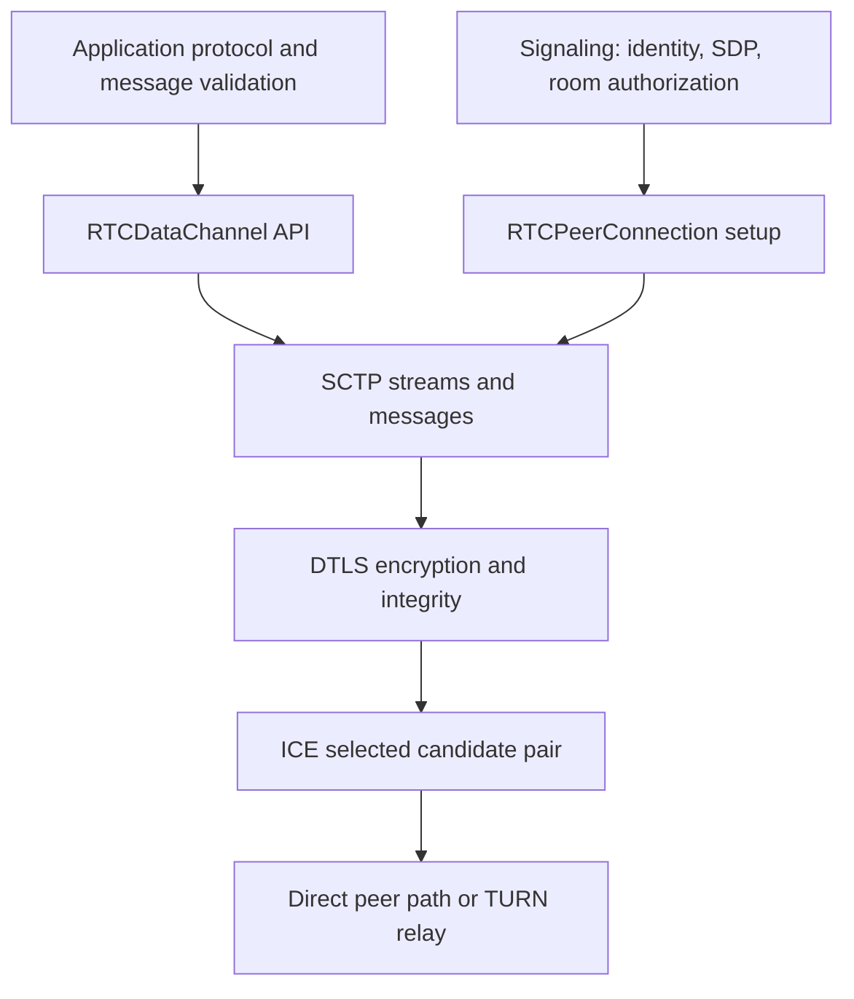

# WebRTC DataChannel security: bảo vệ dữ liệu ngang hàng

**Chương:** WebRTC  
**Mô-đun:** `SECURITY_APPLICATION_SECURITY_BROWSER_SECURITY` — phân tích ranh giới bảo mật giữa trình duyệt, origin, cookie và ứng dụng web để hiểu Same-Origin Policy (SOP), CORS và các cơ chế cách ly; thực hành phòng vệ XSS, CSRF, clickjacking bằng CSP, Trusted Types, security headers và kiểm chứng hành vi thực tế.

**WebRTC DataChannel** là kênh truyền dữ liệu hai chiều giữa các endpoint trong một `RTCPeerConnection`. Nó thường được dùng cho chat, trạng thái cộng tác, tín hiệu điều khiển, đồng bộ game và truyền file. DataChannel chạy SCTP trên DTLS, được vận chuyển qua đường kết nối ICE. DTLS mã hóa và bảo vệ tính toàn vẹn của dữ liệu trên transport, nhưng không tự xác thực tài khoản, phân quyền thao tác, kiểm tra nội dung hay bảo đảm ứng dụng chỉ nhận dữ liệu từ đúng người mà UI hiển thị.

Rủi ro lớn thường nằm ở tầng ứng dụng: peer không được phép gửi message, message sai schema hoặc quá lớn, file độc hại, queue bị làm đầy, message cũ bị phát lại, dữ liệu được render như HTML, hoặc ứng dụng tin rằng DataChannel đã được mã hóa nên mọi nội dung đều đáng tin. Nếu dùng SFU hoặc gateway kết thúc SCTP/DTLS, cần xác minh server có thể đọc payload hay không; DataChannel không tự mang ý nghĩa end-to-end encryption xuyên mọi kiến trúc.

Bài học này tập trung vào ranh giới bảo mật của DataChannel: xác thực peer qua signaling, thiết kế protocol message, validation, reliability/ordering, giới hạn kích thước và tốc độ, backpressure, truyền file, xử lý lifecycle và kiểm thử lạm dụng.

## 1. Mục tiêu học tập

Sau bài học, bạn có thể:

1. Mô tả vị trí DataChannel trong kiến trúc WebRTC: ICE, DTLS, SCTP và DCEP.
2. Phân biệt mã hóa transport với xác thực peer và authorization nghiệp vụ.
3. Thiết kế message envelope có version, type, ID và correlation để chống nhầm ngữ cảnh.
4. Validate message theo schema, kích thước, tần suất và trạng thái phiên.
5. Chọn ordered/unordered, reliable/partially reliable theo yêu cầu dữ liệu.
6. Dùng `bufferedAmount` và `bufferedAmountLowThreshold` để kiểm soát backpressure.
7. Thiết kế chunked file transfer với quota, checksum và xử lý hủy.
8. Ngăn XSS, injection, replay, resource exhaustion và data leakage qua DataChannel.
9. Xử lý DataChannel đóng, reconnect, peer rời phòng và quyền bị thu hồi.
10. Kiểm thử DataChannel bằng lab loopback, DevTools và test matrix.

## 2. DataChannel nằm ở đâu trong WebRTC?

### 2.1. Transport stack

DataChannel dùng SCTP association chạy trên DTLS. DTLS cung cấp bảo mật transport; SCTP cung cấp stream, message boundary, reliability, ordering và congestion control. ICE tìm đường kết nối giữa các endpoint hoặc qua TURN relay. Dữ liệu không được gửi dưới dạng plain SCTP trên mạng công cộng trong WebRTC tiêu chuẩn.



Một DataChannel thuộc về một `RTCPeerConnection` cụ thể. Peer connection có thể chứa nhiều DataChannel với label, protocol và reliability options khác nhau. Các thuộc tính label/protocol giúp ứng dụng chọn cách xử lý, nhưng không phải credential hay bằng chứng danh tính peer.

### 2.2. SCTP, DTLS và DCEP

- **ICE** tìm đường truyền; candidate pair có thể là direct path hoặc relay qua TURN.
- **DTLS** thiết lập khóa và bảo vệ dữ liệu SCTP trên đường truyền.
- **SCTP** vận chuyển message trên các stream, hỗ trợ ordering và các chế độ retransmission.
- **DCEP** là Data Channel Establishment Protocol dùng để thương lượng kênh in-band khi ứng dụng gọi `createDataChannel()` mà không đặt `negotiated: true`.
- **SDP** mang thông tin cần thiết để thương lượng application media section, SCTP port và các tham số liên quan.

DataChannel chỉ mở sau khi quá trình thương lượng và kết nối transport thành công. Sự kiện `open` có nghĩa channel sẵn sàng gửi dữ liệu; nó không có nghĩa peer đã được xác minh theo danh tính sản phẩm hoặc được cấp mọi quyền nghiệp vụ.

### 2.3. Các thuộc tính quan trọng

| Thuộc tính/API | Ý nghĩa | Góc nhìn bảo mật |
| --- | --- | --- |
| `label` | Tên channel do ứng dụng đặt | Không dùng làm danh tính hoặc quyền |
| `protocol` | Chuỗi subprotocol do ứng dụng chọn | Cần kiểm tra version/protocol; không phải authentication |
| `ordered` | Có yêu cầu thứ tự message hay không | Chọn theo semantics; không giả định mọi channel có ordering |
| `maxRetransmits` | Giới hạn số lần retransmission | Có thể mất message; cần xử lý thiếu dữ liệu |
| `maxPacketLifeTime` | Giới hạn thời gian retransmission (milliseconds) | Phù hợp dữ liệu thời gian thực có thể bỏ qua |
| `bufferedAmount` | Số byte đang chờ gửi trong user agent | Dùng để tạo backpressure và giới hạn memory |
| `readyState` | connecting/open/closing/closed | Chỉ gửi khi open; xử lý đóng/reconnect |
| `binaryType` | Dạng dữ liệu binary khi nhận | Validate Blob/ArrayBuffer và giới hạn byte |
| `RTCSctpTransport.maxMessageSize` | Giới hạn message được thương lượng | Không gửi payload vượt giới hạn |

### 2.4. DataChannel không phải signaling

Signaling thường dùng HTTPS/WSS để trao đổi SDP, ICE candidate, room membership và sự kiện cuộc gọi. DataChannel chỉ hoạt động sau khi peer connection được thiết lập. Không gửi access token, TURN secret hoặc thông tin xác thực chỉ vì DataChannel đã được mã hóa.

Nếu DataChannel dùng để điều khiển cuộc gọi, ví dụ mute peer, kick participant, bật recording hoặc đổi quyền, server vẫn phải kiểm tra authorization. Không cấp quyền quản trị chỉ dựa vào việc một message đến từ DataChannel đang mở.

## 3. Mã hóa transport và xác thực peer

### 3.1. DTLS bảo vệ đường truyền

Khi DataChannel mở, SCTP message được vận chuyển qua DTLS. Điều này giúp bảo vệ confidentiality và integrity trên transport giữa các DTLS endpoint. Một người nghe lén mạng không thể đọc payload DataChannel theo cách đọc TCP/UDP plaintext thông thường.

Tuy nhiên, mã hóa chỉ bảo vệ dữ liệu tới endpoint đã thương lượng. Nếu signaling cho phép attacker thay SDP/fingerprint hoặc gắn peer connection với tài khoản sai, hai phía có thể thiết lập transport được mã hóa tới endpoint không mong muốn. DTLS không tự biết tên tài khoản, vai trò trong phòng hay quan hệ người dùng mà sản phẩm hiển thị.

### 3.2. Gắn DataChannel với danh tính đã xác thực

Trước khi tạo hoặc chấp nhận peer connection, signaling server cần:

1. Xác thực session hoặc access token của client.
2. Kiểm tra user có quyền tham gia room/call.
3. Tạo call ID hoặc connection generation duy nhất.
4. Gắn peer ID với identity lấy từ session server-side.
5. Chỉ relay offer/answer/candidate giữa peer có quan hệ hợp lệ.
6. Thu hồi membership và từ chối message khi user rời phòng hoặc bị revoke.

Không tin `senderId`, `targetId`, `roomId` hoặc role do client gửi mà chưa đối chiếu state phía server. DataChannel event không chứa danh tính nghiệp vụ đã được chứng thực.

### 3.3. SFU và giới hạn E2EE

Trong kết nối peer-to-peer trực tiếp, DTLS/SCTP kết thúc ở hai browser. Trong kiến trúc có SFU/gateway, transport có thể kết thúc ở server; implementation có thể terminate DataChannel rồi relay message qua kết nối khác. Khi đó server có thể đọc payload ở tầng ứng dụng.

Nếu yêu cầu server trung gian không đọc được nội dung, cần thêm E2EE ở application payload với key management, xác thực peer, rotation/rekey khi thành viên thay đổi và chống replay. E2EE payload không mã hóa metadata như room ID, thời điểm, kích thước message hoặc địa chỉ IP; cũng không bảo vệ endpoint bị XSS.

## 4. Thiết kế protocol message an toàn

### 4.1. Envelope rõ ràng và có version

Đừng gửi chuỗi tự do rồi đoán ý nghĩa bằng prefix hoặc split ký tự. Định nghĩa envelope thống nhất:

```json
{
  "version": 1,
  "type": "chat.message",
  "messageId": "msg-7f21",
  "callId": "call-42",
  "sequence": 18,
  "sentAt": 1790000000000,
  "payload": {
    "text": "Xin chào"
  }
}
```

Các trường có mục đích riêng:

- `version`: version protocol để client từ chối hoặc negotiate phiên bản không hỗ trợ.
- `type`: allowlist loại message được phép.
- `messageId`: ID duy nhất để deduplicate hoặc đối chiếu acknowledgement.
- `callId`: ràng buộc message với cuộc gọi hiện tại.
- `sequence`: số thứ tự ở tầng ứng dụng nếu workflow cần phát hiện gap/replay.
- `sentAt`: metadata hỗ trợ quan sát; không dùng timestamp client làm nguồn tin cậy duy nhất.
- `payload`: schema riêng theo từng type.

Không để payload tự khai báo sender identity có thẩm quyền. Nếu cần hiển thị sender, server gắn identity với signaling session hoặc ký/ủy quyền metadata theo thiết kế.

### 4.2. Parse và validate trước khi xử lý

Dữ liệu nhận từ peer là input không tin cậy, dù DTLS đã mã hóa. Parse JSON trong try/catch, kiểm tra object shape, field allowlist, type, độ dài chuỗi, range số, nested depth và tổng byte. Từ chối field thừa nếu protocol không cho phép; tránh chuyển object tùy ý vào business logic.

Ví dụ validator tối thiểu cho chat:

```javascript
function parseChatMessage(data) {
  if (typeof data !== "string") {
    throw new TypeError("Expected a text message");
  }

  if (new TextEncoder().encode(data).byteLength > 16 * 1024) {
    throw new RangeError("Message is too large");
  }

  let value;
  try {
    value = JSON.parse(data);
  } catch {
    throw new TypeError("Invalid JSON");
  }

  if (
    value === null ||
    typeof value !== "object" ||
    value.version !== 1 ||
    value.type !== "chat.message" ||
    typeof value.messageId !== "string" ||
    value.messageId.length > 80 ||
    typeof value.callId !== "string" ||
    value.callId.length > 80 ||
    value.payload === null ||
    typeof value.payload !== "object" ||
    typeof value.payload.text !== "string" ||
    value.payload.text.length > 4000
  ) {
    throw new TypeError("Invalid chat message schema");
  }

  return {
    version: 1,
    type: "chat.message",
    messageId: value.messageId,
    callId: value.callId,
    text: value.payload.text
  };
}
```

Validator này là ví dụ cơ bản. Production cần schema validation thống nhất giữa client/server, kiểm tra quyền của từng message type, rate limit và giới hạn tổng memory. Không dùng `JSON.parse` thành công làm bằng chứng payload hợp lệ.

### 4.3. Render dữ liệu như text

Chat text, tên file, tên peer và error message phải được coi là dữ liệu. Dùng `textContent` hoặc framework rendering an toàn. Không nối payload vào `innerHTML`, template HTML tùy ý hoặc URL scheme không kiểm soát.

```javascript
function renderChatMessage(container, message) {
  const item = document.createElement("p");
  item.textContent = message.text;
  container.append(item);
}
```

Nếu ứng dụng cần rich text, dùng parser/renderer có allowlist và sanitizer được duy trì. Không cho DataChannel message tạo script, iframe, event handler hoặc link nguy hiểm.


## 5. Reliability, ordering và semantics của message

### 5.1. Reliable và partially reliable

Mặc định DataChannel có ordered delivery và reliable retransmission. Có thể cấu hình channel để bỏ qua một số lần retransmission hoặc giới hạn thời gian retransmission:

```javascript
const chatChannel = pc.createDataChannel("chat", {
  ordered: true
});

const liveStateChannel = pc.createDataChannel("live-state", {
  ordered: false,
  maxPacketLifeTime: 300
});

const telemetryChannel = pc.createDataChannel("telemetry", {
  ordered: false,
  maxRetransmits: 0
});
```

`maxPacketLifeTime` và `maxRetransmits` là hai lựa chọn loại trừ nhau. Khi đặt một trong hai, channel trở thành partially reliable; message có thể không tới đích. Dữ liệu chat, lệnh nghiệp vụ hoặc file chunk thường cần reliable delivery. Dữ liệu trạng thái thời gian thực như vị trí con trỏ hoặc telemetry mới có thể chấp nhận bỏ message cũ.

Đừng dùng unreliable mode cho thao tác có side effect nếu protocol không có acknowledgement, retry và idempotency. Không giả định SCTP reliable delivery thay thế xác nhận nghiệp vụ: channel có thể đóng sau khi message đã được queue nhưng trước khi ứng dụng phía nhận xử lý xong.

### 5.2. Ordering ở transport và sequence ở ứng dụng

`ordered: true` đảm bảo thứ tự message trên cùng DataChannel stream theo semantics của SCTP. Nó không sắp xếp message giữa nhiều DataChannel, nhiều peer connection hoặc nhiều session reconnect. Nếu workflow cần thứ tự xuyên reconnect, dùng sequence/generation ở tầng ứng dụng.

Khi `ordered: false`, message có thể tới theo thứ tự khác hoặc bị mất nếu cấu hình partially reliable. Protocol phải xác định message nào có thể bỏ qua, message nào cần snapshot mới thay thế và cách phát hiện gap. Không áp dụng một cấu hình reliability cho mọi loại dữ liệu.

### 5.3. Tạo channel với options có chủ đích

```javascript
const controlChannel = pc.createDataChannel("control-v1", {
  ordered: true,
  protocol: "app-control-v1"
});

const cursorChannel = pc.createDataChannel("cursor-v1", {
  ordered: false,
  maxPacketLifeTime: 150,
  protocol: "app-cursor-v1"
});
```

`protocol` chỉ là subprotocol string để hai phía nhận diện cách diễn giải dữ liệu. Peer độc hại có thể gửi message không tuân thủ protocol đã khai báo; receiver vẫn phải kiểm tra schema và quyền.

### 5.4. Negotiated channel và channel ID

Nếu dùng `negotiated: true`, hai peer phải tạo channel tương ứng với cùng ID theo quy trình ứng dụng. ID trùng không chứng minh peer đáng tin. Kiểm tra channel label, protocol, reliability settings và trạng thái sau khi mở; từ chối channel ngoài allowlist.

Không tạo channel mới vô hạn khi nhận message hoặc event từ peer. Giới hạn số channel, số stream và loại channel được phép cho mỗi peer connection.

## 6. Giới hạn message, backpressure và chống cạn tài nguyên

### 6.1. Kích thước message tối đa

Giới hạn message phụ thuộc browser, SCTP association và tham số `max-message-size` được thương lượng trong SDP. Có thể xem `pc.sctp.maxMessageSize` khi SCTP transport sẵn sàng. Không giả định mọi browser cho phép gửi payload nhiều megabyte trong một lần `send()`.

```javascript
function getSafeChunkSize(pc) {
  const negotiated = pc.sctp?.maxMessageSize;
  const transportLimit =
    Number.isFinite(negotiated) && negotiated > 0
      ? negotiated
      : 64 * 1024;

  // Giới hạn ứng dụng nhỏ hơn transport limit để giảm memory spike.
  return Math.min(16 * 1024, transportLimit);
}
```

Ví dụ chọn chunk 16 KiB để dễ quản lý memory và retry; đây không phải giới hạn chuẩn cho mọi ứng dụng. Đặt giới hạn ứng dụng riêng cho text, binary, file và loại message. Từ chối message quá lớn trước khi parse hoặc allocate buffer bổ sung.

### 6.2. bufferedAmount là queue, không phải acknowledgement

`bufferedAmount` cho biết số byte dữ liệu đã được ứng dụng queue qua `send()` nhưng chưa được browser gửi xuống transport. Nó không chứng minh peer đã nhận, xác thực hay xử lý message. Để biết peer đã xử lý, protocol cần application-level acknowledgement gắn với `messageId`.

Nếu producer gửi nhanh hơn network, queue tăng và memory tiêu thụ tăng. Dừng producer khi queue vượt high-water mark; tiếp tục khi `bufferedamountlow` báo queue giảm xuống dưới threshold.

### 6.3. Hàm gửi có backpressure

```javascript
function waitForBufferedAmountLow(channel) {
  if (channel.bufferedAmount <= channel.bufferedAmountLowThreshold) {
    return Promise.resolve();
  }

  return new Promise((resolve, reject) => {
    const cleanup = () => {
      channel.removeEventListener("bufferedamountlow", onLow);
      channel.removeEventListener("close", onClose);
    };

    const onLow = () => {
      cleanup();
      resolve();
    };

    const onClose = () => {
      cleanup();
      reject(new Error("DataChannel closed while waiting"));
    };

    channel.addEventListener("bufferedamountlow", onLow, { once: true });
    channel.addEventListener("close", onClose, { once: true });
  });
}

async function sendWithBackpressure(channel, data) {
  const HIGH_WATER = 256 * 1024;
  const LOW_WATER = 64 * 1024;

  if (channel.readyState !== "open") {
    throw new Error("DataChannel is not open");
  }

  channel.bufferedAmountLowThreshold = LOW_WATER;

  if (channel.bufferedAmount > HIGH_WATER) {
    await waitForBufferedAmountLow(channel);
  }

  if (channel.readyState !== "open") {
    throw new Error("DataChannel closed before send");
  }

  channel.send(data);
}
```

Đây là baseline cho một producer. Nếu nhiều task cùng gọi `sendWithBackpressure`, hãy serialize chúng qua một queue duy nhất; nếu không, nhiều producer có thể cùng vượt high-water mark. Luôn bắt lỗi từ `send()`: `InvalidStateError` khi channel không mở, `TypeError` khi message vượt giới hạn và `OperationError` khi buffer không thể nhận thêm dữ liệu.

### 6.4. Chống memory exhaustion

Ngoài giới hạn mỗi message, cần giới hạn tổng byte đang chờ, tổng byte nhận theo phiên, số message mỗi giây, số file đồng thời, số chunk chờ và thời gian hoàn tất. Không tích lũy vô hạn message trong array hoặc UI DOM. Có thể áp dụng quota theo user, room, device và account tier.

Khi nhận message bất thường, từ chối sớm, đóng channel hoặc peer connection theo chính sách, ghi event đã redacted và rate limit sender. Không log toàn bộ payload hoặc file bytes.

### 6.5. Application acknowledgement, retry và idempotency

Nếu message kích hoạt hành động nghiệp vụ, gửi ACK chỉ sau khi receiver đã validate và xử lý thành công. ACK chứa `messageId` hoặc operation ID; sender retry theo timeout với giới hạn số lần. Receiver lưu deduplication key trong phạm vi call/session để không áp dụng side effect hai lần.

Ví dụ: lệnh `document.update` có thể được gửi lại sau reconnect. Nếu receiver không deduplicate, cùng một thay đổi có thể được áp dụng nhiều lần. Với thao tác quan trọng, server vẫn là nguồn xác thực và trạng thái cuối cùng; DataChannel không thay thế transaction hay audit log phía server.

## 7. Truyền file và binary data an toàn

### 7.1. Không gửi toàn bộ file trong một message

File lớn cần được chia thành chunk. Metadata ban đầu có thể gồm:

```json
{
  "version": 1,
  "type": "file.start",
  "transferId": "transfer-91",
  "name": "report.pdf",
  "size": 5242880,
  "mediaType": "application/pdf",
  "chunkSize": 16384,
  "chunkCount": 320,
  "sha256": "..."
}
```

Metadata từ peer là không tin cậy. Receiver phải kiểm tra:

- User có quyền gửi file vào room và recipient có quyền nhận hay không.
- Recipient đã chấp thuận nhận file nếu sản phẩm yêu cầu consent.
- `size` nằm dưới quota, ví dụ giới hạn 10 MiB cho lab.
- `chunkSize` và `chunkCount` khớp nhau, không âm và không vượt giới hạn.
- `name` chỉ là nhãn hiển thị; loại bỏ path separator, control character và tên gây nhầm lẫn.
- `mediaType` chỉ là gợi ý; không tin MIME type do sender khai báo.
- `transferId` duy nhất, có timeout và không trùng phiên đang hoạt động.

### 7.2. Chunk framing

Có thể gửi metadata bằng JSON text, sau đó gửi binary chunk theo một protocol đã định nghĩa. Nếu chỉ cho phép một transfer hoạt động trên mỗi channel, mỗi binary message có thể chứa header sequence 4 byte và payload. Receiver kiểm tra sequence, số byte và trạng thái transfer trước khi giữ chunk.

Không ghép binary chunk tùy tiện với message text mà không có framing. Nếu cho phép nhiều transfer đồng thời, header phải mang transfer ID; nếu không, dữ liệu của hai file có thể bị trộn.

Ví dụ sender đọc từng slice và chờ backpressure:

```javascript
async function sendFileChunks(channel, file, chunkSize) {
  const totalChunks = Math.ceil(file.size / chunkSize);

  for (let index = 0; index < totalChunks; index += 1) {
    if (channel.readyState !== "open") {
      throw new Error("Transfer interrupted");
    }

    const start = index * chunkSize;
    const end = Math.min(start + chunkSize, file.size);
    const payload = new Uint8Array(await file.slice(start, end).arrayBuffer());

    const frame = new Uint8Array(4 + payload.byteLength);
    new DataView(frame.buffer).setUint32(0, index, false);
    frame.set(payload, 4);

    await sendWithBackpressure(channel, frame);
  }
}
```

Trong ví dụ này chỉ một transfer được gửi tại một thời điểm; receiver gắn chuỗi chunk với transfer metadata đang active. Protocol thực tế nên mang transfer ID trong từng frame nếu cần multiplex.

### 7.3. Kiểm tra file ở phía nhận

Receiver phải từ chối chunk sai sequence, chunk vượt kích thước, tổng byte vượt `size`, transfer hết hạn hoặc file không được chấp nhận. Chỉ tạo Blob sau khi đã nhận đủ chunk và xác minh digest theo thuật toán đã thống nhất.

`Blob.type`, filename và MIME type do sender cung cấp không chứng minh file an toàn. Không render HTML/SVG hoặc mở file trực tiếp trong origin ứng dụng nếu không có isolation phù hợp. Tải xuống dưới dạng attachment, dùng object URL có kiểm soát và revoke URL khi không còn cần.

### 7.4. Integrity và malware scanning

Hash như SHA-256 giúp phát hiện dữ liệu truyền bị thiếu hoặc sai so với metadata đã thống nhất; nó không chứng minh sender đáng tin nếu attacker có thể tự tạo cả file lẫn hash. Nếu file cần được lưu vào hệ thống, upload tới server có authorization, kiểm tra loại file thực tế, quét malware, giới hạn dung lượng và lưu ở nơi tách biệt.

Nếu yêu cầu authenticity cao, ký metadata hoặc digest bằng khóa gắn với danh tính đã xác minh. Chữ ký cần xác định rõ ai ký, key rotation và cách thu hồi. DTLS integrity chỉ bảo vệ packet trên transport tới endpoint, không thay thế chữ ký ứng dụng hoặc malware scanning.

### 7.5. Hủy và resume transfer

Cho phép message `file.cancel`, timeout transfer không hoạt động và giải phóng chunk đã buffer. Khi reconnect, không tiếp tục transfer chỉ dựa trên transfer ID cũ; kiểm tra call generation, quyền user và trạng thái file. Resume cần protocol xác định chunk đã nhận, checksum theo chunk hoặc digest cuối, quota và idempotency.

## 8. Signaling, SOP/CORS và các lớp bảo vệ xung quanh DataChannel

### 8.1. DataChannel không đi qua CORS

CORS kiểm soát việc JavaScript đọc HTTP response cross-origin; nó không quyết định message nào được phép gửi qua DataChannel. DataChannel hoạt động trên peer connection đã thiết lập bằng ICE/DTLS/SCTP. Quyền tham gia cuộc gọi và quyền gửi loại message nào do signaling và protocol ứng dụng quyết định.

SOP cũng không xác thực peer từ xa. Một peer có thể ở origin khác nhưng vẫn gửi message sau khi signaling cho phép kết nối. Ngược lại, script XSS cùng origin có thể thao tác DataChannel mà trang đang giữ. Đừng nhầm same-origin policy với peer authorization.

### 8.2. Signaling server phải kiểm tra Origin và quyền

Nếu signaling dùng WebSocket, kiểm tra `Origin` trong handshake, xác thực cookie/token, chống CSRF khi dùng cookie và kiểm tra room membership. CORS không thay thế WebSocket origin validation. Server phải tự gắn sender identity từ session và chỉ relay SDP/candidate tới peer được phép.

Khi peer connection đã mở, server có thể không nhìn thấy từng DataChannel message nếu kết nối là peer-to-peer trực tiếp. Vì vậy, authorization ở thời điểm join chưa đủ cho mọi nghiệp vụ: message type nhạy cảm có thể cần server-mediated authorization, token capability ngắn hạn hoặc E2EE protocol có chữ ký tùy yêu cầu.

### 8.3. XSS trên endpoint có thể đọc dữ liệu trước/sau mã hóa

XSS cùng origin có thể đọc message trước khi gọi `send()`, đăng ký `onmessage`, giả UI, gửi message thay mặt người dùng và truy cập file được chọn trong trang. DTLS không ngăn mã độc đang chạy trong endpoint hợp lệ.

Phòng vệ:

- Dùng safe DOM APIs và output encoding; không render DataChannel payload bằng HTML.
- Dùng CSP nonce/hash, Trusted Types và giảm third-party script.
- Không lưu token/secret trong DataChannel message hoặc DOM lâu hơn cần thiết.
- Xác nhận người dùng trước hành động nhạy cảm như nhận file, bật recording hoặc điều khiển thiết bị.
- Ràng buộc channel với call ID, user session và generation đã xác thực.
- Từ chối message khi room membership bị revoke hoặc peer connection cũ đã đóng.

### 8.4. CSP và signaling endpoint

CSP có thể giới hạn script và các endpoint fetch/WebSocket qua `connect-src`:

```http
Content-Security-Policy:
  default-src 'self';
  script-src 'self' 'nonce-random-per-response';
  connect-src 'self' https://api.example.test wss://signal.example.test;
  object-src 'none';
  base-uri 'self';
  frame-ancestors 'self'
```

Nonce phải được sinh ngẫu nhiên theo từng response và gắn đúng vào script được phép. `connect-src` giới hạn các kết nối web như fetch/XHR/WebSocket tới signaling service; nó không thay thế peer authentication, message validation hoặc authorization của DataChannel.

### 8.5. CSRF và hành động nhạy cảm

Nếu ứng dụng dùng cookie session, các endpoint HTTP thay đổi trạng thái — tạo room, cấp TURN credential, lưu file, bật recording, mời peer hoặc revoke participant — cần CSRF defense phù hợp. Dùng CSRF token, SameSite cookie, kiểm tra Origin/Referer theo thiết kế và authorization server-side.

Không thực hiện hành động nhạy cảm chỉ vì nhận được message DataChannel. Peer có thể gửi lệnh giả hoặc phát lại lệnh cũ; receiver phải kiểm tra capability, call generation, role, nonce/sequence và xác nhận với server khi cần.

### 8.6. E2EE payload và key management

Nếu DataChannel đi qua gateway/SFU có thể đọc payload và sản phẩm yêu cầu trung gian không được đọc nội dung, có thể mã hóa payload ở tầng ứng dụng. Thiết kế cần có:

- Khóa phiên được tạo và phân phối tới đúng peer.
- Binding khóa với identity đã xác minh qua signaling.
- Authenticated encryption (AEAD) và nonce duy nhất cho mỗi khóa.
- Sequence/counter và chống replay.
- Re-key khi participant join/leave, quyền bị revoke hoặc thiết bị đổi.
- Xử lý reconnect, multi-device, key rotation và recovery.
- Xác định rõ metadata vẫn lộ cho signaling/relay.

Không tự thiết kế thuật toán mật mã hoặc tái sử dụng nonce. Dùng thư viện/protocol đã được đánh giá và thực hiện threat modeling. E2EE payload không ngăn XSS đọc plaintext ở endpoint hoặc người nhận độc hại lưu lại dữ liệu.

## 9. Lifecycle, reconnect và cleanup

### 9.1. DataChannel state

Các trạng thái chính:

| readyState | Ý nghĩa | Hành động |
| --- | --- | --- |
| `connecting` | Chưa sẵn sàng | Không gọi `send()` |
| `open` | Có thể gửi message | Validate và áp dụng backpressure |
| `closing` | Đang đóng | Ngừng enqueue dữ liệu mới |
| `closed` | Đã đóng | Giải phóng queue/task và từ chối message mới |

Theo dõi các event `open`, `message`, `bufferedamountlow`, `error` và `close`. `error` không phải lúc nào cũng cung cấp chi tiết đủ để chẩn đoán; dùng state, signaling logs đã redacted và `getStats()` để bổ sung quan sát.

### 9.2. Rời phòng hoặc thu hồi quyền

Khi user rời room, bị kick hoặc session hết hạn:

1. Server revoke membership và từ chối message mới.
2. Dừng hoặc hủy transfer đang hoạt động.
3. Gửi thông báo kết thúc nếu channel còn mở.
4. Đóng DataChannel và peer connection.
5. Giải phóng file chunk, Blob/object URL và listener.
6. Thu hồi token/capability và TURN credential theo expiry/revocation policy.
7. Ghi audit event không chứa payload nhạy cảm.

Không chỉ ẩn chat UI. Nếu channel còn mở, peer vẫn có thể gửi message và tiêu thụ tài nguyên.

### 9.3. Reconnect không tiếp tục tin phiên cũ

Sau reconnect, tạo call generation mới hoặc xác minh generation cũ vẫn còn hiệu lực. Từ chối message có call ID/generation không khớp. Không tự động tái sử dụng message ID hoặc transfer ID nếu deduplication store đã hết hạn. File transfer resume phải xác minh lại user, quyền nhận, digest và các chunk đã nhận.

### 9.4. Dọn event listener và object URL

Khi channel đóng, hủy timer, promise chờ buffer, queue và transfer state. Khi tạo link tải file bằng `URL.createObjectURL`, revoke URL sau khi người dùng không còn cần. Không giữ Blob lớn trong memory sau khi transfer kết thúc.

```javascript
function cleanupDataChannel(channel, handlers = []) {
  for (const [eventName, handler] of handlers) {
    channel.removeEventListener(eventName, handler);
  }

  if (channel.readyState !== "closed") {
    channel.close();
  }
}
```

Trong ứng dụng có nhiều producer, dùng một queue/dispatcher trung tâm để cleanup có thể hủy mọi công việc đang chờ thay vì để Promise và callback tiếp tục enqueue sau khi channel đóng.

## 10. Lab local: DataChannel loopback và file chunk

Lab chạy trên `http://localhost:8080` và tạo hai peer connection trong cùng một trang. Nó không dùng signaling server, STUN/TURN hoặc peer ngoài máy. Mục tiêu là quan sát DataChannel, validate message, backpressure và file transfer nhỏ theo chunk.

### 10.1. Tạo file HTML

Tạo file `datachannel-security-lab.html`:

```html
<!doctype html>
<html lang="vi">
<head>
  <meta charset="utf-8">
  <meta name="viewport" content="width=device-width, initial-scale=1">
  <title>DataChannel security lab</title>
  <style>
    body { font: 16px system-ui, sans-serif; max-width: 850px; margin: 2rem auto; padding: 0 1rem; }
    button { margin: .25rem; padding: .6rem .9rem; }
    pre { white-space: pre-wrap; overflow-wrap: anywhere; background: #f4f4f4; padding: 1rem; }
    section { border: 1px solid #aaa; padding: 1rem; margin: 1rem 0; }
  </style>
</head>
<body>
  <h1>DataChannel security lab</h1>
  <p id="status">Not connected</p>

  <section>
    <h2>Connection</h2>
    <button id="connect">Connect local peers</button>
    <button id="close" disabled>Close</button>
  </section>

  <section>
    <h2>Message validation</h2>
    <input id="chat-text" maxlength="4000" value="Xin chào từ DataChannel">
    <button id="send-chat" disabled>Send chat message</button>
    <button id="send-invalid" disabled>Send invalid message</button>
  </section>

  <section>
    <h2>Chunked file transfer</h2>
    <input id="file" type="file">
    <button id="send-file" disabled>Send file (max 1 MiB)</button>
    <p id="file-state">No file transferred</p>
  </section>

  <section>
    <h2>Received messages</h2>
    <pre id="received"></pre>
  </section>

  <section>
    <h2>Event log</h2>
    <pre id="log"></pre>
  </section>

  <script>
    const statusNode = document.querySelector("#status");
    const receivedNode = document.querySelector("#received");
    const logNode = document.querySelector("#log");
    const fileState = document.querySelector("#file-state");

    let leftPeer = null;
    let rightPeer = null;
    let sendChannel = null;
    let receiveChannel = null;
    let incomingTransfer = null;
    let connectGeneration = 0;

    const MAX_FILE_BYTES = 1024 * 1024;
    const CHUNK_SIZE = 16 * 1024;
    const HIGH_WATER = 256 * 1024;
    const LOW_WATER = 64 * 1024;

    function log(message) {
      logNode.textContent += message + "\n";
    }

    function setConnected(connected) {
      document.querySelector("#send-chat").disabled = !connected;
      document.querySelector("#send-invalid").disabled = !connected;
      document.querySelector("#send-file").disabled = !connected;
      document.querySelector("#close").disabled = !connected;
      document.querySelector("#connect").disabled = connected;
    }

    function waitForIceGatheringComplete(peer) {
      if (peer.iceGatheringState === "complete") return Promise.resolve();

      return new Promise((resolve, reject) => {
        const timeoutId = setTimeout(() => {
          peer.removeEventListener("icegatheringstatechange", onChange);
          reject(new Error("ICE gathering timed out"));
        }, 15000);

        const onChange = () => {
          if (peer.iceGatheringState === "complete") {
            clearTimeout(timeoutId);
            peer.removeEventListener("icegatheringstatechange", onChange);
            resolve();
          }
        };

        peer.addEventListener("icegatheringstatechange", onChange);
      });
    }

    function waitForOpen(channel) {
      if (channel.readyState === "open") return Promise.resolve();

      return new Promise((resolve, reject) => {
        const timeoutId = setTimeout(() => {
          reject(new Error("DataChannel open timed out"));
        }, 10000);

        channel.addEventListener("open", () => {
          clearTimeout(timeoutId);
          resolve();
        }, { once: true });

        channel.addEventListener("close", () => {
          clearTimeout(timeoutId);
          reject(new Error("DataChannel closed before open"));
        }, { once: true });
      });
    }

    function waitForLowBuffer(channel) {
      if (channel.bufferedAmount <= channel.bufferedAmountLowThreshold) {
        return Promise.resolve();
      }

      return new Promise((resolve, reject) => {
        const cleanup = () => {
          channel.removeEventListener("bufferedamountlow", onLow);
          channel.removeEventListener("close", onClose);
        };
        const onLow = () => {
          cleanup();
          resolve();
        };
        const onClose = () => {
          cleanup();
          reject(new Error("Channel closed while waiting for buffer"));
        };

        channel.addEventListener("bufferedamountlow", onLow, { once: true });
        channel.addEventListener("close", onClose, { once: true });
      });
    }

    async function sendData(data) {
      if (!sendChannel || sendChannel.readyState !== "open") {
        throw new Error("Channel is not open");
      }

      sendChannel.bufferedAmountLowThreshold = LOW_WATER;
      if (sendChannel.bufferedAmount > HIGH_WATER) {
        await waitForLowBuffer(sendChannel);
      }

      if (sendChannel.readyState !== "open") {
        throw new Error("Channel closed before send");
      }

      sendChannel.send(data);
    }

    function appendReceived(value) {
      receivedNode.textContent += value + "\n";
    }

    function validateChat(data) {
      if (typeof data !== "string" || new TextEncoder().encode(data).byteLength > 8192) {
        throw new Error("Message type/size rejected");
      }

      const message = JSON.parse(data);
      if (
        message?.version !== 1 ||
        message?.type !== "chat.message" ||
        typeof message?.payload?.text !== "string" ||
        message.payload.text.length > 4000
      ) {
        throw new Error("Message schema rejected");
      }

      return message;
    }

    function safeFileName(name) {
      return String(name)
        .replace(/[\\/]/g, "_")
        .replace(/[\u0000-\u001f\u007f]/g, "_")
        .slice(0, 120) || "download.bin";
    }

    function toHex(buffer) {
      return Array.from(new Uint8Array(buffer), byte =>
        byte.toString(16).padStart(2, "0")
      ).join("");
    }

    async function receiveFileStart(message) {
      if (incomingTransfer) throw new Error("Another transfer is active");

      const { transferId, name, size, chunkSize, chunkCount, sha256 } = message;
      if (
        typeof transferId !== "string" ||
        transferId.length > 80 ||
        typeof name !== "string" ||
        !Number.isSafeInteger(size) ||
        size < 1 ||
        size > MAX_FILE_BYTES ||
        chunkSize !== CHUNK_SIZE ||
        !Number.isSafeInteger(chunkCount) ||
        chunkCount !== Math.ceil(size / chunkSize) ||
        typeof sha256 !== "string" ||
        !/^[a-f0-9]{64}$/i.test(sha256)
      ) {
        throw new Error("File metadata rejected");
      }

      incomingTransfer = {
        transferId,
        name: safeFileName(name),
        size,
        chunkSize,
        chunkCount,
        sha256,
        nextIndex: 0,
        receivedBytes: 0,
        chunks: []
      };

      fileState.textContent = "Receiving " + incomingTransfer.name;
    }

    async function receiveBinary(data) {
      if (!(data instanceof ArrayBuffer) || !incomingTransfer) {
        throw new Error("Unexpected binary frame");
      }

      if (data.byteLength < 5 || data.byteLength > CHUNK_SIZE + 4) {
        throw new Error("Invalid chunk size");
      }

      const view = new DataView(data);
      const index = view.getUint32(0, false);
      const payload = data.slice(4);
      const expectedLength = Math.min(
        incomingTransfer.chunkSize,
        incomingTransfer.size - incomingTransfer.receivedBytes
      );

      if (index !== incomingTransfer.nextIndex || payload.byteLength !== expectedLength) {
        throw new Error("Unexpected chunk sequence or length");
      }

      if (incomingTransfer.receivedBytes + payload.byteLength > incomingTransfer.size) {
        throw new Error("Transfer exceeds declared size");
      }

      incomingTransfer.chunks.push(payload);
      incomingTransfer.receivedBytes += payload.byteLength;
      incomingTransfer.nextIndex += 1;

      if (incomingTransfer.nextIndex === incomingTransfer.chunkCount) {
        const transfer = incomingTransfer;
        incomingTransfer = null;

        if (transfer.receivedBytes !== transfer.size) {
          throw new Error("File size mismatch");
        }

        const combined = new Uint8Array(transfer.size);
        let offset = 0;
        for (const chunk of transfer.chunks) {
          combined.set(new Uint8Array(chunk), offset);
          offset += chunk.byteLength;
        }

        const digest = toHex(await crypto.subtle.digest("SHA-256", combined));
        if (digest.toLowerCase() !== transfer.sha256.toLowerCase()) {
          throw new Error("SHA-256 mismatch");
        }

        const blob = new Blob([combined], { type: "application/octet-stream" });
        const objectUrl = URL.createObjectURL(blob);
        const link = document.createElement("a");
        link.href = objectUrl;
        link.download = transfer.name;
        link.textContent = "Download received file: " + transfer.name;
        receivedNode.append(link, document.createTextNode("\n"));
        fileState.textContent = "Received and verified " + transfer.name;
        link.addEventListener("click", () => {
          setTimeout(() => URL.revokeObjectURL(objectUrl), 60000);
        }, { once: true });
        log("File received; SHA-256 verified.");
      }
    }

    function configureReceiveChannel(channel) {
      receiveChannel = channel;
      receiveChannel.binaryType = "arraybuffer";

      receiveChannel.addEventListener("message", async event => {
        try {
          if (typeof event.data === "string") {
            const message = JSON.parse(event.data);

            if (message?.version !== 1) {
              throw new Error("Unsupported protocol version");
            }

            if (message?.type === "chat.message") {
              const valid = validateChat(event.data);
              appendReceived("Chat: " + valid.payload.text);
            } else if (message?.type === "file.start") {
              await receiveFileStart(message);
            } else {
              throw new Error("Unsupported message type");
            }
          } else {
            await receiveBinary(event.data);
          }
        } catch (error) {
          log("Rejected incoming message: " + error.message);
          incomingTransfer = null;
        }
      });

      receiveChannel.addEventListener("close", () => {
        incomingTransfer = null;
        log("Receive channel closed.");
      });
    }

    document.querySelector("#connect").addEventListener("click", async () => {
      const generation = ++connectGeneration;

      try {
        leftPeer = new RTCPeerConnection({ iceServers: [] });
        rightPeer = new RTCPeerConnection({ iceServers: [] });

        rightPeer.addEventListener("datachannel", event => {
          configureReceiveChannel(event.channel);
        });

        sendChannel = leftPeer.createDataChannel("lab-data-v1", {
          ordered: true,
          protocol: "lab-data-v1"
        });

        const offer = await leftPeer.createOffer();
        await leftPeer.setLocalDescription(offer);
        await waitForIceGatheringComplete(leftPeer);

        await rightPeer.setRemoteDescription(leftPeer.localDescription);
        const answer = await rightPeer.createAnswer();
        await rightPeer.setLocalDescription(answer);
        await waitForIceGatheringComplete(rightPeer);
        await leftPeer.setRemoteDescription(rightPeer.localDescription);

        await waitForOpen(sendChannel);

        if (generation !== connectGeneration) return;
        statusNode.textContent = "Local DataChannel is open";
        setConnected(true);
        log("Local peers connected over DTLS/SCTP.");
      } catch (error) {
        log("Connection failed: " + error.name + " " + error.message);
        closePeers();
      }
    });

    document.querySelector("#send-chat").addEventListener("click", async () => {
      try {
        const text = document.querySelector("#chat-text").value;
        const message = {
          version: 1,
          type: "chat.message",
          messageId: crypto.randomUUID(),
          payload: { text }
        };

        await sendData(JSON.stringify(message));
        log("Chat message sent.");
      } catch (error) {
        log("Send failed: " + error.message);
      }
    });

    document.querySelector("#send-invalid").addEventListener("click", async () => {
      try {
        await sendData(JSON.stringify({
          version: 1,
          type: "admin.grant",
          payload: { role: "admin" }
        }));
        log("Invalid message sent for receiver-side rejection test.");
      } catch (error) {
        log("Send failed: " + error.message);
      }
    });

    document.querySelector("#send-file").addEventListener("click", async () => {
      const file = document.querySelector("#file").files[0];
      if (!file) {
        fileState.textContent = "Choose a file first";
        return;
      }
      if (file.size < 1 || file.size > MAX_FILE_BYTES) {
        fileState.textContent = "Choose a non-empty file up to 1 MiB";
        return;
      }

      try {
        const transferId = crypto.randomUUID();
        const chunkCount = Math.ceil(file.size / CHUNK_SIZE);
        const bytes = await file.arrayBuffer();
        const digest = toHex(await crypto.subtle.digest("SHA-256", bytes));

        await sendData(JSON.stringify({
          version: 1,
          type: "file.start",
          transferId,
          name: file.name,
          size: file.size,
          chunkSize: CHUNK_SIZE,
          chunkCount,
          sha256: digest
        }));

        for (let index = 0; index < chunkCount; index += 1) {
          const start = index * CHUNK_SIZE;
          const end = Math.min(start + CHUNK_SIZE, file.size);
          const payload = new Uint8Array(bytes.slice(start, end));
          const frame = new Uint8Array(4 + payload.byteLength);

          new DataView(frame.buffer).setUint32(0, index, false);
          frame.set(payload, 4);
          await sendData(frame);
        }

        fileState.textContent = "Sent " + file.name;
        log("File chunks sent.");
      } catch (error) {
        fileState.textContent = "Transfer failed: " + error.message;
        log("File transfer failed.");
      }
    });

    function closePeers() {
      connectGeneration += 1;
      if (sendChannel && sendChannel.readyState !== "closed") sendChannel.close();
      if (receiveChannel && receiveChannel.readyState !== "closed") receiveChannel.close();
      if (leftPeer) leftPeer.close();
      if (rightPeer) rightPeer.close();

      sendChannel = null;
      receiveChannel = null;
      leftPeer = null;
      rightPeer = null;
      incomingTransfer = null;
      statusNode.textContent = "Disconnected";
      setConnected(false);
    }

    document.querySelector("#close").addEventListener("click", closePeers);
    window.addEventListener("pagehide", closePeers);
  </script>
</body>
</html>
```

### 10.2. Phục vụ file trên localhost

Tạo `server.mjs`:

```javascript
import { createServer } from "node:http";
import { readFile } from "node:fs/promises";

const server = createServer(async (request, response) => {
  const url = new URL(request.url, "http://localhost:8080");

  if (
    request.method !== "GET" ||
    !["/", "/datachannel-security-lab.html"].includes(url.pathname)
  ) {
    response.writeHead(404);
    response.end("Not found");
    return;
  }

  try {
    const html = await readFile("./datachannel-security-lab.html");
    response.writeHead(200, {
      "Content-Type": "text/html; charset=utf-8",
      "Cache-Control": "no-store"
    });
    response.end(html);
  } catch {
    response.writeHead(500);
    response.end("Lab file not found");
  }
});

server.listen(8080, "localhost", () => {
  console.log("Open http://localhost:8080");
});
```

Chạy server:

```bash
node server.mjs
```

### 10.3. Thực hiện lab

1. Mở `http://localhost:8080`.
2. Nhấn **Connect local peers** và chờ DataChannel mở.
3. Gửi chat message; nội dung xuất hiện ở vùng nhận dưới dạng text.
4. Nhấn **Send invalid message**. Receiver phải từ chối message type `admin.grant` vì không nằm trong allowlist.
5. Chọn file nhỏ hơn 1 MiB và nhấn **Send file**.
6. Receiver kiểm tra thứ tự chunk, tổng byte và SHA-256, sau đó hiển thị link tải file.
7. Thử chọn file lớn hơn 1 MiB; lab phải từ chối trước khi gửi.
8. Nhấn **Close** và xác nhận channel/peer connection đã đóng.

Lab chỉ kiểm tra DataChannel loopback trong cùng browser. Nó không kiểm thử signaling authorization, TURN relay, SFU, peer identity thực tế hoặc E2EE application-level. Hash trong lab kiểm tra tính toàn vẹn so với metadata đã gửi cùng phiên; nó không xác thực người gửi.

### 10.4. Dọn lab

Dừng Node server bằng Ctrl+C, đóng peer connections và tab. Xóa file lab khỏi thư mục test khi không còn cần. Không gửi file thật, dữ liệu nhạy cảm hoặc file không tin cậy qua môi trường demo.

## 11. Kiểm thử DataChannel security

### 11.1. Ma trận kiểm thử

Chạy test trên browser/version thuộc support matrix và mạng khác nhau. Ghi nhận channel state, message type/size, queue depth và kết quả xử lý; không log toàn bộ payload, file bytes hoặc dữ liệu riêng tư.

| ID | Tình huống | Kết quả mong đợi |
| --- | --- | --- |
| DC-01 | Gửi text khi channel chưa open | Ứng dụng từ chối; không gọi send |
| DC-02 | Gửi message schema hợp lệ | Receiver validate và xử lý đúng type |
| DC-03 | Gửi JSON lỗi cú pháp | Receiver bắt lỗi parse, không crash |
| DC-04 | Gửi type ngoài allowlist như admin.grant | Receiver từ chối; không thực hiện side effect |
| DC-05 | Gửi version protocol không hỗ trợ | Receiver từ chối hoặc negotiate version theo thiết kế |
| DC-06 | Gửi message vượt byte limit | Receiver từ chối trước khi xử lý sâu |
| DC-07 | Gửi chuỗi có HTML/script | Hiển thị dưới dạng text; không thực thi |
| DC-08 | Gửi message ID trùng | Deduplication ngăn xử lý side effect hai lần |
| DC-09 | Gửi call ID/generation cũ | Receiver từ chối message stale |
| DC-10 | Channel ordered reliable | Message trên cùng stream được xử lý đúng thứ tự |
| DC-11 | Channel unordered/partially reliable | Ứng dụng chịu được gap, reorder hoặc mất message |
| DC-12 | Gửi nhanh hơn tốc độ mạng | Backpressure giữ queue dưới giới hạn |
| DC-13 | Channel đóng khi đang chờ bufferedamountlow | Promise kết thúc bằng lỗi; producer dừng |
| DC-14 | Gửi payload vượt maxMessageSize | Client xử lý send exception; không crash |
| DC-15 | Peer mở quá nhiều DataChannel | Giới hạn channel/stream và rate limit được áp dụng |
| DC-16 | File metadata khai báo size quá lớn | Receiver từ chối trước khi allocate buffer |
| DC-17 | Chunk sai sequence hoặc length | Transfer bị hủy và buffer được giải phóng |
| DC-18 | File có SHA-256 không khớp | Receiver không cung cấp file như transfer hợp lệ |
| DC-19 | Filename chứa path separator/control character | Tên hiển thị/tải xuống được làm sạch |
| DC-20 | File HTML/SVG hoặc MIME giả | File không được render trong origin tin cậy; áp dụng attachment/isolation |
| DC-21 | User bị revoke giữa transfer | Server từ chối quyền mới; client hủy transfer và đóng channel theo policy |
| DC-22 | XSS cùng origin gửi/đọc DataChannel | Threat model xác nhận XSS có thể thao tác endpoint; CSP/XSS defense giảm khả năng injection |
| DC-23 | DataChannel đi qua SFU/gateway | Xác minh điểm kết thúc DTLS/SCTP và khả năng server đọc payload |
| DC-24 | Reconnect sau khi call kết thúc | Generation cũ và transfer ID stale bị từ chối |
| DC-25 | Nhiều producer gửi đồng thời | Một dispatcher/queue kiểm soát bufferedAmount và memory |
| DC-26 | Browser tab bị freeze/discard | Server lease/heartbeat dọn peer stale; không dựa vào unload duy nhất |

### 11.2. Kiểm tra bằng DevTools

Trong Chromium:

1. Mở `chrome://webrtc-internals` trước khi bắt đầu kết nối.
2. Tạo peer connection và DataChannel.
3. Quan sát PeerConnection state, SCTP transport, ICE candidate pair và thống kê.
4. Dùng DevTools Console để kiểm tra `readyState`, `bufferedAmount`, `ordered`, `maxRetransmits`, `maxPacketLifeTime` và `pc.sctp.maxMessageSize` khi có.
5. Kiểm tra signaling WebSocket ở Network → WS nếu ứng dụng có signaling.
6. Kiểm tra log/telemetry có vô tình chứa payload, file name, candidate hoặc user identifier nhạy cảm không.

Firefox cung cấp `about:webrtc` để xem PeerConnection, DataChannel và thống kê tùy phiên bản. Không chia sẻ dump nội bộ nếu chưa redacted IP, candidate, SDP, room ID và metadata người dùng.

### 11.3. Kiểm tra queue và message size

Ghi lại `bufferedAmount` trước/sau burst test. Xác nhận producer tạm dừng khi vượt high-water mark và tiếp tục khi nhận `bufferedamountlow`. Thử message text và binary có byte length gần giới hạn ứng dụng; không chỉ đo số ký tự vì UTF-8 có thể dùng nhiều byte hơn một ký tự.

Kiểm tra `pc.sctp.maxMessageSize` trên browser hỗ trợ; nếu không có giá trị, dùng giới hạn ứng dụng bảo thủ. Đừng dựa vào một con số hard-code như giới hạn phổ quát cho mọi browser và peer.

### 11.4. Browser automation

Với Playwright, có thể kiểm tra nội dung nhận được và trạng thái channel:

```javascript
await page.goto("http://localhost:8080");
await page.getByRole("button", { name: "Connect local peers" }).click();

await expect(page.locator("#status")).toContainText("open");

await page.getByRole("button", { name: "Send chat message" }).click();
await expect(page.locator("#received")).toContainText("Xin chào");

await page.getByRole("button", { name: "Send invalid message" }).click();
await expect(page.locator("#log")).toContainText("Unsupported message type");

await page.getByRole("button", { name: "Close" }).click();
await expect(page.locator("#status")).toContainText("Disconnected");
```

Đây là khung test cho lab. Khi chạy trên browser automation, xác nhận quyền mở localhost, WebRTC support và ICE loopback được cho phép. Reset page/context giữa test để tránh channel hoặc transfer state từ lần chạy trước.

## 12. Những ngộ nhận thường gặp

**“DataChannel đã mã hóa nên message đáng tin.”** Sai. DTLS bảo vệ transport; peer vẫn có thể gửi payload độc hại, sai schema hoặc vượt quyền.

**“Label hoặc protocol của channel chứng minh peer là ai.”** Sai. Đây là metadata do ứng dụng đặt, không phải authentication.

**“CORS kiểm soát ai được gửi DataChannel message.”** Sai. CORS áp dụng cho HTTP response; peer authorization do signaling và application protocol quyết định.

**“Reliable DataChannel bảo đảm nghiệp vụ chỉ chạy một lần.”** Sai. Transport reliability không thay thế ACK, idempotency, deduplication và transaction nghiệp vụ.

**“Ordered channel sắp xếp mọi message trong mọi channel.”** Sai. Ordering áp dụng trong phạm vi stream/channel; nhiều channel và reconnect cần sequence ở tầng ứng dụng.

**“bufferedAmount là số byte peer đã nhận.”** Sai. Nó là lượng byte đang chờ trong queue gửi của browser; cần ACK ở tầng ứng dụng để biết peer đã xử lý.

**“send() có thể nhận file lớn không giới hạn.”** Sai. Có giới hạn message được thương lượng và giới hạn memory; cần chunk, backpressure và quota.

**“SHA-256 chứng minh file do người đáng tin gửi.”** Sai. Hash kiểm tra nội dung khớp digest; attacker có thể tạo file và digest của chính họ. Authenticity cần identity/signature.

**“MIME type do sender gửi là đủ để mở file.”** Sai. Filename và MIME type có thể giả; cần kiểm tra nội dung, attachment và isolation.

**“Peer-to-peer nghĩa là không có server nào đọc dữ liệu.”** Sai. Signaling luôn có thể thấy metadata; SFU/gateway có thể terminate DTLS/SCTP và đọc payload tùy kiến trúc.

**“DataChannel không bị XSS ảnh hưởng vì đã mã hóa.”** Sai. XSS chạy trong endpoint có thể đọc plaintext, gửi message và thao tác channel.

**“Đóng tab chắc chắn dọn hết session ngay lập tức.”** Sai. Browser có thể freeze/discard; server cần lease/heartbeat và timeout để dọn peer stale.

## 13. Checklist triển khai DataChannel security

Trước khi phát hành, xác nhận:

1. **Peer identity:** gắn peer connection với identity đã xác thực qua signaling; không tin label/protocol.
2. **Authorization:** kiểm tra room membership, role và quyền message type.
3. **Protocol version:** có version, allowlist type, message ID và call generation.
4. **Schema validation:** validate type, length, range, nested data và tổng byte.
5. **Safe rendering:** hiển thị text bằng safe DOM API; không đưa payload vào HTML sink.
6. **Transport:** hiểu DTLS/SCTP endpoint và nơi SFU/gateway có thể đọc payload.
7. **E2EE:** nếu cần, dùng AEAD và key management đã được đánh giá; nonce duy nhất và replay protection.
8. **Reliability:** chọn ordered/reliable hoặc partially reliable theo semantics.
9. **Acknowledgement:** dùng ACK, retry có giới hạn, idempotency và deduplication cho side effect.
10. **Message size:** kiểm tra maxMessageSize và giới hạn ứng dụng.
11. **Backpressure:** theo dõi bufferedAmount, high/low water mark và serialize nhiều producer.
12. **Rate limit:** giới hạn message/second, channel count, queue và thời gian xử lý.
13. **File transfer:** xác minh consent, quota, sequence, size, digest và transfer timeout.
14. **File handling:** làm sạch filename, không tin MIME type, không render HTML/SVG từ peer.
15. **Reconnect:** tạo generation mới và từ chối message/transfer stale.
16. **Cleanup:** đóng channel, peer connection, queue, listener, timer và revoke object URL.
17. **Signaling:** HTTPS/WSS, Origin validation, authentication, authorization và CSRF defense.
18. **XSS defense:** CSP, Trusted Types, safe DOM và kiểm soát dependency.
19. **Observability:** log state/error/metrics đã redacted; không log payload, file bytes hoặc SDP thô.
20. **Abuse controls:** quota theo user/room, giới hạn băng thông và giám sát bất thường.
21. **Browser coverage:** kiểm thử browser/version, mạng NAT/firewall và SFU/gateway thực tế.
22. **Incident response:** có thể revoke peer, đóng room, dừng transfer và thu hồi credential/capability.

## 14. Câu hỏi tự kiểm tra

**Câu 1.** DataChannel chạy trên những lớp transport nào?  
**Đáp án:** SCTP chạy trên DTLS; DTLS được vận chuyển qua đường ICE đã chọn.

**Câu 2.** DTLS có xác thực tài khoản người dùng không?  
**Đáp án:** Không. Ứng dụng phải gắn peer connection với identity đã xác thực qua signaling.

**Câu 3.** Label và protocol của DataChannel có phải credential không?  
**Đáp án:** Không. Chúng chỉ mô tả channel/subprotocol do ứng dụng đặt.

**Câu 4.** CORS có quyết định peer nào được gửi message không?  
**Đáp án:** Không. Quyền đó do signaling authorization và application protocol.

**Câu 5.** Mặc định DataChannel có ordered và reliable không?  
**Đáp án:** Có, nếu không cấu hình partially reliable options.

**Câu 6.** maxPacketLifeTime và maxRetransmits có thể đặt cùng lúc không?  
**Đáp án:** Không. Hai tùy chọn loại trừ nhau.

**Câu 7.** bufferedAmount cho biết điều gì?  
**Đáp án:** Byte đang chờ trong queue gửi của browser; không chứng minh peer đã nhận hoặc xử lý.

**Câu 8.** Vì sao cần backpressure?  
**Đáp án:** Để producer không queue dữ liệu nhanh hơn network và làm tăng memory/queue không giới hạn.

**Câu 9.** maxMessageSize lấy từ đâu?  
**Đáp án:** Từ tham số max-message-size được thương lượng trong SCTP/SDP và được expose qua RTCSctpTransport khi có.

**Câu 10.** Vì sao file transfer nên chia chunk?  
**Đáp án:** Để giữ message dưới giới hạn, kiểm soát memory, theo dõi tiến độ, retry và hủy transfer.

**Câu 11.** SHA-256 có chứng minh danh tính sender không?  
**Đáp án:** Không. Nó kiểm tra nội dung khớp digest; xác thực sender cần identity/signature hoặc cơ chế tin cậy khác.

**Câu 12.** Vì sao cần messageId và idempotency?  
**Đáp án:** Để deduplicate message retry và tránh thực hiện side effect nhiều lần.

**Câu 13.** SFU có luôn không đọc được DataChannel payload không?  
**Đáp án:** Không. Tùy kiến trúc, SFU/gateway có thể terminate transport và đọc payload.

**Câu 14.** XSS cùng origin có thể làm gì với DataChannel?  
**Đáp án:** Đọc message plaintext, gửi message thay người dùng, thao tác channel và truy cập file trong endpoint.

**Câu 15.** Khi peer bị revoke giữa file transfer, ứng dụng cần làm gì?  
**Đáp án:** Server từ chối quyền mới; client hủy transfer, giải phóng buffer và đóng channel/peer theo policy.

## 15. Ghi nhớ cốt lõi

DataChannel là API gửi message trên SCTP/DTLS qua đường ICE. DTLS bảo vệ dữ liệu trên transport; SCTP cung cấp stream, ordering, reliability và congestion control. Những cơ chế này không xác thực tài khoản hoặc phân quyền message.

Hãy gắn peer với identity qua signaling, validate mọi message, dùng allowlist type/version, giới hạn byte và rate, xử lý replay/idempotency, áp dụng backpressure bằng bufferedAmount và chọn reliability theo semantics. Với file transfer, dùng chunk framing, quota, sequence, digest, consent và xử lý file như nội dung không tin cậy.

CSP/XSS defense bảo vệ endpoint; signaling authorization kiểm soát room/peer; E2EE payload chỉ cần khi threat model yêu cầu bảo vệ khỏi SFU/gateway có thể đọc dữ liệu. Khi rời cuộc gọi, dừng transfer, đóng channel/peer và giải phóng mọi buffer/timer/listener.

**DataChannel mã hóa đường truyền, còn ứng dụng phải bảo vệ ý nghĩa, quyền và vòng đời của từng message.**

### Tài liệu tham khảo

- [MDN — RTCDataChannel](https://developer.mozilla.org/en-US/docs/Web/API/RTCDataChannel).
- [MDN — Using data channels](https://developer.mozilla.org/en-US/docs/Web/API/WebRTC_API/Using_data_channels).
- [MDN — RTCPeerConnection.createDataChannel()](https://developer.mozilla.org/en-US/docs/Web/API/RTCPeerConnection/createDataChannel).
- [MDN — RTCSctpTransport](https://developer.mozilla.org/en-US/docs/Web/API/RTCSctpTransport).
- [W3C — WebRTC 1.0](https://www.w3.org/TR/webrtc/).
- [IETF RFC 8831 — WebRTC Data Channels](https://www.rfc-editor.org/rfc/rfc8831).
- [IETF RFC 8832 — WebRTC Data Channel Establishment Protocol (DCEP)](https://www.rfc-editor.org/rfc/rfc8832).
- [IETF RFC 8261 — SCTP over DTLS](https://www.rfc-editor.org/rfc/rfc8261).
- [IETF RFC 8841 — SDP Offer/Answer Procedures for SCTP over DTLS](https://www.rfc-editor.org/rfc/rfc8841).
- [IETF RFC 8827 — WebRTC Security Architecture](https://www.rfc-editor.org/rfc/rfc8827).
- [OWASP — WebSocket Security Cheat Sheet](https://cheatsheetseries.owasp.org/cheatsheets/WebSocket_Security_Cheat_Sheet.html).
- [OWASP — HTML5 Security Cheat Sheet](https://cheatsheetseries.owasp.org/cheatsheets/HTML5_Security_Cheat_Sheet.html).
