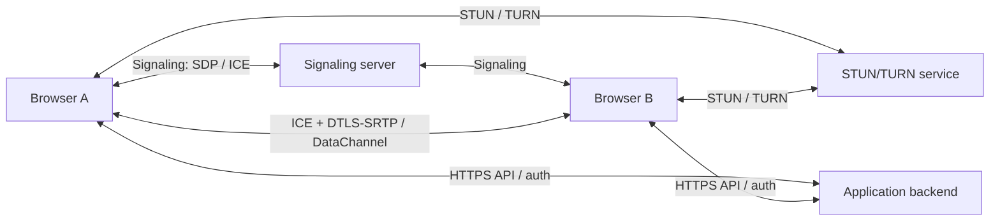

# WebRTC threat — nhận diện và giảm thiểu các mối đe dọa

> **Chương:** WebRTC  
> **Mục tiêu:** Xây dựng threat model cho ứng dụng WebRTC; phân biệt signaling plane với media/data plane; hiểu vai trò của ICE, STUN, TURN, DTLS-SRTP và DataChannel; nhận diện rủi ro giả mạo signaling, chiếm phòng, rò rỉ IP, lạm dụng camera/microphone, dữ liệu peer không tin cậy và từ chối dịch vụ; triển khai kiểm soát xác thực, quyền truy cập, quyền thiết bị, privacy và kiểm thử bằng DevTools.

## 1. Vì sao WebRTC cần threat model riêng?

WebRTC cho phép browser thiết lập giao tiếp thời gian thực bằng audio, video và dữ liệu. Một phiên có thể gồm nhiều thành phần: trang web, signaling server, STUN/TURN server, peer khác hoặc một máy chủ trung gian như SFU/MCU.

Mỗi thành phần tạo ra một ranh giới tin cậy khác nhau. Mã hóa media không tự bảo vệ signaling; người dùng cấp quyền camera không đồng nghĩa họ đã cho phép mọi người trong phòng nhận media; một DataChannel được mã hóa vẫn có thể nhận message độc hại từ peer đã kết nối.

Threat model cần trả lời:

- Ai có thể tạo phòng, tham gia phòng hoặc mời peer?
- Ai được phép xem/nghe từng track?
- Ai có thể thay đổi SDP, ICE candidate hoặc thông tin định tuyến?
- Địa chỉ IP và metadata mạng được tiết lộ cho những bên nào?
- Điều gì xảy ra khi peer gửi message sai định dạng hoặc gửi quá nhiều dữ liệu?
- Ai có thể cấp TURN credential và ai chịu chi phí relay?
- Khi người dùng logout, thu hồi quyền hoặc rời phòng, kết nối được dừng ra sao?

WebRTC bảo vệ một số lớp transport, nhưng bảo mật tổng thể phụ thuộc vào thiết kế ứng dụng, signaling, server và cách xử lý dữ liệu.

## 2. Kiến trúc và các trust boundary

Một ứng dụng WebRTC thường có các thành phần:



Các trust boundary chính:

| Thành phần | Vai trò | Rủi ro cần kiểm soát |
| --- | --- | --- |
| Web page/browser | Xin quyền thiết bị, tạo PeerConnection, hiển thị media | XSS, clickjacking, lạm dụng permission, xử lý dữ liệu peer |
| Signaling server | Chuyển tiếp SDP, ICE candidate và event phòng | Chiếm phòng, giả mạo peer, replay, sửa signaling, CSWSH |
| STUN server | Hỗ trợ phát hiện địa chỉ/mapping phục vụ ICE | Lộ metadata địa chỉ mạng, abuse hạ tầng |
| TURN server | Relay packet khi peer không kết nối trực tiếp | Lộ metadata cho relay, lạm dụng băng thông và chi phí |
| Peer khác | Gửi media, DataChannel message và signaling đã được chuyển tiếp | Payload độc hại, spam, giả mạo danh tính ở tầng ứng dụng |
| SFU/MCU | Chuyển tiếp hoặc xử lý luồng media | Trust vào media server, quyền truy cập recording/transcoding |
| Backend | Xác thực, authorization, quản lý phòng và cấp credential | IDOR, token leak, sai quyền, session abuse |

Không coi signaling server, TURN server và peer là cùng một miền tin cậy. Mỗi bên nhìn thấy dữ liệu khác nhau và cần quyền tối thiểu.

## 3. Signaling plane và media plane khác nhau

WebRTC không định nghĩa một giao thức signaling ứng dụng duy nhất. Ứng dụng tự chọn WebSocket, HTTP, SSE hoặc một cơ chế khác để trao đổi thông tin cần thiết cho việc thiết lập kết nối.

**Signaling plane** thường trao đổi:

- SDP offer/answer.
- ICE candidate và thông tin ICE gathering.
- Room ID, participant ID và trạng thái phiên.
- Thông tin thương lượng application protocol.
- Event join, leave, renegotiation hoặc restart ICE.

**Media/data plane** truyền:

- Audio/video thường qua SRTP.
- DataChannel thường qua SCTP được bảo vệ bởi DTLS.
- Packet có thể đi trực tiếp giữa peer hoặc qua TURN relay/SFU tùy kiến trúc.

Hai plane có mục tiêu bảo vệ khác nhau. TLS của WebSocket/HTTPS bảo vệ signaling trên đường truyền; DTLS-SRTP bảo vệ media transport; authorization của ứng dụng quyết định ai được phép tham gia phòng và gửi/nhận track.

Không dùng mã hóa transport để thay xác thực người dùng hoặc phân quyền phòng.

## 4. Các lớp bảo vệ của WebRTC

Một kết nối WebRTC thông thường dùng các cơ chế sau:

| Cơ chế | Vai trò | Giới hạn |
| --- | --- | --- |
| HTTPS/WSS | Bảo vệ trang và signaling trên đường truyền | Không tự xác minh quyền tham gia phòng |
| ICE | Tìm đường kết nối khả dụng qua các loại candidate | Có thể tiết lộ metadata địa chỉ mạng |
| STUN | Hỗ trợ phát hiện địa chỉ/mapping bên ngoài NAT | Không phải relay và không mã hóa media |
| TURN | Relay packet khi đường trực tiếp không khả dụng | Relay thấy metadata kết nối; tiêu tốn tài nguyên |
| DTLS | Thiết lập khóa và bảo vệ transport liên quan | Tính xác thực phụ thuộc signaling bảo vệ fingerprint |
| SRTP | Bảo vệ media packet về bí mật/toàn vẹn | Không thay quyền xem/nghe ở tầng ứng dụng |
| SCTP over DTLS | Chở DataChannel với bảo vệ transport | Payload vẫn cần validation và authorization |
| Browser permission | Kiểm soát truy cập camera/microphone theo browser/OS | Không cấp quyền nghiệp vụ cho peer |

WebRTC media transport thường dùng DTLS để thương lượng khóa SRTP. Browser xác minh certificate fingerprint được trao đổi qua signaling; vì vậy, nếu signaling bị sửa hoặc bị chiếm, attacker có thể cố thay fingerprint hoặc peer identity. Bảo vệ signaling và xác minh danh tính peer là điều kiện quan trọng.

## 5. Threat: signaling bị nghe lén hoặc sửa đổi

Nếu signaling chạy qua HTTP hoặc WebSocket không bảo vệ, attacker có thể có cơ hội đọc hoặc sửa SDP, ICE candidate, room event và thông tin xác thực.

Hậu quả có thể gồm:

- Thay địa chỉ hoặc thông tin candidate để chuyển kết nối.
- Thay SDP fingerprint để can thiệp quá trình xác thực DTLS.
- Giả mạo participant hoặc thay đổi mapping giữa user và peer connection.
- Replay offer/answer cũ trong một flow không có session binding.
- Đọc room metadata hoặc token được gửi qua signaling.

Biện pháp phòng vệ:

- Dùng HTTPS/WSS và certificate hợp lệ.
- Xác thực mọi kết nối signaling.
- Ràng buộc message với user, room, session và participant đã được server xác minh.
- Không tin room ID hoặc participant ID chỉ vì client gửi lên.
- Chống replay bằng session ID, nonce, sequence hoặc trạng thái thương lượng phù hợp.
- Không cho client tùy ý sửa fingerprint hoặc thông tin định tuyến nhạy cảm.
- Log event cần thiết nhưng che token, SDP và candidate nhạy cảm.

TLS bảo vệ signaling khi truyền, nhưng server vẫn cần xác minh người gửi được phép thực hiện event cụ thể.

## 6. Threat: chiếm phòng và giả mạo participant

Một lỗi phổ biến là dùng room ID khó đoán như thể đó là quyền truy cập. Room ID thường chỉ là định danh; nó không phải bằng chứng người dùng được phép tham gia.

Các tình huống:

- Attacker đoán hoặc lấy room ID từ URL/log.
- Người dùng đã logout nhưng signaling connection vẫn còn.
- Client giả participant ID của người khác.
- Một user hợp lệ trong hệ thống cố tham gia room không thuộc tenant của họ.
- Server chuyển tiếp SDP/candidate tới peer không có trong danh sách participant hợp lệ.

Server cần kiểm tra:

1. Session/token còn hợp lệ.
2. User có quyền tham gia room theo nghiệp vụ.
3. Room thuộc tenant hoặc tổ chức đúng.
4. Participant ID được tạo/gắn ở server, không tin giá trị client tự khai.
5. Event join, leave, publish, subscribe và renegotiate có authorization riêng.
6. Khi user bị thu hồi quyền, server xóa membership và đóng các kết nối liên quan.

Không dùng một lần kiểm tra ở thời điểm join để cấp quyền vô hạn cho mọi hành động về sau.

## 7. Threat: Cross-Site WebSocket Hijacking với signaling

Nếu signaling dùng WebSocket và xác thực bằng cookie, browser có thể gửi cookie tới signaling host trong một số ngữ cảnh cross-site. Website độc hại có thể thử mở WebSocket tới server của ứng dụng khi người dùng đang đăng nhập.

Đây là rủi ro Cross-Site WebSocket Hijacking (CSWSH). WebSocket handshake không dùng CORS response-sharing như Fetch, vì vậy chỉ cấu hình CORS header không đủ để bảo vệ signaling.

Phòng vệ:

- Kiểm tra header `Origin` tại server bằng allowlist chính xác.
- Dùng cookie SameSite phù hợp và hiểu browser third-party cookie behavior.
- Xác thực session tại handshake.
- Ràng buộc socket với user và session đã xác minh.
- Có thể dùng CSRF-style token ngắn hạn cho bước mở kết nối nếu kiến trúc cần.
- Authorization cho từng room event và message.
- Đóng socket khi session hết hạn hoặc logout.

Origin check là tín hiệu quan trọng cho browser client, nhưng client không phải browser có thể tự tạo header Origin. Do đó, Origin validation không thay authentication.

## 8. Threat: SDP injection và thương lượng ngoài ý muốn

SDP là dữ liệu mô tả session media: media section, codec, ICE credential, candidate, DTLS fingerprint và các thuộc tính thương lượng khác.

Nếu ứng dụng nhận SDP từ client rồi chuyển tiếp hoặc chỉnh sửa mà không có kiểm soát, có thể xuất hiện:

- SDP bị giả mạo hoặc gắn với sai room/participant.
- Candidate không thuộc phiên hiện tại.
- Fingerprint bị thay đổi.
- Message cũ bị replay vào một phiên mới.
- Parser hoặc logic thương lượng bị khai thác qua input bất thường.

Nguyên tắc:

- Xem SDP là input không tin cậy khi đi qua signaling.
- Giới hạn kích thước message và số lần renegotiation.
- Ràng buộc offer/answer với đúng peer connection và trạng thái phiên.
- Không tự ghép chuỗi SDP từ input không tin cậy.
- Nếu cần kiểm tra nội dung SDP, dùng parser/logic có cấu trúc và chỉ cho phép thay đổi đã được thiết kế.
- Bảo vệ DTLS fingerprint trong signaling và không chấp nhận fingerprint từ nguồn không được xác thực.
- Xử lý lỗi thương lượng và đóng phiên bất thường có kiểm soát.

Không coi SDP hợp lệ về cú pháp là bằng chứng peer được phép tham gia.

## 9. Threat: ICE candidate và rò rỉ địa chỉ IP

ICE thu thập các candidate để tìm đường kết nối. Tùy browser, network và cấu hình, candidate có thể chứa:

- Host candidate: địa chỉ giao diện mạng nội bộ hoặc tên host được browser cung cấp.
- Server-reflexive candidate: địa chỉ/mapping công khai quan sát qua STUN.
- Relay candidate: địa chỉ relay do TURN cấp.

ICE candidate được gửi qua signaling tới peer hoặc hạ tầng xử lý phiên. Vì vậy, bên nhận candidate có thể suy ra một số thông tin về mạng của người dùng.

Rủi ro privacy:

- Peer có thể thấy địa chỉ IP công khai trong một số cấu hình.
- Metadata candidate có thể tiết lộ loại mạng hoặc topology.
- Kết hợp nhiều candidate có thể hỗ trợ tương quan phiên hoặc người dùng.
- Signaling log có thể lưu địa chỉ IP và thông tin mạng lâu hơn cần thiết.

Browser hiện đại có thể dùng mDNS host candidate để giảm việc lộ địa chỉ IP nội bộ cho trang/peer trong một số trường hợp. Hành vi phụ thuộc browser, chính sách privacy và cấu hình; không giả định mọi IP đều được ẩn.

## 10. Giảm lộ IP bằng ICE policy và TURN relay

Nếu sản phẩm cần hạn chế peer nhìn thấy địa chỉ mạng trực tiếp, có thể cân nhắc chỉ dùng relay candidate:

```js
const pc = new RTCPeerConnection({
  iceServers: [
    {
      urls: "turn:turn.example.com:3478",
      username: turnUsername,
      credential: turnCredential,
    },
  ],
  iceTransportPolicy: "relay",
});
```

`iceTransportPolicy: "relay"` yêu cầu ICE chỉ dùng relay candidate trong cấu hình tương ứng. Điều này có thể làm giảm việc peer nhận địa chỉ candidate trực tiếp, nhưng có trade-off:

- Tăng latency do media đi qua relay.
- Tăng chi phí băng thông và vận hành TURN.
- TURN server nhìn thấy metadata kết nối và địa chỉ nguồn.
- Nếu TURN credential bị lộ, attacker có thể lạm dụng relay.
- Kết nối có thể thất bại nếu TURN không khả dụng.

Relay-only không phải giải pháp ẩn danh tuyệt đối. Nó thay đổi bên nào nhìn thấy địa chỉ và đường đi của packet. Hãy kiểm tra candidate thực tế trong môi trường mục tiêu.

## 11. STUN và TURN không thay thế mã hóa media

STUN giúp client khám phá địa chỉ/mapping phục vụ ICE. STUN không phải nơi relay toàn bộ media và không mã hóa media.

TURN relay packet khi kết nối trực tiếp không khả dụng hoặc policy yêu cầu. TURN không tự biến media thành end-to-end encrypted; bảo vệ media vẫn dựa trên DTLS-SRTP và kiến trúc endpoint.

Các biện pháp vận hành:

- Dùng TURN server được quản lý và cập nhật.
- Cấp credential ngắn hạn, có giới hạn thời gian và scope phù hợp.
- Không nhúng TURN secret tĩnh vào JavaScript frontend.
- Áp quota theo user/session/IP và giới hạn allocation.
- Theo dõi lưu lượng bất thường, số allocation và chi phí.
- Không vận hành TURN open relay cho người dùng không xác thực.
- Giới hạn relay protocol/port theo nhu cầu triển khai.

TURN credential nên được cấp từ backend sau khi xác thực user. Nếu credential hết hạn, client cần xin credential mới qua API được bảo vệ.

## 12. Threat: lạm dụng camera và microphone

WebRTC có thể lấy media từ thiết bị:

```js
const stream = await navigator.mediaDevices.getUserMedia({
  audio: true,
  video: true,
});
```

Rủi ro xuất hiện khi ứng dụng:

- Xin quyền mà không giải thích mục đích.
- Mở camera/microphone ngay khi trang tải.
- Giữ track chạy sau khi người dùng rời phòng.
- Gửi track tới peer hoặc room sai.
- Không thể hiện trạng thái đang capture.
- Dùng quyền đã cấp trước đó cho một mục đích khác mà người dùng không mong đợi.

Phòng vệ:

- Chỉ xin quyền sau hành động rõ ràng của người dùng.
- Chỉ yêu cầu loại thiết bị cần thiết.
- Hiển thị trạng thái camera/microphone đang bật.
- Có nút mute, stop camera và rời phòng dễ tìm.
- Dừng track khi kết thúc phiên hoặc khi component bị hủy.
- Không tự bật lại thiết bị sau khi người dùng đã tắt.
- Kiểm tra browser permission và OS permission; xử lý việc thu hồi quyền.

Browser permission chỉ cho phép trang sử dụng thiết bị trong phạm vi browser policy. Server vẫn phải xác minh user được phép publish media vào room.

## 13. Threat: lạm dụng screen sharing

Screen sharing thường dùng:

```js
const displayStream = await navigator.mediaDevices.getDisplayMedia({
  video: true,
  audio: false,
});
```

Người dùng chọn màn hình, cửa sổ hoặc tab theo prompt của browser. Không được coi việc user đã cho phép camera là đã cho phép chia sẻ màn hình; đây là quyền và thao tác riêng.

`getDisplayMedia()` yêu cầu secure context trong browser hiện đại và thường phải được gọi trong một thao tác có user activation, chẳng hạn click nút “Chia sẻ màn hình”. Browser vẫn hiển thị picker do người dùng kiểm soát; ứng dụng không được tự chọn màn hình hoặc âm thầm bắt đầu capture.

Rủi ro:

- Người dùng vô tình chia sẻ toàn bộ màn hình thay vì một tab.
- Nội dung nhạy cảm hoặc notification xuất hiện trong lúc chia sẻ.
- Track vẫn tiếp tục sau khi user nghĩ rằng đã dừng.
- Ứng dụng không thông báo rõ ai đang nhận màn hình.

Phòng vệ:

- Giải thích phạm vi chia sẻ trước khi gọi API.
- Dùng UI rõ ràng để hiển thị đang chia sẻ.
- Theo dõi event `ended` trên track để cập nhật giao diện.
- Có nút dừng chia sẻ trong ứng dụng.
- Dừng track khi rời room.
- Không ghi hoặc lưu screen capture nếu chưa có mục đích, thông báo và quyền phù hợp.

Ví dụ cleanup:

```js
function stopStream(stream) {
  if (!stream) return;
  for (const track of stream.getTracks()) {
    track.stop();
  }
}

displayStream.getVideoTracks()[0]?.addEventListener("ended", () => {
  showSharingState(false);
});
```

## 14. Threat: peer độc hại và media không tin cậy

Peer có thể là người dùng hợp lệ nhưng vẫn gửi nội dung hoặc hành vi gây hại:

- Audio/video có nội dung quấy rối hoặc lừa đảo.
- Media stream liên tục bật/tắt hoặc renegotiate bất thường.
- Codec, frame rate hoặc bitrate gây áp lực tài nguyên.
- DataChannel gửi payload lớn hoặc tần suất cao.
- Tên hiển thị, avatar hoặc metadata chứa chuỗi tấn công.

Không coi media nhận từ peer là nội dung an toàn chỉ vì transport đã mã hóa. Mã hóa bảo vệ packet trên đường truyền; nó không kiểm tra tính đúng đắn hay an toàn của nội dung.

Biện pháp:

- Giới hạn participant và quyền publish/subscribe.
- Cho phép mute, block, remove participant và report.
- Giới hạn bitrate, resolution, frame rate và số track theo nhu cầu.
- Validate metadata hiển thị trước khi đưa vào DOM.
- Giới hạn renegotiation và số lượng peer connection.
- Cập nhật browser/OS để nhận bản vá codec và media stack.
- Dùng SFU moderation/recording policy nếu kiến trúc có media server.

Không render tên peer hoặc metadata bằng HTML không an toàn. Dùng text node/framework escaping và validation theo schema.

## 15. Threat: DataChannel message injection

DataChannel có thể mang text hoặc binary:

```js
const channel = peerConnection.createDataChannel("app-events");

channel.addEventListener("message", (event) => {
  const message = JSON.parse(event.data);
  handleMessage(message);
});
```

Đoạn code trên chưa đủ an toàn nếu không kiểm tra input. Peer có thể gửi JSON sai schema, object có field ngoài dự kiến, payload quá lớn hoặc message với action mà user không được phép thực hiện.

Thiết kế an toàn:

1. Kiểm tra loại dữ liệu nhận: string hay Blob/ArrayBuffer.
2. Giới hạn kích thước trước khi parse hoặc decode.
3. Parse theo schema rõ ràng và từ chối field không hợp lệ.
4. Allowlist message type.
5. Xác minh quyền cho từng action ở server hoặc endpoint có thẩm quyền.
6. Rate limit theo peer/session.
7. Không đưa nội dung vào `innerHTML` hoặc eval.
8. Đóng channel hoặc áp backpressure khi peer lạm dụng.

Ví dụ:

```js
const MAX_MESSAGE_CHARS = 16 * 1024;
const ALLOWED_TYPES = new Set(["chat", "typing", "ack"]);

function handleDataChannelMessage(data) {
  if (typeof data !== "string" || data.length > MAX_MESSAGE_CHARS) {
    throw new Error("Invalid message size or type");
  }

  let message;
  try {
    message = JSON.parse(data);
  } catch {
    throw new Error("Invalid JSON");
  }

  if (
    !message ||
    typeof message !== "object" ||
    !ALLOWED_TYPES.has(message.type)
  ) {
    throw new Error("Unsupported message");
  }

  if (message.type === "chat" && typeof message.text !== "string") {
    throw new Error("Invalid chat payload");
  }

  processValidatedMessage(message);
}
```

Giới hạn kích thước ở JavaScript cần tính đến binary payload và chi phí decode/parse. Server authoritative vẫn phải kiểm tra mọi hành động ảnh hưởng dữ liệu dùng chung.

## 16. Mã hóa DataChannel không đồng nghĩa tin cậy peer

DataChannel WebRTC được bảo vệ bởi DTLS transport trong kiến trúc chuẩn. Điều này giúp bảo vệ dữ liệu trên đường truyền giữa hai endpoint của DataChannel.

Tuy nhiên, encryption không trả lời:

- Peer có phải user mà ứng dụng tuyên bố không?
- User có quyền gửi action này không?
- Message có hợp lệ về nghiệp vụ không?
- Payload có chứa nội dung lừa đảo hoặc XSS không?
- Peer có đang spam hoặc gửi dữ liệu quá lớn không?

Ứng dụng phải xác thực danh tính peer qua signaling/backend, ràng buộc peer với room và authorization, rồi validate message độc lập.

## 17. Threat: denial of service và resource exhaustion

WebRTC có thể tiêu tốn CPU, memory, socket, codec, GPU, network bandwidth và TURN allocation.

Các vector thường gặp:

- Tạo nhiều PeerConnection hoặc join room liên tục.
- Gửi SDP/ICE candidate với tần suất cao.
- Gửi DataChannel message lớn hoặc liên tục.
- Yêu cầu nhiều video track hoặc bitrate cao.
- Mở nhiều TURN allocation để tiêu thụ relay bandwidth.
- Gửi renegotiation hoặc restart ICE liên tục.
- Giả mạo event signaling để buộc server broadcast rộng.

Kiểm soát:

- Rate limit create/join/leave/renegotiate và message.
- Giới hạn số room, peer connection và track trên mỗi user.
- Giới hạn SDP size, DataChannel message size và candidate count.
- Giới hạn bitrate/resolution/frame rate.
- Quota TURN allocation và băng thông.
- Timeout cho phiên không hoạt động.
- Giám sát error rate, connection churn, relay usage và chi phí.
- Có circuit breaker và khả năng chặn user/session lạm dụng.

Không dựa vào client-side limit như biện pháp duy nhất. Attacker có thể sửa JavaScript hoặc dùng client tùy biến; enforce quota ở server và TURN infrastructure.

## 18. Threat: SFU/MCU và ranh giới end-to-end encryption

Trong kết nối peer-to-peer, DTLS-SRTP bảo vệ media transport giữa các endpoint WebRTC. Khi dùng SFU/MCU, mỗi client thường thiết lập transport bảo vệ tới media server; server nằm giữa và có thể xử lý hoặc truy cập media tùy kiến trúc.

Phân biệt:

| Mô hình | Ranh giới bảo vệ |
| --- | --- |
| Peer-to-peer | Media transport được bảo vệ giữa hai endpoint |
| SFU | Mỗi client có transport bảo vệ tới SFU; SFU định tuyến media và thường là một trust boundary |
| MCU | Media có thể được giải mã/xử lý để trộn rồi mã hóa lại cho client |
| Application-level E2EE | Nội dung media được mã hóa ở tầng ứng dụng giữa người gửi và người nhận, kể cả khi đi qua SFU, nếu key management và triển khai đúng |

Không tuyên bố “WebRTC luôn end-to-end encrypted” mà không mô tả endpoint nào nắm khóa. DTLS-SRTP bảo vệ transport hop; application-level E2EE cần cơ chế mã hóa encoded frame và quản lý khóa riêng.

Khi yêu cầu E2EE:

- Xác định ai có thể tạo, phân phối và thu hồi khóa.
- Ràng buộc khóa với danh tính participant đã xác thực.
- Xử lý thêm/bớt participant và thiết bị.
- Xem xét recording, transcription, moderation và server-side processing.
- Có quy trình xác minh key/fingerprint nếu threat model cần chống server trung gian độc hại.

E2EE có thể hạn chế khả năng server xử lý nội dung media, vì vậy phải thiết kế rõ trade-off sản phẩm.

## 19. Threat: TURN abuse và credential leakage

TURN server có thể relay lưu lượng cho client. Nếu cấp credential tĩnh trong frontend hoặc mở TURN relay không kiểm soát, attacker có thể dùng hạ tầng để chuyển tiếp traffic ngoài mục đích.

Biện pháp:

- Cấp TURN credential ngắn hạn sau khi xác thực user.
- Không commit shared secret vào frontend bundle.
- Hạn chế lifetime và quota theo user/room.
- Theo dõi allocation, băng thông, destination và bất thường.
- Giới hạn loại transport/port theo chính sách vận hành.
- Thu hồi hoặc rotate secret khi nghi ngờ lộ.
- Không coi STUN/TURN URL là bí mật; credential mới là dữ liệu cần bảo vệ.

Không ghi username/credential hoặc URL chứa secret vào client log, analytics hay error report.

## 20. Threat: clickjacking và lạm dụng quyền từ iframe

Trang WebRTC có thể bị nhúng trong iframe của website khác. Attacker có thể tìm cách phủ giao diện giả lên nút Join, bật camera, chia sẻ màn hình hoặc chấp nhận cuộc gọi.

Biện pháp:

- Dùng CSP `frame-ancestors` để giới hạn site được phép nhúng.
- Dùng `X-Frame-Options` như lớp tương thích khi cần, hiểu rằng CSP frame-ancestors là cơ chế hiện đại.
- Dùng Permissions Policy để giới hạn camera/microphone ở document và iframe.
- Chỉ delegate feature cho origin đối tác thực sự cần.
- Hiển thị rõ trạng thái capture và người nhận media.
- Không dùng UI ẩn hoặc click target chồng lấp để xin quyền.

Ví dụ:

```http
Content-Security-Policy: frame-ancestors 'self' https://portal.example.com
Permissions-Policy: camera=(self), microphone=(self), geolocation=()
```

Nếu sản phẩm không cần embed, cân nhắc `frame-ancestors 'none'`. Nếu cần embed, allowlist origin cụ thể.

## 21. Threat: XSS trong ứng dụng WebRTC

XSS có thể gây hậu quả nghiêm trọng trong ứng dụng WebRTC:

- Đọc room metadata và token có thể truy cập từ JavaScript.
- Gửi signaling message dưới danh nghĩa user.
- Tham gia room hoặc subscribe track nếu session cho phép.
- Thay đổi UI để lừa người dùng bật camera/microphone.
- Đọc nội dung message DataChannel được chuyển tới trang.
- Lấy quyền thao tác mà người dùng đã cấp cho origin.

Biện pháp:

- Encode output theo context và tránh `innerHTML` với dữ liệu peer.
- Dùng CSP nghiêm ngặt, nonce/hash và Trusted Types khi phù hợp.
- Không lưu bearer token dài hạn ở nơi XSS đọc được.
- Kiểm tra schema của signaling và DataChannel.
- Giới hạn quyền theo room và action.
- Tách origin cho nội dung không tin cậy khi cần.
- Cập nhật dependency và bảo vệ build pipeline.

Browser permission không bảo vệ khỏi XSS cùng origin. Một script độc hại chạy trong origin đã được cấp quyền có thể cố sử dụng API theo các điều kiện browser áp dụng.

## 22. Threat: metadata, logs và privacy

WebRTC tạo nhiều metadata ngoài nội dung audio/video:

- ICE candidate và địa chỉ mạng.
- Room ID, participant ID và thời điểm tham gia.
- SDP, codec, media capability và fingerprint.
- IP của peer/TURN endpoint.
- Connection state, bitrate, packet loss và thống kê.
- Notification hoặc thông tin thiết bị theo thiết kế ứng dụng.

Log quá chi tiết có thể trở thành nơi rò rỉ dữ liệu. Đặc biệt, SDP và ICE candidate có thể chứa địa chỉ IP, port, username fragment hoặc credential ICE.

Nguyên tắc logging:

- Không log access token, TURN credential hoặc session secret.
- Hạn chế log raw SDP và candidate; ưu tiên event/code đã redact.
- Giới hạn retention và quyền truy cập log.
- Pseudonymize participant ID khi phân tích.
- Chỉ thu thập telemetry cần cho reliability/security.
- Không ghi nội dung audio/video nếu không có mục đích và cơ chế consent phù hợp.

## 23. Threat: signaling và media bị nhầm lẫn với CORS

CORS áp dụng cho một số request HTTP do browser thực hiện, ví dụ Fetch API gọi endpoint signaling. Nó không phải cơ chế kiểm soát trực tiếp kết nối media peer-to-peer và không bảo vệ WebSocket handshake theo cách Fetch CORS hoạt động.

| Luồng | Cơ chế cần xem xét |
| --- | --- |
| Fetch tới signaling REST API | CORS, CSRF, authentication, authorization |
| WebSocket signaling | WSS, Origin validation, authentication, CSWSH defense, authorization |
| ICE connectivity | ICE policy, STUN/TURN config, candidate privacy |
| Media transport | DTLS-SRTP, certificate fingerprint qua signaling, endpoint trust |
| DataChannel | DTLS transport, schema validation, authorization, rate/size limits |

Không thêm ACAO wildcard rồi cho rằng WebRTC đã an toàn. Hãy bảo vệ từng luồng theo protocol thực tế.

## 24. Quy trình tạo phiên an toàn

Một flow điển hình:

1. Người dùng đăng nhập qua HTTPS.
2. Client yêu cầu backend tạo hoặc tham gia room.
3. Backend xác minh session, tenant, room membership và quyền publish/subscribe.
4. Backend cấp signaling authorization và TURN credential ngắn hạn nếu cần.
5. Client mở WSS và gửi room/session identifier đã được cấp.
6. Signaling server xác minh Origin, session, participant và room.
7. SDP offer/answer và ICE candidate được chuyển tiếp đúng peer được phép.
8. Browser thiết lập ICE và DTLS-SRTP; DataChannel nếu được thương lượng.
9. Server tiếp tục kiểm tra authorization cho renegotiation, publish, subscribe và các action.
10. Khi logout, session expiry hoặc remove participant, backend thu hồi quyền và signaling server đóng connection liên quan.

Không cho client tự khai một room ID hoặc participant ID rồi tin đó là quyền hợp lệ. Backend là nguồn có thẩm quyền cho membership và quyền.

## 25. Ví dụ: kiểm tra quyền tham gia room ở signaling server

Pseudo-code server:

```js
async function handleJoinRoom(socket, message, session) {
  if (!session || session.revoked || session.expiresAt <= Date.now()) {
    socket.close(4001, "Session expired");
    return;
  }

  const room = await loadRoom(message.roomId);
  if (!room || !await canJoinRoom(session.userId, room.id)) {
    socket.close(4003, "Not authorized");
    return;
  }

  const participant = await createParticipant({
    userId: session.userId,
    roomId: room.id,
  });

  bindSocketToParticipant(socket, participant.id);
  await notifyAuthorizedPeers(room.id, participant);
}
```

Đây là pseudo-code minh họa. Cần bổ sung schema validation, rate limiting, race handling, audit event và quản lý close code theo protocol của hệ thống.

## 26. Kiểm thử threat WebRTC trong môi trường lab

Thực hiện trên staging với tài khoản và thiết bị thử nghiệm. Không ghi hình, ghi âm hoặc thu thập IP của người không tham gia kiểm thử.

### Bước 1 — Kiểm tra secure context và permission

Mở trang qua HTTPS hoặc localhost. Kiểm tra:

```js
console.log(window.isSecureContext);
console.log("mediaDevices" in navigator);
```

Thử cấp và thu hồi camera/microphone permission. Xác minh UI phản ánh đúng trạng thái và track được dừng khi rời phòng.

### Bước 2 — Quan sát signaling

Mở DevTools → Network, lọc Fetch/XHR hoặc WS. Kiểm tra:

- Signaling dùng HTTPS/WSS.
- Origin được gửi trong WebSocket handshake.
- Server từ chối origin ngoài allowlist.
- Join room và participant mapping được xác minh.
- Không có token hoặc credential trong URL/log.

### Bước 3 — Kiểm tra ICE candidate

Trong lab, quan sát candidate qua API hoặc WebRTC internals của browser. Ghi nhận loại host, srflx, relay và xác định địa chỉ nào được lộ tới peer/signaling. So sánh cấu hình mặc định với relay-only.

### Bước 4 — Kiểm tra TURN credential

Xác minh credential có thời hạn, được cấp sau authentication và không nằm trong frontend bundle như shared secret tĩnh. Thử hết hạn credential và quan sát ICE failure/recovery.

### Bước 5 — Kiểm tra DataChannel

Gửi message đúng schema, sai schema, vượt giới hạn kích thước và message lặp nhanh. Xác minh ứng dụng từ chối input không hợp lệ, rate limit và không render dữ liệu bằng HTML không an toàn.

### Bước 6 — Kiểm tra authorization

Thử tham gia room bằng user không có quyền, thay room ID và gửi action publish/subscribe ngoài quyền. Server phải từ chối dù client có thể tạo PeerConnection.

### Bước 7 — Kiểm tra clickjacking và iframe policy

Nhúng trang lab vào iframe ở origin không được phép. Xác minh CSP frame-ancestors chặn việc nhúng và Permissions Policy không delegate camera/microphone ngoài allowlist.

### Bước 8 — Kiểm tra session revocation

Thu hồi session ở backend khi WebRTC đang hoạt động. Xác minh signaling socket bị đóng, quyền publish/subscribe bị thu hồi và client không thể reconnect bằng credential cũ.

## 27. Chẩn đoán lỗi và dấu hiệu tấn công

| Dấu hiệu | Nguyên nhân có thể | Hướng xử lý |
| --- | --- | --- |
| Join room từ origin lạ | Origin validation thiếu hoặc allowlist quá rộng | Kiểm tra Origin tại handshake và authentication |
| Participant ID trùng/giả | Server tin ID client gửi | Tạo participant ID phía server và bind với session |
| ICE candidate lộ IP ngoài dự kiến | Candidate policy hoặc browser privacy behavior | Đánh giá relay-only, mDNS và logging |
| TURN bandwidth tăng đột biến | Credential bị lộ hoặc relay abuse | Rotate credential, quota và kiểm tra allocation |
| Renegotiation tăng bất thường | Client spam SDP/ICE event | Rate limit và giới hạn trạng thái thương lượng |
| DataChannel memory tăng | Payload lớn hoặc producer nhanh | Giới hạn size, bufferedAmount và rate |
| Camera vẫn chạy sau khi rời phòng | MediaStream track chưa dừng | Stop mọi track và cleanup |
| User đã logout nhưng còn nhận media | Session revocation không truyền tới signaling/media plane | Thu hồi membership, đóng connection và unsubscribe |
| CORS header đúng nhưng WS vẫn bị chiếm | Nhầm CORS với WebSocket Origin validation | Kiểm tra Origin và CSWSH defense |
| SFU có thể truy cập media | Transport encryption kết thúc ở SFU | Đánh giá trust model hoặc application-level E2EE |
| Trang bị nhúng và lừa bật capture | Clickjacking/iframe policy thiếu | CSP frame-ancestors và Permissions Policy |

## 28. Checklist bảo mật WebRTC

- Dùng HTTPS/WSS và xác minh certificate.
- Xác thực signaling handshake và kiểm tra Origin bằng allowlist.
- Không coi CORS là biện pháp bảo vệ WebSocket handshake.
- Xác minh room membership và quyền publish/subscribe ở server.
- Ràng buộc SDP, ICE candidate và event với đúng session/participant.
- Chống replay, renegotiation spam và signaling message quá lớn.
- Bảo vệ SDP fingerprint qua signaling; không tin fingerprint từ nguồn không xác thực.
- Đánh giá IP exposure, mDNS candidate và relay-only policy theo privacy requirement.
- Dùng TURN credential ngắn hạn, quota và không vận hành open relay.
- Chỉ xin camera/microphone/screen permission khi có hành động rõ ràng.
- Hiển thị capture state và dừng mọi track khi kết thúc.
- Validate DataChannel schema, type, size, rate và authorization.
- Giới hạn peer, track, bitrate, connection count và TURN bandwidth.
- Hiểu trust boundary của SFU/MCU; không tuyên bố E2EE nếu transport kết thúc ở server.
- Dùng CSP frame-ancestors và Permissions Policy cho iframe.
- Không log token, raw SDP, ICE credential hoặc media content không cần thiết.
- Thu hồi session và đóng signaling/media connection khi user logout hoặc bị remove.
- Kiểm thử negative cases, browser privacy behavior và failure/reconnect paths.

## 29. Câu hỏi tự kiểm tra

1. Signaling plane và media/data plane khác nhau ở điểm nào?
2. Vì sao TLS signaling không thay DTLS-SRTP và ngược lại?
3. Vì sao SDP fingerprint cần được bảo vệ qua signaling?
4. Room ID có phải authorization token không?
5. CSWSH có thể xảy ra với signaling WebSocket như thế nào?
6. ICE candidate có thể tiết lộ metadata nào?
7. mDNS host candidate và TURN relay giúp giảm rủi ro privacy ra sao?
8. Vì sao relay-only không tạo anonymity tuyệt đối?
9. STUN và TURN khác nhau như thế nào?
10. Vì sao TURN credential cần ngắn hạn và có quota?
11. Browser permission có đảm bảo user được publish vào room không?
12. DataChannel được mã hóa có đồng nghĩa message đáng tin không?
13. Vì sao SFU là một trust boundary đối với media?
14. DTLS-SRTP khác application-level E2EE ở điểm nào?
15. Cần làm gì khi session bị thu hồi trong lúc media đang truyền?

**Ghi nhớ:** WebRTC an toàn khi signaling, media, data channel và quyền ứng dụng được bảo vệ như các lớp riêng. HTTPS/WSS bảo vệ signaling; DTLS-SRTP bảo vệ media transport; ICE/STUN/TURN quyết định đường đi và ảnh hưởng privacy; browser permission kiểm soát thiết bị; backend quyết định ai được tham gia và thực hiện hành động nào. Hãy xác thực Origin và session, giới hạn room/track/message, quản lý TURN credential, giảm IP/log exposure và thu hồi kết nối khi quyền thay đổi.
