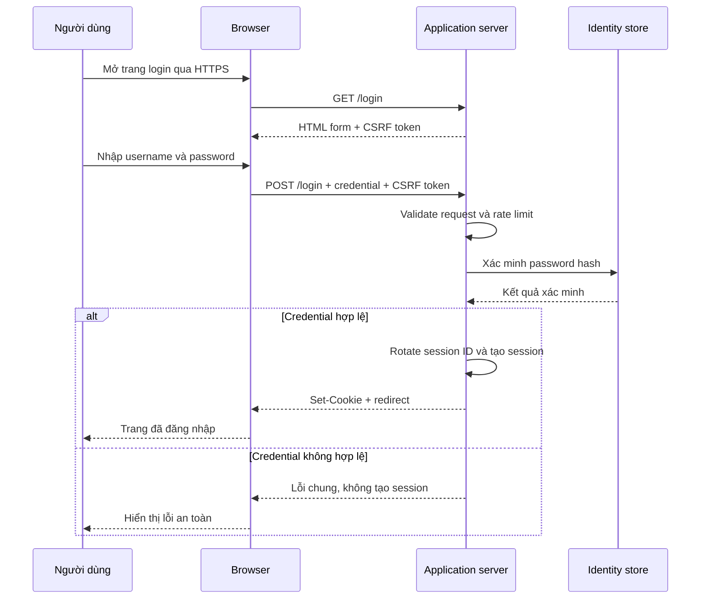

# Login form

> **Chương:** Authentication browser  
> **Bài học:** Login form — thiết kế biểu mẫu đăng nhập an toàn trong trình duyệt  
> **Phạm vi module:** **SECURITY_APPLICATION_SECURITY_BROWSER_SECURITY** — phân tích ranh giới bảo mật giữa trình duyệt, origin, cookie và ứng dụng web để hiểu Same-Origin Policy (SOP), CORS và các cơ chế cách ly; thực hành phòng vệ XSS, CSRF, clickjacking bằng CSP, Trusted Types, security headers và kiểm chứng hành vi thực tế.

## Mục tiêu học tập

Sau bài này, bạn có thể:

1. Thiết kế form đăng nhập bằng HTML semantic, HTTPS và phương thức gửi dữ liệu phù hợp.
2. Cấu hình `autocomplete` để hỗ trợ password manager và browser autofill.
3. Phân biệt validation phía client với validation và authentication bắt buộc ở server.
4. Bảo vệ form khỏi CSRF và login CSRF.
5. Xử lý username/password mà không làm lộ credential qua URL, log, analytics hoặc storage phía client.
6. Hiểu password hashing, rate limiting, credential stuffing và MFA ở phía server.
7. Tạo session an toàn sau khi đăng nhập, chống session fixation và quản lý cookie.
8. Xử lý lỗi, redirect sau đăng nhập và trạng thái đăng xuất an toàn.
9. Bảo vệ trang login bằng CSP, security headers và kiểm soát nguồn script.
10. Xây dựng form có accessibility tốt và kiểm thử trên browser/password manager.

## 1. Login form nằm ở đâu trong browser authentication?

Login form là giao diện để người dùng cung cấp thông tin xác thực cho ứng dụng. Browser thu thập input và gửi tới endpoint đăng nhập; server xác minh credential, áp dụng chính sách xác thực và tạo session hoặc trả về kết quả của một giao thức xác thực khác.

Form chỉ là một phần của quy trình. Một trang có giao diện đẹp, validation đầy đủ hoặc nút submit bị khóa vẫn không thể tự chứng minh người dùng là ai. Client chạy trong môi trường do người dùng kiểm soát; mọi dữ liệu gửi lên có thể bị sửa bằng DevTools, proxy hoặc chương trình tự viết.

Một luồng đăng nhập cơ bản:



Trong thực tế có thể có thêm MFA, CAPTCHA/risk checks, email verification, passkey hoặc redirect tới identity provider. Những bước đó không làm thay đổi nguyên tắc: server là nơi xác minh danh tính và cấp session.

### 1.1. Ranh giới trách nhiệm

| Thành phần | Trách nhiệm |
|---|---|
| HTML form | Thu thập input bằng control phù hợp và gửi request |
| Browser | Bảo vệ transport, quản lý autofill/password manager và áp dụng cookie policy |
| JavaScript | Cải thiện trải nghiệm, validation sớm và trạng thái giao diện |
| Server login endpoint | Kiểm tra CSRF, rate limit, xác minh credential và tạo session |
| Identity store | Lưu password hash hoặc thông tin xác thực đã đăng ký |
| Session layer | Duy trì danh tính sau đăng nhập, expiry và revoke |
| Authorization layer | Quyết định user được phép làm gì sau đăng nhập |

Không dùng `required`, regex, nút disabled hoặc biến JavaScript `isLoggedIn` làm cơ chế bảo mật. Người dùng có thể bỏ qua toàn bộ kiểm tra phía client.

### 1.2. Authentication khác authorization

Authentication xác định danh tính. Authorization quyết định danh tính đó được phép truy cập tài nguyên hoặc thực hiện hành động nào.

Đăng nhập thành công không có nghĩa user có quyền quản trị, đọc mọi hồ sơ hoặc truy cập mọi tenant. Server phải kiểm tra authorization trên từng request và tài nguyên sau đăng nhập.

## 2. Thiết kế HTML form an toàn

Với form đăng nhập truyền thống, HTML form có thể gửi `POST` trực tiếp tới server. Cách này đơn giản, tương thích tốt với browser, password manager và hoạt động được khi JavaScript lỗi hoặc bị tắt.

### 2.1. Dùng POST qua HTTPS

Không gửi password bằng query string hoặc URL path. URL thường xuất hiện trong browser history, proxy log, server access log, analytics, screenshot và hệ thống quan sát.

Ví dụ cấu trúc form:

```html
<form id="login-form" method="post" action="/login">
  <input type="hidden" name="csrf_token" value="SERVER_RENDERED_TOKEN">

  <div>
    <label for="username">Email hoặc tên đăng nhập</label>
    <input
      id="username"
      name="username"
      type="text"
      autocomplete="username"
      required
    >
  </div>

  <div>
    <label for="password">Mật khẩu</label>
    <input
      id="password"
      name="password"
      type="password"
      autocomplete="current-password"
      required
    >
  </div>

  <button type="submit">Đăng nhập</button>
</form>
<p id="login-status" role="status" aria-live="polite"></p>
```

`SERVER_RENDERED_TOKEN` chỉ là chỗ minh họa. Server phải tạo token ngẫu nhiên gắn với session hoặc cơ chế CSRF đang dùng và render an toàn; không dùng một chuỗi cố định cho mọi người dùng.

Dùng `method="post"` vì credential là dữ liệu nhạy cảm và request đăng nhập tạo hoặc thay đổi trạng thái authentication. HTTPS bảo vệ dữ liệu trên đường truyền. POST tự nó không mã hóa nội dung; nếu không có HTTPS, credential vẫn có thể bị nghe lén.

### 2.2. Không gửi credential qua GET

Ví dụ không an toàn:

```html
<form method="get" action="/login">
  <input name="username">
  <input name="password" type="password">
  <button type="submit">Đăng nhập</button>
</form>
```

Request có thể tạo URL dạng:

```text
/login?username=alice&password=secret
```

Password có thể bị lưu trong history, log hoặc telemetry. Hãy dùng POST và bảo đảm các hệ thống ghi log không lưu body đăng nhập hoặc CSRF token.

### 2.3. Input type và name

- Dùng `type="password"` để browser che ký tự khi nhập.
- Dùng `type="text"` hoặc `type="email"` cho username theo chính sách tài khoản.
- Dùng `name` ổn định để browser/password manager nhận diện field.
- Không dùng placeholder thay cho label.
- Không dùng `readonly` hoặc `disabled` để giả lập bảo vệ credential.
- Không tự động trim hoặc biến đổi password; khoảng trắng có thể là ký tự hợp lệ nếu chính sách password cho phép.

`type="email"` giúp browser kiểm tra định dạng cơ bản, nhưng không chứng minh email tồn tại hoặc thuộc về người dùng. Server vẫn cần validation và xác minh theo chính sách tài khoản.

### 2.4. Một form, một mục đích rõ ràng

Giữ form đăng nhập tập trung vào xác thực. Nếu trang có đăng ký, quên mật khẩu, MFA hoặc social login, dùng action và điều hướng rõ ràng. Không đặt nhiều nút submit có semantics mơ hồ hoặc gửi cùng credential tới nhiều endpoint.

Nếu có nhiều submit button, đặt `name`/`value` rõ ràng và kiểm tra server chỉ xử lý action được cho phép.

## 3. Autocomplete và password manager

Browser autofill và password manager giúp người dùng chọn mật khẩu mạnh, tránh gõ lại credential và giảm nguy cơ phishing do phải nhớ nhiều password. Không nên vô hiệu hóa tính năng này chỉ để ép người dùng nhập thủ công.

### 3.1. Giá trị autocomplete phù hợp

| Field | Giá trị gợi ý | Ý nghĩa |
|---|---|---|
| Username/email đăng nhập | `username` | Định danh tài khoản dùng để đăng nhập |
| Password hiện tại | `current-password` | Mật khẩu dùng cho form đăng nhập |
| Password mới | `new-password` | Mật khẩu đang được tạo hoặc thay đổi |
| OTP một lần | `one-time-code` | Mã xác minh dùng một lần nếu browser hỗ trợ |
| Email liên hệ | `email` | Địa chỉ email |

Ví dụ login dùng `autocomplete="username"` và `autocomplete="current-password"`. Form đổi password hoặc đăng ký dùng `new-password` cho field password mới.

Không gắn `autocomplete="new-password"` vào password hiện tại vì có thể làm password manager hiểu sai ý nghĩa field.

### 3.2. Không tắt autocomplete một cách máy móc

`autocomplete="off"` không bảo đảm browser sẽ không điền password. Browser/password manager có thể bỏ qua chỉ thị này đối với thông tin đăng nhập vì lợi ích bảo mật và trải nghiệm.

Thay vì chống autofill:

- Dùng label và `name` rõ ràng.
- Đặt autocomplete token đúng mục đích.
- Không đổi `name` ngẫu nhiên mỗi lần render.
- Không dùng hidden field đánh lừa password manager.
- Không copy password vào clipboard tự động.
- Không đọc password để gửi analytics hoặc telemetry.

### 3.3. Hỗ trợ paste và password manager

Không chặn paste trong password field. Việc chặn paste gây khó khăn cho password manager, làm người dùng phải gõ mật khẩu dài và có thể thúc đẩy họ chọn password yếu hơn.

Không yêu cầu password phải có thể gõ bằng tay theo một layout bàn phím cụ thể. Chấp nhận password manager, paste và ký tự Unicode theo chính sách password đã công bố.

### 3.4. Không tự lưu password ở client

Không lưu password vào:

- `localStorage` hoặc `sessionStorage`.
- IndexedDB hoặc Cache Storage.
- URL, fragment hoặc query string.
- Cookie do JavaScript tự tạo.
- Log, analytics event, crash report hoặc session replay.

Hãy để password manager của browser quản lý credential theo quyền và cài đặt của người dùng. Ứng dụng chỉ gửi password tới endpoint xác thực qua HTTPS và không giữ lại sau khi request hoàn tất.

## 4. Validation: browser hỗ trợ, server quyết định

Validation phía client giúp người dùng sửa lỗi trước khi gửi. Nó không phải ranh giới bảo mật vì attacker có thể bỏ JavaScript, sửa DOM hoặc gửi request trực tiếp.

### 4.1. Dùng HTML constraint validation

Các thuộc tính như `required`, `type="email"`, `minlength` và `maxlength` có thể giúp browser hiển thị lỗi cơ bản. Chỉ dùng các ràng buộc phù hợp với chính sách tài khoản.

Ví dụ:

```html
<label for="email">Email</label>
<input
  id="email"
  name="username"
  type="email"
  autocomplete="username"
  inputmode="email"
  required
>
```

Không đặt giới hạn password ở form login khác với quy tắc đã dùng khi tài khoản được tạo. Nếu password hợp lệ trước đây dài hơn giới hạn mới, người dùng có thể bị khóa khỏi tài khoản.

### 4.2. Không tự ý biến đổi password

Không tự động:

- Trim khoảng trắng đầu/cuối.
- Chuyển chữ hoa thành chữ thường.
- Chuẩn hóa Unicode theo một quy tắc khác với lúc đăng ký.
- Cắt password theo giới hạn ngắn tùy tiện.
- Thay ký tự hoặc xóa ký tự không nhận diện.

Username/email có thể được chuẩn hóa theo chính sách định danh nhất quán. Password phải được xử lý nhất quán với quy trình đăng ký và xác minh ở server. Không giả định mọi hệ thống email đều phân biệt hoặc không phân biệt chữ hoa/thường giống nhau.

### 4.3. Server validation là bắt buộc

Server cần kiểm tra:

1. Request dùng phương thức và content type được endpoint hỗ trợ.
2. Body có kích thước trong giới hạn.
3. Username/password có mặt và đúng kiểu dữ liệu.
4. Giá trị không vượt giới hạn tài nguyên của ứng dụng.
5. CSRF token và Origin/Referer phù hợp với chính sách.
6. Rate limit và risk controls được áp dụng.
7. Credential được xác minh bằng quy trình password verification an toàn.

Không trả stack trace hoặc thông tin truy vấn database cho browser. Dùng error code nội bộ và thông báo chung cho người dùng.

### 4.4. Không coi nút submit là khóa bảo mật

Có thể disable nút trong lúc gửi để tránh double submit, nhưng server vẫn phải xử lý request trùng, retry và race condition. Nếu một lần đăng nhập thành công tạo session mới, server nên quản lý session cũ theo policy và tránh tạo trạng thái không nhất quán.

Client có thể gửi nhiều request song song dù nút đang disabled. Rate limit và xử lý idempotent ở nơi phù hợp vẫn cần thiết.

## 5. CSRF và login CSRF

CSRF (Cross-Site Request Forgery) xảy ra khi browser gửi request mang credential tự động, chẳng hạn cookie, tới một site mà người dùng đã đăng nhập, trong khi người dùng không chủ động thực hiện hành động đó.

Login endpoint cũng có thể bị CSRF. Đây thường được gọi là **login CSRF**: attacker khiến browser của nạn nhân gửi form đăng nhập bằng tài khoản do attacker kiểm soát. Nạn nhân có thể tưởng mình đang ở tài khoản riêng, sau đó nhập thông tin hoặc tải dữ liệu vào tài khoản của attacker.

### 5.1. Vì sao login form cũng cần CSRF protection?

Login endpoint thường chưa có session đã xác thực, nhưng request vẫn thay đổi trạng thái browser: nó tạo một phiên đăng nhập. Kẻ tấn công có thể ép browser đăng nhập vào tài khoản khác do attacker sở hữu.

Ví dụ kịch bản:

1. Attacker tạo tài khoản trên dịch vụ.
2. Attacker tạo trang độc hại chứa form POST tới login endpoint của dịch vụ, điền username/password của tài khoản attacker.
3. Nạn nhân truy cập trang độc hại; browser gửi form tới dịch vụ.
4. Nếu login endpoint không có biện pháp chống login CSRF, browser của nạn nhân có thể được đăng nhập vào tài khoản attacker.
5. Nạn nhân tiếp tục sử dụng dịch vụ và có thể đưa dữ liệu riêng vào tài khoản mà attacker kiểm soát.

### 5.2. Synchronizer token

Với form server-rendered, server có thể tạo CSRF token ngẫu nhiên gắn với pre-auth session hoặc trạng thái form. Token được đặt trong hidden field và kiểm tra khi nhận POST.

Nguyên tắc:

- Token phải khó đoán và gắn với session/context phù hợp.
- Token không phải password hoặc session ID.
- Không đưa token vào URL.
- Không ghi token vào log hoặc analytics.
- Kiểm tra token ở server trước khi xử lý đăng nhập.
- Token phải được render an toàn và không dùng chung giữa mọi người.

Ví dụ hidden field:

```html
<input
  type="hidden"
  name="csrf_token"
  value="TOKEN_GENERATED_FOR_THIS_LOGIN_CONTEXT"
>
```

Tên token và cơ chế lưu/so sánh phụ thuộc framework. Dùng CSRF middleware đã được duy trì khi có thể; tránh tự phát minh thuật toán token.

### 5.3. Kiểm tra Origin và Referer

Với endpoint chỉ nhận request từ browser, server có thể kiểm tra `Origin` chính xác bằng allowlist scheme/host/port. Nếu Origin không có, chính sách có thể kiểm tra `Referer` như fallback trong những môi trường được xác định trước.

Không dùng kiểm tra chuỗi con. Không chấp nhận mọi origin chỉ vì thiếu header. Cần xử lý rõ trường hợp `Origin: null`, request từ sandboxed context và client không phải browser.

Origin/Referer validation là lớp phòng vệ bổ sung; kết hợp với CSRF token và cookie policy phù hợp.

### 5.4. SameSite cookie hỗ trợ nhưng không thay thế CSRF token

`SameSite=Lax` hoặc `Strict` có thể ngăn cookie được gửi trong một số cross-site request. Nhưng chính sách cookie không thay thế toàn bộ CSRF defense, đặc biệt khi có subdomain, luồng redirect, browser khác nhau hoặc endpoint có nhiều cách truy cập.

`SameSite=None` cho phép cookie tham gia một số cross-site context khi có `Secure`; nếu ứng dụng cần cấu hình này, hãy đánh giá CSRF kỹ hơn.

### 5.5. Login CSRF và pre-auth session

Một cách triển khai là tạo pre-auth session khi trả form login, gắn CSRF token vào session đó và rotate sang session ID mới sau khi xác thực thành công.

Luồng:

1. Browser GET trang login qua HTTPS.
2. Server tạo pre-auth state và token.
3. Server render token trong form.
4. Browser POST credential và token.
5. Server xác minh token, Origin và credential.
6. Khi đăng nhập thành công, server hủy pre-auth state và tạo session ID mới.

Không nâng pre-auth session thành authenticated session bằng cách giữ nguyên session ID. Rotate ID giúp chống session fixation.

## 6. Xử lý password ở server

Form browser không nên quyết định cách lưu password. Server cần xác minh password bằng password hashing algorithm chuyên dụng, có salt riêng cho từng credential và cost phù hợp.

### 6.1. Không lưu password dạng plaintext

Không lưu password nguyên văn trong database, log hoặc file cấu hình. Không dùng hash nhanh thông thường như SHA-256 một lần làm password storage. Hash nhanh khiến attacker thử password đoán được với tốc độ rất cao khi database bị lộ.

Dùng password hashing function được thiết kế cho password, chẳng hạn Argon2id, scrypt hoặc bcrypt với cấu hình phù hợp và salt riêng. Cân nhắc pepper được quản lý tách khỏi database nếu kiến trúc hỗ trợ.

### 6.2. Xác minh credential

Quy trình tổng quát:

1. Tìm account theo identifier đã chuẩn hóa.
2. Lấy password hash và tham số lưu trữ.
3. Dùng password verification function của thư viện tin cậy để so sánh password gửi lên.
4. Không tự so sánh string với hash hoặc tự viết thuật toán.
5. Áp dụng chính sách khi hash cần rehash do tham số cũ.
6. Không trả password hash cho browser.

Với username không tồn tại, hệ thống có thể dùng một dummy hash verification để giảm khác biệt timing rõ rệt giữa account tồn tại và không tồn tại. Đây là tối ưu bổ sung; thông báo lỗi chung và rate limit vẫn cần thiết.

### 6.3. Password policy và UX

Tránh đặt quy tắc password phức tạp chỉ ở login form. Login form cần chấp nhận password hợp lệ đã được đăng ký. Password policy thuộc luồng tạo/thay đổi credential.

Không hiển thị password trong thông báo lỗi. Không yêu cầu người dùng gửi password qua email/chat để “hỗ trợ đăng nhập”. Nhân viên hỗ trợ không cần biết password.

### 6.4. Không ghi credential vào telemetry

Trước khi ghi request log, analytics hoặc error report, loại bỏ body đăng nhập và field nhạy cảm. Kiểm tra cả:

- Reverse proxy/access log.
- APM và distributed tracing.
- Session replay và frontend analytics.
- Error monitoring.
- Debug log trong development.
- Log từ middleware khi request validation thất bại.

Redact phải xảy ra trước khi dữ liệu được chuyển vào hệ thống lưu trữ hoặc bên thứ ba.

## 7. Chống brute force và credential stuffing

Attacker có thể thử nhiều password cho một account (brute force), hoặc dùng cặp username/password bị lộ từ dịch vụ khác (credential stuffing). Form login là điểm tiếp nhận các request này; biện pháp chính phải nằm ở server và hạ tầng.

### 7.1. Rate limiting nhiều chiều

Kết hợp giới hạn theo:

- Account identifier đã chuẩn hóa.
- IP hoặc dải mạng theo tín hiệu đáng tin cậy.
- Device/session risk signal nếu có cơ sở và chính sách quyền riêng tư.
- Endpoint và tổng lưu lượng hệ thống.
- Thất bại liên tiếp và tốc độ thử theo thời gian.

Chỉ giới hạn theo IP có thể ảnh hưởng người dùng chung NAT. Chỉ giới hạn theo account có thể bị dùng để khóa tài khoản của nạn nhân. Dùng chiến lược cân bằng, theo dõi false positive và không tiết lộ trạng thái khóa qua error message.

### 7.2. Không khóa account theo cách dễ bị DoS

Khóa cứng tài khoản sau một số lần sai cố định có thể cho phép attacker cố ý khóa tài khoản người khác. Cân nhắc progressive delay, throttling, risk-based challenge và quy trình recovery an toàn.

Không yêu cầu CAPTCHA cho mọi người dùng ngay từ đầu nếu không có dấu hiệu rủi ro; có thể dùng challenge tăng dần theo tín hiệu lạm dụng và khả năng tiếp cận.

### 7.3. Thông báo lỗi chung

Thông báo như “Email không tồn tại” và “Mật khẩu sai” có thể giúp attacker dò danh sách tài khoản. Dùng thông báo chung, ví dụ:

```text
Thông tin đăng nhập không hợp lệ. Hãy kiểm tra lại và thử lại.
```

Thông báo chung cần áp dụng nhất quán cho account không tồn tại, password sai hoặc trạng thái account không nên tiết lộ. Với account bị khóa hoặc cần xác minh thêm, dùng luồng hỗ trợ riêng không làm lộ trạng thái cho người không được xác thực.

### 7.4. MFA và xác thực tăng cường

MFA bổ sung yếu tố xác minh ngoài password, ví dụ authenticator app, security key hoặc passkey. Với hành động rủi ro cao, có thể yêu cầu step-up authentication.

- Không coi OTP qua SMS là lựa chọn chống phishing mạnh nhất.
- Ưu tiên phishing-resistant authentication như WebAuthn/passkeys khi phù hợp.
- Không log OTP hoặc recovery code.
- Giới hạn lần thử và thời hạn OTP.
- Recovery flow cần được bảo vệ tương đương hoặc tốt hơn luồng login.

## 8. Tạo session an toàn sau đăng nhập

Khi credential hợp lệ, server cần tạo một session mới hoặc hoàn tất quy trình cấp session đã được thiết kế. Không để session ID do attacker chọn trước tiếp tục được dùng sau khi đăng nhập.

### 8.1. Chống session fixation bằng rotation

Session fixation xảy ra khi attacker khiến nạn nhân sử dụng một session ID mà attacker biết hoặc kiểm soát. Nếu server giữ nguyên ID đó sau đăng nhập, attacker có thể dùng lại ID để truy cập session đã xác thực.

Khi authentication thành công:

1. Hủy hoặc vô hiệu hóa pre-auth session ID.
2. Tạo session ID mới bằng nguồn ngẫu nhiên mật mã.
3. Gắn session mới với principal đã xác minh.
4. Cập nhật cookie session bằng ID mới.
5. Không chấp nhận lại ID cũ như authenticated session.

Nếu dùng session framework, bật cơ chế regenerate/rotate session ID sau login và sau các thay đổi quyền quan trọng theo hướng dẫn của framework.

### 8.2. Cookie session

Ví dụ header:

```http
Set-Cookie: __Host-session=OPAQUE_RANDOM_SESSION_ID; Path=/; Secure; HttpOnly; SameSite=Lax
```

Ý nghĩa:

- `Secure`: browser chỉ gửi cookie qua HTTPS.
- `HttpOnly`: JavaScript không đọc cookie qua `document.cookie`.
- `SameSite=Lax`: giảm việc cookie được gửi trong một số cross-site request.
- Prefix `__Host-`: yêu cầu `Secure`, `Path=/` và không có `Domain`, giúp giới hạn cookie vào host.

Session ID nên có entropy cao, không chứa user ID, email hoặc dữ liệu có thể đoán. Server giữ mapping session → principal và có thể revoke session khi logout, đổi password, account lock hoặc phát hiện rủi ro.

### 8.3. Expiry và rotation

Đặt cả idle timeout và absolute lifetime theo mức nhạy cảm của ứng dụng. Gia hạn idle timeout chỉ khi có hoạt động hợp lệ; không kéo dài session vô hạn chỉ vì tab vẫn mở.

Cân nhắc rotate session sau:

- Đăng nhập thành công.
- Nâng quyền hoặc hoàn tất MFA.
- Thay đổi thông tin bảo mật quan trọng.
- Phát hiện thay đổi rủi ro cần tái xác thực.

Không ràng buộc session quá cứng với IP hoặc User-Agent nếu điều đó gây khóa nhầm người dùng di động; các tín hiệu này có thể thay đổi và không phải bằng chứng danh tính.

### 8.4. Logout phải vô hiệu hóa session ở server

Logout cần là hành động thay đổi trạng thái, thường gửi POST và được bảo vệ CSRF. Server hủy session trong kho session, sau đó xóa cookie bằng cùng các thuộc tính Path/Domain phù hợp.

Xóa cookie ở browser mà không revoke session ở server có thể để session cũ tiếp tục dùng được nếu credential bị sao chép trước đó.

## 9. Redirect sau khi đăng nhập

Ứng dụng thường muốn đưa người dùng về trang họ đang truy cập trước khi bị chuyển tới login. Tham số redirect không được trở thành open redirect.

### 9.1. Rủi ro open redirect

Không chuyển hướng tới URL tùy ý do query parameter cung cấp, ví dụ `?returnUrl=https://attacker.invalid`. Attacker có thể tạo link trông như thuộc domain hợp lệ nhưng sau login lại đưa người dùng tới website lừa đảo.

### 9.2. Chỉ chấp nhận đích đã kiểm soát

Các cách an toàn hơn:

- Chỉ chấp nhận relative path bắt đầu bằng một dấu `/` và từ chối `//`, backslash hoặc scheme.
- Parse URL bằng thư viện chuẩn, so sánh origin với origin ứng dụng.
- Hoặc dùng identifier server-side ánh xạ tới route đã định nghĩa.
- Từ chối URL có userinfo hoặc host khác.
- Dùng fallback cố định nếu giá trị không hợp lệ.

Ví dụ kiểm tra relative path ở server cần xử lý canonicalization và encoding theo framework; không dựa vào regex đơn giản. Nếu ứng dụng cần redirect tới identity provider, dùng allowlist callback URI đã đăng ký và kiểm tra `state`/PKCE theo giao thức.

### 9.3. Không tin return URL sau khi đã kiểm tra ở client

Hidden field hoặc JavaScript có thể bị sửa. Server phải xác minh lại redirect target ngay trước khi gửi response redirect.

## 10. Xử lý lỗi và trạng thái đăng nhập

Thông báo lỗi cần giúp người dùng khôi phục thao tác mà không tiết lộ thông tin cho attacker.

### 10.1. Thông báo credential chung

Dùng một thông báo chung cho username không tồn tại và password sai. Không xác nhận account có tồn tại, đang hoạt động, bị khóa hay đã đăng ký MFA cho một người chưa xác thực.

Ví dụ:

```text
Không thể đăng nhập bằng thông tin đã cung cấp. Hãy kiểm tra và thử lại.
```

Không nhất thiết phải giấu mọi lỗi. Có thể hiển thị lỗi định dạng input ở client, lỗi CSRF hoặc hướng dẫn khôi phục chung. Nhưng không tiết lộ trạng thái tài khoản nhạy cảm trước khi xác thực.

### 10.2. Thời gian phản hồi và account enumeration

Nếu account không tồn tại trả lời ngay còn account tồn tại luôn chạy password hash verification, attacker có thể đo thời gian để suy đoán danh sách tài khoản.

Dùng thông báo nhất quán, giới hạn tốc độ và cân nhắc dummy password hash verification cho identifier không tồn tại. Không cố tạo delay cố định quá lớn làm tăng khả năng DoS; đánh giá timing bằng đo đạc thực tế.

### 10.3. Giữ form có thể sử dụng lại

Sau lỗi, giữ username nếu phù hợp nhưng không đưa password vào HTML response hoặc lưu lại trong storage. Browser/password manager có thể hỗ trợ điền lại theo cài đặt người dùng.

Không render lại password từ request body. Không phản chiếu input không tin cậy vào HTML mà không escape.

### 10.4. Trạng thái MFA và challenge

Nếu cần MFA, trả về trạng thái bước tiếp theo rõ ràng. Không tạo session có toàn quyền trước khi MFA hoàn tất. Có thể tạo pre-auth transaction ngắn hạn chỉ cho phép xác minh yếu tố tiếp theo.

Giới hạn thời hạn challenge, số lần thử, resend và replay. Sau khi MFA thành công, rotate sang authenticated session theo thiết kế.

## 11. Accessibility và trải nghiệm người dùng

Form login thường là điểm đầu tiên người dùng tương tác với ứng dụng. Accessibility tốt giúp mọi người dùng hoàn thành thao tác và giảm lỗi nhập.

### 11.1. Label và thông báo lỗi

- Mỗi input có `<label>` gắn với `for` và `id`.
- Dùng `aria-describedby` để liên kết hướng dẫn hoặc lỗi.
- Đặt `aria-invalid="true"` khi field không hợp lệ.
- Có error summary hoặc thông báo chung dễ nhận biết.
- Dùng `role="alert"` cho lỗi cần được screen reader thông báo ngay.
- Không chỉ dùng màu sắc để biểu thị lỗi.

Ví dụ:

```html
<label for="login-email">Email</label>
<input
  id="login-email"
  name="username"
  type="email"
  autocomplete="username"
  aria-describedby="email-help email-error"
  aria-invalid="true"
  required
>
<p id="email-help">Nhập email đã đăng ký.</p>
<p id="email-error" role="alert">Hãy kiểm tra định dạng email.</p>
```

Chỉ đặt `aria-invalid="true"` khi field thực sự có lỗi. Khi người dùng sửa đúng, cập nhật trạng thái và thông báo tương ứng.

### 11.2. Keyboard và focus

Form cần hoạt động bằng bàn phím:

- Tab đi qua field và button theo thứ tự hợp lý.
- Enter có thể submit form.
- Focus indicator nhìn thấy được.
- Không trap focus ngoài ý muốn.
- Sau lỗi submit, focus tới error summary hoặc field đầu tiên có lỗi theo thiết kế.

Không dùng `outline: none` nếu không cung cấp focus indicator thay thế rõ ràng.

### 11.3. Nút hiện/ẩn password

Có thể cung cấp nút hiện/ẩn password để người dùng kiểm tra nội dung đã nhập. Nút phải có `type="button"` để không submit form, có accessible name và cập nhật trạng thái `aria-pressed`.

Không gửi password sang một endpoint khác khi người dùng bật hiển thị. Thao tác chỉ thay đổi thuộc tính `type` của input tại client.

### 11.4. Không tạo UX ép người dùng giảm bảo mật

Không chặn paste, không ép password ngắn, không yêu cầu thay password định kỳ vô lý và không giấu thông báo về MFA/recovery. Giải thích rõ khi session hết hạn hoặc cần xác thực lại, đồng thời tránh đưa người dùng tới một form giả mạo qua link không đáng tin.

## 12. Security headers cho trang đăng nhập

Trang login chứa credential và thường là mục tiêu phishing, clickjacking và XSS. Cấu hình security headers giúp giới hạn cách browser tải, nhúng và lưu trang.

### 12.1. CSP giới hạn nguồn form và script

Ví dụ policy khởi đầu cho trang login cùng origin:

```http
Content-Security-Policy: default-src 'self'; base-uri 'self'; form-action 'self'; frame-ancestors 'none'; object-src 'none'; script-src 'self'; style-src 'self'; img-src 'self' data:; connect-src 'self'; upgrade-insecure-requests
```

Các directive quan trọng:

- `form-action 'self'` giới hạn nơi form được submit.
- `frame-ancestors 'none'` ngăn trang login bị nhúng trong frame nếu sản phẩm không cần nhúng.
- `script-src 'self'` giới hạn nguồn script; dùng nonce/hash nếu cần inline script hợp lệ.
- `base-uri 'self'` hạn chế thẻ base bị chèn để đổi URL tương đối.
- `object-src 'none'` tắt object/embed không cần thiết.

Đây là policy mẫu. Điều chỉnh theo asset và kiến trúc thực tế; không thêm `unsafe-inline` hoặc wildcard chỉ để làm lỗi biến mất. Có thể triển khai Report-Only trước để quan sát vi phạm rồi chuyển sang enforcement.

### 12.2. Các header hữu ích khác

Ví dụ các header thường cân nhắc:

```http
Strict-Transport-Security: max-age=31536000; includeSubDomains
X-Content-Type-Options: nosniff
Referrer-Policy: no-referrer
Cache-Control: no-store
X-Frame-Options: DENY
```

- HSTS yêu cầu browser dùng HTTPS cho host trong thời hạn policy; chỉ bật `includeSubDomains` khi mọi subdomain đều sẵn sàng HTTPS.
- `X-Content-Type-Options: nosniff` giảm việc browser suy đoán MIME type.
- `Referrer-Policy: no-referrer` giảm việc URL trang login bị gửi trong Referer.
- `Cache-Control: no-store` yêu cầu không lưu response login trong cache HTTP thông thường.
- `X-Frame-Options: DENY` là lớp tương thích cũ; `frame-ancestors` trong CSP là lựa chọn hiện đại.

Không copy nguyên xi mọi header vào mọi route mà không đánh giá tác động. HSTS cần được triển khai có kế hoạch; policy quá rộng có thể làm subdomain HTTP không còn truy cập được.

### 12.3. Không để login response bị cache

Đặt chính sách no-store cho trang login, response authentication và trang chứa dữ liệu cá nhân. Cache Storage do ứng dụng chủ động quản lý là cơ chế riêng; không ghi response nhạy cảm vào Cache API chỉ vì header đã có `no-store`.

### 12.4. CORS không phải giải pháp bảo vệ form login

Nếu form login cùng origin, thường không cần bật CORS cho endpoint đăng nhập. Không dùng `Access-Control-Allow-Origin: *` kết hợp credentials. CORS không ngăn một trang khác gửi form HTML cross-origin; CSRF token, Origin validation và cookie policy mới là các lớp cần thiết.

## 13. JavaScript enhancement mà không phá native form

Form HTML nên hoạt động được khi JavaScript không chạy. JavaScript có thể bổ sung trạng thái loading, thông báo lỗi và submit bằng fetch, nhưng không được biến client thành nơi quyết định authentication.

### 13.1. Nút hiện/ẩn password

HTML:

```html
<label for="password">Mật khẩu</label>
<div>
  <input
    id="password"
    name="password"
    type="password"
    autocomplete="current-password"
    required
  >
  <button
    id="toggle-password"
    type="button"
    aria-pressed="false"
    aria-label="Hiện mật khẩu"
  >
    Hiện
  </button>
</div>
```

JavaScript:

```js
const passwordInput = document.querySelector('#password');
const toggleButton = document.querySelector('#toggle-password');

toggleButton?.addEventListener('click', () => {
  const willShow = passwordInput.type === 'password';

  passwordInput.type = willShow ? 'text' : 'password';
  toggleButton.setAttribute('aria-pressed', String(willShow));
  toggleButton.setAttribute(
    'aria-label',
    willShow ? 'Ẩn mật khẩu' : 'Hiện mật khẩu'
  );
  toggleButton.textContent = willShow ? 'Ẩn' : 'Hiện';
});
```

Nút phải là `type="button"` để click không submit form. Không log giá trị input và không gửi password sang nơi khác.

### 13.2. Submit bằng fetch là tùy chọn

Nếu ứng dụng cần SPA-style login, dùng endpoint có contract rõ ràng, gửi POST qua HTTPS và giữ CSRF protection. Ví dụ khái quát:

```js
const form = document.querySelector('#login-form');
const status = document.querySelector('#login-status');

form?.addEventListener('submit', async (event) => {
  event.preventDefault();

  if (!form.reportValidity()) return;

  const submitButton = form.querySelector('[type="submit"]');
  submitButton.disabled = true;
  status.textContent = 'Đang xác thực…';

  try {
    const response = await fetch(form.action, {
      method: 'POST',
      credentials: 'same-origin',
      headers: {
        Accept: 'application/json',
      },
      body: new FormData(form),
    });

    const result = await response.json();

    if (!response.ok) {
      status.textContent =
        result.message || 'Không thể đăng nhập. Hãy thử lại.';
      return;
    }

    // Server đã tạo session cookie qua Set-Cookie.
    // Redirect target phải được server xác minh và trả về an toàn.
    window.location.assign(result.redirect || '/account');
  } catch {
    status.textContent = 'Không thể kết nối. Hãy thử lại sau.';
  } finally {
    submitButton.disabled = false;
  }
});
```

Ví dụ giả định server trả JSON cho cả success và error, đồng thời thiết lập session cookie bằng `Set-Cookie`. Cookie `HttpOnly` không thể được JavaScript đọc và không cần phải đọc.

Nếu dùng fetch:

- Giữ CSRF token trong form/header theo cơ chế server yêu cầu.
- Không log FormData, password hoặc response chứa credential.
- Chỉ redirect tới URL đã được server xác minh.
- Không hiển thị nguyên văn thông báo lỗi nội bộ từ server.
- Giữ native form fallback nếu JavaScript không tải được.

Không cần chuyển sang fetch chỉ để “bảo mật hơn”. Native POST form là lựa chọn tốt cho nhiều ứng dụng.

### 13.3. Không lưu password trong state hoặc telemetry

Nếu framework UI dùng state để điều khiển input, chỉ giữ giá trị trong bộ nhớ trong thời gian cần thiết. Không đưa password vào global store, Redux devtools, persisted state, analytics, error boundary hoặc log debug. Không serialize toàn bộ form object vào telemetry.

## 14. Quên mật khẩu và recovery

Liên kết “Quên mật khẩu?” thường nằm cạnh login form nhưng là một quy trình bảo mật riêng. Recovery có thể cho phép đổi credential, vì vậy phải được bảo vệ chặt chẽ.

### 14.1. Thông báo recovery không tiết lộ account

Sau khi người dùng nhập email, dùng thông báo chung, chẳng hạn “Nếu tài khoản phù hợp tồn tại, chúng tôi sẽ gửi hướng dẫn.” Tránh xác nhận email có tồn tại hay không.

### 14.2. Recovery token

Token reset password cần:

- Sinh bằng nguồn ngẫu nhiên mật mã.
- Có thời hạn ngắn và dùng một lần.
- Gắn với đúng account và mục đích reset.
- Được lưu dưới dạng hash nếu kiến trúc hỗ trợ.
- Bị vô hiệu hóa sau khi dùng hoặc khi yêu cầu token mới theo policy.
- Không xuất hiện trong log, analytics hoặc referrer.

Trang reset password cần HTTPS, chống CSRF theo luồng, CSP phù hợp và response không cache. Không tự động đăng nhập user chỉ vì reset password thành công nếu policy yêu cầu xác minh lại.

### 14.3. Sau khi đổi password

Cân nhắc revoke các session hiện có, thông báo cho chủ tài khoản và yêu cầu xác thực lại trên thiết bị khác. Không gửi password mới trong email hoặc log.

## 15. Kiểm thử login form trên browser

Kiểm thử không chỉ là nhập đúng password. Cần xác minh HTML semantics, request thực tế, cookie, lỗi và các tình huống browser.

### 15.1. Kiểm tra Network

Trong DevTools → Network:

1. Submit form bằng credential test.
2. Xác minh request là POST qua HTTPS.
3. Kiểm tra password không nằm trong URL, path hoặc query string.
4. Kiểm tra CSRF token được gửi theo cơ chế thiết kế.
5. Xác minh response thành công thiết lập session cookie đúng flags.
6. Kiểm tra redirect target và response không chứa credential.
7. Bảo đảm DevTools/log chia sẻ không ghi lại password thật.

Không chụp hoặc chia sẻ HAR chứa credential, cookie hoặc token thật.

### 15.2. Kiểm tra cookie và session

Trong DevTools → Application/Storage → Cookies:

- `Secure` được bật.
- `HttpOnly` được bật cho session cookie.
- `SameSite` phù hợp với luồng.
- Prefix `__Host-` được cấu hình đúng nếu sử dụng.
- Cookie có expiry phù hợp.
- Session ID thay đổi sau login.
- Logout làm session bị revoke ở server và cookie bị xóa.

Không cần xem hoặc copy giá trị session cookie để xác minh flags.

### 15.3. Kiểm tra autofill/password manager

Thử:

- Tài khoản đã lưu và tài khoản mới.
- Điền tự động username/password.
- Paste password dài và có ký tự Unicode.
- Form có lỗi và submit lại.
- Browser khác nhau hoặc profile sạch.
- MFA input với `autocomplete="one-time-code"` nếu có.

Không tự động xóa password field sau mọi lỗi nếu điều đó làm password manager không thể hỗ trợ người dùng; chọn hành vi phù hợp với rủi ro và UX.

### 15.4. Kiểm tra keyboard và screen reader

Điều hướng toàn form bằng Tab/Shift+Tab, submit bằng Enter, xác minh label, focus, error message và trạng thái `aria-invalid`. Kiểm tra zoom và màn hình nhỏ để không che nút submit hoặc thông báo lỗi.

## 16. Quy trình xử lý login endpoint ở server

Một endpoint đăng nhập nên xử lý theo thứ tự rõ ràng. Các bước dưới đây là logic tổng quát; dùng framework authentication/session/CSRF đã được duy trì thay vì tự viết cryptography hoặc session store.

### 16.1. Pipeline xử lý POST /login

1. Chỉ nhận method và content type đã định nghĩa.
2. Giới hạn body size và từ chối request sai định dạng.
3. Kiểm tra Origin/Referer theo chính sách browser endpoint.
4. Xác minh CSRF token gắn với pre-auth context.
5. Áp dụng rate limit và risk checks trước khi thực hiện password verification tốn tài nguyên.
6. Chuẩn hóa username theo quy tắc định danh của hệ thống.
7. Tìm credential record; nếu không tồn tại, thực hiện nhánh xử lý timing phù hợp.
8. Xác minh password bằng thư viện password hashing.
9. Nếu cần MFA, tạo pre-auth transaction ngắn hạn và chỉ cho phép bước MFA.
10. Nếu đủ yếu tố, rotate session ID, tạo authenticated session và thiết lập cookie an toàn.
11. Xác minh redirect target ở server.
12. Trả response không chứa password, hash hoặc token nội bộ.

Không xử lý authentication dựa trên cờ client gửi như `isAuthenticated`, `verified` hoặc `role`.

### 16.2. Pseudocode logic

```text
POST /login
  require HTTPS
  require supported content type and body size
  verify Origin/Referer policy
  verify CSRF token for pre-auth context
  apply rate limit and risk checks

  identifier = normalizeUsername(request.username)
  account = findAccount(identifier)

  if account exists:
      valid = verifyPassword(request.password, account.passwordHash)
  else:
      performDummyPasswordVerification(request.password)
      valid = false

  if not valid:
      return generic login failure

  if account requires MFA:
      create short-lived pre-auth transaction
      return MFA challenge

  revoke or invalidate pre-auth session
  create fresh authenticated session
  set Secure, HttpOnly, SameSite session cookie
  validate redirect target on server
  return success
```

Pseudocode không thay thế implementation của framework. Các hàm verify password, CSRF, rate limit, session rotation và cookie serialization phải dùng thư viện phù hợp và được kiểm thử.

### 16.3. Phân biệt lỗi và audit nội bộ

Server có thể phân loại lỗi nội bộ như CSRF invalid, rate limited, password mismatch, account challenge required hoặc session store unavailable. Nhưng response cho người chưa xác thực cần tránh tiết lộ account enumeration và chi tiết nội bộ.

Ghi audit event theo category và correlation ID. Không ghi password, token, CSRF value hoặc raw body.

## 17. Thực hành A — Kiểm tra native form và credential exposure

Dùng ứng dụng demo/staging với tài khoản test.

1. Mở trang login và kiểm tra form có `method="post"` và action HTTPS không.
2. Submit credential test.
3. Mở Network và xác minh password nằm trong request body, không xuất hiện trong URL.
4. Kiểm tra query string, redirect URL và browser history không chứa credential.
5. Kiểm tra reverse proxy, application log và APM không lưu body hoặc password.
6. Kiểm tra field username/password có label và autocomplete token phù hợp.
7. Thử paste password dài và xác minh form không chặn paste.

Kết quả mong đợi: credential chỉ được gửi tới endpoint xác thực qua HTTPS và không bị ghi vào URL hoặc telemetry.

## 18. Thực hành B — Kiểm tra CSRF và login CSRF

Thực hiện với hai origin test do bạn kiểm soát và tài khoản giả.

1. Tạo trang login có pre-auth session và CSRF token.
2. Mở một trang test khác origin có form POST mô phỏng gửi tới login endpoint.
3. Gửi request không có CSRF token và xác minh server từ chối.
4. Thử token sai hoặc token của pre-auth session khác.
5. Thử request có Origin không nằm trong allowlist.
6. Xác minh login endpoint không đăng nhập browser vào tài khoản do attacker kiểm soát.
7. Thử lại từ form hợp lệ và xác minh login thành công.

Không thử trên tài khoản thật hoặc website không thuộc quyền kiểm soát của bạn. Kết quả mong đợi là request hợp lệ có token/context đúng mới được xử lý.

## 19. Thực hành C — Kiểm tra session fixation và cookie flags

1. Mở trang login và ghi nhận rằng pre-auth context được tạo (không cần copy giá trị cookie).
2. Đăng nhập bằng tài khoản test.
3. So sánh session cookie trước và sau login trong DevTools; ID phải được rotate.
4. Kiểm tra cookie có `Secure`, `HttpOnly`, `SameSite` và Path phù hợp.
5. Logout và xác minh server revoke session.
6. Thử dùng lại session cũ trong môi trường test; server phải từ chối.
7. Đổi password hoặc revoke session từ server và xác minh các session cần thu hồi không còn dùng được.

Không chia sẻ giá trị cookie hoặc HAR chứa session ID.

## 20. Thực hành D — Kiểm tra lỗi, rate limit và password manager

1. Thử username không tồn tại và password sai; so sánh thông báo người dùng nhìn thấy.
2. Kiểm tra response timing ở mức tổng quan để phát hiện khác biệt rõ rệt có thể hỗ trợ enumeration.
3. Gửi nhiều lần đăng nhập sai trong staging và xác minh rate limit hoạt động.
4. Xác minh rate limit không khóa cứng account theo cách dễ bị attacker lạm dụng.
5. Thử password manager autofill, paste và OTP autofill nếu có MFA.
6. Dùng keyboard và screen reader để kiểm tra label, error summary và focus.
7. Kiểm tra log không chứa password, OTP, CSRF token hoặc recovery token.

Không chạy brute-force hoặc credential-stuffing test trên production. Dùng tài khoản giả, giới hạn request và theo dõi hệ thống staging.

## 21. Checklist review Login form

| Hạng mục | Câu hỏi cần trả lời |
|---|---|
| Transport | Trang và endpoint login có dùng HTTPS không? |
| Method | Credential có được gửi bằng POST thay vì URL không? |
| HTML | Input có label, type, name và button semantics rõ ràng? |
| Autocomplete | Username, current password và OTP có token phù hợp? |
| Password manager | Paste và autofill có hoạt động? |
| Client validation | Có dùng để hỗ trợ UX nhưng không coi là bảo mật? |
| Server validation | Body size, type, identifier và credential được kiểm tra? |
| CSRF | Login POST có token và kiểm tra Origin/Referer phù hợp? |
| Login CSRF | Pre-auth state có gắn token và bị rotate sau login? |
| Password storage | Server dùng Argon2id/scrypt/bcrypt với salt và cost phù hợp? |
| Enumeration | Lỗi chung và timing có được đánh giá? |
| Rate limit | Có giới hạn theo account, IP, endpoint và risk? |
| MFA | Challenge có expiry, replay protection và giới hạn lần thử? |
| Session | Session ID có rotate sau login và khi nâng quyền? |
| Cookie | Secure, HttpOnly, SameSite, Path và prefix có đúng? |
| Logout | Session có bị revoke ở server? |
| Redirect | Return URL có được allowlist/validate ở server? |
| CSP | form-action, script-src, base-uri và frame-ancestors được cấu hình? |
| Cache | Login/auth response có Cache-Control phù hợp như no-store? |
| Logging | Password, token, OTP và body nhạy cảm có được redact? |
| Accessibility | Label, error, keyboard, focus và screen reader hoạt động? |
| Recovery | Reset token ngắn hạn, one-time và không tiết lộ account? |
| Testing | Đã thử CSRF, login CSRF, fixation, rate limit và password manager? |

## 22. Câu hỏi tự kiểm tra

**1.** Login form có tự xác thực người dùng không?  
**Đáp án:** Không. Form chỉ thu thập và gửi credential; server xác minh danh tính và tạo session.

**2.** Vì sao form đăng nhập nên dùng POST qua HTTPS?  
**Đáp án:** POST tránh đưa password vào URL; HTTPS bảo vệ dữ liệu trên đường truyền. POST một mình không mã hóa body.

**3.** `autocomplete="current-password"` dùng khi nào?  
**Đáp án:** Dùng cho password hiện tại trong form đăng nhập.

**4.** Vì sao không nên chặn paste trong password field?  
**Đáp án:** Điều đó gây khó cho password manager và có thể khiến người dùng chọn mật khẩu yếu hơn.

**5.** Client-side validation có thể thay server validation không?  
**Đáp án:** Không. Attacker có thể bỏ qua hoặc sửa toàn bộ kiểm tra phía client.

**6.** Login CSRF là gì?  
**Đáp án:** Attacker khiến browser nạn nhân đăng nhập vào tài khoản do attacker kiểm soát bằng cách gửi form login cross-site.

**7.** Vì sao login endpoint cần CSRF protection dù người dùng chưa đăng nhập?  
**Đáp án:** Request login tạo trạng thái session trong browser và có thể bị lợi dụng để gắn browser với tài khoản attacker.

**8.** Vì sao rotate session ID sau login?  
**Đáp án:** Để session ID pre-auth hoặc ID do attacker biết không trở thành authenticated session, chống session fixation.

**9.** Cookie HttpOnly bảo vệ điều gì?  
**Đáp án:** Ngăn JavaScript đọc trực tiếp cookie qua document.cookie; nó không ngăn XSS gửi request có cookie tự động đính kèm.

**10.** Vì sao thông báo login failure nên chung?  
**Đáp án:** Giảm khả năng attacker dò account tồn tại, trạng thái account hoặc MFA enrollment.

**11.** Cache-Control no-store có tự xóa Cache Storage không?  
**Đáp án:** Không. Ứng dụng phải tự quản lý dữ liệu do Cache API ghi vào.

**12.** Redirect sau login cần kiểm tra ở đâu?  
**Đáp án:** Ở server ngay trước khi redirect; không tin hidden field hoặc giá trị đã kiểm tra ở client.

## Ghi nhớ

**Login form là điểm thu thập credential; server mới là nơi xác minh danh tính và cấp session.** Dùng HTML semantic, POST qua HTTPS, autocomplete chính xác và hỗ trợ password manager. Client validation giúp UX; server vẫn phải kiểm tra request, CSRF token, Origin, credential, rate limit và MFA.

Khi login thành công, rotate session ID, thiết lập cookie `Secure`, `HttpOnly`, `SameSite` phù hợp và xác minh redirect target ở server. Dùng lỗi chung để giảm account enumeration, không lưu password trong browser storage hoặc telemetry, không cache response nhạy cảm và revoke session khi logout. Bảo vệ trang bằng CSP/security headers, giữ form accessible và kiểm thử login CSRF, session fixation, autofill, rate limit cùng recovery flow.
