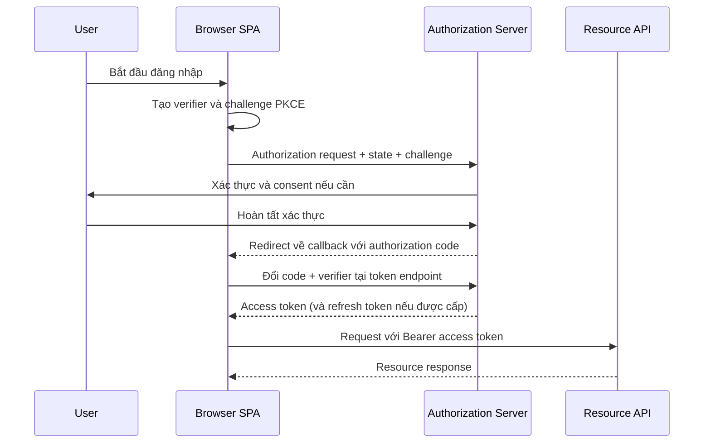
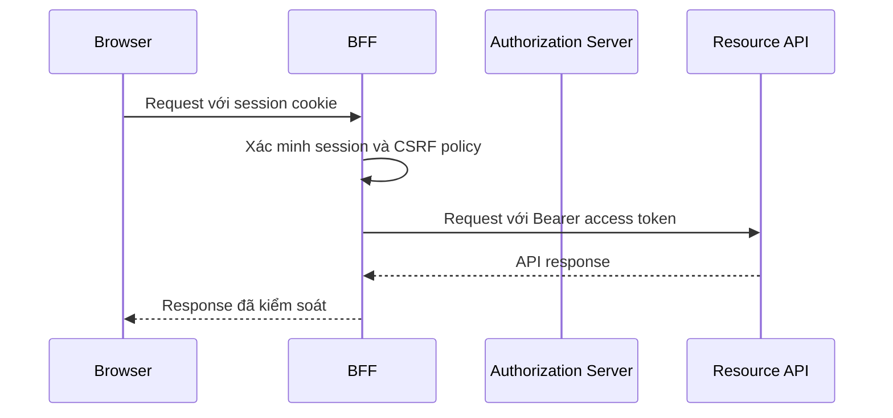

# Bearer token: xác thực request từ trình duyệt an toàn

Bearer token là credential mà người sở hữu token có thể trình ra để truy cập tài nguyên theo quyền được cấp. Trong ứng dụng web, client thường gửi access token trong HTTP Authorization header với scheme Bearer. Server xác minh token, thời hạn, audience, scope và quyền trên tài nguyên trước khi xử lý request.

Điểm quan trọng nhất của mô hình bearer là **ai lấy được token có thể sử dụng token trong phạm vi quyền của nó**. Token bị lộ qua XSS, log, URL, extension, DevTools hoặc storage có thể bị dùng để mạo danh người dùng cho đến khi hết hạn hoặc bị thu hồi. Vì vậy, thiết kế bearer token phải bao gồm cách cấp token, lưu trữ, gửi, làm mới, giới hạn quyền, thu hồi và xử lý sự cố.

Bài học thuộc chương **Authentication browser**, theo đề bài **Bearer token**, trong phạm vi **SECURITY_APPLICATION_SECURITY_BROWSER_SECURITY**: phân tích ranh giới bảo mật giữa trình duyệt, origin, cookie và ứng dụng web để hiểu Same-Origin Policy, CORS và các cơ chế cách ly; thực hành phòng vệ XSS, CSRF, clickjacking bằng CSP, Trusted Types, security headers và kiểm chứng hành vi thực tế.

## 1. Mục tiêu học tập

Sau bài học, người học có thể:

1. Giải thích bearer token và vì sao việc sở hữu token đồng nghĩa có thể trình token để truy cập.
2. Phân biệt access token, refresh token, ID token và session cookie.
3. Mô tả luồng OAuth Authorization Code với PKCE cho browser-based public client.
4. Phân biệt opaque token và JWT, đồng thời hiểu giới hạn của việc decode JWT ở client.
5. Gửi access token bằng Authorization header qua Fetch API.
6. Đánh giá rủi ro khi lưu token trong localStorage, sessionStorage, IndexedDB, memory hoặc cookie.
7. Giải thích tác động của XSS, CSRF, CORS và redirect tới bearer credential.
8. Thiết kế access token ngắn hạn, refresh token rotation, revoke và logout.
9. So sánh SPA gọi API trực tiếp với mô hình Backend for Frontend (BFF).
10. Kiểm tra token flow bằng DevTools mà không làm lộ credential thật.

## 2. Bearer token là gì?

Bearer token là một loại access credential. Client gửi token tới resource server để chứng minh request có credential được cấp. Server kiểm tra token và quyết định có cho phép hành động hay không.

Header phổ biến:

```http
GET /api/profile HTTP/1.1
Host: api.example.test
Authorization: Bearer demo-access-token
```

Tên Bearer thể hiện rằng người trình token được coi là người có quyền sử dụng token theo policy của server. Server không thể biết người đang gửi có phải người dùng ban đầu hay không chỉ dựa trên việc họ có chuỗi token.

### Bearer token không nhất thiết là JWT

Bearer mô tả cách trình credential, không mô tả định dạng token. Token có thể là:

- **Opaque token:** chuỗi ngẫu nhiên, không chứa claims có thể đọc trực tiếp; resource server tra cứu hoặc introspect token.
- **JWT access token:** token có cấu trúc claim được ký, resource server xác minh chữ ký và các claim theo profile/policy.

Không suy luận token là JWT chỉ vì nó có ba phần ngăn bởi dấu chấm. Cũng không coi token opaque là kém an toàn hơn; cả hai có trade-off về kiểm tra, thu hồi, cache và vận hành.

### Bearer token khác API key

API key thường định danh ứng dụng, project hoặc client tích hợp. Access token thường đại diện cho quyền được cấp trong một phiên/ủy quyền cụ thể, có thể gắn với subject, audience, scope và thời hạn. Cách đặt tên không quyết định semantics; phải xem hợp đồng của hệ thống cấp token.

### Bearer token khác session cookie

| Đặc điểm | Bearer token | Session cookie |
| --- | --- | --- |
| Cách gửi | Ứng dụng thường tự thêm Authorization header. | Browser tự gửi cookie phù hợp URL và cookie policy. |
| Quyền đọc bằng JavaScript | Nếu token nằm trong JS-accessible storage/memory, script cùng origin có thể truy cập. | HttpOnly cookie không đọc được qua document.cookie. |
| CSRF | Header do ứng dụng tự gắn thường không tự động được browser thêm vào request cross-site. | Cookie là ambient credential nên cần CSRF controls. |
| XSS | XSS có thể lấy token hoặc dùng code của ứng dụng để gọi API. | HttpOnly hạn chế đọc cookie, nhưng XSS vẫn có thể thực hiện request trong phiên. |
| Phạm vi | Theo issuer/audience/scope và policy của API. | Theo Domain/host, Path, Secure, SameSite và server session. |

Không có một lựa chọn tự động an toàn trong mọi kiến trúc. Quyết định phụ thuộc SPA gọi API trực tiếp hay browser làm việc qua BFF, yêu cầu offline, hệ thống identity và khả năng kiểm soát server.

## 3. Phân biệt access token, refresh token và ID token

Các token thường xuất hiện trong OAuth 2.0 và OpenID Connect (OIDC), nhưng có mục đích khác nhau.

| Loại | Mục đích | Nơi sử dụng |
| --- | --- | --- |
| Access token | Cho phép truy cập resource server theo quyền được cấp. | Gửi tới API/resource server. |
| Refresh token | Xin access token mới mà không yêu cầu người dùng đăng nhập lại ngay. | Gửi tới authorization server/token endpoint. |
| ID token | Mang thông tin xác thực người dùng cho OIDC client. | Client OIDC dùng để xác nhận sự kiện đăng nhập và identity claims theo OIDC. |

Không gửi ID token tới API như thể nó là access token, trừ khi API có hợp đồng riêng quy định điều đó. Resource server cần nhận loại access credential dành cho chính audience của nó.

### Access token

Access token thường có:

- Thời hạn tương đối ngắn.
- Audience xác định resource server hoặc nhóm tài nguyên.
- Scope/permission giới hạn hành động.
- Subject hoặc client context theo hệ thống cấp token.
- Issuer và metadata xác minh nếu dùng JWT.

Client không nên tự suy ra quyền từ nội dung token rồi quyết định thay server. Server luôn phải kiểm tra token và authorization tại resource.

### Refresh token

Refresh token có giá trị cao vì có thể cấp access token mới. Nếu bị đánh cắp, kẻ tấn công có thể duy trì quyền truy cập lâu hơn thời hạn của một access token.

Refresh token cần được bảo vệ nghiêm ngặt hơn:

- Chỉ gửi tới authorization server/token endpoint được định nghĩa.
- Không đưa vào URL, log, analytics hoặc message payload không cần thiết.
- Dùng rotation và phát hiện reuse nếu authorization server hỗ trợ.
- Có cơ chế revoke theo phiên, thiết bị hoặc grant.
- Đặt thời hạn và chính sách inactivity/absolute lifetime phù hợp.

Không dùng refresh token làm access token tới resource API.

### ID token

ID token trong OIDC là assertion về authentication event và subject dành cho client. Client cần xác minh theo OIDC flow, bao gồm issuer, audience, signature và các claim như nonce khi được sử dụng. Một SPA không nên coi việc decode payload là xác minh.

### Không cache token response

Token endpoint nên trả response chứa token với chỉ thị không lưu cache, theo yêu cầu của OAuth token response:

`http
HTTP/1.1 200 OK
Cache-Control: no-store
Pragma: no-cache
Content-Type: application/json
`

Client cũng không nên ghi response token vào HTTP cache, Cache Storage, service worker cache hoặc telemetry. Chỉ giữ credential trong thành phần quản lý token có vòng đời rõ ràng.

## 4. Browser là public client

Một ứng dụng JavaScript chạy trong browser không thể giữ client secret như một ứng dụng server. Người dùng có thể xem bundle, source map, request, runtime state và cấu hình được tải xuống. Vì vậy, SPA là public client.

Không nhúng client secret vào:

- JavaScript bundle.
- Biến môi trường được build vào frontend.
- HTML hoặc meta tag.
- localStorage/sessionStorage.
- Request từ browser với giả định người dùng không thể quan sát.

Giá trị client ID thường không phải secret. Client secret đặt trong SPA không trở thành bí mật chỉ vì đã minify hoặc obfuscate.

### Authorization Code Flow với PKCE

Với browser-based public client, dùng Authorization Code Flow với Proof Key for Code Exchange (PKCE), theo hướng dẫn hiện hành của OAuth/OIDC provider.

Luồng khái quát:



PKCE ràng buộc authorization code với verifier do client tạo lúc bắt đầu flow. Nếu code bị chặn giữa đường, bên khác không thể đổi code nếu không có verifier tương ứng.

PKCE không mã hóa access token, không bảo vệ token khỏi XSS sau khi token được cấp và không biến SPA thành confidential client.

### State và nonce

- **state** liên kết authorization response với lần đăng nhập mà client đã khởi tạo, giúp chống request forgery và nhầm lẫn callback.
- **nonce** trong OIDC liên kết ID token với authentication request, giúp phát hiện ID token bị phát lại trong ngữ cảnh không mong đợi.
- **PKCE verifier/challenge** bảo vệ authorization code khỏi bị đổi bởi bên không có verifier.

Các giá trị phải được tạo ngẫu nhiên đủ mạnh, kiểm tra đúng callback và gắn với transaction đăng nhập. Không tái sử dụng một state hoặc verifier tĩnh cho mọi phiên.

### Redirect URI

Authorization server phải kiểm tra redirect URI theo danh sách đã đăng ký. Client không nên cho phép người dùng đưa một URL bất kỳ vào tham số returnUrl/redirect_uri.

Callback nên:

- Dùng HTTPS ở production.
- Có route chính xác đã đăng ký.
- Xử lý code/state một lần và xóa dữ liệu tạm khỏi URL sau khi hoàn tất nếu flow yêu cầu.
- Không log authorization code, token hoặc query chứa credential.
- Không tải script bên thứ ba không cần thiết trên callback page.

### Không dùng implicit flow cho SPA mới

Implicit flow trả access token trực tiếp qua front-channel và làm token đi qua URL fragment/browser context. Các hướng dẫn OAuth hiện đại ưu tiên Authorization Code với PKCE cho public client. Không chọn implicit flow cho ứng dụng mới chỉ vì nó có vẻ đơn giản hơn.

## 5. Access token opaque và JWT

### Opaque token

Opaque token thường là chuỗi ngẫu nhiên không mang claims tự mô tả. Resource server có thể:

1. Tra cứu token trong datastore/session store.
2. Gọi authorization server introspection endpoint.
3. Kiểm tra trạng thái active, expiry, subject, client và scope theo hợp đồng.

Ưu điểm là có thể thu hồi tập trung và thay đổi trạng thái mà không cần đợi JWT hết hạn. Đổi lại, việc kiểm tra có thể cần network/store lookup và cần thiết kế cache/introspection availability.

### JWT access token

JWT thường có header, payload và signature. Payload chứa claims như issuer, subject, audience, expiry và scope/permission tùy profile.

JWT là định dạng có thể xác minh chữ ký, không tự động là token an toàn. Một JWT được decode thành công chỉ cho biết client có thể đọc JSON; nó chưa chứng minh token do issuer tin cậy ký, chưa hết hạn hoặc dành cho API hiện tại.

### Resource server cần xác minh gì?

Tùy profile token và hợp đồng issuer, resource server cần kiểm tra:

- Chữ ký bằng khóa tin cậy, thuật toán được allowlist.
- Issuer đúng.
- Audience chứa resource server mong đợi.
- Thời hạn exp và các ràng buộc thời gian như nbf nếu có.
- Token type/profile phù hợp với loại credential được chấp nhận.
- Scope/permission đủ cho endpoint/action.
- Các claim bổ sung cần thiết như client, tenant hoặc authorization context.

Không chấp nhận thuật toán do token tự chọn ngoài allowlist. Không tin claim chỉ vì nó xuất hiện trong payload.

### Ví dụ xác minh JWT phía server

Ví dụ Node.js dùng thư viện jose:

```js
const { jwtVerify, createRemoteJWKSet } = require('jose');

const jwks = createRemoteJWKSet(
  new URL('https://issuer.example.test/.well-known/jwks.json')
);

async function verifyAccessToken(token) {
  const result = await jwtVerify(token, jwks, {
    issuer: 'https://issuer.example.test/',
    audience: 'https://api.example.test',
    algorithms: ['RS256']
  });

  const claims = result.payload;
  if (typeof claims.exp !== 'number') {
    throw new Error('Access token must contain exp.');
  }

  return claims;
}
```

Đây là ví dụ minh họa. Thuật toán, issuer, audience, key source và profile phải khớp cấu hình thực tế của authorization server. Nếu issuer dùng thuật toán khác, cấu hình allowlist tương ứng; không bỏ allowlist để chấp nhận mọi thuật toán.

Sau khi xác minh token, API vẫn phải kiểm tra scope/permission và quyền trên resource cụ thể. Chữ ký hợp lệ không đồng nghĩa user có quyền với mọi endpoint.

### JWKS và key rotation

JWT có thể dùng kid trong header để chỉ key ID. Resource server lấy public key từ JWKS endpoint tin cậy, cache theo policy và xử lý key rotation:

- Chỉ tải JWKS từ issuer đã cấu hình, không lấy URL khóa tùy ý từ token.
- Xử lý kid không biết bằng cách refresh JWKS có kiểm soát.
- Không fetch JWKS cho mỗi request nếu có thể cache an toàn.
- Có kế hoạch chuyển tiếp khi issuer xoay khóa.
- Không giữ khóa cũ vô thời hạn nếu đã bị thu hồi.

## 6. Gửi Bearer token bằng Fetch

Ứng dụng thường tự gắn access token vào Authorization header:

```js
async function getProfile(accessToken) {
  const response = await fetch('/api/profile', {
    method: 'GET',
    headers: {
      Authorization: 'Bearer ' + accessToken,
      Accept: 'application/json'
    },
    cache: 'no-store'
  });

  if (response.status === 401) {
    throw new Error('Authentication required.');
  }

  if (response.status === 403) {
    throw new Error('Insufficient permission.');
  }

  if (!response.ok) {
    throw new Error('Profile request failed.');
  }

  return response.json();
}
```

Token trong ví dụ là tham số giả định được cung cấp từ token manager trong memory. Không hardcode token, ghi token ra console hoặc lưu vào URL.

### Authorization header

Header có dạng:

```http
Authorization: Bearer <access-token>
```

Header phải được gửi qua HTTPS. TLS bảo vệ token trên đường truyền tới server hợp lệ, nhưng không ngăn XSS, extension có quyền cao, endpoint/log bị cấu hình sai hoặc server đích bị compromise.

### Không gửi token trong URL

Không dùng:

```http
GET /api/profile?access_token=secret-value
```

Token trong URL có thể xuất hiện trong browser history, reverse proxy/server logs, monitoring, analytics, copied links và Referer tùy policy. Dùng Authorization header theo hợp đồng API.

Không đưa token vào:

- Query string hoặc path.
- Fragment để chia sẻ qua link.
- HTML data attribute.
- Error message hoặc telemetry.
- Console log, screenshot hay bug report.

### Không tự động gắn token cho mọi host

Token manager nên kiểm tra URL đích trước khi thêm Authorization. Tránh một wrapper toàn cục tự động đính kèm token vào mọi request, kể cả URL bên thứ ba.

Ví dụ allowlist:

```js
function isTrustedApiUrl(input) {
  const url = new URL(input, window.location.href);
  return url.origin === 'https://api.example.test';
}

async function fetchWithAccessToken(input, accessToken, init = {}) {
  if (!isTrustedApiUrl(input)) {
    throw new Error('Refusing to send access token to this origin.');
  }

  const headers = new Headers(init.headers);
  headers.set('Authorization', 'Bearer ' + accessToken);

  return fetch(input, {
    ...init,
    headers,
    redirect: 'error'
  });
}
```

Ví dụ đặt redirect error để request API thất bại nếu endpoint bất ngờ trả redirect. Nếu API contract cho phép redirect, cần thiết kế và kiểm thử rõ ràng. Không coi redirect error là biện pháp thay thế kiểm tra host hoặc authorization.

## 7. Redirect và nguy cơ lộ token

Khi Fetch theo redirect sang origin khác, browser áp dụng quy tắc redirect cho credential headers. Authorization header được loại bỏ khi chuyển sang origin khác để tránh gửi credential của origin ban đầu tới host đích.

Không dựa vào hành vi này để cho phép redirect tùy ý:

- Request ban đầu vẫn được gửi.
- Redirect có thể làm thay đổi method/body tùy status.
- Cookie được đánh giá lại theo URL đích và cookie policy.
- Các client HTTP ngoài browser có thể có hành vi khác.
- Một redirect trong cùng origin vẫn có thể không phù hợp API contract.

Với API bearer, thường nên dùng redirect: error nếu endpoint được kỳ vọng trả dữ liệu trực tiếp. Server nên trả 401/403 JSON thay vì redirect sang trang login HTML. Frontend có thể chủ động điều hướng người dùng sau khi nhận lỗi xác thực.

## 8. CORS và Bearer token

CORS kiểm soát việc browser cho JavaScript đọc response cross-origin theo chính sách chia sẻ tài nguyên. CORS không phải cơ chế xác thực và không thay thế authorization ở API.

Khi SPA gọi API cross-origin và thêm Authorization header, request thường cần CORS preflight vì Authorization không phải CORS-safelisted request header.

### Ví dụ preflight

Browser có thể gửi:

```http
OPTIONS /api/profile HTTP/1.1
Origin: https://app.example.test
Access-Control-Request-Method: GET
Access-Control-Request-Headers: authorization
```

Server cần cho phép origin, method và header theo policy:

```http
HTTP/1.1 204 No Content
Access-Control-Allow-Origin: https://app.example.test
Access-Control-Allow-Methods: GET, POST
Access-Control-Allow-Headers: Authorization, Content-Type
Vary: Origin
```

Response thực tế phải cấu hình cho đúng endpoint và policy của ứng dụng. Không phản chiếu mọi Origin mà không xác minh allowlist.

### CORS không bảo vệ token khỏi XSS cùng origin

Nếu XSS chạy trong origin của SPA, script độc hại có thể đọc token mà SPA có thể truy cập và gửi request theo quyền của trang. CORS không ngăn script cùng origin sử dụng token đó. CORS chủ yếu điều khiển quyền đọc response giữa các origin; nó không phải lớp chống XSS.

### CORS không thay authorization

Một client ngoài browser không bị ràng buộc bởi CORS như JavaScript trong browser. API phải xác minh token và quyền trên server cho mọi request, bất kể Origin header có giá trị gì.

### Credentials và Authorization là hai khái niệm khác

Fetch credentials mode điều khiển credential browser-managed như cookie, TLS client certificate và HTTP authentication theo quy tắc Fetch. Authorization header do ứng dụng tự thêm là request header riêng và có thể kích hoạt preflight.

Ví dụ request chỉ dùng bearer header:

```js
await fetch('https://api.example.test/data', {
  mode: 'cors',
  credentials: 'omit',
  headers: {
    Authorization: 'Bearer ' + accessToken
  }
});
```

Nếu API cần cookie cùng bearer header, phải thiết kế credentials mode, CORS allowlist và cookie attributes có chủ đích. Không dùng wildcard origin với credentialed CORS response.

## 9. Lưu trữ Bearer token trong browser

Không có storage nào biến bearer token thành bí mật tuyệt đối trước mã độc đang chạy trong cùng origin. Chọn cách lưu cần dựa trên threat model, thời hạn token, kiến trúc frontend và khả năng dùng BFF.

### localStorage

Ưu điểm:

- Dễ sử dụng và tồn tại qua reload/tab.
- Dung lượng phù hợp cho một số dữ liệu client.

Rủi ro:

- JavaScript cùng origin có thể đọc token.
- XSS có thể lấy token và gửi ra ngoài.
- Token có thể còn sau logout nếu cleanup thiếu.
- Dữ liệu dễ bị quan sát trong DevTools hoặc profile browser.

Không lưu refresh token hoặc access token dài hạn trong localStorage nếu có kiến trúc phù hợp hơn. Namespace và mã hóa bằng khóa lưu cùng storage không giải quyết rủi ro XSS.

### sessionStorage

sessionStorage gắn với browsing context và thường sống theo tab. Nó giảm thời gian tồn tại so với localStorage trong một số tình huống, nhưng script cùng origin vẫn đọc được. XSS trong tab có thể lấy token.

Không coi sessionStorage là biện pháp chống XSS hoặc chống malware trên thiết bị.

### JavaScript memory

Giữ access token trong memory làm giảm việc token tồn tại bền vững qua reload và giảm khả năng lấy token từ storage sau khi browser đóng. Tuy nhiên:

- XSS đang chạy có thể đọc biến nếu có tham chiếu hoặc can thiệp code.
- XSS có thể gọi API thông qua ứng dụng mà không cần trích token.
- Reload làm mất token và cần một luồng cấp lại phù hợp.
- State trong memory không tự giải quyết logout/revocation ở server.

Memory thường là lựa chọn tốt hơn Web Storage cho access token ngắn hạn trong SPA, nhưng không phải ranh giới bảo mật chống script độc hại.

### IndexedDB

IndexedDB cũng được script cùng origin truy cập. Lưu token trong IndexedDB không tạo bảo vệ đặc biệt trước XSS. Dùng IndexedDB cho dữ liệu offline có cấu trúc khi cần, nhưng tránh dùng nó như kho bí mật cho bearer credential.

### Cookie HttpOnly

HttpOnly cookie không thể được JavaScript đọc qua document.cookie. Server đặt cookie và browser tự gửi theo cookie policy. Cách này giảm đường đánh cắp trực tiếp token/session bằng script, nhưng cookie là ambient credential và cần CSRF protection.

Cookie session có thể dùng các thuộc tính:

```http
Set-Cookie: __Host-session=opaque-session-id; Path=/; Secure; HttpOnly; SameSite=Lax
```

Prefix __Host- yêu cầu Secure, Path=/ và không có Domain trong browser hỗ trợ prefix này. Cookie host-only giúp giới hạn phạm vi host. Chọn SameSite theo luồng đăng nhập và điều hướng cross-site của ứng dụng.

### So sánh lựa chọn

| Cách lưu | Chống đọc trực tiếp bởi JS cùng origin | Tồn tại qua reload | Rủi ro chính |
| --- | --- | --- | --- |
| localStorage | Không | Có | XSS có thể đọc và exfiltrate token. |
| sessionStorage | Không | Thường trong cùng tab session | XSS trong tab có thể đọc. |
| Memory | Không bảo đảm | Không | XSS vẫn có thể đọc/dùng token khi app chạy. |
| IndexedDB | Không | Có | XSS cùng origin có thể truy cập. |
| HttpOnly cookie | Có đối với document.cookie | Có theo expiry/session | CSRF; XSS vẫn có thể thực hiện request trong phiên. |
| BFF server-side session | Browser chỉ giữ cookie session HttpOnly | Có theo session | Cần CSRF controls và bảo vệ server session. |

## 10. SPA trực tiếp gọi API hay dùng BFF?

### SPA gọi resource API trực tiếp

Trong mô hình này:

1. Browser thực hiện OAuth/OIDC flow với authorization server.
2. SPA nhận access token theo public-client flow.
3. SPA giữ access token trong memory hoặc cơ chế được thiết kế.
4. SPA thêm Authorization header vào request tới API.

Ưu điểm là kiến trúc trực tiếp và API có thể phục vụ nhiều client. Nhược điểm là token hiện diện trong môi trường JavaScript của browser và cần kiểm soát XSS, dependency, token lifecycle và CORS.

### Backend for Frontend (BFF)

BFF là backend riêng phục vụ frontend. Browser giữ session cookie HttpOnly; BFF giữ access/refresh token phía server và gọi resource API thay mặt người dùng.



Ưu điểm:

- Browser không cần truy cập trực tiếp access/refresh token.
- Token được giữ ở server-side session/token store.
- BFF có thể tập trung refresh, revoke và scope policy.
- Giảm nguy cơ token bị lấy trực tiếp từ Web Storage.

Đổi lại, BFF cần vận hành backend, quản lý session, CSRF protection, scaling và bảo vệ token server-side. XSS vẫn có thể gửi request qua browser trong phiên hiện tại nếu không có biện pháp chống XSS và kiểm tra quyền.

### Cookie của BFF cần chống CSRF

Vì browser tự gửi session cookie, BFF cần:

- Cookie Secure, HttpOnly, SameSite phù hợp.
- CSRF token cho request thay đổi trạng thái khi cần.
- Kiểm tra Origin/Referer theo policy phù hợp.
- Không cho GET thực hiện hành động thay đổi trạng thái.
- Kiểm tra authorization ở backend cho từng hành động.

SameSite là lớp giảm rủi ro, không nên là biện pháp duy nhất trong mọi kiến trúc.

## 11. XSS và Bearer token

XSS là một trong các rủi ro nghiêm trọng nhất với SPA giữ token trong JavaScript-accessible storage.

Nếu XSS chạy trong origin của ứng dụng, script có thể:

- Đọc token từ localStorage/sessionStorage/IndexedDB.
- Truy cập biến hoặc state có chứa token nếu có đường tham chiếu.
- Gọi API qua wrapper của ứng dụng.
- Đọc dữ liệu API trả về và gửi ra ngoài.
- Can thiệp giao diện để yêu cầu người dùng thực hiện thao tác.

### Giảm khả năng XSS

- Dùng textContent khi hiển thị text không tin cậy.
- Tránh innerHTML, document.write, eval và DOM execution sink không cần thiết.
- Output encode theo đúng HTML/attribute/URL/JavaScript context.
- Dùng CSP chặt, nonce/hash cho script và hạn chế nguồn script.
- Dùng Trusted Types để kiểm soát DOM XSS sink trong browser hỗ trợ.
- Kiểm soát dependency, tag manager và script bên thứ ba.
- Không đưa access token vào DOM attribute, URL hoặc error report.

### CSP không phải token vault

CSP có thể giảm khả năng thực thi script không được phép và hạn chế một số kênh kết nối. Nó không bảo vệ token khỏi mọi script hợp lệ hoặc XSS đã vượt qua policy. Không dựa vào CSP thay cho việc giảm dữ liệu nhạy cảm trong browser.

### Trusted Types

Trusted Types giúp yêu cầu dữ liệu đi vào một số DOM sink nguy hiểm phải qua policy được kiểm soát. Nó hỗ trợ giảm DOM XSS, nhưng không ngăn script hợp lệ đọc localStorage hoặc gọi API bằng token.

## 12. CSRF và Bearer token

CSRF khai thác việc browser tự đính kèm credential vào request ngoài ý muốn. Cookie session là ambient credential, nên request cross-site có thể mang cookie nếu cookie policy cho phép.

Với SPA tự thêm Authorization header từ memory, browser không tự động thêm bearer token vào form hoặc image request cross-site thông thường. Điều này làm mô hình bearer header ít chịu CSRF kiểu cookie hơn.

Tuy nhiên:

- Nếu token được lưu trong cookie, request có thể trở lại mô hình ambient credential.
- Nếu ứng dụng có endpoint cookie-auth song song, endpoint đó vẫn cần CSRF controls.
- XSS có thể đọc token hoặc gọi request qua ứng dụng.
- CORS không thay thế CSRF protection.
- Không cho GET thay đổi trạng thái.

Nếu dùng BFF/session cookie, triển khai CSRF token hoặc biện pháp tương đương, SameSite phù hợp và kiểm tra Origin/Referer theo threat model.

## 13. Access token lifetime, refresh và rotation

Access token ngắn hạn giúp giới hạn thời gian sử dụng khi token bị lộ. Thời hạn cụ thể phải cân bằng trải nghiệm, độ nhạy cảm và khả năng refresh/revoke; không có một con số đúng cho mọi sản phẩm.

### Refresh flow

Khi access token hết hạn:

1. Client nhận 401 theo API contract.
2. Client gọi refresh endpoint/token endpoint theo flow đã thiết kế.
3. Authorization server xác minh refresh token và policy.
4. Server cấp access token mới; nếu rotation được bật, refresh token cũ bị thay bằng token mới.
5. Client cập nhật token trong memory và retry request an toàn một lần.

Không refresh khi nhận mọi 403. 403 thường biểu thị token hợp lệ nhưng không đủ quyền; refresh không tự cấp thêm scope.

### Refresh token rotation

Với rotation, mỗi lần refresh thành công, authorization server cấp refresh token mới và vô hiệu hóa token cũ. Nếu token cũ được dùng lại, server có thể phát hiện reuse và revoke token family/session theo policy.

Rotation cần xử lý race condition:

- Hai tab cùng refresh một token có thể khiến một request dùng token đã bị rotate.
- Dùng single-flight/mutex hoặc cơ chế phối hợp tab khi kiến trúc cần.
- Không broadcast token qua BroadcastChannel hoặc storage event nếu không cần.
- Khi reuse bị phát hiện, yêu cầu đăng nhập lại theo policy thay vì retry vô hạn.

### Ví dụ single-flight refresh ở client

Đây là khung minh họa cho token manager giữ token trong memory:

```js
let refreshPromise = null;

async function refreshAccessToken() {
  if (!refreshPromise) {
    refreshPromise = performRefresh()
      .finally(() => {
        refreshPromise = null;
      });
  }

  return refreshPromise;
}
```

Single-flight tránh nhiều request trong cùng runtime đồng thời refresh. Nó không tự đồng bộ nhiều tab hoặc nhiều thiết bị; cần thiết kế riêng nếu refresh token rotation có thể bị tranh chấp giữa các context.

### Retry request sau refresh

Chỉ retry tự động khi request có thể phát lại an toàn và API contract cho phép. Với POST/PUT hoặc thao tác thay đổi trạng thái, dùng idempotency key hoặc xác minh kết quả trước khi retry.

Không lặp refresh vô hạn. Nếu refresh thất bại hoặc session bị revoke, xóa state local phù hợp và yêu cầu đăng nhập lại.

## 14. Logout, revoke và sự cố token bị lộ

Logout chỉ xóa token trong memory không đảm bảo token đã bị thu hồi. Nếu token vẫn còn hiệu lực, người đã sao chép token có thể tiếp tục dùng nó cho tới khi hết hạn hoặc server từ chối.

### Logout trong SPA trực tiếp gọi API

1. Gọi revoke endpoint nếu authorization server hỗ trợ và có token phù hợp.
2. Xóa access token/refresh token khỏi memory.
3. Dọn dữ liệu người dùng trong memory và storage theo policy.
4. Reset state của ứng dụng và điều hướng về trang đăng nhập.
5. Đồng bộ trạng thái logout giữa tab mà không gửi token qua kênh broadcast.

Nếu refresh token được lưu phía server hoặc cookie, server phải invalidate session/token family theo thiết kế.

### Logout trong BFF

1. BFF invalidate server-side session.
2. BFF revoke refresh/access token nếu hệ thống hỗ trợ và policy yêu cầu.
3. BFF trả Set-Cookie hết hạn với đúng cookie scope.
4. Browser reset UI và dữ liệu client.

### Giới hạn revoke với JWT

JWT access token thường có thể được xác minh cục bộ mà không hỏi authorization server. Vì vậy, revoke ở issuer không nhất thiết làm mọi resource server ngừng chấp nhận JWT ngay lập tức, trừ khi hệ thống có denylist/introspection/version check hoặc cơ chế tương đương.

Thời hạn access token ngắn, audience hẹp và scope tối thiểu giúp giới hạn tác động. Nếu cần thu hồi tức thời, chọn kiến trúc hỗ trợ kiểm tra trạng thái tập trung hoặc revoke-aware.

### Khi nghi token bị lộ

- Revoke session/grant/token family liên quan.
- Rotate refresh token và credential liên quan theo incident policy.
- Kiểm tra log API/authorization server bằng request ID, subject và thời gian; tránh ghi token thô.
- Xác định nguồn lộ: XSS, log, URL, extension, browser storage hoặc hệ thống trung gian.
- Xóa bản sao token khỏi telemetry/log nếu có thể và theo quy trình retention.
- Sửa nguyên nhân gốc trước khi cấp credential mới.

## 15. Xử lý 401, 403 và lỗi API

Client cần phân biệt lỗi xác thực và lỗi quyền:

| HTTP status | Ý nghĩa thường gặp | Hành động phía client |
| --- | --- | --- |
| 401 Unauthorized | Thiếu credential hợp lệ, token hết hạn hoặc không được chấp nhận. | Thử refresh theo policy một lần hoặc yêu cầu đăng nhập. |
| 403 Forbidden | Credential hợp lệ nhưng không đủ quyền cho hành động/resource. | Hiển thị thông báo quyền; không refresh vô hạn. |
| 429 Too Many Requests | Vượt rate limit. | Tôn trọng Retry-After và backoff. |
| 5xx | Lỗi server/upstream. | Retry có kiểm soát nếu request an toàn. |

API có thể dùng WWW-Authenticate để mô tả challenge/error theo Bearer token semantics. Ví dụ:

`http
HTTP/1.1 401 Unauthorized
WWW-Authenticate: Bearer error="invalid_token"
Cache-Control: no-store
`

Với token hợp lệ nhưng thiếu scope, server có thể trả 403 và thông tin insufficient_scope theo policy. Không đưa token, chữ ký, claim nhạy cảm hoặc chi tiết nội bộ vào error response.

### Không suy luận token hết hạn chỉ từ mọi 401

401 có thể do token sai audience, issuer, signature, revoked hoặc thiếu credential. API nên trả error code ổn định theo contract, nhưng không tiết lộ chi tiết xác minh nhạy cảm cho client.

### Tránh refresh loop

- Chỉ refresh theo điều kiện rõ ràng.
- Không refresh request refresh endpoint.
- Giới hạn một lần retry cho mỗi request.
- Nếu refresh thất bại, kết thúc phiên client.
- Dùng request ID/correlation ID để chẩn đoán.
- Không log Authorization header.

## 16. Kiểm tra Bearer token bằng DevTools

DevTools là công cụ để xác minh luồng request và storage trong môi trường kiểm thử. Token thật là secret; không copy token production vào ticket, chat, ảnh chụp hoặc file log.

### Network panel

Mở DevTools → **Network**:

- Chọn request API.
- Xem Request Headers và xác nhận Authorization có scheme Bearer trong lab.
- Kiểm tra request URL không chứa access_token hoặc refresh_token.
- Xem status 401/403 và response contract.
- Kiểm tra redirect chain nếu endpoint trả 3xx.
- Với cross-origin API, kiểm tra OPTIONS preflight và CORS response headers.

Nếu phải chụp bằng chứng, thay token bằng giá trị giả hoặc che toàn bộ header. Không lưu HAR chứa token thật.

### Application panel

Kiểm tra:

- Local Storage và Session Storage có token hay không.
- IndexedDB có lưu credential không.
- Cookies có Secure, HttpOnly, SameSite, Domain/Path đúng không.
- Service worker/cache có lưu response chứa token hoặc dữ liệu riêng tư không.

Không in toàn bộ storage ra Console. Chỉ kiểm tra tên key hoặc metadata đã mask.

### Sources và Console

Tìm các điểm có thể làm lộ token:

- localStorage/sessionStorage access.
- console.log hoặc telemetry ghi token.
- URL/query builder có gắn access token.
- fetch wrapper thêm Authorization cho host không tin cậy.
- Error handler serialize toàn bộ request headers.
- Service worker xử lý request có Authorization.

Không bật logging verbose trên production nếu log có thể chứa credential.

## 17. Thực hành: Bearer token trong SPA lab

Thực hành trên localhost hoặc HTTPS staging do người học kiểm soát. Dùng token giả, tài khoản lab và API test. Không dùng credential production hoặc gửi token tới host bên ngoài.

### 17.1. Chuẩn bị API thử nghiệm

Tạo API lab có endpoint:

| Endpoint | Hành vi |
| --- | --- |
| GET /api/profile | Yêu cầu Bearer token hợp lệ, trả profile giả. |
| GET /api/admin | Yêu cầu scope admin; token thường nhận 403. |
| GET /api/expired | Trả 401 theo kịch bản token hết hạn. |
| GET /api/redirect | Trả 302 tới endpoint lab khác để kiểm tra redirect policy. |

API phải xác minh token ở server. Không chấp nhận user ID/role gửi từ browser làm bằng chứng quyền.

### 17.2. Gửi request bằng Bearer header

Trong Console của SPA lab:

```js
const fakeAccessToken = 'lab-token-not-a-real-credential';

const response = await fetch('/api/profile', {
  headers: {
    Authorization: 'Bearer ' + fakeAccessToken,
    Accept: 'application/json'
  },
  cache: 'no-store'
});

console.log('status:', response.status);
```

Quan sát Network và xác nhận Authorization header được gửi. Token chỉ là chuỗi giả trong lab.

### 17.3. Kiểm tra 401 và 403

Gọi endpoint hết hạn và endpoint cần scope admin. Xác nhận client phân biệt 401 với 403 và không refresh vô hạn khi thiếu quyền.

### 17.4. Kiểm tra redirect policy

Gọi endpoint redirect với redirect error:

```js
try {
  await fetch('/api/redirect', {
    redirect: 'error',
    headers: {
      Authorization: 'Bearer ' + fakeAccessToken
    }
  });
} catch (error) {
  console.log('Redirect bị từ chối:', error.name);
}
```

Quan sát Network để xác nhận request đầu tiên vẫn tới server nhưng Fetch không follow redirect. Không thử redirect sang domain bên ngoài bằng token thật.

### 17.5. Kiểm tra CORS preflight

Nếu SPA và API chạy ở hai origin lab khác nhau:

1. Gửi request với Authorization header.
2. Quan sát OPTIONS preflight trong Network.
3. Kiểm tra Access-Control-Allow-Origin, Allow-Methods và Allow-Headers.
4. Bỏ Authorization khỏi allowlist ở server và quan sát browser chặn request theo CORS.
5. Xác nhận API vẫn phải kiểm tra token server-side, kể cả khi request không đến từ browser.

### 17.6. Audit nơi lưu token

Trong lab, kiểm tra Local Storage, Session Storage, IndexedDB và Cookies. Nếu thử so sánh các vị trí lưu, chỉ dùng token giả, sau đó xóa dữ liệu lab.

Ghi nhận:

- Script cùng origin có thể đọc Web Storage.
- HttpOnly cookie không xuất hiện qua document.cookie.
- HttpOnly không ngăn request cùng origin sử dụng cookie.
- Memory token không tồn tại bền vững qua reload nhưng vẫn cần chống XSS.

### 17.7. Thực hành BFF

Tạo một endpoint BFF lab dùng session cookie HttpOnly. Browser gọi BFF mà không tự gắn access token; BFF lấy token từ server-side session và gọi API upstream bằng Authorization header.

Xác minh:

- Browser chỉ thấy session cookie và không thấy access token upstream.
- Cookie có Secure/HttpOnly/SameSite phù hợp.
- Request thay đổi trạng thái có CSRF control.
- Logout invalidates session ở server và expire cookie.

### 17.8. Bằng chứng cần lưu

| Bằng chứng | Điều cần xác nhận |
| --- | --- |
| Bearer request | Authorization header có trong request lab. |
| URL hygiene | URL không chứa access/refresh token. |
| 401/403 | Client phân biệt authentication và permission error. |
| Redirect error | Fetch không follow redirect ngoài contract. |
| CORS preflight | Authorization header kích hoạt preflight khi cross-origin. |
| Storage audit | Xác định token có xuất hiện trong storage nào. |
| BFF | Browser không nhận access token upstream. |
| Logout | Session/token bị revoke theo policy và client reset state. |

## 18. Những lỗi thường gặp

| Hiện tượng | Nguyên nhân có thể | Cách xử lý |
| --- | --- | --- |
| Token bị lấy từ localStorage | XSS hoặc script cùng origin đọc được storage | Giảm lưu token trong JS-accessible storage, chống XSS và cân nhắc BFF. |
| Dùng ID token gọi API | Nhầm mục đích OIDC ID token với access token | Dùng access token dành cho audience của resource server. |
| JWT decode rồi tin claims | Không xác minh chữ ký/issuer/audience/expiry | Xác minh đầy đủ tại resource server bằng thư viện chuẩn. |
| Token gửi tới host ngoài | Fetch wrapper tự gắn Authorization mọi URL | Allowlist origin trước khi gắn token; dùng redirect policy phù hợp. |
| API trả HTML login thay JSON | Auth middleware redirect khi session hết hạn | API trả 401/403 theo contract; frontend điều hướng chủ động. |
| Refresh token reuse | Rotation race giữa tab hoặc token bị sao chép | Single-flight, phối hợp tab phù hợp và reuse detection phía server. |
| Refresh khi nhận 403 | Nhầm thiếu quyền với token hết hạn | Refresh theo error contract; 403 thường cần xử lý authorization. |
| Logout nhưng token vẫn dùng được | Chỉ xóa token phía client | Revoke server-side; hiểu giới hạn revoke của JWT. |
| CORS bị coi là auth | Cho rằng chặn browser là chặn mọi client | Xác thực và authorization tại API server. |
| HttpOnly bị coi là chống XSS hoàn toàn | Script không đọc cookie nhưng vẫn gọi API trong phiên | Phòng XSS và kiểm tra quyền/action server-side. |
| Token trong query string | Dùng URL để chuyển credential | Dùng Authorization header hoặc server-side session. |
| Log chứa token | Log toàn bộ request/headers/HAR | Redact Authorization, không lưu token trong telemetry. |

## 19. Checklist production

| Hạng mục | Câu hỏi rà soát | Kết quả mong đợi |
| --- | --- | --- |
| Client type | SPA có bị coi nhầm là confidential client không? | Không nhúng client secret vào browser. |
| OAuth flow | SPA dùng Authorization Code + PKCE không? | state, verifier và callback được kiểm tra đúng. |
| Token purpose | API có nhận access token đúng audience không? | Không dùng ID token thay access token. |
| Token format | Opaque/JWT có contract xác minh rõ không? | Server kiểm tra active/signature, issuer, audience, expiry và scope. |
| Lifetime | Access token có thời hạn và scope tối thiểu không? | Giảm tác động khi bị lộ. |
| Storage | Token có nằm trong localStorage/sessionStorage/IndexedDB không? | Có threat model; ưu tiên memory hoặc BFF phù hợp. |
| Refresh | Refresh token có rotation/reuse detection/revoke không? | Refresh token được bảo vệ và có vòng đời rõ. |
| Header | Authorization có chỉ gửi tới API origin tin cậy không? | Không gắn token toàn cục cho URL tùy ý. |
| Redirect | API bearer request có redirect ngoài ý muốn không? | Contract rõ; dùng redirect error nếu endpoint không được redirect. |
| CORS | Origin/method/header có allowlist chính xác không? | Preflight đúng; CORS không thay auth. |
| XSS | Có CSP, Trusted Types, output encoding và dependency controls không? | Giảm khả năng script không tin cậy chạy trong origin. |
| CSRF | Nếu dùng cookie/BFF, có CSRF controls không? | SameSite, token và Origin validation theo threat model. |
| Logout | Có revoke server-side và reset client state không? | Token/session không còn được chấp nhận theo policy. |
| Logging | Authorization, token và code có bị log không? | Redaction ở app, proxy, APM và support tooling. |
| Incident | Có quy trình revoke/rotate khi token lộ không? | Xác định phiên, thu hồi, điều tra và khắc phục nguồn lộ. |
| Testing | Có test 401/403, expired, CORS, redirect, refresh và logout không? | Có bằng chứng trên browser mục tiêu. |

## 20. Câu hỏi tự kiểm tra

1. Vì sao bearer token được xem là credential theo kiểu possession?
2. Bearer token có bắt buộc là JWT không?
3. Access token, refresh token và ID token khác nhau như thế nào?
4. Vì sao SPA là public client và không thể giữ client secret?
5. PKCE bảo vệ authorization code ra sao và không bảo vệ điều gì?
6. Resource server cần xác minh những claim/thuộc tính nào của JWT?
7. Vì sao decode JWT ở browser không chứng minh token hợp lệ?
8. Vì sao Authorization header cross-origin thường kích hoạt CORS preflight?
9. CORS khác authentication và authorization như thế nào?
10. Vì sao localStorage/sessionStorage không phù hợp để giữ refresh token dài hạn trong ứng dụng có XSS risk?
11. HttpOnly cookie giảm rủi ro nào và làm phát sinh yêu cầu CSRF nào?
12. BFF thay đổi nơi lưu access/refresh token và luồng request ra sao?
13. Refresh token rotation xử lý reuse và race condition như thế nào?
14. Vì sao logout phía client không đủ để thu hồi bearer token?
15. Làm thế nào kiểm tra Authorization header bằng DevTools mà không làm lộ token thật?

**Tiêu chí hoàn thành:** người học có thể mô tả bearer token và OAuth/OIDC browser flow, phân biệt opaque/JWT và các loại token, gửi access token qua Authorization header, chọn chiến lược lưu trữ phù hợp, đánh giá XSS/CSRF/CORS/redirect, thiết kế refresh/revoke/logout và kiểm chứng luồng bằng DevTools trong môi trường lab.
