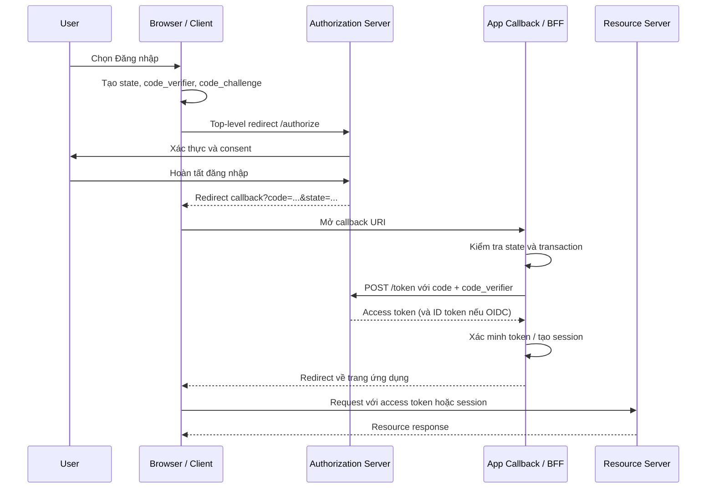

# OAuth redirect

## 1. OAuth redirect là gì?

**OAuth redirect** là luồng điều hướng browser từ ứng dụng web tới Authorization Server để người dùng đăng nhập hoặc cấp quyền, sau đó quay về một callback URL đã đăng ký của ứng dụng. Browser đóng vai trò user agent: nó chuyển người dùng qua các origin, mang authorization request và nhận authorization response từ endpoint callback.

Một luồng hiện đại cho ứng dụng web thường dùng **Authorization Code Flow với PKCE**. Ứng dụng tạo một giao dịch đăng nhập, chuyển browser tới authorization endpoint, nhận authorization code tại callback rồi đổi code lấy token qua token endpoint. PKCE ràng buộc authorization code với một `code_verifier` bí mật tạm thời do client tạo, giúp chống việc kẻ tấn công chặn code rồi đổi code đó ở nơi khác.

OAuth redirect là một ranh giới bảo mật quan trọng vì ứng dụng chuyển quyền điều khiển giữa nhiều origin. Một callback sai, `state` không được kiểm tra, `redirect_uri` quá rộng hoặc token bị lộ trong URL có thể dẫn tới login CSRF, authorization code injection, token leakage hoặc open redirect.

Bài học tập trung vào cách thiết kế redirect an toàn cho browser application, bao gồm Authorization Code + PKCE, kiểm tra callback, OIDC nonce, quản lý session/cookie, các lỗi thường gặp và cách kiểm thử.

### Kết quả học tập

Sau bài này, người học có thể:

1. Mô tả vai trò của browser, client, Authorization Server và callback.
2. Giải thích Authorization Code Flow và PKCE.
3. Tạo `state`, `code_verifier`, `code_challenge` và OIDC `nonce` đúng cách.
4. Cấu hình `redirect_uri` chính xác và ngăn open redirect.
5. Kiểm tra callback, xử lý lỗi và chỉ sử dụng authorization code một lần.
6. Phân biệt OAuth `state`, PKCE và OIDC `nonce`.
7. Bảo vệ token, session cookie và URL callback.
8. Nhận diện login CSRF, code interception, mix-up và token leakage.
9. Chọn mô hình SPA hoặc Backend for Frontend (BFF) phù hợp.
10. Kiểm thử OAuth redirect trên browser và môi trường staging.

## 2. Các bên tham gia và ranh giới tin cậy

| Thành phần | Vai trò |
| --- | --- |
| Resource Owner | Người dùng sở hữu tài khoản và quyết định cấp quyền |
| Browser/User Agent | Điều hướng tới Authorization Server, nhận callback và thực thi code của ứng dụng |
| Client | Ứng dụng web yêu cầu quyền; browser-based SPA thường là public client |
| Authorization Server (AS) | Xác thực người dùng, xin consent và phát authorization code/token |
| Resource Server (RS) | API nhận access token và kiểm tra quyền truy cập |
| Redirect URI / callback | Endpoint nhận authorization response của client |
| Backend for Frontend (BFF) | Backend của ứng dụng giữ token và tạo session cho browser |

Browser có thể chuyển từ `https://app.example.com` sang `https://login.example-idp.com`, sau đó quay về `https://app.example.com/auth/callback`. Mỗi origin có storage và quyền riêng. Ứng dụng không được giả định rằng dữ liệu trong URL callback là đáng tin chỉ vì browser vừa quay về từ nhà cung cấp danh tính.

### 2.1. OAuth không phải giao thức đăng nhập

OAuth 2.0 là framework ủy quyền. Nó cho phép client nhận access token để truy cập resource theo scope. Nếu ứng dụng cần xác thực người dùng và nhận thông tin danh tính, thường dùng OpenID Connect (OIDC) xây trên OAuth 2.0.

Access token dành cho Resource Server; client không nên giải mã hoặc xem access token như bằng chứng danh tính. OIDC bổ sung ID Token và các quy tắc xác minh issuer, audience, chữ ký, expiry và nonce.

### 2.2. Public client và confidential client

SPA chạy hoàn toàn trong browser không thể giữ một `client_secret` bí mật. Mọi secret đóng gói trong JavaScript có thể bị người dùng hoặc script đọc. SPA vì vậy là public client và cần PKCE.

BFF chạy ở server có thể giữ credential của confidential client trong secret manager/server configuration. Browser chỉ giữ session cookie. BFF có thể đổi authorization code ở server và không đưa access/refresh token vào JavaScript runtime.

Không biến một SPA thành confidential client bằng cách nhúng `client_secret` vào bundle, biến môi trường build hoặc hidden field.

## 3. Authorization Code Flow với PKCE

Luồng cơ bản:



### 3.1. Tại sao cần authorization code?

Authorization endpoint trả về một code ngắn hạn thay vì access token trực tiếp trong URL. Client đổi code tại token endpoint. Code có thời hạn ngắn, dùng một lần và được ràng buộc với client cùng redirect URI. Với PKCE, token endpoint còn yêu cầu verifier khớp challenge ban đầu.

Authorization code vẫn xuất hiện trên front channel trong callback URL, vì vậy cần bảo vệ URL và xử lý callback cẩn thận. Code không phải token, nhưng không được log, chia sẻ hoặc để tồn tại lâu trong browser history.

### 3.2. PKCE hoạt động thế nào?

Client tạo một chuỗi ngẫu nhiên gọi là `code_verifier`, rồi tính SHA-256 để tạo `code_challenge`:

```text
code_challenge = BASE64URL(SHA256(ASCII(code_verifier)))
```

Authorization request gửi `code_challenge` và `code_challenge_method=S256`. Khi đổi code, client gửi `code_verifier`. Authorization Server tự tính challenge và chỉ phát token nếu giá trị khớp.

PKCE ngăn kẻ tấn công chỉ chặn được authorization code đổi code đó mà không có verifier. Dùng `S256`; không dùng `plain` trong triển khai mới.

### 3.3. Authorization request

Một authorization request điển hình:

```http
GET /authorize?
  response_type=code&
  client_id=browser-app&
  redirect_uri=https%3A%2F%2Fapp.example.com%2Fauth%2Fcallback&
  scope=openid%20profile%20email&
  state=RANDOM_STATE&
  code_challenge=BASE64URL_SHA256_CHALLENGE&
  code_challenge_method=S256&
  nonce=RANDOM_NONCE
Host: login.example-idp.com
```

Các tham số quan trọng:

| Tham số | Mục đích |
| --- | --- |
| `response_type=code` | Yêu cầu authorization code |
| `client_id` | Định danh client đã đăng ký |
| `redirect_uri` | Callback nhận authorization response |
| `scope` | Quyền truy cập được yêu cầu; OIDC thường có `openid` |
| `state` | Liên kết response với giao dịch do client khởi tạo, chống CSRF |
| `code_challenge` | PKCE challenge |
| `code_challenge_method=S256` | Cách tính challenge |
| `nonce` | OIDC: liên kết ID Token với authentication request |

Không đặt password, client secret, access token hoặc dữ liệu cá nhân không cần thiết trong authorization URL.

## 4. Tạo transaction: state, PKCE và nonce

Mỗi lần bắt đầu đăng nhập, tạo một transaction mới. Không dùng lại cùng `state`, verifier hoặc nonce cho nhiều lần đăng nhập.

### 4.1. Tạo giá trị ngẫu nhiên

Dùng Web Crypto API thay cho `Math.random()`:

```js
function randomBase64Url(byteLength = 32) {
  const bytes = crypto.getRandomValues(new Uint8Array(byteLength));
  let binary = "";

  for (const byte of bytes) {
    binary += String.fromCharCode(byte);
  }

  return btoa(binary)
    .replace(/\+/g, "-")
    .replace(/\//g, "_")
    .replace(/=+$/g, "");
}

function createPkceVerifier() {
  // 32 random bytes tạo chuỗi base64url dài 43 ký tự.
  return randomBase64Url(32);
}

async function createCodeChallenge(verifier) {
  const data = new TextEncoder().encode(verifier);
  const digest = await crypto.subtle.digest("SHA-256", data);

  let binary = "";
  for (const byte of new Uint8Array(digest)) {
    binary += String.fromCharCode(byte);
  }

  return btoa(binary)
    .replace(/\+/g, "-")
    .replace(/\//g, "_")
    .replace(/=+$/g, "");
}
```

Verifier cần có entropy cao và đáp ứng độ dài/character set của PKCE. Đoạn code trên dùng 32 byte ngẫu nhiên, tạo verifier dài 43 ký tự base64url.

Web Crypto API cần secure context trong các browser hiện đại. Hãy chạy luồng đăng nhập trên HTTPS hoặc localhost trong môi trường phát triển; không hạ xuống PRNG yếu nếu API không khả dụng.

### 4.2. Tạo và lưu transaction

Ví dụ cho SPA lưu transaction tạm trong `sessionStorage`:

```js
async function createLoginTransaction() {
  const state = randomBase64Url(32);
  const nonce = randomBase64Url(32);
  const codeVerifier = createPkceVerifier();
  const codeChallenge = await createCodeChallenge(codeVerifier);

  const transaction = {
    state,
    nonce,
    codeVerifier,
    createdAt: Date.now()
  };

  sessionStorage.setItem("oauth.transaction", JSON.stringify(transaction));

  return { state, nonce, codeChallenge };
}
```

`sessionStorage` giới hạn transaction theo tab/page session và tránh lưu dài hạn, nhưng JavaScript cùng origin vẫn đọc được. XSS có thể lấy verifier hoặc can thiệp vào luồng đăng nhập. Nếu dùng BFF, ưu tiên lưu transaction server-side và liên kết nó với browser bằng cookie/session transaction được bảo vệ.

Không lưu transaction trong `localStorage` dùng chung lâu dài giữa các tab nếu không cần. Không đặt verifier trong URL, analytics, log hoặc DOM.

### 4.3. Transaction phải có thời hạn và dùng một lần

Khi tạo transaction, ghi nhận thời điểm bắt đầu. Callback cần từ chối transaction quá hạn, không tìm thấy hoặc đã được dùng. Sau khi nhận callback, consume transaction trước khi tiếp tục đổi code để tránh callback replay hoặc double submit.

Nếu ứng dụng cho phép nhiều tab đăng nhập song song, cần lưu nhiều transaction độc lập, tra theo `state`, và xóa đúng transaction đã được dùng. Không dùng một biến `pendingState` toàn cục có thể bị lần đăng nhập mới ghi đè.

## 5. Redirect URI: đăng ký chính xác và cố định

### 5.1. Exact matching

Authorization Server phải kiểm tra `redirect_uri` khớp với URI đã đăng ký của client theo quy tắc của provider/spec. Với web client, đăng ký URI cụ thể, ví dụ:

```text
https://app.example.com/auth/callback
```

Tránh wildcard như:

```text
https://app.example.com/*
```

Wildcard hoặc pattern rộng có thể khiến code/token bị chuyển tới endpoint không mong muốn. Không ghép `redirect_uri` từ query parameter do người dùng kiểm soát.

### 5.2. Callback không phải open redirect

Một endpoint như `/redirect?url=https://attacker.example` có thể bị lợi dụng làm open redirect. Nếu callback hoặc ứng dụng sau đăng nhập chuyển tiếp tới URL tùy ý, attacker có thể lợi dụng domain đáng tin để lừa người dùng hoặc làm rò authorization response.

Sau đăng nhập, nếu cần quay lại trang ban đầu, lưu một internal path đã kiểm tra trong transaction server-side. Chỉ cho phép path tương đối thuộc ứng dụng hoặc một allowlist route; không dùng `state` như URL đích chưa xác minh.

### 5.3. Không cho phép callback do người dùng tự chọn

Không nhận redirect URI từ form, fragment, query string hoặc `returnUrl` rồi gửi thẳng tới Authorization Server. Chọn callback từ cấu hình tin cậy theo client/environment. Mỗi environment có callback đăng ký riêng, ví dụ staging và production.

### 5.4. HTTPS và localhost

Production callback phải dùng HTTPS. `localhost`/loopback có thể được dùng cho phát triển theo quy tắc của provider, nhưng không mang ngoại lệ phát triển sang production. Không dùng HTTP callback trên host public.

## 6. Điều hướng browser tới Authorization Server

OAuth authorization request là một navigation, không phải API call thông thường cần `fetch()`:

```js
async function beginLogin() {
  const { state, nonce, codeChallenge } =
    await createLoginTransaction();

  const authorizeUrl = new URL(
    "https://login.example-idp.com/authorize"
  );

  authorizeUrl.search = new URLSearchParams({
    response_type: "code",
    client_id: "browser-app",
    redirect_uri: "https://app.example.com/auth/callback",
    scope: "openid profile",
    state,
    nonce,
    code_challenge: codeChallenge,
    code_challenge_method: "S256"
  }).toString();

  window.location.assign(authorizeUrl);
}
```

`window.location.assign()` tạo top-level navigation và browser thực hiện redirect. Không cần cấu hình CORS cho authorization endpoint chỉ để điều hướng. Dùng `fetch()` tới `/authorize` thường không phù hợp vì redirect/login UI, cookie, interaction và browser navigation semantics.

### 6.1. Tránh phụ thuộc iframe

Không thiết kế login flow dựa vào việc nhúng Authorization Server trong iframe nếu không có yêu cầu đặc biệt. Third-party cookie restrictions, clickjacking protection và chính sách browser có thể chặn hoặc làm luồng thất bại. Top-level redirect thường tương thích và dễ kiểm soát hơn.

### 6.2. Kiểm soát URL authorization endpoint

Authorization endpoint phải đến từ cấu hình tin cậy hoặc metadata đã xác minh của issuer. Không cho người dùng cung cấp URL tùy ý; nếu attacker điều khiển endpoint, ứng dụng có thể gửi authorization request và dữ liệu transaction tới server giả mạo.

## 7. Callback: kiểm tra response trước khi sử dụng

Authorization Server thường redirect browser về callback với `code` và `state`, hoặc với `error` và `state` nếu người dùng từ chối hay request thất bại.

Ví dụ:

```text
https://app.example.com/auth/callback?code=AUTHORIZATION_CODE&state=RANDOM_STATE
```

Callback là dữ liệu đầu vào không tin cậy. Phải kiểm tra transaction trước khi đổi code hoặc tạo session.

### 7.1. Kiểm tra state và consume transaction

Ví dụ SPA:

```js
function readAndConsumeTransaction(returnedState) {
  const raw = sessionStorage.getItem("oauth.transaction");
  if (!raw) {
    throw new Error("Không tìm thấy OAuth transaction.");
  }

  let transaction;

  try {
    transaction = JSON.parse(raw);
  } catch {
    sessionStorage.removeItem("oauth.transaction");
    throw new Error("OAuth transaction không hợp lệ.");
  }

  if (
    !transaction ||
    typeof transaction !== "object" ||
    typeof transaction.state !== "string" ||
    typeof transaction.createdAt !== "number" ||
    typeof transaction.codeVerifier !== "string"
  ) {
    sessionStorage.removeItem("oauth.transaction");
    throw new Error("OAuth transaction không hợp lệ.");
  }

  if (!returnedState || returnedState !== transaction.state) {
    throw new Error("OAuth state không khớp.");
  }

  const maxAgeMs = 10 * 60 * 1000;
  const age = Date.now() - transaction.createdAt;
  if (
    typeof transaction.createdAt !== "number" ||
    age < 0 ||
    age > maxAgeMs
  ) {
    throw new Error("OAuth transaction đã hết hạn.");
  }

  // Consume sau khi state và thời hạn hợp lệ.
  sessionStorage.removeItem("oauth.transaction");
  return transaction;
}
```

Trong ứng dụng thực tế, cần xử lý cả trường hợp clock client sai hoặc transaction ở tương lai bất thường. Thời hạn server-side là nguồn đáng tin hơn với BFF.

`state` phải được so sánh chính xác với giá trị đã lưu, gắn với browser transaction và chỉ dùng một lần. Không chỉ kiểm tra `state` có tồn tại; không phản chiếu giá trị state vào redirect hoặc HTML.

### 7.2. Xử lý callback

Ví dụ rút gọn:

```js
async function handleOAuthCallback() {
  const callbackUrl = new URL(window.location.href);
  const params = callbackUrl.searchParams;

  const code = params.get("code");
  const returnedState = params.get("state");
  const oauthError = params.get("error");

  // Xóa code/state khỏi thanh địa chỉ và history càng sớm càng tốt.
  window.history.replaceState(
    {},
    document.title,
    callbackUrl.pathname
  );

  const transaction = readAndConsumeTransaction(returnedState);

  if (oauthError) {
    throw new Error("Đăng nhập không hoàn tất: " + oauthError);
  }

  if (!code) {
    throw new Error("Authorization response thiếu code.");
  }

  return exchangeCode(code, transaction.codeVerifier);
}
```

Ví dụ này minh họa thứ tự xử lý. Trong code production, cần giữ lại các tham số callback cần thiết trước khi làm sạch URL; xử lý lỗi sau khi đã xác minh state; không hiển thị `error_description` chưa sanitize; và tránh để callback page tải script bên thứ ba trước khi làm sạch URL.

Nếu callback dùng `response_mode=form_post`, dữ liệu có thể đến trong POST body thay vì query string. Endpoint phải hỗ trợ đúng response mode đã đăng ký/cấu hình và áp dụng CSRF transaction validation tương tự.

Nếu dùng OIDC, sau token exchange phải đưa `transaction.nonce` vào thư viện OIDC để xác minh claim `nonce` trong ID Token. Việc lấy được authorization code và đổi code thành công chưa đủ để chấp nhận danh tính; ID Token phải qua đầy đủ bước xác minh chữ ký, issuer, audience và thời hạn.

### 7.3. Xử lý lỗi từ Authorization Server

Các lỗi thường gặp gồm `access_denied`, `invalid_request`, `unauthorized_client`, `unsupported_response_type` hoặc `server_error`. Khi nhận error response:

- Vẫn xác minh `state` để liên kết lỗi với transaction đã khởi tạo.
- Consume transaction để không tái sử dụng.
- Không đổi code nếu response không có code hợp lệ.
- Không tin `error_description` là nội dung HTML an toàn.
- Không đưa toàn bộ callback URL vào log.
- Hiển thị thông báo chung, không tiết lộ chi tiết nhạy cảm.

## 8. Đổi authorization code lấy token

### 8.1. Token request

Sau khi xác minh callback, client gửi token request:

```http
POST /token HTTP/1.1
Host: login.example-idp.com
Content-Type: application/x-www-form-urlencoded

grant_type=authorization_code&
client_id=browser-app&
code=AUTHORIZATION_CODE&
redirect_uri=https%3A%2F%2Fapp.example.com%2Fauth%2Fcallback&
code_verifier=ORIGINAL_CODE_VERIFIER
```

`redirect_uri` trong token request phải giống URI dùng ở authorization request theo quy tắc của Authorization Server. PKCE verifier phải là verifier đã tạo ở đầu transaction.

Authorization code có thời hạn ngắn và dùng một lần. Nếu code đã dùng, hết hạn, sai redirect URI hoặc verifier không khớp, token endpoint phải từ chối.

### 8.2. SPA public client

SPA không gửi `client_secret`. Token endpoint cần hỗ trợ public client và CORS nếu SPA gọi token endpoint bằng XHR/Fetch trực tiếp. PKCE là biện pháp bắt buộc quan trọng cho public client.

Nếu provider không hỗ trợ CORS cho token endpoint, không cố dùng proxy CORS tùy tiện hoặc nhúng secret vào SPA. Hãy dùng BFF hoặc SDK/flow được provider hỗ trợ.

Ví dụ đổi code trong SPA public client:

~~~js
async function exchangeCode(code, codeVerifier) {
  const body = new URLSearchParams({
    grant_type: "authorization_code",
    client_id: "browser-app",
    code,
    redirect_uri: "https://app.example.com/auth/callback",
    code_verifier: codeVerifier
  });

  const response = await fetch("https://login.example-idp.com/token", {
    method: "POST",
    mode: "cors",
    headers: {
      "Content-Type": "application/x-www-form-urlencoded"
    },
    body,
    cache: "no-store",
    credentials: "omit"
  });

  if (!response.ok) {
    throw new Error("Token endpoint từ chối authorization code.");
  }

  return response.json();
}
~~~

Đây là ví dụ public client nên không có client secret. Token response phải được xử lý theo chính sách của ứng dụng; không ghi token vào console, URL, analytics hoặc Web Storage. Nếu không muốn token xuất hiện trong JavaScript, dùng BFF để thực hiện token exchange ở server.

### 8.3. BFF confidential client

Với BFF, callback có thể được xử lý tại server. Server kiểm tra state và transaction, đổi code tại token endpoint bằng PKCE verifier cùng cơ chế client authentication phù hợp. Token được giữ server-side; browser nhận session cookie opaque.

Cookie session nên có thuộc tính bảo vệ phù hợp, ví dụ:

```http
Set-Cookie: __Host-app-session=OPAQUE_SESSION_ID; Path=/; Secure; HttpOnly; SameSite=Lax
```

Sau khi tạo session, server nên rotate session identifier để ngăn session fixation. Cookie `HttpOnly` ngăn JavaScript đọc giá trị session, nhưng không ngăn XSS gửi request trong phiên đang hoạt động; vẫn cần CSP/XSS defenses, CSRF protection và authorization.

## 9. OAuth state, PKCE và OIDC nonce khác nhau thế nào?

Ba giá trị này thường xuất hiện cùng luồng nhưng có mục đích khác nhau.

| Cơ chế | Tạo bởi | Được kiểm tra ở đâu? | Mục đích |
| --- | --- | --- | --- |
| `state` | Client | Callback của client | Tương quan request/response, chống login CSRF và response injection |
| `code_verifier` / `code_challenge` | Client | Token endpoint của Authorization Server | Chứng minh bên đổi code là client đã khởi tạo request |
| OIDC `nonce` | Client | Claim `nonce` trong ID Token | Ràng buộc ID Token với authentication request, chống replay |

Không dùng một giá trị duy nhất thay cho cả ba. `state` được trả về front channel; verifier phải được giữ bí mật tạm thời; nonce được đưa vào ID Token để client xác minh.

### 9.1. Xác minh OIDC ID Token

Nếu request có scope `openid`, client nhận ID Token theo OIDC flow. Client cần xác minh tối thiểu:

- Chữ ký bằng key phù hợp từ issuer tin cậy.
- `iss` đúng issuer đã cấu hình/discovery.
- `aud` chứa client ID của ứng dụng.
- `exp` chưa hết hạn; kiểm tra `iat` và các thời gian liên quan.
- `nonce` trong token khớp nonce transaction đã lưu.
- `azp` khi có nhiều audience theo yêu cầu OIDC.
- Các claim bổ sung như `auth_time` nếu ứng dụng yêu cầu `max_age`.

Không chỉ decode JWT rồi tin payload. Base64 decode không xác minh chữ ký hoặc issuer. Với BFF, nên dùng thư viện OIDC đã được duy trì thay vì tự viết verifier.

### 9.2. Access token không phải ID Token

Access token dành cho Resource Server. ID Token mô tả authentication event cho client trong OIDC. Không gửi ID Token tới API như access token, không dùng access token làm bằng chứng danh tính nếu không có contract xác thực riêng.

## 10. Các tấn công và lỗi thiết kế thường gặp

### 10.1. Login CSRF

Attacker có thể cố khiến browser nạn nhân hoàn tất callback gắn với tài khoản của attacker, khiến nạn nhân vô tình dùng sai tài khoản. `state` ngẫu nhiên, transaction gắn với browser và kiểm tra một lần giúp phát hiện response không thuộc login transaction do client khởi tạo.

PKCE bảo vệ việc đổi code nhưng không nên bỏ qua correlation/CSRF controls. Dùng state và PKCE đồng thời; với OIDC, xác minh nonce.

### 10.2. Authorization code interception

Code có thể bị lộ qua callback URL, browser history, log hoặc extension. PKCE khiến code bị chặn không đủ để đổi token nếu attacker không có verifier. Tuy vậy, cần giảm lộ code: callback tối giản, làm sạch URL sớm, không log query, không tải script bên thứ ba ở callback và dùng HTTPS.

### 10.3. Open redirect

Nếu callback hoặc ứng dụng sau đăng nhập redirect tới URL tùy ý, attacker có thể dùng redirector trên domain hợp lệ để đưa người dùng tới site độc hại. Dùng exact redirect URI đã đăng ký và allowlist internal return path.

### 10.4. Authorization server mix-up

Client có thể hỗ trợ nhiều Authorization Server. Nếu không xác định response đến từ issuer nào, client có thể gửi code tới token endpoint của issuer khác hoặc gắn nhầm kết quả đăng nhập.

Giảm rủi ro bằng cách gắn transaction với issuer đã chọn, dùng redirect URI riêng theo issuer khi phù hợp, kiểm tra issuer identification response parameter `iss` theo RFC 9207 nếu được hỗ trợ, và chỉ đổi code tại token endpoint tương ứng. Không lấy issuer/token endpoint từ tham số callback chưa tin cậy.

### 10.5. Redirect URI quá rộng hoặc wildcard

Wildcard hoặc redirect URI do user kiểm soát có thể chuyển authorization response tới endpoint attacker. Đăng ký callback cố định và so khớp chính xác. Không dùng callback generic chuyển tiếp tới bất kỳ host nào.

### 10.6. Implicit flow và token trong fragment

Implicit flow từng trả access token trực tiếp trong fragment URL. Với ứng dụng mới, ưu tiên Authorization Code + PKCE; không chọn implicit chỉ để tránh token endpoint CORS. Token front-channel dễ lộ qua JavaScript, browser extensions, history, script injection và các tích hợp trong trang.

### 10.7. Client secret trong JavaScript

Mọi giá trị trong bundle có thể được người dùng tải xuống và đọc. Không đặt `client_secret`, private key hoặc refresh token dài hạn trong source map, build variable, local storage hay hidden input.

### 10.8. Token leakage qua URL, Referer và telemetry

Callback URL có thể chứa authorization code và state. Một trang callback tải ảnh, analytics hoặc script bên thứ ba có thể tạo thêm request và nguy cơ lộ URL/referrer. Hãy dùng callback page tối giản, `Referrer-Policy: no-referrer`, không tải third-party resources, làm sạch query string sớm và redaction URL trong access log/monitoring.

## 11. Cookie, SameSite và browser behavior

### 11.1. Top-level GET callback

Với callback bằng top-level GET navigation, cookie `SameSite=Lax` thường được gửi trong các tình huống cross-site top-level safe navigation theo quy tắc browser. Điều này có thể giúp BFF nhận transaction/session cookie ở callback.

### 11.2. response_mode=form_post

Nếu Authorization Server trả callback bằng cross-site POST (`form_post`), cookie `SameSite=Lax` có thể không được gửi như với top-level GET. Nếu chọn form_post, phải thiết kế transaction binding phù hợp với browser cookie policy; không đơn giản đổi cookie sang `SameSite=None` mà thiếu `Secure` và CSRF defense.

### 11.3. Third-party cookie restrictions

Không dựa vào third-party cookie trong iframe để duy trì login session hoặc silent authentication. Browser có thể chặn hoặc partition cookie. Top-level redirect thường là luồng đăng nhập ổn định hơn.

### 11.4. Session fixation và session rotation

Sau khi xác thực thành công, tạo session mới và vô hiệu hóa session pre-authentication cũ nếu kiến trúc yêu cầu. Không giữ nguyên session identifier do browser gửi trước đăng nhập rồi nâng quyền trực tiếp mà không rotate.

## 12. Thiết kế callback page an toàn

Callback là endpoint đặc biệt, nên giảm tối đa nội dung và code chạy trên trang này:

- Không tải analytics, chat widget, tag manager hoặc script không cần thiết.
- Không render code, state, token hoặc error_description vào DOM.
- Không log full callback URL hoặc request query.
- Dùng HTTPS và security headers phù hợp.
- Đặt Referrer-Policy: no-referrer.
- Xóa query string khỏi history sau khi đã đọc các tham số cần thiết.
- Chỉ điều hướng tiếp tới internal route đã allowlist.
- Xử lý refresh/double submit và callback replay bằng transaction one-time.
- Không cache callback response chứa dữ liệu nhạy cảm; cân nhắc Cache-Control: no-store.

Ví dụ header cho callback response:

```http
Cache-Control: no-store
Pragma: no-cache
Referrer-Policy: no-referrer
Content-Security-Policy: default-src 'none'; script-src 'self'; connect-src 'self' https://login.example-idp.com; base-uri 'none'; frame-ancestors 'none'
```

CSP thực tế phải khớp với kiến trúc callback và script nonce/hash. Nếu callback chỉ xử lý ở server rồi redirect, có thể không cần script inline hoặc connect-src tới IdP. Tránh thêm directive chỉ để làm ví dụ chạy được mà không đánh giá nhu cầu.

## 13. SPA hay BFF?

| Tiêu chí | SPA public client | BFF |
| --- | --- | --- |
| Nơi đổi code | Browser gọi token endpoint | Server gọi token endpoint |
| PKCE | Cần | Nên dùng; ràng buộc transaction |
| Client secret | Không có | Có thể giữ ở server |
| Token trong browser | Có thể xuất hiện trong memory | Không cần expose token cho JavaScript |
| Session browser | Thường do SPA quản lý token | Cookie opaque HttpOnly |
| CORS token endpoint | Có thể cần | Không cần browser gọi token endpoint |
| CSRF | Theo cơ chế token/API phù hợp | Cookie session cần CSRF defense |
| Rủi ro XSS | XSS có thể dùng token trong runtime | XSS vẫn thao tác được ứng dụng trong phiên, nhưng khó lấy token server-side trực tiếp |

BFF thường giảm bề mặt token trong browser và phù hợp khi ứng dụng đã có backend. SPA public client vẫn có thể an toàn nếu dùng Authorization Code + PKCE, token lifetime ngắn, scope tối thiểu, bảo vệ XSS tốt và quản lý token cẩn thận.

Không có mô hình nào miễn nhiễm XSS. Với BFF, XSS vẫn có thể gửi request thay người dùng bằng cookie browser tự đính kèm. Cần CSP, output encoding, CSRF controls và authorization server-side.

## 14. Thực hành: kiểm tra một OAuth redirect transaction

Bài lab này dùng Authorization Server thử nghiệm hoặc môi trường staging của tổ chức. Không dùng tài khoản production hay token thật trong bài thực hành. Đăng ký một callback chính xác, ví dụ `https://app.example.test/auth/callback`.

### 14.1. Chuẩn bị client

Cấu hình client:

- Client type: public SPA hoặc BFF theo mô hình đang học.
- Grant: Authorization Code.
- PKCE: bắt buộc, method `S256`.
- Redirect URI: callback cố định đã đăng ký.
- Scope: chỉ yêu cầu quyền tối thiểu; thêm `openid` nếu dùng OIDC.
- Token endpoint authentication: public client không dùng secret; BFF dùng cơ chế server-side theo provider.

### 14.2. Quan sát authorization request

Mở DevTools → Network, bắt đầu login và kiểm tra request điều hướng tới `/authorize`. Xác nhận:

1. `response_type=code`.
2. `client_id` đúng client.
3. `redirect_uri` khớp chính xác cấu hình.
4. `state` là giá trị ngẫu nhiên mới.
5. `code_challenge` có dạng base64url.
6. `code_challenge_method=S256`.
7. `nonce` mới nếu dùng OIDC.
8. Không có client secret, token hoặc password trong URL.

Không sao chép authorization URL chứa dữ liệu transaction vào ticket/chat công khai.

### 14.3. Quan sát callback

Sau khi đăng nhập thử nghiệm:

- Callback phải đúng host/path đã đăng ký.
- `state` phải khớp transaction đã tạo.
- Callback lỗi vẫn phải kiểm tra state.
- Code chỉ được đổi một lần.
- Query string được làm sạch sớm.
- Không có third-party request mang callback URL/referrer.
- Sau khi hoàn tất, session mới được tạo hoặc token được xử lý theo kiến trúc.

### 14.4. Thử các trường hợp thất bại

Trong môi trường thử nghiệm, lần lượt thay đổi hoặc mô phỏng:

- State không khớp.
- Transaction hết hạn hoặc đã bị consume.
- Code bị thiếu hoặc đã dùng.
- Verifier không khớp challenge.
- Redirect URI khác giá trị ban đầu.
- Authorization Server trả `access_denied`.
- Callback đến từ issuer khác với transaction.
- User return path là URL ngoài domain.

Ứng dụng phải từ chối an toàn, không tạo session và không redirect ra host ngoài allowlist.

## 15. Ma trận kiểm thử OAuth redirect

| Mã | Tình huống | Kết quả mong muốn |
| --- | --- | --- |
| OAUTH-01 | Bắt đầu Authorization Code + PKCE | Có state và verifier ngẫu nhiên riêng cho transaction |
| OAUTH-02 | PKCE challenge | Dùng SHA-256 và method S256 |
| OAUTH-03 | State callback khớp | Transaction hợp lệ được consume một lần |
| OAUTH-04 | State callback sai hoặc thiếu | Từ chối callback, không đổi code |
| OAUTH-05 | Callback transaction hết hạn | Từ chối và yêu cầu bắt đầu login mới |
| OAUTH-06 | Callback bị submit lại | Transaction/code replay bị từ chối |
| OAUTH-07 | Verifier không khớp challenge | Token endpoint từ chối đổi code |
| OAUTH-08 | Redirect URI khác lúc authorize | Token exchange thất bại |
| OAUTH-09 | Redirect URI wildcard hoặc open redirect | Cấu hình bị từ chối trong review |
| OAUTH-10 | Người dùng từ chối consent | Xác minh state, hiển thị lỗi an toàn, không tạo session |
| OAUTH-11 | ID Token nonce sai | OIDC validation thất bại |
| OAUTH-12 | ID Token issuer/audience sai | Token bị từ chối |
| OAUTH-13 | Authorization code xuất hiện trong log | Log redaction loại bỏ query nhạy cảm |
| OAUTH-14 | Callback tải third-party script | Kiểm tra và loại bỏ request không cần |
| OAUTH-15 | SPA bundle chứa client_secret | Build/review thất bại |
| OAUTH-16 | Login qua nhiều tab | Mỗi transaction có state/verifier độc lập |
| OAUTH-17 | Multi-issuer client nhận response sai issuer | Mix-up check từ chối |
| OAUTH-18 | Return path là external URL | Redirect sau login bị chặn |
| OAUTH-19 | BFF tạo session sau login | Session identifier được rotate và cookie có thuộc tính bảo vệ |
| OAUTH-20 | Logout/account switch | Session cũ bị revoke; dữ liệu phiên được dọn theo policy |
| OAUTH-21 | form_post callback với SameSite=Lax | Transaction không phụ thuộc cookie có thể không được gửi |
| OAUTH-22 | Third-party cookie bị chặn | Top-level redirect vẫn hoàn tất luồng theo thiết kế |

## 16. Checklist triển khai

- [ ] Dùng Authorization Code Flow với PKCE S256.
- [ ] Không dùng implicit flow cho ứng dụng browser mới.
- [ ] Tạo state, verifier và nonce ngẫu nhiên cho từng transaction.
- [ ] Lưu transaction tạm, gắn với browser/session và đặt expiry.
- [ ] Consume transaction một lần khi callback được xử lý.
- [ ] Đăng ký redirect URI HTTPS chính xác; không dùng wildcard.
- [ ] Không nhận redirect URI hoặc issuer tùy ý từ user input.
- [ ] Kiểm tra state trước khi xử lý code hoặc error.
- [ ] Đổi code với đúng redirect URI và code_verifier.
- [ ] Không nhúng client_secret vào SPA.
- [ ] Với OIDC, xác minh chữ ký, issuer, audience, expiry và nonce.
- [ ] Không nhầm access token với ID Token.
- [ ] Làm sạch callback URL và tránh log code/state/token.
- [ ] Không tải third-party script trên callback page.
- [ ] Dùng Referrer-Policy và Cache-Control phù hợp.
- [ ] Chống open redirect và authorization server mix-up.
- [ ] Thiết kế cookie SameSite theo response mode thực tế.
- [ ] Rotate session sau login; revoke server-side khi logout.
- [ ] Có CSRF protection cho BFF/cookie-authenticated requests.
- [ ] Kiểm thử nhiều tab, retry, callback replay và lỗi provider.
- [ ] Dùng thư viện OAuth/OIDC được duy trì; tránh tự viết token validation.

### Ghi nhớ

**OAuth redirect là một giao dịch bảo mật có điểm bắt đầu, callback và kết thúc rõ ràng.** Authorization Code + PKCE bảo vệ authorization code; `state` liên kết callback với transaction do ứng dụng khởi tạo; OIDC `nonce` ràng buộc ID Token với authentication request. Redirect URI phải cố định và khớp chính xác, callback phải consume transaction một lần, và token/code không được rò qua URL, log hoặc script bên thứ ba. Với BFF, giữ token ở server và cấp session cookie bảo vệ cho browser; với SPA, dùng public-client PKCE và không nhúng secret. Server vẫn phải xác thực, authorize và bảo vệ CSRF sau khi redirect hoàn tất.
