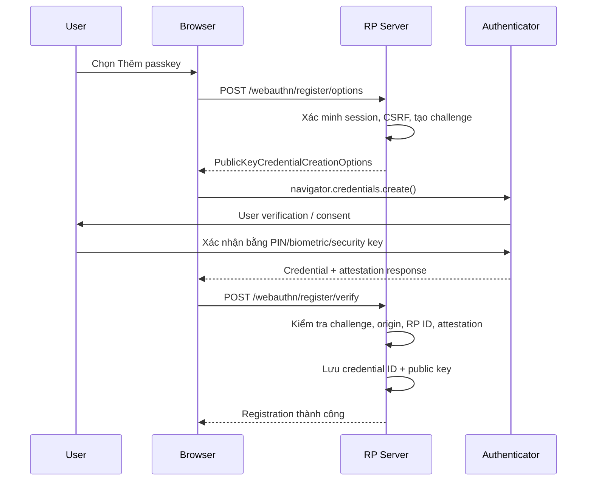
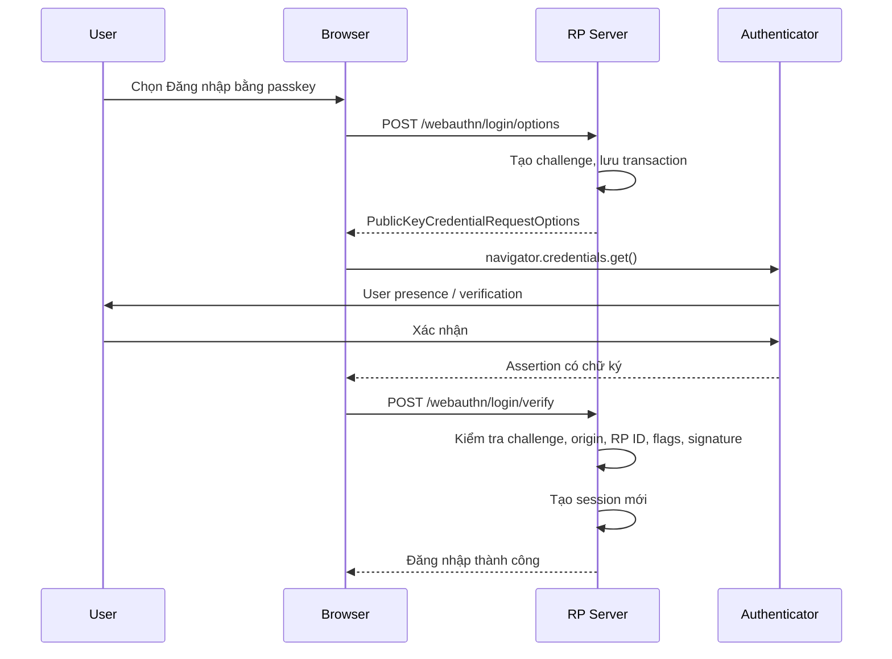

# Passkey browser flow: đăng ký và đăng nhập bằng WebAuthn

Passkey cho phép người dùng đăng ký một credential mật mã với website và dùng credential đó để đăng nhập mà không phải nhập mật khẩu. Trong browser, ứng dụng gọi Web Authentication API (WebAuthn) qua `navigator.credentials.create()` để đăng ký hoặc `navigator.credentials.get()` để xác thực. Browser phối hợp với authenticator của thiết bị hoặc security key; private key không được trả về cho JavaScript. Server lưu public key và kiểm tra chữ ký trong mỗi lần đăng nhập.

Passkey có khả năng chống phishing vì credential được ràng buộc với relying party (RP ID) và browser kiểm tra origin của trang. Một trang giả mạo ở domain khác không thể yêu cầu authenticator tạo assertion hợp lệ cho RP của website thật. Để đạt được lợi ích này, server vẫn phải xác minh challenge, origin, RP ID hash, credential ID, user presence/verification và chữ ký theo đúng WebAuthn ceremony.

Bài học thuộc chương **Authentication browser**, theo đề bài **Passkey browser flow**, trong phạm vi **SECURITY_APPLICATION_SECURITY_BROWSER_SECURITY**: phân tích ranh giới bảo mật giữa trình duyệt, origin, cookie và ứng dụng web để hiểu Same-Origin Policy, CORS và các cơ chế cách ly; thực hành phòng vệ XSS, CSRF, clickjacking bằng CSP, Trusted Types, security headers và kiểm chứng hành vi thực tế.

## 1. Mục tiêu học tập

Sau bài học, người học có thể:

1. Giải thích passkey, WebAuthn, authenticator và relying party.
2. Phân biệt đăng ký credential với xác thực bằng assertion.
3. Mô tả vai trò của challenge, origin, RP ID và credential ID.
4. Triển khai browser flow bằng `navigator.credentials.create()` và `navigator.credentials.get()`.
5. Chuyển đổi dữ liệu nhị phân WebAuthn sang JSON/base64url để trao đổi với server.
6. Xác minh registration response và authentication assertion ở server.
7. Phân biệt User Presence (UP) và User Verification (UV).
8. Hiểu discoverable credential, conditional UI và passkey đồng bộ giữa thiết bị.
9. Đánh giá attestation, sign counter và giới hạn của chúng.
10. Bảo vệ flow trước CSRF, origin confusion, iframe ngoài ý muốn và account recovery yếu.
11. Kiểm tra passkey browser flow bằng DevTools và thiết bị lab.

## 2. Passkey và WebAuthn là gì?

Passkey là credential đăng nhập dựa trên public-key cryptography, thường được quản lý bởi hệ điều hành, password manager hoặc security key. WebAuthn là API web tiêu chuẩn để website tạo và sử dụng public-key credential. WebAuthn là một phần của hệ sinh thái FIDO2, phối hợp với CTAP khi browser cần giao tiếp với authenticator bên ngoài.

Khi đăng ký, authenticator tạo cặp khóa cho một relying party:

- **Private key:** được giữ trong authenticator hoặc hệ thống quản lý passkey; website không nhận private key.
- **Public key:** được trả về trong registration response để server lưu.
- **Credential ID:** định danh credential mà browser/authenticator sử dụng trong các lần xác thực.
- **RP ID:** phạm vi domain mà credential được ràng buộc.

Khi đăng nhập, authenticator dùng private key ký dữ liệu xác thực mới. Server kiểm tra chữ ký bằng public key đã lưu. Mỗi lần đăng nhập có challenge mới nên assertion cũ không thể được phát lại để tạo một lần đăng nhập mới hợp lệ.

### Passkey không phải bearer token

Passkey không phải chuỗi bí mật mà client gửi lại cho server. Browser không xuất private key để ứng dụng lưu trong localStorage. Ứng dụng nhận một response chứa credential ID, client data, authenticator data và chữ ký; server xác minh các dữ liệu này.

Sau khi WebAuthn xác thực thành công, ứng dụng vẫn cần tạo session hoặc token theo kiến trúc của mình. Passkey chứng minh quyền kiểm soát credential; nó không tự quyết định người dùng được phép truy cập mọi chức năng.

### Passkey và password

| Đặc điểm | Password | Passkey/WebAuthn |
| --- | --- | --- |
| Dữ liệu gửi khi đăng nhập | Password hoặc dẫn xuất theo protocol | Assertion có chữ ký bằng private key |
| Ràng buộc website | Dựa vào người dùng nhận biết domain và TLS | Browser/authenticator ràng buộc credential với RP ID/origin |
| Phishing | Có thể bị nhập vào website giả | Credential không thể được dùng tùy ý cho RP ID khác |
| Server lưu | Password hash/salt | Public key, credential ID và metadata |
| Khôi phục | Reset password hoặc recovery flow | Dùng passkey khác, thiết bị đồng bộ hoặc recovery đã xác minh |

Passkey giảm mạnh nguy cơ phishing kiểu thu thập mật khẩu, nhưng không loại bỏ XSS, malware trên thiết bị, chiếm quyền email/recovery hoặc session theft sau khi đăng nhập.

## 3. Các thành phần trong browser flow

| Thành phần | Vai trò |
| --- | --- |
| Relying Party (RP) | Website/dịch vụ yêu cầu đăng ký hoặc xác thực passkey. |
| RP ID | Domain identifier ràng buộc credential, thường là hostname của website hoặc domain cha hợp lệ. |
| Origin | Scheme, host và port của document đang gọi WebAuthn. |
| Browser | Kiểm tra secure context, origin, RP ID và điều phối WebAuthn API. |
| Authenticator | Tạo/giữ private key và thực hiện thao tác user presence/verification. |
| User agent platform | Có thể cung cấp platform authenticator và UI chọn passkey. |
| Server | Tạo challenge, lưu credential public key và xác minh response. |

### Origin và RP ID khác nhau

Origin gồm scheme, host và port:

```text
https://login.example.test:443
```

RP ID chỉ là domain identifier, ví dụ:

```text
example.test
```

RP ID không chứa scheme, port hoặc path. Nó phải phù hợp với domain của origin gọi WebAuthn theo quy tắc WebAuthn và public suffix. Một trang tại login.example.test có thể dùng RP ID example.test nếu domain đó hợp lệ; trang ở attacker.test không thể tự chọn example.test làm RP ID.

Origin được server kiểm tra chính xác, gồm scheme, host và port. Không chỉ kiểm tra hostname rồi bỏ qua scheme/port.

### Secure context

WebAuthn yêu cầu secure context. Production phải dùng HTTPS. Localhost được browser coi là potentially trustworthy cho phát triển trong các trường hợp được hỗ trợ; không dùng HTTP thường trên mạng công cộng.

## 4. Hai ceremony chính

WebAuthn có hai ceremony khác nhau:

| Ceremony | Browser API | Kết quả |
| --- | --- | --- |
| Registration / create | `navigator.credentials.create()` | Tạo credential mới và trả attestation response. |
| Authentication / get | `navigator.credentials.get()` | Dùng credential hiện có để tạo assertion có chữ ký. |

Mỗi ceremony bắt đầu từ server với challenge ngẫu nhiên, có thời hạn và chỉ dùng một lần. Server lưu trạng thái ceremony, liên kết với session/user/transaction và xác minh response sau khi browser gửi về.

### Challenge

Challenge là dữ liệu ngẫu nhiên do server tạo, thường ít nhất 16 bytes và thực tế thường dùng 32 bytes từ CSPRNG. Challenge chống replay và liên kết response với lần đăng ký/đăng nhập hiện tại.

Server cần:

- Tạo challenge mới cho từng ceremony.
- Lưu challenge cùng session/transaction và loại ceremony.
- Đặt thời hạn ngắn.
- Chỉ chấp nhận đúng một lần.
- So sánh giá trị nhận lại theo bytes, không so sánh chuỗi chưa canonicalize.
- Xóa/đánh dấu consumed sau khi xử lý thành công hoặc hết hạn.

Không nhận challenge do client tự tạo làm nguồn tin cậy. Browser chỉ chuyển challenge server cấp sang authenticator.

## 5. Luồng đăng ký passkey

Người dùng cần đăng nhập hoặc hoàn thành một bước xác minh đủ tin cậy trước khi thêm credential vào tài khoản. Việc đăng ký passkey mới là thay đổi bảo mật quan trọng; server phải bảo vệ endpoint bằng session authentication, CSRF control và xác nhận người dùng theo policy.



### 5.1. Server tạo creation options

Server tạo options theo WebAuthn:

```json
{
  "challenge": "BASE64URL_SERVER_CHALLENGE",
  "rp": {
    "id": "example.test",
    "name": "Example"
  },
  "user": {
    "id": "OPAQUE_STABLE_USER_ID",
    "name": "user@example.test",
    "displayName": "Example User"
  },
  "pubKeyCredParams": [
    { "type": "public-key", "alg": -7 },
    { "type": "public-key", "alg": -257 }
  ],
  "timeout": 60000,
  "attestation": "none",
  "authenticatorSelection": {
    "residentKey": "preferred",
    "userVerification": "required"
  },
  "excludeCredentials": []
}
```

Đây là JSON minh họa. Algorithm ID phải được chọn theo thư viện và policy server hỗ trợ. ES256 (-7) và RS256 (-257) là các ví dụ phổ biến; không chấp nhận thuật toán không nằm trong allowlist.

### 5.2. Ý nghĩa các field

| Field | Ý nghĩa |
| --- | --- |
| challenge | Nonce do server tạo cho ceremony. |
| rp.id | RP ID mong muốn. |
| rp.name | Tên hiển thị cho authenticator/user. |
| user.id | User handle dạng bytes, ổn định và không nên chứa PII trực tiếp. |
| user.name | Tên tài khoản có thể hiển thị cho người dùng. |
| user.displayName | Tên thân thiện của tài khoản. |
| pubKeyCredParams | Danh sách thuật toán public-key credential server chấp nhận. |
| timeout | Thời gian browser chờ thao tác, chỉ là gợi ý cho user agent. |
| attestation | Mức thông tin attestation server yêu cầu. |
| authenticatorSelection | Yêu cầu loại authenticator, resident key và user verification. |
| excludeCredentials | Credential ID đã có để tránh đăng ký trùng theo policy. |

user.id là opaque user handle do RP tạo, không phải username/email. WebAuthn yêu cầu user handle dài từ 1 đến 64 bytes; giữ giá trị ổn định và không chứa PII trực tiếp.

### 5.3. Resident key và discoverable credential

Discoverable credential (trước đây thường gọi resident credential) cho phép authenticator tìm credential theo RP ID mà không cần browser gửi trước danh sách credential ID. Đây là nền tảng cho username-less sign-in và passkey conditional UI.

Các giá trị residentKey:

- discouraged: không yêu cầu discoverable credential.
- preferred: ưu tiên nếu authenticator hỗ trợ.
- required: yêu cầu authenticator tạo discoverable credential.

Với passkey flow hiện đại, preferred hoặc required thường phù hợp tùy yêu cầu đăng nhập. Nếu ứng dụng cần username-less sign-in, phải thiết kế server mapping user handle/credential và chọn required khi muốn bảo đảm credential discoverable.

### 5.4. User verification

userVerification có các giá trị:

- required: authenticator phải thực hiện user verification.
- preferred: yêu cầu nếu có thể, nhưng có thể không thực hiện.
- discouraged: không ưu tiên user verification.

Nếu ứng dụng cần bảo đảm thao tác xác minh người dùng bằng PIN/biometric hoặc phương thức local verification, dùng required và server phải kiểm tra UV flag trong authenticator data.

### 5.5. Attestation

attestation điều khiển mức thông tin authenticator cung cấp về nguồn gốc/đặc tính của thiết bị:

- none: không yêu cầu attestation identifying; phù hợp mặc định cho nhiều website vì giảm thu thập thông tin thiết bị.
- indirect/direct: các hình thức attestation có thể cung cấp bằng chứng về authenticator theo policy.
- enterprise: chỉ dùng trong môi trường quản trị doanh nghiệp có yêu cầu và hỗ trợ phù hợp.

Không yêu cầu attestation chỉ vì muốn passkey an toàn hơn. Attestation có thể tăng khả năng nhận diện thiết bị và ảnh hưởng privacy; server cần kiểm tra trust chain/metadata nếu thực sự sử dụng.

### 5.6. excludeCredentials

Server có thể gửi danh sách credential ID đã đăng ký để browser/authenticator tránh tạo credential trùng trên authenticator tương ứng. Đây là tiện ích cho UX và quản lý credential, không thay thế kiểm tra trùng ở database server.

## 6. Gọi navigator.credentials.create() trong browser

Server thường trả options dưới dạng JSON, trong đó các trường bytes được encode base64url. Browser API cần các trường tương ứng ở dạng ArrayBuffer/BufferSource.

### Chuyển base64url thành bytes

```js
function base64urlToBytes(value) {
  const base64 = value
    .replace(/-/g, '+')
    .replace(/_/g, '/')
    .padEnd(Math.ceil(value.length / 4) * 4, '=');

  const binary = atob(base64);
  const bytes = new Uint8Array(binary.length);

  for (let i = 0; i < binary.length; i++) {
    bytes[i] = binary.charCodeAt(i);
  }

  return bytes;
}

function bytesToBase64url(buffer) {
  const bytes = new Uint8Array(buffer);
  let binary = '';

  for (const byte of bytes) {
    binary += String.fromCharCode(byte);
  }

  return btoa(binary)
    .replace(/\+/g, '-')
    .replace(/\//g, '_')
    .replace(/=+$/g, '');
}
```

Trong ứng dụng thực tế, dùng thư viện WebAuthn client/server đã được kiểm chứng để xử lý encoding, extensions và phiên bản browser. Helper trên minh họa việc chuyển bytes; cần kiểm thử với dữ liệu dài và Unicode.

### Chuyển creation options

```js
function prepareCreationOptions(options) {
  return {
    ...options,
    challenge: base64urlToBytes(options.challenge),
    user: {
      ...options.user,
      id: base64urlToBytes(options.user.id)
    },
    excludeCredentials: (options.excludeCredentials || []).map(
      (credential) => ({
        ...credential,
        id: base64urlToBytes(credential.id)
      })
    )
  };
}
```

### Gọi browser API và gửi response

```js
async function registerPasskey() {
  const optionsResponse = await fetch(
    '/webauthn/register/options',
    {
      method: 'POST',
      credentials: 'same-origin',
      headers: {
        'Content-Type': 'application/json',
        'X-CSRF-Token': getCsrfToken()
      },
      body: JSON.stringify({})
    }
  );

  if (!optionsResponse.ok) {
    throw new Error('Không thể bắt đầu đăng ký passkey.');
  }

  const options = await optionsResponse.json();
  const publicKey = prepareCreationOptions(options);

  const credential = await navigator.credentials.create({
    publicKey
  });

  if (!credential) {
    throw new Error('Không nhận được credential.');
  }

  const response = credential.response;
  const payload = {
    id: credential.id,
    rawId: bytesToBase64url(credential.rawId),
    type: credential.type,
    response: {
      clientDataJSON: bytesToBase64url(response.clientDataJSON),
      attestationObject: bytesToBase64url(response.attestationObject),
      transports: response.getTransports?.() || []
    },
    clientExtensionResults: credential.getClientExtensionResults()
  };

  const verifyResponse = await fetch(
    '/webauthn/register/verify',
    {
      method: 'POST',
      credentials: 'same-origin',
      headers: {
        'Content-Type': 'application/json',
        'X-CSRF-Token': getCsrfToken()
      },
      body: JSON.stringify(payload)
    }
  );

  if (!verifyResponse.ok) {
    throw new Error('Server không chấp nhận passkey.');
  }

  return verifyResponse.json();
}
```

getCsrfToken() là hàm minh họa lấy CSRF token theo cơ chế của ứng dụng. Không hardcode token, không bỏ CSRF check và không ghi response chứa credential vào log.

### Browser xử lý gì?

Khi gọi create():

1. Browser kiểm tra secure context và RP ID có phù hợp origin không.
2. Browser hiển thị UI chọn authenticator nếu cần.
3. Authenticator yêu cầu user presence/verification theo policy.
4. Authenticator tạo credential key pair.
5. Browser nhận public credential response.
6. JavaScript nhận credential object nhưng không nhận private key.

Nếu người dùng hủy, browser có thể reject Promise bằng NotAllowedError. Không coi mọi lỗi là server authentication failure.

## 7. Registration response và server verification

Registration response chứa:

- rawId/credential ID.
- clientDataJSON.
- attestationObject.
- transports nếu browser cung cấp.
- client extension results.

Server phải parse và xác minh response bằng thư viện WebAuthn server đã được kiểm chứng. Không tự viết parser CBOR/COSE trong production nếu không có chuyên môn và test phù hợp.

### 7.1. Kiểm tra clientDataJSON

Server giải mã clientDataJSON và kiểm tra:

- type là webauthn.create.
- challenge trùng challenge đã lưu cho registration transaction.
- origin khớp chính xác allowlist origin.
- crossOrigin/topOrigin theo policy nếu ceremony diễn ra trong iframe cross-origin.
- challenge chưa hết hạn và chưa được dùng.

Origin phải bao gồm scheme, host và port theo cấu hình. Không dùng contains(), endsWith() hoặc so khớp substring để kiểm tra domain.

### 7.2. Kiểm tra authenticator data và RP ID

Authenticator data chứa RP ID hash và các flag. Server kiểm tra:

- rpIdHash bằng SHA-256 của RP ID đã cấu hình.
- User Presence (UP) flag phải được đặt trong registration ceremony.
- User Verification (UV) flag nếu policy yêu cầu.
- Attested credential data có mặt trong registration response.
- Credential ID trong attested credential data khớp rawId/credential ID của response.
- COSE public key parse hợp lệ và dùng thuật toán nằm trong allowlist.

### 7.3. Kiểm tra attestation

Nếu attestation policy là none, server xử lý theo format/verification rules tương ứng và không suy diễn danh tính thiết bị. Nếu yêu cầu direct/enterprise attestation, server cần xác minh attestation statement, certificate chain, metadata và trust policy.

Không chấp nhận một AAGUID hoặc attestation statement như danh tính thiết bị đáng tin nếu chưa xác minh theo nguồn metadata phù hợp. Không lưu thêm dữ liệu thiết bị không cần thiết.

### 7.4. Lưu credential

Sau khi xác minh thành công, lưu:

| Field | Mục đích |
| --- | --- |
| credential_id | Định danh credential; cần unique theo RP. |
| public_key | Public key/COSE key đã parse và xác minh. |
| user_id | Account sở hữu credential. |
| user_handle | Opaque user handle theo WebAuthn. |
| sign_count | Signature counter ban đầu. |
| transports | Hint về transport nếu được cung cấp. |
| backup_eligible | Flag BE nếu có. |
| backup_state | Flag BS nếu có. |
| created_at / last_used_at | Quản lý vòng đời. |
| label | Tên thiết bị do người dùng đặt, không phải bằng chứng tin cậy. |

Chỉ lưu credential sau khi toàn bộ kiểm tra registration thành công. Không ghi raw attestation response hoặc dữ liệu nhạy cảm vào log tùy tiện.

## 8. Luồng đăng nhập bằng passkey

Khi đăng nhập, server tạo challenge mới và gửi request options. Browser chọn credential phù hợp, authenticator ký dữ liệu, server xác minh chữ ký và tạo session.



### 8.1. Server tạo request options

Ví dụ username-first:

```json
{
  "challenge": "BASE64URL_LOGIN_CHALLENGE",
  "rpId": "example.test",
  "timeout": 60000,
  "userVerification": "required",
  "allowCredentials": [
    {
      "type": "public-key",
      "id": "BASE64URL_CREDENTIAL_ID",
      "transports": ["internal", "hybrid"]
    }
  ]
}
```

Nếu user đã nhập username, server có thể lấy credential IDs thuộc account đó và đưa vào allowCredentials. Nếu dùng discoverable credential/username-less flow, có thể bỏ allowCredentials để authenticator tìm credential theo RP ID.

### 8.2. allowCredentials

allowCredentials giới hạn credential được chấp nhận trong lần xác thực. Danh sách rỗng hoặc không được cung cấp có thể cho phép discoverable credential flow, tùy API options và browser.

Không nhận credential ID do client tự gửi rồi tin đó là user identity. Server phải xác định credential ID có trong database và thuộc account/grant phù hợp.

### 8.3. Gọi navigator.credentials.get()

Browser chuyển challenge base64url sang bytes và chuyển credential IDs nếu có:

```js
function prepareRequestOptions(options) {
  return {
    ...options,
    challenge: base64urlToBytes(options.challenge),
    allowCredentials: (options.allowCredentials || []).map(
      (credential) => ({
        ...credential,
        id: base64urlToBytes(credential.id)
      })
    )
  };
}
```

Gọi API:

```js
async function authenticateWithPasskey(options) {
  const credential = await navigator.credentials.get({
    publicKey: prepareRequestOptions(options)
  });

  if (!credential) {
    throw new Error('Không nhận được assertion.');
  }

  return serializeAssertion(credential);
}

function serializeAssertion(credential) {
  const response = credential.response;
  return {
    id: credential.id,
    rawId: bytesToBase64url(credential.rawId),
    type: credential.type,
    response: {
      clientDataJSON: bytesToBase64url(response.clientDataJSON),
      authenticatorData: bytesToBase64url(response.authenticatorData),
      signature: bytesToBase64url(response.signature),
      userHandle: response.userHandle
        ? bytesToBase64url(response.userHandle)
        : null
    },
    clientExtensionResults: credential.getClientExtensionResults()
  };
}
```

Ứng dụng gửi payload này tới endpoint verify cùng session/CSRF protection phù hợp. Server không tin user ID do client tự thêm vào payload.

Ví dụ gửi assertion tới server:

```js
async function submitAssertion(assertion) {
  const response = await fetch('/webauthn/login/verify', {
    method: 'POST',
    credentials: 'same-origin',
    headers: {
      'Content-Type': 'application/json',
      'X-CSRF-Token': getCsrfToken()
    },
    body: JSON.stringify(assertion)
  });

  if (!response.ok) {
    throw new Error('Server không xác minh được passkey.');
  }

  return response.json();
}

async function loginWithPasskey() {
  const optionsResponse = await fetch('/webauthn/login/options', {
    method: 'POST',
    credentials: 'same-origin',
    headers: {
      'Content-Type': 'application/json',
      'X-CSRF-Token': getCsrfToken()
    },
    body: JSON.stringify({})
  });

  if (!optionsResponse.ok) {
    throw new Error('Không thể bắt đầu đăng nhập passkey.');
  }

  const options = await optionsResponse.json();
  const assertion = await authenticateWithPasskey(options);
  return submitAssertion(assertion);
}
```

## 9. Server xác minh authentication assertion

Assertion response gồm credential ID, clientDataJSON, authenticatorData, signature và userHandle có thể null. Server xác minh bằng public key đã lưu khi registration.

### 9.1. Xác minh challenge và client data

Server kiểm tra:

1. clientDataJSON.type bằng webauthn.get.
2. challenge khớp transaction login đang chờ.
3. challenge chưa hết hạn và chưa được dùng.
4. origin khớp allowlist chính xác.
5. crossOrigin/topOrigin đúng policy nếu có cross-origin iframe.

Challenge của registration không được dùng cho login; challenge của một lần login không được tái sử dụng cho lần khác.

### 9.2. Xác minh credential

- Credential ID trong response tồn tại trong database.
- Credential thuộc user đã xác định hoặc userHandle mapping hợp lệ.
- Credential chưa bị revoke/disabled.
- RP ID hash trong authenticatorData khớp RP ID.
- UP flag có mặt.
- UV flag có mặt nếu policy yêu cầu.

### 9.3. Xác minh chữ ký

Authenticator ký dữ liệu được xây dựng từ:

```text
authenticatorData || SHA-256(clientDataJSON)
```

Server xác minh signature bằng public key và thuật toán đã lưu/allowlist. Không xác minh chữ ký bằng key do client gửi trong chính assertion; public key phải đến từ registration đã được xác minh.

### 9.4. Sign counter

Authenticator data có signCount. Counter có thể giúp phát hiện credential bị clone trong một số authenticator:

- Nếu counter tăng, đó có thể là tín hiệu hoạt động bình thường.
- Nếu counter mới không tăng hoặc giảm trong trường hợp authenticator vốn có counter đáng tin, đây có thể là tín hiệu bất thường.
- Một số authenticator/passkey đồng bộ có thể luôn trả 0 hoặc không cung cấp counter đơn điệu đáng tin cậy.

Vì vậy, không hard-fail mọi assertion chỉ vì signCount bằng 0 hoặc không tăng. Đánh giá theo loại credential, lịch sử và risk policy; dùng nó như tín hiệu phát hiện, không phải bằng chứng duy nhất.

### 9.5. User handle

userHandle có thể null nếu server đã biết user qua username/allowCredentials. Trong discoverable flow, userHandle có thể giúp xác định account. Server phải so khớp với opaque user handle đã lưu, không coi giá trị client gửi là user ID tùy ý.

### 9.6. Chỉ tạo session sau khi xác minh thành công

Sau khi assertion hợp lệ:

- Consume challenge.
- Cập nhật last_used_at và metadata cần thiết.
- Áp dụng account status, risk policy và authorization.
- Tạo session mới hoặc rotate session ID để chống session fixation.
- Đặt cookie session Secure, HttpOnly, SameSite phù hợp.
- Trả response không chứa private key hoặc secret authenticator.

Không tạo session chỉ vì browser trả về một credential object; server verification là bước bắt buộc.

## 10. Conditional UI và username-less sign-in

Conditional UI cho phép browser gợi ý passkey ngay trong trải nghiệm autofill của trường username, thay vì buộc người dùng bấm nút riêng trước. Đây là một cách triển khai discoverable credential flow.

HTML:

```html
<form id="login-form">
  <label for="username">Tên đăng nhập</label>
  <input
    id="username"
    name="username"
    autocomplete="username webauthn">
  <button type="submit">Tiếp tục</button>
</form>
```

JavaScript khởi chạy conditional get khi browser hỗ trợ:

```js
async function startConditionalPasskeyLogin() {
  if (!window.PublicKeyCredential ||
      !navigator.credentials) {
    return;
  }

  const supported =
    await PublicKeyCredential.isConditionalMediationAvailable?.();

  if (!supported) return;

  const optionsResponse = await fetch(
    '/webauthn/login/options',
    {
      method: 'POST',
      credentials: 'same-origin',
      headers: {
        'Content-Type': 'application/json',
        'X-CSRF-Token': getCsrfToken()
      },
      body: JSON.stringify({ mode: 'conditional' })
    }
  );

  if (!optionsResponse.ok) return;

  const options = await optionsResponse.json();
  const credential = await navigator.credentials.get({
    publicKey: prepareRequestOptions(options),
    mediation: 'conditional'
  });

  if (!credential) return;

  const assertion = serializeAssertion(credential);
  await submitAssertion(assertion);
}
```

prepareRequestOptions(), serializeAssertion() và submitAssertion() là các helper đã được minh họa ở phần trước. Conditional mediation có thể chờ cho tới khi người dùng chọn credential hoặc hủy; ứng dụng cần xử lý cancellation và tránh để Promise không được quản lý.

### Fallback

Nếu browser không hỗ trợ conditional UI:

- Hiển thị nút “Đăng nhập bằng passkey”.
- Có thể dùng username-first flow với allowCredentials.
- Có thể cung cấp lựa chọn đăng nhập khác theo policy.

Không tự động hạ cấp sang một phương thức yếu hơn mà không thông báo hoặc bỏ qua risk policy.

## 11. User Presence và User Verification

Authenticator data chứa các flag quan trọng:

| Flag | Ý nghĩa |
| --- | --- |
| UP (User Present) | Có sự hiện diện/tương tác của người dùng theo authenticator. |
| UV (User Verified) | Authenticator đã xác minh người dùng theo phương thức local của nó. |
| BE (Backup Eligible) | Credential đủ điều kiện backup/sync theo semantics WebAuthn. |
| BS (Backup State) | Credential hiện ở trạng thái backup theo semantics WebAuthn. |

UP và UV khác nhau. Một thao tác chạm security key có thể đáp ứng user presence mà không nhất thiết chứng minh local PIN/biometric đã được thực hiện. Nếu policy yêu cầu user verification, server phải yêu cầu userVerification=required và kiểm tra UV flag.

### Passkey có luôn là MFA không?

Không nên gắn nhãn MFA chỉ dựa vào việc dùng passkey. WebAuthn có thể thực hiện user verification bằng PIN, biometric hoặc phương thức local khác, nhưng mức bảo đảm phụ thuộc authenticator, cấu hình và policy. Một passkey có UV phù hợp có thể đáp ứng yêu cầu xác minh người dùng mạnh; việc phân loại MFA/assurance phải theo tiêu chuẩn và risk policy của tổ chức.

Biometric template hoặc PIN local không được gửi cho website. Authenticator chỉ trả kết quả xác minh qua flag và chữ ký theo protocol.

## 12. Passkey đồng bộ và passkey gắn thiết bị

Passkey có thể được lưu trên platform authenticator của thiết bị hoặc đồng bộ qua hệ sinh thái/password manager. Một số security key giữ credential gắn với thiết bị.

| Kiểu | Đặc điểm | Lưu ý |
| --- | --- | --- |
| Platform authenticator | Tích hợp trong điện thoại/laptop/OS | Có thể dùng biometric hoặc PIN của thiết bị. |
| Roaming authenticator | Security key USB/NFC/Bluetooth | Người dùng kết nối hoặc chạm key. |
| Synced passkey | Có thể đồng bộ qua account/provider giữa thiết bị | Cần quản lý account đồng bộ và recovery của provider. |
| Device-bound credential | Credential không được đồng bộ theo cách thông thường | Có thể phù hợp policy yêu cầu thiết bị cụ thể; trải nghiệm khôi phục khác. |

Backup Eligible/Backup State flags giúp RP hiểu credential có thể backup và đang ở trạng thái backup theo semantics WebAuthn. Không dùng flags này để suy ra tên cloud provider hoặc danh tính người đồng bộ.

### Quản lý nhiều passkey

Cho phép người dùng đăng ký nhiều passkey:

- Điện thoại cá nhân.
- Laptop.
- Security key dự phòng.
- Passkey đồng bộ theo hệ sinh thái được hỗ trợ.

Mỗi credential cần label dễ nhận biết, ngày tạo và last-used. Label do người dùng đặt chỉ phục vụ UX, không phải metadata xác thực.

## 13. Attestation và quyền riêng tư

Attestation có thể cung cấp bằng chứng về loại authenticator hoặc nguồn gốc credential. Nó cũng có thể làm lộ thông tin thiết bị và tạo khả năng nhận diện người dùng qua thiết bị.

### Khi nào dùng attestation?

- Ứng dụng tiêu dùng thông thường: attestation none thường phù hợp.
- Môi trường doanh nghiệp quản lý thiết bị: có thể có policy enterprise attestation được phê duyệt.
- Hệ thống có yêu cầu assurance đặc biệt: phải xác định trust anchor, metadata source, certificate validation và cách xử lý thiết bị không nằm trong danh sách.

Không bật attestation trực tiếp/enterprise chỉ để “tăng bảo mật” mà chưa xác định dữ liệu thu thập, cơ sở privacy và yêu cầu vận hành.

### AAGUID

AAGUID có thể giúp nhận diện loại authenticator trong một số trường hợp, nhưng không luôn có sẵn hoặc có giá trị định danh ổn định cho passkey đồng bộ. Không coi AAGUID là serial number hay danh tính duy nhất của thiết bị.

## 14. Browser security: origin, iframe và Permissions Policy

WebAuthn dựa vào ranh giới origin và RP ID. Một số sai sót cấu hình có thể làm website gọi API từ context không mong muốn hoặc server chấp nhận response không đúng origin.

### Origin validation chính xác

Server nên có allowlist origin tường minh:

```text
https://login.example.test
https://app.example.test
```

Không chấp nhận:

- Origin chỉ vì hostname kết thúc bằng một chuỗi tùy ý.
- Scheme HTTP khi chỉ cho phép HTTPS.
- Port lạ không nằm trong allowlist.
- Origin null trừ khi có use case và policy riêng.
- Origin được gửi từ client payload ngoài clientDataJSON đã được xác minh.

### Cross-origin iframe

Mặc định, website nên thực hiện passkey ceremony ở top-level context của chính RP. Nếu cần gọi WebAuthn trong iframe cross-origin, phải cấu hình Permissions Policy và kiểm tra quy tắc WebAuthn liên quan.

Ví dụ parent document có thể cho phép feature cụ thể:

```html
<iframe
  src="https://login.example.test/passkey-frame"
  allow="publickey-credentials-get; publickey-credentials-create"
  title="Passkey sign-in">
</iframe>
```

Parent response có thể giới hạn feature ở header Permissions-Policy:

```http
Permissions-Policy: publickey-credentials-get=(self "https://login.example.test"), publickey-credentials-create=(self "https://login.example.test")
```

Server cần xác minh origin và các trường cross-origin/top-origin theo flow được hỗ trợ. Không bật iframe access rộng cho mọi origin; chỉ allowlist frame origin và top-level origin được tin cậy. Kiểm tra Permissions-Policy response header của parent và browser support.

### CSP

CSP không xác minh WebAuthn signature, nhưng giúp giảm khả năng XSS có thể gọi passkey/session flow bằng script độc hại. Dùng script-src nonce/hash, hạn chế script bên thứ ba và connect-src theo endpoint cần thiết.

Trusted Types và output encoding giảm DOM XSS. Chúng bổ trợ cho WebAuthn nhưng không thay thế challenge/origin/RP ID/signature validation.

## 15. CSRF và quản lý credential

Đăng ký passkey, xóa passkey, đổi label hoặc đặt credential mặc định là các hành động thay đổi bảo mật tài khoản. Nếu website dùng session cookie, browser tự gửi cookie; endpoint cần CSRF protection.

Áp dụng:

- CSRF token cho endpoint create/delete/update credential.
- Kiểm tra Origin/Referer theo policy phù hợp.
- SameSite cookie đúng với login/callback flow.
- Xác nhận lại người dùng cho thao tác nhạy cảm theo risk policy.
- Audit log khi thêm/xóa passkey.
- Thông báo người dùng khi có credential mới được thêm.

WebAuthn challenge chống replay của ceremony; nó không tự thay CSRF token cho endpoint quản lý tài khoản. Đặc biệt, attacker có thể cố gắng khởi tạo flow đăng ký credential mới trên session của nạn nhân nếu endpoint không có xác thực và CSRF controls.

## 16. Session sau passkey authentication

Passkey xác minh credential; ứng dụng vẫn phải tạo session an toàn. Sau khi server xác minh assertion:

1. Rotate session ID hoặc tạo session mới.
2. Gắn session với user đã xác minh.
3. Đặt cookie Secure, HttpOnly, SameSite phù hợp.
4. Giới hạn session idle/absolute lifetime.
5. Kiểm tra authorization cho từng request.
6. Ghi nhận authentication method/assurance cần thiết mà không lưu dữ liệu sinh trắc học.

Ví dụ:

```http
Set-Cookie: __Host-session=opaque-session-id; Path=/; Secure; HttpOnly; SameSite=Lax
```

Cookie prefix __Host- yêu cầu Secure, Path=/ và không có Domain trong browser hỗ trợ prefix. Chọn SameSite theo luồng điều hướng và yêu cầu ứng dụng.

Không lưu private key, authenticator PIN hoặc biometric data trong session. Không đưa credential response thô vào cookie.

## 17. Account recovery và thu hồi passkey

Passkey không loại bỏ nhu cầu recovery. Người dùng có thể mất thiết bị, mất quyền truy cập account đồng bộ hoặc mất security key.

### Recovery an toàn

- Cho phép nhiều passkey dự phòng được đăng ký trước.
- Cung cấp recovery code hoặc quy trình hỗ trợ có xác minh danh tính mạnh.
- Không dùng email đơn thuần làm yếu tố duy nhất để thay toàn bộ passkey nếu tài khoản có giá trị cao.
- Có delay/notification cho thay đổi credential nhạy cảm khi phù hợp.
- Thông báo khi passkey mới được thêm hoặc credential bị xóa.
- Có quy trình revoke credential bị mất.

### Xóa passkey

Server đánh dấu credential revoked/disabled hoặc xóa record theo retention policy. Không chỉ xóa credential ở giao diện. Sau khi revoke, server phải từ chối assertion có credential ID đó.

### Credential lifecycle

Mỗi credential nên có:

- Created at.
- Last used at.
- Label.
- Credential ID.
- Trạng thái active/revoked.
- Metadata backup flags nếu có và cần thiết.

Không lưu thông tin thiết bị quá mức cần thiết. Cho người dùng xem danh sách credential, thời gian hoạt động gần nhất và khả năng xóa credential không còn dùng.

## 18. Xử lý lỗi browser

WebAuthn API trả Promise và có thể reject với các DOMException khác nhau:

| Lỗi | Nguyên nhân có thể | Cách xử lý UX |
| --- | --- | --- |
| NotAllowedError | Người dùng hủy, timeout hoặc không có credential phù hợp | Hiển thị lựa chọn thử lại/phương thức khác. |
| SecurityError | Origin/RP ID hoặc secure context không hợp lệ | Báo lỗi cấu hình, ghi diagnostic không chứa secret. |
| InvalidStateError | Credential đã tồn tại hoặc trạng thái không phù hợp trong registration | Kiểm tra excludeCredentials và trạng thái account. |
| NotSupportedError | Browser/authenticator không hỗ trợ options/algorithm | Fallback theo policy và kiểm tra browser support. |
| AbortError | Operation bị hủy bởi ứng dụng/browser | Cho phép người dùng bắt đầu lại. |
| UnknownError | Lỗi authenticator hoặc browser không phân loại rõ | Hướng dẫn thử thiết bị/browser khác và ghi mã correlation. |

Không hiển thị stack trace hoặc dữ liệu credential cho người dùng. Log loại lỗi, browser version và correlation ID ở mức cần thiết.

### Timeout

timeout trong options là gợi ý cho user agent. Browser có thể điều chỉnh thời gian. Server vẫn phải quản lý challenge expiry độc lập; không dùng timeout phía browser làm bằng chứng challenge còn hợp lệ.

## 19. Thực hành: passkey browser flow trong lab

Thực hành trên localhost hoặc HTTPS staging do người học kiểm soát. Dùng account lab, browser hỗ trợ WebAuthn và platform authenticator/security key test. Không đăng ký passkey cá nhân cho hệ thống thử nghiệm không đáng tin.

### 19.1. Chuẩn bị RP lab

Thiết lập:

| Thành phần | Giá trị minh họa |
| --- | --- |
| Origin | https://login.example.test |
| RP ID | example.test |
| Registration options | POST /webauthn/register/options |
| Registration verify | POST /webauthn/register/verify |
| Login options | POST /webauthn/login/options |
| Login verify | POST /webauthn/login/verify |

Server tạo challenge ngẫu nhiên, lưu session transaction, và cấu hình origin allowlist chính xác. Dùng thư viện WebAuthn server có kiểm chứng để parse/verify CBOR, COSE, attestation và signature.

### 19.2. Đăng ký credential

1. Đăng nhập account lab bằng phương thức ban đầu.
2. Mở trang Security → Add passkey.
3. Quan sát request options trong Network.
4. Kiểm tra rp.id, user.id, challenge, userVerification và attestation.
5. Gọi navigator.credentials.create().
6. Xác nhận trên authenticator.
7. Gửi response tới register/verify.
8. Kiểm tra server lưu credential ID và public key.

Kỳ vọng: private key không xuất hiện trong response hoặc browser storage của ứng dụng.

### 19.3. Đăng nhập username-first

1. Nhập username lab.
2. Server trả allowCredentials tương ứng account.
3. Browser gọi navigator.credentials.get().
4. Authenticator ký challenge.
5. Server kiểm tra credential ID, origin, RP ID, UP/UV và signature.
6. Server tạo session mới.

Thử một challenge cũ để xác nhận server từ chối replay.

### 19.4. Đăng nhập discoverable/conditional

1. Tạo credential với residentKey preferred/required.
2. Mở trang đăng nhập có autocomplete username webauthn.
3. Kiểm tra conditional mediation support.
4. Gọi navigator.credentials.get() với mediation conditional và không chỉ định allowCredentials.
5. Chọn passkey được browser gợi ý.
6. Xác minh userHandle/credential mapping ở server.

### 19.5. Thử sai origin

Chạy một trang lab ở origin khác và thử dùng cùng RP ID. Browser phải từ chối nếu RP ID không hợp lệ với origin. Ngoài browser, gửi response giả với origin không nằm allowlist để xác nhận server từ chối.

Không chỉ kiểm tra hostname. Thử thay scheme hoặc port để xác nhận origin validation chính xác.

### 19.6. Thử challenge replay

1. Lưu một assertion lab đã thành công.
2. Gửi lại payload cũ tới verify endpoint.
3. Xác nhận server từ chối vì challenge đã consumed hoặc hết hạn.
4. Tạo challenge mới và đăng nhập lại thành công.

### 19.7. Kiểm tra UV và signCount

Thử userVerification required và xác nhận server kiểm tra UV flag. Quan sát signCount trên authenticator test; không giả định mọi passkey đồng bộ có counter tăng. Thử policy risk signal trên counter mà không làm khóa nhầm mọi credential có counter bằng 0.

### 19.8. Kiểm tra iframe policy

Nếu ứng dụng có use case iframe cross-origin:

1. Tạo parent origin và frame origin riêng trong lab.
2. Thử khi không cấp Permissions Policy.
3. Thử với allowlist publickey-credentials-get/create cần thiết.
4. Quan sát browser behavior và clientData cross-origin metadata.
5. Xác nhận server chỉ chấp nhận top-level/frame origin đã cấu hình.

Nếu không có nhu cầu iframe, giữ ceremony ở top-level page của RP.

### 19.9. Kiểm tra session và recovery

- Sau đăng nhập, kiểm tra session cookie có Secure/HttpOnly/SameSite.
- Kiểm tra session ID được rotate.
- Đăng ký passkey thứ hai.
- Revoke một credential.
- Thử assertion bằng credential đã revoke và xác nhận server từ chối.
- Kiểm tra audit event và notification theo policy lab.

### 19.10. Bằng chứng cần lưu

| Bằng chứng | Điều cần xác nhận |
| --- | --- |
| Creation options | Challenge, RP ID, user, algorithms và selection policy đúng. |
| Registration response | Credential ID/public key được server xác minh và lưu. |
| Private key | Không xuất hiện trong JavaScript response/storage. |
| Authentication options | Challenge mới, RP ID và allowCredentials đúng. |
| Assertion | Signature, origin, RP ID hash, UP/UV được xác minh. |
| Replay | Challenge đã dùng bị từ chối. |
| Conditional UI | Browser hỗ trợ passkey suggestion và fallback. |
| Session | Cookie an toàn và session ID được rotate. |
| Revoke | Credential đã thu hồi không đăng nhập được. |
| Iframe | Permissions Policy/origin được giới hạn nếu use case tồn tại. |

## 20. Những lỗi thường gặp

| Hiện tượng | Nguyên nhân có thể | Cách xử lý |
| --- | --- | --- |
| Browser báo SecurityError | HTTP không secure hoặc RP ID không hợp lệ | Dùng HTTPS và RP ID phù hợp origin. |
| Server từ chối assertion hợp lệ | Challenge/origin/RP ID hash không khớp hoặc encoding sai | Dùng thư viện WebAuthn và lưu transaction đúng. |
| Credential không tìm thấy | Credential ID chưa lưu hoặc allowCredentials sai | Kiểm tra registration và mapping user. |
| Đăng nhập username-less không hoạt động | Credential không discoverable hoặc server không map userHandle | Cấu hình residentKey và userHandle ổn định. |
| Challenge cũ vẫn được chấp nhận | Không consume challenge hoặc không kiểm tra expiry | Challenge một lần, gắn session và TTL. |
| Origin check cho qua domain giả | Dùng endsWith/substring | Exact allowlist scheme + host + port. |
| UV không được bảo đảm | Chỉ đặt preferred hoặc không kiểm tra UV flag | Dùng required và xác minh UV server-side. |
| Counter bằng 0 bị từ chối | Giả định mọi authenticator có counter tăng | Dùng counter như risk signal theo loại credential. |
| Passkey bị yêu cầu attestation quá mức | Chọn direct/enterprise không có yêu cầu | Ưu tiên none trừ khi có policy rõ. |
| Credential bị thêm bởi CSRF | Endpoint register thiếu CSRF/re-authentication | CSRF token, session validation và xác nhận người dùng. |
| Xóa passkey chỉ ở frontend | Server vẫn giữ public key active | Revoke credential ở server và audit. |
| Conditional UI không xuất hiện | Browser không hỗ trợ hoặc mediation/options không phù hợp | Feature detect và cung cấp nút fallback. |
| Iframe không gọi được WebAuthn | Permissions Policy hoặc cross-origin rules chặn | Chỉ bật feature cho frame/top origin được phép. |

## 21. Checklist production

| Hạng mục | Câu hỏi rà soát | Kết quả mong đợi |
| --- | --- | --- |
| Secure context | Passkey chỉ hoạt động qua HTTPS/localhost phù hợp? | Production HTTPS. |
| RP ID | RP ID có thuộc domain hợp lệ của origin? | Cấu hình rõ và ổn định. |
| Origin | Server có exact allowlist scheme/host/port? | Không substring/endsWith. |
| Challenge | Challenge có ngẫu nhiên, TTL và one-time use? | Server tạo, lưu và consume. |
| Registration | Có xác minh session và CSRF trước khi thêm credential? | Account change được bảo vệ. |
| User handle | user.id có opaque, ổn định và không chứa PII? | Mapping server-side. |
| Algorithms | pubKeyCredParams có allowlist? | Chỉ thuật toán được hỗ trợ. |
| User verification | UV có required khi assurance cần? | Server kiểm tra UV flag. |
| Attestation | Attestation có thực sự cần? | None mặc định nếu không có policy thiết bị. |
| Registration verify | Server kiểm tra type/challenge/origin/RP hash/credential? | Dùng thư viện WebAuthn đáng tin. |
| Authentication verify | Server kiểm tra credential ownership và signature? | Không tin payload client. |
| Counter | Có xử lý authenticator không có counter? | Dùng risk policy, tránh false lockout. |
| Discoverable | Username-less flow có mapping userHandle? | Credential và user được liên kết đúng. |
| Conditional UI | Có feature detection và fallback? | UX hoạt động trên browser mục tiêu. |
| Iframe | Có use case cross-origin thật sự? | Permissions Policy và origin allowlist giới hạn. |
| Session | Session ID có rotate và cookie an toàn? | Secure, HttpOnly, SameSite phù hợp. |
| XSS | Có CSP, Trusted Types, output encoding và dependency review? | Giảm script injection/session abuse. |
| CSRF | Register/delete credential có CSRF protection? | Không thể âm thầm thêm/xóa passkey. |
| Recovery | Có passkey dự phòng và recovery đủ mạnh? | Tránh fallback yếu. |
| Revocation | Credential bị mất có thể revoke server-side? | Assertion từ credential đó bị từ chối. |
| Privacy | Attestation/device metadata có được tối thiểu hóa? | Không thu thập thông tin không cần. |
| Logging | Log có chứa raw credential response hoặc PII không? | Redact và giới hạn retention. |
| Testing | Có test replay, wrong origin, UV, revoke và browser matrix? | Có bằng chứng lab/staging. |

## 22. Câu hỏi tự kiểm tra

1. Passkey và WebAuthn liên hệ với nhau như thế nào?
2. Private key nằm ở đâu và server lưu thông tin nào?
3. RP ID khác origin như thế nào?
4. Vì sao WebAuthn yêu cầu secure context?
5. Registration ceremony khác authentication ceremony ở đâu?
6. Challenge cần được tạo, lưu và consume như thế nào?
7. Vì sao server phải kiểm tra clientDataJSON.type, challenge và origin?
8. rpIdHash được xác minh từ dữ liệu nào?
9. UP và UV khác nhau như thế nào?
10. Vì sao signCount không thể là điều kiện hard-fail cho mọi passkey?
11. Discoverable credential hỗ trợ username-less sign-in ra sao?
12. Conditional UI cần autocomplete token và mediation nào?
13. Khi nào attestation none phù hợp hơn direct/enterprise?
14. Vì sao endpoint thêm/xóa passkey vẫn cần CSRF protection?
15. Passkey authentication thành công có tự động cấp quyền cho mọi API không?
16. BFF/session cookie và passkey kết hợp với nhau như thế nào?
17. Làm thế nào revoke credential bị mất?
18. Vì sao cross-origin iframe cần Permissions Policy và origin validation riêng?

**Tiêu chí hoàn thành:** người học có thể mô tả và triển khai browser registration/authentication ceremony, chuyển đổi dữ liệu WebAuthn, xác minh challenge/origin/RP ID/flags/signature ở server, hiểu discoverable và conditional passkey flow, quản lý session/recovery/revocation, đồng thời kiểm chứng replay và origin boundary trong môi trường lab.
