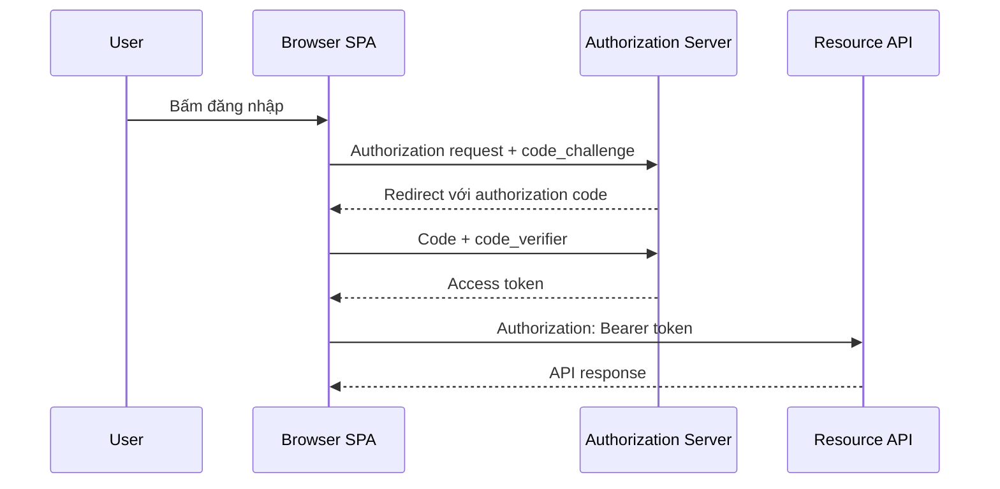
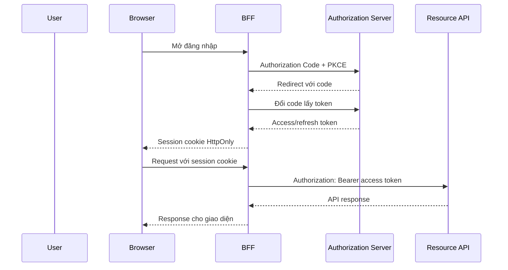

# Access token trong browser

## 1. Access token là gì?

Access token là credential mà client gửi tới resource server để chứng minh request được phép thực hiện một thao tác hoặc truy cập một tài nguyên trong phạm vi đã cấp. Trong ứng dụng web, browser thường gửi access token qua HTTP header:

```http
Authorization: Bearer ACCESS_TOKEN
```

Với bearer token, bên nào sở hữu token đều có thể sử dụng nó theo quyền được cấp. Vì vậy, access token phải được xem như một bí mật có thể cấp quyền truy cập. Nếu token bị sao chép vào log, URL, analytics hoặc bị JavaScript độc hại lấy đi, attacker có thể dùng token từ một thiết bị khác cho tới khi token hết hạn hoặc bị thu hồi theo cơ chế của hệ thống.

Access token có thể là chuỗi opaque do authorization server phát hành hoặc JWT có cấu trúc. Client không nên giả định mọi access token đều là JWT, cũng không nên tự giải mã JWT rồi coi nội dung là bằng chứng xác thực. Resource server mới là nơi xác minh token, chữ ký, issuer, audience, thời hạn và quyền truy cập.

Trong browser, bài toán bảo vệ access token khó hơn ở server truyền thống vì mã JavaScript chạy trong cùng môi trường có thể truy cập dữ liệu ứng dụng. XSS có thể đọc token từ storage hoặc dùng quyền của trang để gọi API thay người dùng. Cookie HttpOnly hạn chế khả năng đọc cookie bằng JavaScript nhưng lại đặt ra bài toán CSRF nếu cookie được tự động gửi theo request.

Bài học này tập trung vào cách ứng dụng browser nhận, lưu, sử dụng, làm mới và xóa access token; đồng thời so sánh SPA tự quản lý token với kiến trúc Backend for Frontend (BFF).

Sau bài học, bạn có thể:

- Giải thích bearer access token và phạm vi quyền mà token đại diện.
- Phân biệt access token, ID token và refresh token.
- Chọn kiến trúc BFF hoặc SPA OAuth phù hợp với threat model.
- Đánh giá rủi ro của memory, localStorage, sessionStorage, IndexedDB và cookie.
- Dùng Authorization Code Flow với PKCE cho public browser client.
- Gửi token tới đúng resource server và kiểm soát audience/scope.
- Giảm rủi ro XSS, CSRF, token leakage và replay.
- Xử lý expiry, refresh rotation, logout và revocation.
- Kiểm thử token lifecycle bằng DevTools và API test.

## 2. Access token, ID token và refresh token

Ba loại token có mục đích khác nhau:

| Loại | Mục đích | Nơi sử dụng |
| --- | --- | --- |
| Access token | Cấp quyền gọi resource/API trong một phạm vi nhất định. | Gửi tới resource server theo cơ chế được thiết kế, thường là Authorization header. |
| ID token | Mang thông tin xác thực người dùng cho client trong OpenID Connect. | Client kiểm tra theo OIDC để biết kết quả đăng nhập và thông tin subject. |
| Refresh token | Đổi lấy access token mới khi access token hết hạn. | Gửi tới authorization server, không gửi tới resource API thông thường. |

Không gửi ID token thay cho access token tới API. ID token được phát hành cho client theo audience của client; resource server có thể từ chối vì sai audience và sai mục đích.

Refresh token thường có vòng đời dài hơn access token và có giá trị cao. Nếu browser SPA giữ refresh token, XSS có thể đánh cắp token hoặc dùng ứng dụng làm proxy để làm mới phiên. Nhiều hệ thống nên giữ refresh token ở backend/BFF thay vì đưa vào JavaScript.

### 2.1 Access token không phải session cookie

Access token thường được client chủ động gắn vào request. Cookie có thể được browser tự động gửi theo domain, path, SameSite và các thuộc tính khác. Hai cơ chế có threat model khác nhau:

- Bearer token trong Authorization header không tự động được browser gắn vào mọi request cross-site.
- Cookie session có thể được browser tự động gửi, nên cần chống CSRF.
- JavaScript có thể đọc token trong localStorage hoặc memory nếu chạy cùng origin.
- Cookie có `HttpOnly` không thể được đọc trực tiếp qua `document.cookie`, nhưng XSS vẫn có thể thực hiện hành động trong phiên đang đăng nhập.

Không có lựa chọn lưu trữ nào loại bỏ mọi rủi ro. Cần chọn kiến trúc theo khả năng kiểm soát XSS, CSRF, backend và trải nghiệm người dùng.

## 3. Bearer token và quyền truy cập

Bearer token có đặc tính “ai giữ token thì có thể dùng token”. Server thường không yêu cầu client chứng minh đang sở hữu một private key riêng khi gửi token. Vì thế, bảo vệ bí mật và giới hạn phạm vi token rất quan trọng.

Một access token nên có:

- Thời hạn ngắn phù hợp với rủi ro và trải nghiệm.
- Audience chỉ tới resource server dự kiến.
- Scope/permission tối thiểu cần cho chức năng.
- Issuer đáng tin cậy và định dạng/validation rõ ràng.
- Cơ chế thu hồi hoặc giảm thiểu tác động khi bị lộ, nếu hệ thống yêu cầu.

Ví dụ token có quyền `orders:read` cho API đơn hàng không nên được chấp nhận tại API quản trị người dùng. Resource server phải tự kiểm tra quyền trên mỗi request; giao diện ẩn nút không phải là authorization.

### 3.1 JWT không tự động an toàn hơn opaque token

JWT có thể mang claim và được resource server xác minh chữ ký mà không cần introspection ở mỗi request. Opaque token thường cần tra cứu hoặc introspection để xác định trạng thái. Cả hai đều có thể bị đánh cắp và replay nếu là bearer token.

Client browser không nên phụ thuộc vào cấu trúc JWT để quyết định quyền truy cập. Token có thể đổi định dạng mà không thay đổi hợp đồng API. Hãy coi access token là chuỗi không trong suốt và để server xác thực.

### 3.2 Không tự giải mã rồi tin claim

Đọc payload JWT bằng Base64URL decode không xác minh chữ ký, issuer, audience hoặc thời hạn. Claim chỉ có giá trị sau khi thành phần có trách nhiệm xác minh token đã kiểm tra chúng. Client có thể đọc một số claim để hỗ trợ giao diện nếu hợp đồng cho phép, nhưng không được dùng điều đó làm hàng rào bảo mật.

## 4. Browser là public client

SPA chạy trong browser không thể giữ một client secret lâu dài. JavaScript bundle, network request và runtime đều có thể được người dùng hoặc attacker kiểm tra. Đặt `client_secret` trong biến môi trường build frontend không biến nó thành secret; giá trị cuối cùng vẫn được đóng gói và tải xuống browser.

Với OAuth 2.0, SPA thường được đăng ký là **public client** và sử dụng Authorization Code Flow với Proof Key for Code Exchange (PKCE). PKCE ràng buộc authorization code với một verifier do client tạo, giảm nguy cơ code bị chặn trên redirect rồi đổi token bởi client khác.

Không sử dụng Implicit Flow cho ứng dụng mới. Flow này đưa access token trực tiếp qua front-channel và có rủi ro leakage/replay lớn hơn; Authorization Code + PKCE là lựa chọn hiện đại cho public browser client.

### 4.1 Không có client secret trong SPA

Ví dụ cấu hình sai:

```javascript
// Sai: giá trị này được đóng gói vào frontend bundle.
const oauthConfig = {
  clientId: "browser-app",
  clientSecret: "not-a-secret-in-a-browser"
};
```

Client ID thường là thông tin công khai. Client secret phải nằm ở confidential client chạy trên backend, nơi có thể bảo vệ secret. Nếu SPA cần backend xử lý token, cân nhắc BFF.

### 4.2 Redirect URI phải được đăng ký chính xác

Authorization server phải so khớp redirect URI theo quy tắc đăng ký, không chấp nhận wildcard tùy tiện. Một redirect URI bị chiếm hoặc cho phép open redirect có thể làm authorization code/token bị chuyển tới nơi khác.

Dùng HTTPS cho redirect URI production, kiểm tra route callback và tránh đưa token vào URL query. Với local development, dùng redirect URI riêng được cấu hình cho môi trường phát triển.

## 5. Hai kiến trúc phổ biến: SPA và BFF

Có hai mô hình thường gặp.

### 5.1 SPA giữ access token

Trong mô hình này, browser SPA thực hiện OAuth Authorization Code + PKCE, nhận access token và gọi API trực tiếp:



Ưu điểm là kiến trúc đơn giản, browser gọi API trực tiếp và không cần backend proxy cho mọi request. Nhược điểm là token tồn tại trong môi trường JavaScript, do đó XSS có thể đánh cắp token hoặc dùng quyền của ứng dụng.

Nếu chọn SPA token model, ưu tiên giữ access token trong memory, dùng token ngắn hạn, scope/audience hẹp, CSP nghiêm ngặt và dependency hygiene. Tránh lưu refresh token lâu dài trong JavaScript nếu có phương án backend phù hợp.

### 5.2 Backend for Frontend (BFF)

Trong BFF, browser chỉ giữ session cookie của ứng dụng. Backend xử lý OAuth, lưu access/refresh token phía server và gọi resource API thay browser:



BFF giảm việc access token xuất hiện trong JavaScript và giúp backend quản lý refresh token, audience, scope và logout. Đổi lại, backend phải vận hành session, chống CSRF, bảo vệ session cookie và kiểm soát các API proxy.

BFF không làm XSS biến mất. XSS vẫn có thể gọi các endpoint BFF bằng session hiện tại và thực hiện hành động trong quyền người dùng. Tuy nhiên, việc đánh cắp credential dùng lại từ xa khó hơn khi session cookie có `HttpOnly` và access/refresh token chỉ tồn tại ở backend.

### 5.3 Chọn kiến trúc theo threat model

| Tiêu chí | SPA giữ token | BFF |
| --- | --- | --- |
| Access token trong JavaScript | Có | Không cần |
| Refresh token trong browser | Có thể có, nhưng rủi ro cao | Không |
| Credential browser giữ | Access token | Session cookie |
| CSRF | Ít hơn với Bearer header gắn thủ công; vẫn cần xem xét các endpoint dùng cookie | Phải thiết kế CSRF protection cho cookie-authenticated requests |
| XSS | Có thể đọc token nếu lưu trong storage; có thể dùng token trong memory | Không đọc được HttpOnly cookie/token backend, nhưng vẫn có thể thao tác qua BFF |
| Backend | Có thể không cần BFF riêng | Cần BFF và session store |
| Quản lý refresh | Phức tạp trong browser | Backend quản lý tập trung |

Không có kiến trúc nào tự động an toàn nếu implementation yếu. Với ứng dụng xử lý dữ liệu nhạy cảm hoặc cần refresh token dài hạn, BFF thường giúp giảm credential exposure trong browser.

## 6. OAuth Authorization Code Flow với PKCE

SPA public client nên dùng Authorization Code Flow với PKCE. Mỗi lần authorization, client tạo `code_verifier` ngẫu nhiên và tính `code_challenge` từ verifier bằng SHA-256.

Các tham số chính:

| Tham số | Vai trò |
| --- | --- |
| `response_type=code` | Yêu cầu authorization code. |
| `client_id` | Định danh public client. |
| `redirect_uri` | Callback URI đã đăng ký. |
| `scope` | Phạm vi quyền cần xin. |
| `state` | Ràng buộc request/callback và chống login CSRF. |
| `code_challenge` | Giá trị challenge được gửi ở authorization request. |
| `code_challenge_method=S256` | Chỉ định challenge dùng SHA-256. |
| `nonce` | Dùng trong OpenID Connect để ràng buộc ID token với authentication request. |

### 6.1 Tạo code verifier và challenge

Ví dụ minh họa trong browser:

```javascript
function base64UrlEncode(bytes) {
  let binary = "";
  for (const byte of bytes) binary += String.fromCharCode(byte);
  return btoa(binary)
    .replace(/\+/g, "-")
    .replace(/\//g, "_")
    .replace(/=+$/g, "");
}

function randomVerifier() {
  const bytes = crypto.getRandomValues(new Uint8Array(32));
  return base64UrlEncode(bytes);
}

async function createCodeChallenge(verifier) {
  const data = new TextEncoder().encode(verifier);
  const digest = await crypto.subtle.digest("SHA-256", data);
  return base64UrlEncode(new Uint8Array(digest));
}

const verifier = randomVerifier();
const challenge = await createCodeChallenge(verifier);
```

Đây là ví dụ cho thấy quan hệ verifier/challenge; ứng dụng production nên dùng OAuth/OIDC client library đã được kiểm chứng để xử lý redirect, state, token response, issuer và lỗi protocol. Không tự viết toàn bộ OAuth protocol nếu thư viện phù hợp có sẵn.

### 6.2 Bảo vệ state và callback

`state` phải được tạo ngẫu nhiên, gắn với transaction đăng nhập hiện tại và kiểm tra lại khi callback. Không chấp nhận callback chỉ vì có `code` query parameter. Kiểm tra state, issuer/authorization server, redirect context và xử lý transaction một lần.

Với OpenID Connect, kiểm tra `nonce` trong ID token theo thư viện OIDC. `state` và `nonce` có mục đích khác nhau; không thay thế lẫn nhau.

### 6.3 PKCE không mã hóa access token

PKCE bảo vệ authorization code trong authorization flow. Nó không làm access token trở thành proof-of-possession token và không ngăn attacker sử dụng một bearer access token đã bị đánh cắp. Sau khi token được phát hành, vẫn phải bảo vệ token trong browser và trên đường gọi API.

## 7. Nhận access token và gọi API

Sau khi token endpoint trả access token, client chỉ gửi token tới resource server dự kiến. Với Bearer token:

```javascript
async function getOrders(accessToken) {
  const response = await fetch("https://api.example.com/orders", {
    method: "GET",
    headers: {
      Authorization: "Bearer " + accessToken,
      Accept: "application/json"
    }
  });

  if (response.status === 401) {
    throw new Error("Authentication is missing or invalid");
  }

  if (response.status === 403) {
    throw new Error("The account is not authorized for this action");
  }

  if (!response.ok) {
    throw new Error("API request failed: " + response.status);
  }

  return response.json();
}
```

Không thêm token vào mọi request bằng một interceptor toàn cục mà không kiểm tra URL. Một bug cấu hình có thể gửi token tới host analytics, image server hoặc API không tin cậy.

### 7.1 Chỉ gửi token tới đúng origin/resource

Nếu dùng HTTP client wrapper, kiểm tra origin trước khi gắn Authorization:

```javascript
const API_ORIGIN = "https://api.example.com";

async function apiFetch(path, accessToken, options = {}) {
  const url = new URL(path, API_ORIGIN);

  if (url.origin !== API_ORIGIN) {
    throw new Error("Refusing to send token to an unexpected origin");
  }

  const headers = new Headers(options.headers);
  headers.set("Authorization", "Bearer " + accessToken);

  return fetch(url, { ...options, headers });
}
```

Trong ứng dụng thực tế, xác thực URL sau khi chuẩn hóa và kiểm tra redirect behavior theo yêu cầu. Không cho dữ liệu không tin cậy quyết định API origin mà token sẽ được gửi tới.

### 7.2 Không đặt token trong URL

Tránh truyền access token qua:

- Query string: URL có thể xuất hiện trong browser history, server/proxy log và analytics.
- Fragment: có thể bị script cùng trang đọc và dễ bị lộ qua lỗi xử lý redirect.
- Path segment: có thể được log hoặc lưu trong telemetry.
- HTML attribute, DOM text hoặc `data-*` attribute.

Đặt token trong Authorization header hoặc giữ token ở backend theo BFF. Không gửi token trong query parameter kể cả khi endpoint dùng HTTPS.

## 8. Lựa chọn nơi lưu access token

Với SPA tự gọi API, access token cần tồn tại ở đâu đó để client gắn vào request. Mỗi lựa chọn có trade-off về khả năng đọc bằng JavaScript, thời gian tồn tại, phạm vi chia sẻ và hành vi sau reload.

| Nơi lưu | JavaScript cùng origin đọc được? | Tồn tại qua reload? | Rủi ro chính |
| --- | --- | --- | --- |
| Memory của ứng dụng | Có | Không, thường mất khi page context bị hủy | XSS có thể đọc hoặc dùng token trong runtime hiện tại. |
| `sessionStorage` | Có | Có trong cùng tab/session theo hành vi browser | XSS đọc được; dữ liệu có thể tồn tại khi reload và được cô lập theo tab/origin. |
| `localStorage` | Có | Có, đến khi bị xóa | XSS đọc được; token tồn tại lâu và có thể bị lấy trong lần compromise sau. |
| IndexedDB | Có qua API JavaScript | Có | XSS cùng origin có thể đọc dữ liệu hoặc gọi API dùng credential. |
| Cookie `HttpOnly` | Không đọc trực tiếp bằng JavaScript | Có theo cookie lifetime | Browser tự gửi cookie; cần chống CSRF và bảo vệ domain/path. |
| Backend session (BFF) | Browser chỉ giữ session cookie | Có theo session policy | Giảm token exposure; BFF phải chống CSRF và XSS vẫn có thể thao tác qua phiên. |

### 8.1 Memory là lựa chọn phù hợp cho SPA nếu cần giữ token phía browser

Giữ access token trong memory làm giảm thời gian tồn tại sau khi page context bị hủy. Token không tự được ghi vào browser storage và không xuất hiện trong browser history.

Tuy nhiên, memory không chống được XSS đang chạy trong cùng page. Script độc hại có thể đọc biến nếu có đường truy cập, hook các hàm hoặc gọi API thông qua ứng dụng. Vì vậy, memory chỉ giảm khả năng lấy lại token sau khi page đã đóng/reload; nó không bảo vệ phiên đang hoạt động khỏi XSS.

### 8.2 localStorage và IndexedDB có rủi ro persistence

`localStorage` và `IndexedDB` tiện cho việc khôi phục trạng thái sau reload, nhưng mọi JavaScript chạy cùng origin có thể truy cập dữ liệu theo quyền của trang. XSS có thể đọc token rồi gửi ra ngoài.

Mã hóa token trước khi lưu không giải quyết triệt để vấn đề nếu khóa giải mã cũng được giữ trong JavaScript hoặc có thể được sử dụng bởi cùng origin. Attacker có thể gọi chính logic giải mã hoặc dùng ứng dụng như một oracle để sử dụng credential.

### 8.3 sessionStorage không phải vùng lưu trữ bí mật

`sessionStorage` có phạm vi tab/session và thường bị xóa khi tab đóng. Nó giảm thời gian tồn tại so với localStorage trong một số luồng, nhưng vẫn có thể bị JavaScript cùng origin đọc. Không coi sessionStorage là biện pháp chống XSS.

### 8.4 Cookie HttpOnly giảm khả năng đánh cắp nhưng tạo CSRF surface

Cookie có `HttpOnly` không xuất hiện trong `document.cookie`, nhưng browser vẫn gửi nó theo quy tắc cookie. Nếu cookie được dùng làm bearer credential cho API, một website khác có thể cố kích hoạt request khiến browser tự gửi cookie.

Vì vậy, cookie authentication cần `Secure`, `HttpOnly`, `SameSite` phù hợp, scope Domain/Path hẹp, CSRF token hoặc cơ chế kiểm tra Origin/Fetch Metadata thích hợp. Cookie không thể được dùng như cách lưu token an toàn mà bỏ qua CSRF.

### 8.5 Không có secure storage API chung cho access token

Browser không cung cấp một kho lưu trữ bí mật tổng quát mà JavaScript ứng dụng có thể đọc để gọi API nhưng XSS hoàn toàn không thể sử dụng. Web Crypto có thể tạo key không extractable, nhưng XSS vẫn có thể gọi thao tác ký/giải mã bằng key đó nếu code cùng origin có quyền sử dụng.

Đối với bearer access token, nếu token phải được gửi nguyên văn trong Authorization header thì việc lưu nó ở đâu cũng cần xem xét khả năng đọc và sử dụng trong runtime. Kiến trúc BFF tránh đưa access token vào browser thường là cách giảm exposure hiệu quả hơn.

## 9. Ví dụ giữ access token trong memory

Một module đơn giản có thể giữ token trong closure:

```javascript
function createTokenStore() {
  let accessToken = null;

  return {
    set(token) {
      accessToken = token;
    },
    get() {
      return accessToken;
    },
    clear() {
      accessToken = null;
    }
  };
}

export const tokenStore = createTokenStore();
```

Sau khi OAuth client nhận token, ứng dụng có thể gọi `tokenStore.set(accessToken)`. Khi cần gọi API, lấy token qua `get()`; khi logout hoặc session hết hạn, gọi `clear()`.

Đây là cách tổ chức state, không phải ranh giới bảo mật chống XSS. Nếu attacker thực thi JavaScript trong cùng origin, họ có thể gọi hàm được export, hook request hoặc thực hiện thao tác thay người dùng.

### 9.1 Tránh gắn token vào DOM hoặc global object

Không đặt token vào:

- `window.accessToken`.
- `document.body.dataset`.
- hidden input hoặc meta tag.
- HTML template được render phía server.
- state debug/devtools được gửi lên telemetry.

Global variable giúp code tiện truy cập nhưng mở rộng bề mặt vô tình lộ token. Giữ token trong module scope và chỉ expose hàm cần thiết giúp giảm lỗi lập trình, dù không ngăn XSS cùng origin.

### 9.2 Không log token

Không ghi token vào `console.log`, exception, tracing, analytics, session replay hoặc bug report. Khi debug, chỉ ghi trạng thái như `tokenPresent`, expiry bucket hoặc request correlation ID; không ghi giá trị token, refresh token hay authorization header.

## 10. XSS là mối đe dọa lớn với token trong browser

Cross-Site Scripting (XSS) xảy ra khi attacker khiến JavaScript không tin cậy chạy trong origin của ứng dụng. Khi đó, script độc hại có thể hoạt động với quyền của trang và truy cập dữ liệu mà JavaScript hợp lệ có thể truy cập.

Tùy cách lưu token:

- `localStorage`/`sessionStorage`/IndexedDB: script có thể đọc token và gửi tới endpoint attacker.
- Memory: script có thể truy cập biến qua đường code có sẵn, hook API hoặc gọi request thay user.
- Cookie HttpOnly: script không đọc trực tiếp cookie, nhưng có thể gửi request cùng origin và đọc response mà trang được phép đọc.
- BFF: script không lấy được access token backend qua cookie HttpOnly, nhưng vẫn có thể thực hiện hành động qua endpoint BFF trong phiên hiện tại.

### 10.1 Vì sao HttpOnly không chặn mọi tác động của XSS?

HttpOnly ngăn JavaScript đọc giá trị cookie qua API cookie. Nó không ngăn JavaScript gọi `fetch("/api/transfer", ...)`; browser vẫn tự gắn cookie phù hợp. XSS có thể đọc response, thay đổi UI hoặc thực hiện thao tác nhạy cảm trong quyền phiên.

HttpOnly giúp giảm khả năng credential bị mang ra khỏi browser để replay từ xa. Nó không biến một trang có XSS thành an toàn.

### 10.2 Giảm nguy cơ XSS

- Encode output theo đúng HTML/attribute/URL/JavaScript context.
- Tránh đưa dữ liệu không tin cậy vào `innerHTML`, `document.write` hoặc các DOM sinks nguy hiểm.
- Dùng framework auto-escaping và sanitizer đã được kiểm chứng khi cần rich HTML.
- Triển khai CSP với nonce/hash, tránh `unsafe-inline` và `unsafe-eval` khi có thể.
- Dùng Trusted Types để kiểm soát một số DOM injection sinks trong browser hỗ trợ.
- Giảm dependency, pin phiên bản và kiểm soát script bên thứ ba.
- Bảo vệ template, build pipeline và quyền publish.

Không đưa token vào DOM rồi kỳ vọng CSP bảo vệ token. CSP giảm một số đường thực thi script nhưng không thay thế xử lý output an toàn.

## 11. CSRF và access token trong browser

Cross-Site Request Forgery (CSRF) lợi dụng việc browser tự động gửi credential, thường là cookie, khi người dùng truy cập một website độc hại. Attacker cố làm browser gửi request tới ứng dụng mà người dùng đang đăng nhập.

Nếu SPA lưu access token trong memory và chỉ gắn thủ công vào `Authorization: Bearer`, một form cross-site thông thường không thể tự biết và thêm token đó. Điều này giảm CSRF đối với API chỉ chấp nhận bearer header. Tuy nhiên, không được coi toàn bộ ứng dụng là miễn nhiễm CSRF:

- Endpoint session cookie hoặc refresh cookie vẫn có thể bị CSRF.
- API chấp nhận cookie song song với Bearer header có thể mở lại CSRF surface.
- CORS misconfiguration có thể làm attacker đọc response hoặc gửi request phức tạp.
- Một số endpoint thay đổi trạng thái qua GET hoặc form POST vẫn cần được thiết kế đúng.

### 11.1 Cookie authentication cần CSRF protection

Với BFF, browser gửi session cookie tự động. Hãy dùng một hoặc nhiều biện pháp theo threat model:

- CSRF token gắn với session và kiểm tra ở request thay đổi trạng thái.
- Kiểm tra `Origin` hoặc `Referer` theo allowlist chính xác khi phù hợp.
- Fetch Metadata (`Sec-Fetch-Site`, `Sec-Fetch-Mode`, `Sec-Fetch-Dest`) như lớp phòng vệ bổ sung.
- `SameSite=Lax` hoặc `Strict` nếu luồng đăng nhập/điều hướng cho phép.
- Không dùng GET để thực hiện thay đổi trạng thái.

SameSite là lớp giảm thiểu, không phải lý do để bỏ qua CSRF design. Các luồng cross-site như OAuth callback hoặc tích hợp đặc biệt có thể cần cấu hình cookie và kiểm tra CSRF riêng.

### 11.2 Không nhầm CORS với CSRF protection

CORS chủ yếu kiểm soát JavaScript ở origin khác có được đọc response hay không. Một request đơn giản có thể được gửi tới server dù browser không cho attacker đọc response. Do đó, chỉ cấu hình CORS không đủ để ngăn CSRF.

## 12. CORS khi SPA gọi resource API

Nếu SPA và API khác origin, browser áp dụng CORS. Khi gửi `Authorization` header, request thường cần preflight vì đây không phải CORS-safelisted request header.

Ví dụ API cho phép frontend:

```http
Access-Control-Allow-Origin: https://app.example.com
Access-Control-Allow-Methods: GET, POST, PATCH, DELETE, OPTIONS
Access-Control-Allow-Headers: Authorization, Content-Type
Vary: Origin
```

Server phải xử lý OPTIONS preflight phù hợp và chỉ cho phép origin/method/header cần thiết.

### 12.1 Không mở wildcard một cách tùy tiện

Với API chứa dữ liệu người dùng, nên dùng allowlist origin chính xác thay vì `Access-Control-Allow-Origin: *`. Wildcard không cho phép credentialed CORS response; nếu dùng cookie credentials, server cần trả origin cụ thể và `Access-Control-Allow-Credentials: true`.

Không phản chiếu bất kỳ giá trị `Origin` nào từ request vào response mà không kiểm tra allowlist. CORS là chính sách chia sẻ response, không phải authorization; API vẫn phải xác thực token và kiểm tra quyền.

### 12.2 Authorization header không làm API tự an toàn

Attacker có thể có token của chính họ và gọi API từ client riêng. CORS không ngăn curl, server-to-server client hoặc ứng dụng mobile gọi API. Resource server phải xác minh token, audience, scope, ownership và business authorization trên mỗi request.

## 13. Cookie trong kiến trúc BFF

Trong BFF, browser giữ session identifier do backend phát hành. Cookie nên là opaque session ID ngẫu nhiên; access token và refresh token được lưu ở server-side session/token store.

Ví dụ response:

```http
Set-Cookie: __Host-session=RANDOM_SESSION_ID; Path=/; Secure; HttpOnly; SameSite=Lax
Cache-Control: no-store
```

Tiền tố __Host- yêu cầu cookie có Secure, Path=/ và không có Domain. Điều này giúp cookie host-only và giảm nguy cơ subdomain đặt cookie cùng tên cho host chính.

### 13.1 Các thuộc tính cookie

| Thuộc tính | Tác dụng |
| --- | --- |
| Secure | Chỉ gửi cookie qua kết nối bảo mật HTTPS (localhost có quy tắc phát triển riêng). |
| HttpOnly | Không cho JavaScript đọc cookie qua cookie API. |
| SameSite=Lax | Giảm gửi cookie trong nhiều request cross-site, vẫn hỗ trợ một số top-level safe navigation. |
| SameSite=Strict | Giới hạn chặt hơn việc gửi cookie cross-site; có thể ảnh hưởng luồng điều hướng/đăng nhập. |
| SameSite=None | Cho phép cookie trong cross-site context; bắt buộc đi cùng Secure trên browser hiện đại. |
| Path | Giới hạn path mà browser gửi cookie; không phải ranh giới bảo mật mạnh giữa ứng dụng cùng host. |
| Domain | Mở rộng cookie tới domain/subdomain; tránh đặt nếu không cần chia sẻ. |

### 13.2 Không lưu access token vào cookie một cách tùy tiện

Nếu browser gửi access token qua cookie tự động, request cross-site có thể mang token theo. Khi đó, API có CSRF surface giống cookie authentication. Nếu thiết kế BFF, nên dùng cookie làm session handle và để backend giữ access token.

Cookie HttpOnly vẫn có thể bị replay nếu bị lấy qua kênh khác như log, backup, browser profile compromise hoặc lỗi server. Bảo vệ session ID và token backend bằng kiểm soát truy cập, TLS, rotation và logging hygiene.

### 13.3 Session fixation và rotation

Sau khi đăng nhập hoặc nâng quyền, tạo session ID mới và vô hiệu hóa session cũ để giảm session fixation. Khi logout, hết hạn hoặc phát hiện rủi ro, backend phải invalid session server-side; chỉ xóa cookie ở browser không đủ nếu session ID vẫn còn hiệu lực trên server.

## 14. Refresh access token và rotation

Access token thường có thời hạn ngắn. Khi hết hạn, client có thể dùng refresh token để xin access token mới nếu authorization server hỗ trợ và client được phép sử dụng cơ chế đó.

Refresh token có giá trị cao vì nó có thể tạo ra access token mới. Với browser SPA, việc giữ refresh token lâu dài trong JavaScript làm tăng thiệt hại khi XSS. Ưu tiên để BFF giữ refresh token nếu ứng dụng có backend phù hợp.

### 14.1 Refresh token rotation

Với refresh token rotation, mỗi lần đổi token thành công, authorization server phát refresh token mới và vô hiệu hóa token cũ. Nếu token cũ bị sử dụng lại, server có thể phát hiện reuse và thu hồi cả token family theo policy.

Luồng:

```text
Browser/BFF có refresh token R1
             │
             ▼
Gửi R1 tới authorization server
             │
             ▼
Server xác thực R1
             │
             ▼
Phát access token A2 + refresh token R2
             │
             ▼
Vô hiệu hóa R1
             │
             ▼
Client lưu token mới theo kiến trúc
```

### 14.2 Tránh refresh đồng thời

Nếu nhiều API request cùng nhận 401 và cùng refresh, một request có thể dùng refresh token cũ sau khi request khác đã rotate thành công. Với rotation, điều này có thể bị hiểu là reuse và làm phiên bị thu hồi.

Dùng single-flight refresh trong mỗi runtime: nhiều request chờ cùng một promise refresh thay vì gửi nhiều request refresh song song. Với nhiều tab, cần cơ chế phối hợp phù hợp hoặc để BFF xử lý tập trung. Không broadcast refresh token qua BroadcastChannel hoặc postMessage.

### 14.3 Refresh chỉ khi lỗi xác thực thực sự

Không tự refresh vô hạn khi API trả 403 hoặc lỗi nghiệp vụ. 401 thường cho biết credential thiếu/hết hạn/không hợp lệ; 403 thường cho biết identity đã xác thực nhưng không có quyền. Hãy tuân theo hợp đồng API và chỉ thử refresh có giới hạn.

Sau khi refresh thất bại, xóa token trong memory, chuyển ứng dụng về trạng thái cần đăng nhập và không lặp request vô hạn. Với request ghi dữ liệu, không retry mù nếu không biết server đã thực hiện side effect hay chưa; dùng idempotency key hoặc kiểm tra trạng thái trước khi retry.

### 14.4 Không để refresh token trong URL hoặc log

Refresh token không được đặt trong query string, fragment, analytics, exception hoặc browser telemetry. Token endpoint nên dùng HTTPS và response token không được cache.

## 15. Access token expiry và thời gian

Client có thể nhận expires_in hoặc thời gian hết hạn từ token response. Hãy dùng thông tin theo hợp đồng của authorization server, không tự suy luận expiry từ chuỗi token nếu định dạng không được đảm bảo.

Có thể làm mới trước expiry một khoảng nhỏ để tránh request rơi đúng thời điểm token hết hạn. Khoảng đệm cần tính tới clock skew và latency, nhưng không refresh quá sớm hoặc liên tục.

### 15.1 Không tin đồng hồ browser như nguồn thẩm quyền

Đồng hồ máy client có thể sai hoặc bị người dùng thay đổi. Browser dùng thời gian để quyết định lúc nào nên refresh, nhưng resource server mới là nơi quyết định token có còn hợp lệ hay không.

Nếu client nhận JWT và đọc claim exp để lên lịch, chỉ dùng nó như gợi ý UX. Không coi việc client nghĩ token còn hạn là bằng chứng server sẽ chấp nhận.

### 15.2 Token response không nên bị cache

Authorization server nên trả header cache phù hợp, thường gồm:

```http
Cache-Control: no-store
Pragma: no-cache
```

Client và proxy không nên cache token response. Tránh đưa token vào Service Worker cache, Cache Storage hoặc offline data cache.

## 16. Sender-constrained token và DPoP

Bearer token có thể được dùng bởi bất kỳ ai lấy được token. Một số hệ thống hỗ trợ sender-constrained access token để ràng buộc token với một khóa của client.

**Demonstrating Proof of Possession (DPoP)** là cơ chế ở tầng ứng dụng dùng key pair để client gửi proof ký kèm request. Authorization server có thể phát token ràng buộc với public key; resource server xác minh proof và ràng buộc token với key đó.

DPoP proof thường chứa thông tin như HTTP method, target URI, thời điểm, unique identifier và hash access token (ath) trong request tới resource server. Server kiểm tra chữ ký, key thumbprint, method/URI, thời gian, nonce nếu áp dụng và chống replay.

### 16.1 DPoP không phải giải pháp chống XSS hoàn chỉnh

Browser có thể giữ private key trong Web Crypto dưới dạng non-extractable, nhưng XSS cùng origin vẫn có thể gọi chức năng ký nếu ứng dụng expose key operation hoặc worker như một signing oracle. DPoP làm token bị đánh cắp khó dùng độc lập hơn; nó không ngăn script độc hại thao tác trong phiên đang chạy.

DPoP chỉ có ích khi authorization server và resource server cùng hỗ trợ và xác minh đúng protocol. Không tự thêm header proof tùy ý rồi coi bearer token đã trở thành sender-constrained.

### 16.2 Không nhầm DPoP với mTLS

mTLS thường dựa vào client certificate trong TLS stack và phù hợp hơn với môi trường client có khả năng quản lý certificate. Browser web thông thường không phải môi trường thuận tiện để ứng dụng SPA tự quản lý client certificate. Chọn cơ chế sender-constrained theo khả năng của nền tảng và authorization server.

## 17. Logout, revoke và xóa token

Logout cần xử lý cả phía browser lẫn server:

1. Xóa access token trong memory hoặc storage mà ứng dụng đang dùng.
2. Hủy/thu hồi refresh token theo endpoint và policy của authorization server nếu có.
3. Với BFF, invalid session server-side và gửi cookie hết hạn.
4. Xóa state nhạy cảm khỏi application state và các cache do ứng dụng quản lý.
5. Điều hướng tới trạng thái đã đăng xuất và ngăn request cũ tiếp tục dùng credential.

Ví dụ xóa cookie BFF:

```http
Set-Cookie: __Host-session=; Path=/; Secure; HttpOnly; SameSite=Lax; Max-Age=0
```

Cookie hết hạn cần khớp tên, path và domain scope của cookie ban đầu. Nếu session server-side vẫn còn hiệu lực, attacker có session ID bị lộ vẫn có thể sử dụng nó; backend phải invalidate record.

### 17.1 Xóa token khỏi browser không thu hồi token phía server

Nếu access token là JWT tự chứa và resource server chỉ kiểm tra chữ ký cùng exp, xóa token ở browser không làm token bị vô hiệu hóa ngay. Token đã bị đánh cắp có thể tiếp tục dùng tới expiry.

Các cách giảm thời gian rủi ro:

- Access token có lifetime ngắn.
- Refresh token rotation và reuse detection.
- Token introspection hoặc revocation check khi kiến trúc cần thu hồi nhanh.
- Denylist/session version hoặc cơ chế thu hồi theo user/device.
- Thu hồi refresh token để ngăn phát hành access token mới.

Chọn cơ chế theo quy mô và yêu cầu latency. Không tuyên bố logout đã thu hồi mọi access token nếu hệ thống không có cơ chế đó.

### 17.2 Logout trên nhiều tab

Ứng dụng có thể thông báo trạng thái logout giữa các tab bằng BroadcastChannel hoặc storage event. Chỉ broadcast sự kiện như LOGOUT, không gửi access token hoặc refresh token qua kênh này.

Mỗi tab cần xóa token trong memory và dừng request tiếp theo. Với BFF, backend session invalidation là nguồn thẩm quyền; tab còn mở phải xử lý 401 sau logout.

## 18. Resource server phải xác minh token

Browser không phải nơi quyết định access token có hợp lệ hay không. Resource server cần xác minh token trên mỗi request theo loại token và profile mà authorization server phát hành.

Với JWT access token, các kiểm tra thường gồm:

- Chữ ký được xác minh bằng key tin cậy từ issuer/JWKS.
- Thuật toán ký nằm trong allowlist cấu hình; không chấp nhận thuật toán tùy ý do token tự khai báo.
- iss khớp issuer được cấu hình.
- aud chứa đúng resource server nhận request.
- exp chưa hết hạn và nbf đã có hiệu lực nếu có.
- Token type/profile đúng với access token mà API chấp nhận.
- Scope/role/permission đủ cho endpoint.
- Subject/tenant/resource ownership đáp ứng authorization nghiệp vụ.

Với opaque token, resource server có thể dùng introspection hoặc cơ chế tra cứu trạng thái được authorization server hỗ trợ. Không giả định opaque token luôn không có expiry hoặc luôn có thể revoke tức thời.

### 18.1 Audience và scope là hai điều kiện khác nhau

Audience xác định token được phát hành cho resource server nào. Scope mô tả quyền hoặc loại hành động được cấp trong phạm vi resource đó.

Ví dụ token có scope orders:read nhưng audience là API hồ sơ người dùng thì API đơn hàng vẫn phải từ chối. Ngược lại, token có audience đúng nhưng không có scope cần thiết cũng không được phép thực hiện thao tác.

### 18.2 Authorization theo từng tài nguyên

Scope orders:read không tự động cho phép người dùng đọc mọi đơn hàng. API vẫn cần kiểm tra người dùng có quyền xem order ID cụ thể hay thuộc tenant đó không. Không dựa vào việc browser chỉ hiển thị các ID hợp lệ.

### 18.3 Không chấp nhận token từ resource khác

Không dùng một access token có audience cho API A để gọi API B chỉ vì cả hai thuộc cùng hệ thống. Mỗi resource server phải kiểm tra audience và issuer theo cấu hình riêng. Nếu cần gọi nhiều API, dùng authorization server để xin token phù hợp với từng resource/audience.

## 19. Web Worker có phải token vault không?

Một số SPA đặt token trong Dedicated Worker để giảm việc token xuất hiện trong main thread. Worker có thể giữ token trong memory và chỉ expose một số thao tác API qua message.

Điều này có thể giảm vô tình lộ token qua global state hoặc thư viện UI, nhưng không tạo ranh giới bảo mật tuyệt đối. Nếu XSS chạy trong trang và có thể gửi message tới worker, script độc hại có thể yêu cầu worker thực hiện request hoặc ký proof thay nó.

Nếu dùng worker:

- Chỉ expose các operation cần thiết, không trả token thô về main thread.
- Validate message type, schema và origin/context theo mô hình worker.
- Không nhận URL tùy ý rồi gắn token vào request.
- Giới hạn API origin, method và path.
- Không coi worker là biện pháp thay thế CSP, output encoding hoặc BFF.

Worker giúp tổ chức quyền truy cập và giảm accidental exposure. Nó không ngăn một XSS có quyền điều khiển ứng dụng gọi các chức năng worker đã được expose.

## 20. Giảm token leakage qua cache, log và third-party code

Token có thể bị lộ ngoài đường lưu trữ chính:

| Kênh | Rủi ro | Biện pháp |
| --- | --- | --- |
| Browser console | Developer log token khi debug. | Không log token hoặc Authorization header. |
| Server/proxy log | Middleware ghi request headers hoặc URL. | Redact Authorization, cookie và token response. |
| Analytics/session replay | Ghi DOM, form hoặc network payload. | Mask dữ liệu nhạy cảm và loại trừ auth route/request. |
| Error reporting | Exception chứa URL/header/body có token. | Sanitize event trước khi gửi. |
| Service Worker/Cache Storage | Token response hoặc API response nhạy cảm bị cache. | Không cache token response; thiết kế cache API có chủ đích. |
| Browser history/referrer | Token đặt trong URL. | Không đưa token vào query, fragment hoặc path. |
| Third-party script | Script bên thứ ba chạy cùng origin có thể truy cập token JS. | Giảm script bên thứ ba, pin SRI, CSP và sandbox khi phù hợp. |
| Source map/debug bundle | Secret bị đóng gói hoặc debug state bị lộ. | Không đưa secret vào frontend; kiểm soát source map và build artifact. |

### 20.1 Token response và API response nhạy cảm

Token endpoint nên trả Cache-Control: no-store và Pragma: no-cache. Các API response chứa dữ liệu nhạy cảm cần cache policy phù hợp; không mặc định cho phép shared proxy cache.

Service Worker không nên lưu access token, refresh token hoặc token endpoint response trong Cache Storage. Nếu cache API response để offline, phải xác định dữ liệu thuộc user nào, thời điểm xóa khi logout và cách ngăn user khác trên cùng thiết bị đọc dữ liệu cũ.

### 20.2 Referrer policy không cứu được token trong URL

Referrer-Policy có thể giảm thông tin URL được gửi trong Referer header, nhưng không xóa URL khỏi history, server log, analytics hoặc browser extension. Cách đúng là không đưa access token vào URL ngay từ đầu.

## 21. CSP và bảo vệ runtime của SPA

Content Security Policy (CSP) giúp giới hạn nguồn script được browser cho phép thực thi. Một CSP dựa trên nonce có thể trông như:

```http
Content-Security-Policy: default-src 'self'; script-src 'self' 'nonce-RANDOM_PER_RESPONSE'; object-src 'none'; base-uri 'self'; frame-ancestors 'none'
```

Nonce phải được tạo ngẫu nhiên cho từng response và gắn nhất quán vào script được phép. Không tái sử dụng nonce tĩnh trong source code hoặc cấu hình build.

### 21.1 CSP không phải nơi lưu token

CSP không mã hóa biến JavaScript, không ngăn script hợp lệ đọc memory và không thay thế quyền truy cập API. Nó giảm các đường đưa script không tin cậy vào trang. Khi XSS vẫn thực thi được trong origin, token trong JavaScript có thể bị đọc hoặc sử dụng.

### 21.2 Trusted Types và DOM sinks

Trusted Types có thể buộc một số DOM sinks như innerHTML nhận giá trị được tạo qua policy được kiểm soát trong browser hỗ trợ. Nó giúp giảm DOM XSS nhưng không phải cơ chế bảo vệ token trực tiếp.

Kết hợp CSP, Trusted Types, output encoding, sanitizer phù hợp và review dependency. Không dùng unsafe-eval chỉ để làm thư viện cũ chạy nếu có thể thay thế hoặc cấu hình lại thư viện.

## 22. Xử lý lỗi API và token lifecycle

Client nên phân biệt authentication failure, authorization failure và lỗi tạm thời:

| HTTP status | Diễn giải thường gặp | Hành động client |
| --- | --- | --- |
| 401 | Token thiếu, sai, hết hạn hoặc không được chấp nhận. | Thử refresh một lần nếu hợp đồng cho phép; nếu thất bại, yêu cầu đăng nhập lại. |
| 403 | Token hợp lệ nhưng không đủ quyền hoặc bị policy từ chối. | Hiển thị quyền truy cập bị từ chối; không refresh lặp lại để tìm quyền. |
| 429 | Bị rate limit. | Tôn trọng Retry-After, backoff và giới hạn retry. |
| 5xx/network error | Server hoặc kết nối tạm thời lỗi. | Retry có giới hạn theo idempotency và loại request. |

### 22.1 Chỉ refresh một lần cho một request

Nếu nhận 401, client có thể refresh rồi retry request một lần theo hợp đồng API. Nếu request vẫn 401, kết thúc phiên và yêu cầu đăng nhập. Không tạo interceptor tự retry vô hạn vì có thể gây vòng lặp, tải lớn và làm rối trạng thái refresh rotation.

### 22.2 Không retry side effect mù quáng

Một request POST có thể đã được server xử lý trước khi response bị mất. Nếu client refresh rồi gửi lại POST, thao tác có thể bị thực hiện hai lần. Với thao tác cần idempotency, dùng idempotency key hoặc API kiểm tra trạng thái operation.

### 22.3 Không tiết lộ token trong error message

Error UI và telemetry chỉ nên chứa mã lỗi, request ID và thông tin không nhạy cảm. Không hiển thị access token, refresh token, raw Authorization header hoặc token response cho người dùng.

## 23. Kiểm thử access token trong browser

Kiểm thử trong môi trường development/staging với tài khoản và token thử nghiệm. Không dán token production vào tài liệu, ticket hoặc chat.

### 23.1 Kiểm tra network request

1. Mở DevTools → Network.
2. Gọi một API yêu cầu đăng nhập.
3. Chọn request và xác nhận Authorization header được gửi tới đúng API origin.
4. Kiểm tra token không xuất hiện trong query string, path hoặc fragment.
5. Kiểm tra redirect và request tiếp theo không gửi token sang host khác.
6. Kiểm tra token response không bị cache.

### 23.2 Kiểm tra storage

Trong DevTools → Application/Storage:

- SPA memory model: token không xuất hiện trong localStorage, sessionStorage hoặc IndexedDB nếu kiến trúc không yêu cầu.
- BFF model: browser chỉ giữ session cookie cần thiết; cookie có Secure, HttpOnly, SameSite và scope phù hợp.
- Không có token trong Cache Storage, Service Worker cache, URL hoặc DOM.
- Logout xóa trạng thái client và invalid session server-side.

### 23.3 Kiểm thử XSS impact an toàn

Trong lab local, tạo một trang thử nghiệm không chứa credential thật và quan sát script cùng origin có thể đọc localStorage hay không. So sánh với cookie HttpOnly: JavaScript không đọc được cookie nhưng vẫn có thể gọi endpoint same-origin trong phiên.

Không thử payload exfiltrate token hoặc chạy trên website production. Mục tiêu là xác nhận threat model và các biện pháp phòng vệ trên môi trường kiểm thử.

### 23.4 Kiểm thử CSRF cho BFF

Tạo một origin lab khác và thử gửi request tới endpoint thay đổi trạng thái:

- Request thiếu CSRF token phải bị từ chối.
- Origin ngoài allowlist phải bị từ chối khi server áp dụng Origin validation.
- Fetch Metadata không phù hợp có thể được dùng như tín hiệu bổ sung.
- Request hợp lệ từ ứng dụng vẫn hoạt động.

Đừng kết luận CSRF đã được chặn chỉ vì browser báo CORS error; kiểm tra server có nhận và xử lý request hay không.

### 23.5 Kiểm thử refresh và logout

- Token hết hạn: client refresh theo policy và chỉ retry request một lần.
- Refresh token rotation: request song song không gây reuse giả.
- Refresh token bị revoke: client kết thúc phiên.
- Logout: session BFF bị invalid server-side hoặc refresh token được revoke theo hỗ trợ.
- Nhiều tab: các tab nhận trạng thái logout nhưng không trao đổi token.

## 24. Các lỗi triển khai thường gặp

| Lỗi | Hậu quả | Cách xử lý |
| --- | --- | --- |
| Đưa client secret vào SPA | Secret có thể bị trích xuất từ bundle. | Đăng ký public client; chuyển secret về backend. |
| Lưu token lâu dài trong localStorage | XSS có thể đọc và replay token. | Ưu tiên memory hoặc BFF; giảm lifetime và scope. |
| Cho rằng HttpOnly chặn XSS | XSS vẫn có thể gọi API trong phiên. | Phòng XSS bằng CSP, output encoding, Trusted Types và dependency control. |
| Dùng cookie nhưng bỏ CSRF protection | Browser tự gửi credential trong request cross-site. | CSRF token, SameSite, Origin và Fetch Metadata. |
| Dùng CORS thay authorization | Client ngoài browser vẫn gọi API; request đơn giản vẫn có thể gửi. | Xác thực token và authorize ở resource server. |
| Gửi token tới mọi URL qua interceptor | Token có thể rò sang host không tin cậy. | Allowlist API origin và giới hạn redirect. |
| Đưa token vào URL | Lộ qua history, log, analytics và referrer. | Dùng Authorization header hoặc BFF session. |
| Dùng ID token gọi API | Sai audience/mục đích token. | Dùng access token dành cho resource server. |
| Tin claim JWT chưa xác minh | Attacker có thể sửa payload hoặc token giả. | Resource server xác minh chữ ký, issuer, audience, expiry. |
| Refresh vô hạn khi 401/403 | Loop và nguy cơ reuse refresh token. | Single-flight, retry có giới hạn, phân biệt 401/403. |
| Chỉ xóa token ở browser khi logout | Token đã bị đánh cắp có thể còn dùng được. | Revoke refresh/session và dùng access token lifetime phù hợp. |
| Broadcast token giữa các tab | Mở thêm kênh lộ credential. | Chỉ broadcast trạng thái logout/refresh-complete, không broadcast token. |
| Cache token response | Token có thể nằm trong cache/proxy/storage. | Cache-Control: no-store, không lưu vào Service Worker cache. |
| Nghĩ DPoP loại bỏ XSS | XSS vẫn có thể gọi signing operation trong phiên. | Dùng DPoP như lớp chống replay token bị lấy, đồng thời phòng XSS. |

## 25. Checklist review access token trong browser

- [ ] SPA được đăng ký là public client; không có client secret trong frontend.
- [ ] OAuth dùng Authorization Code Flow với PKCE S256.
- [ ] Redirect URI được đăng ký chính xác và không có open redirect.
- [ ] state được kiểm tra; OIDC nonce được xác minh khi dùng ID token.
- [ ] Access token chỉ gửi tới đúng resource server/origin.
- [ ] Token không xuất hiện trong URL, DOM, log, analytics hoặc telemetry.
- [ ] Token response có Cache-Control: no-store và không bị Service Worker cache.
- [ ] SPA giữ access token trong memory nếu cần giữ token phía browser; tránh refresh token lâu dài trong JS.
- [ ] Đã đánh giá BFF cho ứng dụng có dữ liệu nhạy cảm hoặc refresh token dài hạn.
- [ ] BFF session cookie có Secure, HttpOnly, SameSite và scope host-only phù hợp.
- [ ] Cookie-authenticated endpoint có CSRF protection.
- [ ] CORS allowlist chính xác; không dùng CORS thay authorization.
- [ ] CSP và Trusted Types được áp dụng theo khả năng tương thích.
- [ ] Resource server xác minh chữ ký/issuer/audience/expiry/scope và ownership.
- [ ] Refresh token rotation có reuse detection và single-flight handling.
- [ ] 401/403 được xử lý khác nhau; retry có giới hạn.
- [ ] Logout xóa client state và invalid/revoke session hoặc refresh token khi hỗ trợ.
- [ ] Access token lifetime và revocation strategy phù hợp với rủi ro.
- [ ] Không log token hoặc cookie; telemetry đã redact credential.
- [ ] Đã kiểm thử XSS, CSRF, refresh, logout và nhiều tab trong staging.

## 26. Câu hỏi tự kiểm tra

1. Access token, ID token và refresh token khác nhau ở mục đích nào?
2. Vì sao SPA là public client và không thể giữ client secret?
3. PKCE bảo vệ authorization code như thế nào, và không bảo vệ điều gì?
4. Vì sao bearer token cần được giữ bí mật?
5. Memory khác localStorage và sessionStorage ở thời gian tồn tại và XSS exposure ra sao?
6. Vì sao mã hóa token trước khi lưu localStorage không giải quyết triệt để XSS?
7. BFF giảm access token exposure như thế nào và tạo thêm yêu cầu bảo vệ nào?
8. Vì sao HttpOnly không ngăn XSS thực hiện request thay người dùng?
9. Vì sao API dùng cookie cần CSRF protection?
10. CORS khác authorization và CSRF protection như thế nào?
11. Audience khác scope ở điểm nào?
12. Vì sao refresh token rotation cần xử lý request đồng thời?
13. DPoP giảm loại rủi ro nào và vì sao không loại bỏ XSS?
14. Logout ở browser khác revocation phía server ra sao?
15. Vì sao token response và API response nhạy cảm cần cache policy phù hợp?

## 27. Tổng kết

Access token là credential cấp quyền cho resource server. Với bearer token, ai có token đều có thể sử dụng token trong phạm vi được cấp; vì vậy, browser cần giới hạn thời gian tồn tại, audience, scope và mọi kênh có thể làm token rò rỉ. SPA là public client và nên dùng Authorization Code Flow với PKCE S256, không nhúng client secret vào frontend.

Nếu SPA trực tiếp quản lý token, memory thường giảm persistence so với Web Storage nhưng không chống XSS đang chạy trong page. localStorage, sessionStorage và IndexedDB đều có thể bị JavaScript cùng origin đọc. BFF giữ access/refresh token ở backend và chỉ đưa session cookie HttpOnly cho browser, giúp giảm token exposure nhưng cần CSRF protection và session lifecycle đúng. HttpOnly không ngăn XSS gọi API trong phiên.

Gửi access token trong Authorization header tới đúng resource origin; không đặt token trong URL, DOM, log hoặc cache. CORS chỉ kiểm soát chia sẻ response, còn resource server phải xác minh token, audience, expiry, scope và quyền trên từng tài nguyên. Refresh rotation, single-flight handling, logout/revocation và CSP là các lớp bổ sung. Không có một lựa chọn storage duy nhất loại bỏ mọi rủi ro; kiến trúc phải phù hợp với dữ liệu, backend và threat model của ứng dụng.
