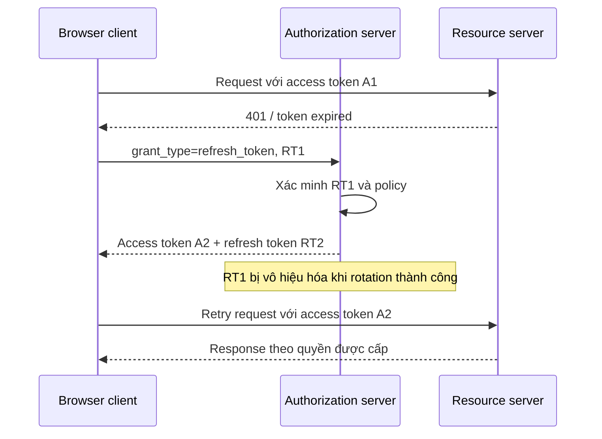
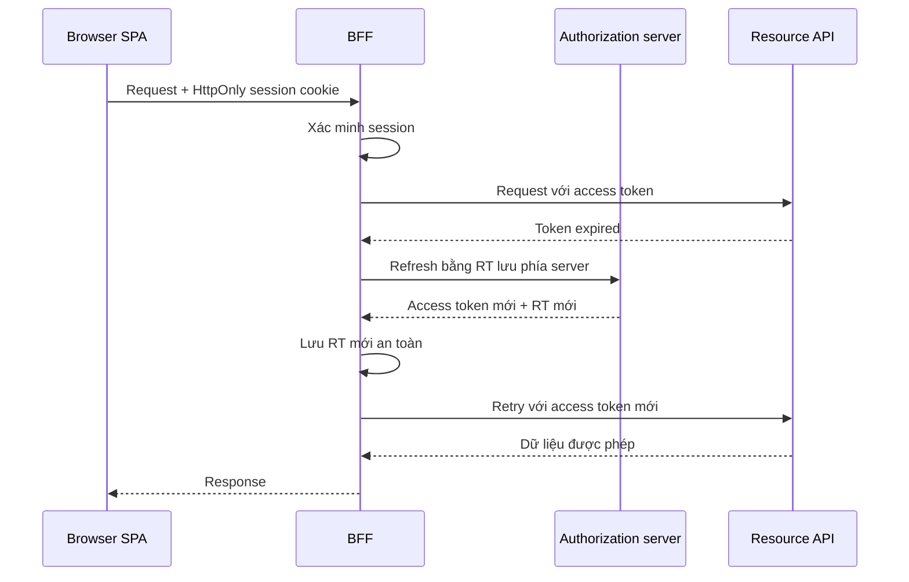

# Refresh token

## Mục tiêu bài học

Sau bài này, bạn có thể:

- Giải thích refresh token dùng để làm gì và phân biệt nó với access token, session cookie và ID token.
- Mô tả vòng đời refresh token trong OAuth 2.0, bao gồm cấp phát, sử dụng, rotation, hết hạn và thu hồi.
- Hiểu vì sao ứng dụng browser là public client và các yêu cầu bảo vệ refresh token khi chạy trong SPA.
- So sánh lưu token trong memory, Web Storage, cookie và kiến trúc Backend for Frontend (BFF).
- Xử lý refresh đồng thời giữa nhiều request hoặc nhiều tab để tránh race condition và reuse detection nhầm.
- Thiết kế logout, refresh failure, token revocation và kiểm thử các kịch bản bị đánh cắp token.

## 1. Refresh token là gì?

Trong OAuth 2.0, access token là credential mà client gửi đến resource server để truy cập API. Access token thường có thời hạn tương đối ngắn. Khi access token hết hạn, client có thể cần một credential khác để xin access token mới mà không yêu cầu người dùng đăng nhập lại. Credential đó là refresh token.

Refresh token được gửi đến authorization server/token endpoint, không phải gửi đến API nghiệp vụ như access token. Authorization server kiểm tra refresh token, trạng thái client, chính sách cấp quyền và các điều kiện liên quan trước khi phát hành access token mới. Tùy cấu hình, server có thể đồng thời cấp refresh token mới và vô hiệu hóa token cũ.

| Credential | Mục đích | Nơi sử dụng |
| --- | --- | --- |
| Access token | Cho phép truy cập một resource server/API theo scope, audience và thời hạn. | Gửi đến API, thường qua `Authorization: Bearer ...`. |
| Refresh token | Xin access token mới khi access token hết hạn hoặc cần làm mới. | Gửi đến authorization server/token endpoint. |
| ID token | Mang thông tin xác thực người dùng trong OpenID Connect. | Client dùng để xác minh kết quả đăng nhập theo quy tắc OIDC; không dùng thay access token để gọi API. |
| Session cookie | Duy trì session của ứng dụng hoặc BFF. | Browser tự gửi đến host/path phù hợp theo chính sách cookie. |

Refresh token thường có giá trị cao hơn access token vì có thể dùng để tạo nhiều access token trong một khoảng thời gian. Nếu attacker lấy được refresh token còn hiệu lực, họ có thể duy trì quyền truy cập sau khi access token ban đầu hết hạn. Vì vậy, refresh token cần được bảo vệ như một credential dài hạn và có cơ chế phát hiện, giới hạn, thu hồi phù hợp.

## 2. Vòng đời refresh token

Một vòng đời phổ biến gồm các bước:

1. Người dùng hoàn tất đăng nhập qua Authorization Code Flow với PKCE.
2. Authorization server phát hành access token và, nếu client đủ điều kiện theo policy, refresh token.
3. Client dùng access token để gọi API.
4. Khi access token hết hạn hoặc API báo token hết hạn, client gọi token endpoint với `grant_type=refresh_token`.
5. Authorization server xác minh refresh token và các ràng buộc của client.
6. Server phát hành access token mới. Nếu bật rotation, server đồng thời phát hành refresh token mới và vô hiệu hóa refresh token vừa dùng.
7. Client thay thế token cũ bằng token mới một cách nguyên tử và tiếp tục request.
8. Khi session hết hạn, logout, token bị thu hồi hoặc phát hiện reuse, client dừng refresh và yêu cầu xác thực lại.



Đây là flow minh họa. Một API có thể trả mã lỗi riêng cho access token hết hạn; không phải mọi `401` đều có nghĩa token hết hạn. Client không nên refresh vô điều kiện khi nhận mọi lỗi `401`, vì lỗi có thể do token sai audience, chữ ký không hợp lệ, tài khoản bị khóa hoặc session đã bị thu hồi.

## 3. Gọi token endpoint bằng refresh token

Với OAuth 2.0, request refresh thường dùng `application/x-www-form-urlencoded`:

```http
POST /oauth/token HTTP/1.1
Host: id.example.com
Content-Type: application/x-www-form-urlencoded

grant_type=refresh_token&refresh_token=RT1&client_id=browser-app
```

Với public client, không gửi client secret được nhúng trong JavaScript. Client ID không phải secret. Authorization server cần biết client là public client và áp dụng yêu cầu bảo vệ refresh token tương ứng. Nếu token được ràng buộc với DPoP hoặc một cơ chế sender-constraining khác, request cần kèm bằng chứng sở hữu khóa theo đúng giao thức.

Nếu request có field `scope`, scope mới không được vượt quá quyền đã được cấp ban đầu; bỏ field này thường có nghĩa tiếp tục dùng scope đã gắn với refresh token/grant theo policy của server. Client không thể dùng refresh token để tự nâng quyền hoặc đổi audience tùy ý.

Response có thể có dạng:

```http
HTTP/1.1 200 OK
Cache-Control: no-store
Pragma: no-cache
Content-Type: application/json

{
  "access_token": "AT2",
  "token_type": "Bearer",
  "expires_in": 300,
  "refresh_token": "RT2",
  "scope": "profile orders.read"
}
```

Các giá trị trong ví dụ là placeholder. Response token không được cache trong browser hoặc shared cache. Client phải đọc `expires_in`, scope và các trường cần thiết theo hợp đồng của authorization server; không suy ra thời hạn từ việc token là JWT hay từ một claim chưa được xác minh.

Với browser SPA gọi token endpoint cross-origin, authorization server phải cấu hình CORS phù hợp cho origin của SPA. CORS chỉ cho phép JavaScript đọc response; nó không thay thế xác minh refresh token, PKCE của luồng authorization code ban đầu hoặc chính sách rotation. Nếu dùng BFF, browser thường không gọi token endpoint trực tiếp; BFF thực hiện thao tác này ở server.

## 4. Vì sao refresh token cần rotation hoặc sender constraint?

Refresh token có thể sống lâu và tạo access token mới, nên việc chỉ đặt thời hạn dài rồi giữ nguyên token qua mọi lần refresh tạo rủi ro lớn. Với public client như SPA, OAuth Security Best Current Practice yêu cầu authorization server phải bảo vệ refresh token bằng một cơ chế sender-constraining hoặc refresh token rotation có khả năng phát hiện reuse.

### 4.1. Refresh token rotation

Khi rotation được bật, mỗi lần refresh thành công sẽ:

- Chấp nhận refresh token hiện tại.
- Phát hành refresh token mới.
- Vô hiệu hóa refresh token vừa dùng.
- Gắn token mới vào cùng một token family/grant hoặc trạng thái phiên tương ứng.

Ví dụ chuỗi token:

```text
RT-1 --refresh--> RT-2 --refresh--> RT-3 --refresh--> RT-4
  |                 |                 |
  invalid           invalid           invalid
```

Client cần thay token cũ bằng token mới ngay sau response thành công. Nếu tiếp tục gửi RT-1 sau khi RT-1 đã bị vô hiệu hóa, authorization server có thể nhận diện đây là reuse.

### 4.2. Reuse detection

Giả sử attacker sao chép RT-1 trước khi người dùng sử dụng nó. Người dùng refresh trước và nhận RT-2; RT-1 bị vô hiệu hóa. Sau đó attacker dùng bản sao RT-1. Server phát hiện token cũ đã được dùng và có thể kết luận token family đã bị sao chép. Một policy an toàn thường thu hồi toàn bộ token family hoặc grant liên quan, buộc người dùng xác thực lại.

Reuse detection không thể luôn xác định ai là attacker. Server chỉ biết cùng một refresh token đã được dùng lại sau khi rotation. Vì vậy, cả client hợp lệ cũng có thể gây sự kiện reuse nếu gửi đồng thời cùng một token từ nhiều tab hoặc request. Phải thiết kế client để tránh refresh race và server cần có policy rõ cho các tình huống retry.

### 4.3. Sender-constrained refresh token

Sender-constraining gắn token với một khóa hoặc cơ chế chứng minh client đang sở hữu một yếu tố mật mã. DPoP (Demonstrating Proof of Possession) là một cơ chế có thể dùng để ràng buộc token với public/private key pair. Khi refresh, client gửi DPoP proof phù hợp; server xác minh proof, thumbprint khóa và các claim như HTTP method/URI, thời điểm, JWT ID cùng nonce nếu có.

Sender-constraining làm giảm giá trị của token bị sao chép đơn lẻ vì attacker còn cần khóa tương ứng. Tuy nhiên, nếu XSS chạy trong cùng browser context có thể gọi logic ký hoặc sử dụng khóa theo quyền của ứng dụng, lợi ích bảo vệ còn phụ thuộc cách khóa được lưu và API ký được cung cấp. Không xem DPoP là biện pháp thay thế chống XSS, kiểm soát quyền hoặc rotation policy.

## 5. Refresh token trong browser: public client và các lựa chọn kiến trúc

Mã JavaScript của SPA được tải về thiết bị người dùng. Người dùng có thể đọc bundle, sửa runtime và quan sát request. Vì vậy, SPA là public client: không thể giữ client secret lâu dài một cách bí mật. Một refresh token mà JavaScript có thể sử dụng cũng có thể bị mã độc cùng origin lấy hoặc lạm dụng khi XSS xảy ra.

### 5.1. Giữ refresh token trong memory

Memory storage giữ token trong biến JavaScript hoặc một module state. Khi reload hoặc đóng context, token thường mất khỏi memory. Điều này giảm thời gian tồn tại và tránh để refresh token nằm trong Web Storage lâu dài.

Hạn chế:

- Reload có thể khiến người dùng phải đăng nhập lại nếu không có cơ chế khôi phục session.
- XSS đang chạy trong trang có thể đọc token nếu truy cập được state hoặc can thiệp vào luồng refresh.
- Nhiều tab không tự chia sẻ memory, nên có thể cùng refresh bằng một token được khôi phục từ nguồn khác hoặc tạo các phiên riêng.

Memory không phải vùng bảo mật chống XSS; nó chỉ thay đổi thời gian lưu và phạm vi truy cập.

### 5.2. Dùng localStorage, sessionStorage hoặc IndexedDB

Các API này thuận tiện cho việc giữ token qua lần tải lại hoặc chia sẻ giữa các context theo phạm vi của từng storage. Tuy nhiên, JavaScript cùng origin có thể đọc dữ liệu đó. Stored XSS có thể lấy refresh token rồi gửi ra ngoài, và token có thể còn tồn tại trên thiết bị dùng chung sau khi tab đóng.

Không nên chọn `localStorage` chỉ vì nó dễ triển khai hoặc vì refresh token được mã hóa trước khi lưu. Nếu khóa giải mã có sẵn trong JavaScript hoặc cùng origin, XSS có thể gọi logic giải mã hoặc lấy token sau khi ứng dụng sử dụng nó. IndexedDB cũng không phải kho bí mật chống XSS.

Nếu sản phẩm vẫn lưu refresh token phía client, cần có threat model rõ, rotation/reuse detection hoặc sender-constraining theo yêu cầu của authorization server, thời hạn và scope giới hạn, CSP/Trusted Types, kiểm soát XSS, cleanup khi logout và quy trình thu hồi khi phát hiện bất thường. Không lưu client secret cùng refresh token.

### 5.3. HttpOnly cookie và Backend for Frontend

Một kiến trúc BFF giữ access token và refresh token ở phía server. Browser chỉ giữ session cookie của BFF, thường có `Secure`, `HttpOnly` và `SameSite` phù hợp. Khi frontend gọi API của ứng dụng, BFF kiểm tra session rồi dùng access token phía server để gọi resource server. Khi access token hết hạn, BFF dùng refresh token ở server để xin token mới.



BFF giảm khả năng JavaScript đọc trực tiếp OAuth refresh token. Tuy nhiên, XSS vẫn có thể gọi endpoint BFF bằng cookie của người dùng và thực hiện hành động mà người dùng được phép làm. Cookie tự động gửi cũng tạo rủi ro CSRF, vì vậy BFF cần CSRF token hoặc biện pháp tương đương, kiểm tra `Origin`/Fetch Metadata và SameSite phù hợp.

Ví dụ session cookie của BFF:

```http
Set-Cookie: __Host-app-session=random-session-id; Path=/; Secure; HttpOnly; SameSite=Lax
Cache-Control: no-store
```

Refresh token được lưu ở server-side session store hoặc secret store phù hợp, không gửi về browser. Khi BFF refresh thành công với rotation, phải cập nhật refresh token mới trong kho lưu trữ một cách nguyên tử trước khi xử lý refresh tiếp theo.

### 5.4. So sánh lựa chọn

| Kiến trúc | Ưu điểm | Rủi ro/chi phí |
| --- | --- | --- |
| SPA giữ token trong memory | Đơn giản, token mất khi context kết thúc, không cần BFF cho mỗi API. | XSS vẫn có thể đánh cắp/lạm dụng token; reload và multi-tab phức tạp. |
| SPA giữ refresh token trong Web Storage | Dễ khôi phục sau reload và chia sẻ theo storage scope. | JavaScript cùng origin đọc được; nguy cơ exfiltration cao khi XSS. |
| BFF giữ token server-side | Refresh token không xuất hiện trong JavaScript; dễ tập trung rotation, revocation và audit. | Cần backend/session store; phải chống CSRF và bảo vệ BFF/session cookie. |
| Cookie do authorization server quản lý trong flow riêng | Có thể tận dụng session IdP cho top-level authentication. | Third-party cookie blocking/partitioning khiến silent iframe refresh không ổn định; không nên giả định IdP cookie luôn sẵn có trong SPA. |

Không có lựa chọn lưu trữ nào làm XSS biến mất. BFF thay đổi nơi giữ credential và giảm khả năng trích xuất token; nó không thay thế phòng chống XSS, CSRF và authorization.

## 6. Thực hiện refresh trong SPA

Ví dụ sau minh họa một client giữ token trong memory và gọi token endpoint. Đây là ví dụ cho authorization server hỗ trợ refresh token rotation; tên endpoint, CORS và policy phải theo cấu hình IdP.

```js
let accessToken = null;
let refreshToken = null;
let accessTokenExpiresAt = 0;
let refreshInFlight = null;

function setTokenResponse(tokens) {
  if (!tokens.access_token || !tokens.refresh_token ||
      !Number.isFinite(tokens.expires_in)) {
    throw new Error("Rotation response is missing required token fields.");
  }
  // Rotation mode: thay token cũ ngay khi server cấp token mới.
  accessToken = tokens.access_token;
  refreshToken = tokens.refresh_token;
  accessTokenExpiresAt = Date.now() + tokens.expires_in * 1000;
}

async function refreshAccessToken() {
  if (refreshInFlight) return refreshInFlight;

  if (!refreshToken) {
    throw new Error("No refresh token is available.");
  }

  refreshInFlight = (async () => {
    const body = new URLSearchParams({
      grant_type: "refresh_token",
      client_id: "browser-app",
      refresh_token: refreshToken
    });

    const response = await fetch("https://id.example.com/oauth/token", {
      method: "POST",
      headers: {
        "Content-Type": "application/x-www-form-urlencoded"
      },
      body,
      cache: "no-store"
    });

    if (!response.ok) {
      throw new Error(`Refresh failed: ${response.status}`);
    }

    const tokens = await response.json();
    setTokenResponse(tokens);
    return accessToken;
  })();

  try {
    return await refreshInFlight;
  } finally {
    refreshInFlight = null;
  }
}
```

`refreshInFlight` ngăn nhiều request trong cùng một JavaScript context cùng refresh một token. Khi rotation được bật, `setTokenResponse()` phải thay refresh token cũ bằng token mới trước khi cho phép lần refresh tiếp theo. Ví dụ giữ token trong memory nên không có khôi phục sau reload; một ứng dụng production cần xử lý trạng thái đăng nhập và lỗi theo thiết kế.

Ví dụ trên giả định authorization server luôn trả refresh token thay thế khi rotation thành công. Một số server có policy khác; client phải tuân theo hợp đồng cụ thể và không tự suy đoán rằng token cũ còn dùng được nếu response thiếu field. Nếu request đã đến server nhưng response bị mất do mạng ngắt, client không biết server đã tiêu thụ token cũ hay chưa. Không tự động retry token cũ vô hạn; hãy dùng cơ chế recovery/retry do IdP hỗ trợ hoặc kết thúc phiên và yêu cầu xác thực lại.

Không nên refresh chỉ dựa vào việc đồng hồ client cho rằng token đã hết hạn. Client có thể dùng `expires_in` để chủ động refresh trước một khoảng ngắn, nhưng server vẫn là nguồn quyết định. Cần xử lý clock skew, tab bị suspend và request đến API sau khi token đã hết hạn.

### 6.1. Retry API sau refresh

Chỉ retry request khi biết lỗi là access token hết hạn và thao tác có thể được retry an toàn. Với request có side effect, dùng idempotency key hoặc cơ chế nghiệp vụ phù hợp để tránh thực hiện trùng.

```js
async function fetchWithAccessToken(url, options = {}) {
  const send = (token) => fetch(url, {
    ...options,
    headers: {
      ...options.headers,
      Authorization: `Bearer ${token}`
    }
  });

  let response = await send(accessToken);

  if (!isExpiredAccessTokenResponse(response)) {
    return response;
  }

  const newToken = await refreshAccessToken();
  response = await send(newToken);
  return response;
}
```

`isExpiredAccessTokenResponse()` cần kiểm tra mã lỗi hoặc `WWW-Authenticate` theo hợp đồng API. Không refresh khi nhận `403 Forbidden`, lỗi quyền, token sai audience hoặc mọi lỗi mạng. Giới hạn số lần retry; nếu token mới vẫn bị từ chối, kết thúc luồng và xử lý lỗi thay vì tạo vòng lặp refresh vô hạn.

## 7. Rotation và xử lý refresh đồng thời

Rotation tạo ra một vấn đề đồng thời: cùng một refresh token chỉ nên được dùng một lần. Trong một tab, nhiều request có thể đồng thời nhận lỗi access token hết hạn. Ở nhiều tab, mỗi tab có thể có bản sao token cũ nếu token được lưu trong storage.

Ví dụ race condition:

```text
Tab A                  Authorization server             Tab B
  |---- refresh RT-1 -------->|                              |
  |                           |<--------- refresh RT-1 ------|
  |<--- AT-2 + RT-2 ----------|                              |
  |                           |---- reuse detected --------->|
  |                           |<--- request rejected ---------|
```

Kết quả phụ thuộc thứ tự xử lý và policy của server. Một request có thể thành công và request còn lại bị xem là reuse. Nếu server thu hồi cả token family, refresh hợp lệ vừa nhận cũng có thể mất hiệu lực. Client cần điều phối để chỉ có một refresh đang chạy cho cùng token family.

### 7.1. Single-flight trong một tab

Dùng một promise chung như ví dụ ở trên để mọi request trong cùng context chờ một lần refresh. Chỉ sau khi promise hoàn tất mới gửi lại các request đang chờ. Nếu refresh thất bại, các request phải nhận lỗi chung và client chuyển sang trạng thái cần đăng nhập lại.

### 7.2. Điều phối nhiều tab

Các cách có thể dùng:

- `navigator.locks` để yêu cầu một tab giữ lock trong lúc refresh nếu browser hỗ trợ.
- `BroadcastChannel` để thông báo trạng thái refresh hoàn tất hoặc session đã hết hạn.
- SharedWorker hoặc một service layer duy nhất để quản lý token cho nhiều tab.
- BFF để tập trung refresh token ở server, nơi có thể dùng transaction/lock theo session.

Không gửi refresh token qua `BroadcastChannel` chỉ để đồng bộ. Channel cùng origin không phải kênh bí mật trước XSS hoặc script độc hại. Nếu dùng Web Storage làm tín hiệu, chỉ lưu trạng thái/version hoặc thông báo không chứa credential.

Ví dụ thông báo không chứa token:

```js
const authChannel = new BroadcastChannel("app-auth");

authChannel.addEventListener("message", ({ data }) => {
  if (data?.type === "session-ended") {
    clearInMemoryTokens();
    showSignedOutState();
  }

  if (data?.type === "tokens-updated") {
    // Tab này cần lấy trạng thái token từ nguồn quản lý an toàn,
    // không nhận refresh token qua BroadcastChannel.
    reloadAuthStateFromCoordinator();
  }
});
```

Đoạn code chỉ là giao thức thông báo. `reloadAuthStateFromCoordinator()` cần lấy trạng thái từ BFF/worker hoặc nguồn quản lý đã thiết kế. Nếu mỗi tab tự giữ token riêng trong memory, thông điệp `tokens-updated` không tự làm tab kia có refresh token mới; kiến trúc phải có một coordinator thực sự hoặc buộc tab khác xác thực lại.

### 7.3. Lock phía server

Với BFF hoặc server giữ refresh token, dùng lock hoặc transaction theo session/token family để chỉ một worker refresh tại một thời điểm. Cập nhật refresh token mới và trạng thái cũ trong cùng transaction nếu kho lưu trữ hỗ trợ. Các request khác chờ kết quả mới thay vì gửi token cũ lần nữa.

Không xử lý race bằng cách chấp nhận mọi lần dùng lại token cũ trong một khoảng thời gian dài. Cửa sổ grace quá rộng làm giảm hiệu quả phát hiện token bị đánh cắp. Nếu authorization server có chính sách retry/idempotency cụ thể, client phải tuân thủ đúng hợp đồng đó.

## 8. Hết hạn, thu hồi và các lỗi refresh

Refresh token có thể không còn hợp lệ vì nhiều lý do:

| Trường hợp | Ý nghĩa | Hành động phía client |
| --- | --- | --- |
| `invalid_grant` | Refresh token sai, hết hạn, đã bị dùng, bị thu hồi hoặc không còn hợp lệ theo policy. | Dừng refresh, xóa credential cục bộ và yêu cầu đăng nhập lại. |
| `invalid_client` | Client không được nhận diện hoặc cấu hình client sai. | Không lặp retry vô hạn; ghi nhận lỗi cấu hình và chuyển đến xử lý vận hành. |
| `unauthorized_client` | Client không được phép dùng grant hoặc refresh flow này. | Dừng flow và sửa cấu hình authorization server. |
| `invalid_scope` | Scope yêu cầu không hợp lệ hoặc vượt quyền đã cấp. | Không tự mở rộng scope; yêu cầu flow cấp quyền mới nếu sản phẩm cho phép. |
| `temporarily_unavailable` / lỗi mạng | Authorization server tạm thời không sẵn sàng hoặc mạng lỗi. | Retry có backoff/jitter giới hạn nếu session còn hợp lệ; không xóa token ngay vì lỗi tạm thời. |
| `429` hoặc rate limit | Client gửi quá nhiều yêu cầu refresh. | Tôn trọng `Retry-After` nếu có, giảm tần suất và điều phối refresh. |

OAuth token endpoint có thể dùng HTTP status và error code theo giao thức. Client cần phân biệt lỗi credential vĩnh viễn với lỗi tạm thời. Không log raw request body vì có refresh token.

### 8.1. Thời hạn refresh token

Refresh token có thể có absolute lifetime, idle lifetime hoặc chính sách hết hạn theo hoạt động. Server nên giới hạn thời gian tồn tại dựa trên rủi ro, loại client, mức độ nhạy cảm và khả năng thu hồi. Rotation không có nghĩa refresh token được sống vô hạn; token mới vẫn cần tuân thủ lifetime của grant/token family.

Nếu người dùng không hoạt động trong thời gian dài, session có thể hết hạn dù access token vừa được refresh ở một thời điểm trước đó. Server nên áp dụng cả thời hạn tuyệt đối và thời gian không hoạt động nếu phù hợp, đồng thời cung cấp UX rõ ràng khi cần đăng nhập lại.

### 8.2. Revocation

OAuth Token Revocation endpoint cho phép client yêu cầu authorization server thu hồi token. Khi logout hoặc phát hiện compromise, hệ thống có thể thu hồi refresh token và các token liên quan theo policy. Với rotation, server thường cần thu hồi token family/grant để ngăn token cũ hoặc token mới trong cùng family tiếp tục được dùng.

Thu hồi refresh token không nhất thiết làm access token đã phát hành mất hiệu lực tức thời. Nếu resource server chỉ xác minh chữ ký JWT offline, token có thể còn dùng được đến `exp`. Muốn thu hồi nhanh cần access token ngắn hạn, introspection, denylist hoặc cơ chế kiểm tra session/version phù hợp. Thiết kế phải nêu rõ khoảng thời gian còn hiệu lực sau logout/compromise.

### 8.3. Logout

Logout cần:

1. Kết thúc session ứng dụng ở server/BFF.
2. Thu hồi refresh token hoặc token family khi flow yêu cầu và authorization server hỗ trợ.
3. Hết hạn cookie session bằng `Set-Cookie` có cùng name/path/domain và thuộc tính tương ứng.
4. Xóa access token, refresh token và user state trong memory/storage do ứng dụng quản lý.
5. Dọn cache dữ liệu riêng tư và thông báo logout cho các tab khác.
6. Điều hướng đến trang đã đăng xuất và xử lý các request đang chờ.

Nếu endpoint revocation tạm thời không truy cập được, ứng dụng cần có policy logout rõ: có thể kết thúc session local ngay nhưng ghi nhận trạng thái revoke pending ở server/BFF để retry an toàn. Không giữ giao diện như đang đăng nhập chỉ vì revoke endpoint lỗi. Với SPA thuần, nếu không thể đảm bảo token đã bị thu hồi, cần nói rõ giới hạn và dựa vào expiration ngắn cùng khả năng revoke của IdP.

## 9. CSRF và refresh token trong cookie

Nếu refresh token được giữ trong cookie và browser tự gửi cookie đến token endpoint, luồng refresh có thể chịu rủi ro CSRF. Kẻ tấn công có thể cố kích hoạt refresh hoặc thay đổi trạng thái phiên thông qua browser của nạn nhân. Rủi ro phụ thuộc domain, SameSite, endpoint, method và credential policy.

Với BFF dùng session cookie:

- Dùng cookie `Secure`, `HttpOnly`, `SameSite` phù hợp và host-only nếu có thể.
- Bảo vệ endpoint refresh/logout bằng CSRF token hoặc cơ chế chống CSRF phù hợp.
- Kiểm tra `Origin` và Fetch Metadata cho request thay đổi trạng thái.
- Không dùng GET để refresh hoặc logout.
- Giới hạn CORS theo origin cụ thể; không phản chiếu origin tùy ý với credentials.
- Không dựa vào CORS để thay thế CSRF token hoặc xác minh session.

Nếu SPA gửi refresh token trong body đến token endpoint, credential không tự động được gửi như cookie; nhưng token vẫn có thể bị đánh cắp qua XSS, extension độc hại hoặc môi trường thiết bị bị xâm nhập. Mỗi kiến trúc có rủi ro khác nhau và cần kiểm tra theo luồng thực tế.

## 10. XSS, CSP và refresh token

XSS là một trong những rủi ro lớn nhất đối với refresh token mà JavaScript có thể truy cập. Stored XSS có thể chờ người dùng mở lại ứng dụng rồi lấy token; reflected/DOM XSS có thể đọc token hoặc gọi logic refresh trong phiên hiện tại.

Các biện pháp giảm thiểu:

- Ưu tiên BFF khi kiến trúc và vận hành cho phép để refresh token không xuất hiện trong browser JavaScript.
- Nếu là SPA public client, áp dụng rotation hoặc sender-constraining theo yêu cầu của authorization server.
- Giữ access token trong memory nếu phù hợp; tránh lưu refresh token dài hạn trong `localStorage`.
- Dùng CSP chặt với nonce/hash, `object-src 'none'`, `base-uri 'self'` và giới hạn nguồn script.
- Dùng Trusted Types cho DOM sink nguy hiểm trên browser hỗ trợ.
- Encode output đúng ngữ cảnh, tránh `innerHTML` và kiểm soát dependency/script bên thứ ba.
- Giới hạn thời hạn, scope, audience và khả năng thu hồi của token.
- Không đưa token vào URL, log, analytics, error tracking hoặc thông điệp giữa các tab.

CSP và Trusted Types giảm khả năng XSS nhưng không phải bảo đảm tuyệt đối. Nếu script hợp lệ hoặc dependency cùng origin bị xâm nhập, attacker vẫn có thể hoạt động trong quyền của ứng dụng. Giảm lượng dữ liệu nhạy cảm phía browser và khả năng token bị tái sử dụng là các lớp bảo vệ bổ sung.

## 11. Refresh token trong iframe và silent authentication

Một số SPA từng dùng hidden iframe để gọi IdP và dựa vào cookie IdP nhằm lấy token mới mà không yêu cầu người dùng tương tác. Cách này phụ thuộc third-party cookie và hành vi iframe. Các trình duyệt có thể chặn hoặc phân vùng cookie bên thứ ba, khiến silent authentication thất bại dù người dùng vẫn đăng nhập ở tab IdP khác.

Không nên thiết kế refresh token rotation dựa trên giả định iframe luôn truy cập được session cookie của IdP. Ưu tiên refresh token được cấp hợp lệ cho public client với rotation/sender constraint, hoặc BFF giữ token phía server. Khi IdP yêu cầu tương tác lại, ứng dụng phải xử lý `login_required`, `interaction_required` hoặc lỗi tương đương bằng UX đăng nhập lại rõ ràng.

Nếu dùng `postMessage` để trao đổi kết quả giữa popup/iframe và ứng dụng, đặt `targetOrigin` chính xác, kiểm tra `event.origin`, `event.source` và schema; không gửi refresh token qua channel không cần thiết. Authorization code và token không được chấp nhận chỉ vì message có cấu trúc đúng.

## 12. Monitoring và phát hiện token bị lạm dụng

Authorization server/BFF nên ghi nhận sự kiện cần thiết để phát hiện bất thường:

- Refresh token family hoặc grant ID (dùng định danh nội bộ, không log token thô).
- Client ID, user/session ID đã được pseudonymize phù hợp và thời điểm refresh.
- Kết quả thành công/thất bại và mã lỗi chuẩn hóa.
- Reuse detection, refresh token đã thu hồi hoặc token family bị revoke.
- Số lần refresh bất thường, địa chỉ mạng/risk signal theo chính sách quyền riêng tư.
- Thay đổi thiết bị hoặc hoạt động refresh đồng thời bất thường.

Không ghi refresh token, access token, DPoP private key, cookie session hoặc toàn bộ form body vào log. Khi phát hiện reuse, cần có quy trình cảnh báo, thu hồi token family, kết thúc session liên quan và yêu cầu người dùng xác thực lại. Thông báo cho người dùng nên tránh tiết lộ chi tiết giúp attacker dò hệ thống.

## 13. Kiểm thử refresh token

Thực hiện trong môi trường lab/staging với tài khoản thử. Không dùng token production hoặc đưa token thật vào ảnh chụp DevTools.

| Kịch bản | Cách kiểm tra | Kết quả mong đợi |
| --- | --- | --- |
| Refresh bình thường | Dùng access token hết hạn và refresh token còn hiệu lực. | Token endpoint trả access token mới; client cập nhật trạng thái. |
| Rotation | Refresh RT-1 rồi thử lại RT-1. | RT-1 bị từ chối; server áp dụng reuse policy cho token family. |
| Reuse token bị đánh cắp | Giả lập hai client có cùng RT-1, một client refresh trước. | Lần dùng lại bị phát hiện và grant/token family bị xử lý theo policy. |
| Refresh đồng thời trong một tab | Cho nhiều API request hết hạn cùng lúc. | Chỉ một refresh được thực hiện; request khác chờ kết quả chung. |
| Refresh đồng thời nhiều tab | Mở nhiều tab dùng chung session/token source và làm access token hết hạn. | Coordinator/lock/BFF ngăn gửi cùng refresh token đồng thời. |
| Refresh token hết hạn | Dùng token đã quá absolute/idle lifetime. | Server trả lỗi phù hợp; client dừng refresh và yêu cầu đăng nhập lại. |
| Logout và revoke | Logout rồi thử dùng refresh token cũ. | Refresh token bị từ chối; cookie/session local đã kết thúc. |
| Access token sau revoke | Dùng access token đã phát hành trước khi refresh token bị revoke. | Hành vi khớp với chính sách: hết hạn ngắn, introspection hoặc denylist; không giả định revoke refresh tự động revoke JWT đã phát hành. |
| XSS/storage exposure | Kiểm tra token có xuất hiện trong Web Storage, log, URL hoặc analytics không. | Không có token ngoài vị trí đã thiết kế; không log credential thô. |
| CSRF trên BFF refresh | Gửi request refresh từ origin lab khác. | Request bị chặn theo CSRF/Origin/Fetch Metadata policy. |
| Mạng gián đoạn | Ngắt mạng giữa lúc refresh và nhận response. | Client xử lý trạng thái không chắc chắn, tránh dùng token cũ lặp vô hạn và khôi phục theo policy của server. |
| Rate limiting | Gửi refresh request liên tục. | Server giới hạn tốc độ và client tôn trọng backoff/Retry-After. |

### 13.1. Quan sát bằng DevTools

Trong Network, lọc request đến token endpoint. Kiểm tra `grant_type`, status, error code, `Cache-Control: no-store` và response có refresh token mới khi rotation được bật. Không copy request bằng “Copy as cURL” hoặc chia sẻ HAR nếu chưa loại bỏ token và cookie.

Trong Application/Storage, kiểm tra Local Storage, Session Storage, IndexedDB và Cookies để xác nhận refresh token không xuất hiện ngoài thiết kế. Cookie `HttpOnly` có thể hiển thị trong DevTools dù JavaScript không đọc được. Trong nhiều tab, quan sát số lần refresh và thứ tự response để phát hiện race condition.

## 14. Những lỗi thường gặp

| Lỗi | Hậu quả | Cách khắc phục |
| --- | --- | --- |
| Dùng refresh token như access token | API không thể xác minh token theo đúng audience/ý nghĩa. | Chỉ gửi refresh token đến authorization server/token endpoint. |
| Coi refresh token là credential ít nhạy cảm | Token bị đánh cắp có thể tạo access token mới trong thời gian dài. | Bảo vệ token, rotation/reuse detection hoặc sender-constraining và lifetime hợp lý. |
| Nhúng client secret trong SPA | Secret có thể bị mọi người dùng tải về và trích xuất. | Đăng ký SPA là public client; không gửi client secret. |
| Lưu refresh token dài hạn trong localStorage mà không có threat model | XSS có thể đọc và exfiltrate token. | Ưu tiên BFF hoặc thiết kế public client có rotation/sender constraint và biện pháp XSS. |
| Không thay refresh token sau rotation | Client gửi token đã bị vô hiệu hóa và có thể kích hoạt reuse detection. | Cập nhật token mới ngay sau response thành công. |
| Nhiều tab refresh cùng một token | Server có thể coi request thứ hai là token reuse và thu hồi family. | Single-flight, lock, coordinator hoặc tập trung refresh ở BFF. |
| Refresh với mọi lỗi 401/403 | Có thể tạo vòng lặp và che lỗi quyền/cấu hình. | Chỉ refresh khi API xác định access token hết hạn. |
| Cho rằng revoke refresh token làm JWT access token mất hiệu lực ngay | Access token đã phát hành có thể còn hợp lệ đến `exp`. | Thiết kế access token ngắn hạn hoặc introspection/denylist khi cần revoke nhanh. |
| Dùng hidden iframe như giải pháp refresh phổ quát | Third-party cookie blocking có thể làm silent auth thất bại. | Dùng refresh flow phù hợp hoặc BFF và xử lý yêu cầu đăng nhập lại. |
| Gửi refresh token qua BroadcastChannel | Script cùng origin có thể quan sát channel và lấy credential. | Chỉ phát thông báo trạng thái; điều phối credential qua nguồn quản lý an toàn. |

## 15. Bài thực hành

Xây dựng một SPA public client trong môi trường thử nghiệm với authorization server hỗ trợ refresh token rotation. Nếu có backend, tạo thêm một BFF để so sánh hai kiến trúc.

1. Thực hiện Authorization Code Flow với PKCE và nhận access token cùng refresh token theo policy của IdP.
2. Gọi một API thử nghiệm bằng access token; đặt access token lifetime ngắn để quan sát refresh.
3. Triển khai single-flight trong một tab và cập nhật refresh token mới sau rotation.
4. Mở hai tab, tạo request đồng thời khi access token hết hạn và quan sát cách coordinator/lock xử lý.
5. Dùng một bản sao refresh token cũ trong môi trường lab để kiểm tra reuse detection và token family revocation.
6. Logout, gọi revocation endpoint theo hỗ trợ của IdP và thử dùng refresh token đã thu hồi.
7. Kiểm tra XSS exposure, Web Storage, URL, log và Network trace; xác nhận không có token thô bị ghi ngoài vị trí được thiết kế.
8. Nếu dùng BFF, kiểm tra session cookie, CSRF protection và việc BFF cập nhật refresh token mới một cách nguyên tử.
9. Ngắt mạng giữa request refresh và response để quan sát trạng thái không chắc chắn, retry và yêu cầu đăng nhập lại.
10. Ghi lại lifetime, rotation policy, reuse response, cách xử lý nhiều tab và giới hạn thu hồi access token.

Hoàn thành bài thực hành khi bạn giải thích được refresh token tạo access token mới như thế nào, vì sao rotation cần reuse detection, cách browser bảo vệ credential và phối hợp nhiều tab, cũng như khoảng thời gian một access token đã phát hành có thể còn hiệu lực sau khi refresh token bị thu hồi.
