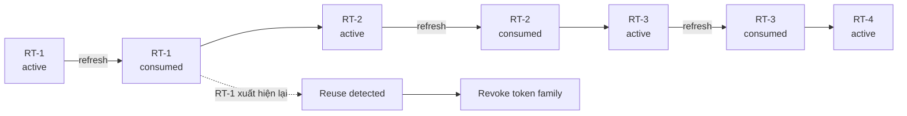
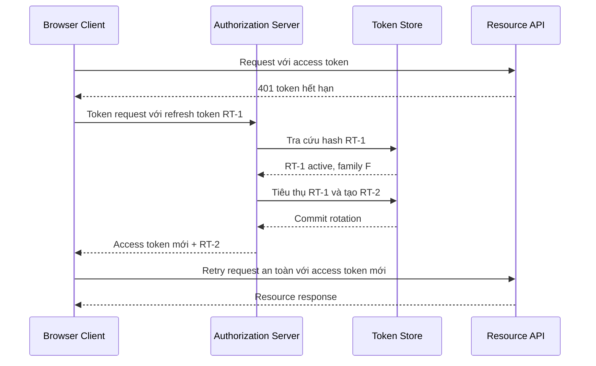
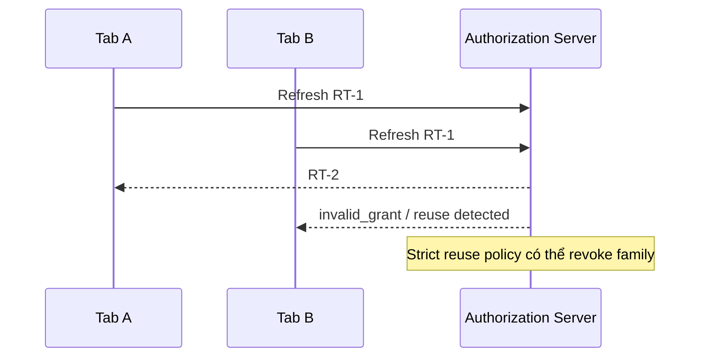

# Token rotation: thay refresh token sau mỗi lần sử dụng

Token rotation là kỹ thuật thay một refresh token bằng refresh token mới sau mỗi lần refresh thành công. Authorization server đánh dấu token cũ đã được sử dụng và cấp token kế tiếp trong cùng một token family. Nếu token cũ xuất hiện lại, server có thể nhận diện khả năng credential đã bị sao chép và thu hồi cả family theo policy.

Rotation đặc biệt quan trọng với browser-based public client vì refresh token là credential có giá trị cao: người sở hữu nó có thể xin access token mới. Nếu refresh token bị đánh cắp, rotation và reuse detection giúp giới hạn khả năng sử dụng lâu dài và phát hiện việc token cũ bị dùng lại. Tuy nhiên, rotation phải được thiết kế cùng xử lý đồng thời, lỗi mạng, logout, lưu trữ browser và vòng đời session; nếu không, chính client hợp lệ có thể tự tạo ra tình huống reuse.

Bài học thuộc chương **Browser token security**, theo đề bài **Token rotation**, trong phạm vi **SECURITY_APPLICATION_SECURITY_BROWSER_SECURITY**: phân tích ranh giới bảo mật giữa trình duyệt, origin, cookie và ứng dụng web để hiểu Same-Origin Policy, CORS và các cơ chế cách ly; thực hành phòng vệ XSS, CSRF, clickjacking bằng CSP, Trusted Types, security headers và kiểm chứng hành vi thực tế.

## 1. Mục tiêu học tập

Sau bài học, người học có thể:

1. Giải thích vì sao refresh token rotation thay thế token cũ sau mỗi lần sử dụng.
2. Phân biệt access token rotation, refresh token rotation và signing-key rotation.
3. Mô tả token family, one-time use và reuse detection.
4. Thiết kế lưu trữ refresh token phía server và quy trình cập nhật nguyên tử.
5. Xử lý race condition giữa nhiều request, tab hoặc thiết bị.
6. Phân tích trường hợp server đã rotate token nhưng response bị mất.
7. So sánh rotation với sender-constrained refresh token như DPoP.
8. Đánh giá rủi ro XSS, CSRF và browser storage đối với refresh token.
9. Thiết kế logout, revocation, expiry và phản ứng khi phát hiện reuse.
10. Kiểm thử rotation thành công, token cũ bị dùng lại, refresh đồng thời và lỗi mạng.

## 2. Vì sao cần token rotation?

Refresh token thường sống lâu hơn access token và được dùng để xin access token mới mà người dùng không phải đăng nhập lại sau mỗi lần access token hết hạn. Vì thế, refresh token là mục tiêu có giá trị cao nếu bị lộ.

Nếu một refresh token có thể được dùng lặp lại trong toàn bộ thời hạn của nó, kẻ tấn công lấy được bản sao có thể tiếp tục đổi nó lấy access token mới. Server khó phân biệt người dùng hợp lệ và người đang sử dụng bản sao nếu cả hai cùng trình một bearer credential.

Rotation thay đổi trạng thái credential sau mỗi lần refresh:

- Client gửi refresh token hiện tại.
- Authorization server xác minh token và điều kiện của grant.
- Server đánh dấu token hiện tại đã tiêu thụ.
- Server phát hành refresh token kế tiếp.
- Client thay thế bản cũ bằng token mới.
- Nếu token cũ xuất hiện lại, server nhận biết một lần sử dụng không còn hợp lệ.

Rotation biến refresh token thành credential dùng một lần trong chuỗi liên tục. Cơ chế này giúp phát hiện replay, nhưng không tự ngăn kẻ đánh cắp dùng token trước chủ sở hữu hợp lệ.

### Bearer refresh token là credential theo kiểu possession

Một bearer refresh token không chứng minh danh tính người đang gửi. Server biết request có token được cấp, chứ không tự biết người gửi là browser ban đầu hay kẻ đã sao chép token.

Do đó, cần kết hợp:

- Token entropy đủ cao và lưu trữ an toàn.
- Rotation và reuse detection.
- Giới hạn thời hạn, client, scope và resource.
- Thu hồi theo grant/session/device.
- Sender constraint khi hệ thống hỗ trợ.
- Xử lý XSS và các kênh làm lộ credential.

## 3. Phân biệt ba loại rotation

Từ “rotation” có thể nói về nhiều loại credential khác nhau:

| Loại | Thành phần được thay | Mục đích |
| --- | --- | --- |
| Access token renewal/rotation | Access token cũ được thay bằng access token mới | Giữ access token ngắn hạn và cập nhật quyền/thời hạn. |
| Refresh token rotation | Refresh token hiện tại được thay bằng refresh token kế tiếp | Phát hiện reuse và giới hạn vòng đời credential dài hạn. |
| Signing-key rotation | Khóa ký JWT được thay bằng khóa mới | Giảm thời gian sử dụng khóa và hỗ trợ quản lý khóa. |

Trong bài này, **token rotation** tập trung vào refresh token rotation trong OAuth 2.0/browser authentication. Việc thay khóa ký JWT là quy trình riêng; thay access token không tự động có nghĩa refresh token cũng đã được rotate.

### Access token và refresh token có vòng đời khác nhau

| Đặc điểm | Access token | Refresh token |
| --- | --- | --- |
| Mục đích | Gọi resource API | Xin access token mới |
| Nơi gửi | Resource server | Authorization server/token endpoint |
| Thời hạn | Thường ngắn hơn | Thường dài hơn nhưng phải có giới hạn |
| Rotation | Có thể được cấp mới theo từng lần refresh | Thay token cũ sau mỗi lần refresh thành công |
| Rủi ro khi lộ | Truy cập API trong scope/audience và thời hạn của token | Có thể xin nhiều access token mới cho tới khi bị hết hạn/thu hồi/phát hiện reuse |

Không gửi refresh token tới resource API. Không dùng ID token thay access token hoặc refresh token.

## 4. Token family và chuỗi rotation

Một token family là nhóm refresh token được sinh ra từ cùng một authorization grant/session. Mỗi lần refresh thành công tạo một token kế tiếp trong family đó.

Ví dụ:



Khi RT-1 đã bị tiêu thụ để tạo RT-2, một request khác dùng RT-1 không còn là refresh hợp lệ. Nếu server phát hiện token cũ được dùng lại, server có thể thu hồi RT-2, RT-3 và token family liên quan theo policy.

### Những thuộc tính nên quản lý

Một record refresh token/family có thể cần:

| Thuộc tính | Ý nghĩa |
| --- | --- |
| token_id | Định danh record nội bộ. |
| token_hash | Hash của secret refresh token để tra cứu mà không lưu raw token. |
| family_id | Nhóm token thuộc cùng grant/session. |
| subject_id | Người dùng hoặc subject được ủy quyền. |
| client_id | OAuth client đã nhận grant. |
| issued_at / expires_at | Thời điểm cấp và hết hạn. |
| consumed_at | Thời điểm token đã được dùng để rotate. |
| replaced_by | ID record token kế tiếp nếu có. |
| revoked_at / revoke_reason | Trạng thái và nguyên nhân thu hồi. |
| scope / resource | Phạm vi được phép theo grant. |
| sender_key_thumbprint | Dấu vân tay khóa nếu token được sender-constrain. |

Các trường cụ thể phụ thuộc hệ thống. Không lưu refresh token thô trong database nếu có thể lưu hash an toàn và chỉ trả raw token một lần khi cấp.

### Tại sao lưu hash?

Refresh token nên là chuỗi ngẫu nhiên có entropy cao, ví dụ tạo từ CSPRNG với ít nhất 256 bit ngẫu nhiên. Server lưu hash của token để nếu database chỉ đọc bị lộ, kẻ tấn công không nhận ngay credential có thể dùng.

Vì token có entropy cao và ngẫu nhiên, hash mật mã phù hợp như SHA-256 có thể dùng để tra cứu; không cần password hashing chậm kiểu Argon2 để chống brute-force một secret 256-bit. Có thể thêm pepper/HMAC quản lý ngoài database theo threat model.

Không tạo token bằng Math.random(), timestamp, user ID hoặc chuỗi có thể đoán. Không dùng hash đơn giản của dữ liệu ít entropy làm refresh token.

## 5. Luồng refresh token rotation

Luồng cơ bản:



Server chỉ trả token kế tiếp sau khi cập nhật trạng thái rotation thành công. Client phải thay refresh token cũ bằng refresh token mới trước khi thực hiện lần refresh tiếp theo.

### Các bước xác minh tại token endpoint

1. Xác minh client/grant được phép refresh.
2. Tra cứu token theo hash và xác nhận token tồn tại.
3. Kiểm tra token chưa hết hạn, chưa revoke và chưa consumed.
4. Kiểm tra family/session chưa bị revoke.
5. Kiểm tra client binding, subject, scope/resource và sender constraint nếu có.
6. Thực hiện cập nhật nguyên tử: consume token cũ, tạo token mới và liên kết hai record.
7. Cấp access token mới theo policy.
8. Trả refresh token kế tiếp qua TLS và không ghi token vào log/cache.

Nếu bất kỳ điều kiện nào không đạt, không phát hành token mới.

## 6. One-time use và reuse detection

### One-time use

Một refresh token active chỉ được tiêu thụ thành công một lần. Khi rotation hoàn tất, token cũ phải chuyển sang trạng thái consumed/replaced và không được dùng lại để tạo một nhánh token khác.

Server không được xử lý kiểu:

1. Đọc token cũ thấy còn active.
2. Tạo token mới.
3. Sau đó mới đánh dấu token cũ đã dùng.

Hai request đồng thời có thể cùng đọc thấy token active và cùng tạo hai successor. Cập nhật phải được khóa hoặc dùng conditional update/transaction để chỉ một request thắng.

### Reuse detection

Nếu token đã consumed được trình lại, server phát hiện reuse. Với bearer refresh token rotation, đây là tín hiệu token có thể đã bị sao chép hoặc client đã gửi lại request cũ.

Phản ứng thường dùng:

- Thu hồi token family đang hoạt động.
- Hủy các refresh token hậu duệ của token bị replay.
- Ghi security event với family ID, client ID, subject và thời điểm.
- Không ghi raw refresh token.
- Yêu cầu người dùng xác thực lại theo policy.
- Có thể thu hồi session/authorization grant liên quan.

### Reuse detection không xác định chắc chắn kẻ tấn công

Token cũ có thể xuất hiện lại do:

- Kẻ tấn công dùng bản sao đã đánh cắp.
- Hai tab cùng refresh một token.
- Client retry sau khi không nhận được response.
- Browser khôi phục state cũ hoặc tab bị treo.
- Lỗi đồng bộ giữa nhiều instance authorization server.

Server không thể chỉ dựa vào một lần reuse để biết chắc ai là chủ sở hữu hợp lệ. Reuse là tín hiệu bảo mật mạnh cần điều tra, nhưng hệ thống client phải giảm các trường hợp reuse hợp lệ do race/lỗi mạng.

## 7. Cập nhật rotation nguyên tử ở server

Rotation cần đảm bảo chỉ một request có thể tiêu thụ token hiện tại. Dùng transaction, row lock hoặc conditional update trong datastore có semantics nguyên tử.

### Pseudocode cho transaction

Ví dụ dưới đây mô tả logic, không gắn với một thư viện database cụ thể:

```text
BEGIN TRANSACTION

1. Tìm refresh-token record bằng hash(token).
2. Khóa record/family liên quan.
3. Kiểm tra token active, chưa hết hạn và family chưa revoked.
4. Kiểm tra client, grant và sender binding.
5. Nếu token đã consumed:
     đánh dấu family revoked vì reuse;
     ghi security event;
     COMMIT;
     trả lỗi invalid_grant.
6. Tạo refresh token mới ngẫu nhiên.
7. Lưu hash token mới trong cùng family.
8. Đánh dấu token cũ consumed và replaced_by = token mới.
9. Cập nhật last_used_at / family expiry theo policy.

COMMIT

Trả access token mới và raw refresh token mới cho client.
```

Không gửi response thành công trước khi transaction commit. Nếu transaction rollback, token cũ vẫn phải ở trạng thái trước đó và không có successor active không thể truy cập.

### Conditional update

Một cách triển khai là chỉ cập nhật record nếu nó vẫn active:

```sql
UPDATE refresh_tokens
SET consumed_at = CURRENT_TIMESTAMP
WHERE token_hash = :token_hash
  AND consumed_at IS NULL
  AND revoked_at IS NULL
  AND expires_at > CURRENT_TIMESTAMP;
```

Kiểm tra số dòng bị cập nhật. Chỉ request cập nhật đúng một dòng mới được tiếp tục tạo successor trong cùng transaction. Nếu không cập nhật được dòng nào, token không còn hợp lệ hoặc đã bị dùng.

Đây là minh họa SQL; cú pháp và isolation level cần điều chỉnh theo database. Việc tạo successor, cập nhật replaced_by, kiểm tra family và consume token cũ phải nằm trong cùng transaction.

### Hai request đồng thời

Giả sử tab A và tab B cùng gửi RT-1:

- Một transaction consume RT-1 thành công và tạo RT-2.
- Transaction còn lại thấy RT-1 đã consumed.
- Server không tạo RT-3 độc lập từ RT-1.
- Theo strict reuse policy, lần dùng thứ hai có thể khiến family bị revoke.

Đây là lý do client cần đảm bảo một refresh authority cho cùng session và không gửi refresh song song.

## 8. Race condition trong browser

Một SPA có thể phát nhiều API request gần như cùng lúc. Nếu tất cả nhận 401 và tự gọi refresh, nhiều request sẽ cùng gửi một refresh token hiện tại.

### Single-flight trong một runtime

Trong cùng một tab, token manager có thể chia sẻ một promise refresh:

```js
let refreshInFlight = null;

async function refreshOnce() {
  if (!refreshInFlight) {
    refreshInFlight = performRefresh()
      .finally(() => {
        refreshInFlight = null;
      });
  }

  return refreshInFlight;
}
```

Mọi request trong tab chờ cùng kết quả thay vì gửi nhiều token request. Khi refresh hoàn tất, token manager cập nhật access token và refresh token mới một lần.

### Nhiều tab cùng origin

Single-flight trong một tab không phối hợp với tab khác. Nếu hai tab giữ cùng một refresh token, chúng có thể tạo race:



Các hướng xử lý:

- Dùng BFF để tập trung refresh token phía server và khóa theo session/family.
- Dùng một token manager trung tâm như SharedWorker nếu phù hợp browser support và kiến trúc.
- Phối hợp refresh giữa tab bằng Web Locks API hoặc cơ chế coordination; tab chờ phải đọc trạng thái mới từ nguồn dùng chung đã thiết kế an toàn.
- Dùng BroadcastChannel/storage event chỉ để gửi tín hiệu “token state changed/refresh completed”, không broadcast raw refresh token.

Không coi BroadcastChannel là kho bí mật. Script cùng origin có thể tham gia channel nếu biết tên và có quyền truy cập trong context.

### Không giải quyết race bằng cách nới reuse vô hạn

Một khoảng grace period có thể giảm false positive do race, nhưng đồng thời tạo thời gian để token cũ bị replay. Nếu triển khai grace/idempotent retry, cần:

- Giới hạn rất ngắn và có lý do vận hành rõ.
- Ràng buộc với client/session và một rotation transaction ID duy nhất.
- Trả lại cùng kết quả successor cho đúng retry đã nhận diện, không tạo nhánh mới.
- Không cho token cũ mở một chuỗi successor mới.
- Ghi log và theo dõi reuse trong grace window.

Một số hệ thống chọn strict reuse detection và yêu cầu đăng nhập lại khi kết quả refresh không rõ ràng. Đây là trade-off giữa bảo mật và trải nghiệm; phải chọn rõ trong threat model.

## 9. Response bị mất sau khi server đã rotate

Một tình huống khó:

1. Client gửi RT-1.
2. Server consume RT-1, tạo RT-2 và commit.
3. Server gửi response chứa RT-2.
4. Mạng đứt trước khi client nhận response.
5. Client vẫn chỉ biết RT-1.
6. Client retry RT-1.

Server thấy RT-1 đã consumed. Nếu áp dụng strict reuse detection, server có thể revoke family dù request retry đến từ client hợp lệ.

### Cách xử lý

- Không tự động retry vô hạn bằng refresh token cũ.
- Nếu client không biết rotation đã thành công hay chưa, xử lý theo recovery policy đã thiết kế.
- Có thể dùng rotation transaction ID/idempotency mechanism gắn với client/session để server nhận diện một retry đúng của cùng operation; cơ chế này phải tránh cho người có token bị đánh cắp tạo successor tùy ý.
- Một số hệ thống chấp nhận grace window rất ngắn; cần hiểu nó giảm độ nhạy reuse detection trong khoảng đó.
- Nếu không thể xác định an toàn kết quả, yêu cầu xác thực lại là phương án rõ ràng.

Không có cách để client chỉ nhìn lỗi mạng mà biết server đã commit hay chưa. Đây là bài toán distributed transaction giữa browser và authorization server.

## 10. Rotation và sender-constrained refresh token

Rotation làm token cũ không còn dùng được sau lần refresh thành công. Sender-constrained token ràng buộc việc sử dụng token với một khóa hoặc client credential cụ thể, giúp giảm giá trị của bản sao token bị đánh cắp riêng lẻ.

OAuth 2.0 Security Best Current Practice yêu cầu public client dùng sender-constrained refresh token hoặc refresh token rotation với replay detection theo khả năng của hệ thống. Đây là hai biện pháp có thể bổ trợ, không nhất thiết loại trừ nhau.

### DPoP

Demonstrating Proof of Possession (DPoP) dùng khóa bất đối xứng để client tạo proof cho request. Access/refresh token có thể được ràng buộc với public key thumbprint; server xác minh proof tương ứng trước khi chấp nhận token.

Ở mức khái quát:

1. Client tạo key pair.
2. Client gửi public key/proof theo DPoP protocol.
3. Authorization server ràng buộc token với key thumbprint.
4. Khi dùng token, client tạo DPoP proof cho HTTP method/URL và thời điểm tương ứng.
5. Server kiểm tra proof, token binding và replay constraints.

DPoP proof thường có các claim như htm (HTTP method), htu (HTTP target URI), iat (thời điểm tạo) và jti (ID duy nhất của proof). Khi dùng access token, proof có thể cần claim ath ràng buộc với access token; authorization server/resource server có thể yêu cầu nonce theo policy. Server phải kiểm tra thời gian, method, URI, thumbprint và chống dùng lại jti trong cửa sổ phù hợp.

### DPoP trong browser có giới hạn

Browser có thể giữ private key trong Web Crypto với extractable=false trong những môi trường phù hợp. Điều này có thể làm việc xuất raw private key khó hơn, nhưng không bảo vệ hoàn toàn trước XSS đang chạy trong origin: script độc hại có thể gọi code sử dụng key hoặc thực hiện request ngay trong phiên.

DPoP giúp giảm khả năng kẻ tấn công dùng token đã exfiltrate ở một thiết bị khác mà không có private key. Nó không thay thế XSS defense, CSP, Trusted Types, token rotation, expiry hoặc authorization.

### So sánh rotation và sender constraint

| Cơ chế | Giảm rủi ro chính | Giới hạn |
| --- | --- | --- |
| Refresh token rotation | Token cũ bị dùng lại sau khi đã consume | Kẻ trộm có thể dùng token trước chủ sở hữu; race có thể gây reuse. |
| Reuse detection | Nhận diện token cũ được trình lại | Không xác định chắc chắn bên nào là kẻ tấn công. |
| DPoP/sender constraint | Token bị lấy riêng lẻ khó dùng ở client khác | XSS đang hoạt động có thể dùng key trong browser. |
| Short access-token lifetime | Giới hạn thời gian token truy cập API | Không tự thu hồi ngay JWT đã phát hành. |
| BFF/server-side token storage | Browser không giữ refresh token upstream | BFF phải bảo vệ session cookie và chống CSRF. |

## 11. Lưu refresh token trong browser

Rotation không giải quyết câu hỏi token được lưu ở đâu. Nếu token kế tiếp được lưu ở nơi JavaScript cùng origin đọc được, XSS có thể lấy token mới sau mỗi lần rotation.

### localStorage

localStorage tồn tại qua reload và dễ dùng, nhưng JavaScript cùng origin đọc được. Không nên lưu refresh token dài hạn ở đây nếu có kiến trúc an toàn hơn.

### sessionStorage

sessionStorage gắn với tab session hơn localStorage nhưng vẫn có thể bị JavaScript cùng origin đọc. Nó không bảo vệ refresh token trước XSS.

### Memory

Giữ token trong memory giảm dữ liệu tồn tại bền vững sau reload, nhưng XSS trong runtime có thể đọc hoặc dùng token. Refresh token cần được cấp lại sau reload theo flow đã thiết kế.

### HttpOnly cookie

HttpOnly cookie không đọc được qua document.cookie. Tuy nhiên, cookie được browser tự gửi theo domain/path/SameSite và vì vậy là ambient credential, cần CSRF protection.

Một kiến trúc có thể đặt refresh/session credential trong cookie HttpOnly do server quản lý, nhưng phải định nghĩa token endpoint, CSRF controls, rotation transaction và cookie scope rõ ràng. Không chỉ chuyển refresh token vào cookie mà bỏ qua CSRF.

### BFF

Với BFF, browser giữ session cookie HttpOnly; BFF giữ refresh token trong server-side token store và thực hiện rotation tập trung. BFF có thể khóa refresh theo session/family, giảm race giữa nhiều tab và tránh gửi refresh token tới JavaScript.

BFF vẫn cần:

- Cookie Secure, HttpOnly, SameSite phù hợp.
- CSRF token/Origin validation cho request thay đổi trạng thái.
- Session fixation protection và session expiry.
- Server-side encryption/secret management cho token store nếu cần.
- Revoke token family khi logout hoặc phát hiện reuse.

## 12. XSS, CSRF và các ranh giới bảo mật

### XSS

XSS chạy trong origin ứng dụng có thể đọc refresh token trong Web Storage, IndexedDB hoặc memory nếu có đường truy cập. Ngay cả khi token không thể export, script độc hại có thể gọi token manager hoặc refresh endpoint bằng quyền của ứng dụng.

Phòng vệ:

- Output encoding theo context và dùng textContent cho text.
- Tránh innerHTML/eval/DOM execution sink không cần thiết.
- CSP chặt, nonce/hash và giới hạn script source.
- Trusted Types cho DOM sink trong browser hỗ trợ.
- Kiểm soát dependency và script bên thứ ba.
- Giảm thời gian sống và scope của token.
- Ưu tiên BFF nếu threat model yêu cầu refresh token không hiện diện trong JavaScript.

### CSRF

Nếu refresh token được gửi tự động bằng cookie, attacker có thể tìm cách khiến browser gửi request tới token endpoint. Cần SameSite phù hợp, CSRF token hoặc biện pháp tương đương và kiểm tra Origin/Referer theo policy.

Nếu SPA gửi refresh token bằng Authorization/body do JavaScript chủ động gắn, browser không tự thêm bearer refresh token vào form cross-site thông thường. Nhưng XSS vẫn có thể gọi endpoint và CORS không thay thế kiểm soát CSRF cho cookie-auth flow.

### CORS

CORS điều khiển việc browser cho JavaScript đọc response cross-origin. Nó không xác thực refresh token và không ngăn client ngoài browser gọi token endpoint. Nếu token endpoint hỗ trợ browser client cross-origin, cấu hình origin allowlist chính xác và chỉ cho phép method/header cần thiết.

### Origin và cookie scope

Không đặt cookie Domain rộng hơn mức cần thiết. Với BFF cùng host, cookie host-only giúp giảm phạm vi. Các subdomain khác nhau có thể có mức tin cậy khác nhau; không chia sẻ refresh/session cookie cho mọi subdomain nếu không cần.

## 13. Expiry, inactivity và giới hạn family

Rotation không có nghĩa token có thể sống vô hạn. Family cần có chính sách vòng đời:

- Absolute expiration: thời điểm tối đa grant/session phải kết thúc.
- Inactivity expiration: hết hạn sau thời gian không sử dụng.
- Per-token expiration: mỗi refresh token có expiry riêng.
- Session/device revocation: thu hồi theo thiết bị hoặc phiên.
- Grant revocation: thu hồi toàn bộ quyền đã cấp cho client.
- Scope/resource constraints: refresh không được tự mở rộng quyền vượt grant.

Có thể đặt idle timeout được làm mới theo hoạt động hợp lệ và absolute lifetime không thể kéo dài quá giới hạn. Việc rotate token không nên tự động kéo dài absolute expiry vô hạn.

### Refresh không được tự cấp thêm scope

Authorization server phải kiểm tra scope/resource theo grant và policy. Client không thể gửi scope rộng hơn để tự nâng quyền chỉ bằng cách gọi refresh. Nếu cần quyền mới, phải thực hiện authorization/consent flow phù hợp.

## 14. Logout và revocation

Logout cần vô hiệu hóa refresh token family ở server. Chỉ xóa refresh token ở browser không làm bản sao đã bị đánh cắp mất hiệu lực.

### Quy trình logout

1. Gửi yêu cầu logout/revoke tới BFF hoặc authorization server theo kiến trúc.
2. Server revoke family/session/grant phù hợp.
3. Xóa access token và refresh token khỏi memory/storage phía client.
4. Expire cookie đúng Domain/Path và thuộc tính.
5. Xóa dữ liệu người dùng/offline cache thuộc session nếu policy yêu cầu.
6. Reset state ở mọi tab; chỉ broadcast tín hiệu logout, không broadcast token.
7. Xác nhận token cũ không thể refresh và session bị từ chối theo policy.

Nếu browser đang offline, client có thể xóa local state ngay nhưng không thể đảm bảo server đã revoke token. Cần hiển thị trạng thái phù hợp và thực hiện revoke khi có kết nối hoặc dùng session TTL/administrative revoke theo thiết kế.

### Access token đã phát hành

Thu hồi refresh token family ngăn cấp access token mới, nhưng access token đã phát hành có thể còn hiệu lực tới khi hết hạn nếu resource server xác minh JWT cục bộ.

Nếu cần revoke access token gần như tức thời, hệ thống cần cơ chế bổ sung như introspection, denylist, session/version check hoặc access token lifetime ngắn. Không tuyên bố refresh reuse detection tự động vô hiệu hóa mọi access token đã phát.

## 15. Xử lý sự kiện reuse

Khi server phát hiện refresh token cũ được dùng lại:

1. Từ chối request với lỗi OAuth phù hợp, thường là invalid_grant.
2. Revoke family hoặc grant liên quan theo policy.
3. Ghi security event không chứa raw token.
4. Thu thập family ID, client ID, subject, device/session metadata, IP/UA ở mức cần thiết.
5. Thông báo client cần đăng nhập lại.
6. Đánh giá có cần revoke access token/session khác hay không.
7. Theo dõi tần suất reuse để phát hiện tấn công hoặc lỗi đồng bộ.

### Log cần và không nên có

Nên log:

- Event type như refresh_success, reuse_detected, family_revoked.
- Token record ID/family ID nội bộ.
- Client ID và subject ID theo policy.
- Timestamp và correlation ID.
- Kết quả kiểm tra sender binding.

Không log:

- Raw refresh token.
- Authorization header.
- Full token response.
- Password, recovery code hoặc PII không cần thiết.

### Không tiết lộ lý do nhạy cảm cho client

Client thường chỉ cần biết refresh credential không còn hợp lệ và cần đăng nhập lại. Chi tiết reuse detection, family mapping và thông tin thiết bị nên ở security log có kiểm soát.

## 16. Kiểm tra rotation bằng DevTools

DevTools giúp quan sát request token endpoint, response và nơi ứng dụng lưu state. Token là secret; chỉ dùng token giả hoặc tài khoản lab và không lưu HAR có credential thật.

### Network panel

Mở DevTools → **Network**:

- Lọc request tới token endpoint.
- Xác nhận grant_type là refresh_token nếu flow dùng OAuth refresh grant.
- Kiểm tra response có access token mới và refresh token kế tiếp khi server cấp rotation.
- So sánh token giả cũ/mới trong môi trường lab để xác nhận giá trị thay đổi.
- Xác nhận token request dùng HTTPS.
- Kiểm tra response token có Cache-Control: no-store và Pragma: no-cache.
- Xác nhận Authorization header/body không bị ghi vào log.

Không copy token thật vào tài liệu hoặc ảnh chụp. Nếu cần bằng chứng, chỉ ghi nhận token có thay đổi bằng cách so sánh hash/giá trị giả trong lab.

### Application panel

Kiểm tra Local Storage, Session Storage, IndexedDB và Cookies:

- Refresh token có nằm trong JavaScript-accessible storage không?
- BFF có chỉ để browser giữ session cookie HttpOnly không?
- Cookie có Secure, HttpOnly, SameSite và scope đúng không?
- Có token hoặc response nhạy cảm trong Cache Storage/service worker không?

Không in toàn bộ storage ra Console.

### Sources và Console

Rà soát:

- Có nhiều nơi gọi refresh endpoint không?
- Có single-flight trong cùng runtime không?
- Có phối hợp tab khi dùng chung refresh credential không?
- Có retry tự động bằng token cũ sau lỗi mạng không?
- Có log Authorization header hoặc token response không?
- Có XSS sink hoặc script bên thứ ba không cần thiết?

## 17. Thực hành: kiểm thử refresh token rotation

Thực hành trên authorization server lab hoặc staging do người học kiểm soát. Dùng account, refresh token và resource API giả. Không replay token production hoặc chạy race/flood test trên hệ thống thật.

### 17.1. Chuẩn bị token family lab

Tạo một authorization grant cho client lab và cấp:

- Access token AT-1 với thời hạn ngắn.
- Refresh token RT-1.
- Family ID giả định F-100.

Server lưu hash RT-1 với trạng thái active. Không lưu raw RT-1 trong log/database.

### 17.2. Thực hiện refresh hợp lệ

Gửi token request:

```http
POST /oauth/token HTTP/1.1
Host: auth.example.test
Content-Type: application/x-www-form-urlencoded

grant_type=refresh_token&client_id=browser-spa-lab&refresh_token=RT-1
```

Kỳ vọng:

1. Server xác minh RT-1 active và thuộc grant hợp lệ.
2. Server consume RT-1 và tạo RT-2 trong một transaction.
3. Server trả access token mới và RT-2.
4. Client thay RT-1 bằng RT-2.
5. RT-1 không còn trạng thái active.

Response minh họa:

```json
{
  "access_token": "AT-2",
  "token_type": "Bearer",
  "expires_in": 300,
  "refresh_token": "RT-2"
}
```

Response thực tế cần có Cache-Control: no-store và Pragma: no-cache. Giá trị token ở đây chỉ là dữ liệu giả.

### 17.3. Thử dùng lại RT-1

Sau khi RT-1 đã được rotate, gửi lại RT-1 trong lab.

Kỳ vọng theo strict reuse policy:

- Server phát hiện token đã consumed.
- Server từ chối request với invalid_grant.
- Server revoke family F-100 và RT-2 active.
- Security event reuse_detected được ghi mà không chứa raw token.
- Client phải xác thực lại.

### 17.4. Thử hai refresh đồng thời

Tạo một family mới F-200 với RT-A. Từ hai tab hoặc hai request lab, gửi RT-A gần như cùng lúc.

Kỳ vọng:

- Transaction server bảo đảm chỉ một request consume RT-A.
- Không tạo hai successor active từ cùng token.
- Request còn lại bị xử lý theo reuse/race policy.
- Client-side coordination giúp tránh tình huống này trong luồng bình thường.

Lặp lại bằng một BFF có lock theo session để so sánh.

### 17.5. Mô phỏng response bị mất

Trong lab, cho server commit rotation RT-B → RT-C nhưng mô phỏng mất response trước khi client nhận RT-C. Quan sát client vẫn giữ RT-B.

Thử recovery policy:

- Strict policy: retry RT-B bị phát hiện reuse và family bị revoke.
- Grace/idempotent policy: chỉ chấp nhận retry đúng transaction đã nhận diện, trong khoảng giới hạn và cùng client/session.

Ghi rõ trade-off: grace window tăng khả năng phục hồi nhưng cũng mở thêm cơ hội replay. Không triển khai grace period không có binding và audit.

### 17.6. Kiểm tra nhiều tab

Mở hai tab của cùng một SPA lab:

1. Cho cả hai cùng có khả năng yêu cầu refresh.
2. Tạo nhiều API response 401 gần nhau.
3. Quan sát số lượng request refresh.
4. Bật single-flight trong mỗi tab và xác nhận nó chỉ giảm request trong tab đó.
5. Thử cơ chế phối hợp tab hoặc chuyển refresh authority sang BFF.
6. Xác nhận raw refresh token không được gửi qua BroadcastChannel/storage event.

### 17.7. Kiểm tra logout/revoke

1. Refresh RT-3 thành RT-4.
2. Logout và yêu cầu server revoke family.
3. Xóa state client và expire cookie nếu có.
4. Thử refresh bằng RT-4.
5. Xác nhận server từ chối.
6. Nếu access token AT-4 là JWT xác minh cục bộ, kiểm tra resource API có tiếp tục chấp nhận tới expiry hay không; ghi nhận cơ chế revoke bổ sung nếu hệ thống yêu cầu.

### 17.8. Bằng chứng cần lưu

| Bằng chứng | Điều cần xác nhận |
| --- | --- |
| Successful rotation | RT cũ consumed, RT mới active. |
| Reuse detection | Dùng RT cũ bị từ chối và family xử lý theo policy. |
| Atomicity | Hai request đồng thời không tạo hai successor active. |
| Lost response | Client xử lý trạng thái không rõ theo recovery policy. |
| Multi-tab | Có coordination; không broadcast raw token. |
| Sender constraint | DPoP proof/key binding được xác minh nếu bật. |
| Logout | Family/session bị revoke và token cũ không refresh được. |
| Cache/log hygiene | Token response no-store; log không chứa raw token. |

## 18. Những lỗi thường gặp

| Hiện tượng | Nguyên nhân có thể | Cách xử lý |
| --- | --- | --- |
| Refresh token cũ dùng được nhiều lần | Không consume token hoặc không lưu trạng thái rotation | One-time use và reuse detection phía server. |
| Hai request tạo hai token mới | Rotation không atomic | Transaction/conditional update và khóa theo token/family. |
| Người dùng bị logout ngẫu nhiên | Nhiều tab refresh cùng token hoặc retry sau response loss | Single refresh authority, coordination và recovery policy rõ. |
| Chỉ rotate token ở client | Client thay giá trị nhưng server vẫn chấp nhận token cũ | Server phải quản lý token family và trạng thái consumed/revoked. |
| Token raw xuất hiện trong DB/log | Lưu/ghi credential trực tiếp | Lưu hash, redact log và giới hạn quyền truy cập token store. |
| Refresh token sống vô hạn | Rotation luôn kéo dài expiry không giới hạn | Absolute lifetime và inactivity expiry cho family/grant. |
| Reuse không revoke successor | Chỉ từ chối token cũ | Revoke token family theo policy để cắt nhánh đã phát hành. |
| Dùng DPoP nhưng bỏ XSS defense | Hiểu nhầm sender constraint là chống XSS | DPoP giảm off-device replay; vẫn cần CSP, Trusted Types và output encoding. |
| Refresh cookie thiếu CSRF control | Chỉ thêm HttpOnly/Secure | SameSite, CSRF token/Origin validation và endpoint policy. |
| Logout chỉ xóa local state | Không revoke server-side family | Revoke grant/session và xử lý access token đã phát hành. |
| JWT access token vẫn dùng sau revoke | Resource server xác minh offline đến expiry | Introspection/denylist/version check hoặc access token lifetime ngắn. |
| Retry POST sau refresh tạo giao dịch trùng | Request không idempotent | Idempotency key và kiểm tra kết quả trước retry. |

## 19. Checklist production

| Hạng mục | Câu hỏi rà soát | Kết quả mong đợi |
| --- | --- | --- |
| Public client | Browser client có rotation hoặc sender constraint phù hợp không? | Có replay protection theo OAuth security guidance. |
| Token entropy | Refresh token có ngẫu nhiên đủ mạnh không? | CSPRNG, entropy cao, không đoán được. |
| Storage | Server có lưu raw refresh token không? | Lưu hash/lookup material an toàn; raw token chỉ trả một lần. |
| Token family | Có family ID và quan hệ successor không? | Có thể revoke cả nhánh/grant khi reuse. |
| One-time use | Token cũ có bị consume sau refresh thành công không? | Token active chỉ được sử dụng một lần. |
| Atomicity | Consume và tạo successor có cùng transaction không? | Không có hai successor active từ cùng token. |
| Reuse detection | Token consumed xuất hiện lại có được phát hiện không? | Event được ghi; family revoke theo policy. |
| Concurrency | Nhiều tab/request có dùng chung một refresh authority không? | Không gửi refresh song song ngoài ý muốn. |
| Lost response | Có policy khi server commit nhưng client mất response không? | Strict reauth hoặc idempotent retry/grace được ràng buộc chặt. |
| Sender constraint | Có DPoP hoặc cơ chế phù hợp khi cần không? | Token khó dùng lại nếu bị exfiltrate riêng lẻ. |
| Expiry | Có absolute và inactivity lifetime không? | Rotation không kéo dài session vô hạn. |
| Scope | Refresh có thể mở rộng scope tùy ý không? | Chỉ cấp quyền trong grant/policy. |
| Browser storage | Refresh token có nằm trong JS-accessible storage không? | Threat model rõ; cân nhắc BFF/HttpOnly cookie. |
| CSRF | Refresh endpoint dùng cookie có CSRF controls không? | SameSite và token/Origin validation phù hợp. |
| XSS | Có CSP, Trusted Types và output encoding không? | Giảm khả năng script lấy/dùng credential. |
| Logout | Logout có revoke family và reset client state không? | Token cũ không refresh được theo policy. |
| Access token | Access token đã phát hành có cơ chế hết hạn/revoke phù hợp không? | Scope/audience hẹp, TTL ngắn hoặc introspection/revocation. |
| Logging | Raw token có xuất hiện trong log/trace/HAR không? | Redaction và audit token endpoint. |
| Monitoring | Có cảnh báo reuse/race bất thường không? | Có correlation ID/family ID và playbook xử lý. |
| Testing | Đã thử success, reuse, race, lost response, multi-tab và logout chưa? | Có bằng chứng staging/lab. |

## 20. Câu hỏi tự kiểm tra

1. Vì sao refresh token có giá trị cao hơn access token trong một số kịch bản bị đánh cắp?
2. Token family biểu diễn chuỗi rotation như thế nào?
3. Vì sao refresh token cũ phải bị consume sau khi phát hành token mới?
4. Reuse detection giúp phát hiện điều gì và không thể kết luận điều gì?
5. Vì sao consume token cũ và tạo successor phải nằm trong cùng transaction?
6. Hai tab cùng refresh một token có thể gây ra vấn đề gì?
7. Vì sao response bị mất sau khi server commit là tình huống khó xử lý?
8. Grace window giúp cải thiện điều gì và làm yếu điều gì?
9. DPoP sender-constrains token ra sao và giới hạn thế nào trước XSS trong browser?
10. Vì sao rotation không thay thế access-token expiry, logout và revocation?
11. Nếu refresh token nằm trong HttpOnly cookie, cần bổ sung CSRF controls nào?
12. Vì sao BFF có thể đơn giản hóa refresh coordination giữa nhiều tab?
13. Refresh token rotation khác JWT signing-key rotation như thế nào?
14. Khi reuse bị phát hiện, server nên log gì và tuyệt đối không log gì?
15. Làm thế nào kiểm chứng one-time use, atomicity, reuse detection và logout trong lab?

**Tiêu chí hoàn thành:** người học có thể thiết kế refresh token family với one-time use và reuse detection, cập nhật trạng thái rotation nguyên tử, xử lý race giữa nhiều tab và response bị mất, đánh giá DPoP/BFF cùng XSS/CSRF, đặt expiry/revocation phù hợp và kiểm chứng toàn bộ vòng đời bằng DevTools trong môi trường lab.
