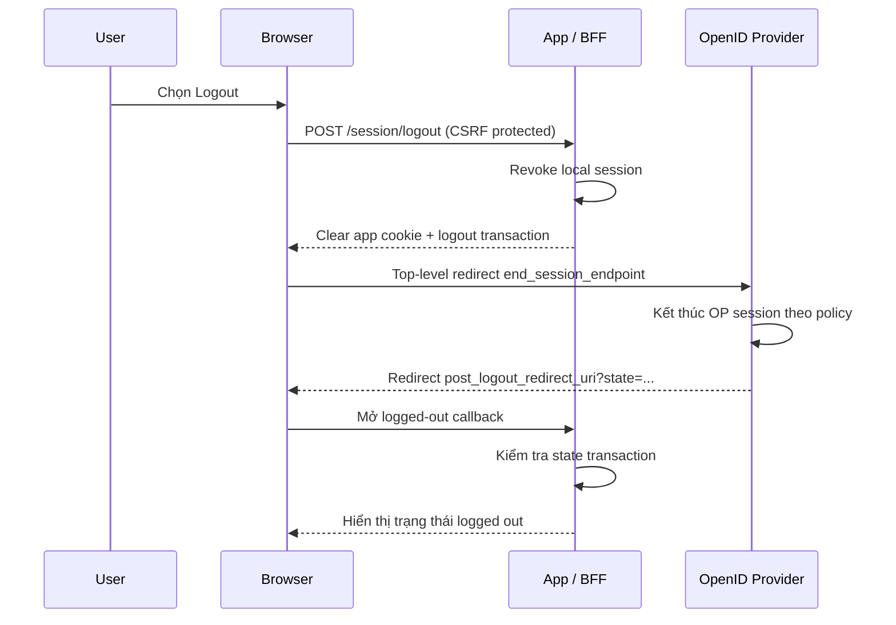

# Logout token

## 1. Logout token là gì?

**Logout token** là quá trình kết thúc phiên đăng nhập và làm mất hiệu lực các thông tin xác thực mà browser đang sử dụng. Trong ứng dụng web hiện đại, danh tính có thể được duy trì bởi session cookie, access token, refresh token hoặc kết hợp nhiều cơ chế. Vì vậy, logout cần xử lý đúng cả trạng thái trong browser lẫn trạng thái xác thực do server quản lý.

Một thao tác xóa access token khỏi JavaScript memory chỉ làm ứng dụng hiện tại ngừng dùng bản token đó. Nếu refresh token vẫn còn hiệu lực, client có thể lấy access token mới. Nếu session phía server chưa bị revoke, cookie/session identifier cũ vẫn có thể được dùng. Ngược lại, revoke session ở server nhưng không dọn dữ liệu hiển thị trong tab có thể khiến thông tin riêng tư vẫn còn trên màn hình.

Logout an toàn phải xác định rõ phạm vi: đăng xuất khỏi ứng dụng hiện tại, thu hồi một refresh-token family, kết thúc session ở Identity Provider (IdP), hay đăng xuất tất cả thiết bị. Các phạm vi này không đồng nghĩa và có thể cần nhiều bước.

Bài học này tập trung vào vòng đời logout của browser token security: dừng việc sử dụng credential, revoke session/token ở server, xóa dữ liệu local do ứng dụng quản lý, xử lý nhiều tab và request đang chạy, tích hợp OAuth/OIDC logout, và kiểm chứng kết quả.

### Kết quả học tập

Sau bài này, người học có thể:

1. Phân biệt local cleanup, application logout, token revocation và IdP logout.
2. Xây dựng trình tự logout phù hợp cho SPA và BFF.
3. Thu hồi session và refresh token ở server.
4. Hiểu giới hạn thu hồi access token dạng JWT và opaque token.
5. Xóa token, cache, draft và dữ liệu tài khoản theo policy.
6. Xử lý refresh-token rotation, reuse detection và request đang chạy.
7. Đồng bộ logout giữa nhiều tab và thiết bị.
8. Triển khai RP-Initiated Logout của OIDC khi provider hỗ trợ.
9. Bảo vệ logout endpoint khỏi CSRF và replay.
10. Kiểm thử logout, revoke và khôi phục session trong browser.

## 2. Các loại credential và trạng thái cần kết thúc

Trước khi thiết kế logout, cần biết ứng dụng đang dùng loại credential nào.

| Thành phần | Vai trò | Khi logout cần làm gì? |
| --- | --- | --- |
| Access token | Gửi tới Resource Server để truy cập API | Ngừng sử dụng, xóa các bản local; revoke nếu hệ thống hỗ trợ và yêu cầu |
| Refresh token | Xin access token mới | Revoke token hoặc toàn bộ token family; xử lý rotation/reuse |
| Session cookie | Browser gửi tới ứng dụng/BFF | Hủy session server-side và expire cookie đúng scope |
| ID Token | Chứa thông tin authentication trong OIDC | Không dùng như access token; có thể cần `id_token_hint` cho IdP logout |
| CSRF token | Bảo vệ request dựa trên cookie | Hết hiệu lực cùng session hoặc rotate theo session mới |
| Local user state | Profile, role, permission và dữ liệu UI trong memory | Xóa khỏi state/cache để không hiển thị cho người tiếp theo |
| Offline data | Draft, cache và outbox | Xóa, giữ hoặc export theo account policy; không gửi bằng phiên khác |

### 2.1. Access token và refresh token

Access token thường có thời hạn ngắn hơn refresh token. Khi access token hết hạn, client có thể dùng refresh token để xin token mới. Nếu logout chỉ xóa access token, refresh token còn lại có thể tạo một access token khác.

Refresh token vì vậy cần được quản lý ở server hoặc authorization server theo token family/grant. Với browser public client, refresh token phải được sender-constrain hoặc dùng rotation kèm reuse detection theo OAuth security best practice; đồng thời giới hạn lifetime và scope theo chính sách Authorization Server.

### 2.2. Session cookie

Trong mô hình BFF, browser giữ cookie opaque trỏ tới session server-side. Access/refresh token được lưu ở backend. Logout cần invalidate session record và expire cookie. Chỉ gửi cookie hết hạn mà không revoke session ở server có thể để session identifier đã bị sao chép tiếp tục hoạt động.

### 2.3. IdP session và application session

Đăng xuất khỏi ứng dụng không tự động đăng xuất người dùng khỏi IdP. Ví dụ, người dùng có thể logout khỏi `app.example.com` nhưng cookie đăng nhập tại `login.example-idp.com` vẫn còn. Lần sau chọn Login, IdP có thể xác thực lại tự động.

Ngược lại, logout tại IdP không đảm bảo mọi ứng dụng relying party đã xóa local session, trừ khi hệ thống triển khai cơ chế front-channel/back-channel logout phù hợp. Hãy mô tả chính xác phạm vi logout trong giao diện và tài liệu sản phẩm.

## 3. Threat model và mục tiêu logout

Logout thường được kích hoạt khi người dùng nhấn nút, session hết hạn, quản trị viên revoke quyền hoặc hệ thống phát hiện rủi ro. Các tình huống cần xét:

- Thiết bị dùng chung hoặc sắp được bàn giao cho người khác.
- Browser tab khác vẫn mở và còn giữ user state.
- Refresh request đang chạy trong lúc logout.
- Access token bị sao chép trước khi logout.
- Refresh token bị đánh cắp và attacker tiếp tục dùng.
- Session cookie bị replay sau khi client xóa cookie.
- Service Worker/cache/offline database còn dữ liệu tài khoản.
- Người dùng logout khỏi một tab nhưng tab khác vẫn hiển thị thông tin.
- IdP session còn tồn tại sau khi application session đã kết thúc.
- Network bị ngắt đúng lúc client gửi logout request.

Một thiết kế logout tốt cần đạt các mục tiêu:

1. Server ngừng chấp nhận session/refresh credential đã revoke theo policy.
2. Client ngừng gửi credential cũ ngay khi logout bắt đầu.
3. Request và response đến muộn không khôi phục trạng thái authenticated.
4. Dữ liệu riêng tư không còn hiển thị ở tab đã logout.
5. Tab khác nhận tín hiệu logout và làm sạch state.
6. Retry không vô tình tạo session mới hoặc phát lại refresh token cũ.
7. Người dùng được thông báo nếu server chưa xác nhận việc revoke.
8. Có cách logout all devices khi nghiệp vụ yêu cầu.

### 3.1. Logout không phải secure erase

JavaScript có thể xóa reference và storage key do ứng dụng quản lý, nhưng không thể bảo đảm ghi đè vật lý mọi bản sao trong browser memory, swap, filesystem, backup hoặc browser profile. Xóa token khỏi `localStorage` không phải bằng chứng token chưa từng bị sao chép.

Mục tiêu thực tế là làm credential mất hiệu lực ở server, dừng ứng dụng sử dụng credential đó và giảm tối đa dữ liệu nhạy cảm còn lại trong browser.

## 4. Trình tự logout tổng quát

Một trình tự có thể áp dụng cho nhiều kiến trúc:

1. Đánh dấu ứng dụng đang logout để chặn hành động authenticated mới.
2. Dừng timer refresh và ngăn refresh request mới bắt đầu.
3. Abort request đang chờ nếu phù hợp; đánh dấu response đến muộn là stale.
4. Gửi logout/revocation request có bảo vệ CSRF khi dùng cookie.
5. Server revoke session hoặc refresh-token family theo phạm vi yêu cầu.
6. Server expire session cookie với đúng tên, Path, Domain và thuộc tính cookie.
7. Client xóa token, user state, cache riêng, IndexedDB/outbox và dữ liệu UI theo policy.
8. Phát tín hiệu logout cho các tab khác.
9. Chuyển về trang public/login và hiển thị trạng thái kết quả.

Thứ tự chi tiết phụ thuộc kiến trúc. Với BFF, server có thể invalidate session và expire cookie trong cùng response. Với SPA giữ token, client có thể cần gọi revocation endpoint trước khi xóa bản token cuối cùng; nếu network thất bại, phải phân biệt local logout với server revocation chưa xác nhận.

Không nên trì hoãn local cleanup vô hạn chỉ vì server không truy cập được. Hãy xóa token khỏi ứng dụng ngay khi logout bắt đầu, ghi nhận rằng revoke server-side chưa được xác nhận, và yêu cầu đăng nhập lại hoặc thử revoke theo policy khi kết nối phục hồi. Không tự lưu lại refresh token chỉ để retry logout nếu điều đó làm tăng nguy cơ lộ credential.

## 5. Logout trong SPA

### 5.1. Token lưu trong memory

Nếu SPA giữ access token trong memory, logout cần xóa state và mọi reference do ứng dụng quản lý. Dừng timer refresh, đóng WebSocket có xác thực, hủy subscription và abort request đang chạy.

Không thể bảo đảm JavaScript ghi đè mọi bản sao của chuỗi token trong memory. Vì vậy, token nên có lifetime ngắn, hạn chế log và không sao chép sang nhiều nơi.

### 5.2. Token lưu trong Web Storage

Nếu kiến trúc cũ lưu token trong `localStorage` hoặc `sessionStorage`, xóa đúng key đã biết:

```js
function clearBrowserTokens() {
  const keys = [
    "access_token",
    "refresh_token",
    "id_token"
  ];

  for (const key of keys) {
    try {
      localStorage.removeItem(key);
      sessionStorage.removeItem(key);
    } catch {
      // Storage có thể bị chặn; vẫn tiếp tục dọn state trong memory.
    }
  }
}
```

Đoạn code chỉ minh họa cleanup local. Nó không revoke token ở Authorization Server. Không dùng `localStorage.clear()` nếu origin có dữ liệu thuộc tính năng khác hoặc nhiều ứng dụng cùng origin; xóa theo namespace/key do ứng dụng sở hữu.

### 5.3. Dừng request và refresh loop

Request đã gửi có thể hoàn tất sau khi người dùng logout. Response đến muộn không được phép ghi đè state đã logout hoặc cập nhật dữ liệu private.

Một mẫu quản lý AbortController:

```js
let authAbortController = new AbortController();
let logoutStarted = false;

function beginAuthenticatedRequest(url) {
  if (logoutStarted) {
    throw new Error("Phiên đang kết thúc.");
  }

  return fetch(url, {
    signal: authAbortController.signal,
    credentials: "same-origin"
  });
}

function stopAuthenticatedRequests() {
  logoutStarted = true;
  authAbortController.abort();
  authAbortController = new AbortController();
}
```

Ứng dụng thật cần dùng controller chung hoặc registry để hủy các request authenticated đang hoạt động. Sau logout, không tái sử dụng controller cũ và không tự động refresh token để phục hồi request bị abort.

### 5.4. Mẫu logout SPA có server confirmation

Ví dụ sau giả định ứng dụng có endpoint same-origin `/session/logout` bảo vệ bằng CSRF token. Hàm `readCsrfToken()` và `clearPrivateAppState()` là helper riêng của ứng dụng:

```js
async function logoutSpa() {
  stopAuthenticatedRequests();

  let serverStatus = "unconfirmed";

  try {
    const response = await fetch("/session/logout", {
      method: "POST",
      credentials: "same-origin",
      cache: "no-store",
      headers: {
        "X-CSRF-Token": readCsrfToken()
      }
    });

    if (response.ok || response.status === 401) {
      serverStatus = "confirmed";
    } else {
      serverStatus = "failed";
    }
  } catch {
    serverStatus = "unreachable";
  } finally {
    clearPrivateAppState();
    clearBrowserTokens();
    notifyOtherTabs({ type: "logout" });
    window.location.replace("/logged-out");
  }

  return { serverStatus };
}
```

Ứng dụng cần quyết định rõ cách xử lý khi endpoint trả lỗi. `401` có thể có nghĩa session đã hết hiệu lực, nhưng không chứng minh refresh token ở Authorization Server đã bị revoke nếu hệ thống dùng token riêng. Không hiển thị “Đã đăng xuất khỏi mọi thiết bị” khi chỉ local cleanup thành công.

## 6. Server-side session logout cho BFF

### 6.1. Invalidate session trước khi expire cookie

Với BFF, session cookie chỉ là handle để server tìm session. Server phải xóa hoặc đánh dấu revoked session record trước/đồng thời với việc expire cookie. Khi session bị revoke, request tiếp theo dùng cookie cũ phải bị từ chối.

Ví dụ response:

```http
HTTP/1.1 204 No Content
Set-Cookie: __Host-app-session=; Path=/; Max-Age=0; Secure; HttpOnly; SameSite=Lax
Cache-Control: no-store
```

Cookie xóa phải khớp name và scope của cookie đã tạo. Với cookie `__Host-`, cần `Secure`, `Path=/` và không có `Domain`. Nếu cookie cũ được tạo với Domain hoặc Path khác, expire một cookie ở scope khác sẽ không xóa bản cũ.

### 6.2. Ví dụ Express với server-side session

```js
app.post("/session/logout", requireCsrf, async (req, res, next) => {
  try {
    await new Promise((resolve, reject) => {
      req.session.destroy(error => {
        if (error) reject(error);
        else resolve();
      });
    });

    res.clearCookie("__Host-app-session", {
      path: "/",
      secure: true,
      httpOnly: true,
      sameSite: "lax"
    });

    res.set("Cache-Control", "no-store");
    res.sendStatus(204);
  } catch (error) {
    next(error);
  }
});
```

Tên cookie trong session middleware phải được cấu hình tương ứng. `requireCsrf` là middleware bảo vệ POST logout; không coi logout là hành động vô hại chỉ vì nó làm giảm quyền. CSRF logout có thể gây gián đoạn hoặc dẫn người dùng vào flow đăng nhập sai tài khoản.

Nếu dùng session store có thao tác revoke bất đồng bộ, cần chờ thao tác đó hoàn tất trước khi trả response thành công. Nếu store lỗi, log sự kiện ở server mà không ghi session ID/token thô, và không tuyên bố revoke thành công.

Nếu BFF còn giữ refresh token của Authorization Server, hủy application session không tự động revoke grant bên IdP. BFF cần gọi revocation endpoint theo policy trước/đồng thời khi kết thúc session. Nếu IdP tạm thời không truy cập được, có thể ghi nhận công việc revoke đang chờ trong server-side job store được bảo vệ, với retention ngắn và retry có kiểm soát; không đưa refresh token trở lại browser để chờ retry.

### 6.3. Cookie clearing phải khớp thuộc tính

Các thuộc tính ảnh hưởng đến cookie identity/scope gồm tên, Domain và Path. `Secure`, `HttpOnly` và `SameSite` nên được lặp lại nhất quán khi clear để tránh khác biệt giữa framework/browser. Không thể xóa cookie `HttpOnly` bằng `document.cookie`; server phải trả `Set-Cookie` expire.

## 7. Thu hồi access token và refresh token

### 7.1. Local deletion khác token revocation

Xóa token ở browser chỉ khiến ứng dụng không còn giữ bản token đó. Nếu token đã bị sao chép, attacker vẫn có thể dùng nó cho tới khi token hết hạn hoặc server từ chối. Vì vậy, logout có yêu cầu bảo mật cao cần revoke refresh token/grant hoặc session ở nơi phát hành.

### 7.2. Refresh token revocation

Refresh token thường là credential dài hạn và có thể cấp access token mới. Khi logout, Authorization Server nên revoke refresh token hiện tại và có thể revoke cả token family/grant tùy chính sách.

Nếu refresh token rotation được bật, mỗi lần refresh phát token mới và vô hiệu hóa token cũ. Logout cần revoke token hiện tại/family để không còn đường tiếp tục refresh. Nếu token cũ đã bị reuse, server cần áp dụng reuse detection và revoke family theo policy.

### 7.3. Access token dạng JWT

JWT access token thường được Resource Server xác minh offline bằng chữ ký và claim. Revoke refresh token không tự động làm JWT access token đã phát hành mất hiệu lực ngay. Nó có thể còn được chấp nhận tới `exp`, trừ khi hệ thống có thêm cơ chế như:

- Access token lifetime ngắn.
- Denylist/jti revocation check.
- Token introspection hoặc kiểm tra trạng thái session/grant.
- User/session version được Resource Server kiểm tra.
- Sender-constrained token và chính sách thu hồi tương ứng.

Chọn trade-off theo yêu cầu. JWT ngắn hạn giảm cửa sổ sử dụng token bị đánh cắp nhưng không tạo revocation tức thời.

### 7.4. Opaque access token

Opaque token thường cần Resource Server gọi introspection hoặc tra cứu trạng thái server-side. Authorization Server có thể đánh dấu token inactive khi revoke. Hiệu quả tức thời phụ thuộc cache introspection và cách Resource Server kiểm tra.

### 7.5. OAuth token revocation endpoint

RFC 7009 định nghĩa revocation endpoint. Client gửi token và loại hint nếu có:

```http
POST /revoke HTTP/1.1
Host: login.example-idp.com
Content-Type: application/x-www-form-urlencoded

token=REFRESH_TOKEN&
token_type_hint=refresh_token&
client_id=browser-app
```

Tên endpoint, yêu cầu client authentication và CORS phụ thuộc Authorization Server. Với SPA public client, chỉ gọi revocation endpoint trực tiếp nếu provider hỗ trợ public client/CORS đúng cách. Với BFF, backend có thể gọi endpoint bằng cơ chế client authentication phù hợp.

Response thành công thường không tiết lộ token có tồn tại hay đã bị revoke trước đó, nhằm tránh tạo oracle để dò token. Client nên xử lý response theo RFC/provider contract và không log token gửi đi.

### 7.6. Revocation không phải logout IdP

Revoking một refresh token hoặc grant không nhất thiết xóa cookie đăng nhập của người dùng ở IdP. Người dùng có thể được IdP xác thực lại tự động ở lần sau. Nếu muốn kết thúc IdP browser session, cần flow OIDC logout riêng và provider hỗ trợ.

## 8. Bảo vệ revocation request

Revocation request chứa credential nên cần bảo vệ như token exchange:

- Dùng HTTPS.
- Gửi token trong POST body, không đưa vào URL query.
- Không log body hoặc header có token.
- Không expose token cho analytics/telemetry.
- Dùng client authentication theo loại client và provider.
- Với browser request dựa trên cookie, áp dụng CSRF defense.
- Không gửi token tới endpoint do user input điều khiển.
- Chỉ dùng endpoint thuộc issuer đã cấu hình/metadata đã xác minh.

Nếu revoke request thất bại vì network, client không thể khẳng định token đã bị revoke. Có thể xóa local state ngay và báo rằng server-side revocation chưa xác nhận; với BFF, server có thể retry bằng credential được giữ server-side theo policy. Không lưu thêm bản refresh token vào local storage để phục vụ retry.

### 8.1. Ví dụ gọi revocation endpoint từ SPA public client

Chỉ dùng mẫu này khi Authorization Server hỗ trợ public client và CORS cho revocation endpoint. Endpoint phải lấy từ cấu hình/metadata issuer đã xác minh, không lấy từ URL do người dùng nhập:

```js
async function revokeRefreshToken(revocationEndpoint, refreshToken) {
  const body = new URLSearchParams({
    token: refreshToken,
    token_type_hint: "refresh_token",
    client_id: "browser-app"
  });

  const response = await fetch(revocationEndpoint, {
    method: "POST",
    mode: "cors",
    credentials: "omit",
    cache: "no-store",
    headers: {
      "Content-Type": "application/x-www-form-urlencoded"
    },
    body
  });

  if (!response.ok) {
    throw new Error("Authorization Server không xác nhận revocation.");
  }
}
```

Gọi hàm khi refresh token vẫn còn trong memory, rồi xóa token và auth state trong khối `finally`. Không đưa token vào URL hoặc log. Public client không gửi client secret; nếu provider yêu cầu cơ chế khác, dùng BFF/SDK được hỗ trợ thay vì nhúng secret vào browser.

## 9. OIDC logout và kết thúc phiên tại IdP

### 9.1. RP-Initiated Logout

OpenID Connect RP-Initiated Logout cho phép Relying Party (ứng dụng) điều hướng browser tới endpoint logout của OpenID Provider (OP) để yêu cầu kết thúc phiên tại OP. Metadata discovery có thể công bố `end_session_endpoint`; không phải provider nào cũng hỗ trợ đầy đủ cùng một cách.

Một request có thể chứa:

- `id_token_hint`: ID Token gần nhất của phiên cần logout, nếu provider yêu cầu hoặc khuyến nghị.
- `post_logout_redirect_uri`: URI quay về ứng dụng sau khi OP xử lý logout; phải đăng ký/allowlist theo provider.
- `state`: giá trị ngẫu nhiên để liên kết response quay về với logout transaction.
- `client_id`: có thể cần khi không gửi `id_token_hint`, tùy provider/spec.

Không gửi access token hoặc refresh token trong URL logout. `id_token_hint` là JWT có thể chứa claim định danh; tránh log URL và không chia sẻ nó qua analytics/referrer. Nếu provider hỗ trợ `id_token_hint` qua browser redirect, dùng đúng contract và hạn chế thời gian lưu.

### 9.1.1. Tạo logout request

Ví dụ dưới đây giả định endpoint và post-logout callback đã được cấu hình tin cậy. Giá trị state được lưu tạm để callback kiểm tra:

```js
function createLogoutState() {
  const bytes = crypto.getRandomValues(new Uint8Array(32));
  return Array.from(bytes, byte => byte.toString(16).padStart(2, "0")).join("");
}

function beginProviderLogout({
  endSessionEndpoint,
  idTokenHint,
  postLogoutRedirectUri
}) {
  const state = createLogoutState();
  sessionStorage.setItem("oidc.logout.state", state);

  const logoutUrl = new URL(endSessionEndpoint);
  logoutUrl.searchParams.set("post_logout_redirect_uri", postLogoutRedirectUri);
  logoutUrl.searchParams.set("state", state);

  if (idTokenHint) {
    logoutUrl.searchParams.set("id_token_hint", idTokenHint);
  }

  window.location.assign(logoutUrl);
}

function validateProviderLogoutCallback(returnedState) {
  const expected = sessionStorage.getItem("oidc.logout.state");
  sessionStorage.removeItem("oidc.logout.state");

  if (!expected || !returnedState || returnedState !== expected) {
    throw new Error("OIDC logout response không khớp transaction.");
  }
}
```

Nếu provider không trả state hoặc dùng response khác, xử lý theo profile/provider contract và không giả định callback là bằng chứng logout thành công. Kiểm tra `endSessionEndpoint` thuộc issuer đã cấu hình; không cho phép open redirect qua `postLogoutRedirectUri`. Vì ID Token hint có thể xuất hiện trong URL, không ghi URL đầy đủ vào access log, analytics hoặc error report.

### 9.2. Luồng RP-Initiated Logout



Local application session nên được revoke độc lập để người dùng đã logout khỏi ứng dụng ngay cả khi OP không truy cập được. RP-Initiated Logout là bước bổ sung để kết thúc phiên IdP; không để việc redirect sang OP là điều kiện duy nhất cho local logout.

### 9.3. Đăng ký post-logout redirect URI

Chỉ cho phép URI đã đăng ký. Không nhận `post_logout_redirect_uri` tùy ý từ query string hoặc form. Sau khi quay về, kiểm tra `state` logout transaction nếu provider trả lại. Không coi việc browser quay về callback là bằng chứng chắc chắn OP đã xóa mọi session trên mọi thiết bị.

Nếu provider không hỗ trợ post-logout redirect hoặc không trả state, dùng UX phù hợp theo tài liệu provider; không tự suy ra thành công từ HTTP navigation.

### 9.4. Front-channel và back-channel logout

| Cơ chế | Cách hoạt động | Giới hạn |
| --- | --- | --- |
| RP-Initiated Logout | RP điều hướng browser tới OP logout endpoint | Phụ thuộc endpoint và hành vi provider |
| Front-channel logout | OP điều hướng/nhúng browser tới logout URL của RP | Có thể phụ thuộc iframe và third-party cookie; browser privacy có thể hạn chế |
| Back-channel logout | OP gửi Logout Token trực tiếp tới endpoint server-side của RP | Cần endpoint server, xác minh token và liên kết session |

Front-channel logout chạy qua browser và có thể bị ảnh hưởng bởi cookie partitioning, iframe restrictions hoặc tab không hoạt động. Back-channel logout là server-to-server, không phụ thuộc browser đang mở, nhưng RP phải xác minh Logout Token và tìm đúng session cần revoke.

### 9.5. Xác minh Back-Channel Logout Token

Khi nhận logout token, RP cần dùng thư viện OIDC tin cậy để xác minh chữ ký và các claim theo OIDC Back-Channel Logout:

- `iss` đúng OP đã cấu hình.
- `aud` chứa client ID của RP.
- `iat` hợp lệ và `jti` được xử lý chống replay.
- Có claim `events` chứa back-channel logout event URI.
- Có `sid` hoặc `sub` để xác định session/user theo quy tắc.
- Không chấp nhận `nonce` trong Logout Token theo đặc tả.
- Token phải có loại JWT phù hợp với logout token profile.

Không chỉ decode JWT rồi xóa tất cả session. Nếu có `sid`, revoke session tương ứng; nếu chỉ có `sub`, áp dụng policy logout mọi session của subject ở RP. Xử lý `jti` idempotent để cùng một logout event được retry không gây lỗi hoặc tác động ngoài phạm vi.

## 10. Đồng bộ logout giữa nhiều tab

Một người dùng có thể mở nhiều tab cùng origin. Nếu chỉ tab hiện tại xóa state, tab khác vẫn có thể hiển thị tên, hồ sơ hoặc dữ liệu riêng và tiếp tục gửi request.

### 10.1. BroadcastChannel

Có thể dùng BroadcastChannel để thông báo các tab cùng origin:

```js
const authChannel = new BroadcastChannel("app-auth-events");

function notifyOtherTabs(message) {
  authChannel.postMessage(message);
}

authChannel.addEventListener("message", event => {
  if (event.data?.type === "logout") {
    stopAuthenticatedRequests();
    clearPrivateAppState();
    clearBrowserTokens();
    window.location.replace("/login");
  }
});
```

Chỉ gửi loại sự kiện và metadata tối thiểu. Không gửi access token, refresh token, ID Token, session ID hoặc dữ liệu cá nhân trong channel. BroadcastChannel không thay thế server revocation; tab khác vẫn phải nhận request bị từ chối nếu nó đã gửi trước khi nhận sự kiện.

### 10.2. Storage event fallback

Nếu không dùng BroadcastChannel, ứng dụng có thể ghi một marker không nhạy cảm vào local storage để tab khác nhận `storage` event:

```js
function broadcastLogoutFallback() {
  try {
    localStorage.setItem("app:auth-event", String(Date.now()));
  } catch {
    // Không có storage thì mỗi tab vẫn phải xử lý session expiry từ server.
  }
}

window.addEventListener("storage", event => {
  if (event.key === "app:auth-event" && event.newValue) {
    stopAuthenticatedRequests();
    clearPrivateAppState();
    clearBrowserTokens();
    window.location.replace("/login");
  }
});
```

`storage` event không phát trong chính tab thực hiện ghi; tab hiện tại phải tự cleanup. Không dùng event marker làm nguồn xác thực; marker có thể bị xóa hoặc sửa.

### 10.3. Kiểm tra session khi tab quay lại foreground

Tab có thể bị treo hoặc ngủ trong thời gian dài và bỏ lỡ sự kiện. Khi `visibilitychange`, `pageshow` hoặc khôi phục từ back-forward cache, ứng dụng có thể kiểm tra trạng thái session với server trước khi render lại dữ liệu private. Không dựa vào timer client như nguồn duy nhất để xác định session còn hiệu lực.

## 11. Race condition giữa logout, refresh và request API

### 11.1. Refresh request đang chạy

Một race phổ biến:

1. Tab bắt đầu refresh token.
2. Người dùng nhấn Logout.
3. Client xóa access token và refresh token local.
4. Refresh response đến muộn chứa token mới.
5. Code refresh ghi token mới trở lại storage.

Kết quả là người dùng đã logout nhưng ứng dụng vẫn có credential mới. Dùng trạng thái logout/epoch để loại bỏ response đến muộn, và bảo đảm refresh endpoint đã revoke token family theo policy.

### 11.2. Dùng generation counter

Mỗi lần thay đổi auth lifecycle, tăng generation. Request bắt đầu ở generation cũ không được phép cập nhật state sau logout:

```js
let authGeneration = 0;
let authState = "authenticated";

function beginLogoutState() {
  authState = "logging-out";
  authGeneration += 1;
}

async function refreshSession() {
  const generationAtStart = authGeneration;
  const result = await requestNewTokens();

  if (
    authState !== "authenticated" ||
    generationAtStart !== authGeneration
  ) {
    // Response đến sau khi auth lifecycle đã thay đổi.
    return null;
  }

  applyTokenResult(result);
  return result;
}
```

`requestNewTokens()` và `applyTokenResult()` là helper của ứng dụng. Generation counter là bảo vệ ở client; server vẫn phải rotate/revoke token đúng cách vì attacker có thể gọi token endpoint ngoài ứng dụng.

### 11.3. Server phải xử lý refresh/logout đồng thời

Client-side guard không giải quyết race giữa hai request đã tới server. Authorization Server/BFF cần cập nhật refresh-token family hoặc session bằng thao tác atomic/transaction phù hợp:

- Refresh token cũ chỉ được dùng theo rotation policy.
- Logout revoke family/session theo một trạng thái nhất quán.
- Nếu refresh và logout cạnh tranh, kết quả cuối cùng phải tuân theo quy tắc server đã định nghĩa.
- Không cấp token mới từ refresh family đã revoked.
- Reuse detection phải xử lý token cũ được gửi lại sau rotation.

### 11.4. Response API đến muộn

Ngay cả khi abort request, server có thể đã xử lý request trước khi nhận disconnect. Response đến muộn không được render hoặc ghi vào cache sau logout. Mọi data loader cần kiểm tra auth generation/session state trước khi cập nhật UI; server vẫn phải từ chối request tiếp theo bằng credential đã revoke.

### 11.5. Logout endpoint nên idempotent

Người dùng có thể double-click, browser retry hoặc tab khác gửi logout đồng thời. Logout endpoint nên an toàn khi gọi nhiều lần: session đã mất vẫn trả trạng thái phù hợp, cookie vẫn được expire, và thao tác revoke không tạo side effect nguy hiểm. Không dùng GET để thực hiện logout có tác dụng thay đổi trạng thái; dùng POST hoặc method phù hợp kèm CSRF protection.

## 12. Logout all devices và quản lý phiên

### 12.1. Logout thiết bị hiện tại

Logout thiết bị hiện tại thường revoke session đang dùng hoặc refresh-token family liên quan tới thiết bị đó. Các session khác của cùng user vẫn có thể hoạt động.

### 12.2. Logout all devices

Tính năng “Đăng xuất khỏi tất cả thiết bị” cần thao tác server-side theo user/account:

- Xác thực người dùng hiện tại; có thể yêu cầu re-authentication hoặc step-up MFA.
- Revoke mọi session server-side thuộc user.
- Revoke refresh token/grant/token family theo chính sách.
- Tăng session/token version nếu hệ thống sử dụng.
- Thông báo các thiết bị đang hoạt động qua push/back-channel hoặc để request tiếp theo phát hiện session invalid.
- Ghi audit event không chứa token/session ID thô.
- Xử lý race với refresh request và request API đang chạy.

Không thể bảo đảm mọi access token JWT bị từ chối tức thì nếu Resource Server xác minh token hoàn toàn offline. Nếu yêu cầu logout all devices có hiệu lực nhanh, cần introspection/revocation lookup, session version check hoặc access token lifetime đủ ngắn cùng cơ chế phù hợp.

### 12.3. Danh sách thiết bị và session

Một trang quản lý phiên có thể hiển thị tên thiết bị ước lượng, thời điểm hoạt động gần nhất và vị trí ở mức cần thiết. Không dùng fingerprint quá mức hoặc coi User-Agent là danh tính chắc chắn. Khi revoke một session từ danh sách, server cần xác minh session thuộc user hiện tại và không cho phép người dùng revoke session của account khác.

## 13. Offline data, Service Worker và browser cleanup

Logout có thể xảy ra khi browser offline. Trong trường hợp đó, local cleanup vẫn cần diễn ra, nhưng server revocation chưa được xác nhận. Giao diện nên thể hiện trạng thái này và không tự động khôi phục credential.

### 13.1. Cache Storage

Nếu Cache Storage có dữ liệu riêng tư, dùng cache namespace theo account và xóa đúng cache thuộc account đó. Không xóa toàn bộ Cache Storage một cách mù quáng vì có thể làm mất app shell hoặc asset public không liên quan.

### 13.2. IndexedDB và outbox

Outbox có thể chứa mutation chưa được server xác nhận. Khi logout/account switch:

- Không gửi queue của account cũ bằng cookie/token của account mới.
- Đánh dấu queue là paused hoặc xóa theo retention policy.
- Nếu giữ draft, phân vùng theo account và yêu cầu xác thực lại đúng principal trước khi resume.
- Không giữ refresh token hoặc session secret trong outbox.
- Cho người dùng biết draft nào sẽ bị xóa nếu họ chọn clear local data.

### 13.3. Service Worker

Service Worker không có một “logout state” tự động. Nếu worker giữ dữ liệu user-specific, gửi message hoặc dùng cơ chế lưu trữ chung để yêu cầu worker dừng sync và xóa cache đúng namespace. Worker phải xác minh session hiện tại trước khi gửi mutation và không dựa vào biến global tồn tại lâu dài.

### 13.4. Browser back-forward cache

Sau logout, người dùng có thể nhấn Back và thấy page snapshot từ back-forward cache. Khi page được khôi phục qua `pageshow`, kiểm tra session/auth state trước khi hiển thị dữ liệu nhạy cảm. Server nên trả cache policy phù hợp cho response private, ví dụ `Cache-Control: no-store`, và ứng dụng cần xóa state trước khi điều hướng khỏi trang authenticated.

## 14. Thực hành: kiểm chứng logout trong browser

Dùng tài khoản thử nghiệm và môi trường local/staging. Không ghi token hoặc cookie thật vào screenshot, console, ticket hay tài liệu chia sẻ.

### 14.1. Kiểm tra trước logout

Mở DevTools:

- Application → Cookies: xác định cookie session, thuộc tính `HttpOnly`, `Secure`, `SameSite`, Path và expiry.
- Application → Local Storage/Session Storage: kiểm tra ứng dụng có lưu token hoặc dữ liệu account không.
- Application → IndexedDB/Cache Storage: tìm draft, outbox và response private.
- Network: xác định endpoint refresh, logout và revocation.
- Application → Service Workers: xem worker có chức năng sync/cache dữ liệu account không.

Không copy giá trị cookie/token. Chỉ ghi tên key, thuộc tính và trạng thái cần thiết.

### 14.2. Thực hiện logout

1. Đăng nhập bằng tài khoản thử nghiệm.
2. Mở cùng ứng dụng ở hai tab.
3. Tạo một draft offline nếu ứng dụng hỗ trợ.
4. Mở Network và bật Preserve log.
5. Logout ở tab thứ nhất.
6. Kiểm tra POST logout, response status và `Set-Cookie` expire.
7. Kiểm tra tab thứ hai nhận logout signal hoặc bị server từ chối khi gọi API.
8. Nhấn Back và xác minh dữ liệu private không xuất hiện trở lại.
9. Kiểm tra refresh token/session không còn được dùng.
10. Nếu có IdP logout, quan sát redirect tới `end_session_endpoint` và callback state.

### 14.3. Thử lỗi mạng

Trong môi trường thử nghiệm, chặn network đúng lúc logout:

- Client phải xóa local auth state theo policy.
- UI không tuyên bố server đã revoke nếu chưa có xác nhận.
- Session cũ phải bị từ chối khi server nhận request sau đó nếu revoke đã hoàn tất.
- Có cách đăng nhập lại và xử lý credential cũ theo chính sách.
- Không tự phát lại mutation offline bằng một tài khoản khác.

### 14.4. Kiểm tra token revocation

Nếu provider có revocation/introspection endpoint:

- Revoke refresh token thử nghiệm.
- Thử dùng refresh token cũ; server phải từ chối.
- Kiểm tra refresh-token reuse detection nếu rotation được bật.
- Kiểm tra access token JWT còn hiệu lực tới `exp` hay bị từ chối qua revocation lookup.
- Không gửi token thật vào jwt.io, online decoder hoặc công cụ bên thứ ba.

## 15. Ma trận kiểm thử logout token

| Mã | Tình huống | Kết quả mong muốn |
| --- | --- | --- |
| LOGOUT-01 | Logout SPA dùng token memory | Auth state và mọi reference do ứng dụng quản lý được xóa |
| LOGOUT-02 | Logout SPA dùng Web Storage | Chỉ key/namespace của ứng dụng bị xóa |
| LOGOUT-03 | Logout BFF | Session server-side bị revoke và cookie được expire |
| LOGOUT-04 | Dùng lại cookie session cũ | Server từ chối request |
| LOGOUT-05 | Dùng lại refresh token đã revoke | Token endpoint từ chối |
| LOGOUT-06 | Chỉ xóa access token local | Kiểm tra refresh token không thể tạo token mới sau logout policy |
| LOGOUT-07 | JWT access token đã phát hành | Hiệu lực còn lại phù hợp với revocation design/expiry |
| LOGOUT-08 | Opaque access token bị revoke | Introspection/resource server nhận trạng thái inactive theo policy |
| LOGOUT-09 | Refresh response về sau logout | Client bỏ response cũ, không ghi token mới |
| LOGOUT-10 | Refresh và logout chạy đồng thời | Server xử lý token family/session nhất quán |
| LOGOUT-11 | Double-click logout | Endpoint idempotent, không tạo lỗi hoặc session mới |
| LOGOUT-12 | CSRF request logout từ origin khác | Request bị từ chối theo CSRF policy |
| LOGOUT-13 | Hai tab cùng đăng nhập | Tab còn lại nhận signal và xóa private state |
| LOGOUT-14 | Tab ngủ bỏ lỡ BroadcastChannel | Kiểm tra session khi foreground/restore |
| LOGOUT-15 | Back-forward cache sau logout | Trang không hiển thị dữ liệu private cũ |
| LOGOUT-16 | Logout khi offline | Local cleanup diễn ra; server revocation hiển thị chưa xác nhận |
| LOGOUT-17 | Logout có pending outbox | Queue bị pause/clear theo account policy, không gửi dưới user khác |
| LOGOUT-18 | Service Worker còn private cache | Cache namespace của user được dọn |
| LOGOUT-19 | RP-Initiated Logout được hỗ trợ | Browser đi tới end_session_endpoint và xử lý callback state |
| LOGOUT-20 | IdP logout không hỗ trợ | Local app logout vẫn hoàn tất và UX mô tả đúng phạm vi |
| LOGOUT-21 | Back-channel Logout Token hợp lệ | RP xác minh token và revoke đúng session |
| LOGOUT-22 | Back-channel Logout Token replay | jti/event handling chống replay và xử lý idempotent |
| LOGOUT-23 | Logout all devices | Session/grant thuộc user bị revoke theo policy |
| LOGOUT-24 | Logout session của user khác | Server từ chối do không thuộc principal hiện tại |
| LOGOUT-25 | Revocation endpoint lỗi network | Không báo revoke thành công; local state vẫn được dọn theo policy |
| LOGOUT-26 | Log/telemetry trong logout | Không chứa access token, refresh token, cookie hoặc code |
| LOGOUT-27 | Cookie clear sai Path/Domain | Test phát hiện cookie cũ còn tồn tại |
| LOGOUT-28 | API response đến sau logout | UI không render hoặc cache dữ liệu private |
| LOGOUT-29 | Người dùng đăng nhập lại sau logout | Session mới được tạo/rotate; credential cũ không được tái sử dụng |
| LOGOUT-30 | Logout sau session timeout | Endpoint xử lý idempotent và cookie được expire |

## 16. Những sai lầm thường gặp

| Nhận định sai | Cách hiểu đúng |
| --- | --- |
| Xóa access token nghĩa là đã logout hoàn toàn | Refresh token/session server có thể còn hiệu lực |
| Xóa cookie ở browser revoke session | Server phải invalidate session identifier |
| Revoke refresh token làm JWT access token mất hiệu lực tức thì | JWT có thể còn hợp lệ tới exp nếu không có revocation lookup |
| Logout khỏi app đồng nghĩa logout khỏi IdP | Application session và IdP session là hai phạm vi khác nhau |
| Xóa localStorage là secure erase | Không bảo đảm mọi bản sao vật lý hoặc token đã bị sao chép biến mất |
| Logout GET là an toàn vì không sửa dữ liệu | CSRF có thể ép người dùng logout; dùng POST và CSRF defense |
| Tab hiện tại logout thì tab khác tự biết | Cần broadcast signal và kiểm tra session khi restore |
| Abort request bảo đảm server chưa xử lý | Server có thể đã xử lý trước khi nhận disconnect |
| Xóa Cache Storage là đủ | Cần xử lý IndexedDB, outbox, memory, cookie và session server |
| SameSite thay thế mọi CSRF defense | Vẫn đánh giá CSRF theo endpoint và kiến trúc |
| Front-channel logout luôn chạy được | Iframe/third-party cookie có thể bị browser hạn chế |
| Logout all devices chỉ cần xóa token trong thiết bị hiện tại | Server phải revoke các session/grant thuộc user |
| Thành công local cleanup nghĩa server đã revoke | Phải có xác nhận từ server/authorization server |
| Có thể log token để debug logout | Token/cookie phải được redaction khỏi log và telemetry |

## 17. Checklist triển khai logout an toàn

- [ ] Xác định phạm vi logout: tab, browser session, device, application hay IdP.
- [ ] Chặn hành động authenticated mới ngay khi logout bắt đầu.
- [ ] Dừng refresh timer và abort request phù hợp.
- [ ] Ngăn response đến muộn khôi phục auth state.
- [ ] Dùng POST và CSRF defense cho logout dựa trên cookie.
- [ ] Revoke session server-side trước/đồng thời expire cookie.
- [ ] Clear cookie với đúng tên, Path, Domain và thuộc tính.
- [ ] Revoke refresh token/token family/grant theo policy.
- [ ] Hiểu cửa sổ hiệu lực còn lại của JWT access token.
- [ ] Không lưu token trong URL hoặc log revocation request.
- [ ] Xóa local token và user state theo key/namespace sở hữu.
- [ ] Dọn cache, IndexedDB, outbox và Service Worker data theo account policy.
- [ ] Đồng bộ logout giữa các tab mà không truyền credential trong message.
- [ ] Kiểm tra session khi tab được restore từ background/BFCache.
- [ ] Xử lý refresh/logout race và retry idempotent ở server.
- [ ] Chỉ bật OIDC RP-Initiated/Front-channel/Back-channel Logout khi provider hỗ trợ và đã xác minh.
- [ ] Xác minh issuer, audience, event, sid/sub và replay cho Back-Channel Logout Token.
- [ ] Phân biệt logout thiết bị hiện tại với logout all devices.
- [ ] Hiển thị rõ trạng thái server revocation chưa xác nhận khi offline.
- [ ] Kiểm thử logout, revoke, replay, nhiều tab và đăng nhập lại bằng tài khoản thử nghiệm.

### Ghi nhớ

**Logout an toàn cần làm cho credential cũ không còn được ứng dụng sử dụng và server từ chối nó theo phạm vi revoke đã chọn.** Local cleanup xóa token khỏi state/storage và dữ liệu private trong browser; server-side logout invalidate session và refresh-token family; OIDC logout có thể kết thúc thêm phiên tại IdP. Revoke refresh token không nhất thiết vô hiệu hóa ngay JWT access token đã phát hành. Hãy xử lý request/refresh đến muộn, nhiều tab, offline outbox và cookie scope; bảo vệ logout endpoint khỏi CSRF; và thông báo trung thực khi server chưa xác nhận revocation.
