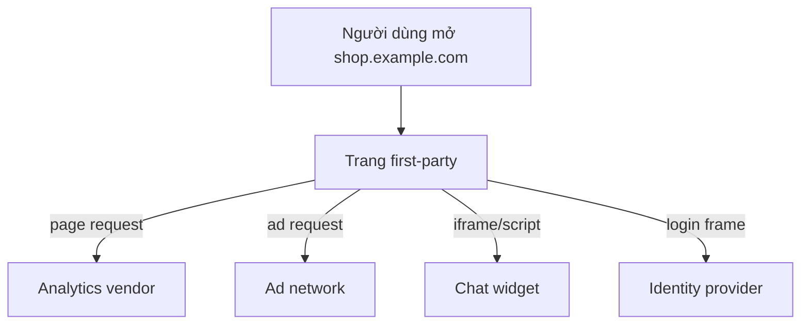
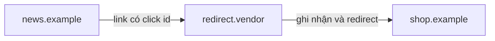

# Third-party tracking: theo dõi người dùng qua nhiều website

## 1. Third-party tracking là gì?

**Third-party tracking** là việc một tổ chức hoặc dịch vụ thu thập, liên kết hay suy luận hoạt động của người dùng khi họ tương tác với nhiều website hoặc ứng dụng khác nhau. Dịch vụ theo dõi thường được nhúng vào trang dưới dạng quảng cáo, analytics, pixel, script, iframe, SDK hoặc request tới một domain khác với website đang được mở.

Ví dụ, một người đọc bài viết trên trang tin, xem sản phẩm ở cửa hàng trực tuyến rồi mở một website khác. Nếu cả ba website cùng tải tài nguyên từ một mạng quảng cáo hoặc analytics, dịch vụ đó có thể nhận các tín hiệu như thời điểm truy cập, URL, referrer, địa chỉ IP, user agent, cookie hoặc mã định danh khác. Khi có thể liên kết các tín hiệu này, dịch vụ có thể xây dựng hồ sơ hành vi xuyên website.

Third-party tracking không chỉ dựa vào cookie. Nó có thể kết hợp nhiều kỹ thuật: pixel theo dõi, JavaScript bên thứ ba, fingerprinting, link decoration, redirect/bounce tracking, storage, cookie synchronization và dữ liệu do server gửi lên.

**Nguyên tắc:** một website có thể cần dùng dịch vụ bên ngoài để phân phối nội dung hoặc đo lường, nhưng mỗi thành phần bên ngoài có thể nhận dữ liệu về người dùng và trang đang được mở. Hãy biết thành phần nào được tải, dữ liệu nào được gửi, mục đích nào được cho phép và cách người dùng kiểm soát việc đó.

Bài viết thuộc chương **Privacy** của module **SECURITY_APPLICATION_SECURITY_BROWSER_SECURITY**. Module phân tích ranh giới bảo mật giữa browser, origin, cookie và ứng dụng web; bài này tập trung vào cách tracking xuyên website tương tác với cookie, storage partitioning, Same-Origin Policy, browser privacy controls và các biện pháp giảm thu thập dữ liệu.

Sau bài học, bạn có thể:

- Phân biệt first-party, third-party, same-origin, same-site và cross-site.
- Giải thích cách cookie, pixel, script, iframe và storage được dùng để theo dõi.
- Nhận diện fingerprinting, link decoration, bounce tracking và CNAME cloaking.
- Phân tích vì sao third-party JavaScript có thể có quyền mạnh trong trang nhúng.
- Hiểu SameSite, third-party cookie blocking và partitioned cookies.
- Giải thích storage partitioning và giới hạn của các biện pháp chống tracking.
- Phân biệt rủi ro privacy với CSRF, XSS và CORS.
- Dùng CSP, SRI, Referrer-Policy và kiểm soát dependency để giảm tracking không cần thiết.
- Thiết kế analytics theo hướng data minimization và consent rõ ràng.
- Thực hành quan sát request của một tracker local bằng DevTools.

## 2. First-party, third-party, origin và site

Các thuật ngữ này thường bị dùng lẫn nhau, nhưng chúng mô tả những ranh giới khác nhau.

### 2.1. Origin

Origin thông thường gồm scheme, host và port. Hai URL cùng origin khi cả ba thành phần khớp:

```text
https://shop.example.com/products
https://shop.example.com/account
```

Hai URL trên cùng origin vì path không thuộc origin. Các URL sau khác origin:

```text
http://shop.example.com
https://shop.example.com
https://shop.example.com:8443
https://cdn.example.com
```

Origin là ranh giới quan trọng cho Same-Origin Policy và quyền truy cập của JavaScript vào DOM/storage.

### 2.2. Site và same-site

Khái niệm site dùng trong cookie và nhiều cơ chế privacy thường dựa trên scheme cùng registrable domain (thường là eTLD+1, tính theo Public Suffix List). Port không tham gia xác định site; subdomain có thể thuộc cùng site.

Ví dụ minh họa:

| URL A | URL B | Quan hệ thường gặp |
|---|---|---|
| `https://shop.example.com` | `https://news.example.com` | Same-site, khác origin |
| `https://shop.example.com` | `https://shop.example.com:8443` | Same-site, khác origin |
| `https://shop.example.com` | `http://shop.example.com` | Cross-site theo schemeful same-site |
| `https://shop.example.com` | `https://shop-example.net` | Cross-site |

Browser áp dụng chi tiết theo chuẩn và phiên bản. Khi kiểm tra cookie, hãy xem cả origin, site, scheme và request context.

### 2.3. First-party và third-party phụ thuộc ngữ cảnh

Trong ngữ cảnh trang top-level là `https://shop.example.com`:

- Request tới `shop.example.com` thường là first-party.
- Request tới `analytics.vendor.net` thường là third-party/cross-site.
- Request tới `cdn.example.com` khác origin nhưng vẫn có thể same-site.
- Một iframe của `accounts.example.net` có thể là third-party dù tổ chức sở hữu cả hai website.

"Third-party" còn được dùng theo nghĩa tổ chức độc lập cung cấp dịch vụ. Cần xác định đang nói về bên thứ ba trong quan hệ kinh doanh hay context cross-site mà browser xử lý. Hai khái niệm liên quan nhưng không đồng nhất.

### 2.4. Ví dụ một trang có nhiều bên nhận dữ liệu



Mỗi request có thể tiết lộ một phần dữ liệu. Khi nhiều website cùng tích hợp một vendor, vendor có thể liên kết hoạt động giữa các site nếu còn một định danh hoặc tín hiệu đủ mạnh.

## 3. Vì sao website tích hợp tracker?

Tracking có thể phục vụ mục đích hợp lệ hoặc gây hại tùy thiết kế, tính minh bạch, dữ liệu thu thập và cách sử dụng.

Các mục đích thường gặp:

- **Analytics:** đo lượt xem, hành trình điều hướng, lỗi và hiệu quả tính năng.
- **Advertising:** phân phối quảng cáo và đo chuyển đổi.
- **Attribution:** xác định chiến dịch hoặc kênh đã dẫn người dùng tới một hành động.
- **Fraud prevention:** phát hiện bot, spam hoặc hành vi gian lận.
- **Personalization:** ghi nhớ lựa chọn và đề xuất nội dung.
- **Social integration:** nhúng nút chia sẻ, video hoặc nội dung từ nền tảng khác.
- **Customer support:** chat widget, hỗ trợ và ghi nhận phiên tương tác.

Một mục đích không tự động biện minh cho mọi dữ liệu. Ví dụ đo số lượt xem có thể chỉ cần event tổng hợp, không cần lưu URL đầy đủ, email, nội dung form hay định danh xuyên website.

Hãy phân biệt dữ liệu cần thiết để cung cấp chức năng với dữ liệu được thu thập để quảng cáo, profiling hoặc chia sẻ cho bên khác.

## 4. Third-party cookies

### 4.1. Cookie được gửi theo request như thế nào?

Cookie là dữ liệu do browser lưu theo các thuộc tính như Domain, Path, Secure, HttpOnly, SameSite, expiry và partition key nếu có. Khi request phù hợp được gửi, browser có thể tự động đính kèm cookie vào header `Cookie`.

Ví dụ trang shop nhúng ảnh từ vendor:

```html

```

Nếu browser có cookie phù hợp cho `tracker.vendor.net` và chính sách cho phép cookie trong third-party context, request có thể gửi cookie đó. Vendor có thể liên kết request với những lần truy cập trước đã dùng cùng cookie.

Cookie không cần được JavaScript đọc thì vẫn có thể được gửi tự động. Thuộc tính HttpOnly ngăn script đọc cookie qua API JavaScript, nhưng không ngăn browser gửi cookie tới server phù hợp.

### 4.2. SameSite

Thuộc tính SameSite điều khiển việc browser gửi cookie trong một số ngữ cảnh cross-site:

| Giá trị | Hành vi khái quát |
|---|---|
| `Strict` | Chỉ gửi trong ngữ cảnh same-site; hạn chế cả một số navigation từ site khác |
| `Lax` | Cho phép cookie trong ngữ cảnh same-site và một số top-level navigation an toàn từ site khác |
| `None` | Cho phép gửi trong cross-site context nếu các điều kiện khác đáp ứng; cần `Secure` |

Ví dụ cookie dùng cho một flow cần cross-site:

```http
Set-Cookie: session_hint=value; SameSite=None; Secure; HttpOnly; Path=/
```

SameSite không phải công tắc duy nhất quyết định third-party cookie. Browser có thể chặn third-party cookies theo cài đặt, chế độ riêng tư, chính sách chống tracking hoặc ngữ cảnh cụ thể dù cookie đặt `SameSite=None; Secure`.

Nếu không khai báo SameSite, browser hiện đại thường áp dụng mặc định gần với Lax; chi tiết và các compatibility behavior có thể khác nhau. Hãy khai báo rõ mục đích cookie thay vì dựa vào default.

### 4.3. Third-party cookie blocking

Nhiều browser hạn chế hoặc chặn cookie trong third-party context. Tùy browser và cài đặt, cookie có thể:

- Không được gửi trong request third-party.
- Không được lưu khi server trả Set-Cookie trong third-party context.
- Được lưu nhưng phân vùng theo top-level site.
- Chỉ được truy cập sau một cơ chế cấp quyền có điều kiện.
- Bị xóa theo thời gian hoặc theo quy tắc chống bounce tracking.

Do đó, cùng một website có thể hoạt động khác nhau giữa browser, profile thường và private mode. Ứng dụng không nên dựa vào third-party cookie như định danh bền vững hoặc yêu cầu bắt buộc để login hoạt động.

### 4.4. Cookie partitioning và CHIPS

Một số browser hỗ trợ cookie có thuộc tính `Partitioned` theo mô hình CHIPS (Cookies Having Independent Partitioned State). Cookie được lưu trong partition gắn với top-level site, thay vì dùng chung một cookie third-party trên mọi website.

Ví dụ:

```http
Set-Cookie: widget_state=abc; Secure; SameSite=None; Partitioned; Path=/
```

Nếu widget được nhúng trong shop.example.com và news.example.net, browser có thể tạo hai partition khác nhau cho cùng widget. Cookie trong partition của shop không tự động trở thành cookie của partition news.

Partitioned cookie vẫn là cookie và vẫn cần bảo vệ bằng Secure, giới hạn thời hạn, dữ liệu tối thiểu và kiểm soát server. Hỗ trợ, policy và điều kiện cụ thể khác nhau giữa browser.

### 4.5. Cookie attributes không giải quyết toàn bộ tracking

- HttpOnly hạn chế JavaScript đọc cookie, không ngăn server nhận cookie.
- Secure yêu cầu truyền cookie qua kênh bảo mật theo quy tắc browser.
- SameSite giảm một số request cross-site, nhưng không ngăn mọi kỹ thuật tracking.
- Domain/Path giới hạn phạm vi gửi cookie, không tạo ranh giới bảo mật giữa script cùng origin.
- Partitioned tách cookie theo top-level site nhưng không ngăn fingerprinting hoặc tracking qua dữ liệu server.

## 5. Pixel và beacon tracking

### 5.1. Tracking pixel

Tracking pixel thường là request ảnh rất nhỏ, đôi khi là ảnh 1×1 trong suốt. Nó có thể được nhúng trong HTML:

```html

```

Khi browser tải ảnh, vendor nhận request cùng metadata mạng và header mà browser cho phép. Query parameter có thể chứa campaign ID, page category hoặc một mã liên kết.

Một pixel không cần chạy JavaScript và thường không cần CORS để gửi request. Same-Origin Policy chủ yếu giới hạn việc script đọc response; nó không chặn mọi request cross-origin được khởi tạo qua image, form hoặc navigation.

### 5.2. Navigator.sendBeacon

`navigator.sendBeacon()` cho phép gửi một lượng dữ liệu nhỏ theo cách không chặn navigation, thường dùng cho analytics khi trang sắp rời đi:

```js
function reportPageExit() {
  const payload = JSON.stringify({
    event: "page-exit",
    path: location.pathname
  });

  navigator.sendBeacon(
    "https://metrics.example.net/collect",
    new Blob([payload], { type: "application/json" })
  );
}

window.addEventListener("pagehide", reportPageExit);
```

sendBeacon không cung cấp response body cho script. Request cross-origin vẫn chịu các quy tắc browser về credentials, content type, CORS/preflight và privacy policy tương ứng. Không đưa dữ liệu nhạy cảm hoặc toàn bộ URL có query chứa token vào payload analytics.

### 5.3. Referrer và request metadata

Khi browser tải resource, request có thể mang header Referer theo Referrer Policy. Chính sách mặc định hiện đại thường giảm thông tin path/query khi chuyển cross-origin, nhưng cấu hình trang hoặc element có thể thay đổi kết quả.

Ví dụ:

```http
Referrer-Policy: strict-origin-when-cross-origin
```

Có thể đặt policy chặt hơn nếu ứng dụng không cần gửi referrer:

```http
Referrer-Policy: no-referrer
```

Ngoài referrer, server có thể nhận IP nguồn, thời điểm, method, path, một số header client hints và thông tin TLS/network ở tầng hạ tầng. Các giá trị này có thể hỗ trợ vận hành nhưng cũng có thể góp phần nhận diện người dùng.

## 6. Third-party JavaScript và iframe

### 6.1. Script bên thứ ba chạy trong origin của trang nhúng

Đây là một ranh giới rất quan trọng. Khi trang tải classic script:

```html
<script src="https://cdn.vendor.net/analytics.js"></script>
```

JavaScript trong file đó thường thực thi trong realm của document nhúng nó. Nó có quyền của page origin, có thể truy cập DOM của trang và các storage/cookie mà JavaScript của trang được phép đọc.

Script có thể:

- Đọc title, URL và nội dung DOM mà trang hiển thị.
- Đọc localStorage/sessionStorage của origin trang.
- Quan sát thao tác người dùng nếu cài event listener.
- Gửi dữ liệu ra endpoint của vendor.
- Thay đổi DOM hoặc chèn thêm script.
- Gọi API cùng origin với quyền của page, tùy cơ chế xác thực và CSRF của ứng dụng.

HttpOnly cookie không thể được đọc qua document.cookie, nhưng browser vẫn có thể tự gửi cookie khi script tạo request phù hợp tới origin đó. Vì vậy, nhúng script là quyết định trao quyền thực thi cho vendor trong trang.

### 6.2. Iframe có ranh giới origin riêng

Iframe tải một document từ origin khác:

```html
<iframe
  src="https://widget.vendor.net/embed"
  title="Support widget">
</iframe>
```

Document trong iframe có origin của nó. Same-Origin Policy hạn chế parent đọc DOM của iframe cross-origin và ngược lại. Hai bên có thể giao tiếp qua `postMessage` nếu chủ động thiết kế.

Iframe vẫn có thể gửi request tới vendor và browser có thể xử lý cookie/storage của iframe theo third-party policy. Iframe có ranh giới tốt hơn việc nạp script trực tiếp, nhưng không có nghĩa mọi hành vi của frame đều vô hại.

### 6.3. postMessage phải kiểm tra origin

Ví dụ parent gửi message:

```js
const frame = document.querySelector("#support-frame");

frame.contentWindow.postMessage(
  { type: "OPEN_HELP", topic: "billing" },
  "https://widget.vendor.net"
);
```

Trong iframe, kiểm tra origin và schema:

```js
window.addEventListener("message", (event) => {
  if (event.origin !== "https://shop.example.com") return;
  if (event.source !== window.parent) return;

  const message = event.data;

  if (
    message === null ||
    typeof message !== "object" ||
    message.type !== "OPEN_HELP"
  ) {
    return;
  }

  // Xử lý message đã được kiểm tra.
});
```

Không dùng `"*"` làm targetOrigin cho dữ liệu nhạy cảm. Không tin message chỉ vì nó đến từ một frame đã nhúng; kiểm tra origin, source, schema, kích thước và quyền của thao tác.

### 6.4. Script trực tiếp và iframe: so sánh

| Cách nhúng | Quyền của code bên ngoài | Ranh giới chính |
|---|---|---|
| Classic script | Chạy trong document/realm của trang nhúng | Cùng quyền JavaScript của page origin |
| Module script | Chạy trong module graph của document; fetch module tuân thủ CORS | Vẫn có quyền của page realm khi thực thi |
| Cross-origin iframe | Document có origin riêng | SOP cách ly DOM; giao tiếp qua API được cho phép |
| Image/pixel | Không thực thi JavaScript | Gửi request và có thể tiết lộ metadata |
| Server-side integration | Code chạy trên server của ứng dụng | Vendor nhận dữ liệu server chủ động gửi; browser không trực tiếp gọi vendor cho từng event |

Đừng chọn script chỉ vì tích hợp nhanh. Hãy đánh giá mức quyền cần cấp, dữ liệu mà vendor nhận và khả năng thay thế bằng iframe hoặc server-side aggregation.

## 7. Các kỹ thuật tracking không cần third-party cookie

### 7.1. Fingerprinting

Browser fingerprinting kết hợp các đặc điểm của browser và thiết bị để tạo tín hiệu nhận diện có xác suất. Tín hiệu có thể gồm:

- User agent hoặc client hints.
- Kích thước màn hình, viewport và pixel ratio.
- Ngôn ngữ, timezone và cấu hình locale.
- Font, canvas rendering và WebGL capabilities.
- Audio processing characteristics.
- Hardware concurrency hoặc device memory khi được expose.
- Các API, codec và tính năng browser hỗ trợ.
- Đặc điểm timing hoặc hành vi tương tác.

Một thuộc tính riêng lẻ thường không đủ định danh. Khi kết hợp nhiều thuộc tính, tập hợp có thể trở nên hiếm và có entropy cao hơn.

Fingerprint không phải ID ổn định tuyệt đối: cập nhật browser, thay đổi thiết bị, privacy defenses hoặc môi trường ảo có thể làm fingerprint đổi. Nhưng tracking có thể dùng fingerprint để liên kết phiên mà không cần cookie.

### 7.2. Canvas và WebGL fingerprinting

Trang có thể vẽ hình hoặc render scene rồi đọc kết quả để quan sát khác biệt giữa GPU, driver, font và pipeline đồ họa. Các khác biệt nhỏ có thể góp phần tạo fingerprint.

Browser có thể chuẩn hóa, giới hạn hoặc thêm nhiễu vào một số API. Không nên tự tạo fingerprint thiết bị để "bảo vệ fraud" nếu chưa có mục đích, cơ sở pháp lý, giới hạn lưu trữ và đánh giá tác động quyền riêng tư.

### 7.3. Audio fingerprinting

Một số kỹ thuật tạo hoặc xử lý tín hiệu audio rồi đo kết quả khác nhau giữa môi trường browser/hardware. Đây là một nguồn tín hiệu có thể góp phần nhận diện, nhưng kết quả phụ thuộc browser, thiết bị và privacy controls.

Không nhầm fingerprinting với việc người dùng cấp quyền microphone. Một số phép đo có thể dùng Web Audio API mà không thu âm từ microphone; quyền và giới hạn API cụ thể phụ thuộc tính năng.

### 7.4. Link decoration

Link decoration thêm mã định danh hoặc campaign parameter vào URL:

```text
https://shop.example.com/product/42?click_id=abc123
https://news.example.net/article?ref=abc123
```

Mã có thể nối lần nhấp từ một site sang site khác. Khi người dùng bấm link, redirect hoặc navigation mang parameter sang domain tiếp theo. Parameter có thể bị lưu trong log, analytics, history hoặc referrer.

Không đặt access token, session secret, email hoặc dữ liệu cá nhân trực tiếp trong URL. Query string có thể xuất hiện trong history, server logs, monitoring và referrer nếu policy cho phép.

### 7.5. Bounce tracking

Bounce tracking dùng một domain trung gian trong luồng điều hướng. Người dùng bấm một link, đi qua tracker domain rồi được redirect tới đích cuối. Tracker có thể ghi nhận lần ghé, tạo/cập nhật storage trong first-party context của chính nó hoặc nối click identifier.

Ví dụ khái niệm:



Một số browser áp dụng phát hiện bounce tracker và xóa state hoặc giới hạn quyền truy cập sau các lượt redirect đáng ngờ. Quy tắc cụ thể khác nhau; ứng dụng không nên dựa vào redirect domain để giữ định danh bền vững.

### 7.6. CNAME cloaking

Một website có thể tạo subdomain như `metrics.shop.example.com` rồi cấu hình DNS CNAME trỏ tới hạ tầng của vendor. Request nhìn bề ngoài giống first-party subdomain, dù được vận hành bởi nhà cung cấp tracking.

CNAME cloaking có thể làm giảm hiệu quả của một số bộ lọc chỉ dựa trên hostname third-party. Browser và privacy tools có thể dùng thêm DNS, response behavior hoặc heuristic để phát hiện. Về vận hành, cần biết ai kiểm soát subdomain, TLS, log, dữ liệu và quyền thay đổi cấu hình.

### 7.7. ETag, cache và các side channel

HTTP cache validator như ETag được thiết kế để tối ưu cache. Nếu server gán giá trị riêng cho từng client và tái sử dụng nó qua request, ETag có thể trở thành tín hiệu liên kết. Browser cache partitioning và privacy defenses có thể giảm một số trường hợp.

Một số kỹ thuật khác có thể kết hợp IP, timing, cache behavior, redirect hoặc identifiers do ứng dụng truyền. Không phải mọi cache hoặc request metadata đều là tracking; điều quan trọng là mục đích, tính duy nhất, thời gian lưu và khả năng liên kết dữ liệu.

### 7.8. Server-side tracking

Ứng dụng có thể gửi event từ backend tới analytics/advertising vendor. Browser không nhất thiết gọi vendor trực tiếp; server gửi dữ liệu sau khi nhận event từ client hoặc xử lý nghiệp vụ.

Server-side tracking có thể giảm số script bên thứ ba trong browser, nhưng không tự động làm tracking riêng tư hơn. Backend vẫn có thể gửi email hash, account ID, IP, event và purchase metadata. Cần data minimization, pseudonymization, retention limit và kiểm soát vendor tương tự.

## 8. Storage partitioning và browser anti-tracking

### 8.1. Partitioning là gì?

Storage partitioning chia một số state theo nhiều khóa, thường gồm origin của bên nhúng và top-level site đang mở. Mục tiêu là ngăn cùng một third-party origin dùng một storage area chung để theo dõi người dùng trên nhiều website.

Ví dụ widget `https://widget.vendor.net` được nhúng trong hai trang:

```text
https://shop.example.com
https://news.example.org
```

Trong browser áp dụng partitioning, storage của widget trong shop có thể tách khỏi storage của widget trong news. Vendor không thể mặc nhiên dùng một localStorage/cookie state chung ở hai context đó.

### 8.2. Các loại state có thể bị partition hoặc hạn chế

Tùy browser, chính sách có thể áp dụng với:

- Third-party cookies.
- localStorage/sessionStorage trong embedded context.
- IndexedDB.
- Cache Storage và HTTP cache.
- Service Worker registration.
- BroadcastChannel hoặc các cơ chế liên lạc liên quan.
- Một số API nhận diện hoặc truy cập storage.

Không phải mọi browser partition mọi API theo cùng cách. Hãy kiểm tra tài liệu browser mục tiêu và kiểm thử trong context thực tế.

### 8.3. Storage Access API

Một số browser cung cấp Storage Access API để embedded document yêu cầu quyền truy cập state first-party/cookie trong một số điều kiện. API có thể cần user activation, lịch sử tương tác, permission hoặc policy cụ thể.

Ví dụ kiểm tra hỗ trợ:

```js
if (document.hasStorageAccess) {
  const alreadyAllowed = await document.hasStorageAccess();
  console.log("Storage access granted:", alreadyAllowed);
}
```

Để yêu cầu quyền, một số browser hỗ trợ `document.requestStorageAccess()` trong điều kiện phù hợp. Không gọi lặp lại để ép người dùng; cần giải thích vì sao widget cần quyền và cung cấp fallback nếu bị từ chối.

### 8.4. Anti-tracking không đồng nghĩa ẩn danh

Browser có thể chặn cookie, partition storage, giảm referrer, giới hạn fingerprinting API hoặc xóa state của bounce tracker. Những biện pháp này làm việc theo dõi khó hơn nhưng không bảo đảm người dùng ẩn danh.

Website vẫn có thể biết người dùng đã đăng nhập vào tài khoản first-party. Server vẫn thấy request metadata. Nếu người dùng chủ động đăng nhập cùng một tài khoản trên nhiều site của cùng tổ chức, dữ liệu có thể được liên kết theo account ID.

### 8.5. Không giả định mọi browser giống nhau

Cùng một flow có thể có kết quả khác do:

- Browser engine và phiên bản.
- Third-party cookie setting.
- Private/incognito mode.
- Tracking protection level.
- Extension hoặc enterprise policy.
- User interaction với embedded site.
- Partitioning và exception đã được cấp.
- Context top-level, iframe hoặc redirect.

Test theo browser support matrix. Không dùng một lần thử trong DevTools làm bằng chứng tất cả người dùng sẽ có cùng behavior.

## 9. Tracking, Same-Origin Policy, CORS và CSRF

Các cơ chế này giải quyết câu hỏi khác nhau.

### 9.1. SOP hạn chế đọc dữ liệu cross-origin

Same-Origin Policy giới hạn script của một origin đọc DOM hoặc dữ liệu của origin khác. Ví dụ JavaScript trên `shop.example.com` không thể tự do đọc document trong iframe `bank.example.net`.

SOP không chặn mọi request cross-origin. Browser vẫn có thể tải ảnh, script, stylesheet, gửi form hoặc navigation theo các quy tắc riêng. Do đó, một pixel có thể gửi request tới tracker dù script trên page không đọc được response của pixel.

### 9.2. CORS kiểm soát quyền đọc response

CORS cho phép server khai báo origin nào được JavaScript đọc response cross-origin. CORS không phải bộ lọc tổng quát ngăn browser gửi request.

Ví dụ tracker có thể nhận một request image hoặc beacon mà page không thể đọc response. Vì vậy, "không có Access-Control-Allow-Origin" không có nghĩa tracker không nhận được request.

### 9.3. CSRF liên quan credential tự động gửi

CSRF xảy ra khi browser tự động đính kèm credential (thường là cookie) vào request khiến server thực hiện hành động ngoài ý muốn. Third-party tracking và CSRF có thể cùng liên quan cross-site request/cookie nhưng mục tiêu khác nhau.

- Tracking thu thập hoặc liên kết hành vi.
- CSRF lợi dụng credential tự động gửi để thực hiện hành động.
- SameSite và CSRF token giúp giảm CSRF.
- Chặn third-party cookie có thể giảm một số tracking/credential flow, nhưng không thay thế CSRF defense.

### 9.4. Script bên thứ ba có thể làm tăng rủi ro XSS/supply chain

Nếu vendor script chạy trong page origin, script có thể truy cập nhiều dữ liệu mà page JavaScript có quyền đọc. Vendor bị xâm phạm hoặc cập nhật mã độc có thể gây hậu quả tương tự một script first-party bị xâm phạm.

Đây là lý do cần inventory script, CSP, SRI, review vendor, giới hạn dữ liệu và ưu tiên iframe cho nội dung cần sandbox.

## 10. Tác động tới quyền riêng tư và bảo mật ứng dụng

Tracking có thể tạo ra nhiều rủi ro:

- **Cross-site profiling:** liên kết hành vi ở nhiều website.
- **Sensitive inference:** suy luận chủ đề quan tâm, sức khỏe, tài chính, vị trí hoặc thói quen từ URL/event.
- **Data leakage:** query string, DOM content hoặc form data bị gửi tới vendor ngoài dự kiến.
- **Account correlation:** nối hoạt động ẩn danh với tài khoản đã đăng nhập.
- **Supply-chain compromise:** vendor script hoặc tag manager bị xâm nhập.
- **Cache/data mix-up:** cache response cá nhân sai key dẫn tới lộ dữ liệu giữa người dùng.
- **Consent mismatch:** tag vẫn chạy trước khi người dùng chọn hoặc sau khi rút consent.
- **Retention risk:** dữ liệu giữ quá lâu hoặc chia sẻ cho nhiều bên mà không có mục đích rõ ràng.

Tracking không mặc nhiên là lỗ hổng bảo mật. Nó là vấn đề quyền riêng tư và quản trị dữ liệu, nhưng có thể tạo ra lỗ hổng bảo mật khi code bên thứ ba được trao quyền quá rộng hoặc dữ liệu nhạy cảm bị gửi ra ngoài.

## 11. Giảm third-party tracking trong ứng dụng

### 11.1. Inventory mọi dependency bên ngoài

Lập danh sách:

- Script, module và tag manager.
- Image/pixel/beacon endpoint.
- Iframe, video, map, chat và social widget.
- Font, CDN, analytics và ad endpoint.
- SDK được tải từ package hoặc bundle.
- DNS CNAME và subdomain do vendor vận hành.
- Server-side event integration.

Với mỗi vendor, ghi mục đích, dữ liệu nhận, nơi xử lý, thời hạn lưu, owner nội bộ, cách tắt và fallback khi vendor không hoạt động.

### 11.2. Data minimization

Chỉ gửi event cần thiết. Ví dụ analytics lượt xem có thể dùng route template hoặc page category thay vì URL đầy đủ có email, search term hoặc token.

Trước khi gửi event, loại bỏ:

- Access token, session ID và query parameter nhạy cảm.
- Email, số điện thoại và thông tin định danh nếu không cần.
- Nội dung form hoặc text người dùng nhập.
- Header hoặc metadata không cần thiết.
- User ID ổn định nếu chỉ cần thống kê tổng hợp.

Pseudonymization không giống anonymization. Hash email vẫn có thể liên kết người dùng và có thể bị đối chiếu nếu không gian giá trị nhỏ hoặc có nguồn dữ liệu phụ trợ.

### 11.3. Consent và preference

Nếu tính năng hoặc luật áp dụng yêu cầu consent, hãy bảo đảm:

- Người dùng được giải thích mục đích và nhóm vendor.
- Tag không cần thiết chưa chạy trước khi có lựa chọn phù hợp.
- Lựa chọn có thể được thay đổi hoặc rút lại.
- Trạng thái consent được áp dụng nhất quán cho page load, SPA navigation và background events.
- Consent không bị coi là đồng ý cho mục đích khác.
- Từ chối không làm mất chức năng cốt lõi nếu chức năng đó không cần tracker.

Yêu cầu pháp lý phụ thuộc khu vực, loại dữ liệu, mục đích và vai trò các bên. Team cần làm việc với bộ phận privacy/legal để xác định nghĩa vụ cụ thể.

### 11.4. Tự host hoặc proxy analytics có cân nhắc

Tự host script có thể giảm một số request trực tiếp tới vendor, nhưng không xóa rủi ro nếu code vẫn thu thập và gửi cùng dữ liệu. Proxy server cũng có thể nhận IP và event metadata.

Hãy đánh giá toàn bộ data flow: browser → application server → analytics processor. Tự host chỉ thay đổi nơi request đi qua; nó không tự động biến dữ liệu thành first-party-only hoặc anonymous.

### 11.5. Ưu tiên aggregate và privacy-preserving metrics

Khi có thể, dùng thống kê tổng hợp, sampling, giới hạn retention, giảm độ chi tiết timestamp và bỏ identifier ổn định. Chỉ giữ event-level data khi có nhu cầu thực sự và quyền xử lý phù hợp.

Không thu thập mọi thứ chỉ vì có thể. Định nghĩa metric trước, sau đó chọn dữ liệu tối thiểu để tính metric đó.

## 12. Security controls khi nhúng tài nguyên bên thứ ba

### 12.1. Content Security Policy

CSP cho phép giới hạn nguồn tài nguyên. Ví dụ policy minh họa:

```http
Content-Security-Policy:
  default-src 'self';
  script-src 'self' 'nonce-random-value';
  img-src 'self' data:;
  connect-src 'self' https://api.example.net;
  frame-src https://support.example.net;
  object-src 'none';
  base-uri 'self';
```

CSP cần được thiết kế theo resource thật của ứng dụng. Tránh mở rộng allowlist bằng wildcard nếu không cần. Dùng nonce/hash cho script phù hợp thay vì cho phép rộng tất cả script từ một domain dùng chung.

Các directive liên quan:

| Directive | Giới hạn |
|---|---|
| `script-src` | Script được phép tải/thực thi |
| `img-src` | Ảnh và pixel |
| `connect-src` | fetch, XHR, WebSocket, EventSource, sendBeacon và kết nối tương ứng |
| `frame-src` | Nguồn iframe được nhúng |
| `worker-src` | Worker và service worker script |
| `object-src` | Plugin/object resource |
| `frame-ancestors` | Ai được phép nhúng trang của bạn |

CSP có thể chặn một tracker nếu endpoint không nằm trong allowlist. Nhưng policy chỉ hiệu quả khi được triển khai đúng và không có directive quá rộng hoặc bypass qua script được tin cậy.

### 12.2. Subresource Integrity

SRI cho phép browser kiểm tra hash của tài nguyên script/style bên ngoài:

```html
<script
  src="https://cdn.example.net/library-4.2.1.min.js"
  integrity="sha384-BASE64_HASH_FROM_RELEASE"
  crossorigin="anonymous"></script>
```

Hash phải được tạo từ đúng file phát hành. Nếu nội dung thay đổi, browser sẽ từ chối tải. SRI phù hợp với tài nguyên versioned, nội dung ổn định; nó không tiện cho URL thay đổi liên tục hoặc tag manager tự sinh script.

SRI không ngăn script đã được xác minh thu thập dữ liệu sau khi chạy. Nó giúp phát hiện nội dung khác với hash mà ứng dụng đã chấp nhận.

### 12.3. Sandbox iframe

Iframe có thể dùng thuộc tính sandbox để giảm quyền:

```html
<iframe
  src="https://widget.vendor.net/embed"
  sandbox="allow-scripts allow-forms"
  referrerpolicy="no-referrer"
  title="External widget">
</iframe>
```

Chỉ cấp token sandbox cần thiết. Kết hợp `allow-scripts` và `allow-same-origin` cho iframe cùng origin có thể làm suy yếu đáng kể sandbox; cần hiểu kỹ tác động trước khi dùng.

Sandbox không thay thế kiểm tra message, CSP hoặc đánh giá dữ liệu gửi ra ngoài.

### 12.4. Referrer-Policy

Giảm dữ liệu URL gửi sang site khác:

```http
Referrer-Policy: strict-origin-when-cross-origin
```

Hoặc nếu không cần referrer:

```http
Referrer-Policy: no-referrer
```

Không chứa secret trong URL ngay từ đầu. Referrer policy chỉ giảm một kênh rò rỉ; URL vẫn có thể xuất hiện trong history, logs hoặc telemetry của chính website.

### 12.5. Permissions Policy

Nếu một embed không cần camera, microphone, geolocation hoặc các powerful features khác, có thể giới hạn bằng Permissions Policy:

```http
Permissions-Policy: camera=(), microphone=(), geolocation=()
```

Policy giúp giới hạn một số quyền thiết bị của document/frame. Nó không ngăn pixel hoặc script gửi request analytics.

### 12.6. Kiểm soát tag manager

Tag manager có thể thêm script mà không cần thay đổi code ứng dụng. Vì vậy, quyền publish container tương đương quyền đưa code chạy vào page.

- Giới hạn editor/publisher.
- Bật review và approval cho thay đổi.
- Dùng môi trường preview/staging.
- Theo dõi version và rollback.
- Ghi lại vendor, trigger và dữ liệu mỗi tag gửi.
- Không cho tag tùy ý đọc form hoặc DOM nhạy cảm.
- Kiểm tra CSP có thực sự giới hạn tag được thêm.

## 13. Thiết kế ứng dụng giảm tracking

Một quy trình thực tế:

1. Vẽ data flow cho page, iframe, vendor script và backend.
2. Phân loại event/dữ liệu theo mức nhạy cảm.
3. Xác định mục đích đo lường và metric cần có.
4. Chọn phương án first-party hoặc aggregate khi đáp ứng được mục tiêu.
5. Chỉ bật vendor cần thiết trong đúng context.
6. Cấu hình consent/preference theo yêu cầu.
7. Áp CSP, SRI, sandbox và Referrer-Policy phù hợp.
8. Kiểm tra request thực tế trong DevTools.
9. Kiểm thử browser có third-party cookie blocking và storage partitioning.
10. Theo dõi thay đổi vendor, endpoint và retention sau release.

### 13.1. Ví dụ: analytics không cần URL đầy đủ

Không nên gửi URL chứa query nhạy cảm:

```js
// Không nên: query có thể chứa email, token hoặc search text.
sendAnalytics({
  url: location.href
});
```

Thay vào đó, map route sang tên trang đã định nghĩa:

```js
const pageNames = {
  "/": "home",
  "/products": "product-list",
  "/checkout": "checkout"
};

sendAnalytics({
  page: pageNames[location.pathname] || "other"
});
```

Không gửi path thô nếu path có thể chứa account ID, email hoặc mã định danh. Hãy map route theo schema và chỉ gửi thuộc tính cần cho metric.

### 13.2. Không đưa dữ liệu form vào tag tự động

Tránh để tag manager tự quét mọi input hoặc DOM text. Nếu cần event submit, tạo payload rõ ràng chỉ chứa event name và thuộc tính đã được allowlist. Không gửi password, OTP, payment data hoặc nội dung tự do.

### 13.3. Kiểm tra sau consent change

Khi người dùng rút consent, ứng dụng cần dừng tag tương ứng, ngăn event mới, xử lý identifier theo chính sách và xóa state nếu nghĩa vụ/thiết kế yêu cầu. Việc chỉ ẩn banner không thay đổi các script đã chạy.

## 14. Lab local: quan sát third-party request

Lab dùng hai host loopback khác nhau để tạo hai site khác nhau trong môi trường local:

- Trang chính: `http://localhost:8080`.
- Tracker mô phỏng: `http://127.0.0.1:8081`.

Hai host này khác site và khác origin. Lab minh họa classic script, pixel, iframe và cookie trong embedded context. Browser có thể chặn cookie third-party; đây là một kết quả hợp lệ cần quan sát.

Chỉ chạy lab local do bạn kiểm soát. Trang demo gửi title/path giả lập tới tracker local để quan sát request; không dùng URL hoặc dữ liệu cá nhân thật.

### 14.1. Tạo file index.html

```html
<!doctype html>
<html lang="vi">
<head>
  <meta charset="utf-8">
  <meta name="viewport" content="width=device-width, initial-scale=1">
  <title>Local third-party tracking lab</title>
</head>
<body>
  <h1>Third-party tracking lab</h1>
  <p id="status">Đang tải tài nguyên demo...</p>
  <p>Host page: <strong id="page-origin"></strong></p>

  <h2>Classic script</h2>
  <p id="script-result">Tracker script chưa chạy.</p>

  <h2>Image pixel</h2>
  

  <h2>Cross-site iframe</h2>
  <iframe
    src="http://127.0.0.1:8081/frame"
    title="Local tracker frame"
    width="320"
    height="100"
    referrerpolicy="origin"></iframe>

  <h2>Quan sát</h2>
  <p>Hãy xem Network tab và terminal chạy tracker server để biết request nào đã tới server.</p>

  <script>
    document.getElementById("page-origin").textContent = location.origin;
  </script>

  <!-- Script tải từ tracker nhưng chạy trong page realm của host page. -->
  <script src="http://127.0.0.1:8081/tracker.js"></script>
</body>
</html>
```

### 14.2. Tạo file tracker.js

```js
const result = document.getElementById("script-result");

result.textContent =
  "Third-party script đã chạy trong page origin: " + location.origin;

console.info("Tracker script context:", {
  pageOrigin: location.origin,
  title: document.title,
  path: location.pathname
});

// Chỉ gửi dữ liệu giả lập tới tracker local để quan sát request.
function reportPageView() {
  const beacon = new Image();
  beacon.src =
    "http://127.0.0.1:8081/collect?title=" +
    encodeURIComponent(document.title) +
    "&path=" +
    encodeURIComponent(location.pathname);
}

// Chờ response pixel trước khi gửi request tiếp theo để quan sát cookie nếu browser chấp nhận.
const pixel = document.getElementById("tracker-pixel");
if (pixel && !pixel.complete) {
  pixel.addEventListener("load", reportPageView, { once: true });
  pixel.addEventListener("error", reportPageView, { once: true });
} else {
  reportPageView();
}
```

Script này được tải từ host tracker nhưng thực thi trong context của page nhúng. Trong ứng dụng thật, script bên thứ ba có thể đọc thêm DOM/storage mà page JavaScript được phép truy cập; lab chỉ gửi title và pathname giả lập.

### 14.3. Tạo file server.mjs

```js
import { createServer } from "node:http";
import { readFile } from "node:fs/promises";

const hostHtml = await readFile(
  new URL("./index.html", import.meta.url)
);
const trackerJs = await readFile(
  new URL("./tracker.js", import.meta.url)
);

const hostServer = createServer((req, res) => {
  if (req.url !== "/" && req.url !== "/index.html") {
    res.writeHead(404).end("Not found");
    return;
  }

  res.writeHead(200, {
    "Content-Type": "text/html; charset=utf-8",
    "Cache-Control": "no-store"
  });
  res.end(hostHtml);
});

const trackerServer = createServer((req, res) => {
  const url = new URL(req.url, "http://127.0.0.1:8081");

  if (url.pathname === "/tracker.js") {
    res.writeHead(200, {
      "Content-Type": "text/javascript; charset=utf-8",
      "Cache-Control": "no-store"
    });
    res.end(trackerJs);
    return;
  }

  if (url.pathname === "/pixel") {
    res.writeHead(200, {
      "Content-Type": "image/svg+xml",
      "Cache-Control": "no-store",
      "Set-Cookie":
        "tracker_demo=local-test; Path=/; SameSite=None; Secure; HttpOnly"
    });
    res.end(
      '<svg xmlns="http://www.w3.org/2000/svg" width="1" height="1"></svg>'
    );
    return;
  }

  if (url.pathname === "/frame") {
    res.writeHead(200, {
      "Content-Type": "text/html; charset=utf-8",
      "Cache-Control": "no-store",
      "Set-Cookie":
        "tracker_frame=local-test; Path=/; SameSite=None; Secure; HttpOnly"
    });
    res.end(
      "<!doctype html><html><body><p>Tracker iframe origin: " +
      "http://127.0.0.1:8081</p><p>Kiểm tra cookie ở request tiếp theo " +
      "trong terminal server.</p></body></html>"
    );
    return;
  }

  if (url.pathname === "/collect") {
    console.log("Tracker request:", {
      query: Object.fromEntries(url.searchParams.entries()),
      cookie: req.headers.cookie || "(no cookie sent)",
      referrer: req.headers.referer || "(no referrer)"
    });
    res.writeHead(204, { "Cache-Control": "no-store" });
    res.end();
    return;
  }

  console.log("Tracker resource request:", {
    path: url.pathname,
    cookie: req.headers.cookie || "(no cookie sent)"
  });
  res.writeHead(404).end("Not found");
});

hostServer.listen(8080, "127.0.0.1", () => {
  console.log("Host page: http://localhost:8080");
});

trackerServer.listen(8081, "127.0.0.1", () => {
  console.log("Tracker:   http://127.0.0.1:8081");
});
```

### 14.4. Chạy lab

Trong thư mục chứa ba file, chạy:

```bash
node server.mjs
```

Mở `http://localhost:8080`. Nếu browser không kết nối được localhost do resolver, thử kiểm tra localhost đang phân giải IPv4/IPv6 và điều chỉnh bind address của server trong môi trường local.

### 14.5. Quan sát request

1. Mở DevTools → Network và bật Preserve log.
2. Tải trang host.
3. Lọc request theo `127.0.0.1:8081`.
4. Quan sát request tới `tracker.js`, `pixel`, `frame` và `collect`.
5. Xem cột Initiator để biết tài nguyên nào tạo request.
6. Mở request headers để xem Referer và Cookie nếu browser gửi.
7. Xem terminal server để biết tracker nhận query, cookie và referrer nào.
8. Reload trong profile có third-party cookie cho phép và trong profile chặn third-party cookies; so sánh header Cookie.
9. Thử chặn request tracker bằng DevTools Request blocking hoặc extension privacy trong môi trường lab.
10. Xóa site data của hai host và chạy lại để quan sát trạng thái cookie.

Nếu cookie không xuất hiện, đó có thể là do third-party cookie blocking, cookie policy hoặc Secure cookie behavior trong môi trường local. `SameSite=None; Secure` là điều kiện cookie cần có để dùng trong cross-site context, nhưng không buộc browser chấp nhận third-party cookie.

### 14.6. Thử biện pháp giảm tracking

Sau khi quan sát baseline, thử:

- Xóa thẻ script và xem tracker còn đọc được title/path từ page không.
- Xóa pixel và xem request page-view còn xuất hiện không.
- Bỏ iframe và kiểm tra request frame.
- Thêm CSP chỉ cho phép script, img, frame và connect tới origin cần thiết; xác nhận tài nguyên tracker bị chặn.
- Thử Referrer-Policy chặt hơn và so sánh header Referer.
- Thử profile browser có tracking protection hoặc third-party cookie blocking.
- Kiểm tra trang vẫn hoạt động khi tracker không tải được.

Lab không mô phỏng đầy đủ fingerprinting, redirect tracking, CNAME cloaking hoặc mọi chính sách browser. Nó chỉ cho thấy một số request và ranh giới script/iframe/cookie có thể quan sát được.

## 15. Checklist review third-party tracking

Trước khi đưa vendor hoặc tracker vào production:

1. **Purpose:** Mục đích cụ thể của tracker là gì?
2. **Owner:** Ai sở hữu integration và ai chịu trách nhiệm review?
3. **Inventory:** Có biết mọi script, pixel, iframe, SDK và endpoint được tải không?
4. **Data:** Request gửi URL, referrer, user ID, email, IP hoặc nội dung DOM nào?
5. **Cookie:** Có cookie third-party không? SameSite, Secure, HttpOnly, expiry và partitioning ra sao?
6. **Storage:** Vendor có dùng localStorage, IndexedDB, Cache Storage hoặc service worker không?
7. **Script privilege:** Script chạy trong page realm hay iframe origin riêng?
8. **CORS/SOP:** Ứng dụng có hiểu request có thể được gửi dù response không đọc được không?
9. **Consent:** Tag nào cần consent và có chạy đúng trạng thái preference không?
10. **Retention:** Dữ liệu được lưu bao lâu và có thể xóa không?
11. **Sharing:** Vendor có chia sẻ dữ liệu với subprocessor hoặc đối tác khác không?
12. **CSP:** Allowlist có tối thiểu và được kiểm thử không?
13. **SRI:** Script tĩnh bên ngoài có integrity hash khi phù hợp không?
14. **Referrer:** Có giảm URL/referrer leakage không?
15. **Sandbox:** Nội dung nhúng có thể dùng iframe sandbox thay script trực tiếp không?
16. **Fallback:** Trang có hoạt động khi tracker bị chặn hoặc vendor ngừng dịch vụ không?
17. **Update:** Có theo dõi tag manager, version và thay đổi endpoint không?
18. **Testing:** Đã thử browser khác nhau, private mode, cookie blocking và storage partitioning chưa?
19. **Data minimization:** Có thể dùng aggregate event hoặc route name thay URL đầy đủ không?
20. **Incident response:** Có cách tắt vendor nhanh khi script hoặc tài khoản vendor bị xâm phạm không?

## 16. Những hiểu lầm phổ biến

| Nhận định sai | Cách hiểu đúng |
|---|---|
| "Third-party tracking chỉ dùng cookie." | Pixel, script, iframe, fingerprinting, link decoration và server-side event cũng có thể theo dõi. |
| "Khác origin luôn là third-party." | Hai subdomain có thể khác origin nhưng same-site. |
| "Không có CORS header thì tracker không nhận request." | CORS chủ yếu kiểm soát việc đọc response; nhiều loại cross-origin request vẫn được gửi. |
| "HttpOnly ngăn server tracking." | HttpOnly chỉ ngăn JavaScript đọc cookie; browser vẫn gửi cookie phù hợp. |
| "SameSite=None bảo đảm third-party cookie hoạt động." | Browser có thể chặn hoặc partition cookie theo privacy policy. |
| "Chặn third-party cookie là ẩn danh." | Fingerprinting, account login, IP và server-side data vẫn có thể liên kết hoạt động. |
| "Script tải từ CDN chạy trong origin CDN." | Classic script thường chạy trong realm và quyền của document nhúng nó. |
| "Iframe cross-origin đọc được DOM parent." | SOP hạn chế truy cập DOM; giao tiếp cần API như postMessage và kiểm tra origin. |
| "Pixel không chạy JavaScript nên không có rủi ro privacy." | Pixel vẫn gửi request và có thể tiết lộ URL, referrer, cookie hoặc metadata. |
| "Tự host analytics tự động làm dữ liệu riêng tư." | Data flow, identifier và retention vẫn quyết định rủi ro. |
| "Hash email là dữ liệu ẩn danh." | Hash có thể được đối chiếu và liên kết; thường chỉ là pseudonymous identifier. |
| "CSP ngăn mọi tracking." | CSP giới hạn nguồn và loại request; dữ liệu vẫn có thể gửi tới endpoint được phép hoặc server first-party. |
| "SRI ngăn script thu thập dữ liệu." | SRI xác minh nội dung khớp hash; script hợp lệ vẫn có thể tracking. |
| "Consent banner nghĩa là đã có consent hợp lệ." | Cần kiểm soát tag thực tế, mục đích, lựa chọn và khả năng rút lại theo yêu cầu áp dụng. |
| "Storage partitioning chặn mọi liên kết." | Nó hạn chế một số state chia sẻ; fingerprinting và account-level correlation vẫn tồn tại. |

## 17. Câu hỏi ôn tập

1. Third-party tracking là gì?
2. Origin và site khác nhau như thế nào?
3. Vì sao hai subdomain có thể khác origin nhưng same-site?
4. Cookie third-party được gửi trong điều kiện nào?
5. SameSite Strict, Lax và None khác nhau ra sao?
6. HttpOnly có ngăn server nhận cookie không?
7. CHIPS/Partitioned cookie giải quyết vấn đề nào?
8. Vì sao tracking pixel có thể gửi request mà không cần CORS?
9. Classic third-party script thực thi trong origin nào?
10. Iframe cross-origin được SOP bảo vệ ra sao?
11. Vì sao postMessage cần kiểm tra event.origin và event.source?
12. Fingerprinting có thể kết hợp những tín hiệu nào?
13. Link decoration và bounce tracking khác nhau ở đâu?
14. CNAME cloaking thay đổi cách tracker xuất hiện như thế nào?
15. Storage partitioning hạn chế loại liên kết nào?
16. Storage Access API có tự động cấp quyền storage không?
17. Tracking khác CSRF và XSS ở mục tiêu nào?
18. CSP và SRI giảm những rủi ro nào, và giới hạn của chúng là gì?
19. Vì sao server-side analytics vẫn cần data minimization?
20. Cần quan sát những gì trong DevTools khi review tracker?

**Đáp án định hướng:** (1) Thu thập/liên kết hoạt động qua nhiều website hoặc context. (2) Origin gồm scheme/host/port; site thường dựa scheme và registrable domain. (3) Port/subdomain có thể khác origin trong khi registrable domain và scheme vẫn giống. (4) Cookie phù hợp với domain/path/attributes và browser policy cho phép trong context đó. (5) Strict hạn chế cross-site; Lax cho một số top-level safe navigation; None cho cross-site nếu Secure và policy cho phép. (6) Không; HttpOnly chỉ ngăn JavaScript đọc cookie. (7) Tách state cookie theo top-level site. (8) SOP/CORS không chặn mọi request; image request có thể gửi mà page không đọc response. (9) Realm của document nhúng. (10) SOP giới hạn đọc DOM giữa hai origin. (11) Để tránh message giả mạo hoặc từ frame khác. (12) Browser/OS features, canvas, WebGL, timezone, locale, viewport và các tín hiệu khác. (13) Link decoration mang ID trên URL; bounce tracking dùng domain trung gian và redirect. (14) Subdomain first-party có thể trỏ DNS tới vendor. (15) Chia sẻ state third-party giữa nhiều top-level site. (16) Không; API có điều kiện và có thể cần user activation/permission. (17) Tracking liên kết hành vi; CSRF lạm dụng credential tự động gửi; XSS thực thi script ngoài ý muốn. (18) CSP giới hạn nguồn/loại tài nguyên; SRI kiểm tra nội dung tĩnh; không thay thế review code/data flow. (19) Backend vẫn có thể gửi identifier và event nhạy cảm cho vendor. (20) Initiator, URL, headers, cookies, referrer, response, storage và request khi tracker bị chặn.

## 18. Tài liệu tham khảo

- [W3C — SameSite Cookies](https://datatracker.ietf.org/doc/html/draft-ietf-httpbis-rfc6265bis): Mô hình cookie và SameSite trong HTTP.
- [MDN — Third-party cookies](https://developer.mozilla.org/en-US/docs/Web/Privacy/Guides/Third-party_cookies): Cookie third-party, privacy controls và partitioning.
- [MDN — Cookies](https://developer.mozilla.org/en-US/docs/Web/HTTP/Cookies): Cookie attributes và cách browser gửi cookie.
- [MDN — CHIPS](https://developer.mozilla.org/en-US/docs/Web/Privacy/Guides/Privacy_sandbox/Partitioned_cookies): Partitioned cookies và top-level site key.
- [W3C — Storage Access API](https://privacycg.github.io/storage-access/): Cơ chế embedded document yêu cầu storage access.
- [MDN — Storage partitioning](https://developer.mozilla.org/en-US/docs/Web/Privacy/Guides/State_Partitioning): Phân vùng browser state trong third-party context.
- [MDN — Web security](https://developer.mozilla.org/en-US/docs/Web/Security): SOP, CORS và các cơ chế bảo mật web.
- [MDN — Content Security Policy](https://developer.mozilla.org/en-US/docs/Web/HTTP/CSP): Giới hạn nguồn script, image, frame và connection.
- [MDN — Subresource Integrity](https://developer.mozilla.org/en-US/docs/Web/Security/Subresource_Integrity): Kiểm tra nội dung tài nguyên bên ngoài bằng hash.
- [MDN — Referrer-Policy](https://developer.mozilla.org/en-US/docs/Web/HTTP/Headers/Referrer-Policy): Kiểm soát thông tin referrer.
- [W3C — Web Application Security and Privacy](https://www.w3.org/TR/): Các chuẩn web liên quan tới quyền riêng tư và an toàn.
- [OWASP — Third Party JavaScript Management Cheat Sheet](https://cheatsheetseries.owasp.org/cheatsheets/Third_Party_Javascript_Management_Cheat_Sheet.html): Quản lý rủi ro JavaScript bên thứ ba.
- [OWASP — Content Security Policy Cheat Sheet](https://cheatsheetseries.owasp.org/cheatsheets/Content_Security_Policy_Cheat_Sheet.html): Triển khai CSP và giảm rủi ro script injection.

**Kết nối với mô hình bảo mật web:** Third-party tracking tận dụng request, cookie, storage, script, iframe và các tín hiệu thiết bị để liên kết hoạt động. Origin/SOP giới hạn quyền đọc dữ liệu, còn site/SameSite và storage partitioning ảnh hưởng việc state được chia sẻ trong cross-site context. CORS không ngăn mọi request được gửi; HttpOnly không ngăn server nhận cookie; chặn cookie không loại bỏ fingerprinting hoặc server-side tracking. Hãy kiểm soát vendor script, giới hạn dữ liệu, áp CSP/SRI/Referrer-Policy phù hợp và kiểm chứng request thực tế.
