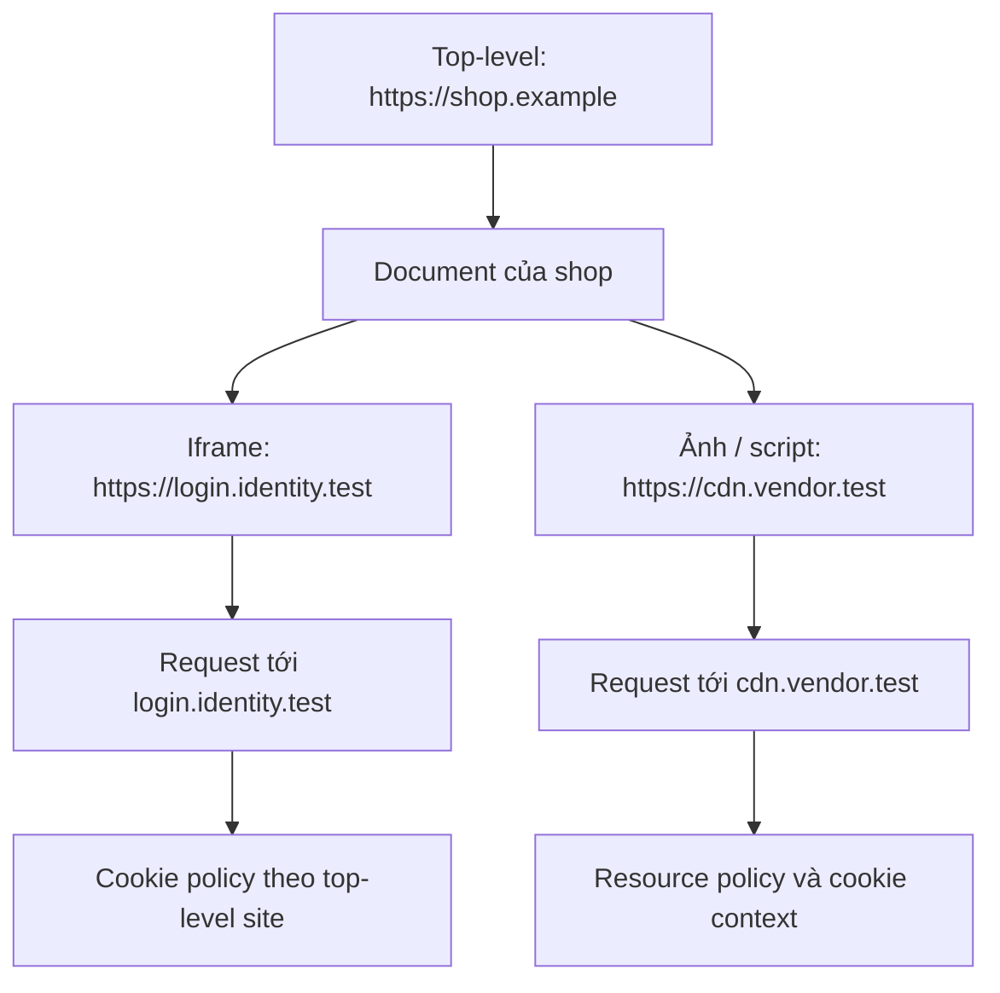
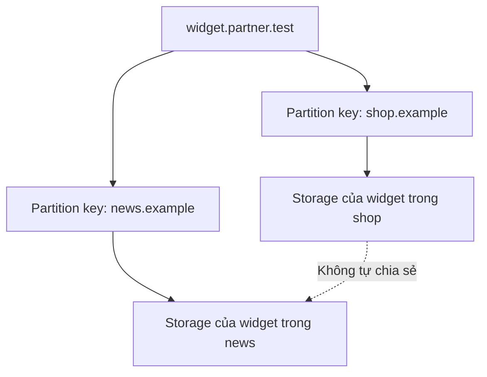

# Third-party cookie — cookie bên thứ ba và ranh giới riêng tư

> **Chương:** Privacy  
> **Mục tiêu:** Hiểu khi nào cookie được xem là third-party; phân biệt origin với site và top-level site; nắm tác động của SameSite, browser cookie blocking và storage partitioning; hiểu CHIPS/Partitioned cookies và Storage Access API; phân biệt cookie policy với CORS; thiết kế đăng nhập nhúng và tích hợp bên thứ ba có tôn trọng quyền riêng tư; kiểm thử bằng DevTools.

## 1. Third-party cookie là gì?

Cookie là dữ liệu nhỏ do server gửi qua header `Set-Cookie` và browser lưu để gửi lại trong các request phù hợp. Cookie thường dùng cho session, tùy chọn và một số trạng thái ứng dụng.

Một cookie được gọi là **third-party cookie** khi nó được sử dụng trong một ngữ cảnh bên thứ ba: site tạo hoặc sở hữu cookie khác với top-level site mà người dùng đang truy cập. Ví dụ:

- Người dùng mở trang `https://news.example`.
- Trang nhúng iframe từ `https://accounts.partner.test`.
- Iframe gửi request tới `accounts.partner.test` và browser cân nhắc cookie của site đó trong ngữ cảnh được nhúng.

Trong ví dụ này, `accounts.partner.test` là bên thứ ba so với top-level site `news.example`. Cookie không trở thành third-party chỉ vì nó có thuộc tính `Domain` trỏ tới subdomain; điều quan trọng là ngữ cảnh site của request.

Third-party cookie có thể giúp các dịch vụ nhúng duy trì trạng thái qua nhiều website, nhưng cũng có thể được dùng để theo dõi người dùng giữa các site. Vì vậy, browser áp dụng nhiều cơ chế hạn chế, chặn hoặc phân vùng loại cookie này.

## 2. Phân biệt origin, site và top-level site

Ba khái niệm này không giống nhau:

| Khái niệm | Thành phần | Dùng trong ngữ cảnh |
| --- | --- | --- |
| Origin | Scheme, host, port | SOP, DOM access, CORS, service worker |
| Site | Scheme và registrable domain theo quy tắc schemeful same-site | SameSite cookie và một số privacy policy |
| Top-level site | Site của trang cấp cao nhất trong tab/window | Ngữ cảnh nhúng và storage/cookie partitioning |

Ví dụ:

| URL | Origin | Site (schemeful) |
| --- | --- | --- |
| `https://app.example.com` | `https://app.example.com` | `https://example.com` |
| `https://cdn.example.com` | `https://cdn.example.com` | `https://example.com` |
| `http://app.example.com` | `http://app.example.com` | `http://example.com` |
| `https://partner.test` | `https://partner.test` | `https://partner.test` |

`app.example.com` và `cdn.example.com` khác origin nhưng có thể same-site. `https://example.com` và `http://example.com` là khác schemeful site vì scheme khác.

Do đó:

- Cross-origin không nhất thiết là third-party.
- Same-site không có nghĩa same-origin.
- Third-party cookie policy không thể suy ra chỉ từ việc URL có khác host.
- Cần biết top-level site và site của request/cookie context.

## 3. First-party và third-party context

Trong một lần truy cập, browser có thể tải nội dung từ nhiều site:



Request tới chính top-level site thường là first-party context. Request từ iframe hoặc resource bên thứ ba có thể là third-party context tùy site relationship và browser policy.

Không phải mọi resource cross-origin đều gửi cookie. Script hoặc ảnh có thể được tải theo chế độ request riêng; cookie còn phụ thuộc credentials mode, cookie matching và privacy policy. Hãy kiểm tra từng loại request thay vì giả định tất cả resource từ một host đều có cùng hành vi.

## 4. Cookie không tự xác định được là first-party hay third-party

Cookie lưu trên browser gắn với host/domain và các thuộc tính như Path, Secure, HttpOnly, SameSite, expiry. Việc cookie được gửi hay không còn phụ thuộc ngữ cảnh request.

Ví dụ server đặt:

```http
Set-Cookie: session_id=opaque-value; Path=/; Secure; HttpOnly; SameSite=None
```

Cookie này có thể được dùng trong ngữ cảnh cross-site theo quy tắc SameSite, nhưng browser vẫn có thể chặn third-party cookie hoặc yêu cầu cơ chế partitioning/access phù hợp.

Thuộc tính `SameSite` mô tả cách cookie được gửi trong ngữ cảnh same-site/cross-site; nó không tự cấp quyền third-party cookie. Cookie có `SameSite=None` vẫn có thể bị browser chặn bởi tracking protection hoặc cài đặt người dùng.

## 5. SameSite và third-party cookie

Các giá trị phổ biến:

| Giá trị | Hành vi khái quát |
| --- | --- |
| `Strict` | Hạn chế cookie trong các ngữ cảnh cross-site |
| `Lax` | Cho phép một số điều hướng top-level an toàn; hạn chế nhiều request cross-site khác |
| `None` | Cho phép cookie trong ngữ cảnh cross-site theo SameSite; yêu cầu `Secure` trong browser hiện đại |

Ví dụ cookie session first-party:

```http
Set-Cookie: __Host-session=opaque; Path=/; Secure; HttpOnly; SameSite=Lax
```

Ví dụ cookie cần hoạt động trong một số ngữ cảnh cross-site:

```http
Set-Cookie: widget_session=opaque; Path=/; Secure; HttpOnly; SameSite=None
```

`SameSite=None; Secure` chỉ nói rằng cookie không bị SameSite loại bỏ vì ngữ cảnh cross-site. Nó không bảo đảm cookie được gửi nếu browser chặn third-party cookies, cookie không khớp domain/path, hết hạn hoặc thuộc partition khác.

Không dùng `SameSite=None` cho mọi cookie theo mặc định. Với session first-party, `Lax` hoặc `Strict` thường phù hợp hơn tùy luồng điều hướng và yêu cầu sản phẩm.

## 6. Third-party cookie bị chặn như thế nào?

Browser và người dùng có thể áp dụng các chính sách khác nhau:

- Chặn cookie bên thứ ba trong mọi ngữ cảnh.
- Chặn theo danh sách tracker hoặc hành vi tracking.
- Cho phép theo cài đặt site/user hoặc ngoại lệ.
- Phân vùng cookie theo top-level site.
- Yêu cầu Storage Access API hoặc một flow browser-mediated khác để truy cập trạng thái unpartitioned.

Hành vi thực tế thay đổi theo browser, phiên bản, chế độ riêng tư, cài đặt người dùng và platform. Không khẳng định mọi browser đều chặn toàn bộ third-party cookie hoặc mọi browser đều cho phép chúng.

Một tích hợp chạy được trên browser này có thể không chạy trên browser khác. Ứng dụng phải thiết kế theo hướng third-party cookie có thể không khả dụng.

## 7. Vì sao browser hạn chế third-party cookie?

Cookie bên thứ ba có thể cho phép cùng một dịch vụ nhận diện browser khi người dùng truy cập nhiều website khác nhau. Điều này hỗ trợ một số chức năng như đăng nhập nhúng, quảng cáo hoặc chống gian lận, nhưng cũng có thể tạo hồ sơ hoạt động xuyên site.

Rủi ro riêng tư:

- Theo dõi hoạt động qua nhiều website.
- Liên kết hành vi từ các ngữ cảnh không liên quan.
- Tạo hồ sơ quảng cáo mà người dùng khó nhận biết.
- Chia sẻ định danh giữa các bên không có quan hệ trực tiếp với người dùng.
- Kết hợp cookie với IP, fingerprint và metadata khác.

Việc chặn hoặc partition cookie làm giảm khả năng dùng cùng một định danh trên mọi top-level site. Tuy vậy, cookie chỉ là một trong nhiều tín hiệu tracking; giảm third-party cookie không tự loại bỏ fingerprinting hoặc tracking qua server-side identifier.

## 8. Storage partitioning là gì?

**Storage partitioning** là cách browser tách một số trạng thái lưu trữ theo top-level site, thay vì cho mọi ngữ cảnh nhúng của cùng một origin dùng chung một vùng dữ liệu.

Ví dụ cùng một widget tại `https://widget.partner.test` được nhúng trong hai website:

- `https://shop.example`.
- `https://news.example`.

Trong browser có partitioning phù hợp, widget có thể nhận hai vùng storage riêng:



Điều này ngăn widget tự động dùng cùng một trạng thái nhúng để theo dõi người dùng giữa hai top-level site trong các storage area đã được partition.

Partitioning không biến hai document thành same-origin, không thay SOP và không đảm bảo mọi API đều có cùng partition key. Phạm vi partition phụ thuộc browser và loại storage/API.

## 9. Những loại trạng thái có thể bị partition

Browser có thể partition hoặc cô lập nhiều loại trạng thái trong third-party context, ví dụ:

- Cookie bên thứ ba trong cơ chế CHIPS hoặc partitioned cookie.
- Một số storage API như localStorage, IndexedDB hoặc Cache Storage trong embedded context.
- Network state/cache và các trạng thái liên quan theo chính sách browser.
- Service worker hoặc các API lưu trữ khác theo quy tắc partition riêng của browser.

Không giả định mọi API được partition giống nhau trên mọi browser. Khi xây widget, kiểm tra tài liệu và hành vi của API cụ thể.

Đặc biệt, localStorage trong iframe không nên được xem là kho chia sẻ toàn cục giữa tất cả website nhúng widget đó. Browser có thể cấp storage partition riêng theo top-level site.

## 10. CHIPS và Partitioned cookies

CHIPS (Cookies Having Independent Partitioned State) cho phép cookie bên thứ ba được phân vùng theo top-level site. Cookie của widget có thể có trạng thái riêng khi widget được nhúng trên các website khác nhau.

Ví dụ:

```http
Set-Cookie: __Host-widget_session=opaque; Path=/; Secure; HttpOnly; SameSite=None; Partitioned
```

Các thuộc tính có ý nghĩa:

- `Secure`: chỉ gửi qua kết nối an toàn.
- `HttpOnly`: không cho JavaScript đọc cookie qua document.cookie.
- `SameSite=None`: cho phép cookie trong ngữ cảnh cross-site theo SameSite rules.
- `Partitioned`: yêu cầu cookie được lưu trong partition tương ứng.
- Prefix `__Host-`: yêu cầu cookie host-only, Secure và Path=/ theo quy tắc prefix.

Với cookie partitioned, cùng một widget origin có thể có cookie riêng theo top-level site. Cookie được tạo khi widget chạy trong `shop.example` không tự động là cookie dùng chung khi widget chạy trong `news.example`.

CHIPS phù hợp với một số use case nhúng cần trạng thái riêng theo từng site, ví dụ giỏ hàng/phiên widget độc lập hoặc trạng thái bảo mật của một dịch vụ nhúng. Nó không phải cách khôi phục tracking xuyên site bằng một cookie toàn cục.

Hỗ trợ và chi tiết triển khai phụ thuộc browser. Hãy feature-test bằng request thực tế và kiểm tra cookie trong DevTools.

## 11. Cookie partitioned khác cookie unpartitioned

| Đặc điểm | Cookie unpartitioned | Cookie Partitioned |
| --- | --- | --- |
| Phạm vi trong third-party context | Có thể được chia sẻ giữa các top-level site nếu browser cho phép | Được tách theo partition key/top-level site |
| Mục đích | Session first-party hoặc tích hợp cũ phụ thuộc third-party state | Trạng thái nhúng riêng theo từng top-level site |
| Thuộc tính | Theo cookie rules thông thường | Có `Partitioned` và các điều kiện bảo mật liên quan |
| Tracking xuyên site | Có thể tạo định danh dùng chung | Giảm khả năng dùng chung cookie giữa top-level site |
| Tương thích | Có thể bị browser chặn | Phụ thuộc hỗ trợ CHIPS/partitioned cookies |

Cookie partitioned không tự động thay thế mọi cookie hiện có. Ứng dụng phải thiết kế session model và backend để hiểu partition context, đồng thời xử lý trường hợp browser không hỗ trợ.

## 12. Storage Access API

Một số dịch vụ nhúng có use case cần truy cập trạng thái first-party/unpartitioned của chính chúng, ví dụ đăng nhập đã tồn tại khi người dùng mở widget trong iframe.

Storage Access API cung cấp cơ chế để embedded document yêu cầu browser cấp quyền truy cập storage không partition trong một số điều kiện:

```js
async function requestEmbeddedStorageAccess() {
  if (!document.hasStorageAccess || !document.requestStorageAccess) {
    return { supported: false, granted: false };
  }

  const alreadyHasAccess = await document.hasStorageAccess();
  if (alreadyHasAccess) {
    return { supported: true, granted: true };
  }

  try {
    await document.requestStorageAccess();
    return { supported: true, granted: true };
  } catch (error) {
    return {
      supported: true,
      granted: false,
      reason: error.name,
    };
  }
}
```

Browser có thể yêu cầu user activation, tương tác trước đó với site ở top-level, permission prompt hoặc điều kiện khác. API có thể bị từ chối và hỗ trợ không giống nhau giữa browser.

Hãy gọi API trong một hành động có ý nghĩa của người dùng, ví dụ bấm “Kết nối tài khoản”. Không gọi lặp lại tự động để ép browser cấp quyền.

Storage Access API không phải lối tắt để vượt qua mọi privacy control. Nó là một cơ chế có điều kiện và browser vẫn quyết định có cấp quyền hay không.

## 13. Thiết kế fallback khi Storage Access bị từ chối

Nếu browser không hỗ trợ hoặc người dùng từ chối, ứng dụng cần có luồng thay thế:

- Cho người dùng mở dịch vụ ở top-level context để đăng nhập.
- Dùng redirect/top-level navigation tới identity provider rồi quay lại bằng authorization code.
- Dùng FedCM nếu use case và browser support phù hợp.
- Dùng CHIPS nếu widget chỉ cần trạng thái độc lập theo từng top-level site.
- Cho phép tính năng hoạt động ở chế độ guest nếu phù hợp.
- Giải thích rõ vì sao widget chưa thể kết nối tài khoản.

Không làm:

- Hiện prompt liên tục sau khi bị từ chối.
- Giấu nội dung hoặc ép người dùng tắt privacy protection.
- Thu thập thêm fingerprint để thay thế cookie bị chặn.
- Chuyển token nhạy cảm qua query string hoặc postMessage không xác minh.

## 14. Third-party cookie và đăng nhập nhúng

Một mô hình cũ thường là:

1. Website A nhúng iframe từ identity provider B.
2. Iframe B đọc cookie phiên unpartitioned của B.
3. Iframe xác định user đã đăng nhập.
4. Iframe cung cấp trạng thái đăng nhập cho A.

Mô hình này có thể thất bại khi browser chặn third-party cookie hoặc partition storage. Không nên xây kiến trúc đăng nhập mới dựa trên giả định cookie B luôn khả dụng trong iframe A.

Các hướng thay thế:

- Top-level redirect tới identity provider, sau đó quay lại qua authorization code.
- FedCM hoặc cơ chế identity browser-mediated phù hợp.
- Storage Access API khi use case thật sự cần và browser cho phép.
- Session first-party tại origin ứng dụng.

Luồng OAuth/OIDC cần dùng state, nonce, PKCE theo loại client và xác minh issuer/audience/redirect URI ở backend. Không coi việc iframe đọc được cookie là bằng chứng authorization.

## 15. Fetch credentials không vượt qua third-party cookie policy

Frontend có thể gọi:

```js
const response = await fetch("https://widget.partner.test/api/session", {
  credentials: "include",
});
```

`credentials: "include"` yêu cầu Fetch cho phép sử dụng credentials trong request cross-origin. Nhưng browser vẫn áp dụng:

- Cookie Domain/Path matching.
- Secure và expiry.
- SameSite.
- Third-party cookie blocking.
- Cookie partitioning và top-level site key.
- Các privacy setting của người dùng/browser.

Vì vậy, code dùng include không bảo đảm cookie unpartitioned sẽ được gửi trong iframe.

Nếu JavaScript cần đọc response cross-origin, server còn phải cấu hình CORS credentialed:

```http
Access-Control-Allow-Origin: https://shop.example
Access-Control-Allow-Credentials: true
Vary: Origin
```

CORS và cookie policy là hai lớp khác nhau. CORS hợp lệ không ép browser gửi cookie bị chặn; cookie được gửi cũng không đồng nghĩa JavaScript được phép đọc response.

## 16. CORS không thay thế quyền truy cập cookie/storage

CORS điều khiển việc JavaScript ở origin này có thể đọc response cross-origin hay không. Nó không cấp quyền đọc:

- Cookie jar của origin khác.
- localStorage hoặc IndexedDB của origin khác.
- DOM của iframe cross-origin.
- Cache Storage của một origin khác.

Ví dụ:

```js
// Có thể đọc response nếu server cho phép CORS.
const response = await fetch("https://api.partner.test/public", {
  mode: "cors",
});

// Không vì CORS mà được đọc localStorage của partner.test.
```

Muốn chia sẻ dữ liệu giữa hai origin, dùng API có authentication/authorization hoặc giao thức cross-origin có kiểm tra nguồn, schema và quyền. Không nới CORS để thay thế thiết kế storage.

## 17. Third-party cookie và CSRF

Cookie tự động được browser gửi theo request context có thể tạo rủi ro CSRF. Third-party cookie blocking có thể giảm một số request cross-site mang cookie, nhưng không nên coi đó là CSRF defense duy nhất.

Lý do:

- Cookie first-party vẫn được gửi trong các request same-site phù hợp.
- Một số cross-site navigation vẫn có hành vi cookie theo SameSite=Lax.
- Browser policy khác nhau và có thể thay đổi.
- Attacker có thể khai thác các endpoint, subdomain hoặc flow khác.
- Client không phải browser có thể gửi request mà không tuân theo cookie privacy policy của browser.

Endpoint thay đổi trạng thái cần:

- CSRF token được xác minh ở server.
- SameSite phù hợp cho session cookie.
- Kiểm tra Origin/Referer hoặc Fetch Metadata theo threat model.
- Không dùng GET để thay đổi trạng thái.
- Xác thực và authorization từng thao tác.

Privacy protection và CSRF protection có mục tiêu liên quan nhưng không thay thế nhau.

## 18. Third-party cookie và tracking

Cookie bên thứ ba có thể làm một dịch vụ nhận diện cùng browser trên nhiều website. Tuy nhiên, tracking có thể dùng thêm:

- IP address và network metadata.
- Browser/device fingerprint.
- URL parameters và click identifiers.
- Login-based identifiers.
- Server-side event correlation.
- Pixel hoặc resource request từ nhiều website.

Chặn third-party cookie giảm một kênh tracking nhưng không tự bảo đảm ẩn danh. Ứng dụng nên giảm thu thập dữ liệu, giới hạn retention, minh bạch mục đích và không tìm cách né privacy control của browser.

Khi tích hợp analytics/advertising:

- Chỉ tải script cần thiết.
- Kiểm soát domain bên thứ ba trong CSP.
- Không gửi token/session identifier vào URL hoặc analytics event.
- Giới hạn dữ liệu và thời gian lưu.
- Tôn trọng consent và privacy settings theo yêu cầu sản phẩm/pháp lý.
- Đánh giá server-side tracking như một xử lý dữ liệu riêng, không coi nó là cách thay thế vô hại cho cookie.

## 19. Cookie prefix và thuộc tính bảo vệ

Cookie session first-party có thể dùng prefix `__Host-`:

```http
Set-Cookie: __Host-session=opaque; Path=/; Secure; HttpOnly; SameSite=Lax
```

`__Host-` yêu cầu:

- Có `Secure`.
- Có `Path=/`.
- Không có thuộc tính `Domain`.

Điều này giới hạn cookie ở host tạo ra, giảm một số rủi ro cookie domain rộng giữa subdomain.

Cookie cho widget cross-site partitioned có thể dùng:

```http
Set-Cookie: __Host-widget=opaque; Path=/; Secure; HttpOnly; SameSite=None; Partitioned
```

Prefix và thuộc tính cookie cần được browser hỗ trợ. Kiểm tra cookie thực tế trong DevTools; server không nên giả định mọi browser đều chấp nhận cùng một thuộc tính mới.

Không đặt session cookie vào `localStorage` chỉ để né third-party cookie blocking. JavaScript có thể đọc localStorage, làm tăng tác động của XSS và không giải quyết privacy partitioning một cách an toàn.

## 20. Logout và thu hồi trạng thái nhúng

Một dịch vụ có thể được đăng nhập ở top-level context và đồng thời xuất hiện trong nhiều iframe. Khi logout, ứng dụng cần xác định:

- Session server nào cần thu hồi.
- Cookie first-party nào cần hết hạn.
- Cookie partitioned ở những top-level site nào có thể còn tồn tại.
- Token hoặc state nào đang được giữ trong memory/storage.
- Các iframe đang mở có cần nhận thông báo logout hay không.

Xóa cookie trong một partition không nhất thiết xóa cookie ở partition khác. Server-side session revocation là lớp quan trọng để ngăn session cũ tiếp tục được dùng.

Ví dụ xóa cookie host-only:

```http
Set-Cookie: __Host-widget=; Path=/; Secure; HttpOnly; SameSite=None; Partitioned; Max-Age=0
```

Để xóa cookie, các thuộc tính định danh cookie phải phù hợp với cookie đã tạo. Với partitioned cookie, thao tác xóa phải diễn ra trong ngữ cảnh partition phù hợp; không giả định một response ở top-level context có thể xóa mọi partition của cookie.

## 21. Cấu hình server cho CHIPS và credentialed CORS

Ví dụ endpoint widget trả cookie partitioned:

```http
HTTP/1.1 200 OK
Set-Cookie: __Host-widget=opaque; Path=/; Secure; HttpOnly; SameSite=None; Partitioned
Access-Control-Allow-Origin: https://shop.example
Access-Control-Allow-Credentials: true
Vary: Origin
Cache-Control: private, no-store
Content-Type: application/json
```

Response này minh họa các lớp độc lập:

- `Set-Cookie` đề nghị browser lưu cookie theo thuộc tính.
- `Partitioned` yêu cầu trạng thái cookie tách theo partition.
- CORS cho phép origin được liệt kê đọc response khi credentials mode phù hợp.
- `Cache-Control` hạn chế lưu response cá nhân hóa.

Không phản chiếu Origin tùy tiện. Backend phải kiểm tra allowlist trước khi trả `Access-Control-Allow-Origin`. Nếu widget được nhúng trên nhiều top-level site, response CORS cần xử lý origin theo cấu hình đã kiểm duyệt và cache phải vary đúng.

## 22. Kiểm thử third-party cookie bằng DevTools

Thực hành trên staging/lab với hai registrable domain do bạn kiểm soát, ví dụ `https://shop.example.test` và `https://widget.partner.test`. Dùng cookie giả lập, không dùng session thật.

### Bước 1 — Tạo first-party và embedded context

Mở widget ở top-level tab rồi nhúng cùng widget trong iframe của site còn lại. Ghi nhận top-level site và embedded origin.

### Bước 2 — Đặt cookie thử nghiệm

Thử các cookie:

- `SameSite=Lax; Secure`.
- `SameSite=None; Secure`.
- `SameSite=None; Secure; Partitioned`.

Mở DevTools → Application/Storage → Cookies. Kiểm tra thuộc tính và trạng thái blocked/partitioned nếu browser hiển thị.

### Bước 3 — Quan sát request

Mở Network, chọn request tới widget host. Kiểm tra:

- Request có gửi Cookie header không.
- Cookie nào bị blocked và lý do browser hiển thị.
- Response Set-Cookie có được lưu không.
- Request có thuộc top-level site/partition dự kiến không.

### Bước 4 — Bật third-party cookie blocking

Thay đổi browser privacy setting hoặc dùng chế độ test phù hợp. Reload iframe và so sánh với top-level context. Không kết luận chỉ từ một browser.

### Bước 5 — Kiểm tra partitioning

Nhúng widget vào hai top-level site khác nhau. Ghi dữ liệu thử nghiệm trong widget storage và kiểm tra mỗi context có nhận state riêng không. Thử cookie có `Partitioned` nếu browser hỗ trợ.

### Bước 6 — Kiểm tra Storage Access API

Thử `hasStorageAccess()` và `requestStorageAccess()` trong iframe sau một thao tác người dùng phù hợp. Quan sát permission, lỗi và fallback khi browser từ chối.

### Bước 7 — Tách CORS khỏi cookie policy

Giữ CORS hợp lệ nhưng chặn third-party cookie; sau đó cho cookie nhưng làm ACAO không hợp lệ. Quan sát hai lỗi khác nhau: cookie không được gửi và JavaScript không được đọc response.

## 23. Chẩn đoán lỗi thường gặp

| Hiện tượng | Nguyên nhân có thể | Cách xử lý |
| --- | --- | --- |
| Cookie có ở top-level nhưng mất trong iframe | Third-party cookie bị chặn hoặc partition khác | Kiểm tra browser privacy policy, CHIPS và Storage Access API |
| `SameSite=None` nhưng cookie vẫn bị chặn | Thiếu Secure, browser chặn third-party hoặc cookie không khớp | Kiểm tra Set-Cookie và blocked reason |
| Widget có trạng thái khác trên hai website | Storage/cookie partitioning theo top-level site | Thiết kế state độc lập hoặc flow first-party |
| Fetch include nhưng không có Cookie header | Cookie policy/partitioning loại cookie trước khi gửi | Kiểm tra request context và cookie jar |
| Cookie gửi được nhưng Fetch báo CORS | Response thiếu ACAO/ACAC hoặc origin không khớp | Sửa CORS allowlist và credentials response |
| Storage Access API reject | Thiếu user activation, chưa đủ điều kiện hoặc browser không hỗ trợ | Hiển thị fallback top-level login |
| Đăng nhập nhúng mất sau khi đổi browser | Browser policy hoặc partition behavior khác | Không phụ thuộc unpartitioned third-party cookie |
| CHIPS cookie không xuất hiện | Browser không hỗ trợ hoặc thuộc tính/cú pháp không hợp lệ | Feature-test và kiểm tra DevTools |
| Logout ở top-level nhưng iframe còn trạng thái | Partitioned state hoặc server session chưa thu hồi | Thu hồi session server-side và xử lý từng partition |
| CORS hoạt động nhưng localStorage vẫn không đọc được | CORS không cấp quyền storage cross-origin | Dùng API có authorization hoặc giao thức chia sẻ dữ liệu |

## 24. Những ngộ nhận thường gặp

| Ngộ nhận | Cách hiểu đúng |
| --- | --- |
| “Cross-origin luôn là third-party.” | Subdomain có thể khác origin nhưng same-site. |
| “SameSite=None bảo đảm cookie được gửi.” | Browser vẫn có thể chặn third-party cookie hoặc yêu cầu partition/access. |
| “Fetch include vượt qua cookie blocking.” | Include chỉ cho phép credentials theo Fetch; browser privacy policy vẫn áp dụng. |
| “CORS bật cookie.” | CORS cho phép đọc response; cookie policy quyết định cookie có được gửi/lưu không. |
| “Partitioned cookie dùng chung trên mọi website.” | Cookie được tách theo partition key/top-level site. |
| “Storage Access API luôn cấp quyền nếu được gọi.” | Browser có thể yêu cầu điều kiện/gesture hoặc từ chối. |
| “Third-party cookie blocking loại bỏ mọi tracking.” | Fingerprinting, login identifier và server-side correlation vẫn có thể tồn tại. |
| “Cookie Domain rộng làm subdomain same-origin.” | Cookie scope không thay origin tuple hoặc SOP. |
| “Xóa cookie ở một nơi xóa mọi partition.” | Partitioned state có thể cần xử lý trong từng partition; thu hồi server-side vẫn quan trọng. |
| “Third-party cookie blocking là CSRF protection.” | Endpoint vẫn cần CSRF token, SameSite và authorization server-side. |

## 25. Checklist thiết kế tích hợp third-party cookie

- Xác định top-level site và embedded site cho từng luồng.
- Phân biệt origin với schemeful site; không dùng thuật ngữ thay thế nhau.
- Không dựa vào unpartitioned third-party cookie để duy trì đăng nhập xuyên site.
- Dùng cookie first-party với Secure, HttpOnly và SameSite phù hợp.
- Chỉ dùng SameSite=None; Secure khi thực sự cần cross-site context.
- Đánh giá CHIPS/Partitioned cookie nếu widget cần state độc lập theo top-level site.
- Dùng Storage Access API có điều kiện, sau tương tác người dùng và có fallback.
- Ưu tiên top-level redirect, authorization code hoặc FedCM cho federated login phù hợp.
- Tách CORS, cookie policy, SOP và storage access thành các lớp riêng.
- Không phản chiếu Origin tùy tiện; dùng allowlist và Vary: Origin.
- Bảo vệ endpoint cookie-authenticated khỏi CSRF.
- Không chuyển token/session secret qua URL, log hoặc analytics.
- Giới hạn tracking, dữ liệu thu thập và thời gian lưu.
- Thu hồi session server-side khi logout; xử lý cookie partitioned theo đúng context.
- Kiểm thử trên nhiều browser, private mode, third-party blocking và top-level site khác nhau.

## 26. Câu hỏi tự kiểm tra

1. Third-party cookie được xác định theo ngữ cảnh nào?
2. Origin, schemeful site và top-level site khác nhau ra sao?
3. Vì sao hai subdomain có thể cross-origin nhưng same-site?
4. SameSite=None; Secure cho phép điều gì và không bảo đảm điều gì?
5. Browser có thể chặn third-party cookie theo những cách nào?
6. Storage partitioning giúp giới hạn tracking xuyên site ra sao?
7. CHIPS và thuộc tính Partitioned dùng để làm gì?
8. Cookie partitioned khác cookie unpartitioned thế nào?
9. Storage Access API hoạt động trong điều kiện nào?
10. Vì sao Fetch credentials include không vượt qua third-party cookie blocking?
11. CORS khác cookie policy và storage access như thế nào?
12. Vì sao third-party cookie blocking không thay CSRF protection?
13. Có thể thay đăng nhập nhúng bằng những flow nào?
14. Khi logout, vì sao cần thu hồi session server-side?
15. Cần quan sát những gì trong DevTools để xác định cookie bị chặn?

**Ghi nhớ:** Third-party cookie được quyết định theo ngữ cảnh top-level site và site của request, không chỉ theo hostname. SameSite, browser blocking và storage partitioning có thể khiến cookie không được gửi hoặc được tách riêng theo từng top-level site. CHIPS hỗ trợ cookie partitioned cho widget; Storage Access API có thể cấp quyền unpartitioned trong điều kiện browser cho phép. CORS không mở quyền cookie/storage và Fetch include không vượt qua privacy policy. Hãy ưu tiên session first-party, partitioned state khi phù hợp, flow đăng nhập top-level/FedCM và bảo vệ CSRF ở server.
