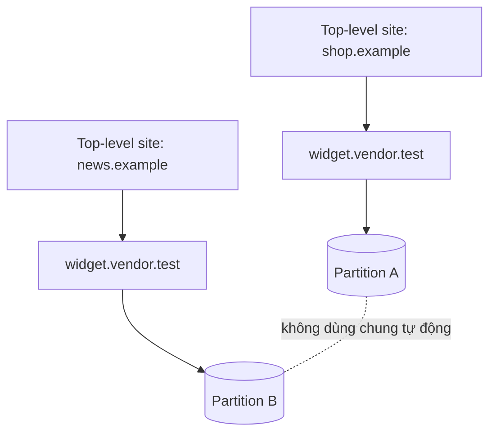

# Phân vùng theo site

## Mục tiêu bài học

Sau bài này, bạn có thể:

- Giải thích vì sao trình duyệt phân vùng trạng thái lưu trữ theo site cấp cao nhất để giảm theo dõi người dùng giữa các website.
- Phân biệt origin, site và top-level site; xác định vì sao cùng một origin nhúng trong hai website khác nhau có thể nhận hai vùng dữ liệu khác nhau.
- Nhận diện các loại trạng thái có thể được phân vùng như cookie, Web Storage, IndexedDB, Cache Storage, service worker và network cache.
- Hiểu CHIPS (`Partitioned` cookie) và phân biệt cookie phân vùng với quyền truy cập cookie bên thứ ba không phân vùng qua Storage Access API.
- Thiết kế iframe, widget, đăng nhập liên kết và tích hợp thanh toán để hoạt động khi trình duyệt hạn chế third-party state.
- Kiểm thử hành vi phân vùng bằng DevTools và đánh giá các giới hạn riêng tư còn lại.

## 1. Vì sao trình duyệt phân vùng theo site?

Một website có thể nhúng nội dung từ nhiều domain khác nhau. Ví dụ, trang cửa hàng `shop.example` có thể nhúng widget hỗ trợ từ `support.vendor.test`, video từ `video.vendor.test`, nút thanh toán từ `pay.vendor.test` và script phân tích từ một nhà cung cấp khác.

Khi một nhà cung cấp bên thứ ba được nhúng trên nhiều website, cùng một origin của nhà cung cấp có thể được tải trong nhiều ngữ cảnh khác nhau. Nếu mọi ngữ cảnh dùng chung một vùng cookie, cache hoặc storage, nhà cung cấp có thể nhận ra rằng cùng một trình duyệt đã ghé thăm nhiều website. Đây là một cơ chế có thể được dùng để theo dõi người dùng giữa các site.

Phân vùng theo site (site partitioning, thường được gọi là storage partitioning hoặc state partitioning) giới hạn việc chia sẻ một số trạng thái của bên thứ ba theo site cấp cao nhất đang chứa nó. Thay vì để một iframe từ `widget.vendor.test` dùng chung mọi dữ liệu ở bất kỳ trang nào, trình duyệt có thể tạo một partition riêng cho widget khi nó được nhúng trong từng top-level site.

Ví dụ:

```text
Top-level site A: https://shop.example
  └── iframe: https://widget.vendor.test
        partition: (shop.example, widget.vendor.test)

Top-level site B: https://news.example
  └── iframe: https://widget.vendor.test
        partition: (news.example, widget.vendor.test)
```

Hai iframe có cùng origin `https://widget.vendor.test`, nhưng storage partition của chúng khác nhau vì top-level site khác nhau. Widget có thể giữ trạng thái cần thiết trong từng website mà không tự động dùng chung trạng thái đó để nhận diện cùng trình duyệt trên tất cả các website.

Phân vùng là một biện pháp bảo vệ quyền riêng tư ở tầng trình duyệt. Nó không thay thế Same-Origin Policy, CORS, xác thực, authorization hoặc chính sách dữ liệu của ứng dụng. Nó cũng không đảm bảo người dùng không thể bị nhận diện bằng tài khoản đã đăng nhập, dữ liệu do họ chủ động cung cấp hoặc các tín hiệu fingerprinting khác.

## 2. Phân biệt origin, site và top-level site

Để hiểu partition key, cần phân biệt ba khái niệm.

### 2.1. Origin

Origin được tạo bởi bộ ba scheme, host và port. Ví dụ:

| URL | Origin |
| --- | --- |
| `https://app.example.com` | `https://app.example.com` |
| `https://app.example.com:8443` | `https://app.example.com:8443` |
| `http://app.example.com` | `http://app.example.com` |
| `https://api.example.com` | `https://api.example.com` |

Các URL trong bảng có origin khác nhau nếu scheme, host hoặc port khác. Same-Origin Policy dùng origin làm ranh giới chính cho nhiều thao tác đọc dữ liệu giữa các document.

### 2.2. Site (schemeful site)

Site thường được xác định từ scheme và registrable domain, tức domain có thể đăng ký theo Public Suffix List. Port và subdomain cụ thể không tạo ra site riêng trong nhiều phép so sánh site. Các trình duyệt hiện đại dùng khái niệm schemeful site cho những chính sách như SameSite cookie.

Ví dụ:

| URL A | URL B | Quan hệ thường gặp |
| --- | --- | --- |
| `https://shop.example.com` | `https://api.example.com` | Khác origin nhưng cùng site. |
| `https://shop.example.com` | `https://shop.example.com:8443` | Khác origin nhưng cùng site. |
| `https://shop.example.com` | `http://shop.example.com` | Khác origin và khác schemeful site. |
| `https://shop.example.com` | `https://other.test` | Khác origin và khác site. |

Không được đồng nhất “same-site” với “same-origin”. Hai subdomain có thể cùng site nhưng vẫn bị Same-Origin Policy xem là khác origin. Ngược lại, SameSite cookie là chính sách gửi cookie theo ngữ cảnh site, không phải quyền cho JavaScript đọc tài nguyên từ origin khác.

### 2.3. Top-level site

Top-level site là site của trang cấp cao nhất trong tab hoặc browsing context, thường là site trong thanh địa chỉ mà người dùng đang truy cập. Khi một iframe bên thứ ba được nhúng, top-level site vẫn là site của trang cha.

Một số mô hình partitioning dùng khóa gồm top-level site và origin của frame hoặc tài nguyên. Cách tạo storage key cụ thể có thể thêm thông tin như ancestor chain, nonce hoặc yếu tố phân vùng khác tùy API và trình duyệt. Vì vậy, biểu thức `(top-level site, origin)` là mô hình tư duy hữu ích, không phải mô tả đầy đủ thuật toán nội bộ của mọi browser.

## 3. Partition key và cách trạng thái được cô lập

Trong mô hình phân vùng, trình duyệt không chỉ hỏi “dữ liệu thuộc origin nào?” mà còn có thể hỏi “origin này đang được sử dụng dưới top-level site nào?”. Khi cùng một third-party origin xuất hiện trong hai website khác nhau, trình duyệt tra cứu hai vùng trạng thái riêng.



Các loại trạng thái có thể chịu ảnh hưởng của partitioning:

| Trạng thái | Tác động có thể gặp |
| --- | --- |
| Cookie bên thứ ba | Cookie có thể bị chặn, phân vùng hoặc chỉ được truy cập qua cơ chế được browser cho phép. CHIPS cho phép site chủ động tạo cookie phân vùng trong browser hỗ trợ. |
| `localStorage` | Trong các browser triển khai storage partitioning, third-party context có thể nhận vùng `localStorage` riêng theo top-level site. |
| `sessionStorage` | Vốn được phân tách theo origin và top-level browsing context; vòng đời theo tab/context này khác với partitioning theo site của `localStorage`. |
| IndexedDB | Database có thể được phân vùng theo storage key, khiến dữ liệu cùng origin không tự chia sẻ giữa các top-level site. |
| Cache Storage | Cache của iframe/service worker có thể nằm trong partition tương ứng; không nên giả định cache bên thứ ba được dùng chung toàn cục. |
| Service worker | Registration và trạng thái liên quan có thể bị giới hạn theo storage key/partition. Vòng đời và hỗ trợ cụ thể phụ thuộc browser. |
| Network cache | Cache HTTP và một số trạng thái kết nối có thể được partition để hạn chế một site suy ra người dùng đã tải tài nguyên ở site khác. |
| BroadcastChannel, SharedWorker và API liên quan | Khả năng chia sẻ giữa các context có thể bị giới hạn theo partition, ngoài ranh giới origin truyền thống. |

Không phải mọi trình duyệt đều partition mọi API theo cùng cách hoặc cùng thời điểm. Một số API có thể bị chặn trong third-party context thay vì được cấp một partition riêng. Hãy kiểm tra ma trận browser/version của sản phẩm, không suy luận rằng mọi storage API đều có hành vi giống cookie.

Partitioning cũng không có nghĩa mọi dữ liệu cùng origin trong một tab bị tách rời. Các document cùng origin và cùng partition thường vẫn có thể chia sẻ storage theo quy tắc của API. Ranh giới top-level site được bổ sung vào khóa lưu trữ, còn Same-Origin Policy vẫn tiếp tục áp dụng.

## 4. Cookie không phân vùng và cookie phân vùng

### 4.1. Cookie bên thứ ba truyền thống

Một cookie thông thường được xác định bởi các thuộc tính như name, domain/host, path và các cờ liên quan. Trước khi các biện pháp hạn chế third-party cookie được triển khai rộng, cookie của `widget.vendor.test` có thể được gửi khi widget xuất hiện trên nhiều website, nếu cookie và chính sách trình duyệt cho phép.

Ví dụ cookie thông thường:

```http
Set-Cookie: widget-session=abc123; Path=/; Secure; HttpOnly; SameSite=None
```

`SameSite=None; Secure` cho phép cookie tham gia các ngữ cảnh cross-site theo quy tắc SameSite, nhưng không buộc trình duyệt phải chấp nhận third-party cookie. Browser có thể chặn cookie bên thứ ba, phân vùng nó hoặc yêu cầu cơ chế truy cập riêng. Vì vậy, `SameSite=None` không còn là cách đảm bảo một cookie được chia sẻ toàn cục trong mọi iframe.

### 4.2. CHIPS và thuộc tính `Partitioned`

CHIPS (Cookies Having Independent Partitioned State) cho phép website chủ động yêu cầu trình duyệt lưu cookie trong partition gắn với top-level site. Cookie phân vùng vẫn thuộc host/domain và path như cookie bình thường, đồng thời được gắn thêm partition key. Cùng widget origin được nhúng trên hai top-level site sẽ có cookie partition riêng.

Ví dụ:

```http
Set-Cookie: __Host-widget-session=abc123; Path=/; Secure; HttpOnly; SameSite=None; Partitioned
```

Các điểm cần chú ý:

- `Partitioned` đánh dấu cookie cần được lưu trong partition theo top-level site trên browser hỗ trợ CHIPS.
- Cookie partitioned cần `Secure`.
- Với cookie dùng tiền tố `__Host-`, phải có `Path=/` và không có `Domain`; đây là cách giới hạn cookie vào host hiện tại.
- `SameSite=None` thường được dùng cho cookie cần gửi trong iframe cross-site; nó không bỏ qua các điều kiện bảo mật hoặc chính sách của browser.
- Cookie phân vùng ở `shop.example` không tự động được gửi trong ngữ cảnh widget trên `news.example`.
- CHIPS không tạo một danh tính người dùng chung giữa các site; nếu sản phẩm cần tài khoản chung, phải dùng một flow đăng nhập có chủ đích.

Ví dụ cùng widget đặt trong hai website:

```text
shop.example embeds widget.vendor.test
  __Host-widget-session -> partition for shop.example

news.example embeds widget.vendor.test
  __Host-widget-session -> partition for news.example
```

Hai cookie có cùng tên và host nhưng thuộc hai partition khác nhau. Widget có thể duy trì trạng thái riêng theo từng website, chẳng hạn một phiên hỗ trợ hoặc một lựa chọn giao diện trong từng cửa hàng.

CHIPS phù hợp với một số use case nhúng cần trạng thái riêng theo website như widget hỗ trợ, chat, bản đồ hoặc dịch vụ nhúng. Nó không phù hợp nếu yêu cầu là theo dõi cùng người dùng xuyên mọi website. Không nên dùng partitioned cookie làm nơi lưu credential có quyền rộng hơn mức cần thiết của widget.

### 4.3. Cookie phân vùng vẫn cần bảo vệ như session cookie

Partitioning giới hạn nơi cookie được gửi; nó không thay thế các thuộc tính bảo mật. Với session cookie, cân nhắc `Secure`, `HttpOnly`, `SameSite` phù hợp, host-only cookie và thời hạn ngắn. Server vẫn phải xác thực session, chống CSRF theo ngữ cảnh và kiểm tra quyền trên từng request.

Nếu widget xử lý dữ liệu nhạy cảm, không dựa vào việc partition key ngăn mọi truy cập trái phép. Một XSS trong widget origin có thể truy cập dữ liệu của partition mà nó đang chạy. Một lỗ hổng authorization phía server vẫn có thể cho phép đọc dữ liệu của khách hàng khác nếu chỉ tin ID do client gửi.

## 5. Storage partitioning trong iframe

Giả sử một dịch vụ bình luận được phục vụ tại `comments.vendor.test`. Dịch vụ được nhúng trong hai website:

- `https://store.example` nhúng `https://comments.vendor.test/embed`.
- `https://blog.example` cũng nhúng `https://comments.vendor.test/embed`.

Trong browser có storage partitioning, iframe trên hai trang có thể nhận partition khác nhau dù URL iframe giống nhau. Nếu iframe ghi `localStorage.setItem("draft", "...")` trong trang store, iframe trong trang blog không nhất thiết nhìn thấy giá trị đó.

Một ví dụ thử nghiệm đơn giản trong iframe:

```js
const key = "partition-demo";
const count = Number(localStorage.getItem(key) || "0") + 1;
localStorage.setItem(key, String(count));

document.querySelector("#result").textContent =
  `Số lần mở trong partition này: ${count}`;
```

Nhúng iframe cùng origin vào hai top-level site khác nhau và quan sát kết quả. Nếu browser partition `localStorage` cho ngữ cảnh đó, mỗi top-level site sẽ có bộ đếm riêng. Nếu API bị chặn hoặc hành vi browser khác, hãy ghi nhận chính xác phiên bản và chính sách đang áp dụng.

Ứng dụng không nên dựa vào việc iframe luôn có thể đọc trạng thái đăng nhập được tạo khi người dùng truy cập trực tiếp origin của widget. Trạng thái first-party và trạng thái third-party có thể khác nhau vì partition key, cookie blocking hoặc yêu cầu cấp quyền.

## 6. Storage Access API: khi nào cần truy cập state không phân vùng?

Một số dịch vụ nhúng có use case hợp lệ cần truy cập trạng thái first-party đã tồn tại, ví dụ người dùng đã đăng nhập trực tiếp vào nhà cung cấp danh tính rồi quay lại một website nhúng IdP trong iframe. Storage Access API cung cấp cơ chế để embedded document yêu cầu quyền truy cập một số loại unpartitioned state, đặc biệt là cookie trong các trình duyệt triển khai API.

API phổ biến là `document.requestStorageAccess()`. Việc cấp quyền phụ thuộc browser, quan hệ giữa top-level site và embedded site, tương tác trước đó của người dùng, user activation và chính sách quyền riêng tư. Browser có thể yêu cầu prompt, từ chối hoặc áp dụng điều kiện bổ sung. Không được giả định lời gọi sẽ luôn thành công.

Ví dụ chỉ yêu cầu khi người dùng bấm nút:

```html
<button id="enable-account">Kết nối tài khoản đã đăng nhập</button>
<p id="storage-status" role="status"></p>
```

```js
const button = document.querySelector("#enable-account");
const status = document.querySelector("#storage-status");

button.addEventListener("click", () => {
  if (!document.requestStorageAccess) {
    status.textContent = "Trình duyệt không hỗ trợ yêu cầu này.";
    return;
  }

  // Gọi trực tiếp trong click handler để giữ user activation.
  document.requestStorageAccess().then(() => {
    status.textContent = "Trình duyệt đã cấp quyền truy cập.";
  }).catch(() => {
    status.textContent = "Chưa được cấp quyền. Bạn vẫn có thể tiếp tục bằng cách đăng nhập lại.";
  });
});
```

Trong triển khai thực tế, lời gọi nên diễn ra trực tiếp từ thao tác rõ ràng của người dùng và cần kiểm tra điều kiện của browser mục tiêu. `hasStorageAccess()` có thể giúp kiểm tra trạng thái khi được hỗ trợ. Việc API trả về thành công không đồng nghĩa mọi loại storage trong mọi browser đều được mở khóa theo cùng cách; cần đọc tài liệu của nền tảng và kiểm thử loại dữ liệu cụ thể.

Storage Access API và CHIPS giải quyết hai nhu cầu khác nhau:

| Cơ chế | Mục đích |
| --- | --- |
| CHIPS / `Partitioned` cookie | Cho phép embedded site lưu cookie riêng theo từng top-level site. |
| Storage Access API | Cho embedded document yêu cầu quyền truy cập một số state không phân vùng theo điều kiện và quyết định của browser. |

Chỉ yêu cầu quyền truy cập không phân vùng khi sản phẩm thực sự cần và người dùng hiểu lợi ích. Nếu widget chỉ cần lưu lựa chọn hoặc trạng thái riêng cho từng website, partitioned storage thường phù hợp hơn.

## 7. Tác động đến đăng nhập liên kết và SSO

Các hệ thống đăng nhập liên kết thường có IdP ở một domain riêng. Một SPA có thể nhúng hidden iframe đến IdP để kiểm tra session hoặc lấy trạng thái đăng nhập mà không điều hướng người dùng. Khi browser chặn hoặc phân vùng third-party cookie, iframe có thể không đọc được session cookie first-party của IdP. Kết quả là silent authentication hoặc silent renewal có thể thất bại.

Các hướng thiết kế nên cân nhắc:

- Dùng top-level redirect đến IdP theo Authorization Code Flow với PKCE rồi quay lại callback đã đăng ký.
- Dùng popup khi UX cần giữ trang chính, đồng thời kiểm tra `postMessage` bằng `event.origin`, `event.source` và schema chính xác.
- Dùng BFF để quản lý token phía server và giữ session cookie cùng site cho ứng dụng.
- Nếu IdP nhúng trong iframe thật sự cần state first-party, đánh giá Storage Access API và các điều kiện browser; cung cấp fallback tương tác.
- Không coi cookie IdP trong iframe là điều kiện luôn tồn tại và không hạ toàn bộ cookie sang `SameSite=None` chỉ để làm silent SSO hoạt động.

Luồng redirect top-level đưa IdP thành site đang được truy cập trực tiếp trong một bước, vì vậy cookie first-party của IdP có thể được sử dụng theo policy thông thường. Callback vẫn cần `state`, PKCE và kiểm tra redirect URI; top-level navigation không tự bảo đảm giao dịch OAuth hợp lệ.

## 8. Tác động đến widget, thanh toán và nội dung nhúng

### 8.1. Widget hỗ trợ và chat

Widget chat có thể cần nhớ trạng thái mở/đóng, ngôn ngữ hoặc một phiên hỗ trợ. Nếu trạng thái chỉ cần tồn tại trong website đang nhúng, partitioned cookie hoặc storage partition là phù hợp. Nếu cần liên kết với tài khoản đã đăng nhập ở nhà cung cấp, hãy dùng một flow đăng nhập rõ ràng hoặc API server-to-server có authorization.

Không dùng một cookie bên thứ ba toàn cục để nhận diện người dùng giữa các website. Hạn chế dữ liệu cá nhân lưu trong partition và đặt retention phù hợp.

### 8.2. Thanh toán

Nhà cung cấp thanh toán có thể cần nhận biết giao dịch đang diễn ra khi được nhúng trong iframe. Không nên phụ thuộc vào cookie bên thứ ba không phân vùng để liên kết giao dịch giữa nhiều site. Dùng transaction ID ngẫu nhiên, ngắn hạn do server cấp, ràng buộc với đơn hàng và session merchant; xác minh trạng thái thanh toán qua callback/webhook đã xác thực ở server.

Không tin thông điệp `postMessage` từ iframe là bằng chứng thanh toán thành công. Merchant phải kiểm tra `origin`, `source`, schema và đối chiếu trạng thái giao dịch từ backend/provider. Nếu browser không hỗ trợ flow nhúng, cung cấp top-level redirect đến trang thanh toán an toàn.

### 8.3. Video, bản đồ và nội dung công khai

Nội dung công khai thường không cần trạng thái định danh xuyên site. Hãy thiết kế embed để tải được mà không cần cookie hoặc unpartitioned storage. Nếu có tùy chọn cá nhân hóa, yêu cầu người dùng bật rõ ràng và lưu lựa chọn trong partition hiện tại khi có thể.

## 9. Network state partitioning

Storage partitioning không chỉ liên quan đến dữ liệu mà ứng dụng chủ động ghi vào `localStorage` hoặc cookie. Browser còn có thể partition một số trạng thái mạng nhằm ngăn website suy luận hoạt động của người dùng trên site khác.

Ví dụ trạng thái có thể được partition tùy browser:

- HTTP cache, để tài nguyên tải trong một top-level site không nhất thiết được tái sử dụng như cache hit ở một top-level site khác.
- Connection pools hoặc trạng thái kết nối, nhằm giảm khả năng một site suy ra người dùng vừa kết nối đến host nào trong ngữ cảnh khác.
- Một số cache hoặc cơ chế tối ưu mạng như DNS/alternative service state theo thiết kế triển khai.

Hệ quả là cùng một thư viện JavaScript từ CDN có thể được tải hoặc cache riêng khi xuất hiện trên hai top-level site khác nhau. Điều này có thể tăng số lần tải, dung lượng mạng hoặc thời gian khởi tạo so với mô hình cache chia sẻ toàn cục.

Không nên xây dựng tính đúng đắn của ứng dụng dựa vào việc một third-party resource chắc chắn đã có trong cache từ lần truy cập website khác. Dùng cache header hợp lý, versioned asset và CDN tối ưu theo cách tương thích với cache partitioning.

Network partitioning không phải CORS. CORS quyết định JavaScript từ origin nào có thể đọc response; network cache partitioning quyết định một số trạng thái mạng/cache có được dùng chung giữa các ngữ cảnh hay không.

## 10. Service worker và ứng dụng offline trong partition

Một service worker được đăng ký trong third-party iframe có thể chịu giới hạn theo storage key của iframe. Điều này có nghĩa widget nhúng trên `shop.example` không nên giả định registration hoặc Cache Storage của nó sẽ được chia sẻ với cùng widget khi nhúng trên `news.example`.

Nếu widget cần offline:

- Xác định rõ dữ liệu nào là công khai và có thể cache trong từng partition.
- Không cache dữ liệu cá nhân nếu không có nhu cầu offline và chính sách retention rõ.
- Không dựa vào service worker của iframe để chia sẻ trạng thái đăng nhập giữa các top-level site.
- Có fallback khi browser không cho đăng ký service worker hoặc storage bị giới hạn trong third-party context.
- Kiểm thử cập nhật worker, xóa cache và dung lượng trên các browser mục tiêu.

Partitioning không bảo đảm dữ liệu luôn tồn tại. Browser vẫn có thể eviction storage khi thiếu dung lượng, khi người dùng xóa dữ liệu site hoặc theo chính sách riêng tư. Ứng dụng cần coi cache/offline storage là dữ liệu có thể mất và đồng bộ dữ liệu quan trọng về server theo quy trình an toàn.

## 11. Phân vùng không thay thế các ranh giới bảo mật khác

Một số hiểu lầm cần tránh:

| Hiểu lầm | Thực tế |
| --- | --- |
| “Cùng site nghĩa là cùng origin.” | Site và origin là hai khái niệm khác nhau. Hai subdomain có thể cùng site nhưng vẫn cross-origin. |
| “Partitioning ngăn mọi tracking.” | Nó hạn chế chia sẻ một số trạng thái giữa top-level site; tài khoản đăng nhập, dữ liệu người dùng chủ động cung cấp và fingerprinting vẫn có thể liên kết hoạt động. |
| “CHIPS là cách bật lại third-party cookie toàn cục.” | CHIPS tạo cookie partitioned theo top-level site; cookie không tự chia sẻ giữa mọi website. |
| “SameSite=None đảm bảo cookie bên thứ ba được gửi.” | Browser vẫn có thể chặn hoặc partition cookie theo chính sách riêng tư. |
| “Storage Access API luôn cấp quyền.” | Browser có thể yêu cầu tương tác, prompt hoặc từ chối theo policy. |
| “Partition key là cơ chế authorization.” | Partitioning giới hạn phạm vi state; server vẫn phải xác thực và kiểm tra quyền. |
| “Dữ liệu của hai iframe cùng origin luôn chia sẻ.” | Storage key có thể bao gồm top-level site và các yếu tố partition khác. |
| “Partitioning thay thế CORS/SOP.” | SOP và CORS vẫn điều khiển quyền truy cập tài nguyên giữa origin; partitioning quản lý việc chia sẻ trạng thái. |

Nếu cùng một origin có XSS, mã độc có thể truy cập dữ liệu trong partition mà document hiện tại được phép dùng. Nếu server trả dữ liệu sai tenant, partitioning không tự sửa lỗi đó. Nếu ứng dụng chuyển dữ liệu nhận diện từ site A sang site B qua URL, postMessage hoặc server, partitioning không thể ngăn sự liên kết do chính ứng dụng tạo ra.

## 12. Kiểm thử partitioning bằng DevTools

Có thể dựng một lab với hai top-level site và một widget origin chung. Dùng domain test có thể điều khiển, HTTPS hoặc localhost theo khả năng của browser.

1. Tạo `site-a.test` và `site-b.test`, mỗi site nhúng cùng một iframe `widget.test`.
2. Trong iframe, ghi một giá trị ngẫu nhiên vào `localStorage` và tạo một IndexedDB database có tên cố định.
3. Mở site A, ghi dữ liệu; sau đó mở site B và đọc lại dữ liệu từ iframe.
4. Quan sát cookie của widget trong Application/Storage. So sánh cookie thường và cookie có `Partitioned` trên browser hỗ trợ CHIPS.
5. Mở trực tiếp `widget.test` ở top-level context và so sánh state với state trong iframe.
6. Kiểm tra Cache Storage, service worker registration và network cache khi widget được nhúng trên từng site.
7. Thử `document.hasStorageAccess()` và gọi `requestStorageAccess()` từ một nút do người dùng bấm trong iframe. Ghi nhận trường hợp được cấp, bị từ chối hoặc không hỗ trợ.
8. Lặp lại trên các browser/version mục tiêu và ghi rõ API nào bị partition, API nào bị block và API nào cần permission.

Trong DevTools, kiểm tra Application/Storage để xem cookie, Local Storage, IndexedDB, Cache Storage và Service Workers. Giao diện DevTools và cách thể hiện partition có thể khác giữa trình duyệt. Network panel giúp xác nhận cookie nào thực sự được gửi, response `Set-Cookie` nào bị chấp nhận và request có bị chặn bởi chính sách cookie hay không.

Không kết luận partitioning chỉ từ một lần reload. Hãy so sánh ít nhất hai top-level site, cùng iframe origin, cùng browser profile và cùng phiên bản browser. Nếu dữ liệu khác nhau, kiểm tra thêm xem browser có block storage hoàn toàn, người dùng có xóa dữ liệu hay partition có bị eviction không.

## 13. Checklist thiết kế cho ứng dụng nhúng

Trước khi phát hành widget hoặc tích hợp third-party, hãy trả lời:

- Widget có thực sự cần lưu trạng thái khi được nhúng không? Trạng thái đó có thể lưu trong partition riêng không?
- Có cần nhận diện cùng tài khoản khi người dùng truy cập widget ở nhiều top-level site không? Nếu có, flow đăng nhập nào được người dùng chủ động khởi tạo?
- Cookie nào cần `Partitioned`, cookie nào là first-party session và cookie nào có thể bỏ hoàn toàn?
- Widget có hoạt động khi third-party cookie bị chặn và khi Storage Access API bị từ chối không?
- Có đang dựa vào hidden iframe để silent SSO hoặc refresh token không?
- `postMessage` có kiểm tra origin, source và schema không? Có truyền token hoặc dữ liệu cá nhân không cần thiết không?
- API phía server có xác thực tenant/resource và kiểm tra quyền độc lập với partition key không?
- Cache, IndexedDB và service worker có giới hạn retention và cleanup theo partition không?
- Có kiểm thử trên browser/version và cấu hình privacy mode mà sản phẩm hỗ trợ không?
- Người dùng có thể xóa dữ liệu hoặc ngắt liên kết tài khoản một cách rõ ràng không?

## 14. Những lỗi thường gặp

| Lỗi | Hậu quả | Cách khắc phục |
| --- | --- | --- |
| Dựa vào third-party cookie toàn cục | Widget hoặc SSO ngừng hoạt động khi browser block/partition cookie. | Dùng CHIPS cho state riêng theo site hoặc top-level redirect/BFF cho đăng nhập. |
| Dùng `SameSite=None` và nghĩ đã vượt qua third-party cookie blocking | Cookie vẫn có thể bị browser chặn hoặc phân vùng. | Kiểm thử chính sách thực tế; chọn CHIPS hoặc Storage Access API theo use case. |
| Coi localStorage của iframe là dùng chung ở mọi website | Mỗi top-level site có thể nhận partition riêng hoặc storage bị block. | Thiết kế như state riêng theo embedding site và có fallback. |
| Dùng CHIPS để chia sẻ đăng nhập giữa các website | Partitioned cookie không tạo session chung xuyên site. | Dùng luồng đăng nhập liên kết có chủ đích, top-level redirect hoặc BFF. |
| Gọi Storage Access API tự động khi iframe tải | Có thể bị từ chối hoặc không đáp ứng user activation/policy. | Giải thích nhu cầu và gọi từ thao tác rõ ràng của người dùng. |
| Tin partitioning bảo vệ dữ liệu khỏi XSS | Script độc hại cùng origin vẫn có thể truy cập partition hiện tại. | Phòng chống XSS và giới hạn dữ liệu lưu trong partition. |
| Bỏ qua khác biệt browser | Widget có thể chạy ở một browser nhưng mất state ở browser khác. | Có ma trận kiểm thử và fallback theo khả năng. |

## 15. Bài thực hành

Hãy xây dựng một widget giả lập được nhúng trong hai top-level site khác nhau. Dùng dữ liệu không nhạy cảm và browser profile thử nghiệm.

1. Tạo widget origin riêng và nhúng nó trong `site-a` cùng `site-b`.
2. Ghi một giá trị vào `localStorage` và IndexedDB từ iframe trên site A; kiểm tra khả năng đọc ở site B.
3. Thiết lập cookie thông thường và cookie `Partitioned`; quan sát request cookie khi widget chạy trên từng site.
4. Thử dùng `__Host-` prefix cho cookie phân vùng và xác minh `Secure`, `Path=/`, không có `Domain`.
5. Kiểm tra Storage Access API từ một nút tương tác; ghi nhận cách browser xử lý khi người dùng chấp nhận hoặc từ chối.
6. Tạo luồng đăng nhập top-level redirect để so sánh với hidden iframe silent authentication.
7. Kiểm tra service worker, Cache Storage và network cache khi cùng widget được nhúng trong hai site.
8. Thử gửi message `postMessage` từ origin không được phép và xác nhận widget từ chối.
9. Viết checklist tương thích cho ít nhất hai browser engine và ghi lại khác biệt thực tế.

Hoàn thành bài thực hành khi bạn giải thích được vì sao cùng một third-party origin có thể nhận storage khác nhau theo top-level site, phân biệt CHIPS với Storage Access API, và thiết kế được widget vẫn hoạt động khi third-party state bị giới hạn mà không dựa vào việc theo dõi người dùng xuyên site.
