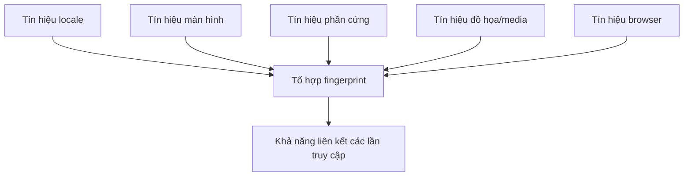

# Privacy budget — giới hạn dữ liệu giúp nhận diện trình duyệt

> **Chương:** Privacy  
> **Mục tiêu:** Hiểu privacy budget trong bối cảnh browser fingerprinting; biết entropy là gì và vì sao nhiều thuộc tính nhỏ có thể kết hợp thành dấu vân tay nhận diện; phân biệt mô hình Privacy Budget từng được đề xuất với API web đã chuẩn hóa; nắm các kỹ thuật giảm entropy, giảm độ chính xác, partitioning và giới hạn truy cập; đánh giá trade-off giữa quyền riêng tư, chống gian lận và tính năng; xây dựng quy trình audit dữ liệu và kiểm thử bằng DevTools.

## 1. Privacy budget là gì?

**Privacy budget** là một mô hình được đề xuất để giới hạn lượng thông tin có thể được suy ra từ các API và thuộc tính của browser. Mục tiêu là giảm khả năng một website thu thập nhiều tín hiệu nhỏ rồi kết hợp chúng thành browser fingerprint có tính phân biệt cao.

Một trang web có thể quan sát nhiều đặc điểm của môi trường người dùng, ví dụ:

- Kích thước màn hình, viewport và device pixel ratio.
- Ngôn ngữ, locale, timezone và định dạng ngày giờ.
- User-Agent hoặc User-Agent Client Hints.
- Số logical processor, device memory và khả năng phần cứng.
- Khả năng render canvas, WebGL, audio hoặc font.
- Các API, codec, media capability và feature được hỗ trợ.

Từng thuộc tính có thể không nhận diện được một người riêng lẻ. Nhưng khi kết hợp nhiều thuộc tính, website có thể tạo một dấu vân tay đủ khác biệt để liên kết các lần truy cập.

Ý tưởng privacy budget là đặt giới hạn cho lượng thông tin phân biệt mà một bên có thể lấy từ các tín hiệu browser trong một phạm vi xác định. Khi giới hạn bị tiêu thụ, browser có thể giảm độ chính xác, trả giá trị tổng quát hoặc hạn chế một số truy vấn tiếp theo.

Đây là **mô hình thiết kế quyền riêng tư**, không phải một API phổ quát mà website có thể gọi để đọc số dư ngân sách của người dùng. Không giả định tồn tại một thuộc tính chuẩn như `navigator.privacyBudget` trên mọi browser.

## 2. Vì sao browser cần hạn chế fingerprinting?

Cookie có thể bị xóa, chặn hoặc partition. Tuy nhiên, website vẫn có thể nhận diện browser bằng cách kết hợp thuộc tính của thiết bị và môi trường chạy.

Ví dụ, một website thu thập:

1. Kích thước màn hình và viewport.
2. Ngôn ngữ, timezone.
3. User-Agent và platform.
4. WebGL renderer hoặc canvas output.
5. Danh sách font hoặc codec hỗ trợ.
6. Một số đặc điểm hiệu năng/phần cứng.

Tập hợp này có thể hiếm trong một nhóm người dùng và giúp liên kết các phiên truy cập, kể cả khi cookie khác nhau.

Fingerprinting có thể được dùng cho mục đích hợp lệ như phát hiện bot hoặc bảo vệ tài khoản, nhưng cũng có thể tạo tracking khó nhận biết và khó kiểm soát hơn cookie thông thường.

Browser privacy controls tìm cách giảm khả năng các website quan sát tín hiệu quá chi tiết hoặc liên kết tín hiệu qua nhiều ngữ cảnh.

## 3. Fingerprinting khác cookie tracking như thế nào?

| Đặc điểm | Cookie tracking | Browser fingerprinting |
| --- | --- | --- |
| Cơ chế | Định danh được lưu trong cookie/storage | Suy ra định danh từ đặc điểm browser/thiết bị |
| Người dùng có thể xóa | Thường có thể xóa cookie/site data | Không có một mục dữ liệu duy nhất để xóa |
| Bị ảnh hưởng bởi partitioning | Có | Có thể vẫn tồn tại nếu tín hiệu quan sát được không được giới hạn |
| Khả năng thay đổi | Cookie ID có thể được rotate | Fingerprint có thể thay đổi khi browser/OS cập nhật hoặc môi trường đổi |
| Rủi ro | Liên kết session và hoạt động | Liên kết phiên ngay cả khi không có định danh lưu trữ |

Fingerprint không nhất thiết là một ID cố định. Một số hệ thống dùng xác suất hoặc kết hợp nhiều tín hiệu để nhận ra cùng browser qua thời gian.

Privacy budget nhắm vào lượng thông tin có thể quan sát được, thay vì chỉ kiểm soát một nơi lưu ID.

## 4. Entropy là gì?

Trong ngữ cảnh fingerprinting, **entropy** mô tả mức độ bất định hoặc khả năng phân biệt mà một thuộc tính cung cấp.

Nếu một thuộc tính có rất ít giá trị phổ biến, nó thường mang ít thông tin phân biệt. Nếu có nhiều giá trị hiếm và phân bố đa dạng, nó có thể cung cấp nhiều thông tin hơn.

Ví dụ minh họa:

| Thuộc tính | Giá trị quan sát | Khả năng phân biệt khái quát |
| --- | --- | --- |
| Ngôn ngữ | vi-VN | Thấp đến vừa, tùy nhóm |
| Múi giờ | UTC+7 | Thấp trong một nhóm địa lý |
| Độ rộng màn hình | 1920 | Vừa, tùy cách đo và phân bố |
| WebGL renderer cụ thể | Tên GPU/driver chi tiết | Có thể cao hơn |
| Kết hợp nhiều thuộc tính | Locale + screen + renderer + fonts | Có thể tăng mạnh |

Entropy thường được biểu diễn bằng bit. Trong mô hình lý tưởng, một tín hiệu có 1 bit thông tin có thể phân biệt hai nhóm có xác suất cân bằng. Nhưng không nên cộng máy móc số bit của mọi thuộc tính: các tín hiệu có thể tương quan, phân bố không đều hoặc phụ thuộc vào những tín hiệu đã biết.

## 5. Entropy đơn lẻ và entropy kết hợp

Giả sử phần lớn người dùng trong một nhóm có ngôn ngữ vi-VN và timezone UTC+7. Hai thuộc tính đó ít giúp phân biệt một người cụ thể trong nhóm.

Nếu kết hợp thêm:

- Một kích thước màn hình hiếm.
- Một renderer WebGL ít gặp.
- Một tập codec hoặc font đặc thù.

Tổ hợp có thể trở nên hiếm hơn nhiều.



Đây là lý do privacy review cần xem xét tổng thể dữ liệu mà một origin và các bên thứ ba có thể kết hợp, không chỉ đánh giá từng API riêng lẻ.

## 6. Mô hình Privacy Budget từng được đề xuất

Một số đề xuất Privacy Budget cho browser hình dung mỗi website hoặc một phạm vi tương tự có một giới hạn thông tin có thể lấy từ các API fingerprinting.

Mô hình khái quát:

1. Browser xác định một tập API/thuộc tính có thể làm lộ thông tin phân biệt.
2. Mỗi truy vấn hoặc nhóm tín hiệu được gán một chi phí privacy ước tính.
3. Browser theo dõi tổng mức thông tin đã cung cấp trong phạm vi được chọn.
4. Khi giới hạn bị chạm, browser có thể giảm độ chi tiết hoặc hạn chế dữ liệu tiếp theo.

Đây là cách diễn đạt ý tưởng, không phải mô tả một thuật toán đang được mọi browser triển khai. Việc định nghĩa đơn vị ngân sách, phạm vi tính, chi phí của từng tín hiệu và hành vi khi hết ngân sách là những vấn đề thiết kế khó.

Không nên viết ứng dụng phụ thuộc vào một số dư privacy budget hay một lời gọi API chưa được chuẩn hóa.

## 7. Privacy Budget không phải một chuẩn API phổ quát

Tên gọi Privacy Budget từng xuất hiện trong các đề xuất giảm fingerprinting của nền tảng web. Tuy nhiên, website không có một API chuẩn, liên trình duyệt để:

- Đọc tổng ngân sách của user.
- Kiểm tra còn bao nhiêu bit.
- Yêu cầu browser trừ một khoản ngân sách.
- Nhận cùng một lỗi hết ngân sách trên mọi browser.

Không viết code giả định:

```js
// Không phải API web chuẩn phổ quát.
const remaining = navigator.privacyBudget.remaining();
```

Các browser hiện có thể áp dụng những biện pháp khác nhau như giảm độ chi tiết của User-Agent, partition storage, giới hạn API, yêu cầu permission, giảm entropy của một số giá trị hoặc chống tracking theo danh sách/chính sách riêng.

Khi thiết kế ứng dụng, hãy feature-detect API thực sự tồn tại và dựa vào tiêu chuẩn/tài liệu của browser mục tiêu. Privacy Budget nên được hiểu là mô hình tư duy cho data minimization và fingerprinting resistance.

## 8. Phân biệt browser privacy budget với differential privacy budget

Thuật ngữ “privacy budget” còn được dùng trong **differential privacy**. Hai ngữ cảnh có liên quan về mục tiêu nhưng không đồng nhất:

| Khái niệm | Privacy budget trong browser fingerprinting | Privacy budget trong differential privacy |
| --- | --- | --- |
| Mục tiêu | Hạn chế thông tin nhận diện suy ra từ API browser | Giới hạn mức rò rỉ thống kê qua các phép phân tích |
| Đơn vị | Từng được đề xuất theo entropy/chi phí tín hiệu | Thường dùng tham số epsilon (và delta) |
| Cơ chế | Giảm độ chi tiết, hạn chế hoặc phân vùng API | Thêm nhiễu và composition accounting theo cơ chế DP |
| Đối tượng | Browser, origin/site và API surface theo thiết kế | Dataset, query hoặc pipeline phân tích |

Không lấy epsilon trong differential privacy để tính số bit fingerprint browser. Cũng không giả định browser Privacy Budget proposal cung cấp differential privacy guarantee.

## 9. Các nguồn entropy phổ biến

Một privacy audit nên kiểm tra nhiều nhóm tín hiệu:

| Nhóm | Ví dụ | Rủi ro |
| --- | --- | --- |
| Browser identity | User-Agent, platform, vendor, Client Hints | Phân loại browser/OS và liên kết phiên |
| Display | Screen size, viewport, pixel ratio, color depth | Tạo tổ hợp hiếm |
| Locale | Language, timezone, calendar, number format | Suy ra vùng và đặc điểm người dùng |
| Hardware | Logical cores, memory, device capability | Phân biệt thiết bị |
| Graphics | Canvas, WebGL renderer/extensions | Tạo tín hiệu đặc thù theo GPU/driver |
| Audio | Audio processing/output characteristics | Tín hiệu bổ sung cho fingerprint |
| Fonts | Font availability/metrics | Phân biệt cấu hình hệ thống |
| Media | Codec, camera capability, supported constraints | Phân biệt browser/thiết bị |
| Network | IP, connection hints, timing | Suy ra vùng và tương quan hoạt động |
| Behavior | Timing, interaction pattern | Có thể hỗ trợ profiling |

Không phải mọi thuộc tính đều được browser cung cấp trực tiếp hoặc có độ ổn định giống nhau. Một số API yêu cầu secure context, permission, user activation hoặc bị giới hạn theo browser.

## 10. User-Agent reduction và Client Hints

User-Agent truyền thống có thể tiết lộ browser, phiên bản, hệ điều hành và platform dưới dạng chuỗi dài. Browser có thể giảm độ chi tiết của một số phần để hạn chế fingerprinting.

User-Agent Client Hints cung cấp một số thông tin browser/platform qua header hoặc API có kiểm soát. Một số hint có độ entropy cao hơn cần cơ chế yêu cầu phù hợp và có thể chịu browser policy.

Ví dụ server yêu cầu một số hint:

```http
Accept-CH: Sec-CH-UA-Platform-Version, Sec-CH-UA-Model
```

Header này chỉ minh họa cơ chế Client Hints; việc browser gửi hint nào phụ thuộc hỗ trợ, policy và ngữ cảnh. Không yêu cầu high-entropy hints nếu không có mục đích chức năng cụ thể.

Đừng dùng User-Agent hoặc Client Hints làm bằng chứng xác thực, authorization hoặc anti-fraud duy nhất. Các giá trị này có thể thiếu, bị giảm, thay đổi hoặc giả mạo ở client không phải browser.

## 11. Giảm độ chi tiết thay vì thu thập giá trị chính xác

Một cách giảm entropy là chỉ dùng độ chính xác cần thiết:

- Dùng nhóm kích thước thay vì pixel chính xác.
- Dùng locale ở mức cần cho định dạng thay vì thu thập toàn bộ đặc điểm.
- Không lấy GPU renderer nếu chỉ cần biết WebGL có hoạt động.
- Không đọc số core hoặc memory nếu không ảnh hưởng tính năng.
- Chỉ yêu cầu media capability khi người dùng bắt đầu cuộc gọi.

Ví dụ phân nhóm viewport để chọn layout:

```js
function getLayoutClass(width) {
  if (width < 600) return "small";
  if (width < 1024) return "medium";
  return "large";
}

const layoutClass = getLayoutClass(window.innerWidth);
```

Ứng dụng chỉ cần ba nhóm layout thay vì lưu chiều rộng chính xác vào analytics. Hãy tránh gửi giá trị thô nếu kết quả nhóm đã đủ cho mục đích.

## 12. Giới hạn API và permission gating

Một số API nhạy cảm yêu cầu user permission hoặc user activation. Đây là lớp kiểm soát quyền truy cập, nhưng không phải mọi fingerprinting signal đều cần permission.

Ví dụ:

- Camera/microphone cần permission theo browser/OS.
- Geolocation cần permission.
- Một số device API yêu cầu secure context và user activation.
- Một số thông tin phần cứng có thể được cung cấp mà không có prompt.

Không giả định permission prompt là giải pháp cho toàn bộ fingerprinting. Người dùng có thể đã cấp permission cho một tính năng nhưng không mong muốn ứng dụng thu thập thêm metadata không cần thiết.

Thiết kế theo nguyên tắc:

1. Chỉ gọi API khi tính năng cần.
2. Giải thích mục đích trước khi xin quyền.
3. Chỉ lấy thuộc tính tối thiểu.
4. Không lưu hoặc gửi dữ liệu ngoài mục đích.
5. Dừng thu thập khi tính năng kết thúc.

## 13. Partitioning giảm khả năng liên kết xuyên site

Storage partitioning tách trạng thái của bên thứ ba theo top-level site. Điều này giảm khả năng một widget dùng chung storage identifier để nhận diện browser trên nhiều website.

Ví dụ:

- Widget `widget.partner.test` được nhúng trong `shop.example`.
- Cùng widget được nhúng trong `news.example`.
- Browser cấp partition riêng theo top-level site cho loại storage được hỗ trợ.

Partitioning làm giảm một số cách liên kết bằng storage, nhưng không loại bỏ mọi tín hiệu fingerprint. Nếu widget vẫn thu thập cùng một tổ hợp canvas, WebGL, locale và IP, nó có thể tìm cách tương quan phiên theo tín hiệu đó.

Vì vậy, partitioning nên kết hợp với data minimization, giới hạn API và giảm độ chính xác của tín hiệu.

## 14. Noise và randomization

Một số kỹ thuật có thể giảm khả năng fingerprint ổn định bằng cách thêm noise hoặc randomization vào kết quả.

Ví dụ khái quát:

- Làm tròn hoặc phân nhóm giá trị.
- Trả kết quả chuẩn hóa thay vì chi tiết phần cứng.
- Thêm nhiễu vào thống kê tổng hợp.
- Dùng giá trị nhất quán theo một partition/session thay vì một giá trị ngẫu nhiên mới ở mọi lần đọc.

Randomization cần được thiết kế cẩn thận. Nếu mỗi lần gọi API trả kết quả hoàn toàn ngẫu nhiên, ứng dụng có thể bị lỗi và attacker vẫn có thể lấy trung bình nhiều lần gọi để giảm tác động của noise.

Noise trong một API đơn lẻ không tự tạo differential privacy guarantee. Muốn có bảo đảm DP cần mô hình dữ liệu, cơ chế nhiễu, accounting và phân tích composition rõ ràng.

## 15. Privacy budget và data minimization

Data minimization là nguyên tắc thu thập, xử lý và lưu giữ dữ liệu ở mức cần thiết cho mục đích đã xác định.

Một ứng dụng nên hỏi:

- Tính năng thực sự cần biết điều gì?
- Có thể dùng capability detection thay vì nhận diện thiết bị chi tiết không?
- Có thể xử lý tại client thay vì gửi dữ liệu lên server không?
- Có thể lưu kết quả tổng hợp thay vì raw attributes không?
- Dữ liệu cần giữ trong bao lâu?
- Có bên thứ ba nào nhận dữ liệu không?
- Người dùng có thể từ chối mà vẫn dùng được phần cốt lõi không?

Privacy budget là một mô hình giới hạn lượng thông tin. Data minimization là cách thiết kế cụ thể để giảm thông tin ngay từ đầu. Hai khái niệm hỗ trợ nhau nhưng không thay thế nhau.

## 16. Privacy budget không phải quota API thông thường

Rate limit hoặc quota API thường giới hạn số lần gọi, số request hoặc tài nguyên tiêu thụ. Privacy budget quan tâm đến lượng thông tin có thể suy ra.

| Cơ chế | Đơn vị thường quan tâm | Mục tiêu |
| --- | --- | --- |
| Rate limit | Request/giây, request/ngày | Chống abuse và bảo vệ hạ tầng |
| Storage quota | Byte hoặc dung lượng | Quản lý tài nguyên lưu trữ |
| Permission | Quyết định cho phép/từ chối | Kiểm soát truy cập capability |
| Privacy budget concept | Entropy/chi phí thông tin theo mô hình | Giảm fingerprinting |

Một website có thể gọi một API ít lần nhưng thu được tín hiệu entropy cao. Ngược lại, nhiều lần đọc cùng một giá trị phổ biến có thể không tăng nhiều thông tin mới. Vì vậy, chỉ đếm số request là chưa đủ để đo rủi ro fingerprinting.

## 17. Privacy budget và chống gian lận

Một số hệ thống cần tín hiệu thiết bị để phát hiện bot, chiếm tài khoản hoặc giao dịch bất thường. Nhưng thu thập quá nhiều đặc điểm thiết bị có thể gây rủi ro riêng tư.

Hãy phân biệt:

- Tín hiệu cần thiết để bảo vệ một giao dịch cụ thể.
- Dữ liệu cần cho telemetry và độ tin cậy hệ thống.
- Dữ liệu có thể dùng để liên kết người dùng xuyên site.
- Thuộc tính chỉ được thu thập vì “có thể hữu ích sau này”.

Biện pháp cân bằng:

- Ưu tiên server-side risk signal có mục đích rõ.
- Giới hạn retention và quyền truy cập.
- Không dùng fingerprint như yếu tố duy nhất để từ chối người dùng.
- Cho phép quy trình review/appeal khi hệ thống phát hiện nhầm.
- Dùng tín hiệu thô hoặc nhóm có độ chính xác thấp hơn nếu đủ cho use case.
- Tách dữ liệu bảo mật khỏi dữ liệu quảng cáo/analytics.

Privacy budget không tự quyết định một giao dịch là gian lận. Nó là một cách suy nghĩ về giới hạn thông tin, cần kết hợp threat model và yêu cầu sản phẩm.

## 18. Rủi ro của việc đo fingerprint ở client

Một script fingerprint có thể đọc nhiều thuộc tính và gửi kết quả tới server. Rủi ro tăng khi:

- Thu thập không có mục đích rõ.
- Gửi raw signal thay vì kết quả cần thiết.
- Dùng cùng ID giữa nhiều domain.
- Chia sẻ với analytics/ad network.
- Giữ dữ liệu lâu hoặc liên kết với tài khoản.
- Không cho người dùng biết hoặc không có lựa chọn phù hợp.

Không nên tạo fingerprint toàn diện chỉ để “phân tích người dùng”. Nếu cần chống gian lận, xác định rõ tín hiệu tối thiểu và đánh giá tác động sai lệch tới người dùng có thiết bị hiếm hoặc công nghệ hỗ trợ.

## 19. Cách audit privacy surface của ứng dụng

Lập danh sách API và thuộc tính browser mà ứng dụng thực sự sử dụng:

| Nhóm | Câu hỏi audit |
| --- | --- |
| Navigator | Có đọc UA, platform, hardwareConcurrency, deviceMemory không? |
| Screen/window | Có gửi screen dimensions, pixel ratio hoặc viewport chính xác không? |
| Graphics | Có đọc canvas/WebGL renderer hoặc extension không? |
| Audio | Có tạo audio fingerprint hoặc đo output không? |
| Fonts | Có dò font availability không? |
| Media | Có enumerateDevices trước khi người dùng bắt đầu tính năng không? |
| Network | Có thu IP, connection type hoặc timing ngoài nhu cầu không? |
| Third-party scripts | Script bên ngoài có tự thu thập tín hiệu không? |
| Storage | Có dùng identifier liên kết giữa nhiều site/partition không? |

Sau audit, phân loại mỗi tín hiệu:

1. Bắt buộc cho tính năng.
2. Hữu ích nhưng có thể giảm độ chính xác.
3. Chỉ phục vụ phân tích phụ.
4. Không có mục đích rõ và nên loại bỏ.

Không chỉ audit code của ứng dụng chính. Third-party script, SDK analytics, tag manager và widget nhúng cũng có thể quan sát browser surface.

Phân biệt cách nhúng rất quan trọng: một file JavaScript được tải bằng thẻ `<script src="https://vendor.test/sdk.js">` thường chạy trong execution context và origin của document nhúng nó. Script đó có thể truy cập DOM và các API mà trang chủ được phép truy cập. Ngược lại, nội dung trong iframe có document và origin riêng, chịu SOP và các cơ chế delegation tương ứng. Vì vậy, thêm script bên thứ ba trực tiếp vào trang đồng nghĩa trao cho code đó mức tin cậy rất lớn; dùng iframe cô lập khi sản phẩm cho phép, đồng thời cấu hình sandbox và Permissions Policy phù hợp.

## 20. Ví dụ audit code: chỉ lấy capability cần thiết

Thay vì thu thập nhiều thông số thiết bị, có thể chỉ kiểm tra capability cần cho chức năng:

```js
function getMediaFeatureSupport() {
  return {
    getUserMedia:
      Boolean(navigator.mediaDevices?.getUserMedia),
    getDisplayMedia:
      Boolean(navigator.mediaDevices?.getDisplayMedia),
  };
}

const capabilities = getMediaFeatureSupport();
renderCallOptions(capabilities);
```

Ví dụ này trả về hai boolean để quyết định hiển thị lựa chọn. Nó không thu thập model thiết bị, GPU hoặc số core nếu giao diện không cần.

Nếu cần telemetry, có thể gửi nhóm capability thay vì toàn bộ thông tin phần cứng. Chỉ gửi khi có mục đích và policy dữ liệu rõ ràng.

## 21. Ví dụ audit và giảm độ chính xác cho analytics

Giả sử analytics chỉ cần phân nhóm màn hình:

```js
function screenClass(width) {
  if (width < 600) return "mobile";
  if (width < 1200) return "tablet-or-small-desktop";
  return "large-desktop";
}

const event = {
  type: "layout_view",
  screenClass: screenClass(window.innerWidth),
};

sendAnalytics(event);
```

Không gửi `screen.width`, `screen.height`, `devicePixelRatio` và toàn bộ navigator fields nếu mục đích chỉ là biết layout nào được hiển thị.

Đảm bảo analytics SDK không tự thêm những thuộc tính khác ngoài schema đã kiểm duyệt.

## 22. Quan sát browser privacy behavior

Browser có thể áp dụng nhiều biện pháp:

- User-Agent reduction hoặc giới hạn high-entropy hints.
- Partition cookie/storage theo top-level site.
- Chặn tracker theo danh sách hoặc heuristics.
- Giới hạn quyền truy cập API nhạy cảm.
- Chuẩn hóa hoặc giảm độ chính xác của một số giá trị.
- Thay đổi hành vi trong private/incognito mode.

Không có một bảng hành vi chung bất biến cho mọi browser và phiên bản. Hãy ghi rõ browser, version, OS, profile mode và privacy settings khi kiểm thử.

Một ứng dụng không nên phụ thuộc vào một tín hiệu fingerprint có độ ổn định cao. Browser có thể giảm hoặc thay đổi giá trị mà không báo trước theo cách ứng dụng mong đợi.

## 23. Kiểm thử privacy surface bằng DevTools

Thực hiện trong môi trường lab/staging. Không thu thập fingerprint của người khác hoặc gửi dữ liệu thiết bị thật tới dịch vụ không được phép.

### Bước 1 — Tìm nơi đọc thuộc tính browser

Mở DevTools → Sources và tìm các API/thuộc tính như:

- `navigator.userAgent`.
- `navigator.userAgentData`.
- `navigator.hardwareConcurrency`.
- `navigator.deviceMemory`.
- `screen.width` và `screen.height`.
- `devicePixelRatio`.
- Canvas/WebGL API.
- Media capability và enumerateDevices.

Ghi nhận nơi đọc, nơi lưu và nơi gửi dữ liệu.

### Bước 2 — Kiểm tra Network

Mở DevTools → Network và lọc request tới analytics, advertising hoặc telemetry endpoint. Kiểm tra payload có chứa:

- Raw device attributes.
- Fingerprint hash hoặc identifier.
- URL/referrer và campaign ID.
- Dữ liệu từ third-party script.

Không chỉ tìm tên field; fingerprint có thể được gửi dưới dạng hash hoặc blob.

### Bước 3 — So sánh top-level và iframe

Mở cùng widget ở top-level và trong iframe của một site khác. Quan sát storage partition, cookie và khả năng đọc các thuộc tính browser. Ghi rõ khác biệt do origin, site, permission hoặc browser policy.

### Bước 4 — Thử privacy settings

So sánh profile thường và private mode, hoặc bật tracking protection/third-party cookie blocking trong browser lab. Xem giá trị API, request và storage thay đổi thế nào.

### Bước 5 — Giảm dữ liệu

Thay việc gửi giá trị chính xác bằng nhóm/coarse capability trong bản lab. So sánh analytics vẫn đáp ứng được câu hỏi sản phẩm hay không.

### Bước 6 — Audit third-party scripts

Tắt từng SDK/third-party script trong lab và so sánh request/thuộc tính được đọc. Ghi rõ bên nào nhận dữ liệu và có cần thiết không.

## 24. Chẩn đoán vấn đề thường gặp

| Hiện tượng | Nguyên nhân có thể | Cách xử lý |
| --- | --- | --- |
| Device property trả undefined | Browser không hỗ trợ hoặc cố ý giảm/ẩn thuộc tính | Feature-detect và không phụ thuộc property đó |
| UA khác giữa browser version | UA reduction hoặc thay đổi format | Dùng capability detection và Client Hints khi có lý do |
| WebGL renderer không đọc được | Browser privacy control, GPU context hoặc policy | Không coi renderer là bắt buộc; fallback theo capability |
| Fingerprint thay đổi sau update | Browser/OS/driver thay đổi | Không dùng fingerprint làm định danh ổn định duy nhất |
| Widget nhận state khác trong iframe | Storage partitioning hoặc third-party policy | Thiết kế state theo partition/top-level site |
| Analytics gửi nhiều thuộc tính hơn dự kiến | SDK tự động thu thập hoặc tag manager | Kiểm tra cấu hình SDK, schema và network payload |
| Một số người dùng bị đánh dấu bot | Thiết bị hiếm hoặc privacy tool làm tín hiệu khác thường | Dùng nhiều tín hiệu, review và cơ chế appeal |
| Private mode hoạt động khác | Browser giới hạn storage/API hoặc tăng privacy | Cung cấp fallback và kiểm thử riêng |

## 25. Những ngộ nhận thường gặp

| Ngộ nhận | Cách hiểu đúng |
| --- | --- |
| “Privacy Budget là API có sẵn trên mọi browser.” | Đây là mô hình/đề xuất; không có API số dư phổ quát cho website. |
| “Một thuộc tính browser không nhạy cảm thì tổ hợp cũng không nhạy cảm.” | Nhiều tín hiệu nhỏ có thể tạo fingerprint có tính phân biệt cao. |
| “Entropy của các field chỉ cần cộng lại.” | Tín hiệu có thể tương quan và phân bố không đều; cần đánh giá entropy có điều kiện. |
| “Privacy budget giống rate limit.” | Rate limit đếm request; privacy budget concept quan tâm lượng thông tin. |
| “Browser privacy budget giống epsilon của differential privacy.” | Hai mô hình khác mục tiêu, đơn vị và cơ chế. |
| “Chặn cookie là hết fingerprinting.” | API/browser attributes, IP và behavior vẫn có thể tạo tín hiệu. |
| “Permission prompt bảo vệ mọi API fingerprinting.” | Nhiều thuộc tính không cần prompt; cần data minimization và giảm entropy. |
| “Randomize mọi giá trị là đủ.” | Noise có thể bị trung bình hóa và phá tính năng; cần thiết kế có phân tích. |
| “Fingerprint là ID cố định.” | Nó có thể thay đổi theo browser, OS, driver và môi trường. |
| “Dùng fingerprint để chống gian lận luôn chính đáng.” | Cần mục đích, giới hạn dữ liệu, đánh giá sai lệch và retention rõ ràng. |

## 26. Checklist thiết kế privacy-aware browser feature

- Liệt kê browser API và thuộc tính thực sự được sử dụng.
- Xác định mục đích cụ thể cho từng tín hiệu.
- Đánh giá khả năng kết hợp tín hiệu và entropy có điều kiện.
- Ưu tiên capability detection thay vì fingerprint thiết bị.
- Giảm độ chính xác bằng grouping/coarsening khi đủ dùng.
- Tránh high-entropy API nếu không cần cho chức năng.
- Không tạo identifier xuyên site từ thuộc tính browser.
- Xem xét top-level site và storage partitioning cho nội dung nhúng.
- Kiểm soát third-party script, SDK, analytics và tag manager.
- Không xem privacy budget proposal là API phổ quát hoặc bảo đảm có sẵn.
- Phân biệt privacy budget browser với differential privacy epsilon.
- Không dùng fingerprint làm yếu tố duy nhất để xác thực hoặc chặn user.
- Giới hạn retention, quyền truy cập và nơi chia sẻ dữ liệu.
- Cung cấp fallback khi browser giảm/ẩn thuộc tính.
- Kiểm thử browser/version/OS/privacy mode khác nhau.
- Ghi nhận rõ trade-off giữa anti-fraud, chức năng và quyền riêng tư.

## 27. Câu hỏi tự kiểm tra

1. Privacy budget trong browser fingerprinting nhằm giải quyết vấn đề gì?
2. Fingerprinting khác cookie tracking ở điểm nào?
3. Entropy mô tả khả năng phân biệt của tín hiệu như thế nào?
4. Vì sao nhiều thuộc tính nhỏ có thể tạo fingerprint mạnh?
5. Mô hình Privacy Budget từng được đề xuất hoạt động khái quát ra sao?
6. Vì sao website không nên giả định có navigator.privacyBudget?
7. Privacy budget browser khác differential privacy budget thế nào?
8. Những nhóm browser API nào có thể tạo entropy?
9. User-Agent reduction và Client Hints giúp giảm lộ thông tin ra sao?
10. Data minimization và coarse-graining giảm rủi ro như thế nào?
11. Storage partitioning giúp hạn chế liên kết xuyên site ra sao?
12. Vì sao randomization không tự tạo differential privacy guarantee?
13. Rate limit khác privacy budget ở đơn vị và mục tiêu nào?
14. Cần cân bằng anti-fraud với privacy và false positive ra sao?
15. Những bước nào cần thực hiện khi audit privacy surface bằng DevTools?

**Ghi nhớ:** Privacy budget là mô hình giới hạn lượng thông tin phân biệt mà browser API có thể tiết lộ, nhằm giảm khả năng kết hợp tín hiệu thành fingerprint. Nó không phải API phổ quát và không đồng nghĩa quota request hay epsilon của differential privacy. Cách triển khai privacy-aware là thu thập ít dữ liệu, ưu tiên capability detection, giảm độ chính xác, partition trạng thái, kiểm soát third-party script và kiểm thử trên browser thực tế. Hãy cân bằng nhu cầu bảo mật/chống gian lận với quyền riêng tư, retention và khả năng giải thích cho người dùng.
