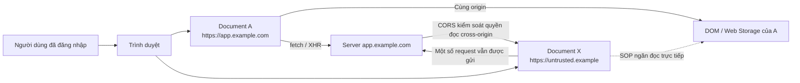

# Chính sách cùng origin (Same-Origin Policy)

## 1. Same-Origin Policy giải quyết vấn đề gì?

**Same-Origin Policy (SOP)** là tập hợp các quy tắc bảo mật mà trình duyệt áp dụng để hạn chế tài liệu và mã JavaScript của một **origin** truy cập trực tiếp vào dữ liệu thuộc **origin khác**. Mục tiêu cốt lõi là ngăn trang web không đáng tin đọc dữ liệu nhạy cảm mà trình duyệt đang hiển thị hoặc nhận được từ một ứng dụng khác.

Giả sử người dùng đã đăng nhập vào `https://bank.example` và sau đó mở `https://untrusted.example`. Trang thứ hai có thể chạy JavaScript trong tab của nó. Nếu không có SOP, đoạn mã này có thể cố đọc DOM của trang ngân hàng, phản hồi từ API tài khoản hoặc dữ liệu lưu trong trình duyệt, bất kể hai trang do hai chủ thể khác nhau quản lý. SOP thiết lập ranh giới để các thao tác đọc như vậy không được thực hiện chỉ vì chúng chạy trên cùng một máy tính.

Tuy nhiên, **SOP không đồng nghĩa với “cấm mọi kết nối tới website khác”**. Web cần cho phép dẫn liên kết, tải ảnh, gửi biểu mẫu, nhúng tài nguyên và kết nối nhiều hệ thống. Có những request cross-origin vẫn được gửi; sự hạn chế thường nằm ở **khả năng JavaScript đọc kết quả** hoặc truy cập các giao diện của trình duyệt sau đó.

Trong module `SECURITY_APPLICATION_SECURITY_BROWSER_SECURITY`, SOP là nền tảng để hiểu CORS, ranh giới cookie, cách ly iframe và lý do những biện pháp chống XSS, CSRF, clickjacking phải phối hợp. Bài học này tập trung vào việc phân biệt chính xác: **ai đang chạy mã, tài nguyên thuộc origin nào, trình duyệt cho phép hành động gì, và máy chủ vẫn phải kiểm tra điều gì**.

### Kết quả học tập

Sau bài này, người học có thể:

1. Tính origin của URL, phân biệt origin với site, host, domain, path.
2. Dự đoán quyền truy cập DOM, `fetch`, storage, cookie và iframe khi hai tài liệu cùng hoặc khác origin.
3. Giải thích vì sao yêu cầu HTTP đã đến máy chủ nhưng JavaScript vẫn nhận lỗi CORS/SOP.
4. Phân biệt cơ chế giao tiếp cross-origin hợp lệ (`postMessage`, CORS) với cách vượt rào nguy hiểm.
5. Kiểm chứng giả thuyết bằng Network, Console, Application/Storage và một thí nghiệm có thể lặp lại.

## 2. Origin được xác định như thế nào?

Với URL HTTP(S) thông thường, một **origin** được xác định bởi bộ ba:

```text
origin = (scheme, host, port)
```

- **Scheme**: giao thức, ví dụ `http` hoặc `https`.
- **Host**: hostname, ví dụ `app.example.com`.
- **Port**: cổng mạng, ví dụ `443`, `8080`. Khi không ghi rõ, HTTP và HTTPS có cổng mặc định lần lượt là 80 và 443.

Hai URL chỉ *same-origin* khi cả ba thành phần tương ứng bằng nhau. Đường dẫn (`/profile`), query string (`?id=1`) và fragment (`#section`) **không** tham gia so sánh origin.

Lấy `https://app.example.com/dashboard` làm mốc:

| URL được so sánh | Cùng origin? | Giải thích |
| --- | --- | --- |
| `https://app.example.com/settings` | Có | Chỉ khác path |
| `https://app.example.com/settings?tab=2` | Có | Chỉ khác path/query |
| `https://app.example.com:443/settings` | Có | `443` là cổng mặc định của HTTPS |
| `https://app.example.com:8443/settings` | Không | Khác port |
| `http://app.example.com/dashboard` | Không | Khác scheme |
| `https://api.example.com/dashboard` | Không | Khác host |
| `https://example.com/dashboard` | Không | Khác host, dù có chung một phần tên miền |

**Không sử dụng việc “có cùng miền gốc về mặt tên gọi” để kết luận cùng origin.** `app.example.com` và `api.example.com` là hai origin khác nhau.

### Origin khác với site

Trong bảo mật cookie, khái niệm **site** thường được xác định theo *schemeful site*: scheme cộng với miền đăng ký (*registrable domain*, dựa trên Public Suffix List). Ví dụ, `https://app.example.com` và `https://api.example.com` là **cross-origin nhưng thường là same-site**. Còn `http://app.example.com` và `https://app.example.com` khác scheme, nên được xem là cross-site trong mô hình schemeful same-site.

| Quan hệ | Cơ chế thường dùng | Câu hỏi cần đặt ra |
| --- | --- | --- |
| Same-origin / cross-origin | SOP, CORS, Web Storage, nhiều API DOM | JavaScript có được đọc dữ liệu của origin khác không? |
| Same-site / cross-site | Cookie `SameSite`, một số tín hiệu Fetch Metadata | Cookie có được gửi trong ngữ cảnh này không? |
| Phạm vi cookie | `Domain`, `Path`, `Secure`, `HttpOnly` | Cookie nào phù hợp với URL đích và ngữ cảnh browser? |

Đối với `localhost`, địa chỉ IP, một số special-use domain và URL không dùng HTTP(S), có quy tắc riêng; không suy ra site bằng cách tự cắt hai phần cuối của hostname. Khi đánh giá thực tế, hãy ghi lại URL và origin mà trình duyệt thực sự sử dụng.

## 3. Hình dung ranh giới bảo mật trong trình duyệt



Sơ đồ cố ý phân biệt hai bước:

1. **Request có được gửi tới máy chủ không?** Điều này phụ thuộc loại request, cách khởi tạo, CSP, preflight, cookie policy và các giới hạn khác của trình duyệt.
2. **Mã JavaScript có được đọc nội dung trả về không?** Với `fetch`/`XMLHttpRequest` cross-origin, SOP mặc định hạn chế quyền đọc; server có thể ủy quyền có điều kiện qua **CORS**.

Ví dụ một trang độc hại không đọc được response JSON tài khoản không có nghĩa là nó không thể kích hoạt request đến API. Đây là lý do **CSRF phải được phòng vệ ở phía server** nếu endpoint dùng credential tự động gửi.

## 4. SOP bảo vệ những loại truy cập nào?

Không có một phép kiểm tra SOP duy nhất áp dụng giống nhau cho mọi API. Mỗi nhóm tài nguyên và giao diện có các quy tắc cụ thể.

### 4.1. DOM và cửa sổ/iframe

Một iframe cùng origin thường cho phép trang cha truy cập DOM của tài liệu con:

```html
<iframe id="same" src="/embedded.html"></iframe>
```

```js
const frame = document.querySelector("#same");
frame.addEventListener("load", () => {
  console.log(frame.contentWindow.document.title);
});
```

Nếu đổi `src` thành `https://other.example/page`, việc đọc `frame.contentWindow.document` hoặc phần tử bên trong thường bị trình duyệt ngăn bằng lỗi bảo mật:

```js
const frame = document.querySelector("#external");
try {
  console.log(frame.contentWindow.document.body.textContent);
} catch (error) {
  console.error(error.name); // Thường là "SecurityError"
}
```

JavaScript của trang A cũng không thể tự do đọc DOM của popup từ origin B qua `window.open`. Tuy vậy, hai window cross-origin không hoàn toàn mất liên hệ: một tập hợp hạn chế các thao tác trên đối tượng `Window`/ `Location` vẫn có thể được cho phép, như trao đổi qua `postMessage` hoặc điều hướng trong những điều kiện mà trình duyệt cho phép. **Có tham chiếu tới window khác không có nghĩa là được đọc tài liệu trong window đó.**

### 4.2. `fetch` và `XMLHttpRequest`

Giả sử JavaScript chạy tại `https://app.example.com`:

```js
// Cùng origin: thường đọc được response nếu các điều kiện khác đều thỏa.
const profile = await fetch("/api/profile");
console.log(await profile.json());

// Cross-origin: browser áp dụng quy tắc CORS để quyết định quyền đọc.
const external = await fetch("https://api.example.com/profile");
console.log(await external.json());
```

Lời gọi thứ hai **không tự động được phép đọc** chỉ vì API trả HTTP 200. Nếu server không gửi CORS headers phù hợp, `fetch` có thể bị reject với `TypeError`, và Console thường báo lỗi chính sách CORS. Network vẫn có thể ghi nhận request HTTP đã được gửi và response đã đến browser.

Đổi sang `mode: "no-cors"` không phải cách bỏ kiểm soát. Khi request hợp lệ theo chế độ này, JavaScript nhận một **opaque response**, không đọc được status/body/headers như response bình thường:

```js
const result = await fetch("https://api.example.com/public-data", {
  mode: "no-cors"
});
console.log(result.type); // "opaque" trong trường hợp cross-origin no-cors
// Không thể dùng result.json() để đọc dữ liệu JSON bị che khuất.
```

Lưu ý: `no-cors` còn giới hạn phương thức và header mà JavaScript được phép tự đặt.

### 4.3. Web Storage và các giao diện dữ liệu phía browser

Các cơ chế như `localStorage` và IndexedDB được cách ly theo **origin**, đồng thời có thể chịu thêm phân vùng lưu trữ (*storage partitioning*) trong những ngữ cảnh hiện đại. Trang `https://sub.example.com` không thể tùy ý mở `localStorage` của `https://example.com`, dù hai trang có thể same-site.

```js
// Chạy tại https://app.example.com
localStorage.setItem("ui-theme", "dark");
console.log(localStorage.getItem("ui-theme")); // "dark"

// Chạy tại https://api.example.com:
// localStorage.getItem("ui-theme") thuộc không gian lưu trữ khác.
```

**Cookie không sử dụng chính xác cùng mô hình phạm vi với Web Storage.** Cookie có các thuộc tính `Domain`, `Path`, `Secure`, `SameSite`, `HttpOnly` và các quy tắc gửi qua request riêng. Cookie đặt cho `Domain=example.com` có thể được gửi tới nhiều subdomain phù hợp dù các subdomain là **cross-origin**. Vì vậy SOP không thay thế chiến lược cookie an toàn.

### 4.4. Tải tài nguyên, hiển thị và khả năng đọc

Web cho phép một số hình thức **nhúng** tài nguyên cross-origin:

| Hành động từ trang A tới origin B | Hành vi điển hình | Điểm bảo mật cần nhớ |
| --- | --- | --- |
| `` | Có thể tải và hiển thị ảnh | Không mặc nhiên được đọc pixels bằng canvas |
| `<script src="...">` (classic script) | Có thể tải script và thực thi trong ngữ cảnh trang A | Đưa script từ nguồn không tin cậy vào trang A là cấp quyền thực thi rất lớn; CSP/SRI có thể giúp kiểm soát |
| `<link rel="stylesheet" href="...">` | Có thể áp dụng stylesheet | JavaScript có thể bị hạn chế đọc CSS rules cross-origin |
| `<iframe src="...">` | Có thể hiển thị trang khác | SOP hạn chế đọc DOM; `frame-ancestors` hoặc X-Frame-Options của trang đích có thể chặn nhúng |
| `<form action="...">` | Có thể gửi request tới origin khác | SOP không tự ngăn CSRF |
| `fetch("...")` | Có thể gửi request tùy điều kiện | Đọc response phải thỏa chính sách CORS |

Mỗi loại tài nguyên còn có thể bị ảnh hưởng bởi CSP, MIME type, CORP, COEP, CORS và chính sách browser khác. Bảng trên mô tả **hành vi thường gặp**, không phải cam kết mọi request sẽ thành công.

Một ví dụ rất quan trọng là **canvas bị “taint”**. Ảnh từ origin B có thể được hiển thị trong trang A, nhưng nếu ảnh không được tải qua CORS đúng cách thì browser thường không cho JavaScript tại A trích xuất pixels sau khi vẽ ảnh lên canvas:

```js
const image = new Image();
image.onload = () => {
  const canvas = document.createElement("canvas");
  canvas.width = image.naturalWidth;
  canvas.height = image.naturalHeight;
  const context = canvas.getContext("2d");
  context.drawImage(image, 0, 0);

  try {
    console.log(canvas.toDataURL());
  } catch (error) {
    console.error(error.name); // SecurityError nếu canvas bị taint
  }
};
image.src = "https://images.other.example/photo.png";
```

Để đọc pixels hợp lệ từ ảnh cross-origin, cần cấu hình `image.crossOrigin` phù hợp **trước khi gán `src`** và server ảnh phải trả CORS headers chấp nhận origin của trang; không thể sửa sau bằng cách thay đổi API đọc canvas.

## 5. Ngoại lệ và các origin đặc biệt

Định nghĩa `(scheme, host, port)` là mô hình hữu ích nhất với HTTP(S), nhưng không phải mọi tài liệu đều có origin dạng này.

| Nguồn tài liệu | Đặc điểm origin cần lưu ý |
| --- | --- |
| `https://example.com/page` | Origin HTTP(S) thông thường |
| `about:blank` | Trong nhiều trường hợp kế thừa origin của context tạo ra/navigating đến nó |
| `iframe srcdoc` | Thường kế thừa origin của trang cha khi không có sandbox làm thay đổi |
| `data:` | Thường được gán **opaque origin** riêng, không được coi là origin của trang đã tạo URL |
| `blob:` | Thường gắn với origin của môi trường đã tạo blob URL; có các quy tắc đặc thù |
| `file:` | Cách xử lý origin có thể phụ thuộc browser; không dùng làm cơ sở để kiểm chứng SOP chính xác |
| `iframe sandbox` không có `allow-same-origin` | Tài liệu trong sandbox được xử lý với **opaque origin** |

**Opaque origin** không tương đương một hostname hay tuple HTTP(S) bình thường; khi được biểu diễn trong một số header/thông điệp, origin có thể hiện là chuỗi `null`. Không nên tin tưởng `Origin: null` như một origin cụ thể an toàn khi thiết kế CORS allowlist.

Đối với môi trường học tập, ưu tiên chạy ứng dụng qua HTTP(S) trên `localhost`, thay vì mở trực tiếp file HTML qua `file://`.

### Không dùng `document.domain` để “gộp” hai subdomain

Trước đây, một số ứng dụng dùng `document.domain` để nới lỏng kiểm tra same-origin cho tương tác DOM giữa các subdomain. Cơ chế này đã **bị deprecated**, tạo thêm rủi ro và không áp dụng thống nhất cho nhiều API hiện đại như `localStorage` hay `fetch`. Không xây dựng ứng dụng mới dựa trên cách này. Hãy sử dụng `postMessage` cho giao tiếp giữa window và CORS có kiểm soát cho API.

## 6. Khi nào CORS cho phép đọc phản hồi cross-origin?

SOP thiết lập mặc định hạn chế quyền đọc; **Cross-Origin Resource Sharing (CORS)** là giao thức cho phép server khai báo các origin được browser chấp nhận đọc response trong những điều kiện phù hợp.

Ví dụ frontend tại `https://app.example.com` gọi API tại `https://api.example.com`:

```http
GET /profile HTTP/1.1
Host: api.example.com
Origin: https://app.example.com
```

API có thể trả:

```http
HTTP/1.1 200 OK
Content-Type: application/json
Access-Control-Allow-Origin: https://app.example.com
Vary: Origin

{"name":"An"}
```

Khi request đáp ứng quy tắc CORS, JavaScript ở `app.example.com` mới được đọc nội dung JSON. Nếu API chọn phản hồi CORS theo `Origin`, `Vary: Origin` giúp cache dùng đúng biến thể phản hồi.

Với request sử dụng credentials cross-origin, cần xem đồng thời hai phía:

```js
fetch("https://api.example.com/profile", {
  credentials: "include"
});
```

```http
Access-Control-Allow-Origin: https://app.example.com
Access-Control-Allow-Credentials: true
Vary: Origin
```

**Không được sử dụng `Access-Control-Allow-Origin: *` để cho JavaScript đọc credentialed CORS response.** Browser từ chối kiểu kết hợp wildcard với credentials. Ngay cả khi `credentials: "include"`, cookie vẫn chịu các điều kiện `SameSite`, `Secure`, `Domain`, `Path`, chính sách third-party cookie và ngữ cảnh request.

### Preflight không phải mọi request cross-origin

Với một số request có method/header không đáp ứng điều kiện CORS-safelisted, browser có thể gửi `OPTIONS` **preflight** trước khi gửi request chính:

```http
OPTIONS /profile HTTP/1.1
Host: api.example.com
Origin: https://app.example.com
Access-Control-Request-Method: PATCH
Access-Control-Request-Headers: content-type
```

Máy chủ chỉ chấp nhận nếu chính sách phù hợp, ví dụ:

```http
Access-Control-Allow-Origin: https://app.example.com
Access-Control-Allow-Methods: PATCH
Access-Control-Allow-Headers: content-type
Vary: Origin
```

Nếu preflight thất bại, browser thường **không gửi request chính**. Một request `GET` đơn giản hoặc một form submit theo cách truyền thống có thể đi qua mạng mà không có preflight. Vì vậy, phải nhìn **có hay không có request chính** trong Network để mô tả chính xác chuyện xảy ra.

> **Ranh giới trách nhiệm:** CORS quyết định một phần quyền đọc response của JavaScript trong browser. CORS không xác thực người dùng, không phân quyền hành động và không bảo vệ API trước các HTTP client nằm ngoài trình duyệt. Máy chủ phải tự áp dụng các kiểm tra nghiệp vụ, xác thực và phân quyền.

## 7. Trao đổi dữ liệu hợp lệ giữa hai cửa sổ khác origin

Để một trang cha tại `https://app.example.com` và iframe tại `https://help.example.net` trao đổi thông điệp, dùng **`window.postMessage`**.

Trang cha:

```js
const iframe = document.querySelector("#help");
const expectedOrigin = "https://help.example.net";

window.addEventListener("message", (event) => {
  if (event.origin !== expectedOrigin) return;
  if (event.source !== iframe.contentWindow) return;
  if (!event.data || event.data.type !== "HELP_READY") return;

  console.log("Iframe trợ giúp đã sẵn sàng");
});

// Khi iframe đã load, gửi đúng origin đích:
iframe.addEventListener("load", () => {
  iframe.contentWindow.postMessage(
    { type: "SET_THEME", value: "dark" },
    expectedOrigin
  );
});
```

Phía iframe:

```js
const allowedParent = "https://app.example.com";

window.addEventListener("message", (event) => {
  if (event.origin !== allowedParent) return;
  if (!event.data || event.data.type !== "SET_THEME") return;
  if (!["dark", "light"].includes(event.data.value)) return;

  document.documentElement.dataset.theme = event.data.value;
});

window.parent.postMessage({ type: "HELP_READY" }, allowedParent);
```

**Ba kiểm tra cần nhớ:** (1) kiểm tra `event.origin` theo allowlist chính xác, (2) khi có thể, xác nhận `event.source` là window mong đợi, (3) xác thực cấu trúc và giá trị của `event.data` như đầu vào không tin cậy. Phía gửi nên khai báo `targetOrigin` cụ thể, thay vì `*`, nếu có dữ liệu nhạy cảm.

`postMessage` tạo kênh giao tiếp được định nghĩa rõ mà **không cấp quyền đọc DOM tùy ý**. Nếu iframe còn có `sandbox`, cần thiết kế quyền và origin hợp lý; một số sandbox thiếu `allow-same-origin` sẽ khiến tài liệu có opaque origin, tác động đến việc định danh origin trong giao tiếp.

## 8. Thực hành: quan sát SOP bằng hai origin khác cổng

Thí nghiệm dùng Node.js có sẵn module `node:http`, không cần cài thư viện. Tạo một file **`sop-lab.js` trong thư mục thử nghiệm của riêng bạn** với nội dung sau:

```js
const http = require("node:http");

const htmlA = `<!doctype html>
<html lang="vi">
<meta charset="utf-8">
<title>Origin A</title>
<h1>Trang A: http://localhost:3000</h1>
<p>Mở Console và Network để xem kết quả.</p>
<iframe id="foreign" src="http://localhost:4000/frame"></iframe>
<button id="read-frame">Đọc DOM iframe B</button>
<script>
  fetch("http://localhost:4000/data")
    .then(r => r.json())
    .then(data => console.log("No CORS - data:", data))
    .catch(err => console.log("No CORS - bị chặn đọc:", err.name));

  fetch("http://localhost:4000/cors")
    .then(r => r.json())
    .then(data => console.log("With CORS - data:", data))
    .catch(err => console.error("With CORS - lỗi:", err));

  document.querySelector("#read-frame").onclick = () => {
    try {
      console.log(document.querySelector("#foreign")
        .contentWindow.document.body.textContent);
    } catch (err) {
      console.log("Không đọc được iframe:", err.name);
    }
  };

  window.addEventListener("message", event => {
    if (event.origin !== "http://localhost:4000") return;
    if (event.source !== document.querySelector("#foreign").contentWindow) return;
    if (event.data && event.data.type === "READY") {
      console.log("postMessage từ B:", event.data.type);
    }
  });
</script>
</html>`;

http.createServer((_req, res) => {
  res.writeHead(200, { "Content-Type": "text/html; charset=utf-8" });
  res.end(htmlA);
}).listen(3000, "localhost", () => {
  console.log("Trang A: http://localhost:3000");
});

http.createServer((req, res) => {
  if (req.url === "/data" || req.url === "/cors") {
    const headers = { "Content-Type": "application/json; charset=utf-8" };
    if (req.url === "/cors") {
      headers["Access-Control-Allow-Origin"] = "http://localhost:3000";
      headers["Vary"] = "Origin";
    }
    res.writeHead(200, headers);
    res.end(JSON.stringify({ from: "origin B", path: req.url }));
    return;
  }

  res.writeHead(200, { "Content-Type": "text/html; charset=utf-8" });
  res.end(`<!doctype html>
<meta charset="utf-8">
<h2>Iframe tại http://localhost:4000</h2>
<script>
  window.parent.postMessage(
    { type: "READY" },
    "http://localhost:3000"
  );
</script>`);
}).listen(4000, "localhost", () => {
  console.log("Trang/API B: http://localhost:4000");
});
```

Khởi chạy:

```bash
node sop-lab.js
```

Truy cập `http://localhost:3000`; mở DevTools → **Network** và **Console**. Nếu môi trường có khác biệt về phân giải `localhost` giữa IPv4/IPv6, hãy dùng hostname nhất quán cho cả hai origin; tuyệt đối không trộn `localhost` và `127.0.0.1` khi đang kiểm chứng *chỉ khác port*.

### Ma trận quan sát

| Phép thử | Dự đoán | Bằng chứng cần thu |
| --- | --- | --- |
| `fetch("http://localhost:4000/data")` | Request có thể đi và API trả JSON, nhưng JS không đọc được response do thiếu CORS headers | Network có `GET /data`; Console có lỗi CORS và `catch` |
| `fetch("http://localhost:4000/cors")` | JS đọc được JSON vì response cấp quyền cho origin A | `Access-Control-Allow-Origin` trên response; Console hiện dữ liệu |
| Bấm nút đọc DOM iframe B | Truy cập `contentWindow.document` bị SOP chặn | Console hiện `SecurityError` hoặc lỗi truy cập tương ứng |
| iframe B gọi `postMessage` | A nhận thông điệp hợp lệ sau khi kiểm tra origin và source | Console ghi `postMessage từ B: READY` |
| Thay origin cho phép trong CORS thành giá trị không khớp | Request vẫn có thể trả 200, nhưng JS không đọc được response | So sánh Network và Console |

**Câu hỏi sau thí nghiệm:**

1. Vì sao `/data` trả response nhưng mã JavaScript lại đi vào `catch`?
2. Nếu cả hai server dùng cùng hostname nhưng khác port, quan hệ origin là gì? Quan hệ site có nhất thiết giống vậy không?
3. Điều gì xảy ra nếu server B cho phép CORS với origin A nhưng endpoint vẫn không xác thực người dùng?
4. Vì sao iframe B có thể gửi thông điệp được nhưng A vẫn không đọc trực tiếp `document.body` của B?
5. Khi một request không xuất hiện trong Network, cần kiểm tra thêm những nguyên nhân nào: CSP, preflight, mixed content, lỗi URL, extension hoặc lỗi mạng?

Thí nghiệm dùng HTTP localhost để minh họa SOP. Nó **không** mô phỏng đầy đủ chính sách cookie `Secure`, các trường hợp third-party cookie hay cấu hình production HTTPS.

## 9. SOP không bảo vệ khỏi những tấn công nào?

SOP hữu ích nhưng không tạo ra vùng an toàn tuyệt đối. Phải ghép nó với các biện pháp khác theo loại rủi ro:

| Tình huống | Vì sao SOP chưa đủ? | Lớp phòng vệ phù hợp |
| --- | --- | --- |
| **XSS trong chính origin ứng dụng** | Script độc hại chạy *trong origin tin cậy*, nên có thể đọc DOM và gọi API theo quyền trang đó | Render an toàn, contextual encoding, sanitization, CSP, Trusted Types khi hỗ trợ |
| **CSRF trên endpoint dùng cookie** | Browser có thể gửi request cross-origin mà mã khởi tạo không cần đọc response | CSRF token server-side, `SameSite` phù hợp, kiểm tra `Origin`/Fetch Metadata, xác thực và phân quyền |
| **Clickjacking** | SOP không tự ngăn trang khác hiển thị ứng dụng trong iframe | `Content-Security-Policy: frame-ancestors ...`, cân nhắc `X-Frame-Options` |
| **API bị gọi trực tiếp ngoài browser** | CORS không phải cơ chế chặn curl hay các HTTP client khác | Kiểm tra authentication, authorization, input validation, rate limit hợp lý |
| **Tải script bên thứ ba vào trang tin cậy** | Classic script được tải qua `<script src>` có thể chạy với quyền của trang nhúng | Kiểm soát dependency, CSP, Subresource Integrity (SRI) khi áp dụng |
| **Rò rỉ theo kênh phụ và quan sát gián tiếp** | SOP thường chặn đọc trực tiếp nhưng không triệt tiêu mọi tín hiệu về trạng thái/timing | Giảm thông tin lộ, kiểm soát cache, cô lập tài nguyên phù hợp, đánh giá XS-Leaks |

### Phân biệt bốn chính sách thường bị nhầm

- **SOP:** mặc định hạn chế truy cập và đọc dữ liệu trực tiếp xuyên origin.
- **CORS:** server cho phép JavaScript ở origin khác đọc HTTP response trong điều kiện được chỉ định.
- **CSP:** giới hạn nguồn script/tài nguyên và một số hành vi của document; có thể ngăn request hoặc thực thi ngay cả khi xét origin không có vấn đề.
- **CORP/COEP/COOP:** các chính sách liên quan tới tải tài nguyên, nhúng và cách ly browsing context; dùng khi cần ràng buộc chặt hơn các tương tác cross-origin.

**Không nhầm SOP với cookie `SameSite`**: SameSite tập trung vào việc cookie có đi cùng request theo ngữ cảnh site hay không, không cấp quyền đọc DOM/response.

## 10. Tình huống áp dụng trong ứng dụng thực tế

Giả sử đội phát triển quản lý ba dịch vụ:

- `https://app.example.com`: ứng dụng giao diện.
- `https://api.example.com`: API dùng cookie phiên để lấy và cập nhật hồ sơ.
- `https://help.example.net`: tài liệu trợ giúp cần nhúng trong iframe.

Một thiết kế hợp lý dựa trên ranh giới origin:

**Bước 1 — Xác định quyền:** `app.example.com` và `api.example.com` là cross-origin nên request `fetch` từ app sang API phải có CORS nếu JavaScript cần đọc response. Hai subdomain có thể same-site, nhưng điều đó không bỏ qua SOP.

**Bước 2 — Cấp quyền đọc response:** API chỉ trả `Access-Control-Allow-Origin` cho các frontend thật sự được tin cậy. Nếu request sử dụng credentials, cấu hình CORS phải đáp ứng quy tắc tương ứng. Đặc biệt, API vẫn phải xác thực và phân quyền từng hành động.

**Bước 3 — Bảo vệ thay đổi trạng thái:** thêm kiểm tra CSRF token cho thao tác đổi email, kiểm tra `Origin` và có thể Fetch Metadata phù hợp. Không dựa vào việc trang lạ không đọc được response vì thao tác ghi vẫn có thể xảy ra.

**Bước 4 — Giao tiếp iframe trợ giúp:** không cố truy cập trực tiếp DOM của `help.example.net`. Xác minh `event.origin`, `event.source` và payload trong `postMessage`. Trang trợ giúp quyết định ai được nhúng nó qua chính sách framing khi cần.

**Bước 5 — Hạn chế mã không đáng tin:** trang ứng dụng render dữ liệu bằng API DOM an toàn, triển khai CSP và cân nhắc Trusted Types. Một script XSS chạy trong `app.example.com` có thể có quyền rất lớn bất kể SOP ngăn các origin ngoài.

**Bước 6 — Kiểm chứng:** lưu ma trận request thành công, request không được cấp quyền đọc, thao tác bị server từ chối và iframe được phép/chặn. Ghi rõ lớp nào tạo ra mỗi kết quả.

## 11. Checklist và câu hỏi tự đánh giá

### Checklist khi phân tích lỗi hoặc thiết kế mới

1. **Ghi lại URL và origin thực tế** của trang khởi tạo, tài nguyên đích và từng iframe/popup.
2. **Phân loại thao tác**: navigation, form, `fetch`, XHR, script, image, iframe, DOM access, storage hay `postMessage`.
3. **Tách khả năng gửi request khỏi quyền đọc response**. Kiểm tra Network trước, Console sau.
4. Nếu là `fetch` cross-origin, **đọc cả request `Origin`, preflight (nếu có), response `Access-Control-Allow-*`** và `Vary`.
5. Nếu dữ liệu liên quan cookie, **phân tích riêng** `Domain`, `Path`, `SameSite`, `Secure`, `HttpOnly`, credentials mode và chính sách browser.
6. Nếu giao tiếp giữa iframe/popup, **dùng `postMessage` và xác minh origin/source/payload**.
7. Nếu hành động thay đổi trạng thái, **xác thực, phân quyền và kiểm tra CSRF phía server**.
8. Kiểm tra CSP, framing policy, sandbox và các header cách ly khi chúng có thể ảnh hưởng đến hành vi quan sát.

### Tự kiểm tra nhanh

**Câu 1.** `https://shop.example.com:443/cart` và `https://shop.example.com/account` có cùng origin không?  
**Trả lời:** Có, vì HTTPS mặc định sử dụng cổng 443, và chỉ path khác nhau.

**Câu 2.** `https://shop.example.com` và `https://api.example.com` khác origin hay khác site?  
**Trả lời:** Khác origin; thường cùng site nếu xét schemeful site của miền đăng ký `example.com`.

**Câu 3.** Request `fetch` bị CORS chặn có chứng minh máy chủ không nhận request không?  
**Trả lời:** Không. Request đơn giản có thể đã gửi và trả response; trường hợp preflight thất bại có thể chặn request chính. Cần xem Network.

**Câu 4.** Thêm `mode: "no-cors"` có giúp đọc dữ liệu JSON từ API khác origin không?  
**Trả lời:** Không. Response cross-origin dạng opaque không cho JavaScript đọc body.

**Câu 5.** Dùng SOP để chống CSRF có đủ không?  
**Trả lời:** Không. Cần kiểm tra ý định hợp lệ ở server, vì CSRF không nhất thiết phải đọc response.

**Câu 6.** Làm thế nào để iframe khác origin báo trạng thái “ready” cho trang cha?  
**Trả lời:** Dùng `postMessage` với `targetOrigin` cụ thể; phía nhận xác minh `event.origin`, nguồn gửi và cấu trúc dữ liệu.

### Ghi nhớ

**Chính sách cùng origin là ranh giới hạn chế quyền truy cập giữa những ngữ cảnh web khác origin, đặc biệt đối với việc đọc DOM, dữ liệu lưu trữ và response.** Nó không phải tường lửa ngăn mọi HTTP request. Nắm vững ranh giới này giúp thiết kế CORS đúng, phân tích cookie và CSRF chính xác, hiểu giới hạn của iframe và đặt XSS, CSP, Trusted Types, security headers vào đúng vai trò bảo vệ ứng dụng web.
