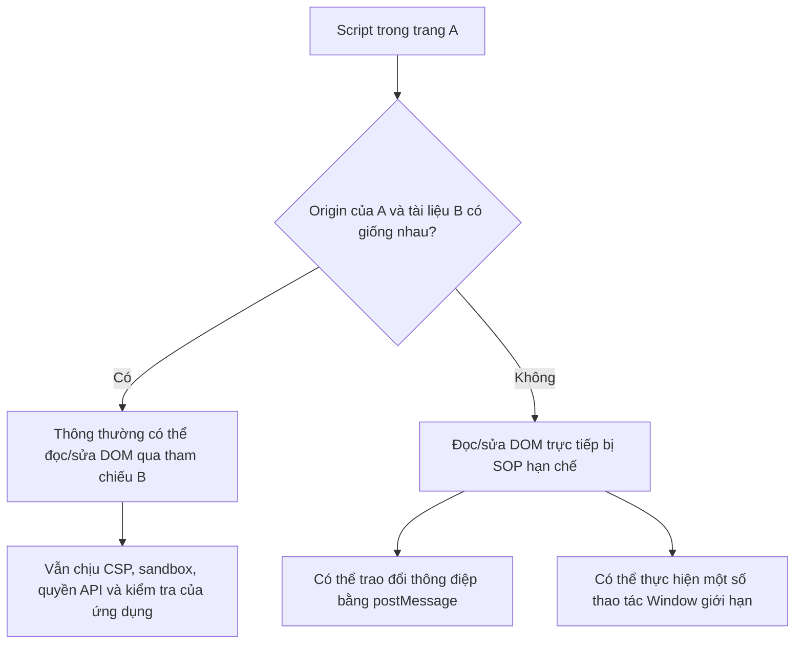

# DOM isolation trong Same-Origin Policy

> **Chương:** Same-origin policy  
> **Chủ đề:** DOM isolation (cách ly Document Object Model)  
> **Module:** `SECURITY_APPLICATION_SECURITY_BROWSER_SECURITY` — phân tích ranh giới bảo mật giữa trình duyệt, origin, cookie và ứng dụng web; hiểu SOP, CORS, các cơ chế cách ly; phòng vệ XSS, CSRF, clickjacking bằng CSP, Trusted Types, security headers và kiểm chứng hành vi thực tế.

## Mục tiêu học tập

Sau bài học, bạn có thể:

1. Giải thích vì sao **DOM isolation** là một ranh giới trung tâm của Same-Origin Policy (SOP).
2. Tính origin từ scheme, hostname và port; phân biệt **same-origin**, **same-site** và **cross-origin** khi làm việc với iframe.
3. Dự đoán những thao tác JavaScript được phép hoặc bị chặn trên `window`, `document`, iframe và cửa sổ khác origin.
4. Dùng `window.postMessage` để trao đổi thông điệp giữa các origin theo cách xác minh nguồn gửi và dữ liệu.
5. Phân biệt DOM isolation với CORS, cookie `SameSite`, iframe `sandbox`, CSP `frame-ancestors` và cross-origin isolation (COOP/COEP).
6. Quan sát hành vi thực tế qua bài lab gồm hai origin trên các cổng localhost khác nhau.

## 1. DOM isolation là gì?

**DOM (Document Object Model)** là mô hình đối tượng mà JavaScript dùng để xem và thay đổi nội dung, cấu trúc, thuộc tính và sự kiện của trang HTML. Ví dụ:

```js
const heading = document.querySelector('h1');
heading.textContent = 'Chào mừng';
```

Mã này đọc hoặc sửa DOM của **tài liệu đang chứa mã đó**. Vấn đề xuất hiện khi một trang nhúng tài liệu khác bằng `<iframe>` hoặc mở một cửa sổ/tab bằng `window.open()`: script của trang A có được tự ý đọc nội dung, ô nhập hoặc cookie của trang B không?

Theo **Same-Origin Policy**, script thuộc một origin nhìn chung **không được tự do đọc hoặc thao tác DOM của tài liệu thuộc origin khác**. Trình duyệt thực thi ranh giới này thông qua các API như `Window`, `Document` và `WindowProxy`. Đây là một phần quan trọng của mô hình bảo mật web, vì các website khác nhau có thể chạy trong cùng một user agent (trình duyệt) nhưng không được mặc nhiên chia sẻ dữ liệu.

Ví dụ:

- Trang `https://news.example.test` nhúng `https://bank.example.test`. Script của trang tin không được đọc số dư, trường nhập liệu hoặc cấu trúc DOM của trang ngân hàng.
- Trang `https://app.example.test` nhúng `https://app.example.test/help`. Nếu không có hạn chế bổ sung, hai tài liệu **cùng origin** có thể truy cập DOM của nhau qua tham chiếu cửa sổ/iframe.
- Trang `https://app.example.test` nhúng `https://chat.example.test`. Dù thuộc cùng domain đăng ký, hai tài liệu khác **hostname** nên khác origin; trực tiếp đọc DOM bị hạn chế.

> **Ý chính:** DOM isolation bảo vệ **khả năng truy cập trực tiếp vào đối tượng của tài liệu khác**. Nó không có nghĩa browser chặn mọi request mạng, mọi nội dung nhúng hoặc mọi cách giao tiếp giữa hai trang.

## 2. Phải xác định origin trước khi dự đoán quyền DOM

Đối với URL HTTP(S) thông thường, **origin** được xác định bởi bộ ba:

`origin = (scheme, host, port)`

Origin của `https://shop.example.test/account` là `(https, shop.example.test, 443)`. Đường dẫn, query string và fragment không làm thay đổi origin.

| URL so với `https://shop.example.test` | Cùng origin? | Giải thích |
|---|---:|---|
| `https://shop.example.test/cart` | Có | Cùng scheme, hostname và port |
| `https://shop.example.test:443/orders` | Có | `443` là cổng mặc định của HTTPS |
| `http://shop.example.test` | Không | Khác scheme |
| `https://api.example.test` | Không | Khác hostname |
| `https://shop.example.test:8443` | Không | Khác port |
| `https://shop.example.test.evil.test` | Không | Host hoàn toàn khác; giống chuỗi ký tự không tạo sự tin cậy |

**Same-site không phải same-origin.** Với HTTP(S), một *schemeful site* thường dựa trên scheme và registrable domain (eTLD+1); cổng không tạo site mới. Vì vậy, `https://shop.example.test` và `https://chat.example.test` có thể **cùng site** nhưng **khác origin**. Cookie `SameSite` chủ yếu dùng ranh giới site; quyền truy cập DOM chủ yếu dùng ranh giới origin.

Một số ngữ cảnh dùng **opaque origin**, không thể biểu diễn như bộ ba thông thường. Ví dụ, `data:` document và iframe có `sandbox` mà thiếu `allow-same-origin` thường không được coi là cùng origin với trang cha, kể cả khi nội dung trông giống nhau. `about:blank`/`srcdoc` trong một số ngữ cảnh lại kế thừa origin của tài liệu tạo/nhúng nếu không có sandbox làm thay đổi điều đó. Vì vậy, **không thể kết luận iframe an toàn chỉ từ cách tạo hoặc tên URL**.

## 3. Cơ chế cách ly DOM của các browsing context

**Browsing context** là môi trường hiển thị một document, chẳng hạn tab, cửa sổ hoặc iframe. Mỗi document có origin; script truy cập tài liệu khác thông qua tham chiếu như `iframe.contentWindow`, `window.parent`, `window.top` hoặc cửa sổ trả về từ `window.open`.



### 3.1. Cùng origin: có thể truy cập DOM qua tham chiếu

Ví dụ trang cha và iframe cùng được phục vụ từ `https://app.example.test`:

```html
<iframe id="details" src="/details.html" title="Chi tiết"></iframe>
```

Khi iframe đã tải, script của trang cha thường có thể:

```js
const frame = document.querySelector('#details');
const innerDocument = frame.contentWindow.document;
const title = innerDocument.querySelector('h1')?.textContent;
console.log(title);
```

Không phải mọi iframe cùng host đều truy cập được. **Origin bao gồm cả scheme và port**; ngoài ra iframe `sandbox` có thể tạo origin riêng. Và dù cùng origin, JavaScript còn phải tôn trọng các giới hạn khác như CSP, chính sách quyền API và sandbox.

### 3.2. Khác origin: tham chiếu Window không đồng nghĩa quyền đọc DOM

Khi iframe ở `https://partner.example.test`:

```html
<iframe id="partner" src="https://partner.example.test/" title="Đối tác"></iframe>
```

Trang cha có thể lấy **tham chiếu** `contentWindow`, nhưng không vì vậy mà có quyền truy cập toàn bộ nội dung:

```js
const frame = document.querySelector('#partner');
const otherWindow = frame.contentWindow; // Tham chiếu có thể lấy được

try {
  console.log(otherWindow.document.body.innerText);
} catch (error) {
  console.error(error.name); // Thường là "SecurityError"
}
```

Trên nhiều browser, `iframe.contentDocument` trả `null` nếu tài liệu khác origin; truy cập `iframe.contentWindow.document` thường ném ngoại lệ `SecurityError`. Chi tiết biểu hiện có thể khác nhau, nhưng **không có quyền đọc DOM cross-origin** là điều cần nhớ.

| Thao tác từ trang A đối với iframe B | Cùng origin | Khác origin |
|---|---|---|
| Lấy tham chiếu `iframe.contentWindow` | Có | Có |
| Đọc `contentWindow.document` và tìm phần tử | Thường cho phép | Bị SOP chặn |
| Đọc/chỉnh giá trị `input` của tài liệu B | Thường cho phép | Bị SOP chặn |
| Gắn event listener vào phần tử thuộc document B | Thường cho phép | Bị SOP chặn |
| Gọi `contentWindow.postMessage(...)` | Có | Có |
| Đọc tùy ý `contentWindow.location.href` | Có | Bị hạn chế |
| Điều hướng một cửa sổ/iframe có tham chiếu | Thường có thể | Có thể trong những điều kiện nhất định; chịu hạn chế chống lạm dụng |
| Đọc/sửa `localStorage` của origin B qua document A | Không phải quyền chung | Không |

Đối với cửa sổ khác origin, browser chỉ công bố **một tập nhỏ** phương thức/thuộc tính an toàn hoặc được định nghĩa đặc biệt (ví dụ `postMessage`). Đừng suy luận “lấy được `Window` nghĩa là đọc được `document`”, cũng đừng thiết kế bảo mật dựa trên khả năng điều hướng cửa sổ khác origin.

### 3.3. Cách ly hai chiều

SOP áp dụng cho cả hai hướng: iframe cross-origin không được tự ý đọc DOM trang cha, và trang cha cũng không được tự ý đọc DOM iframe.

Trong script của iframe:

```js
try {
  console.log(window.parent.document.title);
} catch (error) {
  console.log('Không thể đọc DOM của parent khác origin:', error.name);
}
```

Browser có thể cho phép iframe biết một số thông tin giới hạn về các cửa sổ liên quan và gửi thông điệp cho chúng. Việc **được nhúng** không đồng nghĩa iframe được tin cậy; việc **được nhúng thành công** cũng không cấp quyền đọc DOM của trang cha.

## 4. CORS không mở khóa DOM của iframe

SOP và CORS có liên quan nhưng giải quyết những hành vi khác nhau:

| Cơ chế | Câu hỏi chính |
|---|---|
| **DOM isolation trong SOP** | Script thuộc origin A có được trực tiếp đọc hoặc sửa `document` thuộc origin B không? |
| **CORS** | JavaScript của origin A có được đọc **HTTP response** từ origin B qua `fetch`/`XMLHttpRequest` không? |
| **Cookie `SameSite`** | Browser có gửi cookie trong ngữ cảnh same-site/cross-site không? |
| **CSP `frame-ancestors`** | Trang B có cho phép trang A **nhúng B vào iframe** không? |
| **Iframe `sandbox`** | Iframe được cấp thêm hoặc bị giảm những quyền nào? |

Một API ở origin B có thể trả:

```http
Access-Control-Allow-Origin: https://app.example.test
```

Điều này có thể cho phép script từ `https://app.example.test` đọc **response của một request CORS hợp lệ**. Nó **không** làm cho đoạn sau trở nên hợp lệ khi iframe thuộc origin B:

```js
// Vẫn bị SOP chặn nếu iframe đang chứa document khác origin:
document.querySelector('iframe').contentWindow.document.body;
```

Cũng cần phân biệt **request được gửi** với **response được đọc**: một số request cross-origin có thể tới server dù JavaScript sau đó bị CORS ngăn đọc response. Nếu endpoint thay đổi trạng thái, server vẫn cần xác thực, phân quyền và phòng vệ CSRF. CORS không thay thế các kiểm tra này.

## 5. postMessage: kênh giao tiếp có chủ đích giữa các origin

DOM isolation không yêu cầu các frame phải im lặng với nhau. Browser hỗ trợ `window.postMessage` để các cửa sổ có tham chiếu truyền **bản sao dữ liệu có cấu trúc** qua ranh giới origin, nhưng không cấp quyền truy cập DOM.

Một trang cha ở `https://app.example.test` gửi yêu cầu tới iframe `https://pay.example.test`:

```js
const iframe = document.querySelector('#payment-frame');
const paymentOrigin = 'https://pay.example.test';

iframe.contentWindow.postMessage(
  { type: 'REQUEST_STATUS', requestId: 'req-123' },
  paymentOrigin
);
```

Iframe nhận và phản hồi sau khi kiểm tra nguồn gửi:

```js
const appOrigin = 'https://app.example.test';

window.addEventListener('message', (event) => {
  if (event.origin !== appOrigin) return;
  if (event.source !== window.parent) return;
  if (!event.data || event.data.type !== 'REQUEST_STATUS') return;
  if (typeof event.data.requestId !== 'string') return;

  const reply = {
    type: 'STATUS_RESULT',
    requestId: event.data.requestId,
    status: 'pending',
  };
  event.source.postMessage(reply, event.origin);
});
```

Trang cha xử lý response:

```js
window.addEventListener('message', (event) => {
  if (event.origin !== paymentOrigin) return;
  if (event.source !== iframe.contentWindow) return;
  if (!event.data || event.data.type !== 'STATUS_RESULT') return;
  if (typeof event.data.requestId !== 'string') return;

  // Đối chiếu requestId đã phát sinh; không coi thông điệp là
  // bằng chứng cuối cùng của thanh toán khi chưa xác minh tại server.
  console.log(event.data);
});
```

**Quy tắc an toàn:**

1. Dùng `targetOrigin` cụ thể thay vì `'*'` khi biết origin đích. Giá trị này khiến browser chỉ chuyển thông điệp tới cửa sổ có origin phù hợp tại thời điểm nhận.
2. Ở phía nhận, kiểm tra **`event.origin`** (origin của bên gửi khi gửi thông điệp) và **`event.source`** (tham chiếu cửa sổ gửi). Chỉ một trường `type` không đủ.
3. Xác thực hình dạng, kiểu và giới hạn giá trị của `event.data`. Không đưa trực tiếp dữ liệu từ message vào `innerHTML`, URL điều hướng hoặc thao tác nghiệp vụ.
4. Nếu thông điệp có `requestId`/nonce, đối chiếu với request đang chờ để tránh nhầm lẫn kết quả cũ, kết quả của cửa sổ khác hoặc sự kiện ngoài dự kiến.
5. Không xem `postMessage` là xác nhận danh tính của người dùng hay thành công của giao dịch; backend phải kiểm tra quyền và trạng thái thật.

**Lưu ý:** `event.origin` xác định origin lúc thông điệp được gửi; một cửa sổ có thể điều hướng sang origin khác sau đó. Với iframe chưa xác định được origin (ví dụ sandbox tạo opaque origin), việc chấp nhận mọi thông điệp từ origin `"null"` là nguy hiểm vì nhiều ngữ cảnh không liên quan có thể có cùng chuỗi này. Nên thiết kế giao thức giới hạn quyền và xác minh nguồn bằng cơ chế khác phù hợp.

## 6. Iframe sandbox: cách ly mạnh hơn ngay cả khi cùng URL

Thuộc tính `sandbox` đặt thêm giới hạn lên iframe, có thể gồm cấm chạy script, cấm gửi form, hạn chế điều hướng và làm cho tài liệu bị xem như một **opaque origin**:

```html
<!-- Không khai báo quyền: sandbox áp dụng các hạn chế mặc định -->
<iframe src="/untrusted.html" sandbox title="Nội dung hạn chế"></iframe>

<!-- Cho phép chạy script, nhưng vẫn không cấp allow-same-origin -->
<iframe
  src="/widget.html"
  sandbox="allow-scripts"
  title="Widget không tin cậy">
</iframe>
```

Trong ví dụ thứ hai, URL có thể nằm trên **cùng host** với trang cha nhưng origin của tài liệu sandbox bị cô lập. Script trong iframe có thể chạy nhưng không tự nhiên được đọc DOM trang cha, và trang cha cũng không tự nhiên được đọc DOM iframe.

**Cẩn trọng với cặp `allow-scripts` + `allow-same-origin`:** nếu nhúng tài liệu có cùng origin với trang cha, tổ hợp này có thể khiến nội dung của iframe có khả năng gỡ thuộc tính sandbox rồi tải lại, làm suy yếu đáng kể cơ chế cách ly. Đối với HTML không tin cậy cần thực thi script, nên cân nhắc **host trên origin tách biệt** và cấp quyền theo nhu cầu.

Các trường hợp khác cần nhớ:

| Cách nhúng/tạo tài liệu | Ranh giới origin cần xét |
|---|---|
| `<iframe src="/page.html">` | Thường cùng origin với trang cha nếu cùng scheme/host/port và không có sandbox đặc biệt |
| `<iframe src="https://other.example.test">` | Khác origin |
| `<iframe srcdoc="...">` | Thường kế thừa origin của trang nhúng, trừ khi sandbox hoặc cơ chế khác thay đổi |
| `<iframe src="/page.html" sandbox="allow-scripts">` | Được chạy script nhưng thường có opaque origin do thiếu `allow-same-origin` |
| `data:text/html,...` | Thường có opaque origin, không được coi là cùng origin với trang tạo |

`document.domain` là cơ chế legacy từng cho một số trang liên quan nới lỏng giới hạn origin trong những điều kiện nhất định. Nó đã **bị deprecated**, không hoạt động đồng nhất trên các API và không nên dùng để xây dựng kiến trúc mới. Thay vào đó, tổ chức dữ liệu qua API có kiểm soát hoặc giao tiếp `postMessage`.

## 7. DOM isolation liên quan thế nào tới các phòng vệ web khác?

### 7.1. XSS có thể hoạt động bên trong ranh giới được phép

SOP bảo vệ một origin khỏi script xuất phát từ **origin khác**; nhưng nếu ứng dụng A mắc XSS, script độc hại có thể chạy **trong chính origin A** và có quyền tương ứng với trang A. Khi đó script có thể đọc DOM, lấy dữ liệu trong giao diện hoặc gửi request bằng phiên hiện có.

Ví dụ, khi chỉ cần hiển thị chuỗi:

```js
titleElement.textContent = externalTitle; // Hiển thị dạng text
// titleElement.innerHTML = externalTitle; // Rủi ro XSS nếu chưa sanitize
```

Phòng vệ phải đặt tại ứng dụng: output encoding đúng ngữ cảnh, sanitizer cho HTML thực sự cần thiết, tránh DOM sink nguy hiểm, kiểm tra dữ liệu phía server và giới hạn script bằng CSP. Nếu browser hỗ trợ, **Trusted Types** còn giúp kiểm soát chuỗi truyền tới một số DOM sink tạo XSS:

```http
Content-Security-Policy: require-trusted-types-for 'script'
```

Trusted Types không được hỗ trợ giống nhau trên mọi browser và không thay thế thiết kế xử lý dữ liệu an toàn. `HttpOnly` ngăn JavaScript đọc trực tiếp cookie nhưng không vô hiệu hóa khả năng XSS gửi request trong phiên người dùng.

### 7.2. Clickjacking là vấn đề quyền nhúng và tương tác người dùng

Cross-origin DOM isolation không mặc nhiên cấm trang tấn công **nhúng** một trang khác trong iframe. Kẻ tấn công có thể đặt iframe trong giao diện đánh lừa nhấp chuột, dù script của họ không đọc được DOM bên trong. Trang cần tự giới hạn ai được phép nhúng mình:

```http
Content-Security-Policy: frame-ancestors 'none'
X-Frame-Options: DENY
```

Nếu có đối tác nhúng hợp lệ, cấu hình `frame-ancestors` với origin cho phép cụ thể thay vì `'none'`. Chỉ thị `frame-ancestors` phải được gửi qua **HTTP response header**; không hoạt động khi chỉ khai báo bằng thẻ `<meta http-equiv>`. `X-Frame-Options` là lớp tương thích hạn chế hơn. Browser kiểm tra những chính sách này **trước hoặc trong quá trình nhúng**; SOP vẫn là cơ chế riêng về truy cập DOM sau khi nhúng.

### 7.3. CSRF vẫn tồn tại dù không đọc được DOM

Một trang độc hại có thể gửi một số yêu cầu tới origin khác bằng form hoặc cách khác, dù không đọc được DOM/response. Nếu trình duyệt đính kèm cookie hợp lệ và endpoint có tác dụng thay đổi trạng thái, server cần chống CSRF bằng token, kiểm tra `Origin`/Fetch Metadata phù hợp, `SameSite` và xác thực/phân quyền. CORS và DOM isolation không thay thế kiểm tra này.

### 7.4. Cross-origin isolation không có nghĩa “mở DOM”

Các chính sách sau thường cùng xuất hiện trong bảo mật trình duyệt nhưng có mục tiêu khác:

| Cơ chế | Mục tiêu chính |
|---|---|
| **SOP / DOM isolation** | Hạn chế việc script từ origin A trực tiếp truy cập DOM của origin B |
| **CORS** | Cấp quyền đọc HTTP response cross-origin cho các API request tuân thủ điều kiện |
| **CSP `frame-ancestors` / `X-Frame-Options`** | Hạn chế website nào được nhúng trang |
| **Iframe `sandbox`** | Hạn chế quyền của nội dung nhúng và có thể tạo opaque origin |
| **COOP** (`Cross-Origin-Opener-Policy`) | Điều chỉnh quan hệ giữa các cửa sổ và nhóm browsing context, giảm một số tương tác xuyên origin |
| **COEP** (`Cross-Origin-Embedder-Policy`) | Đặt điều kiện nhúng/tải tài nguyên cross-origin, hỗ trợ cross-origin isolated contexts |
| **Site isolation** | Cơ chế trình duyệt có thể tách tiến trình để giảm ảnh hưởng của lỗi triển khai |

Một tài liệu có `crossOriginIsolated === true` sau khi đáp ứng những điều kiện liên quan đến COOP/COEP **vẫn không thể tự đọc DOM của tài liệu khác origin**. Cross-origin isolation hỗ trợ một số tính năng và bảo vệ bổ sung; nó không bỏ SOP.

## 8. Thực hành: quan sát DOM isolation bằng hai iframe origin

**Mục tiêu:** Dùng cùng một nội dung iframe nhưng tải từ hai cổng khác nhau, quan sát khi nào có thể đọc `contentWindow.document` và khi nào phải trao đổi thông điệp qua `postMessage`. Cần Node.js, không cần thư viện ngoài.

### Bước 1 — Tạo `demo.cjs`

```js
const http = require('node:http');

const childHtml = `<!doctype html>
<html lang="vi">
<head><meta charset="utf-8"><title>Child frame</title></head>
<body>
  <h2 id="secret">Dữ liệu demo trong DOM của iframe</h2>
  <script>
    window.addEventListener('message', (event) => {
      if (event.origin !== 'http://localhost:3000') return;
      if (event.source !== window.parent) return;
      if (!event.data || event.data.type !== 'ASK_SUMMARY') return;

      event.source.postMessage(
        {
          type: 'SUMMARY',
          text: document.getElementById('secret').textContent,
        },
        event.origin
      );
    });
  </script>
</body>
</html>`;

const parentHtml = `<!doctype html>
<html lang="vi">
<head><meta charset="utf-8"><title>DOM isolation demo</title></head>
<body>
  <h1>Same-Origin Policy: DOM isolation</h1>
  <button id="same">Iframe cùng origin (:3000)</button>
  <button id="cross">Iframe khác origin (:4000)</button>
  <button id="read" disabled>Đọc trực tiếp DOM</button>
  <button id="send" disabled>Hỏi qua postMessage</button>
  <p>Chờ iframe hoàn tất tải trước khi thử.</p>
  <iframe
    id="child"
    src="http://localhost:4000/child"
    title="Iframe thử nghiệm"
    width="500"
    height="120"></iframe>
  <pre id="result" aria-live="polite"></pre>
  <script>
    const frame = document.getElementById('child');
    const result = document.getElementById('result');
    const readBtn = document.getElementById('read');
    const sendBtn = document.getElementById('send');
    const show = (message) => { result.textContent = message; };

    function switchFrame(url) {
      readBtn.disabled = true;
      sendBtn.disabled = true;
      frame.src = url;
      show('Đang tải ' + url);
    }

    frame.addEventListener('load', () => {
      readBtn.disabled = false;
      sendBtn.disabled = false;
      show('Iframe đã tải từ ' + new URL(frame.src).origin);
    });

    document.getElementById('same').addEventListener('click', () => {
      switchFrame('http://localhost:3000/child');
    });
    document.getElementById('cross').addEventListener('click', () => {
      switchFrame('http://localhost:4000/child');
    });

    readBtn.addEventListener('click', () => {
      try {
        const childDocument = frame.contentWindow.document;
        const value = childDocument.getElementById('secret').textContent;
        show('Đọc trực tiếp thành công: ' + value);
      } catch (error) {
        show('DOM isolation đã chặn: ' + error.name);
      }
    });

    sendBtn.addEventListener('click', () => {
      const targetOrigin = new URL(frame.src).origin;
      frame.contentWindow.postMessage({ type: 'ASK_SUMMARY' }, targetOrigin);
      show('Đã gửi ASK_SUMMARY; đang đợi phản hồi.');
    });

    window.addEventListener('message', (event) => {
      const expectedOrigin = new URL(frame.src).origin;
      if (event.source !== frame.contentWindow) return;
      if (event.origin !== expectedOrigin) return;
      if (!event.data || event.data.type !== 'SUMMARY') return;
      if (typeof event.data.text !== 'string') return;
      show('Nhận qua postMessage: ' + event.data.text);
    });
  </script>
</body>
</html>`;

function sendHtml(res, html) {
  res.writeHead(200, {
    'Content-Type': 'text/html; charset=utf-8',
    'Cache-Control': 'no-store',
  });
  res.end(html);
}

http.createServer((req, res) => {
  if (req.url === '/') return sendHtml(res, parentHtml);
  if (req.url === '/child') return sendHtml(res, childHtml);
  res.writeHead(404);
  res.end('Not found');
}).listen(3000, () => console.log('Parent: http://localhost:3000'));

http.createServer((req, res) => {
  if (req.url === '/child') return sendHtml(res, childHtml);
  res.writeHead(404);
  res.end('Not found');
}).listen(4000, () => console.log('Child: http://localhost:4000/child'));
```

Chạy:

```sh
node demo.cjs
```

Mở `http://localhost:3000` và bật **Developer Tools → Console**. Trên các nút, có thể thấy iframe hiện cùng nội dung dù truy cập từ port `3000` hoặc `4000`.

### Bước 2 — So sánh DOM access

1. Chọn **Iframe cùng origin (:3000)**, đợi tải xong rồi chọn **Đọc trực tiếp DOM**. Parent đọc được nội dung `h2` trong iframe.
2. Chọn **Iframe khác origin (:4000)**, đợi tải xong rồi chọn **Đọc trực tiếp DOM**. Parent bị browser từ chối; thông báo thường có `SecurityError`. Cả hai trang vẫn hiển thị bình thường.
3. Ở chế độ **khác origin (:4000)**, chọn **Hỏi qua postMessage**. Iframe kiểm tra nguồn gửi và chủ động trả về nội dung cho parent; parent kiểm tra `event.origin` và `event.source` trước khi dùng.
4. Quay về chế độ **cùng origin (:3000)**: cả đọc trực tiếp và `postMessage` đều hoạt động. `postMessage` không chỉ dành cho trường hợp cross-origin.

| Trường hợp | Parent đọc DOM trực tiếp? | `postMessage` có thể trao đổi? |
|---|---|---|
| Parent `http://localhost:3000`, iframe `http://localhost:3000/child` | Có | Có |
| Parent `http://localhost:3000`, iframe `http://localhost:4000/child` | Không | Có, khi hai phía xử lý thông điệp |

**Vì sao?** Hai origin khác nhau ở **port**, đủ để SOP cách ly DOM. Browser vẫn cho phép gửi thông điệp qua API có chủ đích; trong lab, iframe chọn chia sẻ một chuỗi mô phỏng bằng `postMessage`.

### Bước 3 — Thử sandbox và dự đoán kết quả

Thêm thuộc tính `sandbox="allow-scripts"` vào thẻ iframe trong `parentHtml`, lưu và chạy lại demo. Ngay cả khi chọn `http://localhost:3000/child`, việc đọc DOM trực tiếp dự kiến bị chặn vì iframe bị gán opaque origin. Hãy quan sát trên Console/Network và giải thích vì sao **URL cùng origin không luôn bảo đảm document cùng origin**.

Trong biến thể sandbox này, origin của thông điệp gửi **từ** iframe có thể là `"null"`; vì mã parent của lab yêu cầu origin khớp port 3000 hoặc 4000 nên nó sẽ bỏ qua response. Đây là chủ ý của cơ chế kiểm tra nguồn. **Không sửa lab bằng cách chấp nhận bừa mọi `event.origin === "null"`**; để giao tiếp với sandbox có opaque origin, cần thiết kế giao thức phù hợp và xác minh nguồn/ngữ cảnh chặt chẽ hơn.

### Bước 4 — Phân biệt Console với quyền script của trang

Trong DevTools, người dùng có thể chọn **JavaScript execution context** của iframe để chạy lệnh `document.querySelector('#secret')` ngay trong iframe. Việc công cụ gỡ lỗi cho chủ thiết bị xem nội dung từng frame **không có nghĩa** script của trang cha có thể vượt SOP để đọc DOM frame khác origin. Khi chẩn đoán, ghi rõ câu lệnh đang chạy trong context nào.

## 9. Chẩn đoán sự cố DOM isolation

Khi gặp thông báo như “Blocked a frame with origin ... from accessing a cross-origin frame”, thực hiện các bước:

1. **Ghi hai origin chính xác**: scheme, hostname, port của script đang chạy và document mục tiêu. Đừng suy từ registrable domain hoặc đường dẫn.
2. **Kiểm tra ngữ cảnh chạy script**: parent, iframe, popup hay tab; xác định frame được chọn trong DevTools.
3. **Kiểm tra sandbox và URL đặc biệt**: `srcdoc`, `about:blank`, `data:` và `sandbox` có thể làm kết quả khác trực giác.
4. **Xác định đúng nhu cầu**: đọc DOM thật sự, đọc dữ liệu từ API hay nhận một thông báo từ iframe? Chọn API/server hoặc `postMessage` khi khác origin.
5. **Đừng tìm cách sửa bằng CORS** nếu thứ bị chặn là `contentWindow.document`. CORS cho response từ `fetch`, không cấp quyền DOM xuyên origin.
6. **Kiểm tra chính sách nhúng riêng biệt**: nếu iframe không tải, xem CSP `frame-ancestors` và `X-Frame-Options`; đây có thể là lỗi nhúng trước khi tới bước DOM.
7. **Đảm bảo đầu nhận message an toàn**: xác minh `event.origin`, `event.source` và dữ liệu; ở server vẫn cần authentication, authorization và CSRF protection.

### Tình huống sai thường gặp

| Nhận định | Điều cần sửa |
|---|---|
| “Hai subdomain cùng công ty nên đọc DOM của nhau được.” | Cùng tổ chức hoặc cùng site không đồng nghĩa cùng origin |
| “Thêm `Access-Control-Allow-Origin: *` sẽ đọc được iframe DOM.” | CORS không mở quyền đọc `contentWindow.document` |
| “`iframe.contentWindow` tồn tại nghĩa là có thể đọc mọi thuộc tính.” | Cross-origin `Window` chỉ có tập thao tác giới hạn |
| “Iframe cùng đường dẫn tương đối luôn đọc được.” | Sandbox có thể tạo opaque origin, tách khỏi parent |
| “Không đọc được DOM thì không bị clickjacking.” | Nội dung vẫn có thể bị nhúng và người dùng vẫn có thể bị đánh lừa thao tác |
| “Nếu `event.data.type` đúng thì thông điệp an toàn.” | Cần xác minh origin, source, cấu trúc và ý nghĩa nghiệp vụ |
| “Bật COOP/COEP là có quyền DOM cross-origin.” | Cross-origin isolation không bỏ SOP |

## 10. Câu hỏi tự kiểm tra

**1.** Parent ở `https://app.example.test` nhúng iframe `https://support.example.test`. Hai trang cùng site nhưng khác origin. Parent có thể đọc `iframe.contentWindow.document` không?  
**Đáp án:** Không. Hostname khác nhau nên SOP cách ly DOM.

**2.** Parent ở `http://localhost:3000` và child ở `http://localhost:4000` có đọc DOM trực tiếp của nhau được không?  
**Đáp án:** Không, vì port là thành phần của origin. Hai trang có thể trao đổi thông điệp bằng `postMessage`.

**3.** Vì sao iframe có `src="/child"` vẫn có thể không được đọc DOM nếu bật `sandbox="allow-scripts"`?  
**Đáp án:** Sandbox không có `allow-same-origin` khiến document được xem như opaque origin, khác origin của parent dù cùng URL host/port.

**4.** Header CORS cho phép origin A có làm iframe ở origin B thành same-origin với A không?  
**Đáp án:** Không. CORS cấp phép đọc HTTP response cho các API request phù hợp, không thay đổi origin hoặc quyền truy cập DOM của iframe.

**5.** Vì sao phải kiểm tra cả `event.origin` và `event.source` khi nhận `postMessage`?  
**Đáp án:** Để giới hạn cả origin được tin cậy và cửa sổ đang mong đợi; ngoài ra phải xác thực dữ liệu và không xem message là bằng chứng xác thực nghiệp vụ.

**6.** SOP chặn đọc DOM cross-origin có đủ chống XSS, CSRF và clickjacking không?  
**Đáp án:** Không. XSS có thể chạy trong origin bị ảnh hưởng; CSRF có thể lợi dụng request kèm cookie; clickjacking lợi dụng việc nhúng trang. Cần CSP/Trusted Types, CSRF protection, `frame-ancestors`/`X-Frame-Options` và kiểm soát server tương ứng.

## Tổng kết

**DOM isolation** là ranh giới của Same-Origin Policy: JavaScript được quyền thao tác DOM tài liệu cùng origin trong các điều kiện phù hợp, còn DOM tài liệu khác origin bị browser hạn chế truy cập trực tiếp. Để hai bên phối hợp, dùng API có CORS khi cần dữ liệu HTTP hoặc `postMessage` với kiểm tra nguồn khi cần giao tiếp giữa frame. Origin, sandbox, chính sách nhúng và các security headers phải được đánh giá riêng; cùng với đó, ứng dụng vẫn cần ngăn XSS, CSRF, clickjacking và thực thi xác thực, phân quyền tại server.
