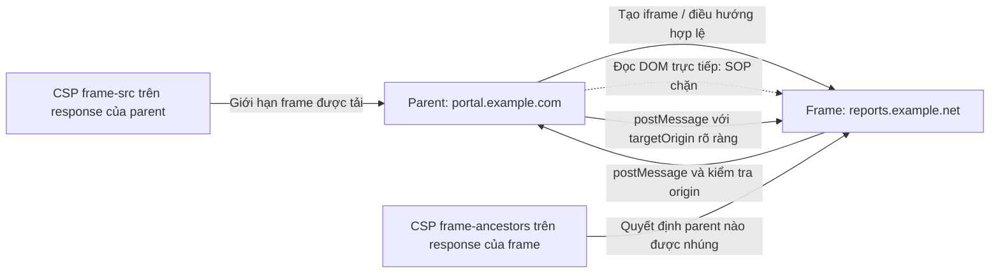

# Cross-origin frame: ranh giới bảo mật khi nhúng trang khác origin

Một ứng dụng web có thể nhúng trang thanh toán, biểu đồ báo cáo, video, cổng đăng nhập hoặc widget của đối tác qua thẻ `<iframe>`. Thao tác nhúng có vẻ đơn giản, nhưng **trang cha** và **trang con trong iframe** có thể thuộc các origin khác nhau, có quyền truy cập khác nhau và chịu những chính sách bảo mật khác nhau.

**Cross-origin frame** là iframe mà tài liệu đang chạy bên trong có origin khác origin của tài liệu đang cố truy cập nó. Same-Origin Policy (SOP) giới hạn việc đọc và thao tác trực tiếp giữa hai tài liệu đó. Tuy nhiên, việc giới hạn truy cập DOM **không tự động chặn nhúng trang, gửi thông điệp, gửi yêu cầu mạng hoặc lừa người dùng nhấp chuột**. Vì thế cần kết hợp SOP với `postMessage`, cơ chế sandbox, CSP và các kiểm tra phía máy chủ.

Bài học thuộc chương **Same-origin policy**, trong phạm vi `SECURITY_APPLICATION_SECURITY_BROWSER_SECURITY`: phân tích ranh giới trình duyệt, origin, cookie, CORS và các cơ chế cách ly; liên hệ cách phòng vệ XSS, CSRF, clickjacking bằng CSP, Trusted Types, security headers và kiểm chứng hành vi thực tế.

## 1. Mục tiêu học tập

Sau bài này, người học có thể:

1. Xác định khi nào một iframe cùng origin hoặc khác origin với trang cha.
2. Phân biệt việc **nhúng được iframe** với việc **đọc được nội dung iframe** và với việc **gửi được thông điệp**.
3. Sử dụng `window.postMessage()` với `targetOrigin`, `event.origin`, `event.source` và kiểm tra cấu trúc dữ liệu.
4. Giải thích sự khác nhau giữa `iframe sandbox`, CSP `frame-src`, CSP `frame-ancestors` và `X-Frame-Options`.
5. Nhận diện các rủi ro do cookie bên thứ ba, XSS, CSRF, clickjacking và tích hợp iframe thiếu kiểm soát.
6. Thực hiện thí nghiệm hai origin và lưu bằng chứng bằng DevTools.

## 2. Iframe tạo một ngữ cảnh duyệt riêng

`<iframe>` tạo một *nested browsing context* để tải một tài liệu trong một trang khác. Xét hai địa chỉ:

- Trang cha: `https://portal.example.com/dashboard`.
- Trang con: `https://reports.example.net/widget`.

Trang cha có thể viết:

```html
<iframe
  id="report-frame"
  src="https://reports.example.net/widget"
  title="Báo cáo từ đối tác">
</iframe>
```

Với HTTP(S), origin là bộ ba **scheme + hostname + effective port**. Hai URL trên khác hostname nên khác origin. Ngay cả khi cùng hostname, chỉ cần khác scheme hoặc port cũng đủ tạo origin khác.

| Trang cha | Trang trong iframe | Kết luận |
| --- | --- | --- |
| `https://app.example.com/a` | `https://app.example.com/b` | Cùng origin: cùng scheme, hostname và port mặc định 443. |
| `https://app.example.com` | `https://api.example.com` | Khác origin: khác hostname, dù thường cùng site. |
| `https://app.example.com` | `http://app.example.com` | Khác origin: khác scheme. |
| `https://app.example.com` | `https://app.example.com:8443` | Khác origin: khác port. |
| `http://localhost:3000` | `http://localhost:3001` | Khác origin: khác port. |

Đường dẫn, query string và fragment không tham gia so sánh origin. **Same-site** (thường dựa trên scheme và registrable domain) là khái niệm khác, chủ yếu hữu ích khi phân tích cookie `SameSite` và yêu cầu giữa các trang.

Một iframe có thể bắt đầu ở origin A rồi điều hướng sang origin B. Quyền truy cập của JavaScript phải được đánh giá theo **origin của tài liệu hiện đang chạy và bối cảnh bảo mật của nó**, không chỉ theo giá trị `src` ban đầu của phần tử iframe.

## 3. SOP áp dụng thế nào giữa trang cha và iframe?

SOP giữ ranh giới giữa hai tài liệu khác origin. Trình duyệt cho phép trang cha giữ một tham chiếu hạn chế tới cửa sổ con (`WindowProxy` qua `iframe.contentWindow`), nhưng không vì thế cho đọc toàn bộ `document` hoặc dữ liệu riêng của con.



### Quyền truy cập thường gặp

| Thao tác từ trang cha | Iframe cùng origin | Iframe khác origin |
| --- | --- | --- |
| Lấy `iframe.contentWindow` | Có thể | Có thể lấy tham chiếu hạn chế (`WindowProxy`). |
| Đọc `iframe.contentDocument` | Thường đọc được, nếu không có cách ly bổ sung | Thường nhận `null`. |
| Đọc `iframe.contentWindow.document` | Thường đọc được | Bị SOP chặn; thường ném `SecurityError`. |
| Đọc DOM, biến JavaScript hoặc `localStorage` của iframe | Thường được phép trong cùng origin, tùy chính sách khác | Không được đọc trực tiếp. |
| Gọi `postMessage` sang iframe | Được phép | Được phép; phải chỉ rõ và kiểm tra origin. |
| Điều hướng iframe qua `src` của phần tử | Được phép nếu các chính sách khác không cản | Thường được phép khi chính sách điều hướng/nhúng cho phép. |
| Đọc HTTP response do script gọi từ origin khác | Tuân theo quy tắc fetch | Cần CORS hoặc cơ chế chia sẻ phù hợp; iframe không tự cấp quyền đọc response. |

Quyền thực tế còn phụ thuộc `sandbox`, CSP, quyền trong Permissions Policy, loại tài liệu và trạng thái điều hướng. **Không dùng SOP thay thế xác thực và phân quyền API:** một request được phép về mặt trình duyệt vẫn có thể bị máy chủ từ chối vì thiếu quyền nghiệp vụ.

### Vì sao `contentWindow` tồn tại nhưng `document` lại bị từ chối?

Trang cha có thể cần gửi thông điệp hoặc thực hiện một số thao tác cửa sổ hạn chế mà không cần đọc dữ liệu con. Do đó, trình duyệt không che hoàn toàn đối tượng cửa sổ khác origin. Thử trong Console của trang cha:

```js
const frame = document.querySelector('#report-frame');

console.log(frame.contentWindow); // Có tham chiếu WindowProxy.
console.log(frame.contentDocument); // Thường là null nếu khác origin.

try {
  console.log(frame.contentWindow.document.body.textContent);
} catch (error) {
  console.log(error.name); // Thường là "SecurityError".
}
```

Nếu mã trên chạy khi iframe chưa tải xong, kết quả có thể phản ánh tài liệu ban đầu (`about:blank`) kế thừa origin của trang cha. Vì vậy, hãy chạy **sau sự kiện `load`** và xác minh rằng iframe đã điều hướng đến tài liệu đích trước khi rút ra kết luận.

Đọc thuộc tính `src` trên phần tử iframe chỉ trả về **URL được khai báo trong DOM cha**. Nó không chứng minh trang cha được phép đọc `location.href` hiện tại bên trong cửa sổ con sau khi có redirect hoặc điều hướng.

## 4. Nhúng iframe không phải là một `fetch` CORS

Nhúng tài liệu qua:

```html
<iframe src="https://reports.example.net/widget"></iframe>
```

không mặc nhiên đòi máy chủ đích trả `Access-Control-Allow-Origin`. Trình duyệt có thể **tải và hiển thị** một trang khác origin, nhưng vẫn ngăn trang cha **đọc DOM bên trong**.

Ngược lại:

```js
const response = await fetch('https://reports.example.net/api/summary');
const summary = await response.json();
```

là yêu cầu `fetch` khác origin, nên script chỉ đọc được phản hồi khi máy chủ cho phép theo CORS và các điều kiện liên quan. CORS không cấp quyền truy cập DOM của iframe và cũng không thay thế quyền truy cập dữ liệu ở máy chủ.

Nếu iframe bị chặn, cần xem lý do thực tế trong DevTools. Những khả năng khác nhau gồm:

- Response của trang con có CSP `frame-ancestors` chặn origin cha.
- Response của trang con có `X-Frame-Options` chặn nhúng.
- CSP `frame-src` của trang cha không cho tải URL con.
- Hạn chế sandbox, lỗi mạng, chứng chỉ hoặc chính sách trình duyệt.

Một lỗi CORS ở yêu cầu `fetch` **khác bản chất** với việc trình duyệt từ chối nhúng iframe. Thêm header CORS không sửa được CSP `frame-ancestors` và cũng không làm SOP cho đọc DOM.

## 5. Trao đổi dữ liệu qua `postMessage` đúng cách

Khi trang cha cần lấy kích thước widget, nhận trạng thái hoàn tất thanh toán hoặc gửi bộ lọc báo cáo cho iframe, hãy thiết kế **giao thức thông điệp** thay vì tìm cách đọc DOM khác origin.

`window.postMessage(message, targetOrigin)` truyền dữ liệu có cấu trúc giữa các cửa sổ. Đây là một **kênh giao tiếp được phép đi qua ranh giới origin**, nhưng bản thân API không phân quyền thông điệp. Cả hai bên phải xác minh đối tác và dữ liệu.

### Ví dụ: iframe gửi chiều cao nội dung cho trang cha

Trang cha ở `https://portal.example.com`:

```html
<iframe
  id="report-frame"
  src="https://reports.example.net/widget"
  title="Báo cáo đối tác">
</iframe>
<script>
  const frame = document.querySelector('#report-frame');
  const PARTNER_ORIGIN = 'https://reports.example.net';
  const requestId = crypto.randomUUID();

  window.addEventListener('message', (event) => {
    // Kiểm tra chính xác cửa sổ gửi và origin của thông điệp.
    if (event.source !== frame.contentWindow) return;
    if (event.origin !== PARTNER_ORIGIN) return;

    const data = event.data;
    if (!data || typeof data !== 'object') return;
    if (data.type !== 'REPORT_HEIGHT') return;
    if (data.requestId !== requestId) return;

    // Giới hạn kích thước để tránh widget phá bố cục.
    if (!Number.isInteger(data.height)) return;
    if (data.height < 200 || data.height > 1200) return;

    frame.style.height = data.height + 'px';
  });

  frame.addEventListener('load', () => {
    frame.contentWindow.postMessage(
      { type: 'GET_REPORT_HEIGHT', requestId },
      PARTNER_ORIGIN
    );
  });
</script>
```

Trang con ở `https://reports.example.net/widget`:

```html
<script>
  const PARENT_ORIGIN = 'https://portal.example.com';

  window.addEventListener('message', (event) => {
    if (event.source !== window.parent) return;
    if (event.origin !== PARENT_ORIGIN) return;

    const data = event.data;
    if (!data || typeof data !== 'object') return;
    if (data.type !== 'GET_REPORT_HEIGHT') return;
    if (typeof data.requestId !== 'string') return;
    if (data.requestId.length > 100) return;

    const height = Math.ceil(document.documentElement.scrollHeight);

    window.parent.postMessage(
      { type: 'REPORT_HEIGHT', requestId: data.requestId, height },
      PARENT_ORIGIN
    );
  });
</script>
```

Đây là ví dụ minh họa một thông điệp **ít nhạy cảm** để điều chỉnh giao diện. Khi tích hợp thanh toán, xác thực hoặc cấp quyền, không nên tin một thông điệp “thanh toán thành công” để tự cập nhật trạng thái đơn hàng: máy chủ của ứng dụng phải kiểm chứng kết quả qua kênh đáng tin với hệ thống thanh toán.

### Quy tắc kiểm tra một thông điệp

| Thành phần | Tại sao cần kiểm tra? | Sai lầm thường gặp |
| --- | --- | --- |
| `targetOrigin` ở phía gửi | Chỉ chuyển thông điệp tới tài liệu có origin đích phù hợp | Dùng `'*'` cho thông điệp có dữ liệu nhạy cảm. |
| `event.origin` ở phía nhận | Biết origin của tài liệu gửi tại thời điểm gửi | Chỉ kiểm tra chuỗi `endsWith('example.com')`, dễ chấp nhận hostname giả mạo. |
| `event.source` | Đối chiếu cửa sổ thực sự gửi thông điệp | Nhận dữ liệu từ một iframe/cửa sổ khác cùng origin ngoài dự kiến. |
| `event.data` | Kiểm tra kiểu dữ liệu, giá trị, kích thước và hành động được phép | Đưa trực tiếp dữ liệu nhận được vào `innerHTML` hoặc dùng nó làm lệnh. |
| `type`, mã yêu cầu hoặc nonce | Gắn phản hồi với tác vụ đang chờ và hạn chế nhầm luồng | Coi mọi thông điệp `SUCCESS` là xác nhận cuối cùng. |

Không kiểm tra chỉ bằng `event.origin.includes('example.com')`: chuỗi như `https://example.com.attacker.net` có thể vượt qua kiểm tra yếu. Với ứng dụng biết trước đối tác, dùng so sánh **origin chính xác** hoặc danh sách cho phép được kiểm soát.

`event.origin` phản ánh origin tại thời điểm gửi thông điệp; cửa sổ có thể đã điều hướng trước khi thông điệp được xử lý. Vì vậy phải kiểm tra thêm `source`, tương quan yêu cầu và quyền thực hiện hành động. Không lưu lại `WindowProxy` rồi mặc định rằng tài liệu bên trong sẽ luôn giữ nguyên origin.

Thông điệp phải được xem là **dữ liệu không tin cậy**. Với giá trị dùng để dựng giao diện, tiếp tục sử dụng `textContent`, kiểm tra URL và dữ liệu theo ngữ cảnh; cân nhắc CSP và Trusted Types để giảm khả năng XSS khi xử lý nhầm dữ liệu nhận được.

## 6. `iframe sandbox`: thu hẹp quyền của nội dung được nhúng

`sandbox` là thuộc tính HTML dùng để hạn chế quyền của tài liệu trong iframe. Khi khai báo `sandbox` không kèm quyền ngoại lệ, trình duyệt áp đặt nhiều hạn chế: chặn thực thi script, gửi form, điều hướng cửa sổ trên cùng, mở popup và làm tài liệu được nhúng có **opaque origin**.

Ví dụ để cho script chạy nhưng vẫn tránh cho iframe nhận lại quyền same-origin thông thường:

```html
<iframe
  src="https://widgets.example.net/preview"
  sandbox="allow-scripts"
  title="Xem trước widget">
</iframe>
```

Một số quyền thường gặp:

| Token trong `sandbox` | Nới hạn chế nào? | Điều cần lưu ý |
| --- | --- | --- |
| `allow-scripts` | Cho phép script trong iframe chạy | Script vẫn chịu ranh giới origin và những hạn chế sandbox còn lại. |
| `allow-same-origin` | Tránh ép tài liệu vào opaque origin, để áp dụng origin thông thường | Với nội dung thật sự cùng origin và có `allow-scripts`, tổ hợp này có thể làm mất hiệu quả cách ly. |
| `allow-forms` | Cho phép gửi form | Không tự xác thực thao tác hoặc bảo vệ CSRF. |
| `allow-popups` | Cho phép mở popup trong những điều kiện cho phép | Popup có thể kế thừa hạn chế sandbox nếu không cấu hình riêng. |
| `allow-top-navigation-by-user-activation` | Cho phép điều hướng trang trên cùng khi có tương tác người dùng phù hợp | Không đồng nghĩa iframe được tự do điều hướng trang cha lúc nào cũng được. |

**Trường hợp cần đặc biệt chú ý:** iframe có `sandbox="allow-scripts allow-same-origin"` và tải tài liệu **cùng origin với trang cha** có thể khiến script trong iframe gỡ thuộc tính `sandbox` trên phần tử cha rồi tải lại, làm suy yếu mục tiêu sandbox. Nên đưa nội dung không tin cậy sang origin riêng và cấp quyền sandbox tối thiểu.

### Opaque origin và thông điệp `"null"`

Iframe sandbox **không có `allow-same-origin`** thường mang opaque origin, dù `src` trỏ về cùng hostname với trang cha. Khi đó `event.origin` của thông điệp từ frame có thể là chuỗi `"null"`. Các tài liệu `data:` cũng có thể có opaque origin.

Không nên tin một đối tác chỉ vì `event.origin === 'null'`: nhiều bối cảnh không liên quan cũng có thể tạo thông điệp với origin đó. Với opaque origin, việc gửi thông điệp vào frame đôi khi buộc dùng `targetOrigin='*'`; nếu phải dùng, chỉ trao đổi dữ liệu không nhạy cảm, đối chiếu `event.source`, kiểm soát chặt schema và dùng cơ chế xác minh bổ sung phù hợp. Đối với dữ liệu nhạy cảm, ưu tiên thiết kế tích hợp có **origin ổn định và cụ thể**.

## 7. Hai chiều chính sách nhúng: `frame-src` và `frame-ancestors`

CSP cung cấp hai chỉ thị dễ bị nhầm:

1. **`frame-src`** trong response của **trang cha**: trang cha được tải iframe từ những nguồn nào?
2. **`frame-ancestors`** trong response của **trang con**: những trang cha/tổ tiên nào được phép nhúng trang con?

Với ứng dụng portal chỉ cần nhúng widget báo cáo:

```http
HTTP/1.1 200 OK
Content-Security-Policy: default-src 'self'; frame-src https://reports.example.net
```

Với trang widget báo cáo chỉ cho portal nhúng:

```http
HTTP/1.1 200 OK
Content-Security-Policy: frame-ancestors https://portal.example.com
```

Hai ví dụ trên mô tả **header của hai response khác nhau**, không phải một header áp dụng chung. Khi còn nhiều cấp iframe lồng nhau, `frame-ancestors` phải thỏa đối với **chuỗi trang tổ tiên**, không chỉ một trang cha trực tiếp. Chỉ thị `frame-ancestors` phải được gửi bằng HTTP response header; đặt nó trong `<meta http-equiv="Content-Security-Policy">` không có tác dụng bảo vệ tương đương.

Nếu trang chứa chức năng nhạy cảm **không có nhu cầu được nhúng**, cấu hình điển hình là:

```http
Content-Security-Policy: frame-ancestors 'none'
X-Frame-Options: DENY
```

`X-Frame-Options` chủ yếu có `DENY` và `SAMEORIGIN`. Nó hữu ích với trình duyệt cũ, nhưng cách cấu hình danh sách đối tác cụ thể nên dựa vào `frame-ancestors`. Nếu widget **cần được nhúng khác origin**, không đồng thời đặt `X-Frame-Options: DENY` hoặc `SAMEORIGIN` trên response widget vì có thể chặn chính kịch bản tích hợp.

Phân biệt thêm các cơ chế cùng họ:

| Cơ chế | Tác dụng chính | Không thay thế cho |
| --- | --- | --- |
| SOP | Hạn chế đọc DOM/tài nguyên giữa origin | CSP chống nhúng, xác thực API, bảo vệ CSRF. |
| `frame-src` | Hạn chế nơi trang hiện tại được tải iframe | `frame-ancestors` ở trang được nhúng. |
| `frame-ancestors` | Kiểm soát ai được nhúng tài liệu hiện tại | Kiểm tra quyền nghiệp vụ và sandbox. |
| `X-Frame-Options` | Kiểm soát nhúng theo cơ chế truyền thống | `frame-ancestors` khi có danh sách origin cho phép. |
| `sandbox` | Hạn chế khả năng hoạt động của tài liệu iframe | Kiểm tra người gửi và dữ liệu trong `postMessage`. |
| `Permissions-Policy` / `allow` | Giới hạn việc sử dụng một số tính năng trình duyệt trong iframe | Quyền người dùng hoặc bảo mật dữ liệu ứng dụng. |

COOP, COEP và CORP phục vụ các mục tiêu cách ly cửa sổ và tài nguyên khác. Chúng có thể ảnh hưởng tính tương thích của các tích hợp, nhưng **không thay thế** kiểm soát `frame-ancestors` hoặc kiểm tra thông điệp. Cần đánh giá và thử trên trình duyệt đích trước khi bật cấu hình cách ly phức tạp.

## 8. Cookie, phiên đăng nhập và storage trong cross-origin frame

Iframe có origin riêng nên JavaScript chạy trong đó chịu phạm vi DOM và storage tương ứng. Parent không được tự đọc `localStorage`, IndexedDB hoặc `document.cookie` của iframe khác origin qua việc nhúng.

Việc cookie có **được gửi theo HTTP request tải iframe hay không** là vấn đề riêng:

- Với iframe khác origin nhưng **cùng site**, `SameSite` không có nghĩa giống như cross-site. Tuy nhiên phạm vi `Domain`, host-only, `Path`, `Secure` và chính sách trình duyệt vẫn quyết định cookie cụ thể có được gửi hay không.
- Với iframe **khác site**, cookie `SameSite=Lax` hoặc `Strict` thường không được gửi trong điều hướng iframe thông thường. `SameSite=None; Secure` cho phép cookie được dùng trong ngữ cảnh cross-site theo thuộc tính cookie, nhưng trình duyệt vẫn có thể chặn hoặc phân vùng cookie bên thứ ba.
- Cookie không được cô lập theo **port**; hai origin khác port trên cùng hostname có thể cùng phạm vi cookie nếu các điều kiện khác thỏa mãn.
- Chính sách bảo vệ riêng tư, phân vùng storage và các API xin quyền truy cập storage có thể thay đổi hành vi tùy trình duyệt và hoàn cảnh.

**Ví dụ:** cổng báo cáo yêu cầu đăng nhập tại `reports.example.net` nhưng được nhúng trong `portal.example.com`. Người dùng đã đăng nhập trên tab riêng có thể vẫn thấy màn hình đăng nhập trong iframe vì cookie bên thứ ba bị hạn chế. Đây không nhất thiết là lỗi CORS hoặc SOP; cần xem tab **Network**, **Application/Storage** và chính sách cookie của trình duyệt.

Không nên giải quyết vấn đề bằng cách mở rộng `Domain` cookie, tắt `SameSite` hoặc thêm `Access-Control-Allow-Origin: *` một cách mù quáng. Thiết kế nên ưu tiên chuyển hướng đăng nhập cấp cao (*top-level navigation*) hoặc cơ chế tích hợp được nhà cung cấp hỗ trợ, rồi kiểm chứng trên các trình duyệt mục tiêu.

## 9. Các kịch bản tấn công liên quan

### 9.1. Clickjacking: nhúng được nhưng thao tác bị đánh lừa

Trang độc hại có thể đặt website nhạy cảm trong iframe, làm trong suốt hoặc phủ giao diện giả bên trên để dụ người dùng nhấp vào nút thật. SOP có thể chặn kẻ tấn công **đọc DOM** của iframe nhưng không nhất thiết ngăn người dùng tương tác với nội dung iframe.

Phòng vệ quan trọng nhất ở trang nhạy cảm là giới hạn nhúng bằng CSP `frame-ancestors` và, khi phù hợp, `X-Frame-Options`. Đối với hành động quan trọng, vẫn cần xác thực, phân quyền, xác nhận ý định và chống CSRF đúng cách.

### 9.2. XSS và thông điệp sai nguồn

Nếu script độc hại chạy trong iframe, nó vẫn có thể gửi `postMessage` sang parent. Nếu parent không kiểm tra `event.origin`, `event.source` hoặc sử dụng `event.data` làm HTML, hành vi này có thể mở đường cho DOM XSS hoặc thao tác trái phép trong ứng dụng cha.

Ví dụ **nguy hiểm**:

```js
window.addEventListener('message', (event) => {
  document.querySelector('#notice').innerHTML = event.data.text;
});
```

Chỉ cần nguồn bất kỳ gửi thông điệp có chứa HTML, parent có nguy cơ diễn giải dữ liệu đó như code. Hãy kiểm tra nguồn và cấu trúc, dùng `textContent` khi cần hiển thị văn bản, sanitization khi cần HTML thực sự; cấu hình CSP và Trusted Types để bổ sung lớp bảo vệ DOM sink.

### 9.3. CSRF: SOP không chặn mọi yêu cầu xuyên origin

Một iframe hoặc trang bên ngoài vẫn có thể khiến trình duyệt gửi một số yêu cầu tới máy chủ khác origin. Việc mã trong iframe không đọc được response **không đảm bảo yêu cầu đã không tới máy chủ**. Nếu máy chủ dùng cookie phiên mà không chống CSRF, một request thay đổi trạng thái vẫn có thể gây hậu quả trong điều kiện cookie được gửi.

Cách bảo vệ là thiết kế endpoint đúng phương thức, kiểm tra session và quyền trên tài nguyên, xác thực CSRF token cho hành động thay đổi dữ liệu, cân nhắc `Origin`/Fetch Metadata và cookie `SameSite` phù hợp. Không coi CORS hoặc CSP nhúng là một giải pháp chống CSRF hoàn chỉnh.

## 10. Thực hành: hai trang trên hai cổng `localhost`

Thí nghiệm dùng môi trường **do người học kiểm soát** và không cần tài khoản thật. Chuẩn bị hai thư mục, mỗi thư mục chứa một tệp `index.html`. Dùng hai máy chủ tĩnh cục bộ để phục vụ:

```text
parent/index.html  -> http://localhost:3000/
child/index.html   -> http://localhost:3001/
```

Ví dụ nếu máy có Python, mở hai terminal ở thư mục chứa `parent` và `child`:

```bash
# Terminal 1
python -m http.server 3000 --directory parent

# Terminal 2
python -m http.server 3001 --directory child
```

Hai địa chỉ **khác origin do khác port** nhưng cùng hostname. Đây là môi trường phù hợp để quan sát SOP và thông điệp.

### 10.1. Trang cha: `parent/index.html`

```html
<!doctype html>
<html lang="vi">
<meta charset="utf-8">
<title>Parent at localhost:3000</title>
<h1>Trang cha, origin 3000</h1>
<iframe id="child" title="Trang con"></iframe>
<script>
  const child = document.querySelector('#child');

  window.addEventListener('message', (event) => {
    if (event.origin !== 'http://localhost:3001') return;
    if (event.source !== child.contentWindow) return;
    if (event.data?.type !== 'PONG') return;
    console.log('Nhận PONG từ', event.origin);
  });

  child.addEventListener('load', () => {
    console.log('contentWindow:', Boolean(child.contentWindow));
    console.log('contentDocument:', child.contentDocument);

    try {
      console.log(child.contentWindow.document.body.textContent);
    } catch (error) {
      console.log('Đọc DOM bị chặn:', error.name);
    }

    child.contentWindow.postMessage(
      { type: 'PING' },
      'http://localhost:3001'
    );
  });

  // Chỉ điều hướng sau khi đã đăng ký listener.
  child.src = 'http://localhost:3001/';
</script>
</html>
```

### 10.2. Trang con: `child/index.html`

```html
<!doctype html>
<html lang="vi">
<meta charset="utf-8">
<title>Child at localhost:3001</title>
<h1>Trang con, origin 3001</h1>
<script>
  window.addEventListener('message', (event) => {
    if (event.origin !== 'http://localhost:3000') return;
    if (event.source !== window.parent) return;
    if (event.data?.type !== 'PING') return;

    window.parent.postMessage(
      { type: 'PONG' },
      'http://localhost:3000'
    );
  });
</script>
</html>
```

### 10.3. Quan sát và thay đổi điều kiện

Mở `http://localhost:3000/` và DevTools **Console**. Kết quả kỳ vọng:

1. `contentWindow` tồn tại, vì trang cha được giữ tham chiếu hạn chế tới cửa sổ con.
2. `contentDocument` là `null` và việc đọc `child.contentWindow.document.body` bị từ chối (thường `SecurityError`) sau khi iframe tải trang cổng 3001.
3. Console in ra thông điệp `PONG` vì hai trang cho phép giao tiếp bằng `postMessage` và kiểm tra origin chính xác.

Sau đó thử các biến thể:

| Biến thể | Kỳ vọng | Nguyên nhân |
| --- | --- | --- |
| Đổi `child.src` thành `http://localhost:3000/` | Có thể đọc DOM khi tải tài liệu cùng origin, nếu không có sandbox | Cùng scheme, host và port. |
| Giữ cổng 3001 nhưng đặt `sandbox="allow-scripts"` trên iframe | Script con có thể chạy, nhưng origin con trở thành opaque và thông điệp có thể mang `origin = "null"`; phép kiểm tra origin 3001 sẽ loại bỏ thông điệp | `sandbox` không có `allow-same-origin`. |
| Sửa `targetOrigin` ở cha thành một origin không khớp | Không nhận `PING` | Trình duyệt không chuyển thông điệp khi origin đích không khớp. |
| Thử `fetch('http://localhost:3001/')` từ Console cha | Không đọc được response nếu máy chủ tĩnh không cấp CORS phù hợp | CORS khác với quyền tải iframe. |
| Thử tạo iframe đến một trang đích có `frame-ancestors 'none'` | Trang bị chặn nhúng | Chính sách nằm trên response của trang con. |

Khi thử sandbox, hãy quan sát cả Console và Network; một số thử nghiệm sẽ thay đổi cả hành vi script, storage và nguồn gốc thông điệp. Nếu đổi lại sang URL cổng 3000, nên bỏ sandbox trước khi kết luận về quyền same-origin.

**Bằng chứng cần lưu:** hai URL có port khác nhau; trạng thái DOM access; thông điệp `PING/PONG` và origin ghi nhận; các lỗi CSP, sandbox hoặc CORS trong Console; response headers thực tế trong Network. Thí nghiệm này chứng minh giới hạn và ngoại lệ của SOP ở trình duyệt, **không phải** bằng chứng toàn bộ ứng dụng đã an toàn.

## 11. Quy trình đánh giá một tích hợp iframe trước khi phát hành

Giả sử sản phẩm muốn nhúng biểu đồ từ đối tác. Hãy đi lần lượt qua những câu hỏi sau:

| Câu hỏi | Đầu ra cần có |
| --- | --- |
| Ai là parent và ai là child? | URL, scheme, hostname, port, origin, site và bên sở hữu mỗi tài liệu. |
| Đối tác có cho phép nhúng không? | Kiểm tra `frame-ancestors`/`X-Frame-Options` ở response đích. |
| Parent có được phép nhúng nguồn đó không? | Kiểm tra CSP `frame-src` ở parent. |
| Iframe cần những quyền nào? | Danh sách token `sandbox` tối thiểu, các quyền `allow` cần thiết và lý do. |
| Hai bên trao đổi gì? | Hợp đồng `postMessage`: origin, source, type, schema, dữ liệu nhạy cảm, vòng đời yêu cầu. |
| Cookie và đăng nhập có hoạt động ổn định không? | Kiểm thử same-site/cross-site, cookie bên thứ ba, trang đăng nhập và các trình duyệt mục tiêu. |
| Nếu iframe hoặc parent bị XSS thì sao? | DOM sink an toàn, CSP, Trusted Types phù hợp, kiểm tra thông điệp và quyền máy chủ. |
| Có thao tác nhạy cảm không? | Xác thực, phân quyền, chống CSRF và xác minh kết quả ở máy chủ. |
| Khi một chính sách chặn nhúng thì biết bằng cách nào? | Kịch bản kiểm thử, bằng chứng Network/Console, thông báo lỗi hữu ích cho người dùng. |

Không đặt iframe chứa chức năng nhạy cảm trong một trang có mức độ tin cậy thấp nếu không có nhu cầu sản phẩm rõ ràng. Ngay cả với iframe có ranh giới origin đúng, trang cha vẫn kiểm soát bố cục, vị trí và lớp phủ của iframe; bảo vệ clickjacking phải được quyết định từ phía tài liệu được nhúng.

## 12. Câu hỏi tự kiểm tra

1. Trang cha `https://app.example.com` nhúng `https://api.example.com/widget`. Hai tài liệu có cùng site không? Có cùng origin không? Parent được đọc `contentDocument` không?
2. Vì sao một iframe có thể hiển thị bình thường dù `fetch` cùng URL từ trang cha bị lỗi CORS?
3. `frame-src` và `frame-ancestors` được cấu hình ở response của tài liệu nào? Điều gì xảy ra nếu một trong hai chính sách không cho phép nhúng?
4. Nếu hai tài liệu khác origin cần gửi thông tin về chiều cao iframe, vì sao phải kiểm tra cả `event.origin`, `event.source` và `event.data`?
5. Điều gì xảy ra với origin của một iframe khi thêm `sandbox="allow-scripts"` nhưng không có `allow-same-origin`?
6. Vì sao ghép `allow-scripts` và `allow-same-origin` nguy hiểm khi nhúng nội dung không tin cậy ở cùng origin?
7. SOP có thể chặn đọc DOM của iframe nhưng vẫn không đủ chống clickjacking hoặc CSRF như thế nào?
8. Nếu trang widget yêu cầu cookie đăng nhập và bị nhúng cross-site, nguyên nhân nào ngoài CORS có thể khiến người dùng mất trạng thái đăng nhập?

**Tiêu chí hoàn thành:** người học có thể phân tích một iframe cụ thể bằng origin của từng tài liệu, giải thích chính xác ranh giới DOM và HTTP, thiết kế thông điệp có xác minh nguồn, áp dụng đúng sandbox/CSP và đưa ra bằng chứng trên trình duyệt cho các hành vi được phép hoặc bị chặn.
