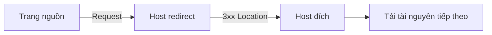

# Referrer header: kiểm soát thông tin URL được gửi tới trang khác

Khi người dùng mở một liên kết hoặc trình duyệt tải tài nguyên từ một trang, browser có thể gửi URL của trang nguồn trong HTTP request header có tên **Referer**. Header này cho server đích biết request đến từ đâu, nhưng nếu URL nguồn chứa path hoặc query nhạy cảm, thông tin đó có thể bị tiết lộ cho website, dịch vụ analytics, CDN hoặc hệ thống log ở phía nhận.

Tên header HTTP là **Referer** — cách viết sai chính tả lịch sử được giữ trong chuẩn giao thức. Tên của cơ chế và response header điều khiển nó là **Referrer-Policy**. Chính sách này quyết định browser gửi toàn bộ URL, chỉ gửi origin hay không gửi thông tin referrer. Ứng dụng cần đặt policy rõ ràng và tránh đặt bí mật trong URL, vì Referrer-Policy không xóa URL khỏi browser history, server access log hoặc các kênh ghi nhận khác.

Bài học thuộc chương **Referrer và URL leak**, theo đề bài **Referrer header**, trong phạm vi **SECURITY_APPLICATION_SECURITY_BROWSER_SECURITY**: phân tích ranh giới bảo mật giữa trình duyệt, origin, cookie và ứng dụng web để hiểu Same-Origin Policy, CORS và các cơ chế cách ly; thực hành phòng vệ XSS, CSRF, clickjacking bằng CSP, Trusted Types, security headers và kiểm chứng hành vi thực tế.

## 1. Mục tiêu học tập

Sau bài học, người học có thể:

1. Giải thích vai trò của HTTP Referer header và vì sao tên header chỉ có một chữ r trong Referer.
2. Phân biệt Referer, Referrer-Policy, document.referrer và Origin header.
3. Mô tả URL nào được gửi theo từng Referrer-Policy.
4. Đặt policy ở HTTP response, HTML meta, element và Fetch request.
5. Nhận diện rò rỉ path, query parameter, identifier và token qua referrer.
6. Hiểu tác động của same-origin, cross-origin và HTTPS-to-HTTP downgrade.
7. Thiết kế trang đăng nhập, reset password và OAuth callback giảm rò rỉ URL.
8. Kiểm tra redirect chain, subresource và third-party request bằng DevTools.
9. Hiểu giới hạn của Referer header trong CSRF defense và logging.
10. Xây dựng checklist để kiểm soát referrer trên production.

## 2. Referer header là gì?

Referer là HTTP request header mà user agent có thể gửi để cho biết URL nguồn đã dẫn tới request hiện tại. Ví dụ:

```http
GET /collect HTTP/1.1
Host: analytics.example.test
Referer: https://shop.example.test/products/item-42?campaign=spring
```

Server tại analytics.example.test có thể ghi nhận rằng request tới /collect xuất phát từ trang sản phẩm trên shop.example.test. Nếu URL nguồn chứa email, mã đơn hàng, search query hoặc token, những thông tin đó có thể bị gửi đi cùng header.

### Tên header và thuật ngữ

| Tên | Vai trò |
| --- | --- |
| Referer | HTTP request header chứa referrer URL theo policy của browser. |
| Referrer | Thuật ngữ chỉ URL/trang nguồn trong web platform và tài liệu chuẩn. |
| Referrer-Policy | HTTP response header điều khiển thông tin referrer được gửi trong các request phát sinh từ tài liệu. |
| document.referrer | Thuộc tính JavaScript cho biết referrer của document hiện tại, đã chịu giới hạn policy của browser. |
| Origin | HTTP request header chứa scheme, host và port của origin, không chứa path/query. |

Tên header Referer được viết đúng như vậy trong HTTP. Khi cấu hình server, không tự đổi thành Referrer; tên header HTTP không phân biệt chữ hoa/thường nhưng cách viết chuẩn vẫn là Referer.

### Browser quyết định giá trị header

Referer là request header do browser kiểm soát. JavaScript thông thường không thể tự đặt hoặc ghi đè Referer bằng Fetch/XHR vì đây là forbidden request-header name. Ứng dụng nên điều khiển nó bằng Referrer-Policy hoặc thuộc tính referrerpolicy được hỗ trợ.

Không giả định mọi request đều có Referer. Browser có thể bỏ header do policy, privacy setting, extension, loại điều hướng hoặc môi trường thực thi. Client không phải browser cũng có thể tự gửi giá trị giả.

### URL nào có thể xuất hiện?

Một referrer URL có thể gồm:

- Scheme, ví dụ https.
- Host và port.
- Path.
- Query string.

Browser loại bỏ fragment và userinfo khỏi giá trị Referer. Ví dụ, fragment sau dấu # không được gửi trong Referer; username/password nhúng trong URL cũng không được gửi. Tuy vậy, không nên dùng fragment làm nơi lưu bí mật vì JavaScript cùng trang, browser history, extension hoặc công cụ telemetry vẫn có thể truy cập.

## 3. Referrer-Policy kiểm soát điều gì?

Referrer Policy xác định mức thông tin browser đưa vào Referer cho một request. Policy có thể áp dụng cho navigation, subresource và request được tạo bằng Fetch, với cách cấu hình ở phạm vi tài liệu hoặc từng request/element.

Trong browser hiện đại, **strict-origin-when-cross-origin** là mặc định phổ biến nếu trang không khai báo policy khác. Không dựa vào default như một cấu hình bảo mật đã được kiểm soát; hãy đặt policy tường minh trên response của ứng dụng.

### Bảng các policy

| Policy | Cùng origin | Khác origin | HTTPS đi xuống HTTP |
| --- | --- | --- | --- |
| no-referrer | Không gửi | Không gửi | Không gửi |
| no-referrer-when-downgrade | Gửi URL đầy đủ | Gửi URL đầy đủ | Không gửi |
| origin | Chỉ gửi origin | Chỉ gửi origin | Vẫn gửi origin |
| origin-when-cross-origin | Gửi URL đầy đủ | Chỉ gửi origin | Chỉ gửi origin |
| same-origin | Gửi URL đầy đủ | Không gửi | Không gửi nếu khác origin |
| strict-origin | Chỉ gửi origin | Chỉ gửi origin | Không gửi |
| strict-origin-when-cross-origin | Gửi URL đầy đủ | Chỉ gửi origin | Không gửi |
| unsafe-url | Gửi URL đầy đủ | Gửi URL đầy đủ | Gửi URL đầy đủ |

URL đầy đủ trong bảng vẫn không bao gồm fragment hoặc userinfo. Policy strict-origin-when-cross-origin giữ path/query cho request cùng origin, chỉ gửi origin khi request đi sang origin khác và bỏ referrer khi downgrade từ HTTPS xuống HTTP.

### no-referrer

Không gửi Referer:

```http
Referrer-Policy: no-referrer
```

Đây là lựa chọn phù hợp cho callback hoặc trang xử lý dữ liệu nhạy cảm khi không có nhu cầu chia sẻ referrer. Các request do trang tạo ra sẽ không gửi URL nguồn theo policy này.

### strict-origin-when-cross-origin

Ví dụ:

```http
Referrer-Policy: strict-origin-when-cross-origin
```

Hành vi:

- Request cùng origin có thể gửi URL đầy đủ, gồm path và query.
- Request khác origin chỉ gửi scheme, host và port.
- Request từ HTTPS xuống HTTP không gửi Referer.

Đây là baseline thực tế cho nhiều website, nhưng không bảo vệ bí mật nằm trong URL khỏi log của chính server nguồn hoặc khỏi script cùng origin. Nếu path/query của một trang nhạy cảm không nên bị gửi cả trong request cùng origin, chọn policy nghiêm hơn cho trang đó.

### origin

Chỉ gửi origin, không gửi path/query:

```http
Referrer-Policy: origin
```

Ví dụ từ https://shop.example.test/account/reset?token=demo tới một tài nguyên khác, browser chỉ gửi https://shop.example.test/ theo policy này. Origin vẫn tiết lộ website nguồn, nhưng không tiết lộ route hoặc query.

### same-origin

Chỉ gửi URL đầy đủ khi request đích cùng origin; request khác origin không có Referer:

```http
Referrer-Policy: same-origin
```

Policy này hữu ích khi ứng dụng muốn giữ referrer trong nội bộ origin nhưng không muốn chia sẻ thông tin nguồn cho host khác. Lưu ý subdomain khác nhau hoặc port khác nhau là origin khác nhau.

### unsafe-url

Gửi URL đầy đủ cho cả request cùng origin và cross-origin, kể cả trong tình huống downgrade:

```http
Referrer-Policy: unsafe-url
```

Tên policy thể hiện đúng rủi ro: path và query có thể bị tiết lộ cho origin khác. Không dùng trên trang có dữ liệu cá nhân, token, mã reset, thông tin tìm kiếm nhạy cảm hoặc route nội bộ.

### Các policy legacy

no-referrer-when-downgrade từng là default phổ biến. Policy này vẫn gửi URL đầy đủ khi chuyển từ HTTPS sang một origin HTTPS khác; nó chỉ bỏ referrer khi downgrade. origin-when-cross-origin giới hạn thông tin cross-origin thành origin nhưng không có quy tắc nghiêm ngặt bỏ referrer khi downgrade. Với ứng dụng mới, ưu tiên policy hiện đại và được đặt rõ ràng.

## 4. Origin và Referer không giống nhau

Origin là bộ ba scheme, host và port. Referer là URL nguồn có thể chứa thêm path/query, tùy policy.

Ví dụ:

```text
Trang nguồn:
https://shop.example.test/orders/ORDER-123?email=user@example.test

Origin:
https://shop.example.test

Referer có thể là:
https://shop.example.test/orders/ORDER-123?email=user@example.test
hoặc chỉ:
https://shop.example.test/
hoặc không có header.
```

### So sánh

| Thuộc tính | Origin | Referer |
| --- | --- | --- |
| Chứa scheme/host/port | Có | Có nếu được gửi |
| Chứa path/query | Không | Có thể có |
| Điều khiển bởi Referrer-Policy | Không | Có |
| Mục đích phổ biến | CORS và kiểm tra nguồn request/CSRF | Thông tin trang nguồn và analytics |
| Có thể vắng mặt | Có, tùy loại request/context | Có |
| Có thể bị client không phải browser giả mạo | Có | Có |

Origin header không bị Referrer-Policy loại bỏ. Khi server cần kiểm tra Origin cho CORS hoặc CSRF, không suy luận rằng policy no-referrer sẽ làm Origin biến mất.

### Không dùng Referer làm danh tính hoặc authorization

Referer chỉ là tín hiệu nguồn request. Nó không chứng minh người dùng đã đăng nhập, có quyền truy cập resource hoặc request không bị giả mạo. Client ngoài browser có thể tự tạo header; browser cũng có thể bỏ header theo policy.

Nếu dùng Origin/Referer như một lớp kiểm tra CSRF, phải thiết kế theo threat model và kết hợp cookie policy, CSRF token hoặc biện pháp phù hợp. Không dùng Referer thay session authentication hoặc authorization phía server.

## 5. Những tình huống làm lộ URL qua Referer

### Liên kết tới website bên ngoài

Người dùng đang ở trang:

```text
https://shop.example.test/search?q=medical+condition&customer=123
```

Sau đó bấm liên kết tới đối tác:

```html
<a href="https://partner.example.net/">Mở đối tác</a>
```

Nếu policy cho phép gửi full URL cross-origin, website đối tác có thể nhận path/query trong Referer. Với strict-origin-when-cross-origin, browser chỉ gửi origin, nhưng nếu policy bị đặt thành unsafe-url thì query có thể lộ.

### Tải tài nguyên bên thứ ba

Một trang có thể tải:

- Ảnh tracking/pixel.
- Script analytics.
- Font hoặc stylesheet từ CDN.
- Video embed.
- Widget chat hoặc quảng cáo.

Request tới bên thứ ba có thể mang Referer theo policy. Nếu policy lỏng, URL hiện tại có thể tiết lộ tên route, ID đối tượng hoặc query. Script bên thứ ba chạy trong trang còn có thể truy cập nhiều dữ liệu DOM mà Referer-Policy không kiểm soát.

### Chuyển hướng qua nhiều host

Một request hoặc navigation có thể đi qua redirect chain:



Redirect không tự bảo đảm thông tin nguồn đã được loại bỏ. Referrer policy của request và policy được áp dụng cho bước tiếp theo trong chain ảnh hưởng giá trị gửi đi. Một redirect response có thể cung cấp Referrer-Policy cho request tiếp theo theo quy tắc Fetch. Hãy kiểm tra từng hop trong browser mục tiêu và tránh đưa secret vào URL ngay từ đầu.

### URL nội bộ chứa dữ liệu nhạy cảm

Các ví dụ rủi ro:

- /reset-password?token=...
- /oauth/callback?code=...
- /invoice/12345?email=...
- /search?q=diagnosis...
- /account/user-identifier/settings
- /download?temporarySignature=...

Ngay cả khi policy chặn cross-origin Referer, URL vẫn có thể xuất hiện trong log request của chính server nguồn, browser history, monitoring, screenshot hoặc telemetry. Tránh đưa dữ liệu nhạy cảm vào URL nếu không cần thiết.

## 6. Các cách đặt Referrer-Policy

### HTTP response header

Đây là cách nên dùng làm cấu hình mặc định ở server:

```http
HTTP/1.1 200 OK
Content-Type: text/html; charset=utf-8
Referrer-Policy: strict-origin-when-cross-origin
```

Ví dụ Nginx:

```nginx
add_header Referrer-Policy "strict-origin-when-cross-origin" always;
```

Ví dụ Express:

```js
app.use((req, res, next) => {
  res.setHeader(
    'Referrer-Policy',
    'strict-origin-when-cross-origin'
  );
  next();
});
```

Đặt header tại reverse proxy hoặc ứng dụng theo kiến trúc triển khai. Kiểm tra cả HTML, error page, redirect response và route nhạy cảm; đừng chỉ cấu hình một response path rồi giả định mọi response đều có header.

### HTML meta element

Có thể đặt policy trong phần head:

```html
<!doctype html>
<html lang="vi">
<head>
  <meta charset="utf-8">
  <meta name="referrer" content="strict-origin-when-cross-origin">
  <title>Trang cửa hàng</title>
</head>
<body>
  ...
</body>
</html>
```

Meta element hữu ích khi không thể thay đổi server config, nhưng response header giúp cấu hình rõ ràng từ đầu response và áp dụng nhất quán hơn. Đặt meta sớm trong head, trước nội dung tạo request.

### Thuộc tính referrerpolicy trên element

Một element có thể đặt policy riêng cho request mà nó tạo:

```html


<iframe
  src="https://video.example.net/embed/demo"
  referrerpolicy="strict-origin"
  title="Video demo">
</iframe>

<a
  href="https://partner.example.net/"
  referrerpolicy="origin">
  Mở đối tác
</a>
```

Policy riêng giúp giảm thông tin gửi cho một destination cụ thể. Nếu không có nhu cầu cung cấp referrer, no-referrer thường là lựa chọn rõ ràng hơn.

### rel=noreferrer cho liên kết

```html
<a href="https://external.example.net/" rel="noreferrer">
  Mở website bên ngoài
</a>
```

rel=noreferrer yêu cầu browser không gửi Referer cho navigation đó. Trong HTML, noreferrer cũng có hiệu lực tương đương noopener đối với liên kết, giúp ngăn trang đích truy cập window.opener.

### Fetch API

Fetch cho phép đặt referrer policy riêng cho request:

```js
await fetch('https://metrics.example.net/collect', {
  method: 'POST',
  body: JSON.stringify({ event: 'page_view' }),
  headers: {
    'Content-Type': 'application/json'
  },
  referrerPolicy: 'no-referrer'
});
```

Đây là policy cho request Fetch đó. Không thể dùng thuộc tính này để tự đặt header Referer tùy ý. Browser vẫn kiểm soát giá trị header theo Fetch và Referrer Policy.

### document.referrer

Trang có thể đọc:

```js
console.log(document.referrer);
```

Giá trị có thể là URL đầy đủ, chỉ origin hoặc chuỗi rỗng tùy policy và cách điều hướng. Direct navigation, bookmark, browser privacy behavior hoặc policy no-referrer có thể khiến giá trị rỗng.

Không dùng document.referrer làm bằng chứng đáng tin cậy về nguồn truy cập, danh tính hoặc quyền của người dùng. Cũng không gửi nguyên giá trị này sang analytics nếu không cần; hãy loại query/path hoặc chỉ lưu origin đã chuẩn hóa.

## 7. Chọn policy theo loại trang

Không phải mọi trang cần cùng một mức thông tin. Một policy toàn site là baseline; trang nhạy cảm có thể cần chính sách nghiêm hơn.

| Loại trang | Policy gợi ý | Lý do |
| --- | --- | --- |
| Trang nội dung công khai | strict-origin-when-cross-origin | Cho request cùng origin đủ ngữ cảnh; cross-origin chỉ biết origin. |
| Trang hồ sơ/tài khoản | same-origin hoặc no-referrer | Tránh chia sẻ route/identifier với host khác. |
| Trang reset password | no-referrer | Tránh gửi URL chứa token tới subresource/đích khác. |
| OAuth/OIDC callback | no-referrer | Authorization code không nên đi theo Referer tới tài nguyên khác. |
| Trang thanh toán | no-referrer hoặc policy nghiêm theo yêu cầu | Giảm rò rỉ route/order context. |
| Trang chứa nội dung nhúng bên thứ ba | no-referrer hoặc origin | Hạn chế thông tin trang nguồn gửi tới embed. |
| Liên kết ngoài đơn lẻ | rel=noreferrer | Chỉ tắt referrer cho navigation cụ thể. |

Chọn policy dựa trên yêu cầu thực tế và kiểm thử. same-origin vẫn gửi full URL cho request nội bộ; nếu path/query có bí mật và có script/service nội bộ không cần biết, dùng no-referrer hoặc loại bí mật khỏi URL.

## 8. Bảo vệ URL nhạy cảm

### Không đặt credential dài hạn trong URL

Không đưa access token, refresh token, session ID, password, API key hoặc secret dài hạn vào path/query/fragment. URL có thể bị lưu trong nhiều hệ thống mà ứng dụng không kiểm soát.

Nếu một luồng bắt buộc dùng URL chứa mã một lần, ví dụ password reset hoặc OAuth authorization code, cần:

- Token/code có entropy cao và thời hạn ngắn.
- Dùng một lần và ràng buộc đúng transaction/client.
- Không dùng code thay access token.
- Đặt Referrer-Policy no-referrer trên callback/reset response.
- Không tải third-party script, pixel hoặc asset không cần thiết trên trang đó.
- Redact query nhạy cảm khỏi access log, proxy, APM và analytics.
- Xóa tham số nhạy cảm khỏi address bar sau khi server đã xử lý an toàn.

### Password reset page

Email reset thường phải chứa link có token một lần. Khi browser mở link:

1. Server xác minh token, expiry và trạng thái unused.
2. Server tạo transaction/session reset phù hợp và consume token theo quy trình.
3. Response đặt Referrer-Policy no-referrer và Cache-Control no-store.
4. Trang không tải analytics, quảng cáo hoặc script bên thứ ba.
5. Sau khi token đã được xử lý, ứng dụng có thể dùng history.replaceState để thay URL hiển thị bằng route sạch.
6. Server không ghi raw token vào log.

Ví dụ response header:

```http
Referrer-Policy: no-referrer
Cache-Control: no-store
Pragma: no-cache
```

history.replaceState chỉ thay URL hiển thị trong history entry hiện tại; nó không xóa bản URL đã ghi ở access log hoặc những nơi đã thu thập trước đó. Vì vậy, redaction phía server vẫn cần thiết.

### OAuth/OIDC callback

Authorization Code Flow thường trả code và state qua callback URL. Code là credential ngắn hạn dùng để đổi token, không phải access token.

Callback cần:

- Kiểm tra state và PKCE verifier theo transaction.
- Xác minh issuer/response theo OIDC flow nếu áp dụng.
- Đổi code qua token endpoint đúng client/redirect URI.
- Đặt Referrer-Policy no-referrer.
- Không tải tài nguyên bên thứ ba trước khi xử lý code.
- Không log query chứa code/state.
- Làm sạch URL sau khi xử lý.

Không chuyển code hoặc token sang analytics event, error report hoặc link điều hướng.

### Giảm dữ liệu nhạy cảm trong path/query

Thay vì:

```text
/orders/ORDER-93821?email=person@example.test&access_token=...
```

Ưu tiên URL không chứa PII/credential:

```text
/orders/current
```

Server xác định tài nguyên dựa trên session đã xác thực và kiểm tra authorization. Nếu cần định danh tài nguyên trong URL, dùng identifier không mang ý nghĩa bí mật và vẫn kiểm tra quyền truy cập.

## 9. Third-party resource và analytics

Một trang có thể gửi referrer tới nhiều dịch vụ mà người dùng không nhận biết rõ. Cần inventory tài nguyên ngoài origin:

- Analytics và tag manager.
- Pixel/advertising.
- Video/audio embed.
- CDN và image host.
- Widget chat/support.
- Script A/B testing.

### Giảm thông tin chia sẻ

- Dùng Referrer-Policy no-referrer hoặc origin cho trang nhạy cảm.
- Đặt referrerpolicy riêng cho iframe/img/script/link khi cần.
- Chỉ tải third-party resource thực sự cần thiết.
- Không gửi URL đầy đủ vào analytics nếu chỉ cần page category.
- Xóa query parameter nhạy cảm trước khi tạo telemetry.
- Dùng CSP để giới hạn connect-src, img-src, script-src và frame-src theo nhu cầu.
- Kiểm tra vendor nhận Referer và thời hạn lưu log của họ.

Referrer-Policy chỉ kiểm soát thông tin referrer trong request. Nó không ngăn script bên thứ ba đã chạy trong trang đọc DOM, localStorage hoặc dữ liệu mà script được phép truy cập. Hãy đánh giá script third-party như một dependency có quyền trong trang.

### Analytics nên chuẩn hóa URL

Thay vì gửi document.location.href hoặc document.referrer nguyên vẹn, tạo page identifier đã loại query/path nhạy cảm:

```js
function safePageContext() {
  const url = new URL(window.location.href);

  return {
    origin: url.origin,
    pageCategory: classifyPath(url.pathname)
  };
}

function safeReferrerOrigin() {
  if (!document.referrer) return null;

  try {
    return new URL(document.referrer).origin;
  } catch {
    return null;
  }
}
```

classifyPath cần ánh xạ route thành tên nhóm đã định nghĩa, không gửi ID người dùng hoặc mã đơn hàng. Không coi việc chỉ bỏ query là đủ nếu path vẫn chứa PII hoặc secret.

## 10. Redirect chain và Referrer-Policy

Redirect có thể xuất hiện trong login middleware, canonical URL, CDN, short link và OAuth flow. Khi điều tra, kiểm tra toàn bộ chain thay vì chỉ nhìn request cuối.

### Điều cần quan sát

- Request đầu tiên gửi Referer nào?
- Response 3xx có Referrer-Policy không?
- Request tiếp theo gửi Referer nào?
- Có chuyển từ HTTPS sang HTTP không?
- Có đổi origin hoặc host qua từng hop không?
- URL path/query có chứa dữ liệu nhạy cảm không?

Response redirect có thể ảnh hưởng policy áp dụng cho request tiếp theo theo quy tắc Fetch. Hành vi cụ thể còn phụ thuộc initiator, response và browser; hãy kiểm tra trên các browser được hỗ trợ. Không dùng redirect như một cách làm sạch URL hoặc che secret.

### Đừng nhầm Location và Referer

| Header | Hướng | Ý nghĩa |
| --- | --- | --- |
| Location | Response | Server chỉ định URL đích cho redirect hoặc một số response khác. |
| Referer | Request | Browser có thể gửi URL nguồn của request. |
| Referrer-Policy | Response | Server chỉ định policy cho referrer của các request liên quan. |

Location có thể chứa URL đích; Referer nói về nguồn. Cả hai đều cần tránh mang credential hoặc dữ liệu nhạy cảm không cần thiết.

## 11. Server logging và privacy

Ngay cả khi browser không gửi Referer, server nguồn vẫn nhận URL request đầy đủ và có thể ghi nó vào access log. Reverse proxy, CDN, WAF, APM và analytics cũng có thể ghi path/query.

### Redact URL ở log pipeline

Không log raw query string trên route chứa:

- Password reset token.
- OAuth authorization code hoặc state.
- Temporary download signature.
- Email, phone hoặc PII.
- Search query nhạy cảm.

Có thể log route template, status, duration, request ID và origin/referrer đã chuẩn hóa. Nếu cần điều tra, dùng allowlist field và masking có kiểm soát.

### Referer cũng có thể chứa dữ liệu nhạy cảm

Khi ghi Referer:

- Chỉ lưu origin nếu analytics/security use case không cần path.
- Xóa query string trước khi lưu.
- Không đưa raw Referer vào log có quyền truy cập rộng.
- Đặt retention và access control cho log.
- Tránh đưa referrer vào exception message hoặc support ticket.

### Không dùng Referrer-Policy để thay logging hygiene

Policy giảm dữ liệu gửi tới request recipient. Nó không xóa URL khỏi log của server nguồn, browser history hoặc telemetry được tạo trước khi policy áp dụng. Bảo vệ URL cần phối hợp thiết kế route, token, response headers và logging.

## 12. Quan hệ với CSP, CORS và CSRF

### CSP

Content Security Policy kiểm soát nguồn nội dung/script được phép tải và thực thi. CSP directive referrer từng tồn tại nhưng đã deprecated; dùng HTTP Referrer-Policy để điều khiển Referer. CSP vẫn hữu ích để giới hạn third-party script, image, frame và network destination.

### CORS

CORS quyết định browser có cho JavaScript đọc response cross-origin hay không. CORS không điều khiển Referer và không làm URL nhạy cảm biến mất. Referrer-Policy cũng không thay CORS; hai cơ chế giải quyết hai vấn đề khác nhau.

### CSRF

Referer/Origin có thể được dùng như tín hiệu kiểm tra nguồn request trong một số CSRF defense. Tuy nhiên:

- Referer có thể bị bỏ theo policy hoặc privacy settings.
- Client không phải browser có thể giả mạo header.
- Request cùng origin không phải lúc nào cũng có header giống nhau trong mọi context.
- Không dùng Referer làm credential hoặc quyền truy cập.

Kết hợp SameSite cookie, CSRF token hoặc custom request header phù hợp, kiểm tra Origin theo policy và authorization phía server. Không mở rộng allowlist bằng cách chấp nhận mọi request thiếu Referer mà không có thiết kế rõ.

## 13. Các lỗi thường gặp

| Hiện tượng | Nguyên nhân có thể | Cách xử lý |
| --- | --- | --- |
| Website bên thứ ba thấy query nhạy cảm | Policy unsafe-url hoặc legacy policy gửi full URL cross-origin | Đặt strict-origin-when-cross-origin hoặc no-referrer; loại secret khỏi URL. |
| Cùng origin vẫn gửi full URL | Default strict-origin-when-cross-origin giữ full URL same-origin | Dùng same-origin/no-referrer cho trang nhạy cảm. |
| Referer biến mất | no-referrer, downgrade, privacy setting hoặc browser behavior | Không dựa vào Referer để xác thực/authorization. |
| document.referrer rỗng | Direct navigation hoặc policy không gửi | Xử lý trường hợp null/empty bình thường. |
| Origin vẫn xuất hiện dù no-referrer | Origin là header độc lập | Đánh giá Origin theo CORS/CSRF riêng. |
| Reset token xuất hiện trong log | Server/proxy ghi raw request URL | Redact query/path nhạy cảm và dùng token một lần, ngắn hạn. |
| OAuth code tới analytics | Callback tải script/asset bên thứ ba trước khi xử lý | no-referrer, không third-party resources và làm sạch URL sau xử lý. |
| rel=noreferrer làm mất analytics source | Liên kết chủ động không gửi referrer | Chỉ dùng khi privacy yêu cầu; nếu cần attribution, truyền campaign ID không nhạy cảm qua cơ chế riêng. |
| Chỉ cấu hình meta nhưng một số response vẫn lộ | Header/server policy không đồng nhất hoặc request được tạo trước khi meta áp dụng | Đặt response header ở server và kiểm tra mọi route. |
| Tin Referer chống CSRF | Xem header nguồn như bằng chứng đáng tin | Dùng CSRF token/SameSite/Origin validation và server authorization. |

## 14. Thực hành: kiểm tra Referer bằng DevTools

Thực hành trên localhost hoặc HTTPS staging do người học kiểm soát. Chỉ dùng query giả như demo=123; không đặt token, email thật hoặc dữ liệu cá nhân vào URL thử nghiệm.

### 14.1. Chuẩn bị hai origin

Tạo hai server lab:

| Origin | Vai trò |
| --- | --- |
| https://app.example.test | Trang nguồn tạo navigation và subresource request. |
| https://collector.example.test | Endpoint ghi nhận request headers trong lab. |

Hai host khác nhau là cross-origin. Dùng HTTPS ở cả hai để quan sát policy cross-origin mà không có yếu tố downgrade.

Trang nguồn có URL giả:

```text
https://app.example.test/lab/profile?demo=123&category=books
```

Tạo link:

```html
<a href="https://collector.example.test/capture">
  Mở collector
</a>
```

Endpoint collector chỉ hiển thị Referer nhận được và không lưu dữ liệu thật.

### 14.2. Kiểm tra default hiện hành

Không khai báo policy riêng trong trang lab. Mở DevTools → **Network**, bấm link sang collector và kiểm tra Request Headers.

Với strict-origin-when-cross-origin, request cross-origin từ HTTPS sang HTTPS thường chỉ gửi origin:

```http
Referer: https://app.example.test/
```

Đối chiếu kết quả với browser mục tiêu. Nếu browser có privacy setting hoặc extension, ghi nhận khác biệt.

### 14.3. Thử unsafe-url

Đặt response header trên trang lab:

```http
Referrer-Policy: unsafe-url
```

Tải lại trang, bấm link và quan sát Referer ở collector. Với URL giả, browser có thể gửi path/query đầy đủ. Sau thử nghiệm, đổi policy về giá trị an toàn.

Không thực hiện thử nghiệm unsafe-url trên URL có token, email hoặc dữ liệu thật.

### 14.4. Thử no-referrer

Đổi header:

```http
Referrer-Policy: no-referrer
```

Tải lại và bấm link. Xác nhận request không có Referer. Origin header nếu có trong một request khác vẫn là header độc lập.

### 14.5. So sánh cùng origin và cross-origin

Tạo một endpoint capture cùng origin và một endpoint trên collector khác origin. Với strict-origin-when-cross-origin:

- Request cùng origin có thể mang URL đầy đủ.
- Request cross-origin chỉ mang origin.

Thay policy thành same-origin và xác nhận request cross-origin không có Referer.

### 14.6. Thử policy riêng trên element

```html


<a
  href="https://collector.example.test/capture"
  rel="noreferrer">
  Mở collector không gửi referrer
</a>
```

Quan sát từng request và xác nhận policy riêng áp dụng cho element tương ứng.

### 14.7. Thử Fetch

```js
await fetch('https://collector.example.test/capture', {
  mode: 'no-cors',
  referrerPolicy: 'no-referrer'
});
```

Collector kiểm tra request đến nhưng JavaScript không đọc response opaque. Nếu cần đọc response trong lab, cấu hình CORS riêng; không nhầm CORS với referrer policy.

### 14.8. Kiểm tra document.referrer

Trong trang đích:

```js
console.log('document.referrer:', document.referrer);
```

So sánh giá trị với Referer request đã nhận ở server. Giá trị có thể bị rút gọn hoặc rỗng theo policy/context.

### 14.9. Kiểm tra redirect chain

Tạo /start trả 302 tới /capture, sau đó thử thêm Referrer-Policy vào response redirect. Quan sát từng request trong Network và ghi lại header Referer của hop tiếp theo. Lặp lại trên browser mục tiêu để hiểu policy được áp dụng trong chain.

### 14.10. Bằng chứng cần lưu

| Bằng chứng | Điều cần xác nhận |
| --- | --- |
| Default policy | Ghi nhận hành vi strict-origin-when-cross-origin của browser lab. |
| unsafe-url | URL path/query giả có thể được gửi cross-origin. |
| no-referrer | Request không gửi Referer. |
| same-origin | Chỉ request cùng origin có referrer. |
| Element policy | img/link áp dụng referrerpolicy hoặc noreferrer riêng. |
| Fetch policy | Request có policy riêng theo RequestInit. |
| document.referrer | Giá trị phản ánh giới hạn policy/context. |
| Redirect chain | Quan sát policy và Referer tại từng hop. |

## 15. Checklist production

| Hạng mục | Câu hỏi rà soát | Kết quả mong đợi |
| --- | --- | --- |
| Default policy | Mọi HTML response có Referrer-Policy tường minh không? | Baseline được đặt ở server/reverse proxy. |
| Sensitive pages | Reset, callback, payment, account pages có policy nghiêm hơn không? | no-referrer hoặc policy đã được đánh giá. |
| URL design | Path/query có chứa token, email, PII hoặc secret không? | Secret được loại khỏi URL hoặc dùng code ngắn hạn một lần. |
| Third-party | Trang có tải analytics/pixel/widget ngoài origin không? | Inventory và giới hạn bằng policy/CSP. |
| Element policy | Link/embed cần referrer có được đặt riêng không? | Chỉ chia sẻ mức thông tin cần thiết. |
| Redirect | Redirect chain có làm lộ URL hoặc đi xuống HTTP không? | Kiểm tra từng hop và giữ HTTPS. |
| OAuth callback | Có no-referrer, state/PKCE và không third-party resource không? | Code không bị gửi tới bên thứ ba. |
| Password reset | Token có one-time, expiry và log redaction không? | Token được consume an toàn; URL được làm sạch sau xử lý. |
| Analytics | Có gửi document.referrer hoặc href nguyên vẹn không? | Chuẩn hóa origin/page category và bỏ query nhạy cảm. |
| Logging | Proxy/APM/access log có ghi query nhạy cảm không? | Redaction ở mọi lớp ghi nhận. |
| CSRF | Có nhầm Referer với authentication/authorization không? | Có CSRF control và authorization server-side. |
| CORS | Có nhầm CORS với Referrer-Policy không? | Hai policy được cấu hình và kiểm thử riêng. |
| Browser coverage | Có kiểm thử browser và privacy setting mục tiêu không? | Có bằng chứng DevTools và test matrix. |

## 16. Câu hỏi tự kiểm tra

1. Vì sao HTTP header viết là Referer trong khi policy viết là Referrer-Policy?
2. Referer có thể chứa những phần nào của URL và phần nào luôn bị loại bỏ?
3. strict-origin-when-cross-origin gửi gì cho request cùng origin, cross-origin và downgrade?
4. Policy same-origin khác no-referrer như thế nào?
5. Vì sao unsafe-url có thể làm lộ query string cho website bên ngoài?
6. Origin header khác Referer ở nội dung và mục đích ra sao?
7. Vì sao document.referrer không thể dùng làm bằng chứng authorization?
8. Referrer-Policy có xóa URL khỏi server access log hoặc browser history không?
9. Vì sao password reset và OAuth callback cần no-referrer cùng kiểm soát third-party resource?
10. rel=noreferrer có thêm tác dụng bảo vệ nào ngoài việc không gửi Referer?
11. Vì sao CORS không thay Referrer-Policy và ngược lại?
12. Làm thế nào kiểm tra redirect chain và Referer header bằng DevTools?

**Tiêu chí hoàn thành:** người học có thể giải thích Referer header và Referrer-Policy, dự đoán thông tin URL được gửi theo policy, phân biệt Referer với Origin, cấu hình policy ở server/document/element/Fetch, giảm rò rỉ từ URL nhạy cảm và kiểm chứng hành vi qua navigation, subresource và redirect chain bằng DevTools.
