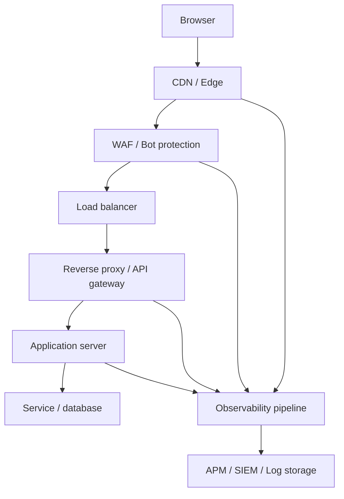

# URL trong log: ngăn rò rỉ dữ liệu nhạy cảm qua access log và telemetry

## 1. Vì sao URL trong log là vấn đề bảo mật?

Khi browser gửi request tới website, URL thường đi qua nhiều thành phần: web server, reverse proxy, load balancer, CDN, Web Application Firewall (WAF), API gateway, hệ thống giám sát và nền tảng phân tích. Nhiều thành phần ghi lại URL để điều tra lỗi, đo hiệu năng hoặc phát hiện tấn công.

URL có thể chứa dữ liệu nhạy cảm trong path hoặc query string: access token, mã đặt lại mật khẩu, mã xác thực một lần, email, số điện thoại, mã đơn hàng, session identifier hoặc chữ ký của signed URL. Nếu hệ thống ghi nguyên URL vào log, dữ liệu đó có thể được sao chép sang SIEM, APM, kho lưu trữ, bản sao lưu và công cụ hỗ trợ.

Một URL chỉ tồn tại trong vài giây vẫn có thể tạo ra bản sao dữ liệu trong nhiều tháng. Người vận hành, nhà cung cấp logging hoặc người có quyền đọc log có thể nhìn thấy credential mà người dùng và ứng dụng tưởng rằng chỉ được gửi tới endpoint.

**URL trong log** là rủi ro khi log ghi lại nhiều dữ liệu hơn mức cần thiết để vận hành. Bài học này hướng dẫn nhận diện nơi URL xuất hiện, thiết kế log an toàn, che dữ liệu nhạy cảm trước khi ghi và xử lý khi URL bí mật đã bị lưu.

Sau bài học, bạn có thể:

- Giải thích những thành phần có thể ghi lại URL của một request.
- Phân biệt request target, query string và fragment.
- Nhận diện token, PII và capability URL có nguy cơ bị lộ.
- Thiết kế structured logging theo allowlist.
- Redact query parameter và path segment trước khi ghi log.
- Cấu hình reverse proxy để tránh ghi raw request line.
- Bảo vệ OAuth callback, password reset link và signed URL.
- Kiểm tra log của CDN, WAF, API gateway, APM và browser telemetry.
- Ứng phó khi secret đã xuất hiện trong log.

## 2. URL gồm những phần nào?

Một URL có thể được mô tả qua các thành phần:

```text
https://app.example.com/orders/123?view=full&email=user@example.com#details
└─┬─┘   └──────┬────────┘ └──┬────┘ └──────────────┬──────────────┘ └──┬──┘
scheme        authority     path                 query              fragment
```

| Thành phần | Ví dụ | Có thể xuất hiện trong HTTP request tới server? |
| --- | --- | --- |
| Scheme | `https` | Không phải phần request-target thông thường; hạ tầng có thể biết từ kết nối hoặc absolute-form request. |
| Authority | `app.example.com` | Có thể xuất hiện trong Host/`:authority` hoặc absolute-form request. |
| Path | `/orders/123` | Có. |
| Query | `?view=full&email=...` | Có. |
| Fragment | `#details` | Không gửi trong HTTP request-target. Browser giữ fragment ở phía client. |

Server thường nhận path và query trong request target. Reverse proxy hoặc CDN có thể ghi URL đầy đủ, host, query hoặc raw request line. Browser history và JavaScript có thể nhìn thấy cả fragment.

### 2.1 Query string thường bị ghi cùng access log

Request:

```http
GET /reset-password?token=ONE_TIME_SECRET&email=person%40example.com HTTP/1.1
Host: app.example.com
```

Một access log ghi request line nguyên vẹn có thể chứa cả token và email. Nhiều web server và proxy mặc định có biến log đại diện cho request URI hoặc request line bao gồm query string.

### 2.2 Fragment không tới server nhưng vẫn có thể bị lộ

Với URL:

```text
https://app.example.com/callback#access_token=SECRET
```

Browser không gửi fragment trong HTTP request tới server. Tuy nhiên, fragment có thể xuất hiện trong:

- Browser history và thanh địa chỉ.
- JavaScript qua `location.href` hoặc `location.hash`.
- Analytics, session replay hoặc error reporting do code frontend ghi lại.
- Screenshot, clipboard, ticket hỗ trợ hoặc nội dung người dùng chia sẻ.

Không đặt token trong fragment chỉ vì server access log không nhận được nó. Script cùng trang vẫn có thể đọc fragment, và một số flow cũ từng đưa token qua fragment.

### 2.3 HTTPS không che URL khỏi hạ tầng của chính ứng dụng

HTTPS mã hóa dữ liệu trên đường truyền giữa các TLS endpoints. Reverse proxy, CDN hoặc server kết thúc TLS vẫn nhìn thấy request target và có thể ghi nó vào log. HTTPS không ngăn log nội bộ, APM hoặc analytics lưu query string.

## 3. Những loại dữ liệu không nên xuất hiện trong URL log

Hãy coi URL là dữ liệu có thể được ghi, chia sẻ và lưu lâu dài. Các nhóm sau cần được loại bỏ hoặc biến đổi trước khi log:

| Dữ liệu | Ví dụ | Tác động nếu lộ |
| --- | --- | --- |
| Access/refresh/ID token | `access_token`, `refresh_token`, `id_token` | Attacker có thể dùng token theo quyền và thời hạn được cấp. |
| Session identifier | `session`, `sid` | Có thể chiếm phiên nếu giá trị còn hiệu lực và có thể replay. |
| Password/reset token | `password`, `reset_token`, `token` | Đặt lại mật khẩu hoặc chiếm tài khoản. |
| OTP/challenge | `otp`, `code`, `state` | Có thể hoàn tất một bước xác thực nếu còn hiệu lực và ngữ cảnh phù hợp. |
| API key/client secret | `api_key`, `client_secret` | Dùng dịch vụ hoặc truy cập API dưới danh tính ứng dụng. |
| Signed URL | `X-Amz-Signature`, `sig`, `signature` | URL có thể là capability cấp quyền tải hoặc ghi tài nguyên. |
| PII | email, phone, địa chỉ, mã khách hàng | Lộ thông tin cá nhân, liên kết hành vi và vi phạm chính sách dữ liệu. |
| Dữ liệu nghiệp vụ | mã đơn, mã hóa đơn, mã hồ sơ | Có thể tiết lộ hoạt động hoặc hỗ trợ dò tìm tài nguyên. |

### 3.1 Không chỉ tham số có tên token mới nhạy cảm

Một giá trị nhạy cảm có thể nằm trong path:

```text
/users/person@example.com/invoices/INV-2026-001
/share/eyJhbGciOi...
/download/private-report?key=...
```

Không thể dựa vào danh sách tên query parameter để che hết dữ liệu. Hãy xác định route có thể chứa dữ liệu cá nhân hoặc capability trong path và log route template thay vì giá trị thực.

### 3.2 Giá trị đã encode vẫn là dữ liệu nhạy cảm

Percent-encoding chỉ thay cách biểu diễn ký tự trong URL, không mã hóa bí mật. Ví dụ `user%40example.com` vẫn là email; Base64URL hoặc URL encoding của token vẫn có thể được giải mã.

Không coi URL encoding, Base64, UUID hoặc chuỗi khó đọc là biện pháp bảo vệ. Nếu một giá trị có thể cấp quyền truy cập, hãy xem nó như credential.

## 4. URL có thể đi qua những log nào?

Không chỉ ứng dụng ghi access log. Một request có thể được ghi ở nhiều lớp:



| Thành phần | Dữ liệu có thể được ghi |
| --- | --- |
| CDN/edge | Host, path, query, cache key, status, origin response. |
| WAF | Request URI, query argument, rule match, mẫu tấn công. |
| Load balancer | Request line, host, path, status, timing. |
| Reverse proxy/API gateway | Original URI, normalized URI, upstream path, query. |
| Web server | Access log, error log, redirect target. |
| Application | URL, route, exception, request object, validation error. |
| APM/distributed tracing | HTTP span URL, query, route, request attributes. |
| Analytics/session replay | Page URL, location, form value hoặc DOM state. |
| Support/debug tooling | URL được copy vào ticket, screenshot hoặc chat. |

Một ứng dụng đã redact log của nó vẫn có thể làm lộ URL ở CDN hoặc APM. Cần kiểm tra toàn bộ đường đi và các bản sao downstream.

## 5. Vì sao log thường ghi thừa dữ liệu?

Logging ban đầu thường được cấu hình để tối ưu việc debug:

- Ghi nguyên request line để biết request nào gây lỗi.
- Ghi URL đầy đủ để phân biệt các truy vấn.
- Ghi mọi request header và body khi trace lỗi.
- Thu thập tự động thuộc tính HTTP trong APM.
- Chuyển log sang bên thứ ba mà không lọc trường nhạy cảm.
- Giữ log lâu hơn vòng đời của credential.

Các lựa chọn này tạo ra rủi ro tích lũy. Một access token có thể hết hạn trong 10 phút nhưng bản log chứa token vẫn còn trong kho lưu trữ, snapshot, export và hệ thống SIEM.

### 5.1 Logging là một bản sao dữ liệu mới

Khi một secret được ghi vào log, nó có thêm:

- Một nơi lưu trữ và một nhóm người có quyền đọc.
- Một chính sách retention và backup riêng.
- Một chuỗi truyền dữ liệu sang collector, APM hoặc SIEM.
- Một bề mặt tìm kiếm/export rộng hơn.
- Một khả năng bị đính kèm vào incident ticket hoặc báo cáo.

Vì vậy, logging cần được thiết kế theo data minimization giống như API và database.

## 6. Rủi ro cụ thể của URL trong log

### 6.1 Credential replay

Nếu log chứa bearer token hoặc session ID còn hiệu lực, người đọc log có thể dùng credential đó để truy cập API. Với signed URL, người sở hữu link có thể tải hoặc ghi đối tượng trong thời hạn và phạm vi đã ký.

### 6.2 Chiếm tài khoản qua reset link

Reset link thường chứa token dùng một lần. Nếu access log hoặc APM ghi URL, người có quyền đọc log có thể dùng link trước chủ tài khoản nếu token chưa hết hạn hoặc chưa được tiêu thụ.

### 6.3 Lộ PII và liên kết hành vi

Email, số điện thoại, search query hoặc mã hồ sơ trong URL giúp người đọc log liên kết hoạt động của một cá nhân giữa nhiều dịch vụ. Kể cả khi không có token, dữ liệu này vẫn có thể nhạy cảm.

### 6.4 Mở rộng phạm vi sự cố

Một lỗi cấu hình ở một endpoint có thể làm lộ dữ liệu qua nhiều nơi: application log, edge log, tracing, alert và ticket hỗ trợ. Khi sự cố xảy ra, cần tìm mọi bản sao chứ không chỉ sửa log format ở ứng dụng.

## 7. Nguyên tắc thiết kế logging an toàn

**Chỉ ghi những trường cần thiết để vận hành và điều tra.** Dùng structured logging với schema rõ ràng thay vì nối chuỗi URL tùy ý.

Một event access log có thể chứa:

| Trường | Ví dụ | Ghi chú |
| --- | --- | --- |
| `timestamp` | thời điểm UTC | Dùng một định dạng nhất quán. |
| `request_id` | ID ngẫu nhiên | Dùng để nối log qua các service. |
| `method` | `GET`, `POST` | Thường không nhạy cảm. |
| `route` | `/orders/:orderId` | Route template, không phải raw path. |
| `status` | `200`, `401`, `500` | Hữu ích cho vận hành. |
| `duration_ms` | `42` | Hữu ích cho hiệu năng. |
| `service` | `orders-api` | Tên service. |
| `auth_result` | `authenticated`, `denied` | Không ghi credential. |
| `subject_ref` | mã giả danh/HMAC | Chỉ khi có nhu cầu và có quản lý khóa. |

Không cần ghi toàn bộ URL để biết endpoint nào chậm. Route template, method, status, duration và request ID thường đủ cho phần lớn điều tra vận hành.

### 7.1 Ưu tiên allowlist thay vì denylist

Denylist cố đoán mọi tên trường nhạy cảm như `token`, `secret`, `password`, `code`, `key`. Attacker hoặc ứng dụng có thể dùng tên khác, viết hoa/thường, alias hoặc nhúng giá trị trong path.

Allowlist chỉ chọn các trường được phép ghi, ví dụ `method`, `route`, `status`, `duration_ms` và `request_id`. Những trường còn lại mặc định không được log. Đây là cách giảm rủi ro bỏ sót dữ liệu mới khi API phát triển.

### 7.2 Log route template, không log raw URL

Thay vì:

```json
{
  "url": "/users/alice@example.com/reset?token=SECRET"
}
```

Ghi:

```json
{
  "route": "/users/:userId/reset",
  "method": "POST",
  "status": 202,
  "request_id": "req_7f31a9"
}
```

Route template cần được lấy từ router đã match, không tự thay chuỗi theo regex đơn giản nếu path có nhiều dạng encoding hoặc route động.

### 7.3 Correlation ID thay cho raw secret

Nếu cần liên kết một request với incident, dùng request ID ngẫu nhiên do hệ thống tin cậy tạo. Không dùng token, session ID hoặc URL có secret làm correlation ID.

Nếu cần đối chiếu một subject trong log, cân nhắc pseudonymous identifier bằng HMAC với khóa quản lý riêng. Hash thường của email hoặc số điện thoại dễ bị dò từ từ điển; HMAC có khóa giúp giảm nguy cơ đó, nhưng giá trị vẫn là dữ liệu có thể liên kết và cần kiểm soát truy cập.

## 8. Redact query string trước khi ghi log

Nếu hệ thống thực sự cần một phần query để điều tra, hãy parse URL bằng thư viện chuẩn, áp dụng allowlist tham số được phép và loại bỏ toàn bộ phần còn lại. Không dùng regex trên raw URL để tìm `token=` vì có thể bỏ sót encoding, chữ hoa/thường, tham số trùng lặp hoặc tên alias.

### 8.1 Allowlist query parameter

Ví dụ một endpoint tìm kiếm chỉ cho phép log `page` và `sort`:

```javascript
function safeQueryForLog(requestUrl) {
  const url = new URL(requestUrl, "https://internal.invalid");
  const safe = new URLSearchParams();

  for (const key of ["page", "sort"]) {
    for (const value of url.searchParams.getAll(key)) {
      safe.append(key, value);
    }
  }

  return safe.toString();
}

console.log(
  safeQueryForLog("/orders?page=2&sort=recent&email=person%40example.com")
);
// page=2&sort=recent
```

Ví dụ này chỉ minh họa một allowlist cố định. Giá trị được phép log vẫn cần validation độ dài, định dạng và cardinality để tránh log injection hoặc dữ liệu quá lớn.

### 8.2 Nếu phải redact theo tên tham số

Trong hệ thống legacy, có thể cần giữ một số query key và che các key nhạy cảm. Khi đó:

- So sánh tên key sau khi parse và normalize theo một quy tắc duy nhất.
- Xử lý tham số trùng lặp, không chỉ lấy giá trị đầu tiên.
- Redact mọi alias đã biết, không phụ thuộc thứ tự query.
- Không log raw URL ở một lớp khác trước khi redaction.
- Kiểm tra nested URL như `redirect_uri` có query riêng.

Ví dụ tên cần loại bỏ có thể gồm `access_token`, `refresh_token`, `id_token`, `token`, `code`, `state`, `session`, `sid`, `password`, `reset_token`, `otp`, `api_key`, `client_secret`, `signature`, `sig` và `X-Amz-Signature`. Danh sách này chỉ là lớp bảo vệ bổ sung; allowlist trường được ghi vẫn đáng tin cậy hơn.

### 8.3 Không hash secret rồi mặc định an toàn

Hash không khóa của một giá trị ít entropy như email, số điện thoại hoặc mã ngắn có thể bị dò. Nếu cần correlation, dùng HMAC với khóa bí mật được quản lý riêng và có kế hoạch rotation. Không log digest của token nếu không có nhu cầu vận hành rõ ràng.

## 9. Structured logging trong ứng dụng Node.js

Ví dụ Express ghi request ID, method, route, status và duration. Middleware không ghi `originalUrl`, query, headers hoặc body:

```javascript
import { randomUUID } from "node:crypto";

app.use((req, res, next) => {
  const startedAt = Date.now();
  const requestId = randomUUID();
  res.setHeader("X-Request-ID", requestId);

  res.on("finish", () => {
    const route = req.route?.path ?? "unmatched";

    logger.info({
      request_id: requestId,
      method: req.method,
      route,
      status: res.statusCode,
      duration_ms: Date.now() - startedAt
    }, "http_request");
  });

  next();
});
```

Đặt middleware ở vị trí phù hợp với router và framework đang dùng. Trong Express, `req.route` chỉ có sau khi route được match; nếu middleware kết thúc response trước router, route có thể là `unmatched`. Có thể ghi route template trong handler hoặc dùng instrumentation hiểu router.

### 9.1 Không log toàn bộ request object

Tránh:

```javascript
// Không an toàn: request object có thể chứa URL, headers và dữ liệu khác.
logger.info({ request: req });
logger.debug("request " + req.method + " " + req.originalUrl);
```

Các middleware debug, serializer hoặc APM có thể tự mở rộng object và ghi nhiều field hơn dự kiến. Hãy tạo object log mới từ các field allowlist.

### 9.2 Redact Authorization và Cookie header

Nếu APM hoặc logger tự động thu thập headers, cấu hình loại bỏ ít nhất:

- `Authorization`
- `Cookie`
- `Set-Cookie`
- `Proxy-Authorization`
- Header API key tùy hệ thống

Không chỉ che `Authorization: Bearer`; cookie session, refresh cookie và custom header cũng có thể là credential.

### 9.3 Không log request body theo mặc định

Body POST có thể chứa password, OTP, thông tin thanh toán hoặc dữ liệu cá nhân. Chỉ log một schema allowlist đã được review, ví dụ `operation_type` và `validation_result`; không ghi toàn bộ body để debug.

## 10. Cấu hình reverse proxy và web server

Redaction phải diễn ra ở từng lớp ghi log. Nếu ứng dụng đã bỏ query nhưng reverse proxy vẫn ghi raw request line, secret vẫn bị lưu.

### 10.1 Nginx

Trong Nginx:

- `$request` là request line và có thể chứa query string.
- `$request_uri` là URI gốc gồm path và query.
- `$args` là query string.
- `$uri` là URI hiện tại đã normalize và không gồm query string.

Tránh log `$request` hoặc `$request_uri` khi query có thể chứa secret. Một log format tối giản:

```nginx
log_format safe_access
  '$time_iso8601 '
  'request_id=$request_id '
  'method=$request_method '
  'uri=$uri '
  'status=$status '
  'request_time=$request_time';

access_log /var/log/nginx/access.log safe_access;
```

`$uri` không chứa query nhưng vẫn có thể chứa email, ID hoặc token trong path. Với route nhạy cảm, chỉ log route template hoặc một route label do upstream cung cấp đã được kiểm soát. Không thay `$request_uri` bằng `$uri` rồi mặc định path đã an toàn.

### 10.2 Apache HTTP Server

Trong Apache, format `%r` ghi request line và có thể chứa query. `%U` ghi URL path; `%q` ghi query string. Nếu không cần query, tránh `%r` và `%q`:

```apache
LogFormat "%t %a %m %U %>s %D" safe
CustomLog logs/access_log safe
```

`%U` vẫn chứa path có thể có PII hoặc capability. Hãy xem xét route mapping hoặc loại trừ endpoint nhạy cảm khỏi log path chi tiết.

### 10.3 API gateway, ingress và load balancer

Kiểm tra cấu hình access log, tracing và error log của từng gateway/ingress. Một số nền tảng tự động ghi full URL hoặc request attributes. Tìm tùy chọn:

- Exclude query string.
- Redact selected query/header fields.
- Log route template thay vì original path.
- Disable request/response body capture cho route nhạy cảm.
- Chỉ bật verbose trace tạm thời, có phê duyệt và thời gian kết thúc.

Không giả định một cấu hình redaction được áp dụng tự động cho mọi log sink hoặc mọi phiên bản agent.

## 11. CDN, WAF, APM và analytics

Các sản phẩm edge và observability có thể ghi URL trước khi request tới ứng dụng. Hãy kiểm tra từng nơi:

| Hệ thống | Cần xem |
| --- | --- |
| CDN | Standard logs, real-time logs, cache key, query forwarding, origin request logs. |
| WAF | Matched variable, request URI, query argument, rule match, sampled request. |
| APM | HTTP span URL, query attributes, exception context, distributed trace. |
| Error monitoring | Breadcrumbs, navigation URL, network request, replay payload. |
| Analytics | Page location, campaign parameter, search term, form capture. |
| Session replay | Address bar, DOM, form field, network payload và custom event. |

### 11.1 Tắt capture nhạy cảm theo route

Đối với `/auth/callback`, `/password/reset`, `/invite/accept` hoặc endpoint có signed link, cấu hình APM/analytics bỏ query, body và header nhạy cảm. Nếu hệ thống không hỗ trợ exclusion đủ chính xác, tắt auto-capture cho route đó và ghi event vận hành tối thiểu riêng.

### 11.2 Kiểm tra data export và bản sao

Log có thể được chuyển sang nhiều workspace, region hoặc vendor. Kiểm tra:

- Collector và pipeline transform.
- Search index, data lake và SIEM.
- Snapshot, backup và export tự động.
- Dashboard, alert và incident ticket.
- Quyền truy cập của support/vendor.
- Retention và cơ chế xóa dữ liệu ở downstream.

Redact sau khi dữ liệu đã tới kho lưu trữ không xóa được các bản sao đã phát sinh trước đó.

## 12. OAuth callback và authorization code trong URL

Authorization Code Flow thường redirect browser về callback với query parameter chứa authorization code và `state`:

```text
https://app.example.com/oauth/callback?code=AUTHORIZATION_CODE&state=OPAQUE_STATE
```

Authorization code ngắn hạn, dùng một lần và được ràng buộc với redirect URI; với public client, PKCE ràng buộc code với `code_verifier`. Những thuộc tính này giảm rủi ro nhưng không làm code trở thành dữ liệu công khai.

Nếu reverse proxy, CDN hoặc APM ghi query string, code và state có thể xuất hiện trong log. Kẻ tấn công có thể thử đổi code nếu lấy được nó trong thời gian còn hiệu lực và thỏa các điều kiện protocol.

### 12.1 Giảm dữ liệu tại callback

- Không log raw URL của callback.
- Redact `code`, `state`, `error_description` và mọi parameter liên quan tới authentication.
- Không tải analytics, pixel, font hoặc script bên thứ ba trên callback page.
- Không ghi URL callback vào error report hoặc session replay.
- Xác minh state và PKCE; không dùng việc che log thay cho kiểm tra protocol.
- Sau khi xử lý callback, redirect sang URL sạch không chứa code/state.

Một redirect sang URL sạch giúp giảm thời gian URL nhạy cảm tồn tại trong browser UI/history hiện tại, nhưng không xóa log đã ghi ở edge hoặc server trước đó.

### 12.2 response_mode=form_post

Một số authorization server hỗ trợ `response_mode=form_post`, gửi authorization response bằng form POST thay vì query string trong top-level redirect. Cách này có thể giảm code xuất hiện trong URL access log, nhưng không tự động loại bỏ logging rủi ro: request body có thể bị application debug logger, WAF hoặc APM capture.

Chỉ dùng khi authorization server/client hỗ trợ và đã kiểm tra tương thích cookie, SameSite, state và callback. Dù dùng response mode nào, không log code, state hoặc token response.

## 13. Password reset và magic link

Reset password, invite acceptance và magic link thường dùng URL như một bearer capability:

```text
https://app.example.com/password/reset?token=ONE_TIME_RESET_SECRET
```

Người có link có thể hoàn thành hành động được cấp nếu token còn hiệu lực. Vì vậy, link phải được bảo vệ như credential.

### 13.1 Thiết kế token reset

- Sinh token ngẫu nhiên có entropy cao bằng CSPRNG.
- Chỉ lưu hash của token ở server nếu thiết kế cho phép.
- Gắn token với đúng user và đúng mục đích.
- Đặt thời hạn ngắn và dùng một lần.
- Invalidate token sau khi sử dụng hoặc khi user yêu cầu token mới.
- Không cho token reset dùng làm access token hoặc session lâu dài.
- Rate limit việc phát hành và sử dụng token.

### 13.2 Giảm khả năng lộ ở trang landing

Khi người dùng mở reset link:

1. Edge và application access log không ghi query chứa token.
2. Trang reset không tải analytics, quảng cáo, chat widget hoặc script bên thứ ba.
3. Response có `Referrer-Policy: no-referrer` để giảm URL được gửi qua Referer.
4. Server xác minh token và tạo một trạng thái reset ngắn hạn, ràng buộc với session/transaction.
5. Redirect sang URL sạch sau khi đã exchange token, nếu flow hỗ trợ.
6. Chỉ tiêu thụ token khi hành động reset hoàn tất và kiểm tra CSRF phù hợp.

Không tiêu thụ token quá sớm khi chỉ mở link nếu hệ thống email scanner hoặc link preview có thể tự truy cập URL. Thiết kế xác nhận hành động và chống replay theo threat model.

### 13.3 history.replaceState chỉ là biện pháp bổ sung

Frontend có thể dùng `history.replaceState` để thay URL hiện tại sau khi server đã exchange token thành một reset transaction an toàn. Điều này giúp giảm token còn hiển thị trong thanh địa chỉ và history entry hiện tại.

Nó không xóa request URL khỏi access log, CDN, WAF, proxy, browser extension hoặc telemetry đã thu thập trước đó. Không dùng thao tác frontend này làm biện pháp duy nhất.

## 14. Signed URL và presigned URL

Signed URL thường chứa chữ ký, expiry và đôi khi có credential identifier trong query. Ai sở hữu URL có thể dùng nó để truy cập object hoặc thực hiện thao tác được ký trong thời hạn cho phép.

Ví dụ minh họa:

```text
https://storage.example.com/private/report.pdf
  ?X-Amz-Expires=300
  &X-Amz-Credential=ACCESS_KEY_ID
  &X-Amz-Signature=SIGNED_CAPABILITY
```

Đây là capability URL. Không ghi nguyên URL vào access log, support ticket, analytics hoặc chat. Không coi chữ ký là dữ liệu vô hại chỉ vì nó được tạo bằng cryptography.

### 14.1 Giới hạn phạm vi signed URL

- Thời hạn ngắn nhất đáp ứng use case.
- Chỉ cấp quyền với đúng object, method và operation.
- Không dùng URL tải xuống để cấp quyền upload hoặc ngược lại.
- Tránh quyền ghi đè object nếu không cần.
- Dùng object key khó đoán nhưng không xem tên khó đoán là authorization.
- Thu hồi bằng cách vô hiệu hóa credential/key hoặc thay đổi quyền object khi hệ thống hỗ trợ.

### 14.2 Không chuyển signed URL qua công cụ hỗ trợ

Nếu cần điều tra lỗi download, log request ID, object reference đã giả danh và status. Không paste signed URL vào issue tracker hoặc chat. Khi cần tái hiện, phát một URL thử nghiệm có scope hẹp và expiry ngắn.

## 15. Path segment cũng có thể làm lộ bí mật

Một số hệ thống đặt identifier trong path vì thiết kế REST:

```text
/users/alice@example.com/profile
/documents/private/opaque-share-capability
/account/recovery/RESET_SECRET
```

Không phải mọi ID trong path đều cần che, nhưng path có thể chứa PII, capability hoặc dữ liệu nghiệp vụ nhạy cảm. Raw path xuất hiện trong proxy log, analytics và tracing giống query string.

### 15.1 Log route template

Thay:

```text
GET /users/alice@example.com/profile
```

Bằng:

```text
GET /users/:userId/profile
```

Nếu cần phân tích một subject, dùng identifier giả danh được thiết kế cho logging thay vì email hoặc token thực.

### 15.2 Không dùng regex thay thế path một cách tùy tiện

Regex như thay mọi chuỗi sau `/users/` có thể làm sai route hoặc bỏ sót encoding. Dùng router metadata, route name hoặc mapping rõ ràng. Nếu chưa có route template, log method/status/request ID và bỏ raw path đối với endpoint nhạy cảm.

## 16. Referrer-Policy và rò rỉ URL sang origin khác

Khi browser điều hướng hoặc tải tài nguyên từ trang hiện tại, `Referer` header có thể gửi thông tin URL của trang nguồn. Theo policy hiện đại thường dùng `strict-origin-when-cross-origin`, request same-origin có thể mang URL đầy đủ, còn cross-origin thường chỉ gửi origin; hành vi cụ thể phụ thuộc policy và loại request.

Một trang có query chứa dữ liệu nhạy cảm có thể làm lộ URL qua Referer nếu policy cho phép gửi path/query trong ngữ cảnh đó. Fragment và userinfo không được đưa vào Referer theo mô hình referrer hiện đại, nhưng vẫn có thể lộ qua browser-side telemetry.

### 16.1 Đặt Referrer-Policy phù hợp

Ví dụ cho trang nhạy cảm:

```http
Referrer-Policy: no-referrer
```

Hoặc nếu ứng dụng cần gửi origin nhưng không muốn gửi path/query cross-origin:

```http
Referrer-Policy: strict-origin
```

Chọn policy theo yêu cầu sản phẩm. `no-referrer` giảm thông tin gửi trong Referer; nó không kiểm soát access log của request tới chính server và không xóa URL khỏi history.

### 16.2 Hạn chế tài nguyên bên thứ ba trên trang nhạy cảm

Trang chứa reset token, invite code hoặc OAuth callback nên tránh tải pixel, analytics, chat widget, quảng cáo và script bên thứ ba. Những thành phần này có thể nhận URL qua navigation context, DOM hoặc code analytics, ngay cả khi browser không gửi full Referer.

## 17. Cache, history và các kênh URL khác

URL nhạy cảm có thể tồn tại ngoài server log:

| Kênh | Cách giảm rủi ro |
| --- | --- |
| Browser history | Không đặt credential trong URL; redirect sang URL sạch sau exchange. |
| Shared proxy/cache | Không cache response nhạy cảm; dùng cache policy phù hợp. |
| Service Worker/Cache Storage | Không lưu URL có secret hoặc token response vào cache. |
| Referrer | Dùng Referrer-Policy và loại bỏ third-party resource trên trang nhạy cảm. |
| Analytics/session replay | Mask URL/query và tắt capture trên route nhạy cảm. |
| Clipboard/ticket/chat | Không copy capability URL vào công cụ hỗ trợ. |
| Browser extension | Giảm dữ liệu nhạy cảm trong URL; không giả định extension đều đáng tin. |

Với response có nội dung nhạy cảm hoặc bước exchange credential, cân nhắc:

```http
Cache-Control: no-store
Pragma: no-cache
Referrer-Policy: no-referrer
```

Các header này bổ sung cho logging controls; chúng không thay thế redaction ở proxy, server và APM.

## 18. Chuẩn hóa URL và log injection

Kẻ tấn công có thể gửi URL được tạo có chủ đích để làm parser hoặc log viewer xử lý sai:

- Tham số trùng lặp như `token=safe&token=secret`.
- Tên tham số có chữ hoa/thường khác nhau.
- Percent-encoding của ký tự phân cách hoặc tên key.
- Nested URL trong `redirect` hoặc `return_to`.
- Unicode và dấu phân cách không chuẩn.
- CR/LF hoặc control character nhằm tạo dòng log giả.

Không parse URL bằng cách split chuỗi đơn giản rồi giả định chỉ có một giá trị cho mỗi key. Dùng parser URL chuẩn, thống nhất cách normalize và quyết định rõ cách xử lý duplicate parameter.

### 18.1 Không tin raw query do client gửi

Nếu log key được phép, chỉ ghi giá trị sau validation:

- Giới hạn chiều dài.
- Giới hạn số lần xuất hiện của key.
- Kiểm tra kiểu và tập giá trị hợp lệ.
- Loại bỏ control character.
- Encode theo định dạng log, ví dụ JSON serializer.

Không nối trực tiếp input người dùng vào một dòng text log. Structured logger cần serialize string đúng cách để CR/LF không tạo entry giả hoặc làm hỏng parser downstream.

### 18.2 Parse một lần, log một representation

Một lớp có thể nhìn thấy URL đã normalize, lớp khác lại ghi raw request target. Nếu nhiều thành phần parse khác nhau, redaction ở một nơi có thể bỏ sót cách biểu diễn khác.

Thiết kế một schema log có route label và request ID; chỉ những trường đã được kiểm tra mới đi vào log. Không truyền raw URL sang logger downstream với kỳ vọng hệ thống sau sẽ tự che.

## 19. Retention, access control và bảo vệ log

Ngay cả log đã giảm dữ liệu vẫn có thể chứa thông tin nhạy cảm. Bảo vệ log theo nguyên tắc least privilege:

- Chỉ nhóm vận hành/security cần thiết được đọc log.
- Dùng SSO, MFA và role-based access.
- Ghi audit event cho thao tác tìm kiếm/export khi hệ thống hỗ trợ.
- Mã hóa dữ liệu khi truyền và khi lưu.
- Tách quyền quản trị logging khỏi quyền đọc dữ liệu nghiệp vụ khi phù hợp.
- Đặt retention theo mục đích vận hành, pháp lý và điều tra.
- Xóa hoặc làm mất khả năng truy cập bản sao khi hết retention, gồm cả downstream theo khả năng nền tảng.

### 19.1 Không giữ log vô thời hạn để tiện debug

Thời gian giữ log cần có lý do cụ thể. Log access thường có thể giữ ngắn hơn audit record cần thiết cho yêu cầu pháp lý. Không trộn log kỹ thuật, audit log và dữ liệu analytics vào một retention policy chung.

### 19.2 Audit log cũng không nên chứa credential

Audit log cần trả lời ai làm gì, khi nào, trên đối tượng nào và kết quả ra sao. Nó không cần ghi password, token, reset link hoặc signed URL. Ghi actor ID, action, target reference đã kiểm soát, request ID và outcome.

## 20. Quy trình ứng phó khi URL secret đã bị log

Nếu phát hiện token hoặc capability URL trong log, coi đó là một credential exposure cho tới khi chứng minh được token không còn hiệu lực.

Quy trình:

1. Xác định loại secret, endpoint, thời gian, môi trường và log sink bị ảnh hưởng.
2. Đánh giá secret còn hiệu lực không, có thể replay không và phạm vi quyền của nó.
3. Thu hồi access/refresh token, session hoặc signed capability nếu hệ thống hỗ trợ.
4. Với reset/magic link, invalidate token và phát link mới cho người dùng qua kênh an toàn.
5. Kiểm tra access log, CDN, WAF, APM, SIEM, export, backup và ticket để xác định phạm vi bản sao.
6. Giới hạn quyền truy cập log liên quan và giữ bằng chứng cần thiết cho điều tra.
7. Cấu hình redaction tại lớp đã ghi lộ, kiểm thử bằng dữ liệu giả rồi mới triển khai rộng.
8. Xác định có request trái phép nào sử dụng credential không; kiểm tra audit trail của resource server.
9. Xử lý các bản sao log theo incident process, retention và yêu cầu bảo toàn chứng cứ.
10. Ghi nhận nguyên nhân gốc và thêm regression test để ngăn tái diễn.

### 20.1 Không chỉ xóa một dòng log rồi kết thúc sự cố

Log có thể đã được replicate, snapshot hoặc export. Việc xóa một entry trong application log không xóa bản sao ở CDN, SIEM hoặc backup. Cần xác định chính xác các bản sao và phối hợp theo chính sách lưu trữ, bảo toàn chứng cứ và xóa dữ liệu.

### 20.2 Nếu không thể revoke ngay

Giảm thời gian rủi ro bằng cách vô hiệu hóa session hoặc key liên quan, hạn chế quyền của principal, chặn route hoặc capability theo khả năng hệ thống, và tăng giám sát request đáng ngờ. Thông báo nhóm incident/security để quyết định hành động phù hợp với mức độ ảnh hưởng.

Không gửi nguyên secret trong incident ticket. Dùng request ID, timestamp, secret type và fingerprint đã được xử lý an toàn.

## 21. Lab: quan sát URL trong access log

Thực hiện trên localhost bằng dữ liệu giả. Không dùng access token, reset link hoặc URL production.

### 21.1 Tạo server thử nghiệm

Tạo file `server.mjs`:

```javascript
import http from "node:http";

const server = http.createServer((req, res) => {
  const url = new URL(req.url, "http://localhost:8080");

  // Cố ý ghi raw URL để quan sát rủi ro trong lab.
  console.log("UNSAFE request:", req.method, req.url);

  // Log an toàn hơn: chỉ route cố định và metadata không nhạy cảm.
  console.log("SAFE event:", JSON.stringify({
    method: req.method,
    route: url.pathname === "/reset-password"
      ? "/reset-password"
      : "/other",
    status: 200
  }));

  res.writeHead(200, { "Content-Type": "text/plain" });
  res.end("Lab response");
});

server.listen(8080, "127.0.0.1", () => {
  console.log("Listening on http://127.0.0.1:8080");
});
```

Chạy:

```bash
node server.mjs
```

### 21.2 Gửi URL có dữ liệu giả

Trong terminal khác:

```bash
curl "http://127.0.0.1:8080/reset-password?token=DEMO_ONLY&email=person%40example.test"
```

Quan sát terminal server. Dòng UNSAFE chứa token giả và email; event SAFE chỉ chứa route đã kiểm soát.

### 21.3 Thử tham số trùng lặp và encoding

```bash
curl "http://127.0.0.1:8080/reset-password?token=first&token=second&Email=person%40example.test"
```

Thảo luận:

- Vì sao chỉ redact key token dạng chữ thường có thể bỏ sót alias hoặc parser behavior?
- Vì sao route template an toàn hơn raw path?
- Vì sao dữ liệu giả vẫn hữu ích để kiểm tra logging pipeline?

### 21.4 Kiểm tra log ở nhiều lớp

Nếu môi trường lab có reverse proxy hoặc APM:

1. Gửi cùng request qua proxy thay vì gọi trực tiếp Node server.
2. Tìm request trong proxy access log.
3. Tìm HTTP span hoặc event trong APM.
4. Kiểm tra query có xuất hiện trong từng log sink không.
5. Thay cấu hình log format để bỏ query.
6. Gửi lại request và xác nhận dữ liệu giả không còn xuất hiện.

## 22. Kiểm thử redaction tự động

Tạo test với giá trị canary giả, ví dụ `DEMO_SECRET_9f3a`, rồi xác nhận chuỗi đó không xuất hiện trong log output.

Một số kiểm tra nên tự động hóa:

- Request chứa query key nhạy cảm không xuất hiện giá trị trong log.
- Request có secret trong path không ghi raw path.
- Authorization/Cookie/Set-Cookie bị redact trong APM.
- Duplicate query parameter không làm lộ giá trị thứ hai.
- URL nested không bị ghi nguyên vẹn.
- CR/LF không tạo log entry giả.
- Route không match vẫn không ghi raw URL.
- Redaction áp dụng trên cả success, 4xx và 5xx/error paths.

### 22.1 Kiểm thử bằng canary secret

Không dùng secret thật để test. Tạo một chuỗi canary không cấp quyền, gửi qua request và tìm trong:

- Application log.
- Reverse proxy log.
- CDN/WAF log.
- APM trace.
- Error report.
- Analytics/session replay.

Kết quả mong đợi là canary chỉ xuất hiện trong test harness hoặc nơi được chủ đích cho phép, không có trong các log production-like đã được kiểm tra.

### 22.2 Test phải bao gồm đường lỗi

Logging thường khác nhau giữa response thành công và exception. Gửi canary trong request tạo 400, 401, 404 và 500 ở môi trường test để chắc rằng error handler, tracing và debug middleware cũng không ghi raw URL.

## 23. Những sai lầm thường gặp

| Sai lầm | Vì sao nguy hiểm | Cách sửa |
| --- | --- | --- |
| Chỉ redact ở application logger | Proxy/CDN/APM đã ghi URL trước đó. | Kiểm tra mọi lớp và log sink. |
| Chỉ lọc key token | Secret có thể nằm ở key alias hoặc path. | Allowlist trường log và log route template. |
| Nghĩ fragment không thể lộ | JavaScript, history và telemetry vẫn đọc được. | Không đặt credential trong fragment. |
| Dùng URL encoding để che secret | Encoding không phải encryption. | Không gửi secret trong URL; redaction trước log. |
| Dùng POST rồi log body | Body có thể chứa password/OTP/PII. | Không log body mặc định; allowlist schema. |
| Bật debug toàn bộ request | Ghi URL, headers, cookies và body. | Debug có thời hạn, redaction và scope hẹp. |
| Dùng Referrer-Policy thay log redaction | Header không ngăn server log request URL của chính nó. | Cấu hình logging tại edge/server/APM. |
| Xóa query nhưng giữ raw path | PII/capability có thể nằm trong path. | Dùng route template. |
| Chỉ kiểm tra access log | Trace, WAF, error report hoặc ticket vẫn chứa URL. | Kiểm tra end-to-end logging pipeline. |
| Xóa log entry mà không revoke token | Credential có thể đã bị sao chép. | Thu hồi/rotate credential và điều tra bản sao. |

## 24. Checklist review URL logging

- [ ] Không có access token, refresh token, ID token hoặc session ID trong URL.
- [ ] Không có password reset, OTP, magic link hoặc invite token trong log.
- [ ] Không ghi nguyên raw request line hoặc full request URL nếu không cần.
- [ ] Query được loại bỏ hoặc chỉ giữ allowlist đã được review.
- [ ] Path nhạy cảm được thay bằng route template.
- [ ] Authorization, Cookie, Set-Cookie và custom API key header được redact.
- [ ] Request body không được log mặc định.
- [ ] CDN, WAF, load balancer, reverse proxy và API gateway đã được kiểm tra.
- [ ] APM, tracing, error reporting, analytics và session replay đã được kiểm tra.
- [ ] OAuth callback và reset landing page không tải script bên thứ ba không cần thiết.
- [ ] Referrer-Policy phù hợp với route nhạy cảm.
- [ ] Token response và response nhạy cảm có cache policy phù hợp.
- [ ] Log được bảo vệ bằng least privilege, audit, encryption và retention.
- [ ] Redaction xử lý duplicate parameter, encoding và control character.
- [ ] Có canary test cho success và error path.
- [ ] Incident process có bước revoke credential và tìm downstream copies.

## 25. Câu hỏi tự kiểm tra

1. Vì sao URL query có thể xuất hiện trong nhiều log dù ứng dụng không tự ghi nó?
2. Path, query và fragment khác nhau thế nào về việc gửi tới server?
3. Vì sao HTTPS không bảo vệ URL khỏi access log tại TLS termination point?
4. Những credential nào thường bị lộ qua URL?
5. Vì sao allowlist log fields an toàn hơn denylist query key?
6. Vì sao route template giúp giảm rò rỉ PII trong path?
7. Nginx `$request`, `$request_uri` và `$uri` khác nhau thế nào?
8. Vì sao POST body cũng cần logging control?
9. OAuth authorization code có thể lộ qua log trong tình huống nào?
10. Vì sao password reset và signed URL phải được coi như bearer capability?
11. Referrer-Policy giảm loại rò rỉ nào và không giải quyết loại nào?
12. Cần làm gì khi phát hiện token đã xuất hiện trong SIEM hoặc APM?

## 26. Tổng kết

URL thường được ghi lại ở nhiều lớp trong hạ tầng web. Query string có thể chứa token, reset code, PII hoặc signed capability; path cũng có thể chứa email, ID hoặc dữ liệu nhạy cảm. Fragment không được gửi trong HTTP request tới server nhưng vẫn có thể lộ qua browser history, JavaScript và telemetry. HTTPS bảo vệ đường truyền, không ngăn TLS endpoint hoặc logging pipeline ghi URL.

Thiết kế logging an toàn bằng structured event và allowlist field. Ưu tiên method, route template, status, duration, request ID và metadata vận hành; tránh raw URL, query, request object, headers và body. Redact ở CDN, WAF, reverse proxy, web server, application, APM và analytics trước khi dữ liệu được lưu hoặc chuyển tiếp. Kiểm tra cả path, duplicate parameter, encoding và log injection.

OAuth callback, password reset link, magic link và signed URL cần được xem như credential/capability. Giảm thời gian tồn tại của URL nhạy cảm, không tải script bên thứ ba không cần thiết, đặt Referrer-Policy và cache header phù hợp, nhưng không dựa vào các header này để thay logging redaction. Nếu secret đã bị log, đánh giá khả năng replay, revoke hoặc rotate credential, tìm downstream copies và bổ sung canary test để ngăn tái diễn.
