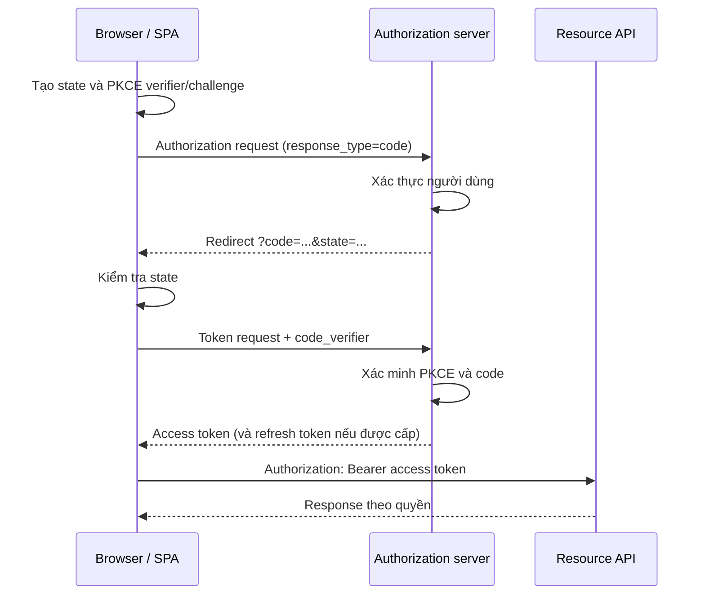

# Fragment chứa token

## Mục tiêu bài học

Sau bài này, bạn có thể:

- Phân biệt URL fragment với path và query, đồng thời giải thích vì sao fragment không được gửi trong HTTP request thông thường.
- Hiểu cách JavaScript đọc fragment và những nơi token trong fragment vẫn có thể bị lộ.
- Phân tích rủi ro của access token hoặc mã xác thực được trả về trong fragment, đặc biệt với OAuth Implicit Flow cũ.
- Chọn Authorization Code Flow với PKCE hoặc Backend for Frontend (BFF) cho ứng dụng browser hiện đại.
- Làm sạch fragment sau khi xử lý mà không nhầm thao tác này với việc thu hồi token đã lộ.
- Kiểm thử rò rỉ token qua browser history, script cùng origin, analytics, redirect và thông điệp giữa các cửa sổ.

## 1. URL fragment là gì?

Một URL có thể có scheme, authority, path, query và fragment:

```text
https://app.example.com/callback?state=abc123#access_token=eyJ...&token_type=Bearer
\________________________/ \____________/ \________________________________________/
          origin                 query                    fragment
```

Fragment là phần bắt đầu bằng ký tự `#`. Trình duyệt thường dùng nó để xác định vị trí trong tài liệu, điều khiển điều hướng nội bộ hoặc truyền trạng thái cho JavaScript của ứng dụng đơn trang (SPA).

Ví dụ:

```text
https://docs.example.com/guide#install
https://app.example.com/#/settings/profile
https://app.example.com/callback#access_token=...
```

Trong ví dụ thứ nhất, `#install` có thể đưa người dùng đến phần tử có ID `install`. Trong ví dụ thứ hai, ứng dụng có thể dùng fragment làm route cho hash-based router. Ví dụ thứ ba minh họa một kiểu trả token cũ từng được dùng trong OAuth Implicit Flow.

Điểm quan trọng về bảo mật là fragment có hành vi khác query string. Khi trình duyệt gửi request HTTP để tải tài liệu, phần fragment không được gửi đến server trong request target. Ví dụ, điều hướng đến:

```text
https://app.example.com/callback#access_token=secret-value
```

thường tạo request:

```http
GET /callback HTTP/1.1
Host: app.example.com
```

Server nhận request không thấy `#access_token=secret-value`. Tuy nhiên, sau khi tài liệu được tải, JavaScript trong trang có thể đọc fragment qua `window.location.hash` hoặc `window.location.href`. Vì vậy, fragment không phải vùng lưu bí mật an toàn.

## 2. Fragment khác query string như thế nào?

| Đặc điểm | Query string | Fragment |
| --- | --- | --- |
| Ký tự bắt đầu | `?` | `#` |
| Được gửi trong HTTP request thông thường | Có | Không |
| Server nhận qua request URL | Có thể đọc từ request target | Không nhận fragment trong request target |
| JavaScript đọc trong trang | `location.search` hoặc `URLSearchParams` | `location.hash` hoặc `URL` API |
| Xuất hiện trong thanh địa chỉ/history | Có | Có |
| Có thể bị script cùng origin đọc | Có | Có |
| Có thể bị analytics hoặc extension trên thiết bị thu thập | Có | Có |
| Xuất hiện trong `Referer` header | Query có thể xuất hiện tùy Referrer-Policy | Fragment không được gửi trong `Referer` |

Fragment giúp tránh đưa giá trị vào request HTTP ban đầu, nhưng không ngăn JavaScript của trang đọc được giá trị. Một ứng dụng có thể vô tình ghi `location.href` hoặc `location.hash` vào analytics, log phía client hay công cụ theo dõi lỗi. Browser extension có quyền đọc trang cũng có thể truy cập URL đang mở.

Query và fragment đều có thể xuất hiện trong browser history, được người dùng sao chép hoặc chụp màn hình. Nếu một URL chứa token được chuyển tiếp qua email, chat hoặc ticket hỗ trợ, người nhận có thể sử dụng token trong thời gian token còn hiệu lực.

## 3. Vì sao token từng được đặt trong fragment?

Trong OAuth 2.0 Implicit Flow cũ, authorization server có thể trả access token trong fragment của redirect URI. Ví dụ:

```text
https://spa.example.com/callback#access_token=AT_VALUE&token_type=Bearer&expires_in=3600&state=RANDOM_STATE
```

Ý tưởng khi đó là browser điều hướng đến SPA, tải callback page mà không gửi access token trong HTTP request đến web server. JavaScript của SPA đọc fragment và sử dụng access token để gọi API.

Ví dụ đọc fragment theo cách cũ:

```js
const params = new URLSearchParams(window.location.hash.slice(1));
const accessToken = params.get("access_token");
const state = params.get("state");
```

Cách này có thể tránh để token xuất hiện trong access log của web server ở request tải callback ban đầu. Nhưng token vẫn hiện trong URL phía browser và có thể bị đọc bởi script chạy trên callback page. Một script analytics, dependency bị xâm nhập hoặc XSS có thể lấy token và gửi ra ngoài.

Implicit Flow không còn là lựa chọn khuyến nghị cho ứng dụng mới. OAuth 2.0 Security Best Current Practice khuyến nghị tránh các response type trả access token trực tiếp trong authorization response; ứng dụng browser nên dùng Authorization Code Flow với PKCE. PKCE ràng buộc authorization code với giao dịch đã khởi tạo, còn code có thời hạn ngắn và chỉ được đổi một lần tại token endpoint.

Không nên tiếp tục dùng fragment chứa access token chỉ vì server không nhìn thấy fragment. Đây là một sự đánh đổi làm giảm một loại log ở server nhưng để token có thể truy cập trực tiếp từ JavaScript và URL trên thiết bị.

## 4. Những nơi token trong fragment có thể bị lộ

### 4.1. JavaScript cùng origin và XSS

Mọi script chạy trong origin của callback page có thể đọc:

```js
window.location.hash
window.location.href
new URL(window.location.href).hash
```

Điều này bao gồm script ứng dụng, thư viện bên thứ ba được nhúng, tag manager và mã độc chạy thông qua XSS. `HttpOnly` cookie không bảo vệ fragment vì fragment không phải cookie; JavaScript vẫn đọc được nó.

Nếu callback page tải nhiều script trước khi xử lý token, bất kỳ script nào bị xâm nhập cũng có thể lấy token. Vì vậy, callback page cần tối giản, tránh analytics và widget không cần thiết, dùng CSP chặt và phòng chống XSS.

### 4.2. Browser history và thanh địa chỉ

Fragment có thể được giữ trong URL đang hiển thị và history entry. Người dùng có thể mở history, sao chép URL, chia sẻ tab hoặc chụp màn hình. Một số công cụ hỗ trợ người dùng và tiện ích mở rộng có thể thu thập URL.

Làm sạch fragment bằng `history.replaceState()` sau khi xử lý giúp xóa token khỏi URL hiện tại và thay thế entry hiện tại trong history. Tuy nhiên, thao tác này không thể bảo đảm xóa mọi bản sao đã được ghi nhận trước đó, không thu hồi token và không ngăn script đã chạy đọc token trước khi cleanup.

### 4.3. Analytics, error tracking và logging phía client

Một số SDK tự động thu thập page URL, route, query hoặc fragment. Các đoạn code sau có thể làm lộ token:

```js
analytics.track("page_view", {
  url: window.location.href
});

console.log("Callback URL:", window.location.href);
```

Ngay cả khi SDK không tự thu thập fragment, ứng dụng có thể gửi URL đầy đủ trong event hoặc error report. Không gửi `location.href`, `location.hash`, authorization code hoặc token thô vào analytics, console log, telemetry và báo cáo lỗi.

### 4.4. Redirect và chuyển giao giữa các cửa sổ

Ứng dụng có thể chuyển fragment sang popup, iframe hoặc một trang khác bằng URL, `postMessage` hay cơ chế điều hướng. Nếu chuyển token đến sai origin hoặc cửa sổ không được xác minh, token có thể bị lộ.

Không dùng `postMessage(message, "*")` để gửi token. Nếu thật sự cần chuyển kết quả xác thực giữa popup và opener, phải dùng `targetOrigin` chính xác, kiểm tra `event.origin`, `event.source`, `state` và schema của message. Ưu tiên chuyển authorization code ngắn hạn hoặc tín hiệu hoàn tất thay vì access/refresh token.

### 4.5. Script và tài nguyên bên thứ ba

Fragment không được đưa vào `Referer` header, nhưng điều đó không làm các script bên thứ ba trở nên an toàn. Script chạy trong document có thể đọc `location.hash` trực tiếp. Một widget được tải từ CDN nhưng chạy trong cùng trang có thể có quyền JavaScript tương tự mã của ứng dụng.

Trên callback page có token trong fragment, hãy tránh tải script, ảnh tracking, pixel, iframe hoặc widget không cần thiết. Dùng CSP để giới hạn nguồn script, nhưng nhớ rằng script hợp lệ từ nguồn được cho phép vẫn có thể đọc fragment.

## 5. Fragment và Referrer-Policy

Theo quy tắc URL/referrer của trình duyệt, fragment không được đưa vào HTTP request URL và không xuất hiện trong `Referer` header. Ví dụ trang nguồn:

```text
https://app.example.com/callback#access_token=secret
```

Khi trang này tải ảnh từ `https://cdn.example.net/logo.png`, request có thể chứa `Referer` theo policy, nhưng giá trị referrer không chứa `#access_token=secret`.

`Referrer-Policy: no-referrer` vẫn hữu ích để ngăn chia sẻ cả origin/path của callback, nhưng nó không phải biện pháp chính để bảo vệ token trong fragment. Nó không ngăn script cùng origin đọc token, browser history giữ URL hoặc analytics tự gửi fragment.

Với callback page, có thể cấu hình:

```http
Referrer-Policy: no-referrer
Cache-Control: no-store
```

Đồng thời không tải tài nguyên bên thứ ba trước khi xử lý callback và không đưa token vào log. `Cache-Control: no-store` giúp ngăn response được lưu trong HTTP cache theo policy, nhưng không xóa URL khỏi history hoặc bộ nhớ của JavaScript.

## 6. OAuth hiện đại: Authorization Code Flow với PKCE

Với SPA, luồng nên dùng là Authorization Code Flow với PKCE. Authorization server trả authorization code cho redirect URI, thường ở query string, thay vì trả access token trực tiếp trong fragment.

Luồng khái quát:

1. Ứng dụng tạo `state`, `nonce` (khi dùng OIDC), `code_verifier` và `code_challenge` bằng cryptographic random generator.
2. Ứng dụng chuyển hướng đến authorization endpoint với `response_type=code`, `state`, `redirect_uri` và `code_challenge`.
3. Người dùng xác thực và cấp quyền tại authorization server.
4. Authorization server redirect về callback với authorization code và `state`.
5. Ứng dụng kiểm tra `state` để xác nhận callback thuộc đúng giao dịch đang chờ.
6. Client hoặc BFF gửi code cùng `code_verifier` đến token endpoint.
7. Authorization server xác minh PKCE, code chưa dùng, redirect URI và các ràng buộc khác rồi phát hành token.
8. Ứng dụng tạo session hoặc giữ access token theo kiến trúc đã chọn.



Authorization code trong query vẫn cần được bảo vệ. Callback nên xử lý code sớm, không tải tài nguyên bên thứ ba, dùng `Referrer-Policy: no-referrer`, tránh ghi URL vào analytics và chuyển đến URL sạch sau khi hoàn tất. PKCE bảo vệ code khỏi việc bị chặn rồi đổi ở client khác; nó không thay thế `state`, kiểm tra redirect URI, XSS protection hoặc xử lý token an toàn.

### 6.1. SPA public client

SPA là public client vì mã JavaScript được gửi đến trình duyệt và không thể giữ client secret. Khi dùng Authorization Code Flow với PKCE, SPA cần:

- Dùng thư viện OIDC/OAuth được duy trì thay vì tự xây dựng giao thức.
- Tạo verifier/challenge và state bằng cryptographic random generator.
- Kiểm tra state ở callback và nonce khi xác minh ID Token OIDC.
- Đổi code tại token endpoint theo CORS policy của IdP.
- Không nhúng client secret vào bundle.
- Giữ access token trong memory nếu phù hợp; đánh giá kỹ mọi cơ chế lưu lâu dài.
- Không lưu refresh token dài hạn trong `localStorage` nếu không có threat model và biện pháp bảo vệ phù hợp.

### 6.2. Backend for Frontend (BFF)

Với BFF, browser nhận session cookie của ứng dụng; BFF xử lý authorization code và giữ access/refresh token phía server. Browser không cần đọc token OAuth. Session cookie nên có `Secure`, `HttpOnly`, `SameSite` phù hợp và endpoint BFF cần chống CSRF.

BFF giảm khả năng JavaScript lấy trực tiếp access/refresh token, nhưng XSS vẫn có thể gọi API BFF bằng session của người dùng. Vì vậy vẫn cần CSP, Trusted Types, output encoding, CSRF protection và authorization server-side.

## 7. Đọc fragment trong ứng dụng legacy

Nếu phải duy trì một ứng dụng cũ đang nhận token trong fragment, cần giới hạn phạm vi và thời gian tồn tại của token. Không nên thêm một parser chung vào mọi trang; chỉ callback route được phép xử lý và phải xử lý càng sớm càng tốt.

Ví dụ parser có allowlist field:

```js
function readLegacyCallbackFragment(fragment = window.location.hash) {
  const raw = fragment.startsWith("#")
    ? fragment.slice(1)
    : fragment;

  const params = new URLSearchParams(raw);
  const allowed = new Set([
    "access_token",
    "token_type",
    "expires_in",
    "state",
    "error",
    "error_description"
  ]);

  for (const key of params.keys()) {
    if (!allowed.has(key)) {
      throw new Error("Unexpected callback parameter.");
    }
    if (params.getAll(key).length > 1) {
      throw new Error("Duplicate callback parameter.");
    }
  }

  return {
    accessToken: params.get("access_token"),
    tokenType: params.get("token_type"),
    expiresIn: params.get("expires_in"),
    state: params.get("state"),
    error: params.get("error")
  };
}
```

Đây chỉ là bước parse, không phải xác minh token. Ứng dụng phải so sánh `state` với giao dịch đăng nhập đang chờ, xử lý lỗi, kiểm tra token theo cơ chế API/IdP và giới hạn quyền, audience, scope cùng thời hạn. Server resource vẫn phải xác minh access token. Không tin claim do client tự parse nếu chưa có bước xác minh chữ ký/issuer/audience ở thành phần có thẩm quyền.

Nếu callback có thể nhận nhiều tham số cùng tên, hãy định nghĩa rõ policy từ chối trường trùng lặp thay vì âm thầm chọn giá trị đầu hoặc cuối. Không đưa `error_description` chưa tin cậy vào `innerHTML` hoặc hiển thị trực tiếp mà không encode.

## 8. Làm sạch fragment sau khi xử lý

Khi callback page khởi chạy, hãy giữ fragment trong biến memory rồi thay URL hiện tại ngay. Sau đó parse và xác minh giá trị đã chụp:

```js
const rawFragment = window.location.hash;

// Thay entry hiện tại trong history, không tạo thêm entry mới.
history.replaceState(
  history.state,
  document.title,
  window.location.pathname + window.location.search
);

const callback = readLegacyCallbackFragment(rawFragment);
validateCallbackState(callback.state);
continueLegacyTokenHandling(callback);
```

Ví dụ giữ lại query string trong URL. Nếu query cũng chứa authorization code hoặc dữ liệu nhạy cảm, hãy làm sạch query theo luồng callback sau khi code đã được xử lý. Không giữ lại các tham số không cần thiết.

Một số lưu ý:

- Gọi cleanup sớm, trước khi tải analytics hoặc script không cần thiết.
- Dùng `replaceState()` để thay entry hiện tại; gán `location.hash = ""` có thể tạo thêm một history entry tùy cách điều hướng.
- `replaceState()` chỉ thay URL entry hiện tại và không thể xóa bản sao đã được script, extension, telemetry hoặc hệ thống khác thu thập.
- Cleanup không thu hồi token. Nếu nghi ngờ token đã lộ, phải revoke hoặc kết thúc grant/session theo khả năng của hệ thống.
- Nếu router sử dụng fragment cho route, đừng xóa route một cách mù quáng. Chuyển sang route sạch sau khi hoàn tất callback và bảo đảm router không xử lý token như một route thông thường.

Trong ứng dụng mới, tốt hơn là không nhận access token trong fragment ngay từ đầu. Cleanup là biện pháp giảm thời gian phơi bày cho hệ thống legacy, không phải lý do để tiếp tục thiết kế token-in-fragment.

## 9. `postMessage`, popup và fragment

Một số ứng dụng mở popup đăng nhập rồi dùng `postMessage` để thông báo cho cửa sổ chính. Không chuyển access/refresh token qua message nếu có thể chuyển authorization code ngắn hạn hoặc chỉ thông báo callback đã hoàn tất để opener tự xác minh trạng thái.

Ví dụ receiver kiểm tra origin và source:

```js
const expectedOrigin = "https://auth.example.com";
const authPopup = window.open(authUrl, "auth", "popup,width=500,height=650");

window.addEventListener("message", (event) => {
  if (event.origin !== expectedOrigin) return;
  if (event.source !== authPopup) return;
  if (!event.data || event.data.type !== "authorization-complete") return;

  validateTransactionState(event.data.state);
  finishAuthorizationFromServer();
});
```

Ví dụ chỉ chuyển thông báo và state của giao dịch, không chuyển token. Trong triển khai thực tế, cần kiểm tra popup chưa bị thay thế, xử lý timeout/đóng popup, xác minh state bằng giao dịch đã lưu và dùng `targetOrigin` chính xác ở phía gửi. `event.origin` cần so khớp chính xác cả scheme, host và port.

Không tin `postMessage` chỉ vì message đến từ một cửa sổ có URL trông giống IdP. Kiểm tra cả `event.source` và origin, đồng thời xác minh giao dịch ở server hoặc client theo giao thức.

## 10. Security headers và thiết kế callback page

Callback page là một trang đặc biệt nhạy cảm vì có thể tạm thời chứa authorization code hoặc token. Nên giảm lượng code chạy trên trang và áp dụng policy chặt.

Ví dụ response:

```http
Cache-Control: no-store
Pragma: no-cache
Referrer-Policy: no-referrer
X-Content-Type-Options: nosniff
Content-Security-Policy: default-src 'none'; script-src 'nonce-abc123BASE64=='; connect-src 'self' https://id.example.com; base-uri 'none'; object-src 'none'; frame-ancestors 'none'; form-action 'self'
```

Đây là cấu hình minh họa; giá trị nonce trong header phải được tạo ngẫu nhiên cho từng response và khớp với thuộc tính `nonce` của script được phép chạy. Điều chỉnh `script-src` và `connect-src` theo callback implementation; ưu tiên nonce/hash cho script cần thiết. Không thêm analytics, quảng cáo hoặc widget chỉ để theo dõi page view trên callback. Nếu callback phải hiển thị trong iframe, đánh giá `frame-ancestors` và clickjacking riêng, không bỏ directive một cách tùy tiện.

Callback page nên:

- Chỉ tải JavaScript cần thiết để xác minh giao dịch và chuyển tiếp kết quả.
- Không tải script bên thứ ba hoặc gửi URL đầy đủ đến analytics.
- Không ghi fragment, code, access token, refresh token hoặc ID token vào console/log.
- Không lưu token vào `localStorage` chỉ để giữ trạng thái qua reload.
- Chuyển người dùng đến URL sạch sau khi callback hoàn tất.
- Xử lý lỗi bằng thông báo tổng quát, không phản chiếu nội dung chưa tin cậy vào HTML.

## 11. Nếu token trong fragment đã bị lộ thì làm gì?

Nếu có bằng chứng token đã được ghi vào analytics, error tracker, log hoặc gửi đến bên thứ ba, hãy xem token là đã bị compromise. Xóa fragment khỏi thanh địa chỉ không làm token cũ mất hiệu lực.

Quy trình phản ứng nên gồm:

1. Xác định loại credential bị lộ: access token, refresh token, authorization code hay dữ liệu không phải credential.
2. Xác định issuer, client, audience, scope, user/session và thời điểm token được phát hành.
3. Thu hồi refresh token/token family hoặc session liên quan qua authorization server/BFF nếu có thể.
4. Với access token đã phát hành, xác định nó còn hiệu lực đến khi nào. Nếu resource server xác minh JWT offline, token có thể còn dùng được đến `exp` trừ khi có denylist/introspection hoặc cơ chế thu hồi bổ sung.
5. Nếu cần, kết thúc session người dùng, yêu cầu đăng nhập lại và đánh giá các hành động đã thực hiện bằng token bị lộ.
6. Xóa hoặc hạn chế quyền truy cập vào log/analytics chứa token; áp dụng quy trình xử lý dữ liệu và retention của tổ chức.
7. Sửa callback để ngừng phát hành token trong fragment, loại bỏ nguồn ghi URL và kiểm thử lại.

Không đưa token thật vào ticket hoặc báo cáo sự cố. Dùng ID giao dịch, timestamp, token fingerprint đã băm theo quy trình nội bộ hoặc thông tin định danh không thể dùng lại để điều tra.

## 12. Kiểm thử fragment token leak

Tạo một callback lab với token giả, ví dụ `demo-token-not-valid`, và hai origin thử nghiệm. Không sử dụng credential thật.

1. Mở callback URL có fragment giả và kiểm tra request tài liệu trong Network. Xác nhận fragment không xuất hiện trong request target gửi đến server.
2. Đọc `location.hash` trong Console để xác nhận JavaScript cùng origin có thể thấy fragment.
3. Tải một tài nguyên cross-origin và kiểm tra `Referer`. Xác nhận fragment không nằm trong header.
4. Thêm một event analytics thử nghiệm ghi `location.href`; quan sát vì sao fragment có thể bị gửi qua payload ứng dụng.
5. Dùng `history.replaceState()` để làm sạch fragment và kiểm tra thanh địa chỉ/history entry hiện tại.
6. Kiểm tra script callback có chạy trước cleanup hay không và loại bỏ các script không cần thiết.
7. Thử `postMessage` từ origin giả và xác nhận receiver từ chối message.
8. Dựng callback Authorization Code + PKCE giả lập; so sánh authorization code trong query với access token trong fragment về nơi có thể bị quan sát.
9. Kiểm tra CSP, `Referrer-Policy: no-referrer`, `Cache-Control: no-store` và log/analytics sau khi callback hoàn tất.

Trong DevTools, Network panel cho thấy request HTTP không mang fragment; Console cho thấy JavaScript có thể đọc fragment; Application/History hoặc thanh địa chỉ cho thấy URL có thể còn hiện diện trong browser. Ba góc nhìn này giúp phân biệt “không gửi đến server trong request ban đầu” với “không thể bị lộ”.

## 13. Những lỗi thường gặp

| Lỗi | Hậu quả | Cách khắc phục |
| --- | --- | --- |
| Nghĩ fragment không gửi lên server nên token an toàn | Script cùng origin, XSS, analytics hoặc extension vẫn có thể đọc token. | Không phát hành access/refresh token trong fragment; dùng Authorization Code + PKCE. |
| Dùng OAuth Implicit Flow cho SPA mới | Access token xuất hiện trực tiếp trong URL phía browser và JavaScript. | Dùng Authorization Code Flow với PKCE. |
| Cho rằng Referrer-Policy che fragment khỏi mọi thành phần | Policy chỉ kiểm soát referrer header, không ngăn JavaScript đọc `location.hash`. | Giảm script callback, không log URL và không đặt token trong fragment. |
| Chỉ xóa fragment bằng `replaceState()` rồi coi token đã bị thu hồi | Token có thể đã bị sao chép và vẫn còn hiệu lực. | Revoke token/session nếu bị lộ; cleanup URL chỉ giảm phơi bày tiếp theo. |
| Ghi `location.href` vào analytics | Fragment chứa token có thể bị gửi đến hệ thống analytics. | Loại bỏ query/fragment khỏi telemetry và dùng allowlist trường. |
| Chuyển token qua `postMessage` với target `*` | Một cửa sổ khác có thể nhận credential. | Dùng origin đích chính xác, kiểm tra source/origin và tránh chuyển token. |
| Tải nhiều script bên thứ ba trên callback | Script có thể đọc fragment trước khi ứng dụng xử lý. | Tối giản callback, CSP chặt và không tải third-party script. |
| Tin access token bị revoke cùng refresh token | Access token đã phát hành có thể còn hợp lệ đến `exp`. | Kiểm tra cơ chế revoke của resource server và thời hạn token. |

## 14. Bài thực hành

Hãy xây dựng hai callback demo: một callback legacy nhận fragment giả và một callback dùng Authorization Code + PKCE trong môi trường sandbox.

1. Tạo URL callback legacy với `#access_token=demo-token-not-valid`.
2. Quan sát request ban đầu, `location.hash`, `document.referrer` và Network panel.
3. Tạo một script analytics giả lập thu thập `location.href`, rồi loại bỏ việc gửi fragment khỏi event.
4. Áp dụng `Referrer-Policy: no-referrer`, CSP tối giản và `Cache-Control: no-store` cho callback.
5. Xử lý state giả lập, gọi `history.replaceState()` và xác nhận URL sạch sau callback.
6. Dùng popup/`postMessage` để gửi tín hiệu hoàn tất không chứa token; thử message từ origin không được phép.
7. Dựng Authorization Code Flow + PKCE ở IdP sandbox và xác minh state, code verifier, redirect URI.
8. So sánh dữ liệu xuất hiện ở browser history, server log, analytics và Network giữa hai flow.
9. Viết quy trình xử lý sự cố cho trường hợp access token hoặc refresh token đã bị thu thập từ fragment.

Hoàn thành bài thực hành khi bạn giải thích được vì sao fragment không xuất hiện trong HTTP request nhưng vẫn có thể bị JavaScript và hệ thống phía client thu thập, phân biệt được luồng Implicit cũ với Code + PKCE, và chứng minh callback không còn ghi hoặc chuyển tiếp credential ngoài thiết kế.
