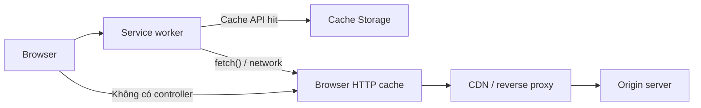
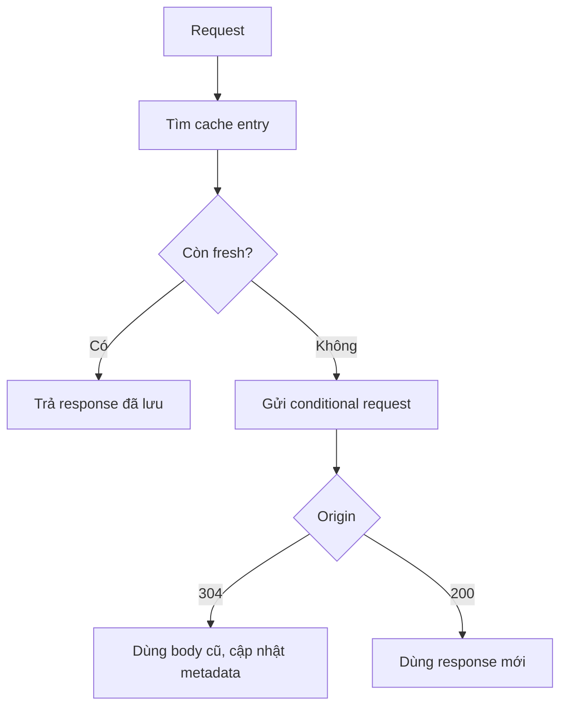
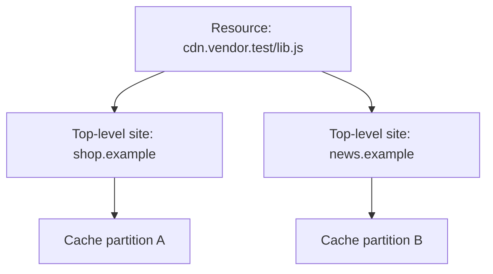

# HTTP cache — cơ chế lưu và tái sử dụng HTTP response

> **Chương:** Browser cache
> **Mục tiêu:** Hiểu cache key, freshness, validation, Cache-Control, validators và rủi ro bảo mật của HTTP cache.

## 1. HTTP cache là gì?

HTTP cache lưu response để tái sử dụng cho request sau. Browser, proxy hoặc CDN có thể giữ response trong một khoảng thời gian và trả lại mà không cần tải lại toàn bộ body từ origin server.

Cache giúp giảm độ trễ, băng thông và tải backend. Cách hoạt động được điều khiển bởi HTTP request/response headers, cache implementation và policy của từng tầng hạ tầng.

Ví dụ:

```http
HTTP/1.1 200 OK
Content-Type: text/css
Cache-Control: public, max-age=3600
ETag: "styles-v8"
```

## 2. Những tầng cache thường gặp



| Tầng | Phạm vi |
| --- | --- |
| Browser HTTP cache | Cache riêng của browser profile/context |
| Shared proxy cache | Nhiều client dùng chung |
| CDN edge cache | Cache tại edge location |
| Service Worker Cache Storage | Dữ liệu do ứng dụng quản lý qua Cache API |

Service Worker Cache Storage khác HTTP cache. Service worker chủ động đọc/ghi Cache Storage; HTTP cache tuân theo HTTP caching semantics. Một response có thể được giữ ở cả hai nơi.

## 3. Cache key

Cache cần xác định request mới có khớp với response đã lưu hay không. Khóa cơ bản thường dựa trên method và target URI; các request header được khai báo trong `Vary` có thể bổ sung yếu tố phân biệt.

Nếu nội dung phụ thuộc `Accept-Encoding`, response có thể khai báo:

```http
Vary: Accept-Encoding
```

Không giả định cache tự đưa mọi request header vào cache key. Nếu representation phụ thuộc một header mà cache không xét tới, response có thể bị dùng nhầm cho request khác.

## 4. Freshness và validation

- **Freshness:** response còn fresh, cache có thể tái sử dụng mà không hỏi origin.
- **Validation:** response đã stale hoặc cần xác nhận; cache hỏi origin xem bản lưu còn hợp lệ không.



## 5. Cache-Control

`Cache-Control` là response header mô tả cách cache được phép lưu và tái sử dụng response.

| Directive | Ý nghĩa |
| --- | --- |
| `max-age=N` | Freshness lifetime tính bằng giây |
| `s-maxage=N` | Freshness cho shared cache; ưu tiên hơn max-age/Expires tại shared cache |
| `public` | Cho phép shared cache lưu trong các trường hợp được HTTP rules cho phép |
| `private` | Chỉ private cache được lưu; shared cache không được lưu |
| `no-cache` | Có thể lưu nhưng phải validate trước khi dùng lại |
| `no-store` | HTTP cache không được lưu response |
| `must-revalidate` | Khi stale phải validate trước khi dùng lại |
| `proxy-revalidate` | Quy tắc tương tự cho shared cache |
| `immutable` | Gợi ý response không đổi trong freshness lifetime |
| `stale-while-revalidate` | Có thể dùng stale trong khi revalidate nền nếu được hỗ trợ |
| `stale-if-error` | Có thể dùng stale khi origin lỗi nếu được hỗ trợ |

Các extension như immutable và stale-while-revalidate cần được kiểm tra theo browser/CDN mục tiêu.

## 6. no-cache và no-store

| Directive | Có được lưu? | Có được dùng mà không hỏi origin? |
| --- | --- | --- |
| `no-cache` | Có thể lưu | Không; cần validation |
| `no-store` | Không được lưu | Không áp dụng |

`no-cache` không có nghĩa là không cache. Nó cho phép giữ body nhưng cần xác nhận trước khi tái sử dụng. `no-store` yêu cầu không lưu response mới; nó không xóa entry cũ hoặc dữ liệu trong Cache Storage.

## 7. max-age và s-maxage

```http
Cache-Control: public, max-age=60, s-maxage=600
```

Trong ví dụ, private browser cache dùng max-age 60 giây; shared cache dùng s-maxage 600 giây. Shared cache áp dụng s-maxage thay cho max-age/Expires khi tính freshness.

`s-maxage` cũng ngụ ý `proxy-revalidate`: shared cache không được dùng response stale sau khi hết hạn nếu chưa validation thành công.

CDN có thể có rule riêng điều chỉnh origin cache headers; cần kiểm tra edge behavior thực tế.

## 8. private và public

`private` phù hợp với response dành riêng cho một user:

```http
Cache-Control: private, max-age=60
```

Browser riêng có thể lưu; shared cache không được lưu.

Không đặt `public` cho response cá nhân hóa. Response chứa dữ liệu theo session, tài khoản hoặc tenant có thể bị phục vụ nhầm user nếu shared cache key/policy không phân biệt đúng.

Request có `Authorization` có giới hạn riêng với shared cache. Chỉ cho phép shared caching khi dữ liệu thực sự có thể chia sẻ và policy đáp ứng HTTP caching rules.

## 9. no-store không xóa mọi dấu vết

`Cache-Control: no-store` yêu cầu HTTP cache không lưu response. Nó không xóa:

- Bản cache đã tồn tại trước đó.
- IndexedDB hoặc localStorage.
- Cache Storage do service worker quản lý.
- Nội dung đã được người dùng lưu bằng cách khác.

Với trang nhạy cảm, kết hợp no-store với session lifecycle, logout/revocation và kiểm tra service worker không chủ động cache response.

## 10. Expires, Date và Age

```http
Date: Sun, 22 Nov 2026 08:00:00 GMT
Expires: Sun, 22 Nov 2026 09:00:00 GMT
Age: 120
```

`Date` là thời điểm tạo response theo HTTP date. `Expires` là thời điểm response hết freshness; max-age/s-maxage thường ưu tiên hơn Expires. `Age` là ước lượng thời gian response đã tồn tại trong cache, không phải thời gian còn lại.

Nếu không có freshness lifetime rõ ràng, một số cache có thể dùng heuristic dựa trên Last-Modified. Hãy đặt Cache-Control rõ ràng cho nội dung quan trọng hoặc cá nhân hóa.

## 11. ETag là gì?

`ETag` là validator định danh một phiên bản representation. Khi cache cần kiểm tra response đã lưu, nó có thể gửi `If-None-Match` với ETag đã nhận:

```http
ETag: "article-v12"
```

Request validation:

```http
GET /article HTTP/1.1
If-None-Match: "article-v12"
```

Nếu representation chưa thay đổi, server trả 304. Browser dùng body đã lưu và cập nhật metadata freshness theo response. Nếu nội dung đã thay đổi, server trả response mới, thường là 200 cùng body và ETag mới.

## 12. Strong ETag và weak ETag

```http
ETag: "asset-v8"
ETag: W/"page-v8"
```

- Strong ETag không có prefix `W/` và đại diện cho representation theo strong validator semantics.
- Weak ETag có prefix `W/`; nó biểu thị nội dung tương đương về mặt ngữ nghĩa theo cách server định nghĩa, không nhất thiết byte-for-byte giống nhau.

Weak validator có thể phù hợp để revalidate HTML khi khác biệt biểu diễn không ảnh hưởng ý nghĩa. Strong validator cần thiết cho một số thao tác yêu cầu so sánh byte chính xác, ví dụ một số tình huống range request/If-Range.

ETag do server định nghĩa, không bắt buộc là cryptographic hash. Giá trị phải thay đổi khi representation cần được xem là phiên bản mới.

## 13. Last-Modified và If-Modified-Since

Server có thể cung cấp thời điểm sửa đổi cuối:

```http
Last-Modified: Sat, 21 Nov 2026 15:30:00 GMT
```

Cache có thể gửi:

```http
If-Modified-Since: Sat, 21 Nov 2026 15:30:00 GMT
```

Nếu resource chưa thay đổi kể từ thời điểm đó, server trả 304. Nếu đã thay đổi, server trả response mới.

Last-Modified dễ triển khai nhưng độ phân giải HTTP date là giây; hai lần cập nhật trong cùng giây có thể khó phân biệt. File timestamp cũng có thể không phản ánh thay đổi của representation được tạo động. Server có thể gửi cả ETag và Last-Modified.

## 14. If-None-Match và If-Modified-Since

Nếu request có cả `If-None-Match` và `If-Modified-Since`, `If-None-Match` được ưu tiên theo thứ tự xử lý conditional request của HTTP. Last-Modified không thay thế kết quả kiểm tra ETag khi điều kiện If-None-Match đã quyết định.

Ví dụ:

```http
GET /app.js HTTP/1.1
If-None-Match: "app-v10"
If-Modified-Since: Sat, 21 Nov 2026 15:30:00 GMT
```

Các node server phải dùng logic validator nhất quán. Nếu cùng một phiên bản trả ETag khác nhau giữa các node, cache có thể revalidate không ổn định.

## 15. 304 Not Modified

`304 Not Modified` báo rằng representation đã lưu có thể được dùng lại. Response 304 không mang body; cache dùng body đã lưu và cập nhật metadata phù hợp.

Các header như `ETag`, `Cache-Control`, `Date` hoặc `Vary` có thể được gửi để cập nhật metadata entry theo quy tắc HTTP.

Server không nên trả 304 nếu không có representation phù hợp hoặc chỉ dựa vào một header không đáng tin. Client không có body đã lưu sẽ không thể dựng nội dung từ response 304.

## 16. Vary: chọn biến thể theo request header

`Vary` cho biết những request header nào ảnh hưởng đến representation. Cache dùng giá trị các header đó khi so khớp entry.

Ví dụ:

```http
Vary: Accept-Encoding
```

Nếu nội dung được nén khác nhau theo `Accept-Encoding`, cache không dùng response br cho client chỉ chấp nhận gzip.

| Vary | Khi nào dùng |
| --- | --- |
| `Accept-Encoding` | Nén response theo encoding |
| `Accept-Language` | Nội dung thực sự thay đổi theo ngôn ngữ request |
| `Origin` | CORS response trả ACAO khác nhau theo Origin |
| `User-Agent` | Chỉ khi representation thực sự khác theo UA và đã đánh giá cache fragmentation |

Không thêm Vary tùy tiện. Quá nhiều biến thể làm cache hit giảm và tăng dung lượng. `Vary: *` khiến response không khớp với request sau theo cách tái sử dụng thông thường.

## 17. Vary: Origin trong CORS

Nếu server chọn ACAO từ allowlist, response cần phân biệt theo request Origin:

```http
Access-Control-Allow-Origin: https://app.example.com
Vary: Origin
```

Nếu cache dùng chung response có ACAO của origin đầu tiên cho origin khác, browser có thể từ chối response; cấu hình cache sai còn có thể gây rò rỉ dữ liệu.

`Vary: Origin` giúp HTTP cache phân biệt biến thể theo Origin. CDN có thể có cache key tùy chỉnh; phải xác minh CDN thực sự tôn trọng Vary hoặc thêm Origin vào cache key.

Vary không thay CORS allowlist. Server vẫn phải kiểm tra origin hợp lệ trước khi trả ACAO.

## 18. Request Cache-Control

Client có thể gửi request directives:

```http
Cache-Control: no-cache
```

Request `no-cache` yêu cầu cache không dùng response đã lưu nếu chưa validation. Request `no-store` yêu cầu không lưu request/response theo HTTP caching rules liên quan.

Request directive không thể bảo đảm mọi tầng proxy/CDN đều bỏ cache nếu tầng đó có policy riêng. Khi debug, xem cả request headers và response headers.

## 19. Fetch Request.cache mode

Fetch API có thuộc tính `cache` để điều khiển tương tác với browser HTTP cache:

```js
const response = await fetch("/api/catalog", {
  cache: "no-cache",
});
```

| Mode | Hành vi khái quát |
| --- | --- |
| `default` | Dùng entry fresh; entry stale có thể được revalidate; nếu không có entry thì fetch network |
| `no-store` | Bỏ qua HTTP cache và không cập nhật HTTP cache từ response |
| `reload` | Bỏ qua entry đang có để lấy từ network, sau đó có thể cập nhật HTTP cache |
| `no-cache` | Revalidate entry trước khi dùng; nếu không có entry thì lấy network |
| `force-cache` | Dùng entry phù hợp kể cả khi stale nếu có; nếu không có thì lấy network |
| `only-if-cached` | Chỉ dùng entry cache; nếu không có entry phù hợp thì trả lỗi gateway tương ứng |

`only-if-cached` chỉ dùng được với request mode `same-origin` theo Fetch API. Các chi tiết vẫn chịu HTTP cache semantics và browser implementation.

Ví dụ:

```js
fetch("/assets/app.js", { cache: "no-cache" });
fetch("/api/private", { cache: "no-store" });
fetch("/offline-catalog", { cache: "force-cache" });
```

Fetch cache mode điều khiển browser HTTP cache. Nó không tự xóa Cache Storage, không buộc CDN purge và không thay đổi cache policy của backend.

## 20. XMLHttpRequest và HTTP cache

XMLHttpRequest không có thuộc tính tương đương trực tiếp với `Request.cache` của Fetch. XHR vẫn chịu HTTP caching semantics và request/response headers.

Ví dụ:

```js
const xhr = new XMLHttpRequest();
xhr.open("GET", "/api/catalog");
xhr.onload = () => console.log(xhr.status, xhr.responseText);
xhr.send();
```

Ứng dụng nên định nghĩa semantics chính bằng response cache policy phía server. Không dựa vào việc tự thêm request header để bảo đảm mọi proxy/CDN đều bỏ cache.

## 21. Chiến lược cache cho static assets

Với asset có tên chứa content hash/version, nội dung URL không thay đổi sau khi phát hành:

```http
Cache-Control: public, max-age=31536000, immutable
```

Ví dụ:

- `app.4f8c2d.js`
- `styles.a18b9e.css`
- `logo.91cd10.svg`

Khi nội dung thay đổi, build tạo URL mới. Chỉ dùng long-lived immutable cache khi URL thực sự versioned/content-addressed. Nếu ghi đè file tại cùng URL, người dùng có thể tiếp tục dùng bản cũ tới khi cache hết fresh hoặc bị invalidated.

## 22. Chiến lược cache cho HTML

HTML thường là entry point tham chiếu tới asset versioned. Nếu HTML cache quá lâu, browser có thể tiếp tục tham chiếu bundle cũ.

Một policy thường gặp:

```http
Cache-Control: no-cache
ETag: "index-v42"
```

Browser có thể lưu HTML nhưng phải revalidate trước khi tái sử dụng. Khi HTML không đổi, server trả 304; khi deploy bản mới, server trả HTML mới chứa asset hash mới.

Nếu HTML chứa dữ liệu cá nhân, cân nhắc `Cache-Control: no-store`.

## 23. Chiến lược cache cho API và dữ liệu cá nhân

API công khai, không cá nhân hóa có thể cache nếu semantics cho phép:

```http
Cache-Control: public, max-age=60, s-maxage=300
```

API trả dữ liệu riêng theo user/session nên dùng policy riêng, ví dụ:

```http
Cache-Control: private, no-store
```

Hoặc `private, no-cache` nếu cần lưu ở private cache nhưng luôn validate trước khi dùng. Đánh giá yêu cầu bảo mật và trải nghiệm trước khi chọn.

Không giả định cookie tự động làm response không cacheable. HTTP cache có quy tắc riêng; response chứa dữ liệu cá nhân cần được đánh dấu rõ để shared cache không phục vụ nhầm user.

`Vary: Cookie` không phải giải pháp mặc định cho dữ liệu cá nhân. Nó có thể tạo số lượng cache variant lớn, dễ cấu hình sai và vẫn không thay authorization. Với dữ liệu nhạy cảm, dùng `private` hoặc `no-store` phù hợp.

## 24. Shared cache, CDN và cache key

CDN có thể cache response ở edge để giảm round trip tới origin. Cần xác định:

- URL/query parameter nào tham gia cache key.
- Header nào được đưa vào cache key.
- Cookie nào được bỏ qua hoặc dùng để phân biệt.
- Request có Authorization có được cache không.
- Cache rule có ghi đè Cache-Control origin không.
- Response 304 và purge được xử lý ra sao.
- Host/proxy headers được normalize và xác minh như thế nào.

Không bật “cache everything” cho toàn bộ website mà không loại trừ route tài khoản, API riêng tư, POST/action và response cá nhân hóa.

| Route | Cache policy gợi ý |
| --- | --- |
| `/assets/*` có content hash | Public, max-age dài, immutable |
| `/` hoặc HTML app shell | No-cache hoặc freshness ngắn + validator |
| `/api/public/*` | Public, max-age ngắn nếu dữ liệu phù hợp |
| `/api/me`, `/account/*` | Private/no-store theo độ nhạy cảm |
| `/login`, `/logout`, `/session/*` | Thường no-store |

Đây là gợi ý thiết kế; cần kiểm tra nội dung response và CDN behavior thực tế.

## 25. Cache partitioning trong browser

Một số browser partition network state/cache theo top-level site để giảm khả năng bên thứ ba dùng cache làm kênh tracking xuyên site.

Ví dụ cùng một CDN resource được nhúng từ hai top-level site có thể không chia sẻ cùng cache partition tùy browser:



Hành vi partitioning phụ thuộc browser, version và loại network state. Không giả định cache hit từ một site sẽ tái sử dụng trên site khác.

Cache partitioning là biện pháp privacy của browser; nó không thay Cache-Control, không thay cache key của CDN và không bảo vệ origin khỏi cache poisoning.

## 26. HTTP cache và Service Worker Cache Storage

Hai cơ chế có API và vòng đời khác nhau:

| HTTP cache | Cache Storage |
| --- | --- |
| Do browser/network stack quản lý theo HTTP semantics | Do ứng dụng thao tác qua Cache API |
| Dựa vào Cache-Control, validators, Vary và freshness | Code chọn lúc put/delete/match |
| Fetch cache mode có thể điều khiển một số hành vi | Không bị xóa chỉ vì Fetch cache mode là no-store |
| Browser có thể tự revalidate | Ứng dụng phải thiết kế versioning/invalidation |

Ví dụ Cache Storage:

```js
const cache = await caches.open("app-shell-v3");
await cache.addAll(["/offline.html", "/assets/app.css"]);
const cachedResponse = await cache.match("/offline.html");
```

Response có `Cache-Control: no-store` không nên được ứng dụng chủ động lưu vào Cache Storage nếu dữ liệu được đánh dấu nhạy cảm. Cache API do code quản lý; không dùng nó để né ý định bảo mật của server.

Khi debug, kiểm tra cả DevTools → Network và Application → Cache Storage. Một response hiển thị “from ServiceWorker” không có nghĩa nó đến từ HTTP cache.

## 27. Cache poisoning

Cache poisoning xảy ra khi attacker khiến cache lưu một response bị thao túng rồi response đó được phục vụ cho request khác.

Một tình huống:

1. Origin phản chiếu header không đáng tin như `X-Forwarded-Host` vào nội dung hoặc redirect.
2. CDN không đưa header đó vào cache key.
3. Attacker gửi request với giá trị header độc hại.
4. CDN lưu response bị ảnh hưởng dưới key dùng chung.
5. Người dùng khác nhận response đã bị đầu độc.

Phòng vệ:

- Chỉ tin proxy header từ reverse proxy được kiểm soát.
- Normalize và validate Host/forwarded headers.
- Đưa mọi input ảnh hưởng representation vào cache key hoặc không cho chúng ảnh hưởng response cacheable.
- Dùng Vary đúng khi representation phụ thuộc request header.
- Không phản chiếu input không tin cậy vào HTML, redirect hoặc header.
- Tách cache key theo host/tenant/locale khi nội dung phụ thuộc các yếu tố đó.
- Kiểm thử cache behavior với nhiều giá trị header/query.

Không chỉ kiểm tra response origin; cần kiểm tra response sau CDN vì cache key và cache rules có thể khác.

## 28. Cache deception

Cache deception xảy ra khi attacker khiến shared cache hiểu nhầm response nhạy cảm là static asset có thể cache.

Ví dụ một ứng dụng trả nội dung tài khoản cho:

```text
/account/profile
/account/profile/style.css
```

Nếu router bỏ qua suffix và vẫn trả profile, nhưng CDN cache mọi URL kết thúc bằng .css, response cá nhân hóa có thể bị lưu dưới cache key có vẻ là static asset.

Phòng vệ:

- Đặt `Cache-Control: private, no-store` cho route nhạy cảm.
- Cấu hình CDN cache theo route/response semantics, không chỉ theo extension.
- Chuẩn hóa đường dẫn và xử lý path suffix nhất quán ở proxy/origin.
- Không để route động trả nội dung riêng tư dưới URL có thể bị cache rule xem là asset.
- Kiểm thử route lạ, suffix, query và encoding path.

## 29. Cache poisoning và cache deception khác nhau

| Tấn công | Cơ chế | Mục tiêu |
| --- | --- | --- |
| Cache poisoning | Thao túng response được lưu vào cache bằng input/header không được key hóa đúng | Phục vụ response độc hại cho request sau |
| Cache deception | Làm cache lưu response nhạy cảm dưới URL bị nhận diện nhầm là static/cacheable | Làm lộ dữ liệu của người dùng |

Cả hai đều có thể xuất hiện khi CDN cache policy không khớp với cách origin định tuyến hoặc tạo nội dung. Cần kiểm tra cache key, route normalization, response headers và rule ở edge.

## 30. Invalidation và deploy

Cache invalidation là việc làm cho bản lưu cũ không còn được tái sử dụng. Một số cách:

- Dùng URL mới khi asset thay đổi (content hashing).
- Purge/invalidate CDN theo URL hoặc tag.
- Revalidate bằng ETag/Last-Modified.
- Giảm freshness lifetime cho HTML entry point.
- Xóa Cache Storage theo version trong service worker.

Không thể dựa vào việc deploy file mới ở origin để đảm bảo mọi cache lập tức bỏ bản cũ. Browser và CDN có thể vẫn giữ response fresh.

`Clear-Site-Data: "cache"` có thể yêu cầu browser xóa cache của origin trên browser hỗ trợ, nhưng không thay thế CDN purge hoặc invalidation của Service Worker Cache Storage. Kiểm tra hỗ trợ và tác động trước khi dùng.

## 31. Ví dụ policy theo loại nội dung

### Static asset có hash

```http
Cache-Control: public, max-age=31536000, immutable
```

### HTML cần nhận deploy mới

```http
Cache-Control: no-cache
ETag: "index-v42"
```

### API công khai thay đổi thường xuyên

```http
Cache-Control: public, max-age=30, s-maxage=120, stale-while-revalidate=30
```

### Response cá nhân hóa

```http
Cache-Control: private, no-store
```

### Response có thể lưu riêng nhưng luôn cần xác nhận lại

```http
Cache-Control: private, no-cache
ETag: W/"account-view-v7"
```

Các giá trị thời gian chỉ là ví dụ. Chọn freshness dựa trên tần suất thay đổi, mức độ nhạy cảm, khả năng stale và yêu cầu của sản phẩm.

## 32. Kiểm thử HTTP cache bằng DevTools

Thực hành trên môi trường lab/staging với dữ liệu giả.

### Bước 1 — Quan sát response headers

Mở DevTools → Network, tải một asset và kiểm tra:

- `Cache-Control`
- `ETag`
- `Last-Modified`
- `Date`
- `Expires`
- `Age`
- `Vary`

Ghi lại status, size và thông tin cache mà browser hiển thị.

### Bước 2 — Kiểm tra freshness

Tải lại resource trong thời gian max-age. Quan sát browser có dùng cache hay gửi request network. Đợi quá freshness lifetime rồi tải lại để kiểm tra revalidation.

### Bước 3 — Kiểm tra ETag và 304

Lần đầu lấy ETag. Gửi request sau với validator qua browser hoặc công cụ test. Xác minh response 304 không có body và browser dùng body đã lưu.

### Bước 4 — So sánh no-cache và no-store

Đặt lần lượt response policy:

- `Cache-Control: no-cache`
- `Cache-Control: no-store`

Quan sát việc browser có lưu entry và có revalidate hay không. Kiểm tra response thực tế thay vì chỉ dựa vào nhãn memory/disk cache.

### Bước 5 — Kiểm tra Vary

Cho endpoint lab trả biến thể theo `Accept-Language` hoặc `Origin`, khai báo Vary tương ứng. Gửi request với hai giá trị khác nhau và kiểm tra cache không dùng nhầm biến thể.

### Bước 6 — Kiểm tra Fetch cache mode

Thử `default`, `no-cache`, `no-store`, `reload`, `force-cache` và `only-if-cached` trong cùng origin. Quan sát request và response; nhớ `only-if-cached` yêu cầu request mode `same-origin`.

### Bước 7 — Phân biệt HTTP cache và Cache Storage

Mở Application → Cache Storage và Network. Xóa cache entry trong lab, reload trang và xem response đến từ service worker hay HTTP cache.

### Bước 8 — Kiểm tra CDN

Trên staging, gọi cùng URL với các Host/Origin/Accept-Encoding/query phù hợp. Kiểm tra `Age`, `Vary`, cache status header của CDN và xác minh cache key không trộn response cá nhân hóa.

Không gửi payload đầu độc vào CDN production hoặc thử cache deception trên dữ liệu người dùng thật.

## 33. Chẩn đoán lỗi thường gặp

| Hiện tượng | Nguyên nhân có thể | Cách xử lý |
| --- | --- | --- |
| Browser không cache response | no-store, method/status hoặc policy không cho cache | Kiểm tra request/response headers và cacheability |
| Browser dùng nội dung cũ | max-age còn hiệu lực hoặc URL asset không đổi | Version hóa URL hoặc revalidate HTML |
| Luôn thấy request 304 | Response no-cache hoặc entry cần revalidate | Xem validator và freshness policy; 304 có thể là hành vi đúng |
| 304 nhưng client không hiển thị nội dung | Client không có body entry tương ứng hoặc cache metadata sai | Kiểm tra cache entry, validator và proxy |
| CDN cache response khác user | Response cá nhân hóa bị public/shared cache hoặc cache key thiếu biến thể | Dùng private/no-store và sửa CDN key/rule |
| CORS lỗi chỉ ở một origin | ACAO thay đổi nhưng cache không vary theo Origin | Thêm Vary: Origin và kiểm tra CDN |
| gzip/br bị dùng nhầm | Thiếu Vary: Accept-Encoding hoặc CDN key sai | Cấu hình Vary/cache key đúng |
| Asset mới vẫn cũ sau deploy | URL không versioned và cache còn fresh | Content hash, purge hoặc giảm freshness |
| API bị cache ngoài ý muốn | CDN rule cache everything hoặc response header thiếu policy | Loại route riêng tư khỏi shared cache |
| Dữ liệu tài khoản xuất hiện ở URL suffix tĩnh | Cache deception do router/CDN không thống nhất | Private/no-store và chuẩn hóa route/cache rule |
| Response độc hại được phục vụ nhiều user | Cache poisoning qua input không nằm trong key | Validate input, Vary/key và purge entry bị ảnh hưởng |
| Xóa HTTP cache nhưng nội dung vẫn còn | Service Worker Cache Storage hoặc CDN vẫn giữ response | Kiểm tra từng tầng cache và invalidation tương ứng |

## 34. Những ngộ nhận thường gặp

| Ngộ nhận | Cách hiểu đúng |
| --- | --- |
| “no-cache nghĩa là không lưu.” | Response có thể được lưu nhưng phải revalidate trước khi dùng lại. |
| “no-store xóa mọi cache.” | Nó ngăn HTTP cache lưu response mới; không xóa entry cũ, CDN hoặc Cache Storage. |
| “Cookie làm response tự động không cacheable.” | Cần policy rõ; response cá nhân hóa nên dùng private/no-store phù hợp. |
| “ETag luôn là hash của file.” | ETag là validator do server định nghĩa, không bắt buộc là cryptographic hash. |
| “304 trả nội dung mới.” | 304 không có body; cache dùng body đã lưu và cập nhật metadata. |
| “Vary tự động thêm mọi header vào cache key.” | Chỉ các header được khai báo trong Vary mới tạo biến thể HTTP theo semantics đó. |
| “Fetch cache: no-store xóa Cache Storage.” | Fetch cache mode điều khiển HTTP cache, không xóa Cache API entries. |
| “CDN luôn tuân thủ origin Cache-Control.” | CDN có thể có rule riêng; cần kiểm tra cấu hình edge. |
| “Browser cache luôn dùng chung giữa mọi website.” | Browser có thể partition cache/network state theo top-level site. |
| “Cache poisoning và cache deception là một.” | Một loại thao túng response; loại kia làm cache lưu nhầm dữ liệu nhạy cảm. |

## 35. Checklist thiết kế HTTP cache an toàn

- Xác định tầng cache nào đang xử lý response: browser, proxy, CDN hay Cache Storage.
- Chọn Cache-Control rõ ràng cho từng nhóm route.
- Dùng URL có content hash và immutable cho static asset bất biến.
- Dùng no-cache/validator cho HTML cần cập nhật theo deploy.
- Dùng private/no-store cho dữ liệu cá nhân hoặc nhạy cảm theo threat model.
- Phân biệt no-cache với no-store.
- Dùng ETag/Last-Modified nhất quán giữa các node.
- Dùng Vary khi representation phụ thuộc request header; kiểm tra CDN có thực sự tôn trọng.
- Không dùng Vary: Cookie như giải pháp mặc định cho dữ liệu cá nhân.
- Xác minh Authorization, Cookie, tenant và Host không làm response riêng tư lọt vào shared cache.
- Kiểm tra cache key, query normalization và forwarded headers.
- Chống cache poisoning bằng validate input và key hóa mọi yếu tố ảnh hưởng response.
- Chống cache deception bằng route normalization và cache rule theo semantics.
- Lập kế hoạch purge/invalidation khi deploy.
- Phân biệt HTTP cache với Service Worker Cache Storage.
- Kiểm thử browser cache partitioning và hành vi browser mục tiêu.
- Kiểm tra Network headers, Age, 304 và CDN cache status trên staging.

## 36. Câu hỏi tự kiểm tra

1. HTTP cache giúp cải thiện hiệu năng và giảm tải như thế nào?
2. Browser HTTP cache khác Service Worker Cache Storage ở điểm nào?
3. Cache key cơ bản dựa trên những yếu tố nào?
4. Freshness khác validation như thế nào?
5. Cache-Control no-cache và no-store khác nhau ra sao?
6. max-age và s-maxage áp dụng cho loại cache nào?
7. private và public ảnh hưởng shared cache như thế nào?
8. Date, Expires và Age mô tả điều gì?
9. ETag và Last-Modified dùng để revalidate ra sao?
10. Strong ETag khác weak ETag thế nào?
11. 304 Not Modified có body không?
12. Vary: Origin giúp tránh lỗi gì với CORS response?
13. Fetch Request.cache có những mode nào và only-if-cached có ràng buộc gì?
14. Vì sao response cá nhân hóa cần private/no-store policy?
15. Cache poisoning khác cache deception ở điểm nào?
16. Cần kiểm tra những gì khi CDN phục vụ nhầm response?

**Ghi nhớ:** HTTP cache lưu và tái sử dụng response dựa trên cache key, freshness, validators và policy của từng tầng. Cache-Control xác định response có thể lưu và dùng lại ra sao; ETag/Last-Modified hỗ trợ revalidation; Vary phân biệt các biến thể theo request header. Hãy dùng cache dài hạn cho asset có content hash, revalidate HTML cần cập nhật và bảo vệ dữ liệu cá nhân bằng private/no-store phù hợp. Kiểm tra CDN cache key, cache partitioning và ranh giới với Service Worker Cache Storage để tránh cache poisoning, cache deception và rò rỉ dữ liệu.
