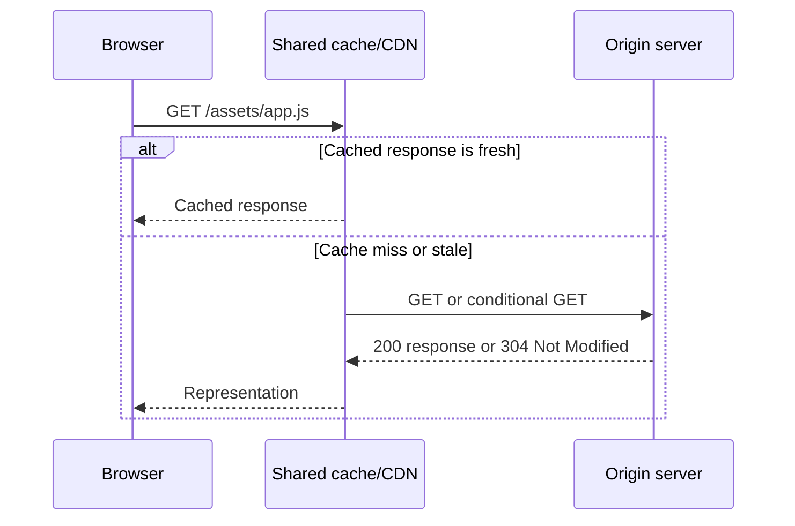

# Cache-Control

> **Chương:** Browser cache  
> **Bài học:** Cache-Control — điều khiển freshness, validation và quyền lưu trữ của HTTP cache  
> **Phạm vi module:** **SECURITY_APPLICATION_SECURITY_BROWSER_SECURITY** — phân tích ranh giới bảo mật giữa trình duyệt, origin, cookie và ứng dụng web để hiểu Same-Origin Policy (SOP), CORS và các cơ chế cách ly; thực hành phòng vệ XSS, CSRF, clickjacking bằng CSP, Trusted Types, security headers và kiểm chứng hành vi thực tế.

## Mục tiêu học tập

Sau bài này, bạn có thể:

1. Mô tả vai trò của HTTP cache trong browser và shared cache như proxy/CDN.
2. Phân biệt freshness, validation và cache storage.
3. Giải thích chính xác `no-cache`, `no-store`, `private`, `public`, `max-age` và `s-maxage`.
4. Thiết kế policy cho HTML, static asset, API public, response cá nhân hóa và dữ liệu nhạy cảm.
5. Dùng `ETag`, `Last-Modified`, conditional request và `304 Not Modified`.
6. Hiểu `Age`, `Date`, `Expires`, `Vary` và cache key.
7. Nhận diện cache poisoning, cache deception và nguy cơ rò rỉ response giữa người dùng.
8. Phân biệt HTTP cache với Cache Storage, service worker và back-forward cache.
9. Kiểm tra cache behavior bằng DevTools, curl và response header.
10. Xây dựng chính sách cache phù hợp với confidentiality, freshness và hiệu năng.

## 1. HTTP cache là gì?

HTTP cache lưu lại response để có thể phục vụ request tiếp theo mà không cần tải lại toàn bộ nội dung từ origin server. Browser có thể dùng bản sao còn fresh, kiểm tra lại bản sao đã stale hoặc tải nội dung mới tùy theo metadata và policy của response.

Cache giúp giảm latency, tiết kiệm băng thông, giảm tải origin và cải thiện trải nghiệm khi mạng chậm. Nhưng cache cũng tạo ra một bản sao dữ liệu ở một vị trí khác. Nếu response chứa dữ liệu cá nhân, thông tin tài khoản hoặc nội dung phụ thuộc vào cookie/session, cấu hình cache sai có thể làm lộ dữ liệu giữa các user hoặc giữ lại thông tin nhạy cảm trên thiết bị.

**`Cache-Control` là HTTP response/request header chính để định nghĩa cách cache lưu trữ và tái sử dụng response.** Đây là một phần của HTTP caching semantics, không phải cơ chế authorization.

### 1.1. Các loại cache thường gặp

| Loại cache | Vị trí | Ví dụ |
|---|---|---|
| Private cache | Riêng cho một user agent | Browser memory/disk HTTP cache |
| Shared cache | Được nhiều user dùng chung | CDN, reverse proxy, forward proxy |
| Application cache | Do ứng dụng chủ động quản lý | Cache Storage API |
| Page snapshot cache | Lưu trạng thái trang để quay lại nhanh | Back-forward cache (bfcache) |

Private cache thường gắn với một browser profile. Shared cache có thể phục vụ nhiều người dùng từ cùng một bản response. Vì vậy, một response an toàn trong private cache chưa chắc an toàn khi được lưu ở CDN.

### 1.2. Luồng cache cơ bản



Nếu response còn fresh, cache có thể trả trực tiếp. Nếu response stale, cache có thể gửi conditional request để hỏi origin xem representation có thay đổi không. Origin có thể trả `304 Not Modified` để cache dùng lại body cũ hoặc `200 OK` với representation mới.

### 1.3. Cache không phải nơi cấp quyền

Cache chỉ quyết định có thể tái sử dụng response nào theo HTTP semantics và cache key. Server vẫn phải xác thực session và authorization cho request cần bảo vệ.

Không dùng việc URL khó đoán, cache hit, cookie tồn tại hoặc response đã nằm trong browser cache làm bằng chứng user có quyền truy cập. Cache key và policy cần được thiết kế sao cho một user không nhận response cá nhân hóa của user khác.

## 2. Freshness, staleness và validation

Ba khái niệm này là nền tảng để đọc đúng `Cache-Control`.

### 2.1. Fresh response

Một response là **fresh** khi tuổi của response chưa vượt quá freshness lifetime mà cache tính được từ metadata. Cache có thể tái sử dụng fresh response mà không hỏi origin, nếu các điều kiện HTTP caching khác đều cho phép.

Ví dụ:

```http
HTTP/1.1 200 OK
Date: Sun, 22 Nov 2026 08:00:00 GMT
Cache-Control: public, max-age=300
Content-Type: application/json
```

`max-age=300` cho biết freshness lifetime là 300 giây. Thời gian thực tế cache còn được phép dùng response phụ thuộc vào `Age`, thời điểm response được tạo và các quy tắc tính current age.

### 2.2. Stale response

Response trở thành **stale** khi current age vượt freshness lifetime. Stale không nhất thiết phải bị xóa ngay. Cache có thể giữ response để revalidate, hoặc có thể dùng stale response trong một số trường hợp được policy cho phép như `stale-while-revalidate` hay `stale-if-error` nếu cache hỗ trợ các extension này.

Nếu không có extension cho phép phục vụ stale và response yêu cầu validation, cache phải tuân thủ các directive như `must-revalidate`.

### 2.3. Validation

Validation là quá trình cache hỏi origin xem bản response đã lưu còn tương đương với representation hiện tại không. Conditional request thường dùng:

- `If-None-Match` với validator `ETag`.
- `If-Modified-Since` với `Last-Modified`.

Nếu chưa thay đổi, origin trả `304 Not Modified` và không cần gửi lại body. Nếu đã thay đổi, origin trả `200 OK` cùng representation mới và metadata tương ứng.

### 2.4. Freshness lifetime được xác định thế nào?

Cache có thể xác định freshness từ:

1. `s-maxage` đối với shared cache.
2. `max-age`.
3. `Expires` kết hợp với `Date`.
4. Heuristic freshness nếu response không cung cấp explicit freshness và điều kiện cho phép.

`s-maxage` có ưu tiên cho shared cache. `max-age` có ưu tiên hơn `Expires`. Không nên dựa vào heuristic freshness cho response nhạy cảm hoặc response cần cập nhật chính xác.

### 2.5. Age và Date

- `Date` cho biết thời điểm origin tạo response theo HTTP date.
- `Age` cho biết ước lượng số giây response đã ở trong cache kể từ khi được tạo hoặc xác nhận lại.

Ví dụ một response có `max-age=600` và `Age: 250` đã tiêu thụ khoảng 250 giây freshness; cache không nên xem nó như mới nhận từ origin với đủ 600 giây còn lại.

Đừng chỉ nhìn `max-age` để kết luận response còn fresh. Kiểm tra cả `Age`, `Date`, request timing và cache đang quan sát.

## 3. Cache-Control directives quan trọng

`Cache-Control` có thể xuất hiện trong request và response. Ý nghĩa của một số directive phụ thuộc vào cache đang xử lý request hay response.

### 3.1. max-age

Trong response, `max-age=N` đặt freshness lifetime tối đa là N giây cho private cache và cũng là cơ sở cho shared cache nếu không bị `s-maxage` ghi đè.

```http
Cache-Control: max-age=300
```

Response có thể được tái sử dụng trong khoảng freshness theo quy tắc current age. `max-age=0` khiến response lập tức stale về mặt freshness, nhưng response vẫn có thể được lưu và revalidate.

### 3.2. s-maxage

`s-maxage=N` áp dụng cho shared cache như CDN hoặc proxy. Nó ghi đè `max-age` và `Expires` đối với shared cache, đồng thời ngụ ý `proxy-revalidate`.

```http
Cache-Control: public, max-age=60, s-maxage=300
```

Ví dụ này cho phép private cache có freshness 60 giây và shared cache dùng freshness 300 giây. Hãy dùng khi representation thực sự an toàn để nhiều user dùng chung.

### 3.3. no-cache

`no-cache` **không có nghĩa là không được lưu**. Nó cho phép cache lưu response nhưng yêu cầu phải kiểm tra lại với origin trước khi tái sử dụng response đã lưu.

```http
Cache-Control: no-cache
```

Directive này hữu ích cho HTML shell hoặc response cần cập nhật theo lần truy cập: browser có thể giữ body và dùng validator để nhận `304`, nhưng không được tự ý dùng lại bản stale mà bỏ qua validation.

### 3.4. no-store

`no-store` yêu cầu cache không lưu request/response hiện tại trong HTTP cache.

```http
Cache-Control: no-store
```

Dùng cho response chứa thông tin nhạy cảm như dữ liệu xác thực, trang recovery, dữ liệu cá nhân cần tránh lưu trong HTTP cache hoặc response có credential tạm thời.

`no-store` không xóa bản sao đã lưu trước đó, không kiểm soát mọi screenshot/download và không bảo vệ khỏi script độc hại hoặc malware trên thiết bị. Nó cũng không tự động xóa dữ liệu do ứng dụng ghi vào Cache Storage.

### 3.5. private và public

- `private`: response dành cho một user; shared cache không được lưu response đó. Private cache như browser vẫn có thể lưu nếu các directive khác cho phép.
- `public`: đánh dấu response có thể được lưu bởi shared cache trong những trường hợp mà mặc định có thể bị hạn chế.

Ví dụ:

```http
Cache-Control: private, max-age=60
```

Browser có thể lưu response trong private cache trong 60 giây, nhưng CDN shared cache không được lưu response này.

```http
Cache-Control: public, max-age=60, s-maxage=300
```

Chỉ dùng `public` khi nội dung giống nhau cho mọi người dùng có cùng cache key và không chứa dữ liệu riêng tư.

### 3.6. must-revalidate và proxy-revalidate

- `must-revalidate`: khi response stale, cache phải revalidate trước khi dùng lại; không được tự ý phục vụ stale chỉ vì origin không sẵn sàng.
- `proxy-revalidate`: yêu cầu tương tự nhưng áp dụng cho shared cache.

Ví dụ:

```http
Cache-Control: public, max-age=60, must-revalidate
```

Không dùng các directive này thay cho `no-store`. Chúng điều khiển việc dùng response stale, không phải cấm lưu response.

### 3.7. immutable

`immutable` báo rằng representation sẽ không thay đổi trong freshness lifetime. Nó phù hợp với asset có URL fingerprint/hash, ví dụ `app.4f82c1.js`.

```http
Cache-Control: public, max-age=31536000, immutable
```

Khi nội dung thay đổi, phát hành URL mới với content hash mới. Không ghi đè nội dung cũ tại cùng URL nếu đang dùng thời hạn cache dài.

### 3.8. stale-while-revalidate và stale-if-error

Hai extension này có thể cho phép cache phục vụ response stale trong một khoảng thời gian có giới hạn:

- `stale-while-revalidate=N`: cache có thể trả response stale trong N giây trong khi revalidate ở nền.
- `stale-if-error=N`: cache có thể dùng response stale khi gặp lỗi phù hợp từ origin trong khoảng cho phép.

Ví dụ:

```http
Cache-Control: public, max-age=60, stale-while-revalidate=30, stale-if-error=300
```

Chỉ dùng cho nội dung mà độ cũ tạm thời có thể chấp nhận, ví dụ tin tức public hoặc catalog không nhạy cảm; cần xác minh cache/CDN triển khai có hỗ trợ extension này. Không áp dụng máy móc cho số dư, trạng thái thanh toán, quyền truy cập hoặc dữ liệu cá nhân.

### 3.9. no-transform

`no-transform` yêu cầu intermediary không tự ý chuyển đổi representation. Nó có thể hữu ích khi nội dung cần giữ nguyên định dạng, nhưng không phải directive về confidentiality hay authorization.

### 3.10. Request directives

Một số directive trong request:

| Request directive | Ý nghĩa |
|---|---|
| `no-cache` | Yêu cầu cache revalidate trước khi dùng response |
| `no-store` | Yêu cầu không lưu request/response liên quan theo directive |
| `max-age=N` | Client không muốn dùng response cũ hơn N giây |
| `min-fresh=N` | Client yêu cầu response còn ít nhất N giây freshness |
| `max-stale[=N]` | Client có thể chấp nhận response stale trong giới hạn chỉ định |
| `only-if-cached` | Chỉ chấp nhận response có sẵn trong cache phù hợp |

Request directive không thể được dùng như cơ chế bảo mật để ép một intermediary độc hại tuân thủ. Server vẫn cần gửi response policy đúng.

## 4. Conditional request và validator

Cache không phải lúc nào cũng cần tải lại body. Nếu response cũ có validator, cache có thể hỏi origin xem representation đã thay đổi chưa.

### 4.1. ETag

`ETag` là validator do server tạo để nhận diện một phiên bản representation.

Ví dụ response:

```http
HTTP/1.1 200 OK
Cache-Control: no-cache
ETag: "profile-v17"
Content-Type: application/json

{"displayName":"Mai"}
```

Khi cache cần revalidate, nó gửi:

```http
GET /api/profile HTTP/1.1
If-None-Match: "profile-v17"
```

Nếu representation chưa thay đổi, server trả:

```http
HTTP/1.1 304 Not Modified
Cache-Control: no-cache
ETag: "profile-v17"
```

Cache dùng lại body đã lưu và cập nhật metadata theo response validation. Nếu representation thay đổi, server trả `200 OK` với body và ETag mới.

### 4.2. Strong và weak ETag

- Strong ETag có dạng `"version-1"` và biểu thị representation tương đương byte-for-byte theo strong comparison.
- Weak ETag có tiền tố `W/`, ví dụ `W/"version-1"`, cho phép nhận diện representation tương đương về mặt ngữ nghĩa dù byte có thể khác.

Ví dụ:

```http
ETag: W/"catalog-v8"
```

Không dùng weak ETag khi client cần xác nhận byte representation giống hệt, chẳng hạn một số trường hợp range request hoặc kiểm tra tính toàn vẹn ở tầng ứng dụng. ETag là validator cache, không mặc nhiên là chữ ký mật mã hay bằng chứng nội dung đến từ nguồn tin cậy.

### 4.3. Last-Modified và If-Modified-Since

Nếu server không có ETag, có thể dùng thời điểm sửa đổi:

```http
HTTP/1.1 200 OK
Last-Modified: Sat, 21 Nov 2026 10:00:00 GMT
Cache-Control: no-cache
```

Cache gửi:

```http
GET /docs/guide.html HTTP/1.1
If-Modified-Since: Sat, 21 Nov 2026 10:00:00 GMT
```

Nếu tài nguyên chưa thay đổi kể từ thời điểm đó, server có thể trả `304 Not Modified`.

`Last-Modified` thường có độ phân giải theo giây và có thể không phân biệt được nhiều lần cập nhật trong cùng một giây. ETag thường chính xác hơn cho representation có thay đổi thường xuyên.

### 4.4. Thứ tự ưu tiên validator

Nếu request có cả `If-None-Match` và `If-Modified-Since`, `If-None-Match` được ưu tiên theo HTTP semantics. Không nên xây dựng logic ứng dụng giả định hai validator luôn phải được so sánh độc lập.

### 4.5. 304 không phải redirect

`304 Not Modified` không trả body mới. Nó chỉ thông báo cache có thể sử dụng representation đã lưu theo điều kiện validation. Browser vẫn hiển thị body từ cache.

Chỉ trả `304` khi request có điều kiện phù hợp và validator match representation hiện tại. Không dùng `304` như response thông thường cho request không có điều kiện validation. Khi nhận `304`, cache/client dùng representation đã lưu tương ứng với validator.

## 5. Vary và cache key

Cache cần biết response nào có thể dùng cho request nào. Cache key thường dựa trên method và target URI, cộng thêm các request header được nêu trong `Vary`.

### 5.1. Vary theo request header

Ví dụ server nén response tùy `Accept-Encoding`:

```http
HTTP/1.1 200 OK
Cache-Control: public, max-age=600
Vary: Accept-Encoding
Content-Encoding: br
```

Cache cần giữ các variant phù hợp với request header `Accept-Encoding`. Nếu bỏ `Vary` trong khi representation thực sự khác nhau theo header, cache có thể trả nhầm variant.

### 5.2. Vary: Origin

Một API có thể phản chiếu một Origin nằm trong allowlist để tạo CORS response. Nếu response được cache dùng chung, cần cân nhắc:

```http
Access-Control-Allow-Origin: https://app.example
Vary: Origin
```

`Vary: Origin` giúp cache phân biệt response theo request Origin. Cấu hình CORS có credentials còn cần allowlist chính xác và `Access-Control-Allow-Credentials: true` khi phù hợp; không dùng wildcard với credentialed response.

`Vary: Origin` không thay authorization và không bảo vệ dữ liệu user-specific nếu cache key còn thiếu yếu tố phân biệt cần thiết.

### 5.3. Vary: Cookie và Authorization

Có thể gặp response khai báo `Vary: Cookie` hoặc `Vary: Authorization`, nhưng không nên xem đó là giải pháp mặc định để cache response cá nhân hóa:

- Cookie có thể chứa nhiều giá trị thay đổi, tạo số lượng variant lớn.
- Một số CDN có cấu hình cache key riêng và có thể bỏ qua hoặc chuẩn hóa header không như mong đợi.
- Việc tách variant không thay thế kiểm tra quyền trên origin.
- Một cấu hình sai có thể làm cache phục vụ response của user trước cho user sau.

Với response phụ thuộc session hoặc user, ưu tiên `private` hoặc `no-store` theo độ nhạy cảm. Nếu có nhu cầu shared caching đặc biệt, phải thiết kế và kiểm thử cache key ở chính CDN/proxy đang triển khai.

### 5.4. Vary: *

`Vary: *` biểu thị response phụ thuộc vào thông tin request không được mô tả đầy đủ bằng các field thông thường. Một stored response có `Vary: *` không thể được coi là match cho request sau theo cách thông thường.

Không dùng `Vary: *` như một cách thay thế cho `Cache-Control: no-store`.

### 5.5. Query string và cache key

Query string là một phần của request target URI và thường tham gia cache key. Tuy nhiên, CDN có thể có rule bỏ qua, sắp xếp, chuẩn hóa hoặc chỉ giữ một số query parameter.

Nếu nội dung phụ thuộc query parameter, xác minh cache key thực tế. Nếu một tham số ảnh hưởng response nhưng bị bỏ khỏi cache key, cache có thể trả response sai hoặc lộ dữ liệu giữa request.

## 6. Response cá nhân hóa, cookie và shared cache

Đây là khu vực cần chú ý nhất khi dùng HTTP cache trong ứng dụng có đăng nhập.

### 6.1. Không mặc định response có Set-Cookie là không thể cache

`Set-Cookie` không tự động làm response trở thành uncacheable theo HTTP caching semantics. Một số shared cache/CDN vẫn có thể lưu response nếu các điều kiện cache cho phép hoặc cấu hình riêng của CDN cho phép.

Vì vậy, không dùng việc response có `Set-Cookie` làm biện pháp bảo vệ dữ liệu. Hãy gửi directive rõ ràng cho response nhạy cảm.

### 6.2. Authorization header và shared cache

HTTP có quy tắc hạn chế shared cache tái sử dụng response cho request mang `Authorization`. Response phải có directive cho phép shared cache một cách rõ ràng, chẳng hạn `public`, `s-maxage` hoặc `must-revalidate`, trước khi shared cache có thể tái sử dụng trong trường hợp được chuẩn cho phép.

Không thêm các directive này cho response chứa dữ liệu riêng tư chỉ để cải thiện hit ratio. Cookie-based authentication không tự động nhận được cùng một bảo vệ theo quy tắc `Authorization`; cần tự đặt cache policy an toàn.

### 6.3. Policy cho API có dữ liệu user

Với endpoint như `/api/me`, `/account`, `/orders` hoặc dữ liệu hồ sơ:

```http
Cache-Control: no-store
Content-Type: application/json
```

Nếu ứng dụng muốn browser private cache giữ representation nhưng phải xác minh lại trước mỗi lần dùng, có thể dùng:

```http
Cache-Control: private, no-cache
ETag: "account-view-v12"
```

Lựa chọn phụ thuộc độ nhạy cảm và khả năng chấp nhận dữ liệu còn trong private cache. Với thông tin nhạy cảm, `no-store` thường là lựa chọn đơn giản và an toàn hơn.

### 6.4. private không có nghĩa là dữ liệu được mã hóa

`private` chỉ ngăn shared cache lưu response. Browser private cache vẫn có thể lưu bản sao nếu policy cho phép. Người có quyền truy cập browser profile hoặc thiết bị có thể có khả năng tiếp cận dữ liệu cache qua môi trường hệ thống hoặc công cụ phù hợp.

Không dùng `private` như cơ chế bảo vệ dữ liệu trước malware, user dùng chung thiết bị hoặc XSS.

### 6.5. Không dựa vào Vary: Cookie để bảo vệ session

`Vary: Cookie` có thể tạo variant theo cookie header, nhưng không thay thế `private` hoặc `no-store`. Cache key có thể bị tùy biến tại CDN, và việc cache mọi cookie variant thường gây tốn tài nguyên, tăng nguy cơ cấu hình sai.

Với response được cá nhân hóa theo session, hãy mặc định không đưa response vào shared cache. Chỉ thiết kế shared caching khi representation thực sự public và có cache key đã được kiểm chứng.

### 6.6. Ví dụ response không an toàn

```http
HTTP/1.1 200 OK
Cache-Control: public, max-age=600
Set-Cookie: session=...
Content-Type: text/html

<h1>Xin chào, Alice</h1>
<p>Đơn hàng của bạn...</p>
```

Nếu CDN lưu response này rồi phục vụ cho request khác, nội dung Alice có thể bị lộ. `Set-Cookie` không phải hàng rào ngăn cache dùng lại body.

Cấu hình phù hợp hơn cho trang này:

```http
Cache-Control: no-store
Content-Type: text/html
```

## 7. Công thức chọn Cache-Control theo loại tài nguyên

Không có một policy phù hợp cho mọi endpoint. Hãy phân loại response theo mức độ công khai, khả năng thay đổi và mức độ nhạy cảm.

### 7.1. Static asset có content hash

Với JavaScript, CSS, font hoặc image có filename chứa content hash:

```http
Cache-Control: public, max-age=31536000, immutable
```

Khi build mới, filename thay đổi theo content hash. HTML tham chiếu tới filename mới để browser tải asset mới, còn asset cũ có thể tiếp tục được cache dài hạn.

Không dùng thời hạn một năm cho asset có URL cố định và nội dung bị ghi đè thường xuyên.

### 7.2. HTML entry point hoặc app shell

HTML thường trỏ tới phiên bản JS/CSS mới. Nếu cache HTML quá lâu, browser có thể nhận HTML cũ và tải nhầm asset hoặc logic không tương thích.

Một lựa chọn phổ biến:

```http
Cache-Control: no-cache
ETag: "index-v42"
```

Browser có thể giữ bản HTML và revalidate trước khi dùng. Nếu HTML chứa dữ liệu cá nhân hoặc phụ thuộc session, cân nhắc `private, no-cache` hoặc `no-store` theo yêu cầu bảo mật.

### 7.3. Public API ít thay đổi

Với dữ liệu public giống nhau cho mọi user:

```http
Cache-Control: public, max-age=30, s-maxage=120, stale-while-revalidate=30
```

Private cache có freshness 30 giây; shared cache có freshness 120 giây. Cache có thể phục vụ stale trong khoảng extension cho phép trong khi revalidate nếu cache/CDN hỗ trợ. Chỉ dùng khi độ cũ tạm thời được nghiệp vụ chấp nhận.

### 7.4. API phụ thuộc tài khoản

Với profile, order, notification hoặc dashboard cá nhân hóa:

```http
Cache-Control: private, no-cache
ETag: "user-view-v7"
```

Cấu hình này cho phép private cache giữ representation nhưng buộc revalidate trước khi dùng lại. Nếu response chứa dữ liệu nhạy cảm hoặc không nên tồn tại trong HTTP cache, dùng `no-store`.

### 7.5. Trang xác thực, recovery và dữ liệu nhạy cảm

Với login, logout, password reset, recovery, thông tin thanh toán hoặc response chứa secret:

```http
Cache-Control: no-store
Referrer-Policy: no-referrer
```

`Cache-Control` kiểm soát HTTP caching. `Referrer-Policy` giảm việc URL nguồn bị gửi trong request tiếp theo. Hai header xử lý hai loại rủi ro khác nhau.

### 7.6. Tóm tắt lựa chọn

| Loại response | Policy gợi ý | Lý do |
|---|---|---|
| Asset có content hash | `public, max-age=31536000, immutable` | URL đổi khi nội dung đổi |
| HTML entry point | `no-cache` | Revalidate để nhận phiên bản mới |
| Public API | `public, max-age=30, s-maxage=120` | Có thể chia sẻ giữa user |
| API cá nhân hóa, cần revalidate | `private, no-cache` | Private cache giữ nhưng phải kiểm tra lại |
| Dữ liệu nhạy cảm | `no-store` | Tránh lưu trong HTTP cache |
| Tài nguyên ít thay đổi, public | `public, max-age=N` | Tái sử dụng trong freshness đã chọn |

Đây là điểm bắt đầu. Cần xác minh policy với CDN, proxy, browser và hành vi thực tế của ứng dụng.

## 8. Cache poisoning và cache deception

Cache sai có thể biến một lỗi routing hoặc header thành sự cố bảo mật ảnh hưởng nhiều user.

### 8.1. Web cache poisoning

Cache poisoning xảy ra khi attacker tác động vào response được cache, trong khi cache key không phân biệt đúng request đã tạo response đó.

Ví dụ một ứng dụng tạo URL tuyệt đối từ header `X-Forwarded-Host` không đáng tin cậy. Attacker gửi header giả, origin tạo response chứa link hoặc script URL độc hại, nhưng CDN cache response theo URL thông thường mà không đưa header này vào cache key. Người dùng khác có thể nhận response bị đầu độc.

Phòng vệ:

- Chỉ tin forwarded header từ proxy được cấu hình tin cậy.
- Không dùng header không được đưa vào cache key để thay đổi nội dung response.
- Chuẩn hóa Host và route tại edge.
- Không phản chiếu input request vào HTML mà không kiểm tra và encode.
- Xác minh cache key và cache rule thực tế tại CDN.
- Purge cache bị ảnh hưởng khi phát hiện poisoning.

### 8.2. Web cache deception

Cache deception xảy ra khi attacker khiến một URL chứa response động hoặc riêng tư bị nhận diện như tài nguyên tĩnh bởi rule cache.

Ví dụ một route hồ sơ xử lý URL có suffix giống file ảnh hoặc CSS. CDN có rule cache mọi URL kết thúc bằng `.css` hoặc `.jpg`, nên có thể lưu response HTML cá nhân hóa.

Phòng vệ:

- Tách route API và static asset rõ ràng.
- Không dùng extension trong URL làm bằng chứng response public.
- Trả đúng `Content-Type`.
- Gửi `private` hoặc `no-store` cho response cá nhân hóa.
- Đảm bảo CDN không override policy origin cho route nhạy cảm.
- Kiểm tra các biến thể path, encoding và suffix trong staging.

### 8.3. Cache key phải khớp với nội dung response

Nếu response phụ thuộc vào một yếu tố mà cache key bỏ qua, cache có thể trả representation sai cho request tiếp theo.

Các yếu tố cần xem xét:

- Host và scheme mà ứng dụng dùng để tạo nội dung.
- Query parameter có ảnh hưởng kết quả.
- Header được dùng cho content negotiation.
- Locale, encoding hoặc định dạng response.
- Origin khi response CORS thay đổi theo Origin.
- Cookie/session nếu response có cá nhân hóa.

Không thêm tất cả header vào cache key một cách máy móc. Chỉ đưa các yếu tố cần thiết vào key và tránh shared-cache response phụ thuộc user.

### 8.4. CDN có thể có rule riêng

Một số CDN có thể override `Cache-Control`, bỏ query parameter, thay đổi cache key hoặc cache response theo rule cấu hình. Vì vậy, response header từ origin chưa đủ để chứng minh CDN đang làm đúng.

Kiểm tra:

- Cache status header do CDN cung cấp.
- Cache key được cấu hình.
- Rule bypass theo path/cookie/header.
- TTL ở edge và browser.
- Purge/invalidation behavior.
- Origin response headers sau khi qua proxy.

## 9. HTTP cache khác Cache Storage và bfcache

Tên gọi đều có chữ cache nhưng cơ chế và quyền điều khiển khác nhau.

### 9.1. HTTP cache

HTTP cache tuân thủ HTTP caching semantics như freshness, validators, `Cache-Control`, `Expires`, `Vary` và conditional request. Browser hoặc intermediary tự quản lý việc lưu và tái sử dụng response.

### 9.2. Cache Storage API

Cache Storage do ứng dụng/service worker chủ động quản lý qua API như `caches.open()`, `cache.put()` và `cache.match()`.

Ứng dụng cần tự quản lý:

- Tên cache và version.
- URL/request được lưu.
- Thời hạn và invalidation.
- Xóa cache cũ.
- Không lưu response cá nhân hóa.
- Cô lập dữ liệu khi logout hoặc đổi tài khoản.

Cache Storage không tự áp dụng đầy đủ freshness/expiry policy của HTTP cache. Đừng giả định response có `Cache-Control: no-store` sẽ tự động xóa hoặc ngăn ứng dụng chủ động ghi một bản sao vào Cache Storage. Hãy kiểm tra logic service worker và code cache của ứng dụng.

### 9.3. Service worker có thể thay đổi đường đi request

Service worker có thể intercept fetch và trả response từ Cache Storage hoặc tự tạo response. Khi debug, request có thể không đi tới network dù HTTP cache chưa phải nguyên nhân.

Trong DevTools, kiểm tra cột Size/Transferred, Service Worker status và Application → Cache Storage. Tạm bypass service worker trong môi trường test để phân biệt lỗi HTTP cache với lỗi routing/cache do worker.

### 9.4. Back-forward cache

Back-forward cache (bfcache) lưu snapshot trạng thái trang để browser khôi phục nhanh khi người dùng back/forward. Nó khác HTTP cache vì có thể giữ trạng thái document và JavaScript runtime thay vì chỉ lưu response.

Không dùng `Cache-Control` như cơ chế duy nhất để quản lý mọi trạng thái được giữ trong browser. Nếu ứng dụng có dữ liệu nhạy cảm, xử lý logout, account switch và sự kiện page lifecycle phù hợp; không giả định xóa HTTP cache sẽ xóa mọi page snapshot hoặc application storage.

## 10. Kiểm tra cache bằng DevTools và command line

Không thể kết luận cache hoạt động đúng chỉ bằng cách đọc source code hoặc response header ở origin. Hãy quan sát request thực tế, cache status và các hop qua CDN/proxy.

### 10.1. Kiểm tra trong browser DevTools

Mở DevTools → Network:

1. Bật hoặc tắt Disable cache để so sánh hành vi khi DevTools đang mở.
2. Tải lại URL và chọn request cần kiểm tra.
3. Xem Request Headers và Response Headers.
4. Kiểm tra `Cache-Control`, `ETag`, `Last-Modified`, `Age`, `Date`, `Expires` và `Vary`.
5. Xem cột Size/Transferred để nhận diện response lấy từ memory cache, disk cache hoặc network khi browser hiển thị thông tin.
6. Thử reload thường, hard reload và điều hướng lại để so sánh.
7. Lặp lại khi service worker đang kiểm soát page và khi bypass service worker.

Lưu ý: Disable cache trong DevTools có thể làm thay đổi hành vi browser cache khi DevTools mở. Đây là công cụ chẩn đoán, không đại diện chính xác cho trải nghiệm người dùng bình thường.

### 10.2. Kiểm tra bằng curl

Lấy response header:

```bash
curl -sS -D - -o /dev/null https://app.example/assets/app.4f82c1.js
```

Gửi conditional request với ETag:

```bash
curl -sS -D - -o /dev/null \
  -H 'If-None-Match: "app-v42"' \
  https://app.example/assets/app.js
```

Kiểm tra shared cache qua CDN có thể cần gửi request lặp lại và xem các header do CDN cung cấp, ví dụ cache status hoặc Age. Tên header chẩn đoán phụ thuộc nhà cung cấp.

Không đưa cookie/session/token thật vào command line hoặc shell history. Dùng tài khoản và credential test, đồng thời redact output trước khi chia sẻ.

### 10.3. Phân biệt cache hit, revalidation và miss

| Quan sát | Ý nghĩa có thể có |
|---|---|
| Response được lấy từ memory/disk cache | Browser dùng bản đã lưu |
| `304 Not Modified` | Cache revalidate thành công và dùng lại body cũ |
| `200 OK` sau conditional request | Representation mới hoặc validator không còn khớp |
| `Age` tăng khi request qua CDN | Response có thể đang được phục vụ từ shared cache |
| CDN báo MISS rồi HIT | Request đầu lấy từ origin, request sau dùng cache edge |
| Service Worker response | Worker có thể trả response từ Cache Storage hoặc logic riêng |

Một header đơn lẻ không chứng minh toàn bộ chuỗi cache. Kiểm tra cả browser, service worker, CDN và origin.

## 11. Các nguyên tắc triển khai an toàn

### 11.1. Bắt đầu từ phân loại dữ liệu

Trước khi đặt TTL, xác định response có phải public, phụ thuộc user, chứa PII, credential hay dữ liệu giao dịch không. Độ nhạy cảm quyết định cache có được lưu hay không; độ mới quyết định thời gian freshness.

### 11.2. Đặt policy ở nơi tạo response

Origin nên trả cache policy đúng theo route và nội dung. CDN cần được cấu hình để tôn trọng hoặc override policy có chủ đích, có review và có test. Không giả định policy ở origin tự động thắng mọi rule edge.

### 11.3. Tránh cache chung response phụ thuộc session

Không dùng shared cache cho response cá nhân hóa trừ khi có thiết kế cache key và authorization đặc biệt được kiểm chứng. Với phần lớn ứng dụng web, dùng `private` hoặc `no-store` cho response phụ thuộc cookie/session là lựa chọn an toàn hơn.

### 11.4. Không dùng cache để che lỗi authorization

Nếu endpoint trả dữ liệu cho user không có quyền, sửa authorization ở origin. Đặt `no-store` không sửa được việc server đã trả nhầm dữ liệu; cache policy chỉ giảm nơi lưu và tái sử dụng response.

### 11.5. Invalidate và deploy có kế hoạch

Khi thay đổi nội dung hoặc phát hiện response bị cache sai:

- Dùng URL version/hash mới cho static asset.
- Revalidate HTML hoặc API có validator.
- Purge CDN theo đúng URL/key khi cần.
- Xác minh các POP/edge đã cập nhật.
- Kiểm tra browser cache của client.
- Không dựa vào việc deploy server mới để xóa mọi bản cache đã phát hành.

### 11.6. Không giả định no-store xóa cache cũ

Nếu trước đó response đã được cache với policy cho phép lưu, thay response hiện tại thành `no-store` không tự động xóa bản cũ trong mọi cache. Cần invalidation/purge hoặc thay đổi URL và kiểm thử luồng chuyển tiếp phù hợp.

## 12. Ví dụ policy theo kiến trúc ứng dụng

### 12.1. Static frontend với filename fingerprint

```http
# app.4f82c1.js
Cache-Control: public, max-age=31536000, immutable

# index.html
Cache-Control: no-cache
```

HTML được revalidate để nhận manifest asset mới; asset fingerprint có thể cache dài hạn.

### 12.2. API public có CDN

```http
HTTP/1.1 200 OK
Cache-Control: public, max-age=30, s-maxage=120, stale-while-revalidate=30
Vary: Accept-Encoding
Content-Type: application/json
```

Chỉ dùng khi response không phụ thuộc session, cookie hoặc dữ liệu riêng tư. Nếu response thay đổi theo locale hoặc format, bổ sung đúng yếu tố vào Vary/cache key và kiểm tra CDN.

### 12.3. API profile

```http
HTTP/1.1 200 OK
Cache-Control: private, no-cache
ETag: "profile-v17"
Vary: Accept-Encoding
Content-Type: application/json
```

Browser có thể giữ response private nhưng phải revalidate. Nếu dữ liệu nhạy cảm hoặc không muốn lưu trên thiết bị, dùng `Cache-Control: no-store`.

### 12.4. Login và password recovery

```http
HTTP/1.1 200 OK
Cache-Control: no-store
Referrer-Policy: no-referrer
Content-Type: text/html; charset=utf-8
```

Không cache form chứa token recovery hoặc nội dung xác thực. Đồng thời không tải third-party analytics trên trang đang xử lý token.

## 13. Những nhầm lẫn cần tránh

### 13.1. no-cache không có nghĩa no-store

`no-cache` cho phép lưu nhưng yêu cầu revalidate trước khi tái sử dụng. `no-store` yêu cầu HTTP cache không lưu response.

### 13.2. max-age=0 không giống no-store

`max-age=0` khiến response stale ngay, nhưng vẫn có thể được lưu và revalidate. Dùng `no-store` khi mục tiêu là không lưu trong HTTP cache.

### 13.3. private không có nghĩa chỉ người dùng được phép mới đọc

`private` ngăn shared cache lưu response. Nó không xác thực user và không bảo vệ dữ liệu trước XSS, malware hoặc người có quyền truy cập browser profile.

### 13.4. Set-Cookie không tự cấm cache

Không dùng sự hiện diện của `Set-Cookie` để suy ra response sẽ không được cache. Gửi directive phù hợp và kiểm tra CDN.

### 13.5. CORS không kiểm soát việc cache có lưu response hay không

CORS kiểm soát khả năng JavaScript đọc response cross-origin. HTTP cache có quy tắc riêng. Khi response CORS thay đổi theo Origin, dùng `Vary: Origin` phù hợp và bảo đảm cache key đúng.

### 13.6. no-store không xóa Cache Storage

Cache Storage do ứng dụng quản lý. Service worker có thể chủ động lưu response; cần kiểm tra và xóa dữ liệu do application cache quản lý theo logic riêng.

### 13.7. Reload không nhất thiết luôn tải mọi thứ từ origin

Browser có thể dùng cache, gửi conditional request hoặc chịu ảnh hưởng service worker. Hard reload và Disable cache là công cụ debug, không phải hành vi của mọi navigation thông thường.

## 14. Thực hành A — Quan sát freshness và max-age

Dùng một endpoint public trong staging hoặc local server.

1. Trả response với `Cache-Control: public, max-age=60`.
2. Tải endpoint lần đầu và ghi nhận `Date`, `Age` nếu có, cùng trạng thái network.
3. Tải lại ngay trong cùng browser profile.
4. Quan sát response có được dùng từ cache không.
5. Chờ quá freshness lifetime hoặc thay đổi request theo cách phù hợp.
6. Tải lại và quan sát cache revalidate hoặc lấy response mới.
7. Thay `max-age=60` bằng `max-age=0` rồi so sánh.

Kết quả mong đợi: hiểu rằng max-age điều khiển freshness; max-age=0 vẫn có thể cho phép lưu và revalidate.

## 15. Thực hành B — Kiểm tra ETag và 304

1. Tạo endpoint trả JSON cùng ETag cố định khi nội dung chưa đổi.
2. Đặt `Cache-Control: no-cache`.
3. Tải lần đầu để nhận `200 OK`, body và ETag.
4. Tải lại và quan sát browser gửi `If-None-Match`.
5. Cho server trả `304 Not Modified` khi ETag khớp.
6. Thay nội dung và ETag.
7. Tải lại để xác minh server trả `200 OK` với representation mới.

Kết quả mong đợi: cache giữ body cũ và chỉ cần metadata validation khi representation chưa thay đổi.

## 16. Thực hành C — Phân biệt private, public và no-store

Dùng hai browser profile hoặc hai tài khoản test và CDN staging nếu có.

1. Tạo endpoint public giống nhau cho mọi user với `public, max-age=60`.
2. Tạo endpoint cá nhân hóa với `private, no-cache`.
3. Tạo endpoint dữ liệu nhạy cảm với `no-store`.
4. Gọi các endpoint qua hai profile/tài khoản.
5. Kiểm tra browser cache và shared cache status.
6. Xác minh response user A không được CDN phục vụ cho user B.
7. Thử thêm `Set-Cookie` vào response test và xác minh nó không tự ngăn cache nếu policy vẫn cho phép.
8. Kiểm tra CDN có override Cache-Control hoặc thay đổi cache key không.

Kết quả mong đợi: phân biệt được cache private/shared và xác minh dữ liệu cá nhân không bị chia sẻ qua edge.

## 17. Thực hành D — Kiểm tra Cache Storage và cache poisoning/deception

Trong staging do bạn kiểm soát:

1. Kiểm tra service worker có intercept route API hoặc response cá nhân hóa không.
2. Mở Application → Cache Storage và xem các cache đang lưu.
3. Xác minh response có `no-store` không bị code ứng dụng chủ động lưu ngoài ý muốn.
4. Kiểm tra cache key có tính tới query parameter ảnh hưởng nội dung không.
5. Thử một route động có suffix giống static asset và xác minh CDN không cache nhầm.
6. Thử header không tin cậy có thể tác động nội dung response và kiểm tra cache key.
7. Xóa cache test, logout/đổi tài khoản và xác minh dữ liệu user trước không còn được hiển thị.
8. Ghi lại policy, cache status và kết quả test.

Không thực hiện cache poisoning hoặc tải dữ liệu của user khác trên hệ thống production. Dùng payload giả và môi trường staging.

## 18. Checklist review Cache-Control

| Hạng mục | Câu hỏi cần trả lời |
|---|---|
| Classification | Response public, private hay sensitive? |
| Freshness | TTL có phù hợp với tốc độ thay đổi dữ liệu? |
| no-cache | Có cần lưu nhưng revalidate trước khi dùng? |
| no-store | Response nhạy cảm có cần tránh lưu trong HTTP cache? |
| private/public | Shared cache có được phép lưu response? |
| s-maxage | TTL edge có khác TTL browser không? |
| Validation | Có ETag hoặc Last-Modified phù hợp? |
| Age/Date | Có kiểm tra tuổi response thực tế? |
| Vary | Response có thay đổi theo header nào? |
| Cache key | CDN có giữ query/header ảnh hưởng nội dung? |
| Cookies | Response có phụ thuộc session hoặc Set-Cookie? |
| Authorization | Shared cache có xử lý request Authorization đúng chuẩn? |
| CORS | Dynamic ACAO có Vary: Origin phù hợp? |
| CDN | Edge rule có override origin policy không? |
| Static assets | Filename fingerprint và immutable có nhất quán? |
| HTML | Entry point có revalidate để nhận asset mới? |
| Service worker | Cache Storage có policy riêng và cleanup? |
| Logout | Cache user-specific có được xử lý khi đổi tài khoản? |
| Invalidation | Có purge/versioning khi nội dung hoặc policy đổi? |
| Testing | Đã kiểm tra browser, proxy/CDN và hai user/profile? |
| Logging | Không ghi credential/PII vào URL hoặc cache diagnostics? |

## 19. Câu hỏi tự kiểm tra

**1.** Cache-Control dùng để làm gì?  
**Đáp án:** Điều khiển việc HTTP cache lưu trữ, freshness, validation và tái sử dụng request/response.

**2.** Fresh response là gì?  
**Đáp án:** Response có current age chưa vượt freshness lifetime và có thể được cache tái sử dụng theo policy.

**3.** no-cache có nghĩa là không lưu không?  
**Đáp án:** Không. Cache có thể lưu nhưng phải revalidate trước khi tái sử dụng.

**4.** no-store khác no-cache thế nào?  
**Đáp án:** no-store yêu cầu HTTP cache không lưu; no-cache cho phép lưu nhưng bắt buộc validation khi dùng lại.

**5.** private có ngăn browser cache lưu response không?  
**Đáp án:** Không. Nó ngăn shared cache lưu; private cache vẫn có thể lưu nếu directive khác cho phép.

**6.** s-maxage áp dụng cho loại cache nào?  
**Đáp án:** Shared cache như CDN hoặc proxy và ghi đè max-age/Expires ở shared cache.

**7.** ETag dùng để làm gì?  
**Đáp án:** Là validator giúp cache xác minh representation có thay đổi hay không.

**8.** 304 Not Modified có body mới không?  
**Đáp án:** Không. Cache dùng lại body đã lưu và cập nhật metadata.

**9.** Vary có vai trò gì?  
**Đáp án:** Chỉ ra request header nào ảnh hưởng representation để cache phân biệt các variant.

**10.** Set-Cookie có tự động cấm shared cache lưu response không?  
**Đáp án:** Không. Cần dùng Cache-Control phù hợp và kiểm tra cấu hình cache.

**11.** Vì sao không nên cache response hồ sơ cá nhân ở shared cache?  
**Đáp án:** Có thể làm lộ dữ liệu của user này cho user khác nếu cache key hoặc policy không cô lập đúng.

**12.** Cache-Control no-store có tự xóa Cache Storage không?  
**Đáp án:** Không. Cache Storage do application/service worker chủ động quản lý.

## Ghi nhớ

**Cache-Control quyết định cách HTTP cache lưu, đánh giá freshness và tái sử dụng response.** `max-age` và `s-maxage` đặt freshness; `no-cache` cho phép lưu nhưng buộc revalidate; `no-store` yêu cầu không lưu; `private` ngăn shared cache lưu; `public` cho phép shared caching khi các điều kiện phù hợp.

Dùng ETag/Last-Modified để giảm tải khi nội dung chưa đổi, Vary để phân biệt representation theo request header và cache key nhất quán ở CDN. Phân loại response trước khi đặt TTL: asset fingerprint có thể cache dài hạn, HTML thường revalidate, API public có thể cache ngắn, response cá nhân hóa cần private/no-cache hoặc no-store, dữ liệu nhạy cảm nên tránh lưu. Luôn kiểm tra Cache Storage, service worker, shared cache, logging và authorization; Cache-Control không thay thế bất kỳ ranh giới bảo mật nào của ứng dụng.
