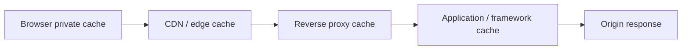

# Đầu độc HTTP cache: nhận diện, khai thác trong lab và phòng vệ

**Chương:** Browser cache  
**Mô-đun:** `SECURITY_APPLICATION_SECURITY_BROWSER_SECURITY` — phân tích ranh giới bảo mật giữa trình duyệt, origin, cookie và ứng dụng web để hiểu Same-Origin Policy (SOP), CORS và các cơ chế cách ly; thực hành phòng vệ XSS, CSRF, clickjacking bằng CSP, Trusted Types, security headers và kiểm chứng hành vi thực tế.

**HTTP cache poisoning** (đầu độc bộ nhớ đệm HTTP) xảy ra khi attacker tác động vào request khiến cache lưu một response sai hoặc độc hại dưới cache key mà các request bình thường khác cũng dùng. Người dùng tiếp theo có thể nhận response đã bị đầu độc dù họ không gửi input của attacker. Rủi ro đặc biệt cao ở shared cache như reverse proxy, CDN, gateway và cache tại edge vì một response có thể được phục vụ cho nhiều người.

Điểm cốt lõi là sự không nhất quán giữa **cache key** và các input thực sự ảnh hưởng tới response. Cache có thể phân biệt request theo URL nhưng origin lại tạo nội dung từ một header không nằm trong cache key. Attacker gửi header đó để thay đổi response; cache lưu response dưới URL chung; người dùng khác truy cập cùng URL và nhận nội dung đã bị thay đổi.

Đầu độc cache không chỉ là “cache lưu nhầm file”. Nó có thể làm sai HTML, JavaScript, CSS, redirect, CORS header hoặc nội dung cá nhân hóa. Tùy vị trí cache và response, tác động có thể gồm stored XSS, chuyển hướng người dùng, rò rỉ dữ liệu, phá hỏng nội dung hoặc làm gián đoạn dịch vụ.

Bài học tập trung vào cách HTTP cache chọn response, cách phát hiện input không nằm trong cache key, phân biệt cache poisoning với cache deception, và cách cấu hình origin/CDN để không chia sẻ response sai ngữ cảnh.

## 1. Mục tiêu học tập

Sau bài học, bạn có thể:

1. Giải thích cache key, cache hit/miss, freshness, validation và shared cache.
2. Phân biệt cache poisoning với web cache deception.
3. Nhận diện unkeyed input như Host, forwarded header, query parameter và request header.
4. Phân tích khác biệt giữa cache key của CDN và logic routing/response của origin.
5. Hiểu vai trò của Cache-Control, Vary, Age, ETag và conditional request.
6. Phát hiện rủi ro từ URL/path normalization, content negotiation và CORS response.
7. Thiết kế response cacheable có tính xác định, không chứa dữ liệu theo user.
8. Cấu hình bypass/no-store/private và cache key theo đúng use case.
9. Kiểm thử cache poisoning an toàn trong lab localhost.
10. Xây dựng test matrix và quy trình purge/incident response.

## 2. HTTP cache hoạt động thế nào?

### 2.1. Cache key và response reuse

HTTP cache lưu response để phục vụ request sau mà không cần gọi origin lại trong mọi trường hợp. Một cache cần xác định request mới có thể dùng response đã lưu hay không. Khái niệm quan trọng là **cache key**: dữ liệu request dùng để nhận diện một representation đã lưu.

Một cache thường dùng ít nhất method và target URI làm cơ sở cho key; implementation có thể bổ sung host, scheme, query, header hoặc thông tin riêng của CDN. Response header `Vary` chỉ ra một hay nhiều request header mà cache phải xét khi chọn representation đã lưu. Cache CDN có thể hỗ trợ thêm custom cache key, query allowlist/ignore list, cookie key hoặc cache policy riêng.

Ví dụ:

```text
Request A:
GET /catalog HTTP/1.1
Host: shop.example.test
Accept-Language: vi
X-Forwarded-Host: public.example.test

Cache key (ví dụ đơn giản):
GET https://shop.example.test/catalog

Origin response:
<html>...</html>
```

Nếu origin dùng `X-Forwarded-Host` để tạo link nhưng cache không đưa header đó vào key, hai request có cùng key có thể nhận response khác nhau. Đây là điều kiện nền tảng cho cache poisoning.

### 2.2. Cache hit, miss và revalidation

- **MISS:** cache không có response phù hợp hoặc response không thể dùng; request được chuyển tiếp tới origin.
- **HIT:** cache tìm thấy response phù hợp và phục vụ lại.
- **REVALIDATED:** cache kiểm tra response cũ với origin bằng validator như ETag hoặc Last-Modified; origin có thể trả `304 Not Modified`.
- **BYPASS/PASS:** request đi qua cache mà không đọc/ghi cache theo policy của hệ thống.

Không phải mọi response được lưu đều được phục vụ vô thời hạn. Freshness lifetime và validation quyết định response còn dùng được không. Tuy nhiên, nếu một response sai được cache trong thời gian dài, tác động có thể kéo dài tới khi hết TTL hoặc được purge.

### 2.3. Private cache và shared cache

| Loại cache | Vị trí điển hình | Ai có thể nhận response? |
| --- | --- | --- |
| Private cache | Browser cache của một user agent | Cùng user agent/profile |
| Shared cache | CDN, reverse proxy, gateway | Nhiều người dùng hoặc nhiều request |
| Application cache | Cache do ứng dụng/framework quản lý | Tùy key và phạm vi ứng dụng |
| Service Worker Cache Storage | Cache do script của site quản lý | Các client thuộc scope/storage context phù hợp |

Shared cache có rủi ro lan truyền cao hơn: response được tạo cho một request có thể được phục vụ cho nhiều user. Private browser cache cũng có thể bị đầu độc và ảnh hưởng user của profile đó, nhưng blast radius thường nhỏ hơn.

### 2.4. Không phải mọi response đều nên cache

Response public, ổn định và không phụ thuộc danh tính thường phù hợp cache. Response có session, account data, quyền riêng tư hoặc nội dung theo user cần policy rõ ràng, thường là `private` hoặc `no-store` tùy yêu cầu.

Không suy ra rằng response có `Set-Cookie` tự động không thể được cache. Theo HTTP caching semantics, chỉ riêng `Set-Cookie` không phải lúc nào cũng ngăn cache lưu response. Hãy đặt Cache-Control rõ ràng cho nội dung nhạy cảm thay vì dựa vào hành vi ngầm của proxy/browser.

## 3. Điều kiện dẫn đến HTTP cache poisoning

### 3.1. Input ảnh hưởng response nhưng không thuộc cache key

Một response có thể được tạo từ nhiều input:

- Request target: path và query.
- Host và scheme sau reverse proxy.
- Forwarded headers như `X-Forwarded-Host`, `X-Forwarded-Proto`, `Forwarded`.
- Header nội dung như `Accept`, `Accept-Language`, `Accept-Encoding`.
- Header tùy biến như `X-Original-URL`, `X-Rewrite-URL`, `X-HTTP-Method-Override`.
- Cookie, authorization và trạng thái session.
- Geo, device class hoặc feature flag do edge thêm.
- Thời gian, trạng thái backend hoặc dữ liệu người dùng.

Nếu input ảnh hưởng body/header/redirect nhưng không được cache key thể hiện, cache có thể dùng chung một response cho request không tương đương.

### 3.2. Cache key và origin hiểu URL khác nhau

CDN có thể normalize URL theo cách khác origin hoặc framework. Ví dụ:

- Cache bỏ qua một query parameter nhưng ứng dụng dùng parameter đó.
- Cache xem hai path là giống nhau nhưng origin xử lý encoded slash hoặc semicolon khác nhau.
- Edge bỏ dấu chấm/segment path trong khi router phía origin chuẩn hóa khác.
- Một lớp giải mã `%2F` trước lớp khác, khiến cache và origin nhìn thấy route khác nhau.
- Cache bỏ query string hoàn toàn cho một extension hoặc path rule.

Sự không nhất quán có thể khiến request mà cache xem là một key lại được origin xử lý như route hoặc nội dung khác. Chuẩn hóa URL một lần ở biên tin cậy và đảm bảo mọi lớp dùng cùng canonical representation.

### 3.3. Host và forwarded header

Một số ứng dụng tạo absolute URL, canonical link, asset URL, redirect hoặc nội dung email từ Host/forwarded headers. Nếu ứng dụng tin giá trị do client gửi, attacker có thể điều khiển host được phản chiếu vào response.

Ví dụ input rủi ro:

```http
Host: shop.example.test
X-Forwarded-Host: attacker.invalid
X-Forwarded-Proto: https
```

Reverse proxy chỉ nên ghi đè forwarded headers từ kết nối client bằng giá trị do proxy tin cậy tự xác định. Origin phải chỉ tin header từ proxy nằm trong trust boundary; không lấy trực tiếp header tùy ý từ Internet. Nếu có nhiều proxy hop, cấu hình rõ cách parse danh sách forwarded value và không chọn nhầm phần tử do client thêm vào.

### 3.4. Query parameter bị loại khỏi cache key

Một CDN có thể được cấu hình bỏ qua query parameter để tăng hit ratio. Điều đó nguy hiểm nếu origin dùng parameter bị bỏ qua để thay đổi nội dung.

Ví dụ, cache key chỉ giữ `/page` nhưng origin trả body khác nhau theo `?lang=vi` hoặc `?theme=dark`. Nếu request đầu tiên làm cache lưu representation theo một biến thể, request sau có thể nhận nhầm ngôn ngữ/theme. Đây có thể là lỗi nội dung hoặc lộ dữ liệu nếu parameter điều khiển tenant/user.

Chỉ ignore parameter khi chứng minh parameter không ảnh hưởng response. Dùng allowlist query parameter có ý nghĩa, không cấu hình “ignore all query strings” theo mặc định.

### 3.5. Header không được vary

Nếu origin trả nội dung khác nhau theo `Accept-Language`, `Accept`, `Origin` hoặc một header tùy biến, cache cần phân biệt representation tương ứng. Nếu thiếu `Vary` hoặc custom cache key tương đương, response của một biến thể có thể được phục vụ cho biến thể khác.

Không thêm `Vary` mù quáng cho mọi header. Một header có vô số giá trị có thể làm cache cardinality tăng mạnh. Chọn header thực sự ảnh hưởng representation, normalize giá trị, hoặc chuyển biến thể vào URL có cache key rõ ràng.

## 4. Các kiểu tấn công và tác động

### 4.1. Unkeyed header reflection

Origin có thể phản chiếu request header vào HTML, link, redirect hoặc response header. Nếu header đó không thuộc cache key, attacker có thể khiến cache lưu response chứa giá trị do họ chọn.

Ví dụ lỗi thiết kế:

```javascript
// Anti-pattern: tin header do request cung cấp.
const publicHost = req.headers["x-forwarded-host"] || req.headers.host;
const canonicalUrl = "https://" + publicHost + req.url;
res.end('<link rel="canonical" href="' + canonicalUrl + '">');
```

Đoạn mã còn có nguy cơ HTML injection nếu không encode. Dù đã encode đúng, việc dùng forwarded host không được xác thực vẫn có thể tạo response sai. Nếu cache không phân biệt header này, response có thể lan sang request bình thường.

Phòng vệ tốt nhất là lấy public origin từ cấu hình server đáng tin cậy hoặc proxy đã xác thực, không dùng header do client tùy ý gửi. Encode output vẫn cần thiết nhưng không sửa được cache key mismatch.

### 4.2. Unkeyed query hoặc cookie

Một query parameter bị bỏ khỏi key nhưng được origin sử dụng có thể làm sai representation. Tương tự, nếu origin tạo nội dung từ cookie hoặc session mà shared cache không bypass/không đưa user state vào policy, response cá nhân hóa có thể bị phục vụ cho người khác.

Không cố giải quyết session cache bằng cách đưa toàn bộ Cookie header vào key. Điều này thường tạo lượng variant rất lớn và có thể làm lộ dữ liệu nếu cache policy sai. Với response theo user, bypass shared cache hoặc dùng `Cache-Control: private`/`no-store` theo yêu cầu; cache public chỉ khi response độc lập user.

### 4.3. Poisoning response header

Cache lưu cả một số response header cùng body. Header sai có thể ảnh hưởng browser khi response được phát lại:

- `Location` có thể điều hướng người dùng sang host không mong muốn.
- `Access-Control-Allow-Origin` sai có thể cho phép origin không được phép đọc response.
- `Content-Type` sai có thể làm browser diễn giải nội dung theo cách khác.
- `Content-Security-Policy` hoặc security header bị thay đổi có thể làm giảm bảo vệ.
- `Set-Cookie` không mong muốn có thể làm thay đổi trạng thái browser nếu response được cache và phát lại.

Cần kiểm tra cả body và headers trong cache review. Không chỉ tìm dấu hiệu HTML/JavaScript lạ.

### 4.4. CORS response và `Vary: Origin`

Một API có thể phản hồi `Access-Control-Allow-Origin` theo giá trị `Origin` được allowlist. Khi response khác nhau theo request `Origin`, shared cache cần phân biệt biến thể đó, thường bằng `Vary: Origin` hoặc cache key tương đương.

Nếu response cho origin A bị cache rồi phục vụ cho origin B, có thể phát sinh CORS policy leak hoặc lỗi chức năng. Nếu response chứa dữ liệu nhạy cảm, CORS không thay thế authorization; server phải xác thực user và kiểm tra quyền trước khi trả dữ liệu.

Không phản chiếu Origin bất kỳ vào `Access-Control-Allow-Origin`. Chỉ trả origin đã allowlist, xử lý credentials đúng và kiểm tra cache key/`Vary` ở cả CDN lẫn reverse proxy.

### 4.5. Content negotiation và encoding

Response có thể khác theo `Accept`, `Accept-Language` hoặc `Accept-Encoding`. Nếu cache không phân biệt biến thể cần thiết, người dùng có thể nhận sai định dạng, ngôn ngữ hoặc encoding. Một số CDN tự xử lý compression/normalization, nên phải kiểm tra policy thực tế.

Dùng `Vary` đúng với request header ảnh hưởng representation, ví dụ `Vary: Accept-Encoding`. Với ngôn ngữ, cân nhắc đưa ngôn ngữ vào URL path để key dễ quan sát. Không vary theo User-Agent thô nếu có thể chuẩn hóa thành một số device class rõ ràng.

### 4.6. Response splitting và header injection

Nếu ứng dụng đưa dữ liệu không tin cậy vào response header mà không validate, CR/LF có thể tạo header injection hoặc response splitting trong những stack lỗi thời/cấu hình sai. Khi response bị cache, tác động có thể lan sang các request khác.

Framework hiện đại thường chặn CR/LF trong header value, nhưng không nên dựa vào đó như biện pháp duy nhất. Dùng API response header an toàn, validate giá trị theo allowlist, không ghép chuỗi header từ input và giữ proxy/server đã vá. Kiểm tra request smuggling/response desynchronization như một nhóm rủi ro riêng vì chúng có thể làm cache và origin không đồng bộ ranh giới message.

### 4.7. Web cache deception khác cache poisoning

Hai lỗi thường bị nhầm:

| Kỹ thuật | Attacker làm gì? | Lỗi chính |
| --- | --- | --- |
| Cache poisoning | Tạo response sai rồi khiến cache lưu dưới key được người khác dùng | Response bị đầu độc |
| Cache deception | Khiến cache hiểu request nhạy cảm như tài nguyên cacheable, ví dụ URL có đuôi `.css` | Nội dung riêng tư bị lưu và có thể bị lộ |

Ví dụ cache deception: ứng dụng trả trang account cho `/account/profile.css` do router bỏ qua suffix `.css`, trong khi CDN cache URL có đuôi `.css` như static asset. Nếu response cá nhân hóa bị cache public, người khác có thể lấy được nội dung đó.

Phòng vệ cache deception: route và cache phải thống nhất cách phân loại path; không cache theo extension đơn thuần nếu backend route có thể trả nội dung động; response nhạy cảm phải `private`/`no-store`; không để URL suffix thay đổi cách cache hiểu representation mà không đổi cách origin xử lý.

## 5. Cache-Control, Vary và validator

### 5.1. Các directive quan trọng

| Directive | Ý nghĩa thực tế | Lưu ý bảo mật |
| --- | --- | --- |
| `no-store` | Cache không được lưu response | Dùng cho dữ liệu nhạy cảm cần tránh lưu |
| `private` | Shared cache không được lưu; private cache có thể lưu | Phù hợp response theo user nếu browser caching được phép |
| `no-cache` | Có thể lưu nhưng phải revalidate trước khi reuse | Không đồng nghĩa không lưu |
| `public` | Cho phép shared cache lưu trong các trường hợp phù hợp | Chỉ dùng khi response thực sự public |
| `max-age` | Freshness lifetime cho cache | TTL dài kéo dài thời gian response sai tồn tại |
| `s-maxage` | Freshness lifetime cho shared cache; ưu tiên hơn max-age ở shared cache | Tách policy browser và CDN |
| `must-revalidate` | Không reuse stale response khi hết freshness nếu chưa validate | Cân nhắc availability |
| `proxy-revalidate` | Tương tự với shared cache | Ít dùng hơn trong thiết kế mới |
| `immutable` | Gợi ý representation không thay đổi trong freshness lifetime | Chỉ dùng asset có version/hash |
| `stale-while-revalidate` | Cho phép dùng stale trong lúc revalidate theo extension được hỗ trợ | Không áp dụng bừa cho dữ liệu nhạy cảm |
| `stale-if-error` | Cho phép dùng stale khi origin lỗi theo extension được hỗ trợ | Đánh giá rủi ro phục vụ dữ liệu cũ |

Ví dụ response public có thể cache:

```http
Cache-Control: public, max-age=60, s-maxage=300
Vary: Accept-Encoding
ETag: "catalog-v42"
```

Ví dụ response riêng tư:

```http
Cache-Control: private, no-store
Pragma: no-cache
```

`Pragma: no-cache` chủ yếu để tương thích HTTP/1.0 cũ; `Cache-Control` là cơ chế hiện đại. Không dùng `no-cache` khi yêu cầu thực sự là không lưu; khi đó dùng `no-store`.

### 5.2. `Vary` tạo representation variant

`Vary` liệt kê request header mà cache phải so sánh khi chọn response. Ví dụ:

```http
Vary: Accept-Encoding, Accept-Language
```

Nếu response được tạo khác theo `Origin`, có thể cần `Vary: Origin`. Nếu response phụ thuộc header tùy biến, cần xác định cache CDN có hỗ trợ vary theo header đó không; một số CDN dùng custom cache key thay cho semantics `Vary` chuẩn.

`Vary: *` chỉ ra response không khớp với request tiếp theo theo cơ chế variant thông thường. Không dùng `Vary` như cách thay thế authorization hoặc bypass cache cho session data.

### 5.3. Validator không sửa được cache key sai

`ETag` và `Last-Modified` giúp cache kiểm tra response đã lưu còn hợp lệ hay không. Request có thể gửi `If-None-Match` hoặc `If-Modified-Since`; origin trả `304` khi representation không đổi.

Validator chỉ có ý nghĩa nếu origin xác định đúng representation cần validate. Nếu cache key thiếu một input làm thay đổi response, cache vẫn có thể gắn validator sai với variant. ETag không phải biện pháp chống poisoning tự động.

### 5.4. Age, Via và cache status

`Age` cho biết thời gian response đã ở trong cache shared theo semantics HTTP. `Via` có thể cho biết intermediary đã xử lý message. CDN thường thêm header riêng như `X-Cache`, `CF-Cache-Status` hoặc `X-Served-By`; tên và giá trị phụ thuộc nhà cung cấp.

Dùng các header này để điều tra HIT/MISS/REVALIDATED, nhưng không xem chúng là bằng chứng duy nhất. Một số edge xóa hoặc ghi đè header, cache lồng nhau có thể tạo nhiều lớp status và private cache browser có thể vẫn HIT dù CDN MISS.

## 6. Thiết kế cache key an toàn

### 6.1. Nguyên tắc completeness

Cache key phải phân biệt mọi request khác nhau có thể tạo representation khác nhau. Nếu origin dùng input nào để quyết định body hoặc security-sensitive header, input đó phải được:

1. Loại bỏ khỏi response generation nếu không cần.
2. Chuẩn hóa và đưa vào cache key/variant.
3. Hoặc khiến request bypass cache.

Không cần đưa mọi request header vào key. Chỉ cần bảo đảm các input có ảnh hưởng đều được xử lý rõ ràng và không có hidden dependency.

### 6.2. Host và scheme phải đến từ cấu hình tin cậy

- Validate Host theo allowlist virtual host.
- Reverse proxy ghi đè forwarded headers từ client và chỉ gửi giá trị chuẩn hóa.
- Origin chỉ tin forwarded header từ proxy có IP/identity nằm trong trust boundary.
- Tạo absolute URL từ cấu hình public base URL khi có thể.
- Không cho client điều khiển redirect host, canonical host hoặc asset origin qua header tùy ý.
- Cache key phải bao gồm host/scheme theo cách edge thực sự route request.

### 6.3. Query string và path normalization

- Xác định query parameter nào làm thay đổi representation.
- Không bỏ query string hoặc ignore parameter hàng loạt nếu origin còn dùng chúng.
- Chuẩn hóa encoding, slash, dot segment, case và path separator đồng nhất giữa CDN, proxy và origin.
- Từ chối path mơ hồ nếu các lớp xử lý không thống nhất.
- Không phân loại cacheability chỉ dựa vào extension nếu router backend dùng rule khác.
- Test cả URL percent-encoded, duplicate parameter và parameter ordering.

### 6.4. Cookie và Authorization

Request có Cookie hoặc Authorization thường mang ngữ cảnh user. Với endpoint cá nhân hóa, mặc định bypass shared cache hoặc trả `private`/`no-store` theo yêu cầu. Chỉ cache authenticated response trong shared cache khi đã có thiết kế rõ ràng về partition key, authorization, tenant isolation, purge và negative test; không dựa vào một rule CDN chưa được kiểm chứng.

`Vary: Cookie` không phải giải pháp tổng quát. Cookie header có thể lớn, thay đổi liên tục và làm cache key cardinality tăng mạnh; nếu CDN bỏ qua Vary hoặc normalize khác, dữ liệu vẫn có thể bị chia sẻ sai.

### 6.5. Không cache lỗi/redirect một cách vô tình

Một số cache có thể cache redirect hoặc error response theo status và header. Nếu origin tạo `302` dựa trên host/header không tin cậy, cache có thể lưu `Location` sai. Nếu cache lưu 404/403/500, một lỗi tạm thời hoặc response bị thao túng có thể tồn tại lâu hơn dự kiến.

Đặt TTL ngắn hoặc bypass cho redirect động, error response và endpoint có side effect. Chỉ cache status code được thiết kế rõ; kiểm tra CDN có negative caching và stale behavior nào.

## 7. Phòng vệ ở origin, reverse proxy và CDN

### 7.1. Cache theo allowlist

Chỉ cache route đã được xác định là public và có representation ổn định. Tạo allowlist theo method, host, path, status code và content type. Với endpoint không nằm trong allowlist, mặc định bypass shared cache.

Một policy mẫu:

| Request/response | Chính sách đề xuất |
| --- | --- |
| GET/HEAD asset có filename hash | Cache dài hạn, immutable |
| GET trang public không cá nhân hóa | Cache ngắn/trung hạn theo freshness |
| GET account/profile/cart | Bypass shared cache, private hoặc no-store |
| POST/PUT/PATCH/DELETE | Không cache trừ thiết kế đặc biệt được đánh giá |
| Response có Authorization/session context | Bypass shared cache theo mặc định |
| Redirect login/logout hoặc redirect theo user | Không cache public |
| Error response | TTL ngắn hoặc không cache theo policy |

Đây là baseline. CDN có thể có default cache behavior khác nhau; kiểm tra effective configuration thay vì chỉ nhìn dashboard rule.

### 7.2. Response header rõ ràng

Với response public, đặt `Cache-Control` và `Vary` phản ánh đúng semantics. Với dữ liệu riêng tư, đặt `private` hoặc `no-store` ở origin; không chỉ dựa vào CDN bypass vì browser cache hoặc proxy khác vẫn có thể lưu.

Không dùng `Set-Cookie` như một tín hiệu duy nhất để ngăn cache. Không dùng `no-cache` thay cho `no-store` nếu yêu cầu là không lưu. Đảm bảo mọi response path — kể cả error, redirect và alternate host — đều có policy phù hợp.

### 7.3. Trust boundary cho forwarded headers

Ở edge/reverse proxy:

1. Xóa hoặc ghi đè `Forwarded`, `X-Forwarded-Host`, `X-Forwarded-Proto`, `X-Forwarded-Port` và header custom từ client.
2. Gán lại giá trị từ thông tin kết nối và cấu hình virtual host đã xác thực.
3. Chỉ cho phép origin nhận request từ proxy tin cậy qua network policy hoặc mutual authentication.
4. Cấu hình framework trust-proxy chính xác theo số hop và subnet.
5. Validate Host header và từ chối host không nằm trong allowlist.
6. Tạo absolute URL từ cấu hình nếu không cần suy ra từ request.

Nếu ứng dụng cần giữ client-supplied value cho logging, lưu vào field riêng đã đánh dấu untrusted; không dùng nó để route, build redirect hoặc tạo response cacheable.

### 7.4. Đồng bộ cache key với response generation

Tạo danh sách dependency cho từng response cacheable: host, path, query, request headers, cookie, identity, locale, feature flag, geo, device class và các biến môi trường. Với mỗi dependency, quyết định rõ:

- Có được phép ảnh hưởng response không?
- Nếu có, có nằm trong key/variant không?
- Nếu không thể đưa vào key an toàn, request có bypass cache không?
- Có test chứng minh hai request cùng key luôn có representation tương đương không?

Không để edge normalize một giá trị trong khi origin dùng giá trị raw. Dùng một canonicalization rule duy nhất và test request bất thường.

### 7.5. CORS và cache policy

Nếu response thay đổi `Access-Control-Allow-Origin` theo `Origin`, cấu hình `Vary: Origin` hoặc custom cache key tương đương. Nếu endpoint trả dữ liệu user, vẫn cần bypass shared cache hoặc cache partition theo identity được thiết kế rõ. CORS allowlist không tự tạo cache isolation.

Đối với public static asset không có credential, `Access-Control-Allow-Origin: *` có thể phù hợp nếu nội dung thực sự public. Không kết hợp wildcard với credentialed CORS. Không phản chiếu origin tùy ý chỉ để làm request cross-origin hoạt động.

### 7.6. Cache tag, purge và TTL

CDN thường hỗ trợ purge theo URL, surrogate key/cache tag hoặc zone. Thiết kế purge theo nhóm nội dung để khi deploy, đổi quyền hoặc phát hiện poisoning có thể vô hiệu hóa representation nhanh.

- Đặt TTL ngắn hơn cho response động hoặc rủi ro cao.
- Dùng filename có content hash cho asset immutable.
- Có thể purge theo tag khi cập nhật bài viết/product/tenant.
- Xác định thời gian purge lan tới mọi POP/edge.
- Không cho user không tin cậy gọi purge API.
- Kiểm tra stale-while-revalidate và stale-if-error có thể tiếp tục phục vụ response bị đầu độc hay không.

Purge không thay thế việc sửa nguyên nhân. Nếu cache key mismatch vẫn tồn tại, attacker có thể đầu độc lại ngay sau purge.

## 8. Quy trình phát hiện và điều tra

### 8.1. Dấu hiệu nghi ngờ

- Response cùng URL có body/header khác nhau không giải thích được.
- Một số người dùng thấy link, host, locale hoặc asset URL lạ.
- `Age` tăng hoặc cache status HIT dù response có giá trị không nên dùng chung.
- `X-Cache`/CDN status cho thấy HIT sau request bất thường.
- Một response chứa input từ header/query không được phép ảnh hưởng nội dung.
- Cache hit/miss khác nhau giữa POP, region hoặc hostname.
- CORS header, Location hoặc Content-Type thay đổi giữa request tương đương.

Một dấu hiệu đơn lẻ chưa chứng minh poisoning. Cache lồng nhau, deploy, stale response và origin load balancing cũng có thể tạo khác biệt.

### 8.2. So sánh request có kiểm soát

Trong staging/lab:

1. Chọn URL public cacheable không chứa dữ liệu thật.
2. Gửi request baseline và ghi body/header, cache status, Age, ETag.
3. Gửi request khác đúng một input nghi ngờ (ví dụ forwarded header).
4. Gửi lại request baseline qua cùng cache path.
5. So sánh response thứ ba với baseline.
6. Purge key sau test và xác minh response chuẩn trở lại.

Chỉ thay một input mỗi lần để xác định biến nào tác động. Không thực hiện thử nghiệm đầu độc trên production hoặc cache dùng chung với người dùng thật nếu chưa có change plan được phê duyệt.

### 8.3. Log phải đủ để truy vết nhưng không làm lộ dữ liệu

Log request ID, route, cache status, cache key fingerprint (không nhất thiết raw key), origin status, upstream host đã chuẩn hóa, TTL, purge event và policy version. Redact Cookie, Authorization, token, query chứa PII và header có dữ liệu nhạy cảm.

Giữ log edge và origin có correlation ID để xác định response được tạo ở đâu, cache nào lưu và POP nào phục vụ lại. Không log raw session cookie để debug cache key.

### 8.4. Incident response

Khi nghi cache poisoning:

1. Xác định URL, host, method, cache layer và vùng/POP bị ảnh hưởng.
2. Bypass cache hoặc vô hiệu hóa route cacheable nếu có thể.
3. Purge chính xác URL/tag/zone liên quan; kiểm tra stale serving và browser cache.
4. Kiểm tra body lẫn response headers, CORS, redirects và security headers.
5. Tìm request đầu tiên làm tạo representation bất thường qua log correlation.
6. Sửa unkeyed input, forwarded header trust, cache key hoặc cache policy.
7. Thêm regression test trước khi bật cache lại.
8. Đánh giá user impact, token/cookie exposure và yêu cầu rotate/revoke nếu cần.
9. Theo dõi cache status sau remediation để bảo đảm response chuẩn được phục vụ.

Nếu response đầu độc chứa script hoặc nội dung thực thi, đánh giá khả năng stored XSS ở người dùng đã nhận response. Purge CDN không xóa browser cache hoặc Service Worker cache đã lưu trước đó.

## 9. Checklist review một cacheable endpoint

Với từng endpoint, trả lời các câu hỏi sau:

| Câu hỏi | Bằng chứng cần có |
| --- | --- |
| Endpoint có thực sự public không? | Threat model và authorization review |
| Response có phụ thuộc user/session không? | Code path, cookie/auth handling |
| Input nào thay đổi body/header/redirect? | Dependency list và test |
| Cache key có chứa đủ input đó không? | CDN/proxy effective cache key |
| Host/forwarded header có được tin cậy không? | Proxy config, allowlist và trust-proxy |
| Path/query được normalize thống nhất không? | Edge/router test |
| Vary có đủ và có được CDN tôn trọng không? | Response header và cache behavior |
| Cookie/Authorization có bypass đúng không? | Negative test qua shared cache |
| Status code/redirect/error có cache ngoài ý muốn không? | Cache policy và TTL |
| Purge có thể chạy nhanh và an toàn không? | Runbook và quyền purge |
| Stale policy có giữ response sai quá lâu không? | stale-while-revalidate/stale-if-error test |
| Có regression test cache hit không? | Test request poison → baseline |

## 10. Lab localhost: mô phỏng cache poisoning do unkeyed header

Lab tạo một cache nhỏ trong Node.js để minh họa lỗi cache key mismatch. Server chỉ bind vào loopback, không gửi request ra Internet và không dùng domain thật. Request đầu tiên có header `X-Forwarded-Host` làm thay đổi nội dung response; cache lưu body dưới key không chứa header đó; request tiếp theo không gửi header vẫn nhận body đã bị đầu độc.

### 10.1. Tạo server mô phỏng

Tạo file `cache-poisoning-lab.mjs`:

```javascript
import { createServer } from "node:http";

const cache = new Map();

function escapeHtml(value) {
  return String(value).replace(/[&<>"']/g, character => ({
    "&": "&amp;",
    "<": "&lt;",
    ">": "&gt;",
    '"': "&quot;",
    "'": "&#39;"
  })[character]);
}

function sendHtml(response, body, cacheStatus) {
  response.writeHead(200, {
    "Content-Type": "text/html; charset=utf-8",
    "Cache-Control": "public, max-age=60",
    "X-Demo-Cache": cacheStatus
  });
  response.end(body);
}

const server = createServer((request, response) => {
  const url = new URL(request.url, "http://127.0.0.1:8080");

  if (request.method === "POST" && url.pathname === "/purge") {
    cache.clear();
    response.writeHead(200, { "Content-Type": "text/plain; charset=utf-8" });
    response.end("Demo cache cleared");
    return;
  }

  if (request.method !== "GET" || url.pathname !== "/page") {
    response.writeHead(404, { "Content-Type": "text/plain; charset=utf-8" });
    response.end("Not found");
    return;
  }

  // Vulnerable cache key: method + Host + path; query and X-Forwarded-Host are omitted.
  const cacheKey = request.method + " " + request.headers.host + url.pathname;

  const cached = cache.get(cacheKey);
  if (cached && cached.expiresAt > Date.now()) {
    sendHtml(response, cached.body, "HIT");
    return;
  }
  if (cached) cache.delete(cacheKey);

  // Vulnerability: application trusts a client-controlled, unkeyed header.
  const publicHost =
    request.headers["x-forwarded-host"] || request.headers.host;

  // Escape the value so this lab demonstrates poisoning without XSS execution.
  const body =
    "<!doctype html><html lang=\"vi\"><meta charset=\"utf-8\">" +
    "<title>HTTP cache lab</title><body>" +
    "<h1>Public page</h1>" +
    "<p>Host used to render this response: " + escapeHtml(publicHost) + "</p>" +
    "</body></html>";

  cache.set(cacheKey, { body, expiresAt: Date.now() + 60_000 });
  sendHtml(response, body, "MISS");
});

server.listen(8080, "127.0.0.1", () => {
  console.log("Open http://127.0.0.1:8080/page");
});
```

### 10.2. Chạy server

Trong thư mục chứa file:

```bash
node cache-poisoning-lab.mjs
```

Mở một terminal PowerShell khác và chạy các request theo đúng thứ tự:

```powershell
curl.exe -i http://127.0.0.1:8080/page
curl.exe -i -H "X-Forwarded-Host: attacker.invalid" http://127.0.0.1:8080/page
curl.exe -i http://127.0.0.1:8080/page
```

Lần đầu là `MISS`. Lần thứ hai là `HIT` nếu cache đã được tạo ở lần đầu, vì cache key không phân biệt header. Để thấy rõ poisoning, xóa cache trước rồi gửi request có header làm request đầu tiên:

```powershell
curl.exe -i -X POST http://127.0.0.1:8080/purge
curl.exe -i -H "X-Forwarded-Host: attacker.invalid" http://127.0.0.1:8080/page
curl.exe -i http://127.0.0.1:8080/page
```

Ở chuỗi thứ hai, request có header tạo cache entry với body chứa `attacker.invalid`; request cuối không có header nhưng nhận lại cùng body. Quan sát `X-Demo-Cache: MISS` và `X-Demo-Cache: HIT`. Đây là mô phỏng một input ảnh hưởng response nhưng không thuộc key.

### 10.3. Sửa lỗi trong lab

Có hai thay đổi chính:

1. Không dùng forwarded header từ client để tạo nội dung. Dùng public host lấy từ cấu hình tin cậy hoặc giá trị proxy đã xác thực.
2. Nếu response thực sự phải thay đổi theo một input request, đưa biến thể đã chuẩn hóa vào cache key hoặc bypass cache.

Ví dụ thay phần tạo public host:

```javascript
// Public host is deployment configuration, not a client request header.
const publicHost = "shop.example.test";
```

Sau khi sửa, purge cache, gửi request có `X-Forwarded-Host: attacker.invalid`, rồi gửi request baseline. Cả hai response phải dùng public host cấu hình. Trong production, không hard-code domain ví dụ này; đọc từ cấu hình deployment được bảo vệ.

### 10.4. Thử thêm query parameter

Mở rộng lab để origin thay nội dung theo query parameter, nhưng cache key bỏ query. Ví dụ thay cache key thành:

```javascript
const cacheKey = request.method + " " + request.headers.host + url.pathname;
```

Trong khi response đọc `url.searchParams.get("theme")`. Gửi `?theme=dark` trước rồi request `/page`; nếu cache key bỏ query, response đầu tiên có thể được dùng lại cho request thứ hai. Cách sửa là đưa query có ý nghĩa vào key hoặc bỏ dependency đó khỏi response generation.

Để thấy khác biệt, thay block tạo `body` trong server bằng đoạn sau:

```javascript
const theme = url.searchParams.get("theme") || "light";
const body =
  "<!doctype html><html lang=\"vi\"><meta charset=\"utf-8\">" +
  "<title>HTTP cache lab</title><body>" +
  "<h1>Public page</h1>" +
  "<p>Host used to render this response: " + escapeHtml(publicHost) + "</p>" +
  "<p>Theme: " + escapeHtml(theme) + "</p>" +
  "</body></html>";
```

Giữ cache key chỉ gồm pathname như trong ví dụ. Sau khi purge, gửi `GET /page?theme=dark`, rồi `GET /page`; request thứ hai có thể nhận representation `dark` dù không có query. Map trong lab hiện thực TTL 60 giây để gần với `Cache-Control: max-age=60`; xóa cache bằng endpoint purge hoặc chờ entry hết hạn.

### 10.5. Dọn lab

Dừng Node server bằng Ctrl+C. Nếu muốn xóa cache trong tiến trình trước khi dừng, gọi endpoint `POST /purge`. Lab chỉ mô phỏng một cache đơn giản trong memory; nó không tái hiện mọi thuật toán cache của CDN, browser hay reverse proxy. Không dùng header poisoning thử nghiệm trên hệ thống production hoặc domain của bên thứ ba.

## 11. Ma trận kiểm thử HTTP cache poisoning

Chạy trong lab hoặc staging riêng, với URL public và dữ liệu giả. Dùng cùng cache path cho request tạo variant và request baseline; ghi lại cache status, Age, body hash và các response header liên quan. Không thử trên cache production dùng chung nếu chưa có phê duyệt và kế hoạch purge.

| ID | Tình huống | Kết quả mong đợi |
| --- | --- | --- |
| HC-01 | Request đầu tiên tới URL cacheable | MISS; origin tạo response chuẩn |
| HC-02 | Lặp lại cùng request | HIT hoặc revalidated theo TTL/validator |
| HC-03 | Gửi X-Forwarded-Host khác baseline | Không làm thay đổi response public hoặc cache key phân biệt variant được phép |
| HC-04 | Gửi Host ngoài allowlist | Origin/edge từ chối request |
| HC-05 | Gửi X-Forwarded-Proto giả | Scheme trong redirect/link không bị client điều khiển |
| HC-06 | Thay query parameter bị ignore | Không làm thay đổi response; nếu có ảnh hưởng thì key phải phân biệt |
| HC-07 | Thay thứ tự query parameter | Cache và origin dùng cùng canonicalization |
| HC-08 | Dùng duplicate query parameter | Router và cache diễn giải nhất quán hoặc request bị từ chối |
| HC-09 | Path có percent-encoded slash | Cache và origin xử lý cùng quy tắc |
| HC-10 | Path có dot segment hoặc semicolon | Không tạo khác biệt route/cache classification |
| HC-11 | Accept-Language thay đổi | Vary/key phân biệt đúng representation hoặc URL có locale rõ |
| HC-12 | Accept-Encoding thay đổi | Compression variant được cache đúng |
| HC-13 | Origin thay đổi trên CORS endpoint | ACAO không bị reuse sai; Vary: Origin/key được áp dụng |
| HC-14 | Cookie session khác nhau | Shared cache bypass hoặc response được private/no-store |
| HC-15 | Authorization header tồn tại | Không cache public ngoài policy được phê duyệt |
| HC-16 | Response có Set-Cookie | Cache policy vẫn rõ; không giả định Set-Cookie tự cấm cache |
| HC-17 | Redirect phụ thuộc request host | Location không bị poison và redirect không cache sai |
| HC-18 | Response 404/403/500 | Negative caching/TTL đúng policy |
| HC-19 | Response dùng ETag/If-None-Match | Revalidation gắn đúng representation |
| HC-20 | Response có stale-while-revalidate | Stale policy không kéo dài response sai ngoài dự kiến |
| HC-21 | Cache deception với path có đuôi .css | Nội dung account không bị cache public |
| HC-22 | Response body phản chiếu header | Input được loại bỏ/encode và cache key xử lý đúng |
| HC-23 | Response header có CR/LF từ input | Framework từ chối; không có header injection/splitting |
| HC-24 | Nhiều cache layer (browser/CDN/reverse proxy) | Cache status và policy từng layer được xác định |
| HC-25 | Purge URL hoặc cache tag | Entry bị loại bỏ trên các POP theo SLA |
| HC-26 | Poisoned entry sau purge | Request baseline tạo lại response chuẩn |
| HC-27 | Cache key có host/scheme | Virtual host khác không nhận nhầm response |
| HC-28 | Response public và response personalized cùng route | Personalized response không rơi vào public cache |
| HC-29 | Request method không phải GET/HEAD | Không cache ngoài policy được thiết kế |
| HC-30 | Request từ POP/region khác | Không có variant sai do cache key/configuration không đồng bộ |

### 11.1. Kiểm tra cache bằng curl

Dùng `curl.exe -i` để xem status và response headers. So sánh ít nhất:

- `Age`
- `Cache-Control`
- `Vary`
- `ETag`
- `Location`
- `Access-Control-Allow-Origin`
- Cache status header do CDN cung cấp
- Body hoặc hash của body

Ví dụ trong staging:

```powershell
curl.exe -i https://staging.example.test/public/catalog
curl.exe -i https://staging.example.test/public/catalog
curl.exe -i -H "Accept-Language: en" https://staging.example.test/public/catalog
curl.exe -i -H "Accept-Language: vi" https://staging.example.test/public/catalog
```

Đừng chỉ nhìn status 200. Một response có thể là HIT nhưng sai variant; hoặc MISS ở CDN nhưng HIT ở reverse proxy. Kiểm tra toàn bộ đường đi và response body.

### 11.2. Kiểm tra nhiều lớp cache

Vẽ đường request thực tế:



Ở mỗi lớp, ghi cache key, TTL, bypass condition, Vary behavior và purge mechanism. Không giả định header status từ edge phản ánh trạng thái browser cache hoặc application cache.

## 12. Những ngộ nhận thường gặp

**“Chỉ cache static file mới có thể bị poisoning.”** Sai. HTML, redirect, JSON, CORS response và security header đều có thể bị cache và phát lại.

**“Response có Set-Cookie sẽ không được cache.”** Sai. Không dựa vào Set-Cookie như cơ chế cấm cache; đặt Cache-Control rõ ràng.

**“Cache-Control: no-cache nghĩa là không lưu.”** Sai. Response có thể được lưu nhưng phải revalidate trước khi reuse. Muốn không lưu, dùng no-store.

**“Vary giải quyết mọi vấn đề cache key.”** Sai. Vary chỉ xử lý request header được nêu và cache phải tôn trọng nó; query, cookie, host, custom CDN policy và logic origin vẫn cần review.

**“Đưa mọi header vào cache key là an toàn.”** Sai. Nó có thể tạo cardinality lớn, cache fragmentation và không sửa được response logic tin input không đáng tin.

**“CORS ngăn cache poisoning.”** Sai. CORS là cơ chế browser kiểm soát đọc response; cache có thể lưu và phát lại response sai trước khi browser áp dụng CORS.

**“HTTPS ngăn attacker đầu độc cache.”** Sai. HTTPS bảo vệ transport tới endpoint; attacker vẫn có thể gửi request hợp lệ với header/query do client kiểm soát hoặc khai thác proxy/origin trust sai.

**“ETag tự sửa cache key mismatch.”** Sai. Validator xác định representation có thay đổi không; nó không làm cache phân biệt input bị bỏ khỏi key.

**“Purge cache là đã khắc phục.”** Sai. Nếu nguyên nhân vẫn còn, entry có thể bị đầu độc lại. Browser cache và Service Worker cache cũng có thể giữ response cũ.

**“Cache poisoning và cache deception là một.”** Sai. Poisoning thay response được lưu; deception khiến response riêng tư bị cache do cache/origin phân loại URL khác nhau.

**“Chỉ CDN mới cần kiểm tra cache key.”** Sai. Browser, reverse proxy, gateway, framework và Service Worker đều có thể cache theo key/policy riêng.

**“Response public không chứa bí mật thì không cần quan tâm host/header.”** Sai. Host hoặc redirect sai có thể gây phishing, stored XSS chain hoặc làm hỏng trust boundary ngay cả khi body không chứa PII.

## 13. Checklist triển khai an toàn

Trước khi bật shared cache cho endpoint, xác nhận:

1. **Public eligibility:** response thực sự public và không phụ thuộc user/session.
2. **Method policy:** chỉ cache method đã cho phép, thường GET/HEAD.
3. **Cache key:** chứa host, scheme, path, query và mọi variant ảnh hưởng response.
4. **Unkeyed input:** không dùng header/query/cookie ngoài key để tạo nội dung cacheable.
5. **Host validation:** từ chối Host không hợp lệ và dùng public base URL đáng tin cậy.
6. **Forwarded headers:** proxy xóa/ghi đè client value; origin chỉ tin proxy đã allowlist.
7. **URL normalization:** edge, proxy và router thống nhất path/query canonicalization.
8. **Query policy:** chỉ ignore parameter đã chứng minh không ảnh hưởng response.
9. **Vary:** khai báo đúng request header và xác nhận CDN tôn trọng.
10. **CORS:** allowlist Origin; dùng Vary: Origin hoặc key tương đương khi response thay đổi theo Origin.
11. **Cookie/Auth:** bypass shared cache hoặc private/no-store cho response personalized.
12. **Set-Cookie:** không dựa vào header này để tự ngăn cache.
13. **Cache-Control:** phân biệt no-store, private, no-cache, public, max-age và s-maxage.
14. **Redirect/error:** xác định status code nào được cache và TTL của chúng.
15. **Content negotiation:** kiểm tra Accept, Accept-Language, Accept-Encoding và compression.
16. **Header safety:** không phản chiếu untrusted value vào Location, CSP, CORS hoặc Content-Type.
17. **Response splitting:** dùng API header an toàn, validate CR/LF và vá proxy/server.
18. **Stale policy:** kiểm tra stale-while-revalidate/stale-if-error với response nhạy cảm.
19. **Purge:** có URL/tag purge, quyền hạn, SLA và runbook.
20. **Observability:** log request ID, cache status, policy version; redact cookie/token/PII.
21. **Regression tests:** test poison request rồi baseline request qua cùng cache.
22. **Multi-layer review:** kiểm tra browser, CDN, reverse proxy và application cache.
23. **Incident plan:** có cách bypass, purge, đánh giá user impact và kiểm tra browser/Service Worker cache.
24. **Change control:** test cấu hình CDN mới ở staging trước khi rollout.

## 14. Câu hỏi tự kiểm tra

**Câu 1.** HTTP cache poisoning là gì?  
**Đáp án:** Khi attacker tác động vào request khiến cache lưu response sai dưới key được request khác sử dụng, làm người dùng sau nhận nội dung đã bị đầu độc.

**Câu 2.** Cache key có vai trò gì?  
**Đáp án:** Xác định request nào có thể dùng lại cùng một cached representation.

**Câu 3.** Unkeyed input là gì?  
**Đáp án:** Input ảnh hưởng response nhưng không được cache key hoặc variant policy phân biệt.

**Câu 4.** Vì sao X-Forwarded-Host có thể nguy hiểm?  
**Đáp án:** Nếu origin tin giá trị client gửi để tạo link/redirect nhưng cache bỏ header khỏi key, response do attacker điều khiển có thể được reuse.

**Câu 5.** Vary dùng để làm gì?  
**Đáp án:** Khai báo request header ảnh hưởng representation để cache chọn đúng variant.

**Câu 6.** Cache-Control: no-cache có nghĩa gì?  
**Đáp án:** Có thể lưu response nhưng phải revalidate trước khi reuse; không đồng nghĩa no-store.

**Câu 7.** Cache-Control: private bảo vệ điều gì?  
**Đáp án:** Ngăn shared cache lưu response; private cache của user agent vẫn có thể lưu theo policy.

**Câu 8.** Set-Cookie có tự động ngăn cache không?  
**Đáp án:** Không nên dựa vào Set-Cookie; cần đặt Cache-Control rõ ràng.

**Câu 9.** Vì sao Vary: Origin có thể cần cho CORS?  
**Đáp án:** Vì ACAO có thể thay đổi theo request Origin; cache cần phân biệt response theo Origin.

**Câu 10.** Cache poisoning khác cache deception thế nào?  
**Đáp án:** Poisoning làm cache lưu response bị thao túng; deception làm cache lưu response riêng tư do cache/origin hiểu URL khác nhau.

**Câu 11.** ETag có ngăn cache poisoning không?  
**Đáp án:** Không. ETag hỗ trợ revalidation nhưng không sửa cache key thiếu input.

**Câu 12.** Vì sao không đưa toàn bộ Cookie vào cache key?  
**Đáp án:** Tạo nhiều variant, tăng cardinality và không thay thế bypass/private policy cho response cá nhân hóa.

**Câu 13.** Purge cache có đủ để khắc phục poisoning không?  
**Đáp án:** Không. Phải sửa nguyên nhân, nếu không entry có thể bị đầu độc lại.

**Câu 14.** Vì sao cần kiểm tra mọi cache layer?  
**Đáp án:** Browser, CDN, reverse proxy và application cache có thể có key, TTL và policy khác nhau.

**Câu 15.** Bằng chứng nào giúp xác nhận cache poisoning trong lab?  
**Đáp án:** Request có input khác làm response MISS được lưu; request baseline tiếp theo nhận cùng body/header qua HIT dù không gửi input đó.

## 15. Ghi nhớ cốt lõi

HTTP cache poisoning xuất hiện khi cache chia sẻ một response giữa các request không tương đương. Điều kiện phổ biến là origin dùng một input không nằm trong cache key — ví dụ forwarded header, query parameter, cookie hoặc Origin — để tạo body/header/redirect. Cache lưu response dưới key chung và phát lại cho người dùng khác.

Phòng vệ bắt đầu từ response generation: không tin Host/forwarded header từ client, normalize URL nhất quán, không để unkeyed input thay đổi response cacheable, và bypass shared cache cho dữ liệu theo user. Dùng Cache-Control rõ ràng, Vary đúng, cache key đầy đủ, CORS allowlist, purge có kiểm soát và regression test qua cùng cache path.

Cache poisoning khác cache deception: một kỹ thuật đầu độc response, kỹ thuật còn lại khiến response riêng tư bị cache do cách phân loại URL không nhất quán. Cả hai đều cần kiểm tra đồng thời origin, CDN, reverse proxy, browser cache và Service Worker.

**Một response chỉ được chia sẻ qua cache khi mọi request cùng cache key thực sự được phép nhận cùng representation.**

### Tài liệu tham khảo

- [IETF RFC 9111 — HTTP Caching](https://www.rfc-editor.org/rfc/rfc9111).
- [IETF RFC 9110 — HTTP Semantics](https://www.rfc-editor.org/rfc/rfc9110).
- [IETF RFC 5861 — HTTP Cache-Control Extensions for Stale Content](https://www.rfc-editor.org/rfc/rfc5861).
- [MDN — HTTP Caching](https://developer.mozilla.org/en-US/docs/Web/HTTP/Guides/Caching).
- [MDN — Cache-Control](https://developer.mozilla.org/en-US/docs/Web/HTTP/Headers/Cache-Control).
- [MDN — Vary](https://developer.mozilla.org/en-US/docs/Web/HTTP/Headers/Vary).
- [PortSwigger Web Security Academy — Web Cache Poisoning](https://portswigger.net/web-security/web-cache-poisoning).
- [PortSwigger Web Security Academy — Web Cache Deception](https://portswigger.net/web-security/web-cache-deception).
- [Cloudflare — Cache Keys](https://developers.cloudflare.com/cache/how-to/cache-keys/).
- [OWASP — HTTP Headers Cheat Sheet](https://cheatsheetseries.owasp.org/cheatsheets/HTTP_Headers_Cheat_Sheet.html).
