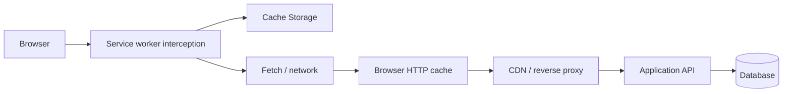

# Sensitive response cache

## Mục tiêu bài học

Sau bài này, bạn có thể:

- Phân biệt browser HTTP cache, shared cache/CDN, Cache Storage của service worker và trạng thái trang được giữ trong bộ nhớ.
- Chọn `Cache-Control` phù hợp cho response chứa thông tin cá nhân, dữ liệu tài khoản hoặc nội dung theo phiên đăng nhập.
- Hiểu sự khác nhau giữa `no-store`, `no-cache`, `private`, `public`, `max-age`, `s-maxage` và `must-revalidate`.
- Nhận diện vì sao `Set-Cookie`, request có `Authorization` hoặc CORS không tự bảo đảm response nhạy cảm được cache an toàn.
- Ngăn dữ liệu người dùng A xuất hiện trong phiên người dùng B qua browser cache, CDN, Cache API hoặc service worker.
- Kiểm thử cache sau đăng nhập, logout, đổi tài khoản, hết hạn session và điều hướng Back/Forward.

## 1. Vì sao sensitive response cần chính sách cache riêng?

Ứng dụng web thường trả về response chứa dữ liệu chỉ một người dùng hoặc một nhóm quyền được phép xem, ví dụ hồ sơ cá nhân, lịch sử giao dịch, thông tin nhân sự, dữ liệu sức khỏe, báo cáo nội bộ hoặc nội dung quản trị. Những response này có thể đi qua nhiều tầng cache trước khi hiển thị trong browser.

Nếu cache dùng sai key hoặc giữ response quá lâu, một người dùng khác có thể nhìn thấy dữ liệu cũ sau khi đăng xuất, chuyển tài khoản hoặc dùng chung thiết bị. Một CDN cấu hình sai còn có thể trả response của một người cho request của người khác. Lỗi này thường không phải do authorization endpoint bỏ kiểm tra, mà do cache trả lại response đã lưu trước khi request đến được ứng dụng.

Hãy xem cache là một phần của đường đi dữ liệu:



Sơ đồ chỉ mô tả các lớp thường gặp; thứ tự thực tế tùy kiến trúc. Service worker có thể chặn request trước khi nó đi đến network, CDN có thể nằm trước nhiều service backend, và browser có thể giữ trang trong Back/Forward Cache (BFCache) mà không thực hiện request mới.

Với response nhạy cảm, câu hỏi không chỉ là “server có xác thực không?” mà còn là “mọi tầng trung gian có được phép lưu response không, key cache có phân biệt đúng người dùng không, và khi quyền thay đổi thì response cũ có còn được dùng không?”.

## 2. Các loại cache cần phân biệt

| Loại | Phạm vi | Rủi ro chính |
| --- | --- | --- |
| Browser HTTP cache | Cache HTTP riêng của browser profile, có thể dùng lại giữa các tab trong cùng môi trường. | Dữ liệu còn trên thiết bị sau logout hoặc khi đổi tài khoản. |
| Shared cache | Proxy, gateway hoặc cache dùng chung cho nhiều người dùng. | Response cá nhân bị trả nhầm cho người dùng khác nếu cấu hình và key không đúng. |
| CDN/reverse proxy cache | Cache ở biên hoặc trước application server. | Rule cache có thể bỏ qua cookie, authorization hoặc header chỉ định response riêng tư. |
| Cache Storage | Kho cache do ứng dụng/service worker quản lý bằng Cache API. | Code có thể lưu response riêng tư dù HTTP cache header yêu cầu không lưu. |
| Framework/application cache | Cache trong process, Redis hoặc tầng dữ liệu của ứng dụng. | Cache key thiếu user/tenant/permission context hoặc không invalidation khi quyền thay đổi. |
| Back/Forward Cache (BFCache) | Snapshot trang trong bộ nhớ để quay lại nhanh. | Trang cũ có thể được khôi phục mà không gọi lại API hoặc render lại từ server. |

Các lớp này có quy tắc khác nhau. `Cache-Control` là cơ chế chính cho HTTP caching, nhưng không thay thế logic kiểm soát Cache Storage do JavaScript chủ động ghi. Xóa browser HTTP cache cũng không tự động xóa Redis, CDN hoặc mọi dữ liệu đang nằm trong bộ nhớ của trang.

## 3. HTTP caching và Cache-Control

Server gửi `Cache-Control` trong response để hướng dẫn cache cách lưu và tái sử dụng representation. Với dữ liệu nhạy cảm, cần hiểu rõ từng directive.

### 3.1. `no-store`

`no-store` chỉ thị cache không lưu request/response liên quan theo quy tắc HTTP caching. Đây là lựa chọn phù hợp cho response chứa bí mật, dữ liệu cá nhân nhạy cảm, token, trang thanh toán hoặc response mà tổ chức không muốn lưu vào HTTP cache.

```http
Cache-Control: no-store
```

`no-store` không có nghĩa dữ liệu biến mất khỏi bộ nhớ, DOM, screenshot, clipboard, log hoặc hệ thống mà ứng dụng tự gửi. Nó cũng không tự ngăn service worker gọi `cache.put()` để lưu response. Vì vậy, cần kết hợp cấu hình HTTP cache với chính sách rõ ràng ở service worker, CDN và ứng dụng.

### 3.2. `no-cache`

`no-cache` cho phép cache lưu response, nhưng cache phải xác thực lại với server trước khi dùng response đã lưu cho request tiếp theo. Tên directive dễ gây hiểu nhầm: nó không có nghĩa “không lưu”.

```http
Cache-Control: no-cache
```

Khi response có validator như `ETag` hoặc `Last-Modified`, browser có thể gửi request có điều kiện (`If-None-Match` hoặc `If-Modified-Since`). Server trả `304 Not Modified` nếu representation vẫn hợp lệ. Với response nhạy cảm, server phải xác thực session và authorization trước khi trả `304`; không được xác nhận response cũ chỉ dựa trên ETag mà bỏ qua danh tính hiện tại.

### 3.3. `private`

`private` cho phép private cache của người dùng (thường là browser cache) lưu response, nhưng chỉ thị shared cache không lưu response đó.

```http
Cache-Control: private, max-age=60
```

Directive này phù hợp khi response được cá nhân hóa nhưng sản phẩm chấp nhận browser cache trong một khoảng thời gian ngắn. Cần nhớ browser profile có thể được dùng bởi nhiều người trên cùng thiết bị; `private` không có nghĩa chỉ user account hiện tại mới truy cập được dữ liệu. Nếu logout hoặc chuyển tài khoản trong khi response còn fresh, browser có thể tái sử dụng bản lưu mà không hỏi server.

### 3.4. `public`

`public` cho phép response được lưu trong shared cache ngay cả trong một số trường hợp mà mặc định cache có thể không lưu, chẳng hạn response gắn với request có `Authorization` theo các điều kiện của HTTP caching.

```http
Cache-Control: public, max-age=300
```

Không dùng `public` cho response cá nhân hoặc response chứa dữ liệu theo session chỉ để tăng hiệu năng. Một CDN có thể phục vụ bản lưu cho nhiều người dùng.

### 3.5. `max-age` và `s-maxage`

- `max-age=N` xác định thời gian response được xem là fresh tính bằng giây.
- `s-maxage=N` áp dụng freshness lifetime cho shared cache và ghi đè `max-age` ở shared cache.

Ví dụ:

```http
Cache-Control: public, max-age=60, s-maxage=300
```

Ví dụ này phù hợp hơn với nội dung công khai có thể được cache ở CDN. Với response nhạy cảm, đừng đặt `s-maxage` hoặc `public` trừ khi đã thiết kế cache có phân quyền rõ ràng và chấp nhận rủi ro.

### 3.6. `must-revalidate`

`must-revalidate` yêu cầu cache không dùng response đã stale nếu chưa xác thực lại với server. Nó hữu ích khi response có thể được lưu nhưng không được dùng lại sau khi hết freshness lifetime nếu không có xác nhận từ origin.

```http
Cache-Control: private, max-age=0, must-revalidate
```

Với response cá nhân, `private, no-cache` thường diễn đạt rõ rằng browser có thể giữ bản sao nhưng phải revalidate trước khi dùng. Nếu không muốn lưu bản sao HTTP, dùng `no-store`.

## 4. Chọn policy cho response nhạy cảm

Policy cần phản ánh độ nhạy cảm và khả năng chấp nhận dữ liệu cũ.

| Loại response | Policy khởi đầu | Lý do |
| --- | --- | --- |
| Password, token, dữ liệu xác thực, reset link | `Cache-Control: no-store` | Không muốn HTTP cache giữ credential hoặc response nhạy cảm. |
| Hồ sơ cá nhân, dữ liệu tài chính/y tế, nội dung quản trị | `Cache-Control: no-store` | Giảm nguy cơ response còn trong cache sau logout hoặc đổi tài khoản. |
| API cá nhân hóa ít nhạy cảm, có nhu cầu revalidate | `Cache-Control: private, no-cache` | Browser có thể lưu nhưng phải hỏi server trước khi tái sử dụng. |
| Nội dung riêng tư có thể dùng lại trong thời gian rất ngắn | `Cache-Control: private, max-age=30` (chỉ khi threat model cho phép) | Không dùng shared cache; vẫn có cửa sổ stale ở browser. |
| CSS/JS/font/icon công khai, có version trong URL | `Cache-Control: public, max-age=31536000, immutable` | Tài nguyên tĩnh không cá nhân hóa có thể cache lâu. |
| HTML shell công khai | Tùy khả năng cập nhật; thường revalidate hoặc thời hạn ngắn | Tránh browser giữ HTML cũ trỏ đến asset đã xóa. |

Với dữ liệu nhạy cảm, ưu tiên `no-store` ở response API và HTML liên quan. Nếu cần offline, hãy xác định riêng dữ liệu nào được phép lưu và cơ chế mã hóa, phân vùng, retention, logout cleanup cùng authorization; đừng vô tình đưa response riêng tư vào Cache Storage chỉ để hỗ trợ offline.

Ví dụ response API cá nhân:

```http
HTTP/1.1 200 OK
Content-Type: application/json
Cache-Control: no-store
Pragma: no-cache
Vary: Accept-Encoding

{"accountId":"acct-demo","balance":1250}
```

`Pragma: no-cache` có thể được thêm để tương thích với một số cache HTTP/1.0 cũ. `Cache-Control` vẫn là cơ chế chính cho HTTP hiện đại. Không cần thêm `Expires` tùy tiện nếu `no-store` đã được áp dụng; nếu cần tương thích với hệ thống cũ, hãy dùng giá trị HTTP-date hợp lệ và kiểm tra cache thực tế.

## 5. Authorization, cookie và Set-Cookie không tự bảo vệ cache

Một số giả định dễ dẫn đến lỗi:

- Request có `Authorization` không có nghĩa mọi cache đều tự động xử lý an toàn. Shared cache có quy tắc hạn chế reuse response cho request có `Authorization`, nhưng response directive như `public`, `s-maxage` hoặc `must-revalidate` có thể cho phép shared caching theo điều kiện chuẩn. Hãy khai báo policy rõ ràng thay vì dựa vào mặc định.
- Cookie xác thực không tự động làm response không thể cache. Cache/CDN có thể được cấu hình bỏ qua cookie hoặc dùng URL làm cache key; nếu response cá nhân bị lưu, dữ liệu có thể bị dùng sai ngữ cảnh.
- Header `Set-Cookie` tự nó không phải lệnh cấm cache phổ quát. Response có `Set-Cookie` vẫn có thể được cache theo các quy tắc và cấu hình tương ứng.
- `Vary: Cookie` không phải giải pháp thay thế cho `private` hoặc `no-store`. Nó tạo cache key theo giá trị Cookie và có thể gây cardinality rất lớn; cấu hình CDN có thể bỏ qua hoặc chuẩn hóa header này.
- CORS quyết định JavaScript từ origin nào có thể đọc response. CORS không ngăn browser, proxy hoặc CDN lưu response sai cách.

Với endpoint yêu cầu đăng nhập, hãy đặt `Cache-Control: no-store` hoặc policy private/revalidation đã được đánh giá. Đồng thời cấu hình CDN/reverse proxy không cache route đó. Không dựa vào việc response có cookie hoặc API có bearer token để suy ra cache tự động an toàn.

## 6. Vary và cache key

HTTP cache thường dùng method và target URI làm phần chính của cache key. `Vary` bổ sung các request header mà representation phụ thuộc vào. Ví dụ:

```http
Vary: Accept-Encoding
```

Nếu response thay đổi theo `Origin`, server thường cần:

```http
Access-Control-Allow-Origin: https://app.example.com
Vary: Origin
```

Nếu cache không phân biệt origin, một response CORS được tạo cho origin A có thể bị dùng lại trong ngữ cảnh origin B. `Vary: Origin` giúp cache phân biệt representation theo header đó, nhưng server vẫn phải chỉ cho phép origin đúng.

Với response cá nhân, không nên tự tạo cache key dựa trên `userId` hoặc `tenantId` do client gửi. Nếu một hệ thống có lý do đặc biệt để cache dữ liệu cá nhân ở server-side cache, key phải lấy từ identity đã xác thực và bao gồm đầy đủ tenant, permission/version và các yếu tố làm thay đổi representation. Cần invalidation khi quyền, membership hoặc dữ liệu thay đổi. Browser HTTP cache thông thường không phải nơi thích hợp để triển khai logic phân quyền phức tạp.

## 7. Conditional request và validator trên dữ liệu riêng tư

`ETag` và `Last-Modified` hỗ trợ cache kiểm tra xem representation đã thay đổi chưa. Với response cá nhân, validator cần gắn với đúng representation và đúng principal/tenant context.

Ví dụ:

```http
HTTP/1.1 200 OK
Cache-Control: private, no-cache
ETag: "account-acct-demo-v12"
Content-Type: application/json
```

Khi browser gửi:

```http
GET /api/account HTTP/1.1
If-None-Match: "account-acct-demo-v12"
Cookie: __Host-session=...
```

Server phải xác thực session, xác định người dùng và quyền hiện tại, sau đó mới quyết định có trả `304 Not Modified` hay không. Nếu người dùng đã logout hoặc đổi tài khoản, server không được trả `304` chỉ vì validator trùng với bản cũ của browser. Nếu representation thay đổi theo user, validator phải tránh va chạm giữa người dùng và không được làm lộ thông tin nhạy cảm qua giá trị ETag.

Không đưa email, số tài khoản, token hoặc dữ liệu cá nhân trực tiếp vào ETag. Dùng validator không tiết lộ nội dung và thiết kế sao cho revalidation luôn đi qua kiểm tra authorization.

## 8. Cache trong Fetch API

Fetch API có `Request.cache` để điều khiển tương tác của request với browser HTTP cache. Các giá trị thường dùng:

| Giá trị | Hành vi khái quát |
| --- | --- |
| `default` | Dùng cache nếu response còn fresh; nếu stale có thể revalidate rồi cập nhật. |
| `no-store` | Không đọc từ HTTP cache và không cập nhật HTTP cache cho request này. |
| `reload` | Không dùng bản cache hiện có làm response; tải qua network và cập nhật cache theo quy tắc. |
| `no-cache` | Có thể đọc entry đã lưu nhưng yêu cầu revalidate trước khi dùng. |
| `force-cache` | Ưu tiên cache, kể cả entry stale; chỉ ra network khi không có entry phù hợp. |
| `only-if-cached` | Chỉ dùng cache; nếu không có entry phù hợp có thể trả lỗi gateway timeout. Mode này chỉ dùng cùng `mode: "same-origin"`. |

Ví dụ gọi API nhạy cảm:

```js
const response = await fetch("/api/account", {
  method: "GET",
  credentials: "same-origin",
  cache: "no-store",
  headers: {
    Accept: "application/json"
  }
});
```

`cache: "no-store"` là lựa chọn phía client cho browser HTTP cache. Server vẫn nên trả `Cache-Control: no-store` để các cache HTTP khác trên đường đi cũng nhận được chỉ thị. Nếu service worker intercept request, code trong worker vẫn có thể chủ động lấy response rồi ghi vào Cache Storage; cần kiểm tra riêng đường đi đó.

Không dùng `force-cache` cho API riêng tư chỉ để giảm request. Nó có thể trả dữ liệu cũ mà không xác minh session hiện tại. `no-cache` hữu ích khi muốn revalidate; `no-store` phù hợp khi không muốn HTTP cache giữ response.

## 9. Cache Storage và Service Worker

Cache API là một kho lưu trữ do ứng dụng quản lý. Nó không tự động tuân thủ đầy đủ các HTTP caching directives như browser HTTP cache. Service worker có thể gọi `cache.put()` để lưu response mà ứng dụng đã nhận, kể cả khi response có header `Cache-Control: no-store`. Vì vậy, không được giả định chỉ cần đặt header là Cache Storage sẽ không ghi.

Ví dụ policy allowlist chỉ cache tài nguyên tĩnh công khai:

```js
const STATIC_CACHE = "app-static-v4";
const STATIC_URLS = [
  "/assets/app.4f2a.js",
  "/assets/app.8b31.css",
  "/assets/logo.2c10.svg"
];

self.addEventListener("install", (event) => {
  event.waitUntil((async () => {
    const cache = await caches.open(STATIC_CACHE);
    await cache.addAll(STATIC_URLS);
  })());
});

self.addEventListener("fetch", (event) => {
  const request = event.request;
  const url = new URL(request.url);

  if (request.method !== "GET" || url.origin !== self.location.origin) {
    return;
  }

  if (url.pathname.startsWith("/api/private/")) {
    // API riêng tư luôn đi qua network; không gọi cache.match/put.
    event.respondWith(fetch(request, { cache: "no-store" }));
    return;
  }

  if (STATIC_URLS.includes(url.pathname)) {
    event.respondWith((async () => {
      const cache = await caches.open(STATIC_CACHE);
      return (await cache.match(request)) || fetch(request);
    })());
  }
});
```

Ví dụ trên minh họa allowlist cho static asset và bypass cache cho API riêng tư. Ứng dụng thật cần xử lý lỗi network, update cache, URL có query, version asset và scope service worker. Không cache mọi response GET theo một quy tắc tổng quát.

Nếu sản phẩm bắt buộc hỗ trợ offline cho dữ liệu cá nhân, hãy thiết kế một kho offline riêng với các quyết định rõ ràng: dữ liệu nào được phép lưu, partition theo account/tenant ra sao, retention bao lâu, xử lý đổi tài khoản và logout thế nào, có mã hóa at-rest hay không, và cách đồng bộ/thu hồi quyền. Mã hóa phía client không bảo vệ được dữ liệu khỏi XSS nếu mã độc cùng origin có thể gọi logic giải mã hoặc đọc dữ liệu sau khi giải mã.

## 10. Logout và chuyển tài khoản

Logout không tự động xóa browser HTTP cache, Cache Storage, IndexedDB hoặc mọi state trong tab. Nếu response riêng tư được phép cache, dữ liệu có thể vẫn còn trong browser profile sau khi session đã bị thu hồi.

Với ứng dụng không có nhu cầu offline cho dữ liệu cá nhân, policy đơn giản và an toàn hơn là:

1. Server trả `Cache-Control: no-store` cho API và HTML nhạy cảm.
2. CDN/reverse proxy bypass cache cho endpoint xác thực và route cá nhân.
3. Service worker không lưu response từ API riêng tư vào Cache Storage.
4. Logout thu hồi session phía server và hết hạn cookie.
5. Frontend xóa state trong memory, đóng kết nối realtime và dọn cache/storage riêng tư do ứng dụng tạo.
6. Các tab khác nhận tín hiệu logout và gọi API để xác minh session đã kết thúc trước khi hiển thị dữ liệu.

Ví dụ đồng bộ logout giữa các tab:

```js
const authChannel = new BroadcastChannel("app-auth");

function finishLogout() {
  clearInMemoryUserState();
  clearPrivateApplicationCaches();
  authChannel.postMessage({ type: "logout" });
  window.location.replace("/login");
}

authChannel.addEventListener("message", ({ data }) => {
  if (data?.type !== "logout") return;
  clearInMemoryUserState();
  clearPrivateApplicationCaches();
  window.location.replace("/login");
});
```

Thông điệp giữa các tab chỉ đồng bộ giao diện. Server vẫn phải từ chối session đã thu hồi. Không truyền token hoặc dữ liệu cá nhân trong `BroadcastChannel`.

## 11. Back/Forward Cache và dữ liệu còn trong bộ nhớ

BFCache giữ snapshot của một trang để browser khôi phục nhanh khi người dùng bấm Back/Forward. Đây không giống browser HTTP cache: khi khôi phục từ BFCache, browser có thể phục hồi DOM và JavaScript state mà không gửi request tải tài liệu mới.

Vì vậy, người dùng có thể logout ở tab hoặc một luồng khác rồi bấm Back và nhìn thấy giao diện cũ được khôi phục. Điều này không nhất thiết có nghĩa session phía server vẫn hợp lệ, nhưng UI có thể hiển thị dữ liệu cũ cho đến khi ứng dụng kiểm tra lại trạng thái.

Ví dụ kiểm tra khi trang được khôi phục:

```js
window.addEventListener("pageshow", async (event) => {
  if (!event.persisted) return;

  const session = await fetch("/api/session", {
    credentials: "same-origin",
    cache: "no-store"
  });

  if (!session.ok) {
    clearInMemoryUserState();
    window.location.replace("/login");
    return;
  }

  await refreshSensitiveView();
});
```

Đây là ví dụ cần điều chỉnh theo ứng dụng. Endpoint session phải xác minh session hiện tại; `refreshSensitiveView()` phải tải lại dữ liệu với authorization mới. Có thể ẩn hoặc che nội dung nhạy cảm trước khi hoàn tất kiểm tra. Không dựa vào `Cache-Control: no-store` như một bảo đảm phổ quát rằng browser sẽ không giữ trang trong BFCache; hành vi BFCache thay đổi theo browser/version và có thể có ngoại lệ.

Ngay cả khi HTTP cache không lưu response, dữ liệu vẫn có thể tồn tại trong memory, DOM, JavaScript heap, screenshot hoặc clipboard. Chính sách cache không thay thế quy trình xóa dữ liệu ứng dụng và kiểm soát thiết bị dùng chung.

## 12. Cấu hình server và CDN

### 12.1. Ví dụ Node.js/Express

Có thể đặt policy cho route nhạy cảm bằng middleware:

```js
function noStoreSensitiveResponse(req, res, next) {
  res.setHeader("Cache-Control", "no-store");
  res.setHeader("Pragma", "no-cache");
  res.setHeader("Expires", "Thu, 01 Jan 1970 00:00:00 GMT");
  next();
}

app.get("/api/account", noStoreSensitiveResponse, authenticateSession,
  async (req, res) => {
    const account = await accountService.getForUser(req.user.id);
    res.json(account);
  }
);
```

Middleware nên chạy cho mọi response của route, kể cả lỗi authorization, redirect và lỗi nghiệp vụ. Trong thực tế có thể đặt policy ở router hoặc reverse proxy để tránh một nhánh lỗi bỏ sót header. Không cache response lỗi có chứa thông tin nội bộ hoặc dữ liệu theo user.

### 12.2. Reverse proxy/CDN

Với route riêng tư, cấu hình CDN/reverse proxy bypass cache theo path và theo chính sách xác thực. Ví dụ khái niệm:

```text
/api/private/*   -> bypass cache, respect origin Cache-Control
/account/*       -> bypass shared cache
/assets/*        -> cache public, versioned, immutable
```

Tên rule và thứ tự ưu tiên phụ thuộc nhà cung cấp CDN. Cần kiểm tra cả cache key, origin response header, cookie forwarding, `Authorization` handling, stale response policy và cache purge. Đừng chỉ dựa vào một rule path nếu endpoint cá nhân có thể được gọi qua alias hoặc route khác.

Nếu CDN có header riêng như `CDN-Cache-Control` hoặc `Surrogate-Control`, hãy hiểu thứ tự ưu tiên giữa header của CDN và `Cache-Control` gửi đến browser. Cấu hình CDN có thể ghi đè hoặc bỏ qua origin directive; xác minh bằng response header và trạng thái cache thực tế trên môi trường triển khai.

## 13. Kiểm thử sensitive response cache

Thực hiện trên staging/local với hai tài khoản thử A và B. Không dùng dữ liệu cá nhân thật.

| Kịch bản | Cách kiểm tra | Kết quả mong đợi |
| --- | --- | --- |
| Response cá nhân có no-store | Gọi API account, xem response headers và lặp request. | Response có `Cache-Control: no-store`; không được tái sử dụng từ HTTP cache. |
| CDN cache nhầm response | Đăng nhập A, gọi endpoint cá nhân; sau đó dùng B gọi cùng URL. Kiểm tra `Age`, `X-Cache` hoặc header tương đương. | CDN bypass cache; B không nhận dữ liệu của A. |
| Cookie không ngăn cache | Kiểm tra response có `Set-Cookie` và quan sát cache behavior trong môi trường lab. | Policy cache được xác định rõ bằng header/rule, không dựa vào Set-Cookie tự động. |
| Authorization response | Gọi API với bearer token qua proxy test. | Shared cache không lưu/reuse response nhạy cảm theo policy. |
| `private` và `no-cache` | Cho browser lưu response riêng tư rồi yêu cầu lại sau khi thay đổi session. | Browser revalidate; server kiểm tra session/authorization trước khi trả 304. |
| Service worker Cache Storage | Mở API riêng tư rồi kiểm tra Application → Cache Storage. | Không có response riêng tư được lưu trong cache do ứng dụng quản lý. |
| Đổi tài khoản | A xem dữ liệu, logout, B đăng nhập cùng browser profile và mở lại URL. | Không xuất hiện dữ liệu A; API trả dữ liệu B sau khi xác minh session. |
| Back/Forward | Mở trang nhạy cảm, logout ở tab khác rồi bấm Back. | Ứng dụng che dữ liệu cũ và xác minh session khi trang được khôi phục. |
| Offline | Mở API cá nhân rồi ngắt mạng và tải lại. | Không phục vụ dữ liệu cá nhân cũ từ Cache Storage ngoài policy offline đã phê duyệt. |
| Response 304 | Gửi request có `If-None-Match` sau khi đổi user/session. | Server không trả 304 dựa trên validator của principal cũ. |
| Error/redirect response | Thử 401, 403, 302 và lỗi server ở route cá nhân. | Các response nhạy cảm cũng có cache policy đúng; redirect không tiết lộ dữ liệu. |

### 13.1. Quan sát bằng DevTools

Trong Network panel:

1. Bật/tắt “Disable cache” để hiểu sự khác biệt giữa request đi qua cache và request tải lại từ network. Tùy chọn này chỉ có tác dụng trong điều kiện DevTools đang mở và không kiểm tra thay cho policy production.
2. Chọn response và xem `Cache-Control`, `Expires`, `ETag`, `Last-Modified`, `Age`, `Vary`, `Set-Cookie` và các header cache của CDN.
3. Quan sát cột Size/Transferred hoặc thông báo “from memory cache”/“from disk cache” nếu browser hiển thị.
4. Mở Application → Cache Storage để kiểm tra cache do service worker/app tạo.
5. Mở Application → Service Workers và thử bypass worker để so sánh đường network.
6. Dùng cùng browser profile đăng nhập A rồi B để kiểm tra dữ liệu có bị tái sử dụng không.
7. Kiểm tra tab Network sau logout và sau Back/Forward để xác định trang có được tải lại hay khôi phục từ BFCache.

Đừng coi việc DevTools báo “from memory cache” là bằng chứng dữ liệu đã bị lộ cho người khác; cần kiểm tra ngữ cảnh profile và principal. Ngược lại, việc không thấy cache hit trong một lần thử cũng không chứng minh CDN hoặc browser không thể cache trong điều kiện khác.

## 14. Những lỗi thường gặp

| Lỗi | Hậu quả | Cách khắc phục |
| --- | --- | --- |
| Dùng `no-cache` với ý nghĩa không lưu | Browser vẫn có thể lưu response và revalidate. | Dùng `no-store` nếu không muốn HTTP cache lưu response. |
| Chỉ đặt `private` cho dữ liệu rất nhạy cảm | Browser cache vẫn có thể giữ response sau logout hoặc đổi tài khoản. | Dùng `no-store` cho dữ liệu nhạy cảm; nếu cần cache, revalidate và đánh giá thiết bị dùng chung. |
| Nghĩ `Set-Cookie` tự ngăn cache | Shared/private cache có thể vẫn lưu theo policy. | Đặt `Cache-Control` rõ ràng và cấu hình CDN. |
| Nghĩ request có `Authorization` luôn bypass mọi cache | Shared cache có ngoại lệ theo response directives và cấu hình. | Trả `no-store`/`private` và cấu hình bypass cho endpoint nhạy cảm. |
| Dùng `Vary: Cookie` làm cơ chế phân quyền | Cache key có thể không được cấu hình đúng; cardinality tăng và dữ liệu vẫn có thể bị dùng sai. | Không cache response cá nhân ở shared cache; xác thực và authorization ở server. |
| Chỉ đặt `Cache-Control` nhưng service worker vẫn `cache.put()` | Cache Storage vẫn có thể giữ response riêng tư. | Review fetch handler và chỉ cache allowlist tài nguyên công khai. |
| Chỉ xóa cookie khi logout | HTTP cache, Cache Storage, IndexedDB và BFCache có thể còn dữ liệu. | Thu hồi session, dùng no-store và dọn state/cache do ứng dụng quản lý. |
| Cho rằng `no-store` xóa dữ liệu khỏi bộ nhớ | DOM, JS heap, screenshot và clipboard có thể còn dữ liệu. | Che/reset UI, xóa state và kiểm tra lại session khi restore. |
| Trả 304 trước khi kiểm tra quyền | Browser có thể tái sử dụng body cũ trong ngữ cảnh không còn hợp lệ. | Xác thực session và authorization trước khi trả 304. |

## 15. Bài thực hành

Hãy xây dựng một API `/api/account` trả dữ liệu riêng cho hai tài khoản thử A và B, cùng một service worker có cache static asset.

1. Cấu hình `/api/account` trả `Cache-Control: no-store` và kiểm tra response trong Network.
2. Tạo một route tài nguyên công khai có version trong URL và cache bằng service worker.
3. Xác nhận fetch handler bypass Cache Storage cho `/api/private/*` và không gọi `cache.put()` với response riêng tư.
4. Thử `cache: "no-store"` trong Fetch API rồi so sánh với response header server.
5. Thử policy `private, no-cache` với ETag trong lab; xác minh server kiểm tra session và quyền trước khi trả 304.
6. Đăng nhập A, xem dữ liệu, logout rồi đăng nhập B trong cùng browser profile. Kiểm tra Network, HTTP cache và Cache Storage.
7. Mở trang cá nhân, logout ở tab khác rồi bấm Back. Xử lý `pageshow` để xác minh session và che dữ liệu cũ.
8. Cấu hình CDN/reverse proxy staging bypass cache cho route cá nhân; xác nhận response không có cache hit hoặc Age bất thường.
9. Ghi lại policy cho API nhạy cảm, HTML tài khoản, static asset và dữ liệu offline nếu có.

Hoàn thành bài thực hành khi bạn chứng minh được response nhạy cảm không bị lưu hoặc tái sử dụng ngoài thiết kế, dữ liệu của tài khoản A không xuất hiện ở tài khoản B, và bạn phân biệt được HTTP cache với Cache Storage cùng BFCache.
