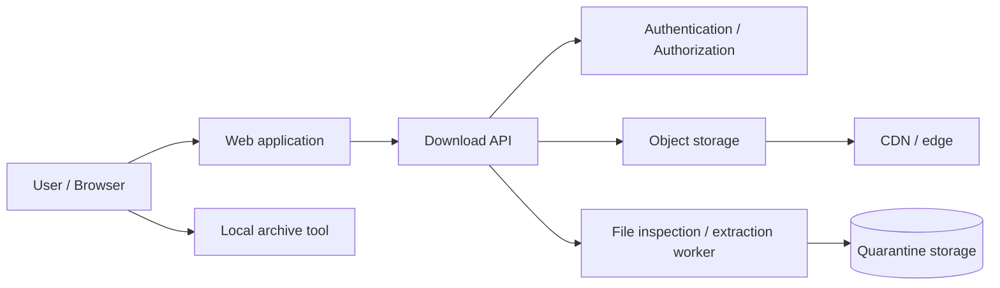

# Download bomb

## Mục tiêu bài học

Sau bài này, bạn có thể:

- Giải thích download bomb và phân biệt việc làm cạn tài nguyên qua nhiều lần tải, file quá lớn và archive/decompression bomb.
- Nhận diện tác động đến browser, thiết bị người dùng, server, CDN, băng thông và hệ thống giải nén.
- Thiết kế giới hạn kích thước, tốc độ, số download đồng thời và thời gian xử lý ở cả client lẫn server.
- Phục vụ file theo cách có xác thực, authorization, tên file an toàn và header phù hợp.
- Xử lý archive không tin cậy bằng giới hạn dung lượng giải nén, số entry, độ sâu, thời gian và đường dẫn.
- Kiểm thử khả năng chống download bomb bằng dữ liệu giả lập có giới hạn, không làm cạn tài nguyên môi trường.

## 1. Download bomb là gì?

Download bomb là cách lạm dụng luồng tải file để làm cạn tài nguyên hoặc gây gián đoạn hoạt động. Tác động có thể xuất hiện ở browser, thiết bị người dùng, ứng dụng server, kho lưu trữ, CDN hoặc bước xử lý file sau khi tải. Không có một định dạng duy nhất đại diện cho download bomb; đây là nhóm tình huống khai thác việc tải, lưu hoặc giải nén dữ liệu vượt quá khả năng mà hệ thống dự kiến.

Các dạng thường gặp:

| Dạng | Cách gây tác động | Tài nguyên bị ảnh hưởng |
| --- | --- | --- |
| Lặp nhiều download | Trang hoặc endpoint liên tục khởi tạo nhiều lượt tải, cửa sổ hoặc file. | Disk, băng thông, browser UI, số file và sự chú ý của người dùng. |
| Download file quá lớn | Một response có dung lượng lớn hoặc kéo dài, khiến người dùng tải ngoài ý muốn. | Network, disk, pin, bộ nhớ và chi phí CDN/server. |
| Download đồng thời | Một tài khoản hoặc nhiều client tạo nhiều request tải cùng lúc. | Connection pool, file descriptor, CPU, storage I/O và egress. |
| Archive/decompression bomb | File nén nhỏ tạo ra dữ liệu giải nén rất lớn hoặc số lượng entry cực cao. | CPU, RAM, disk, inode, thời gian xử lý và hàng đợi quét file. |
| Nested archive | Archive chứa nhiều lớp archive lồng nhau, làm hệ thống xử lý đệ quy kéo dài. | CPU, disk, số lần mở file và thời gian xử lý. |
| Range/request abuse | Client yêu cầu nhiều byte range hoặc lặp request một phần để tiêu thụ tài nguyên. | Băng thông, CPU, cache và kết nối. |

Một archive có tỷ lệ nén cao không mặc nhiên là độc hại. File backup, ảnh hoặc dữ liệu khoa học có thể nén rất tốt. Cần đánh giá tổng dung lượng sau giải nén, số entry, độ sâu, thời gian và mục đích nghiệp vụ thay vì chỉ dùng một ngưỡng tỷ lệ nén.

## 2. Threat model và ranh giới tài nguyên

Một luồng download có nhiều thành phần tham gia:



Rủi ro có thể nằm ở các điểm khác nhau:

- Browser bị yêu cầu tải nhiều file hoặc file quá lớn, làm đầy ổ đĩa hoặc khiến người dùng khó kiểm soát nội dung tải xuống.
- API tạo file đồng bộ trong request, giữ worker và kết nối quá lâu.
- CDN phục vụ một file rất lớn cho nhiều client hoặc cache nhầm response cá nhân.
- Hệ thống nhận file giải nén archive không tin cậy, không giới hạn dung lượng đầu ra hoặc số entry.
- Ứng dụng lưu file vào đường dẫn do người dùng kiểm soát và vô tình ghi đè file khác.
- Hệ thống quét virus, preview hoặc tạo thumbnail mở file mà không có giới hạn tài nguyên.

Phòng vệ cần đặt giới hạn ở từng ranh giới. Browser không thể tự bảo vệ server khỏi request tải lặp; server không thể ngăn hoàn toàn người dùng tự mở file đã tải; và header HTTP không thể kiểm soát mọi chương trình giải nén chạy trên thiết bị.

## 3. Browser xử lý download như thế nào?

Trang web có thể khởi tạo download bằng điều hướng đến URL, liên kết có thuộc tính `download`, form submission hoặc JavaScript gọi Fetch rồi tạo Blob. Server thường báo cho browser biết nội dung nên được tải về bằng header `Content-Disposition`.

Ví dụ response:

```http
HTTP/1.1 200 OK
Content-Type: application/octet-stream
Content-Disposition: attachment; filename="bao-cao.csv"; filename*=UTF-8''b%C3%A1o-c%C3%A1o.csv
Content-Length: 4096
X-Content-Type-Options: nosniff
Cache-Control: private, no-store
```

`Content-Disposition: attachment` yêu cầu browser xử lý response như file tải xuống thay vì hiển thị inline nếu browser hỗ trợ và loại response phù hợp. `filename` và `filename*` cung cấp tên gợi ý; browser vẫn có thể chuẩn hóa tên, thêm phần mở rộng hoặc hỏi người dùng nơi lưu. Tên file do server gửi phải được tạo từ dữ liệu đã kiểm tra, không nối trực tiếp chuỗi không tin cậy vào header.

Browser hiện đại có thể giới hạn download tự động, yêu cầu user activation hoặc hỏi người dùng trước khi cho một origin tải nhiều file. Cơ chế cụ thể thay đổi theo browser, cài đặt và ngữ cảnh. Đây là lớp giảm lạm dụng ở phía client, không phải giới hạn tải đáng tin cậy cho backend. Attacker vẫn có thể gọi endpoint bằng script, công cụ HTTP hoặc nhiều session.

### 3.1. Không tự động tạo vòng lặp download

Ứng dụng nên khởi tạo download sau hành động rõ ràng của người dùng, ví dụ bấm liên kết “Tải báo cáo”. Không tự tạo hàng loạt thẻ `a`, mở nhiều popup hoặc liên tục điều hướng để tải file. Các thao tác này làm người dùng mất quyền kiểm soát và có thể kích hoạt cơ chế chặn download tự động.

Ví dụ liên kết tải trực tiếp:

```html
<a href="/api/reports/current/download">Tải báo cáo</a>
```

Endpoint phải xác thực người dùng và kiểm tra quyền tải ở server. Điều hướng tải file không cung cấp cho JavaScript tiến độ hoặc xác nhận browser đã lưu file. Nếu cần trạng thái job, hãy tạo endpoint chuẩn bị file và endpoint kiểm tra trạng thái riêng. Không tuyên bố download thành công chỉ vì browser đã bắt đầu navigation. Server vẫn phải rate limit vì người dùng có thể bấm lặp hoặc gọi URL trực tiếp.

### 3.2. Tránh tải file lớn vào RAM bằng Blob

Với `fetch()` rồi `response.blob()`, ứng dụng thường phải tiêu thụ toàn bộ body trước khi tạo Blob. File lớn có thể gây áp lực bộ nhớ, đặc biệt trên thiết bị di động. Với file lớn, ưu tiên điều hướng trực tiếp đến endpoint download để browser quản lý luồng tải xuống. Nếu cần Fetch để xử lý response, hãy đặt giới hạn dung lượng, hỗ trợ hủy và tránh giữ nhiều Blob lớn cùng lúc.

Ví dụ cho một file nhỏ có giới hạn:

```js
const MAX_BYTES = 5 * 1024 * 1024;
const controller = new AbortController();

async function downloadSmallExport() {
  const response = await fetch("/api/export/small", {
    credentials: "same-origin",
    cache: "no-store",
    signal: controller.signal
  });

  if (!response.ok) throw new Error("Không thể tải file.");

  const declaredLength = Number(response.headers.get("Content-Length"));
  if (Number.isFinite(declaredLength) && declaredLength > MAX_BYTES) {
    controller.abort();
    throw new Error("File vượt giới hạn tải ở trình duyệt.");
  }

  const blob = await response.blob();
  if (blob.size > MAX_BYTES) {
    throw new Error("File thực tế vượt giới hạn cho phép.");
  }

  const objectUrl = URL.createObjectURL(blob);
  const link = document.createElement("a");
  link.href = objectUrl;
  link.download = "export.csv";
  document.body.append(link);
  link.click();
  link.remove();
  setTimeout(() => URL.revokeObjectURL(objectUrl), 1000);
}
```

Đây là mẫu minh họa cho file nhỏ. `Content-Length` có thể vắng mặt hoặc không phản ánh kích thước sau giải mã content encoding; kiểm tra `blob.size` diễn ra sau khi body đã được tải vào bộ nhớ nên không phải giới hạn RAM đầy đủ. Với file lớn, giới hạn thực phải được áp dụng ở server và nên dùng download navigation/streaming thay vì gom toàn bộ body thành Blob.

## 4. Giới hạn download ở server

Server là nơi có thể thực thi quota và authorization một cách đáng tin cậy. Các kiểm soát quan trọng gồm:

- Xác thực user/session trước khi cấp file.
- Kiểm tra quyền trên đúng file, report, tenant và trạng thái nghiệp vụ; không tin ID file là bằng chứng quyền.
- Đặt giới hạn dung lượng tối đa theo loại file và vai trò người dùng.
- Rate limit theo user, tenant, IP và endpoint; tránh chỉ dựa vào IP vì nhiều người có thể dùng chung NAT.
- Giới hạn số download đồng thời và số job tạo file đang chạy.
- Giới hạn thời gian xử lý, thời gian giữ kết nối và thời gian sống của link tải.
- Dùng quota egress/storage để bảo vệ chi phí CDN và object storage.
- Ghi nhận metadata và kết quả tải, không ghi token hoặc dữ liệu nhạy cảm trong URL/log.
- Hỗ trợ hủy job hoặc dừng stream khi client ngắt kết nối.

### 4.1. Kiểm tra file trước khi stream

Nếu file đã tồn tại trong object storage và có metadata đáng tin cậy, kiểm tra kích thước trước khi bắt đầu response. Không nhận đường dẫn filesystem tùy ý từ client; client chỉ gửi ID, server tra cứu metadata và storage key từ database.

Ví dụ Express minh họa:

```js
const MAX_DOWNLOAD_BYTES = 100 * 1024 * 1024;

app.get(
  "/api/files/:fileId/download",
  noStoreSensitiveResponse,
  authenticateSession,
  rateLimitDownloads,
  async (req, res, next) => {
    try {
      const file = await fileRepository.findById(req.params.fileId);
      if (!file) return res.sendStatus(404);

      await policy.require({
        principal: req.user,
        action: "file.download",
        resource: file
      });

      if (file.sizeBytes > MAX_DOWNLOAD_BYTES) {
        return res.status(413).json({ error: "file_too_large" });
      }

      const stream = objectStorage.createReadStream(file.storageKey);
      res.set({
        "Content-Type": "application/octet-stream",
        "Content-Disposition": makeSafeAttachmentHeader(file.displayName),
        "Content-Length": String(file.sizeBytes),
        "X-Content-Type-Options": "nosniff",
        "Cache-Control": "private, no-store"
      });

      stream.on("error", (error) => {
        if (res.headersSent) {
          res.destroy(error);
        } else {
          next(error);
        }
      });
      res.on("close", () => {
        if (!res.writableEnded) stream.destroy();
      });
      stream.pipe(res);
    } catch (error) {
      next(error);
    }
  }
);
```

Đây là khung minh họa; `noStoreSensitiveResponse`, `authenticateSession`, `rateLimitDownloads`, `policy`, `objectStorage` và `makeSafeAttachmentHeader` là thành phần cần triển khai. Metadata `file.sizeBytes` phải đến từ nguồn tin cậy và được đối chiếu với object thực tế khi ingest. Với storage stream, cần xử lý client abort để dừng đọc và giải phóng tài nguyên. Nếu stream lỗi sau khi header đã gửi, không thể thay response thành JSON lỗi; hãy đóng stream và ghi nhận lỗi ở server.

### 4.2. Giới hạn khi stream dữ liệu được tạo động

Report hoặc export có thể được tạo từ truy vấn lớn. Không nên giữ một request HTTP mở trong thời gian dài để chạy truy vấn không giới hạn. Có thể tạo job bất đồng bộ:

1. API kiểm tra quyền và giới hạn kích thước dự kiến.
2. Server tạo job với quota CPU, RAM, thời gian và dung lượng đầu ra.
3. Worker tạo file trong vùng tạm riêng, theo dõi số byte thực tế.
4. Nếu vượt giới hạn, worker dừng và xóa artifact chưa hoàn tất.
5. Khi hoàn tất, server lưu file ở object storage và cấp link tải ngắn hạn, giới hạn quyền.
6. Job hết hạn thì file tạm và artifact theo retention được xóa.

Với dữ liệu lớn, phân trang hoặc export theo batch có thể giảm áp lực lên database và worker. Không cho phép client yêu cầu một export không giới hạn chỉ bằng cách bỏ tham số filter.

## 5. Bảo vệ endpoint download khỏi lạm dụng

### 5.1. Rate limit và concurrency

Rate limit giới hạn số request trong một khoảng thời gian. Concurrency limit giới hạn số tác vụ đang chạy đồng thời. Cả hai cần thiết: một user có thể gửi ít request nhưng mỗi request giữ kết nối lâu; hoặc gửi nhiều request nhỏ gây overhead lớn.

Thiết kế limit theo nhiều chiều:

| Chiều giới hạn | Ví dụ policy |
| --- | --- |
| User/account | Số lượt tải hoặc tổng byte trong một cửa sổ thời gian. |
| Tenant | Tổng băng thông hoặc số export đồng thời của tổ chức. |
| IP/network | Hạn chế burst bất thường, có xét đến NAT/proxy và false positive. |
| File/job | Số lượt tải đồng thời, số lần retry và thời gian giữ job. |
| Hệ thống | Tổng stream, worker, disk tạm và egress đang sử dụng. |

Trả `429 Too Many Requests` khi vượt rate limit và có thể kèm `Retry-After`. Với concurrency limit, hàng đợi hoặc từ chối sớm giúp tránh giữ nhiều kết nối chờ vô hạn. Limit phải được kiểm tra ở server hoặc gateway; disable button ở frontend chỉ cải thiện UX.

### 5.2. Signed URL

Object storage/CDN có thể cấp signed URL ngắn hạn để tải file trực tiếp, giảm tải cho application server. Signed URL là bearer credential: ai có URL đều có thể dùng trong thời gian hiệu lực theo quyền được ký.

Các nguyên tắc:

- Cấp URL sau khi xác thực và authorize đúng resource.
- Giới hạn object key, method, thời gian hết hạn và các header được phép.
- Không ký wildcard hoặc quyền truy cập cả bucket nếu chỉ cần một file.
- Không ghi query signature vào log, analytics, referrer hoặc ticket hỗ trợ.
- Dùng thời hạn ngắn phù hợp với kích thước file và trải nghiệm tải.
- Có kế hoạch thu hồi hoặc vô hiệu hóa object/link khi file bị xóa hay quyền thay đổi.
- Nếu cần một lần tải, thực thi one-time token ở gateway/server; signed URL thuần túy thường có thể được dùng nhiều lần cho đến khi hết hạn.

Với HTTP Range, một file lớn có thể cần nhiều request để tiếp tục tải. One-time URL có thể làm resume không hoạt động nếu chỉ cho phép một request. Hãy xác định rõ policy về range, retry và resume; có thể dùng token gắn với một download session thay vì một request đơn lẻ.

### 5.3. Range requests

HTTP Range cho phép client yêu cầu một phần của representation, thường dùng để resume hoặc tải media. Hỗ trợ range giúp UX tốt hơn nhưng có thể bị lạm dụng nếu server xử lý nhiều range nhỏ hoặc range phức tạp.

Server nên:

- Chỉ hỗ trợ range khi có nhu cầu và implementation đã được kiểm thử.
- Giới hạn số range trong một request và từ chối range không hợp lệ.
- Áp dụng rate limit/concurrency cho cả request `206 Partial Content`.
- Không tạo bản sao file hoặc truy vấn storage tốn kém cho mỗi range nếu có thể stream trực tiếp.
- Xác minh quyền cho mỗi request range; không giả định request đầu tiên đã cấp quyền vĩnh viễn.
- Cân nhắc CDN/object storage đã có khả năng xử lý range an toàn.

## 6. Archive bomb và decompression bomb

Archive bomb là trường hợp file nén có kích thước đầu vào nhỏ nhưng khi giải nén tạo ra dữ liệu rất lớn, số lượng file lớn hoặc công việc xử lý kéo dài. Decompression bomb cũng có thể xuất hiện trong định dạng nén khác ngoài ZIP, ví dụ dữ liệu ảnh hoặc document có cấu trúc nén.

Rủi ro không chỉ là tỷ lệ nén cao. Một archive có thể chứa:

- Một entry có kích thước giải nén rất lớn.
- Hàng trăm nghìn entry nhỏ gây áp lực lên inode, metadata và thao tác filesystem.
- Nhiều lớp archive lồng nhau khiến worker tiếp tục giải nén đệ quy.
- Entry khai báo kích thước hoặc checksum không khớp với dữ liệu thực tế.
- File đặc biệt, symbolic link hoặc đường dẫn được tạo để ghi ra ngoài thư mục đích.

### 6.1. Giới hạn giải nén

Không giải nén archive không tin cậy trực tiếp trong request thread hoặc vào thư mục dùng chung. Dùng worker/container cô lập, giới hạn CPU, RAM, disk, file descriptor và thời gian. Áp dụng đồng thời các giới hạn:

| Giới hạn | Mục đích |
| --- | --- |
| Kích thước archive đầu vào | Ngăn file nén quá lớn đi vào pipeline. |
| Tổng byte giải nén thực tế | Chặn archive tạo ra dữ liệu vượt quota. |
| Byte giải nén trên mỗi entry | Ngăn một file đơn lẻ chiếm toàn bộ disk. |
| Số lượng entry | Hạn chế archive chứa quá nhiều file rỗng/nhỏ. |
| Tỷ lệ nén | Là tín hiệu phát hiện bất thường, không phải tiêu chí duy nhất. |
| Độ sâu archive lồng nhau | Ngăn xử lý đệ quy kéo dài. |
| CPU và wall-clock time | Dừng tác vụ tốn quá nhiều tài nguyên. |
| Disk/inode quota | Ngăn đầy ổ đĩa hoặc cạn inode. |
| Số archive đang xử lý | Kiểm soát tải tổng thể của worker pool. |

Các ngưỡng cần dựa trên loại file và nghiệp vụ. Ví dụ, một hệ thống nhận tài liệu văn phòng có thể đặt giới hạn thấp hơn hệ thống xử lý backup lớn. Đừng chỉ kiểm tra kích thước được khai báo trong central directory; hãy đếm số byte thực tế trong lúc giải nén vì metadata có thể sai hoặc bị tạo có chủ đích.

### 6.2. Giải nén theo streaming

Không đọc toàn bộ archive hoặc toàn bộ output vào RAM. Dùng thư viện archive được duy trì, hỗ trợ streaming và có API giới hạn entry/output. Theo dõi số byte đã ghi cho từng entry và tổng job; dừng ngay khi vượt quota.

Pseudocode phòng vệ:

```text
input = open_untrusted_archive_in_isolated_worker()
total_written = 0
limits = {
  input_bytes: MAX_ARCHIVE_BYTES,
  output_bytes: MAX_TOTAL_EXPANDED_BYTES,
  entry_bytes: MAX_ENTRY_BYTES,
  entries: MAX_ENTRY_COUNT,
  depth: MAX_NESTING_DEPTH,
  duration: MAX_PROCESSING_TIME
}

for each entry in input:
    reject_if_entry_count_exceeded()
    reject_if_nesting_depth_exceeded()
    validate_entry_type_and_destination()

    written = 0
    for each chunk in entry.stream:
        written += chunk.size
        total_written += chunk.size
        reject_if_entry_or_total_limit_exceeded()
        write_chunk_to_quarantine_storage(chunk)

    verify_entry_integrity_and_scan()
```

Đây là pseudocode, không phải thư viện giải nén cụ thể. Việc kiểm tra phải diễn ra trong lúc stream, trước khi tiếp tục ghi thêm dữ liệu. Khi vượt giới hạn, hủy worker/job, đóng file handle và xóa dữ liệu tạm chưa được chấp nhận.

### 6.3. Tỷ lệ nén chỉ là một tín hiệu

Có thể tính tỷ lệ gần đúng bằng `expanded_bytes / compressed_bytes`, nhưng không dùng nó làm hàng rào duy nhất. File hợp lệ có thể có tỷ lệ cao, trong khi một archive có tỷ lệ thấp vẫn gây hại do quá nhiều entry hoặc độ sâu lồng nhau. Hệ thống nên kết hợp tỷ lệ với byte đầu ra tuyệt đối, số entry, thời gian và giới hạn tài nguyên.

## 7. Path traversal và file đặc biệt trong archive

Archive không tin cậy có thể chứa entry name như đường dẫn tuyệt đối, đường dẫn có `..`, drive letter hoặc UNC path. Nếu chương trình ghép trực tiếp entry name với thư mục giải nén, file có thể được ghi ra ngoài thư mục dự kiến (Zip Slip/path traversal).

Nguyên tắc xử lý:

- Chỉ giải nén vào thư mục quarantine riêng, không phải web root hoặc thư mục chứa executable.
- Chuẩn hóa đường dẫn theo filesystem đích rồi xác nhận nó vẫn nằm bên trong extraction root.
- Từ chối absolute path, `..`, drive prefix, UNC path và đường dẫn có ký tự điều khiển không cần thiết.
- Xử lý symbolic link, hard link, device file và entry đặc biệt theo allowlist; mặc định từ chối nếu không cần.
- Không cho phép entry ghi đè file đã tồn tại hoặc file hệ thống.
- Dùng tên file được chuẩn hóa và giới hạn độ dài; không tin phần mở rộng để xác định loại file.
- Sau giải nén, quét và kiểm tra nội dung trước khi chuyển file sang vùng sử dụng.

Chỉ kiểm tra chuỗi có chứa `../` là chưa đủ vì separator, encoding và quy tắc đường dẫn khác nhau giữa Windows, Linux và thư viện archive. Cần dùng API path an toàn, canonicalize theo nền tảng và kiểm tra containment sau chuẩn hóa.

## 8. Phục vụ file tải xuống an toàn

Download endpoint cũng là một phần của browser security. File được tải về có thể được browser mở trực tiếp hoặc người dùng mở bằng ứng dụng khác. Hãy phân biệt nội dung công khai, file do server tạo và file người dùng tải lên.

### 8.1. Content-Type và Content-Disposition

- Dùng MIME type đúng khi biết định dạng; nếu không tin cậy loại file, không suy ra từ phần mở rộng do client gửi.
- Dùng `Content-Disposition: attachment` cho file cần tải thay vì hiển thị inline.
- Dùng `X-Content-Type-Options: nosniff` để giảm MIME sniffing trong các ngữ cảnh browser áp dụng header này.
- Tạo tên file an toàn; loại bỏ CR/LF, ký tự điều khiển, dấu phân cách path và chuỗi có thể gây header injection.
- Không phản chiếu tên file tùy ý vào header `Content-Disposition`.

`nosniff` không biến file nguy hiểm thành an toàn và không ngăn người dùng mở file đã tải. File HTML, SVG hoặc định dạng có nội dung chủ động vẫn có thể chạy khi được mở trong một ngữ cảnh phù hợp. Với nội dung do người dùng cung cấp, cân nhắc phục vụ từ origin riêng không có cookie phiên ứng dụng và không cho chạy inline trong origin chính.

### 8.2. Tách origin cho file không tin cậy

Nếu ứng dụng cho người dùng upload và download file, cân nhắc lưu file trên host/domain riêng, không chia sẻ cookie với ứng dụng chính. Không phục vụ file HTML/SVG do người dùng tải lên dưới origin có quyền truy cập API hoặc cookie của ứng dụng. Có thể dùng signed URL với scope hẹp và thời hạn ngắn, đồng thời đặt `Content-Disposition: attachment` khi phù hợp.

Nếu sản phẩm cần preview, hãy dùng renderer/sandbox riêng, CSP chặt và loại bỏ nội dung chủ động theo loại file. Không nhúng file không tin cậy trực tiếp vào DOM của ứng dụng chính.

### 8.3. Tên file và header injection

Tên file có thể đến từ database, upload metadata hoặc client. Hãy tạo một tên download đã chuẩn hóa:

- Loại bỏ CR, LF và ký tự điều khiển.
- Không cho phép separator `/` hoặc `\\` làm thay đổi thư mục.
- Giới hạn độ dài và xử lý tên rỗng.
- Dùng thư viện tuân thủ RFC 6266/RFC 8187 để tạo `Content-Disposition`, đặc biệt với Unicode.
- Giữ một storage key nội bộ riêng, không dùng tên file do client gửi làm đường dẫn lưu trữ.

## 9. Hủy download và giải phóng tài nguyên

Client có thể hủy Fetch bằng `AbortController`, nhưng server phải quan sát việc client ngắt kết nối và dừng công việc tương ứng. Với tác vụ tạo file bất đồng bộ, việc browser đóng tab không tự động hủy job phía server trừ khi ứng dụng thiết kế liên kết cancellation.

Các bước cần xem xét:

1. Khi client abort hoặc socket đóng, dừng stream nếu không còn consumer.
2. Hủy truy vấn hoặc worker nếu job chưa hoàn tất và không có consumer khác.
3. Xóa file tạm chưa hoàn chỉnh.
4. Giải phóng file handle, buffer, connection và quota đã giữ.
5. Ghi trạng thái canceled/failed để job không bị tải như artifact hoàn chỉnh.
6. Có timeout tự động cho job mồ côi và file tạm.

Với CDN/object storage, client hủy request có thể không dừng ngay toàn bộ quá trình ở origin nếu edge đã nhận đủ file. Hãy đo và cấu hình cancellation theo khả năng của hạ tầng.

## 10. Monitoring và phản ứng khi có download bomb

Theo dõi chỉ số ở cả cấp user và hệ thống:

- Số download bắt đầu, hoàn tất, bị hủy và thất bại.
- Byte truyền đi theo user, tenant, IP, endpoint và loại file.
- Download đồng thời, thời gian giữ kết nối và tỷ lệ retry/range request.
- Job tạo export đang chờ/chạy, CPU/RAM/disk và tuổi job.
- Archive input/output bytes, entry count, nesting depth và thời gian giải nén.
- Số archive bị quarantine, vượt quota hoặc bị scanner đánh dấu.
- Egress, cache hit/miss và chi phí CDN/object storage.

Không ghi access token, signed URL đầy đủ hoặc nội dung file vào log. Nếu cần liên kết một download với sự kiện bảo mật, dùng download ID nội bộ, user/session ID đã được bảo vệ và metadata không chứa credential.

Khi phát hiện lạm dụng:

1. Giới hạn hoặc tạm khóa endpoint, user, tenant hoặc token bị lạm dụng theo policy.
2. Hủy các job đang tiêu thụ tài nguyên bất thường.
3. Cô lập archive/file đầu vào trong quarantine; không tiếp tục preview hoặc giải nén.
4. Giữ log metadata cần thiết để điều tra mà không sao chép credential hoặc nội dung nhạy cảm không cần thiết.
5. Kiểm tra egress, disk, worker pool và hàng đợi để phục hồi dịch vụ.
6. Điều chỉnh quota/rate limit và bổ sung test regression.

## 11. Kiểm thử an toàn

Kiểm thử download bomb nên dùng fixture nhỏ, giới hạn rõ và môi trường cô lập. Không tạo hoặc chạy archive thực sự có thể làm đầy disk/RAM, không kiểm thử trên production và không gửi nhiều request gây quá tải đến dịch vụ thật.

| Kịch bản | Cách kiểm tra an toàn | Kết quả mong đợi |
| --- | --- | --- |
| Lặp download | Gọi endpoint thử nghiệm nhiều lần trong giới hạn test rate. | Rate limit trả `429` hoặc hàng đợi từ chối đúng policy. |
| Download vượt kích thước | Dùng metadata fixture khai báo file lớn hơn quota. | Server từ chối trước khi stream và không tiêu thụ egress lớn. |
| File stream bị ngắt | Hủy request client trong lúc tải file test vừa phải. | Server dừng stream và giải phóng handle/tài nguyên. |
| Download đồng thời | Dùng số client test nhỏ theo concurrency limit. | Số tác vụ đang chạy không vượt giới hạn; request dư được xếp hàng hoặc từ chối. |
| Archive có quá nhiều entry | Dùng fixture có số entry nhỏ hơn ngưỡng và một fixture vượt ngưỡng nhưng tổng dung lượng rất nhỏ. | Worker từ chối theo entry count trước khi tạo quá nhiều file. |
| Archive vượt expanded-size limit | Dùng fixture kiểm thử có output bị giới hạn ở kích thước nhỏ, đủ để vượt quota thử nghiệm. | Worker dừng khi byte thực tế vượt ngưỡng và xóa output tạm. |
| Nested archive | Dùng fixture lồng vài lớp với depth limit thấp. | Worker dừng ở độ sâu cấu hình. |
| Path traversal entry | Dùng tên entry giả lập có absolute path hoặc parent segment, không ghi ra filesystem thật. | Worker từ chối entry và không ghi ra ngoài extraction root. |
| Tên file bất thường | Thử tên chứa CR/LF, separator, Unicode và tên quá dài. | Header hợp lệ, không có header injection hoặc path manipulation. |
| Authorization | Tài khoản A thử tải file thuộc B. | Server trả 403/404 theo policy và không stream byte file. |
| Signed URL hết hạn | Dùng URL test sau thời điểm hết hạn. | Storage/gateway từ chối request. |
| Range abuse | Gửi một số range không hợp lệ hoặc vượt giới hạn trong lab. | Server từ chối request theo policy, không tạo nhiều công việc nặng. |

### 11.1. Quan sát bằng DevTools

Trong Network panel, kiểm tra:

1. Request download có được khởi tạo từ thao tác người dùng hay từ script tự động.
2. Response status, `Content-Length`, `Content-Disposition`, `Content-Type`, `Cache-Control` và `X-Content-Type-Options`.
3. Số request download đồng thời và các lần retry/range.
4. Request bị hủy có dừng truyền dữ liệu hay không.
5. Với Fetch/Blob, kiểm tra kích thước response và mức sử dụng bộ nhớ trong Performance/Memory khi cần.
6. Với signed URL, bảo đảm URL và query signature không bị sao chép vào báo cáo hoặc log chia sẻ.

DevTools chỉ quan sát phía browser. Cần đối chiếu server log, metrics CDN và worker telemetry để xác nhận quota, cancellation và giới hạn giải nén thực sự được thực thi.

## 12. Những lỗi thường gặp

| Lỗi | Hậu quả | Cách khắc phục |
| --- | --- | --- |
| Chỉ dựa vào browser chặn automatic downloads | Endpoint vẫn có thể bị gọi trực tiếp hoặc từ nhiều client. | Rate limit, quota, concurrency limit và authorization ở server. |
| Đọc toàn bộ file lớn bằng `response.blob()` | Browser có thể tiêu thụ nhiều RAM và treo tab. | Dùng download navigation/streaming; đặt giới hạn server-side. |
| Tin `Content-Length` do client hoặc archive khai báo | Kích thước thực có thể khác, hoặc header không có. | Đếm byte thực tế trong lúc stream/giải nén và áp dụng hard limit. |
| Chỉ kiểm tra tỷ lệ nén | Bỏ sót archive nhiều entry, lồng sâu hoặc có output tuyệt đối lớn. | Kết hợp output bytes, per-entry bytes, entry count, depth, CPU và thời gian. |
| Giải nén trực tiếp vào web root | File có thể ghi đè nội dung hoặc được thực thi/serve ngoài ý muốn. | Dùng quarantine riêng, kiểm tra path và chỉ promote sau scan. |
| Dùng tên file client gửi trong header/path | Có thể gây header injection hoặc path traversal. | Chuẩn hóa tên, dùng storage key nội bộ và thư viện tạo Content-Disposition. |
| Cấp signed URL sống lâu hoặc scope rộng | URL bị lộ có thể cho phép tải nhiều file trong thời gian dài. | Scope một object/method, TTL ngắn, redact log và có revoke policy. |
| Không xử lý client abort | Server tiếp tục stream hoặc tạo file dù người dùng đã hủy. | Propagate cancellation và dọn file tạm/tài nguyên. |
| Chỉ giới hạn request mà không giới hạn byte | Ít request nhưng mỗi request tải file rất lớn vẫn gây cạn egress. | Quota byte, giới hạn file size và concurrency. |
| Cho rằng `attachment` hoặc `nosniff` làm file an toàn | Người dùng vẫn có thể mở file độc hại bằng ứng dụng phù hợp. | Validate/scan file, tách origin và sandbox preview. |

## 13. Bài thực hành

Xây dựng một download endpoint trong môi trường local/staging với file fixture nhỏ và quota thấp.

1. Tạo endpoint yêu cầu session và kiểm tra quyền trên file ID ở server.
2. Đặt giới hạn kích thước file, rate limit theo user và giới hạn download đồng thời.
3. Trả `Content-Disposition: attachment`, MIME type phù hợp, `X-Content-Type-Options: nosniff` và `Cache-Control` đúng loại dữ liệu.
4. Dùng streaming từ storage; ngắt request giữa chừng và xác nhận server giải phóng tài nguyên.
5. Tạo worker giải nén fixture an toàn với giới hạn input bytes, output bytes, entry count, depth và thời gian.
6. Kiểm tra path traversal bằng entry name giả lập và xác nhận không ghi ra ngoài quarantine root.
7. Thử rate limit, concurrency limit và signed URL hết hạn bằng số request nhỏ, có kiểm soát.
8. Kiểm tra browser không khởi tạo download lặp và giao diện cho phép người dùng chủ động bắt đầu/hủy theo khả năng của flow.
9. Ghi lại metrics và kết quả kiểm thử mà không lưu URL ký, token hoặc nội dung file nhạy cảm.

Hoàn thành bài thực hành khi bạn chứng minh được server giới hạn được số lượt tải, dung lượng và tác vụ đồng thời; worker dừng giải nén khi vượt quota; file không thể ghi ra ngoài thư mục quarantine; và download được xác thực, phân quyền, hủy cùng ghi nhận an toàn.
