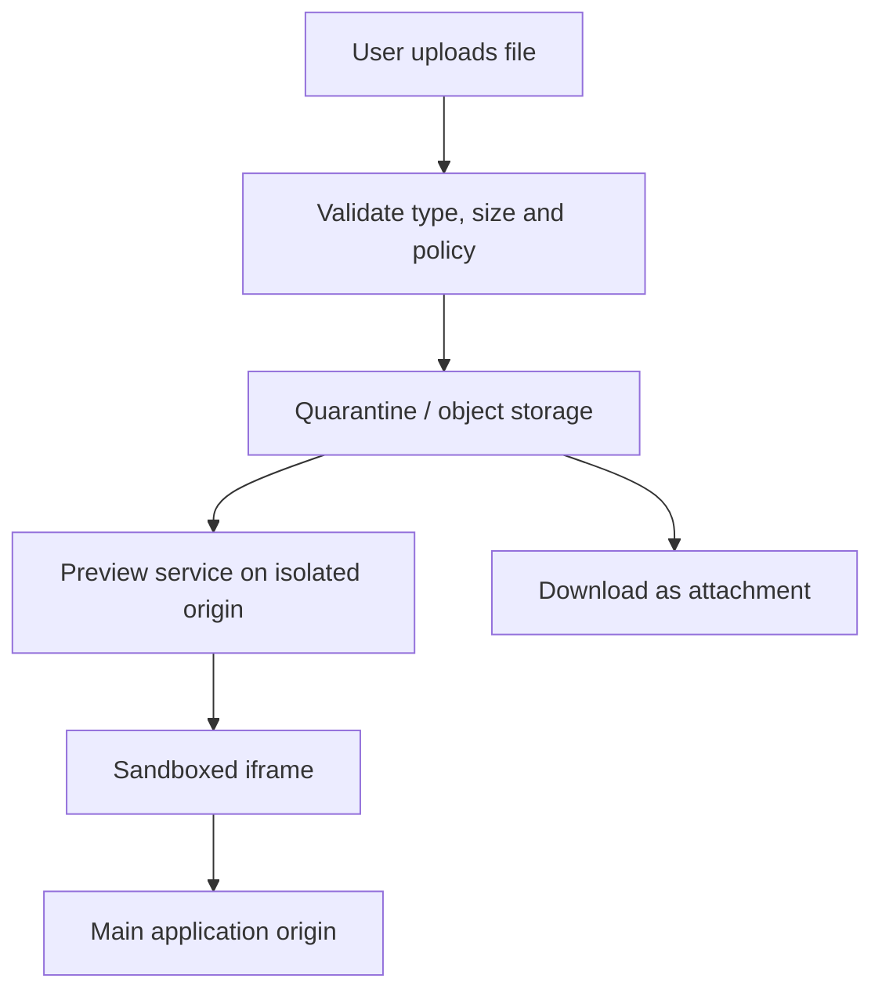

# Sandbox file — cô lập và xem trước tệp không tin cậy

> **Chương:** Download và file  
> **Mục tiêu:** Hiểu các lớp sandbox liên quan tới tệp trong browser; phân biệt iframe sandbox, CSP sandbox, file origin và browser process sandbox; biết giới hạn của sandbox khi mở tệp đã tải xuống; thiết kế luồng preview tệp không tin cậy; kiểm soát script, form, navigation, download và quyền truy cập origin; kiểm thử bằng DevTools.

## 1. Sandbox file là gì?

Khi browser hiển thị hoặc xử lý một tệp, nội dung đó có thể chứa HTML, JavaScript, SVG, PDF, media hoặc dữ liệu có cấu trúc. Một số định dạng có khả năng kích hoạt nội dung chủ động, tải tài nguyên khác, điều hướng trang hoặc tương tác với người dùng.

**Sandbox file** là cách cô lập nội dung tệp trong một môi trường có quyền hạn hạn chế để giảm hậu quả nếu tệp độc hại hoặc có hành vi ngoài dự kiến.

Trong web platform, không có một cơ chế duy nhất tên là “file sandbox” áp dụng tự động cho mọi tệp. Cần phân biệt:

- **Iframe sandbox:** Giới hạn khả năng của một browsing context được nhúng bằng thuộc tính `sandbox`.
- **CSP sandbox:** Áp đặt các hạn chế sandbox cho document qua HTTP response header.
- **Opaque origin:** Cô lập document khỏi origin thông thường trong một số ngữ cảnh sandbox.
- **Browser process sandbox:** Cơ chế cô lập process/renderer do browser và hệ điều hành triển khai.
- **OS file protection:** Cơ chế quarantine, cảnh báo hoặc kiểm tra tệp sau khi tải xuống, tùy hệ điều hành.

Các lớp này bổ trợ nhau nhưng có phạm vi khác nhau. Không nên cho rằng một tệp đã tải xuống tự động được bảo vệ bởi iframe sandbox hoặc rằng browser process sandbox thay thế việc thiết kế web an toàn.

## 2. Tại sao cần cô lập tệp không tin cậy?

Tệp đến từ người dùng, email, website khác hoặc hệ thống lưu trữ có thể chứa nội dung được thiết kế để khai thác cách browser hiển thị hoặc xử lý.

Ví dụ:

- HTML tải xuống có JavaScript và giao diện giả mạo trang đăng nhập.
- SVG có script hoặc tham chiếu tài nguyên bên ngoài.
- Tệp HTML được mở từ local disk và cố tải thêm nội dung.
- Tệp preview được nhúng vào trang ứng dụng có session đăng nhập.
- Nội dung tệp chứa link điều hướng người dùng sang trang phishing.
- Một parser hoặc viewer xử lý dữ liệu lỗi định dạng và gặp bug.

Nếu ứng dụng mở trực tiếp nội dung không tin cậy trên cùng origin với ứng dụng chính, nội dung đó có thể có quyền truy cập lớn hơn dự kiến. Rủi ro đặc biệt cao khi origin chứa cookie, API hoặc dữ liệu người dùng.

Mục tiêu của sandbox là giảm quyền của nội dung preview: hạn chế script, form, popup, navigation, storage và quyền truy cập origin theo nhu cầu tối thiểu.

## 3. Ba ranh giới cần phân biệt

| Ranh giới | Cơ chế | Câu hỏi cần trả lời |
| --- | --- | --- |
| Document/browsing context | iframe sandbox hoặc CSP sandbox | Tài liệu được phép chạy script, gửi form, mở popup hay điều hướng không? |
| Origin | SOP và opaque origin | Tài liệu có cùng origin với ứng dụng và truy cập DOM/storage/API được không? |
| Process/OS | Browser renderer sandbox, OS quarantine | Lỗi trong renderer hoặc tệp tải xuống bị giới hạn tới mức nào? |

Ví dụ, iframe có thể bị sandbox và nhận opaque origin, nhưng điều đó không đồng nghĩa tệp đã được lưu xuống ổ đĩa bị hệ điều hành sandbox khi người dùng mở bằng một ứng dụng khác.

Ngược lại, browser có thể chạy renderer trong process sandbox, nhưng document vẫn có thể được phép gửi form hoặc điều hướng theo HTML/CSP policy. Process isolation không thay document policy.

## 4. Iframe sandbox mặc định hạn chế điều gì?

Thuộc tính `sandbox` trên iframe bật một tập hạn chế. Nếu không cấp token ngoại lệ, document bên trong thường bị:

- Gán origin opaque riêng thay vì giữ origin thông thường.
- Chặn script.
- Chặn form submission.
- Chặn popup.
- Hạn chế top-level navigation.
- Hạn chế một số API và tương tác cần quyền.
- Chặn tải xuống do nội dung trong frame khởi tạo.

Ví dụ:

```html
<iframe
  src="https://files-preview.example.net/document/123"
  sandbox
  title="Xem trước tệp">
</iframe>
```

Không có token nào được cấp, vì vậy nội dung chỉ được chạy trong phạm vi rất hạn chế. Đây là điểm bắt đầu an toàn hơn khi preview nội dung HTML không tin cậy; sau đó chỉ thêm quyền thật sự cần thiết.

Hành vi chi tiết phụ thuộc loại nội dung, browser và token được cấp. Hãy kiểm tra trên browser mục tiêu thay vì suy ra từ giao diện.

## 5. Các token sandbox thường gặp

Token trong thuộc tính `sandbox` là các ngoại lệ mở lại một khả năng cụ thể:

| Token | Khả năng được cho phép |
| --- | --- |
| `allow-scripts` | Cho phép script trong frame chạy |
| `allow-same-origin` | Giữ origin thật của tài liệu thay vì ép thành opaque origin |
| `allow-forms` | Cho phép form submission |
| `allow-downloads` | Cho phép nội dung trong frame khởi tạo download theo policy browser |
| `allow-popups` | Cho phép mở popup hoặc browsing context mới |
| `allow-popups-to-escape-sandbox` | Popup mở ra không kế thừa sandbox restrictions của frame |
| `allow-top-navigation` | Cho phép điều hướng top-level context |
| `allow-top-navigation-by-user-activation` | Cho phép top-level navigation khi có user activation |
| `allow-modals` | Cho phép một số modal API như alert/confirm/prompt |
| `allow-pointer-lock` | Cho phép pointer lock |
| `allow-presentation` | Cho phép presentation session trong trường hợp hỗ trợ |
| `allow-storage-access-by-user-activation` | Cho phép yêu cầu Storage Access API theo điều kiện user activation |

Không cấp tất cả token để “cho trang chạy bình thường”. Hãy xác định tính năng preview cần gì, cấp đúng token đó và đánh giá tác động của từng quyền.

Một token không làm nội dung trở nên đáng tin. Ví dụ `allow-scripts` chỉ cho script chạy; nó không chứng minh script an toàn.

## 6. allow-scripts và allow-same-origin

Hai token này cần được cân nhắc đặc biệt:

- `allow-scripts` cho phép script chạy.
- `allow-same-origin` giữ origin của document theo origin thực tế thay vì opaque origin do sandbox tạo ra.

Nếu nội dung trong iframe cùng origin với trang cha và được cấp đồng thời cả hai token, script của iframe có thể truy cập DOM cùng origin, tìm tới iframe element ở trang cha, gỡ thuộc tính sandbox rồi reload để thoát khỏi các hạn chế. Đây là lý do không nên dùng tổ hợp này cho nội dung không tin cậy cùng origin.

Ví dụ không an toàn cho nội dung do người dùng tải lên:

```html
<iframe
  src="/uploads/user-content.html"
  sandbox="allow-scripts allow-same-origin">
</iframe>
```

Nếu cần chạy script trong preview, đặt nội dung trên origin riêng biệt và tránh chia sẻ cookie/API với ứng dụng chính. Chỉ cấp quyền script khi có lý do rõ ràng; không cấp same-origin một cách máy móc.

## 7. Opaque origin trong sandbox

Một iframe có `sandbox` nhưng không có `allow-same-origin` thường được gán một opaque origin. Opaque origin không bằng origin của URL nguồn và không được xác định chỉ bằng scheme/host/port như origin tuple thông thường.

Hệ quả:

- Document không được xem là same-origin với trang cha chỉ vì URL cùng host.
- Truy cập DOM giữa hai context vẫn bị giới hạn bởi SOP.
- Storage và một số API yêu cầu origin thông thường có thể bị hạn chế.
- Request từ context opaque có thể mang Origin được serialize thành `null`.

Không dùng `Origin: null` như một danh tính đáng tin. Nhiều loại context có opaque origin, không chỉ iframe sandbox; server không thể suy ra “đây là file hợp lệ” chỉ từ giá trị null.

Opaque origin giúp cô lập document, nhưng không thay authentication hoặc authorization ở server. Request mạng vẫn có thể được gửi trong những trường hợp được browser cho phép.

## 8. File origin và file://

Tệp HTML được mở trực tiếp thường có URL dạng `file://`. Quy tắc origin của file URL có các điểm đặc biệt và từng có khác biệt giữa browser. Trong nhiều triển khai hiện đại, file document được xử lý như opaque origin hoặc theo policy riêng của browser.

Không nên dựa vào giả định rằng:

- Hai file trong cùng thư mục luôn same-origin.
- File local có thể đọc các file khác trên máy.
- File local không thể gửi network request.
- Một file mở từ disk được sandbox giống iframe.
- Origin serialize thành `null` chứng minh nội dung an toàn.

Browser thường hạn chế việc đọc file local qua fetch/XHR và áp dụng quy tắc riêng cho file URL. Tuy nhiên, hành vi cụ thể có thể khác nhau; không dùng file origin làm ranh giới bảo mật cho dữ liệu nhạy cảm.

Nếu cần preview tệp HTML/SVG không tin cậy, hãy phục vụ nội dung qua origin cách ly và áp sandbox/CSP phù hợp. Không yêu cầu người dùng tải file về rồi mở local như một cách cô lập.

## 9. CSP sandbox

Content Security Policy có directive `sandbox` để áp đặt các hạn chế sandbox cho document được trả về. Khác với iframe sandbox, CSP sandbox được gửi từ server trong HTTP response header.

Ví dụ:

```http
Content-Security-Policy: sandbox; default-src 'none'; base-uri 'none'; form-action 'none'
```

Directive `sandbox` không có token ngoại lệ trong ví dụ, nên áp dụng các hạn chế sandbox cho document. Các directive CSP còn lại tiếp tục giới hạn resource, base URL và form destination.

Điểm cần nhớ:

- CSP sandbox được cấu hình ở response header.
- Không dùng thẻ meta CSP để thay thế directive sandbox.
- Có thể kết hợp CSP sandbox với iframe sandbox để tạo nhiều lớp kiểm soát.
- Token được cho phép cần giới hạn theo chức năng.
- Kiểm tra response header thực tế, đặc biệt khi nội dung đi qua CDN/proxy.

CSP sandbox phù hợp khi server muốn document tự mang policy cô lập, kể cả khi document được mở trực tiếp. Tuy nhiên, cần kiểm thử luồng điều hướng và viewer để bảo đảm policy không bị mất ở response khác.

## 10. Iframe sandbox và CSP sandbox khác nhau

| Đặc điểm | Iframe sandbox | CSP sandbox |
| --- | --- | --- |
| Nơi cấu hình | Thuộc tính trên iframe element | HTTP response header |
| Ai áp dụng | Trang cha áp lên browsing context con | Server áp policy cho document |
| Phạm vi | Context được nhúng trong iframe | Document nhận response policy |
| Token ngoại lệ | Có thể chỉ định trong thuộc tính | Có thể chỉ định trong directive |
| Mục tiêu | Giới hạn nội dung nhúng | Giới hạn document theo response policy |

Có thể dùng cả hai. Khi kết hợp, nội dung phải đáp ứng các hạn chế đang có hiệu lực; việc thêm token ở một lớp không nên được hiểu là tự động gỡ hạn chế ở lớp còn lại.

## 11. Sandbox không phải Content-Disposition attachment

`Content-Disposition: attachment` yêu cầu browser xử lý response theo hướng tải xuống thay vì hiển thị inline trong nhiều trường hợp.

Ví dụ:

```http
Content-Disposition: attachment; filename="report.html"
Content-Type: text/html
X-Content-Type-Options: nosniff
```

Header attachment không phải sandbox. Khi người dùng lưu file rồi mở bằng browser hoặc ứng dụng khác, cách xử lý phụ thuộc URL/file origin, browser và OS.

Ngược lại, iframe sandbox giới hạn document đang được nhúng; nó không thay đổi cách OS xử lý bản file đã tải xuống.

Với loại file chủ động như HTML/SVG không tin cậy, cân nhắc attachment để tránh render inline trong origin ứng dụng. Nếu sản phẩm cần preview, dùng origin riêng và sandbox thay vì dựa vào attachment như lớp bảo vệ duy nhất.

## 12. Tệp đã tải xuống không tự động được sandbox khi mở

Download là thao tác chuyển dữ liệu về thiết bị. Sau khi lưu, browser không còn kiểm soát toàn bộ cách file được mở:

- Người dùng có thể mở bằng browser, trình đọc PDF, editor hoặc ứng dụng khác.
- OS có thể hiển thị cảnh báo, gắn metadata nguồn tải hoặc quét file.
- Cơ chế quarantine/Mark-of-the-Web phụ thuộc hệ điều hành, filesystem và browser.
- Một số định dạng có thể chứa macro, script hoặc nội dung chủ động.

Không tuyên bố “file đã tải từ browser là an toàn” hoặc “đã nằm trong sandbox”. Hãy coi tệp từ nguồn không tin cậy là dữ liệu không tin cậy cho tới khi được xử lý bằng policy phù hợp.

Browser process sandbox là một lớp giảm tác động khi renderer bị khai thác. Nó không phải cam kết rằng mọi file được mở bởi mọi ứng dụng đều chạy trong một sandbox OS giống nhau.

## 13. Kiến trúc preview tệp an toàn

Một dịch vụ cho phép người dùng tải tệp lên và xem trước nên tách khu vực nội dung không tin cậy khỏi ứng dụng chính.

Kiến trúc tham khảo:



Các nguyên tắc:

- Lưu tệp không tin cậy ở storage riêng.
- Phục vụ preview từ origin riêng, không dùng cookie session của ứng dụng chính.
- Không dùng chung cookie Domain rộng giữa app và preview host.
- Dùng iframe sandbox với quyền tối thiểu.
- Áp CSP sandbox và resource policy phù hợp trên response preview.
- Dùng attachment cho định dạng chủ động nếu không cần preview.
- Không cho preview gọi API nội bộ chỉ vì browser tải được nội dung.

Ví dụ app ở `app.example.com` có thể dùng preview origin riêng như `usercontent-preview.example.net`. Tách registrable domain giúp giảm nguy cơ cookie Domain hoặc lỗi cấu hình subdomain làm nội dung preview cùng site với ứng dụng.

## 14. Vì sao chỉ dùng subdomain có thể chưa đủ?

Đặt preview ở `preview.example.com` tạo origin khác với `app.example.com`, nhưng hai host vẫn có thể same-site. Nếu ứng dụng đặt cookie với `Domain=example.com`, cookie đó có thể được gửi tới các subdomain phù hợp.

Điều này làm tăng rủi ro nếu preview host bị cấu hình sai hoặc có lỗ hổng:

- Cookie Domain rộng có thể bị gửi tới preview host.
- Một subdomain yếu có thể ảnh hưởng trust boundary của toàn site.
- SameSite không cô lập hai subdomain same-site.
- CORS hoặc postMessage cấu hình rộng có thể làm lộ dữ liệu.

Ưu tiên preview origin trên một site riêng, không có cookie đăng nhập và không có quyền truy cập API nội bộ. Nếu buộc dùng subdomain cùng site, dùng cookie host-only, không đặt Domain rộng và kiểm tra mọi luồng credential.

## 15. Ví dụ iframe preview với quyền tối thiểu

Ví dụ trang ứng dụng nhúng nội dung preview:

```html
<iframe
  id="file-preview"
  src="https://usercontent-preview.example.net/files/preview-123"
  sandbox
  referrerpolicy="no-referrer"
  loading="lazy"
  title="Xem trước tệp đã tải lên">
</iframe>
```

Ví dụ này không cấp script, same-origin, form, popup hoặc download. Nếu preview cần một tính năng cụ thể, đánh giá token tương ứng và thêm từng quyền một.

Trang cha cũng nên giới hạn nguồn frame bằng CSP:

```http
Content-Security-Policy: default-src 'self'; frame-src https://usercontent-preview.example.net
```

Response preview có thể giới hạn ancestor được phép nhúng:

```http
Content-Security-Policy: sandbox; default-src 'none'; base-uri 'none'; form-action 'none'; object-src 'none'; frame-ancestors https://app.example.com
```

Origin trong ví dụ cần thay bằng origin thật của ứng dụng. Kiểm tra CSP header sau CDN/proxy và xác minh browser không tải nội dung preview từ một host khác ngoài allowlist.

## 16. Khi nào preview cần script?

Tốt nhất preview nội dung tĩnh không cần JavaScript. Nếu định dạng hoặc viewer cần script:

- Chạy viewer trên origin riêng, không có session cookie của app.
- Cấp `allow-scripts` riêng khi cần.
- Không cấp `allow-same-origin` nếu không cần truy cập storage/API của origin preview.
- Giữ CSP resource allowlist nhỏ.
- Không cho script preview nhận token hoặc credential của ứng dụng.
- Không cho preview điều hướng top-level hoặc mở popup nếu không cần.
- Giới hạn message qua postMessage bằng origin và schema.

Ví dụ chỉ cấp script:

```html
<iframe
  src="https://usercontent-preview.example.net/viewer/123"
  sandbox="allow-scripts"
  referrerpolicy="no-referrer"
  title="Trình xem tệp">
</iframe>
```

Iframe vẫn bị sandbox và không giữ origin thật nếu thiếu `allow-same-origin`. Tuy nhiên, script vẫn có thể thực hiện các hành động mạng mà browser cho phép; sandbox không thay thế CSP, server authorization hoặc kiểm soát dữ liệu gửi đi.

## 17. Dùng CSP để hạn chế tài nguyên của preview

Một response HTML preview tĩnh, không cần script, có thể dùng policy chặt:

```http
Content-Security-Policy: sandbox; default-src 'none'; img-src data: blob: https://usercontent-preview.example.net; style-src https://usercontent-preview.example.net; font-src https://usercontent-preview.example.net; connect-src 'none'; object-src 'none'; base-uri 'none'; form-action 'none'; frame-ancestors https://app.example.com
X-Content-Type-Options: nosniff
Referrer-Policy: no-referrer
```

Policy này là ví dụ cần điều chỉnh theo viewer:

- `default-src 'none'` chặn resource không được allowlist.
- `img-src` chỉ cho phép nguồn ảnh đã chọn.
- `connect-src 'none'` chặn fetch/XHR/WebSocket từ preview.
- `object-src 'none'` chặn plugin/object embedding.
- `base-uri 'none'` ngăn thay đổi base URL.
- `form-action 'none'` chặn form submit.
- `frame-ancestors` giới hạn site được nhúng preview.
- `nosniff` giảm rủi ro MIME sniffing trong các ngữ cảnh được áp dụng.

Nếu viewer cần tải ảnh hoặc gọi API, chỉ mở đúng origin/endpoint cần thiết. Không thay toàn bộ policy bằng `default-src *` hoặc `unsafe-inline` chỉ để khắc phục lỗi preview.

Nếu viewer thật sự cần script, phải cho phép `allow-scripts` ở cả thuộc tính iframe và CSP sandbox response; chỉ thêm ở một lớp thì lớp còn lại vẫn có thể chặn script. Giữ `allow-same-origin` bị tắt nếu không cần origin/storage riêng của preview. Ví dụ iframe ở mục trước chỉ hoạt động với script khi response policy cũng cho phép script.

## 18. Xử lý HTML và SVG không tin cậy

HTML và SVG có thể chứa nội dung chủ động hoặc tham chiếu tài nguyên. Không nên render chúng bằng `innerHTML` trực tiếp trong origin ứng dụng.

Các lựa chọn an toàn hơn:

1. Phục vụ như attachment nếu không cần preview.
2. Chuyển đổi phía server sang định dạng tĩnh/inert đã kiểm soát.
3. Render trên origin riêng với CSP sandbox.
4. Nhúng bằng iframe sandbox với quyền tối thiểu.
5. Dùng text rendering nếu mục tiêu chỉ là xem source.

SVG có thể được tải như image trong một số ngữ cảnh với giới hạn khác với document navigation; hành vi phụ thuộc cách sử dụng. Không dựa vào việc nhúng qua thẻ img để biến mọi SVG thành dữ liệu vô hại. Nếu cần preview an toàn, rasterize hoặc phục vụ trong context cô lập.

Nếu hiển thị source text:

```js
const preview = document.querySelector("#source-preview");
preview.textContent = untrustedFileText;
```

`textContent` hiển thị nội dung như văn bản thay vì parse thành HTML. Đây là lựa chọn phù hợp khi không cần thực thi markup.

## 19. PDF và định dạng có viewer riêng

Browser hiện đại thường có PDF viewer tích hợp, nhưng implementation và mức cô lập phụ thuộc browser. Không giả định mọi PDF viewer, plugin hoặc ứng dụng ngoài browser có cùng sandbox.

Với PDF không tin cậy:

- Xác minh loại nội dung ở server.
- Cân nhắc attachment nếu không cần xem inline.
- Nếu preview inline, dùng viewer được cập nhật và origin cách ly.
- Không cấp quyền truy cập session app cho viewer.
- Không cho phép viewer gửi dữ liệu hoặc tải tài nguyên tùy ý nếu không cần.
- Kiểm tra quyền in, tải xuống, mở link và điều hướng theo yêu cầu sản phẩm.

Nếu chuyển PDF thành ảnh để preview, kiểm soát pipeline chuyển đổi, giới hạn kích thước/trang và cập nhật thư viện xử lý file. Rasterization cũng có thể gặp parser vulnerability hoặc resource exhaustion.

## 20. Blob URL không phải sandbox

`URL.createObjectURL()` tạo URL tham chiếu tới Blob hoặc MediaSource trong browser:

```js
const blob = new Blob([untrustedText], {
  type: "text/plain",
});
const objectUrl = URL.createObjectURL(blob);
previewLink.href = objectUrl;
```

Blob URL không tự làm nội dung an toàn. Với Blob URL, origin được gắn với môi trường tạo URL theo quy tắc blob URL; tạo URL từ trang ứng dụng không đồng nghĩa nội dung đã được chuyển sang một origin cô lập.

Không tạo Blob chứa HTML không tin cậy từ origin chính rồi mở nó như một cách sandbox. Nếu cần preview HTML, dùng origin riêng và CSP/iframe sandbox. Thu hồi URL khi không còn cần:

```js
URL.revokeObjectURL(objectUrl);
```

Thu hồi object URL giúp giải phóng tài nguyên và hạn chế URL tiếp tục được dùng; nó không thay thế việc kiểm soát nội dung.

## 21. Download từ iframe sandbox

Sandboxed iframe mặc định hạn chế download do nội dung trong frame khởi tạo. Token `allow-downloads` có thể cho phép hành vi tải xuống:

```html
<iframe
  src="https://usercontent-preview.example.net/report"
  sandbox="allow-downloads"
  title="Tài liệu xem trước">
</iframe>
```

Chỉ cấp token khi sản phẩm thật sự cần download từ frame. Browser vẫn có thể áp dụng user activation, download policy, safe browsing hoặc các hạn chế khác.

`allow-downloads` không làm file được tải xuống an toàn và không xác minh nội dung file. Server vẫn phải dùng Content-Type, Content-Disposition, filename handling và malware scanning phù hợp.

Tránh cấp `allow-popups-to-escape-sandbox` hoặc quyền top-level navigation chỉ để mở file trong cửa sổ mới; những token đó có thể làm nội dung thoát khỏi một phần hạn chế dự kiến.

## 22. postMessage giữa app và preview

Nếu app và preview cần trao đổi trạng thái, có thể dùng `postMessage`. Nhưng message phải được xác minh:

```js
const frame = document.querySelector("#file-preview");

window.addEventListener("message", (event) => {
  if (event.source !== frame.contentWindow) return;
  if (event.origin !== "null") return;

  const data = event.data;
  if (
    !data ||
    typeof data !== "object" ||
    data.type !== "preview-ready"
  ) {
    return;
  }

  markPreviewReady();
});
```

Ví dụ này giả định script được cho phép ở cả iframe sandbox và CSP sandbox response để gửi trạng thái, nhưng không có `allow-same-origin`; origin của document là opaque và `event.origin` được serialize thành chuỗi `null`. Giá trị null không xác thực danh tính preview; kiểm tra `event.source` chỉ ràng buộc message với browsing context của frame. Chỉ dùng message như tín hiệu trạng thái không đặc quyền, kiểm tra schema/size và không thực hiện hành động nhạy cảm dựa vào nó. Nonce có thể giúp ghép message với một lần tải, nhưng không biến nội dung không tin cậy thành nguồn xác thực.

Khi gửi message từ parent tới iframe opaque, browser yêu cầu target origin phù hợp với opaque origin; trong thực tế có thể phải dùng `*`. Chỉ gửi dữ liệu khởi tạo không nhạy cảm, không gửi token, dữ liệu cá nhân hoặc capability. Kiểm tra schema và giới hạn kích thước message.

## 23. Origin: null và CORS

Một số request xuất phát từ context có opaque origin được serialize thành:

```http
Origin: null
```

Nguồn có thể gồm sandboxed iframe không có `allow-same-origin`, một số file URL hoặc data URL context, tùy browser và loại request.

Không cấu hình:

```http
Access-Control-Allow-Origin: null
Access-Control-Allow-Credentials: true
```

như một cách cho phép “file preview hợp lệ”. Attacker có thể tạo context opaque của riêng họ và gửi request từ đó. Giá trị null không xác định danh tính hay nguồn đáng tin.

Nếu cần chia sẻ dữ liệu với preview, dùng một origin riêng cụ thể, xác thực session/capability ở server, giới hạn endpoint và kiểm tra message protocol. CORS chỉ kiểm soát việc JavaScript đọc response; nó không thay authentication, CSRF defense hoặc authorization.

## 24. Content-Type và MIME sniffing

Server phải trả Content-Type đúng với representation:

```http
Content-Type: text/plain; charset=utf-8
X-Content-Type-Options: nosniff
```

Không tin extension hoặc Content-Type do client upload khai báo. Người dùng có thể đổi tên file hoặc sửa multipart header; server cần kiểm tra nội dung theo allowlist và policy của ứng dụng.

`X-Content-Type-Options: nosniff` yêu cầu browser không tự suy đoán MIME trong các ngữ cảnh được tiêu chuẩn áp dụng, đặc biệt script/style. Nó không biến HTML hoặc SVG thành văn bản vô hại và không thay thế Content-Disposition, CSP hoặc origin isolation.

Với nội dung không tin cậy:

- Trả đúng MIME type.
- Dùng attachment nếu không cần inline rendering.
- Dùng text/plain khi mục tiêu là hiển thị source text.
- Không phục vụ HTML/SVG upload trực tiếp từ origin có session.
- Không dựa vào tên file hoặc extension làm kiểm tra bảo mật duy nhất.

## 25. Content-Disposition và tên tệp

Khi tải file không tin cậy, server có thể trả:

```http
Content-Type: application/octet-stream
Content-Disposition: attachment; filename="download.bin"
X-Content-Type-Options: nosniff
Cache-Control: private, no-store
```

Filename cần được chuẩn hóa và encode đúng theo HTTP header rules. Không đưa raw filename do user cung cấp vào header; tránh CR/LF injection, path separator, tên thiết bị đặc biệt và extension gây hiểu nhầm.

Attachment giảm khả năng browser render trực tiếp response trong tab, nhưng không ngăn người dùng mở file sau khi lưu. Cảnh báo/quarantine ở OS là lớp khác và không phải browser guarantee.

## 26. Kiểm soát dữ liệu và API của preview

Preview không nên nhận session cookie hoặc bearer token của ứng dụng chính. Nếu preview cần tải metadata, cấp một capability ngắn hạn với scope hẹp:

- Chỉ cho phép đọc một file cụ thể.
- Có expiry ngắn và có thể thu hồi.
- Không cho phép liệt kê file hoặc truy cập thư mục.
- Không dùng token đó để gọi API tài khoản khác.
- Không đưa token vào URL nếu có thể tránh; URL thường xuất hiện trong log/referrer/telemetry.
- Không gửi capability qua postMessage tới context không xác minh.

Server vẫn phải kiểm tra quyền trên mỗi request. Một iframe bị sandbox không thể thay authorization của endpoint.

Nếu cần preview private file, có thể dùng URL ký có thời hạn, cookie host-only trên preview origin hoặc một cơ chế proxy có xác thực. Đánh giá nguy cơ token leakage và cache policy trước khi chọn.

## 27. Giới hạn tài nguyên khi parse/preview

Sandbox quyền trình duyệt không tự ngăn mọi resource exhaustion. Một file có thể rất lớn, nén cực cao hoặc khiến parser tốn CPU/memory.

Đặt giới hạn:

- Kích thước upload tối đa.
- Kích thước giải nén và compression ratio.
- Số trang/ảnh/entry cần render.
- Thời gian xử lý và thời gian preview.
- Số worker/process chuyển đổi đồng thời.
- Pixel dimensions, frame count và media duration.
- Số request tài nguyên phụ mà viewer được phép tạo.

Ví dụ, một archive nhỏ có thể giải nén thành dữ liệu rất lớn; một ảnh có dimensions cực lớn có thể làm browser hoặc converter tiêu tốn nhiều bộ nhớ. Hãy kiểm tra giới hạn trước và trong quá trình parse.

## 28. Quarantine và xử lý file phía server

Một pipeline upload có thể gồm:

1. Nhận file vào vùng quarantine.
2. Sinh tên lưu trữ nội bộ, không dùng trực tiếp tên client.
3. Kiểm tra kích thước, extension, MIME và signature/magic bytes.
4. Quét malware hoặc dùng bộ xử lý chuyên dụng theo loại file.
5. Giới hạn giải nén và chuyển đổi trong worker cô lập.
6. Chỉ publish kết quả preview sau khi policy cho phép.
7. Phục vụ preview từ origin cách ly.

MIME sniffing, signature check và malware scanning đều có giới hạn. Không có một bước đơn lẻ nào chứng minh file an toàn tuyệt đối. Bộ chuyển đổi cũng xử lý input không tin cậy, vì vậy cần sandbox process, patch dependencies, quota và timeout riêng.

## 29. Browser process sandbox

Browser thường tách renderer process và áp dụng OS-level restrictions để giảm khả năng một lỗi trong renderer chiếm toàn bộ máy. Thiết kế cụ thể khác nhau giữa browser, OS, phiên bản và loại nội dung.

Đây là defense-in-depth:

- Giảm quyền truy cập file system/process của renderer.
- Hạn chế giao tiếp giữa renderer và browser process qua IPC có kiểm tra.
- Có thể tách site/process theo kiến trúc browser.
- Kết hợp exploit mitigations của OS và browser.

Web developer không thể thay thế hoặc cấu hình đầy đủ process sandbox bằng thuộc tính HTML. Cũng không nên coi process sandbox là lý do để cho phép file preview chạy script cùng origin hoặc nhận token ứng dụng.

## 30. Khi nào dùng iframe, attachment hoặc chuyển đổi tĩnh?

| Nhu cầu | Cách tiếp cận thường phù hợp |
| --- | --- |
| Tải file gốc về thiết bị | Content-Disposition attachment, MIME và filename an toàn |
| Xem source HTML/XML | Trả text/plain và hiển thị bằng textContent |
| Preview HTML không tin cậy | Origin riêng, iframe sandbox, CSP chặt |
| Preview SVG không tin cậy | Rasterize hoặc origin riêng với sandbox/CSP |
| Preview PDF | Viewer cập nhật trên origin cách ly hoặc attachment |
| Preview ảnh raster | Giới hạn dimensions/size và phục vụ với MIME chính xác |
| Chuyển đổi tài liệu | Worker/process cô lập, quota và timeout |

Không có một cách duy nhất phù hợp mọi định dạng. Chọn dựa trên active content, nhu cầu tương tác và mức tin cậy của nguồn file.

## 31. Kiểm thử sandbox file bằng DevTools

Thực hành trên staging/lab với file giả lập. Không mở file độc hại thật hoặc thử payload trên tài khoản production.

### Bước 1 — Kiểm tra response preview

Mở DevTools → Network, chọn request file preview. Kiểm tra:

- Content-Type.
- Content-Disposition.
- X-Content-Type-Options.
- Content-Security-Policy.
- Referrer-Policy.
- Cache-Control.

Xác minh response đi từ preview origin riêng và không mang cookie session của app.

### Bước 2 — Kiểm tra iframe sandbox

Trong Elements, kiểm tra thuộc tính sandbox và token được cấp. Thử một trang lab có script/form/popup/download để xác nhận những khả năng bị chặn.

### Bước 3 — Kiểm tra origin

Trong preview context, quan sát location origin và request Origin. Nếu iframe opaque, request có thể gửi Origin null. Xác minh server không cho phép null như một origin tin cậy.

### Bước 4 — Kiểm tra CSP

Mở Console để xem resource/script/form bị CSP chặn. Kiểm tra response header thay vì chỉ dựa vào thẻ meta.

### Bước 5 — Kiểm tra navigation và popup

Thử link target top, window.open và form submit trong file lab. Xác minh sandbox token không mở quyền vượt nhu cầu.

### Bước 6 — Kiểm tra download

Thử download từ iframe không có allow-downloads và sau đó trong một frame lab có token. Quan sát browser policy/user activation; xác minh response file vẫn có Content-Disposition và MIME đúng.

### Bước 7 — Kiểm tra postMessage

Gửi message hợp lệ, sai origin, sai source và sai schema. Xác minh parent bỏ qua message không hợp lệ; không dùng wildcard target origin cho dữ liệu nhạy cảm.

### Bước 8 — Kiểm tra ranh giới cookie

So sánh cookie request của app origin và preview origin. Xác minh cookie session host-only của app không được gửi sang preview host.

## 32. Chẩn đoán lỗi thường gặp

| Hiện tượng | Nguyên nhân có thể | Cách xử lý |
| --- | --- | --- |
| Script preview không chạy | Iframe/CSP sandbox đang chặn script | Chỉ cấp allow-scripts nếu thật sự cần và đánh giá rủi ro |
| Preview không đọc được storage | Opaque origin do sandbox | Thiết kế preview không phụ thuộc storage app; dùng API giới hạn |
| Request có Origin null | Opaque origin hoặc file/data context | Không allow null như danh tính tin cậy |
| Preview cùng site gửi cookie app | Cookie Domain rộng hoặc preview dùng subdomain cùng site | Dùng host-only cookie và site riêng |
| Download từ iframe bị chặn | Thiếu allow-downloads hoặc browser policy | Chỉ cấp token khi cần và kiểm tra user activation |
| Popup mở ra vẫn bị hạn chế | Popup kế thừa sandbox | Không cấp allow-popups-to-escape-sandbox trừ khi có threat review |
| CSP chặn ảnh/font | Resource allowlist thiếu | Chỉ thêm đúng nguồn cần thiết |
| HTML preview chạy trong origin app | File được phục vụ inline trên app host | Dùng attachment hoặc isolated preview origin |
| Blob HTML vẫn có quyền của app | Blob URL gắn với creator origin | Không coi Blob URL là sandbox; dùng origin riêng |
| PDF preview lỗi | Viewer/browser policy hoặc file parser | Dùng viewer cập nhật, attachment hoặc chuyển đổi cô lập |
| File lớn làm tab treo | Thiếu giới hạn kích thước/parse time | Quota, timeout, worker/process isolation |
| postMessage bị bỏ qua | Opaque origin hoặc kiểm tra source/origin không khớp | Thiết kế handshake chặt và không gửi bí mật tới opaque context |

## 33. Những ngộ nhận thường gặp

| Ngộ nhận | Cách hiểu đúng |
| --- | --- |
| “Download xong thì file đã nằm trong browser sandbox.” | File được lưu xuống thiết bị; cách mở sau đó phụ thuộc browser, OS và ứng dụng khác. |
| “Content-Disposition attachment là sandbox.” | Attachment yêu cầu tải xuống; nó không cô lập file khi mở. |
| “Iframe sandbox làm mọi request mạng biến mất.” | Sandbox giới hạn nhiều khả năng document nhưng không thay firewall, CSP hoặc server authorization. |
| “Origin null là file an toàn.” | Null có thể đại diện nhiều opaque context; không phải danh tính tin cậy. |
| “allow-scripts chỉ cho script chạy, không ảnh hưởng bảo mật khác.” | Script có thể thao tác DOM, gửi request và khai thác các quyền còn lại của context. |
| “allow-same-origin luôn vô hại.” | Kết hợp với allow-scripts cho nội dung cùng origin có thể làm mất hiệu lực sandbox. |
| “Blob URL tạo ra origin mới.” | Blob URL gắn với origin creator theo quy tắc blob URL; không tự cô lập nội dung. |
| “nosniff làm HTML upload không thể thực thi.” | Nosniff có phạm vi cụ thể; không thay attachment/origin isolation/CSP. |
| “PDF viewer luôn an toàn tuyệt đối.” | Viewer có implementation và sandbox riêng; vẫn cần cập nhật, giới hạn và cô lập. |
| “Quét malware chứng minh file sạch.” | Scanner giảm rủi ro nhưng không bảo đảm phát hiện mọi payload hoặc parser bug. |

## 34. Checklist thiết kế sandbox file

- Coi mọi file từ user/nguồn ngoài là dữ liệu không tin cậy.
- Phân biệt iframe sandbox, CSP sandbox, opaque origin, process sandbox và OS quarantine.
- Không preview HTML/SVG không tin cậy trực tiếp trên origin có session.
- Ưu tiên preview origin/site riêng, không có cookie đăng nhập.
- Dùng iframe sandbox không token trước; chỉ thêm quyền cần thiết.
- Tránh allow-scripts kết hợp allow-same-origin cho nội dung không tin cậy cùng origin.
- Dùng CSP sandbox và resource allowlist trên response preview.
- Dùng frame-src ở app và frame-ancestors ở preview để giới hạn embedding.
- Dùng attachment cho định dạng chủ động nếu không cần inline preview.
- Trả Content-Type đúng và X-Content-Type-Options: nosniff; không dựa vào nosniff như lớp duy nhất.
- Không allow CORS Origin null như nguồn tin cậy.
- Không coi Blob URL hoặc file:// là sandbox.
- Validate file signature, size, decompression ratio và parser limits.
- Chạy converter/scanner trong worker/process cô lập có quota và timeout.
- Không gửi app session/token vào preview; dùng capability hẹp, ngắn hạn khi cần.
- Validate source, origin, schema và size của postMessage.
- Chỉ cho phép download từ iframe khi use case yêu cầu.
- Kiểm tra cookie Domain và tách preview khỏi credential app.
- Kiểm thử navigation, popup, form, script, download và storage trên browser mục tiêu.

## 35. Câu hỏi tự kiểm tra

1. Vì sao “sandbox file” không phải một cơ chế duy nhất áp dụng cho mọi file?
2. Iframe sandbox mặc định hạn chế những khả năng nào?
3. allow-scripts và allow-same-origin có ý nghĩa gì?
4. Vì sao tổ hợp hai token đó nguy hiểm với iframe cùng origin?
5. Opaque origin ảnh hưởng SOP và Origin header như thế nào?
6. Vì sao không được allow CORS Origin null như một danh tính tin cậy?
7. CSP sandbox khác iframe sandbox ở vị trí cấu hình nào?
8. Content-Disposition attachment khác sandbox như thế nào?
9. Vì sao file đã tải xuống không tự động được sandbox khi mở?
10. Vì sao Blob URL không phải cơ chế cô lập origin?
11. Khi nào nên dùng textContent thay vì render HTML preview?
12. Vì sao preview origin riêng cần tránh cookie Domain rộng?
13. allow-downloads có bảo đảm file tải xuống an toàn không?
14. Những giới hạn tài nguyên nào cần áp dụng cho file parser?
15. Cần kiểm tra gì trong DevTools để xác minh sandbox policy?

**Ghi nhớ:** Tệp không tin cậy cần được cô lập theo đúng lớp: iframe sandbox và CSP sandbox giới hạn document; opaque origin giảm quyền truy cập origin; browser process sandbox và OS quarantine là lớp triển khai riêng. Attachment chỉ điều khiển cách browser xử lý response tải xuống, không sandbox file khi mở. Hãy preview HTML/SVG trên origin riêng, cấp token sandbox tối thiểu, kiểm soát MIME/CSP/cookie/postMessage và giới hạn tài nguyên parser. Không tin Origin null, Blob URL hoặc kết quả malware scan như bằng chứng file an toàn.
