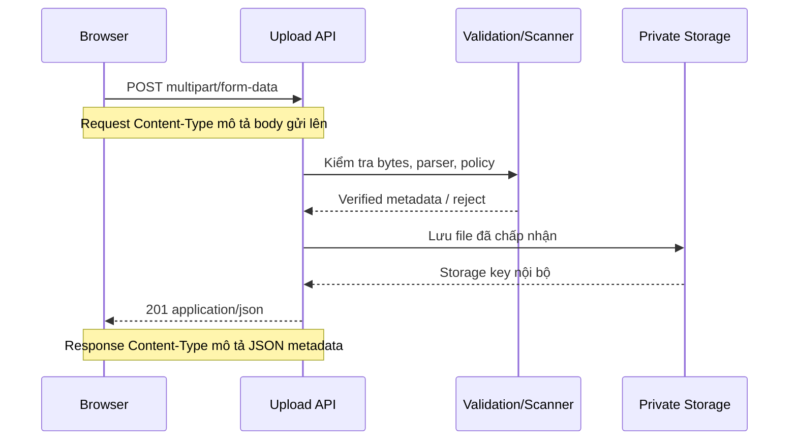
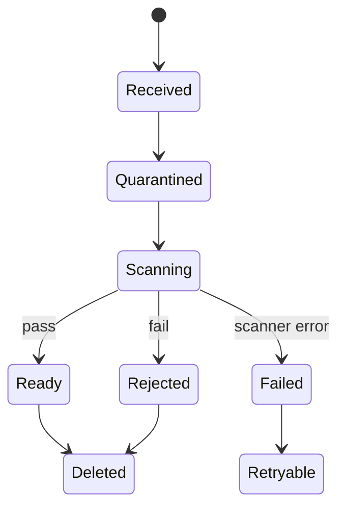

# Upload response: khai báo Content-Type an toàn sau khi nhận tệp

## 1. Vì sao response của upload endpoint cần được kiểm soát?

Khi browser upload một tệp, request thường dùng `multipart/form-data` hoặc một định dạng body khác. Server nhận bytes, xác minh tệp, lưu trữ và trả response để thông báo kết quả. Response này có thể là JSON chứa mã tệp, trạng thái quét, kích thước và media type đã xác minh.

`Content-Type` của request upload mô tả dữ liệu browser gửi lên. `Content-Type` của response mô tả representation server gửi trở lại. Hai header phục vụ hai chiều khác nhau. Server không nên sao chép MIME type do client khai báo sang response, cũng không nên phản chiếu bytes của tệp upload trong một response HTML chỉ để hiển thị kết quả.

Một lỗi thường gặp là upload endpoint nhận file HTML/SVG do người dùng kiểm soát rồi trả ngay nội dung đó với `Content-Type: text/html`, hoặc trả file với `Content-Type` dựa trên filename mà không xác minh. Browser có thể diễn giải response như nội dung chủ động trong origin của ứng dụng. Nếu trang đó có cùng origin với ứng dụng đã đăng nhập, hậu quả có thể vượt khỏi phạm vi một file download.

Bài học này tập trung vào **response sau upload**: chọn status code và media type đúng, thiết kế response body chỉ chứa metadata cần thiết, xử lý lỗi an toàn và tách endpoint preview/download khỏi endpoint nhận tệp.

Sau bài học, bạn có thể:

- Phân biệt `Content-Type` request upload với `Content-Type` response.
- Chọn `application/json` hoặc `application/problem+json` cho upload API.
- Dùng status code phù hợp cho upload đồng bộ và xử lý bất đồng bộ.
- Trả metadata đã xác minh thay vì phản chiếu nội dung file.
- Ngăn stored XSS qua response upload và trang kết quả.
- Thiết kế endpoint riêng để preview hoặc tải file đã được kiểm tra.
- Áp dụng `nosniff`, `Content-Disposition`, cache policy và CORS phù hợp.
- Xử lý lỗi 413, 415, 422 và 5xx mà không làm lộ nội bộ.
- Kiểm thử response upload bằng DevTools và canary content.

## 2. Hai chiều Content-Type trong một luồng upload

Luồng upload có request và response riêng:



Ví dụ request:

```http
POST /api/uploads HTTP/1.1
Content-Type: multipart/form-data; boundary=----browser-boundary
Accept: application/json

------browser-boundary
Content-Disposition: form-data; name="file"; filename="avatar.png"
Content-Type: image/png

...file bytes...
------browser-boundary--
```

Header `Content-Type: image/png` bên trong part là metadata do client cung cấp. Server phải coi nó là input không tin cậy.

Response thành công có thể là:

```http
HTTP/1.1 201 Created
Content-Type: application/json; charset=utf-8
X-Content-Type-Options: nosniff
Cache-Control: no-store
Location: /api/uploads/upl_8f31c2

{
  "id": "upl_8f31c2",
  "status": "ready",
  "mediaType": "image/png",
  "size": 48231
}
```

`Content-Type: application/json` mô tả JSON response. `mediaType` trong JSON là metadata của file đã được server xác minh, không phải header response và không được dùng làm bằng chứng an toàn nếu chỉ sao chép từ request.

### 2.1 Request Content-Type không quyết định response Content-Type

Không làm như sau:

```javascript
// Sai: phản chiếu MIME type do client khai báo.
res.setHeader("Content-Type", req.file.mimetype);
res.send(req.file.buffer);
```

Đoạn code trên trộn lẫn hai mục đích: MIME type của file upload và media type của response. Nếu client khai báo `text/html` và gửi HTML, server có thể trả HTML ngay từ upload route.

Upload API nên trả representation cố định theo hợp đồng, thường là JSON hoặc problem details. Endpoint download/preview riêng sẽ quyết định media type dựa trên metadata đã xác minh và policy hiển thị.

### 2.2 Accept và Content-Type không thể thay thế nhau

| Header | Hướng | Ý nghĩa |
| --- | --- | --- |
| Request `Content-Type` | Browser → server | Body request đang được mã hóa theo media type nào. |
| Request `Accept` | Browser → server | Client có thể xử lý những media type response nào. |
| Response `Content-Type` | Server → browser | Body response thực tế thuộc media type nào. |

Browser gửi `Accept: application/json` không tự làm server trả JSON. Server cần thực hiện content negotiation hoặc định nghĩa upload endpoint luôn trả JSON. Nếu server hỗ trợ nhiều response format theo `Accept`, cần trả đúng `Content-Type` và `Vary: Accept` khi representation thay đổi theo header đó.

## 3. Chọn media type cho upload response

Với upload API phục vụ giao diện web, `application/json` thường là lựa chọn phù hợp cho response thành công:

```http
Content-Type: application/json; charset=utf-8
```

JSON giúp client nhận một cấu trúc dữ liệu ổn định gồm file ID, trạng thái xử lý và metadata được phép công khai.

Response lỗi có thể dùng `application/problem+json` theo Problem Details:

```http
Content-Type: application/problem+json
```

Không trả file upload bằng media type gốc ngay tại endpoint nhận file. Tách upload result khỏi nội dung file giúp browser luôn hiểu response theo một hợp đồng API rõ ràng.

### 3.1 Khi nào dùng application/json?

Dùng `application/json` cho:

- Kết quả upload thành công.
- Trạng thái xử lý tệp.
- File identifier và resource URL nội bộ.
- Metadata đã xác minh và được phép hiển thị.
- Kết quả validation có cấu trúc.

Ví dụ:

```json
{
  "id": "upl_8f31c2",
  "status": "scanning",
  "displayName": "avatar.png",
  "mediaType": "image/png",
  "size": 48231
}
```

`displayName` cần được làm sạch trước khi lưu/trả về. JSON serialization bảo vệ cấu trúc JSON, nhưng frontend vẫn phải encode giá trị khi hiển thị trong HTML/DOM.

### 3.2 Khi nào dùng application/problem+json?

Dùng Problem Details cho lỗi API có thể được client xử lý:

```http
HTTP/1.1 415 Unsupported Media Type
Content-Type: application/problem+json
X-Content-Type-Options: nosniff

{
  "type": "https://api.example.test/problems/unsupported-upload-type",
  "title": "Unsupported upload type",
  "status": 415,
  "detail": "The uploaded file format is not accepted.",
  "instance": "/api/uploads"
}
```

Response chỉ đưa ra thông tin đủ để người dùng hiểu và sửa request. Không trả stack trace, filesystem path, bucket name, scanner internals hoặc bytes của tệp.

### 3.3 Không trả text/html cho kết quả API

Upload endpoint trả JSON không nên dùng `text/html` chỉ để nhúng thông báo thành công. Nếu browser điều hướng trực tiếp tới endpoint và nhận HTML có chứa filename hoặc nội dung upload, dữ liệu đó có thể trở thành injection point.

Không dùng template string để ghép user input vào HTML response. Nếu cần trang kết quả, render qua template engine có auto-escaping, encode theo đúng context và giữ response policy riêng.

## 4. Chọn HTTP status code cho upload

Status code mô tả kết quả xử lý; `Content-Type` mô tả body response. Chọn hai thứ độc lập và nhất quán.

| Status | Khi dùng | Response thường gặp |
| --- | --- | --- |
| `201 Created` | File đã được xác minh và resource đã tạo. | JSON metadata, có thể kèm `Location`. |
| `202 Accepted` | Đã nhận yêu cầu, còn chờ scan/processing. | JSON trạng thái job/resource. |
| `200 OK` | Upload endpoint thực hiện một thao tác đã hoàn tất nhưng không tạo resource mới theo semantics API. | JSON kết quả. |
| `204 No Content` | Thành công nhưng không cần body. | Không có response body; không cần Content-Type. |
| `400 Bad Request` | Multipart/body sai cấu trúc hoặc request không hợp lệ. | `application/problem+json`. |
| `401 Unauthorized` | Thiếu hoặc không hợp lệ authentication. | Problem details hoặc response auth theo hợp đồng. |
| `403 Forbidden` | Đã xác thực nhưng không có quyền upload. | `application/problem+json`. |
| `413 Content Too Large` | Request/file vượt giới hạn. | Problem details nếu server/proxy có thể trả body. |
| `415 Unsupported Media Type` | Request representation hoặc loại file không được endpoint chấp nhận. | `application/problem+json`. |
| `422 Unprocessable Content` | Body parse được nhưng nội dung file không đạt policy/validation. | `application/problem+json`. |
| `429 Too Many Requests` | Vượt rate limit/quota. | Problem details, có thể kèm `Retry-After`. |
| `5xx` | Lỗi nội bộ hoặc dependency. | Lỗi tổng quát, không lộ chi tiết nội bộ. |

### 4.1 201 Created cho upload đồng bộ

Nếu server đã lưu resource và resource có thể được truy vấn, `201 Created` là lựa chọn tự nhiên. `Location` có thể trỏ tới API metadata:

```http
HTTP/1.1 201 Created
Location: /api/uploads/upl_8f31c2
Content-Type: application/json; charset=utf-8
```

Location không nên chứa token, signed URL dài hạn hoặc đường dẫn filesystem. Client cần gọi API resource theo authorization hiện tại.

### 4.2 202 Accepted cho scan bất đồng bộ

Nếu upload đã được nhận nhưng malware scanning, transcoding hoặc CDR chưa hoàn tất, không báo `ready` quá sớm. Trả `202 Accepted` cùng job/resource ID:

```http
HTTP/1.1 202 Accepted
Content-Type: application/json; charset=utf-8
Location: /api/uploads/upl_8f31c2
Retry-After: 3

{
  "id": "upl_8f31c2",
  "status": "scanning",
  "statusUrl": "/api/uploads/upl_8f31c2"
}
```

Client poll status URL bằng session/authentication bình thường. Không đưa capability secret vào URL chỉ để người dùng có thể poll.

### 4.3 204 No Content không có body

Nếu hợp đồng API chỉ cần xác nhận đã xóa hoặc thay thế một upload resource, `204` có thể phù hợp. Không gửi JSON body cùng `204`; client không nên kỳ vọng có representation để parse.

## 5. Thiết kế response body chỉ chứa metadata

Upload response nên cho client biết điều cần thiết để tiếp tục luồng giao diện. Nó không cần trả lại bytes file, filesystem path hoặc toàn bộ metadata nội bộ.

Ví dụ response tối thiểu:

```json
{
  "id": "upl_8f31c2",
  "status": "scanning",
  "displayName": "avatar.png",
  "mediaType": "image/png",
  "size": 48231,
  "createdAt": "2026-11-22T09:10:00Z"
}
```

Các trường cần cân nhắc:

| Trường | Mục đích | Quy tắc |
| --- | --- | --- |
| `id` | Định danh resource để truy vấn trạng thái. | Dùng ID nội bộ/opaque; vẫn kiểm tra authorization ở mọi lần truy cập. |
| `status` | Cho biết `scanning`, `ready`, `rejected` hoặc trạng thái khác. | Chỉ báo `ready` khi pipeline đã hoàn tất. |
| `displayName` | Hiển thị tên tệp trong UI. | Làm sạch control character, độ dài và ký tự gây nhầm lẫn. |
| `mediaType` | Cho UI biết loại tệp đã xác minh. | Lấy từ kết quả server-side, không sao chép header multipart. |
| `size` | Hiển thị kích thước. | Là kích thước bytes server thực nhận/lưu. |
| `createdAt` | Thời điểm nhận file. | Dùng timestamp do server tạo. |

Không trả:

- Raw file bytes trong JSON hoặc HTML.
- Đường dẫn filesystem, bucket private hoặc storage key có ý nghĩa nội bộ.
- Session ID, access token, signed URL dài hạn hoặc secret scanner.
- Stack trace, exception message nội bộ hoặc cấu hình hạ tầng.
- Tên file gốc chưa được xử lý nếu có thể chứa dữ liệu nhạy cảm hoặc control character.

### 5.1 File ID không phải authorization

ID khó đoán giúp giảm khả năng dò tìm nhưng không thay thế kiểm tra quyền. Endpoint `GET /api/uploads/{id}` phải xác thực user và kiểm tra user có quyền đọc resource cụ thể hay không. Trả một ID ngẫu nhiên trong response không làm file trở thành public.

### 5.2 Không trả storage URL như một mặc định

Tránh trả bucket URL hoặc signed URL lâu hạn trong response upload nếu client chỉ cần hiển thị trạng thái. Nếu cần tải file, dùng API download có authorization hoặc signed URL scope hẹp, expiry ngắn và không được log/copy vào analytics.

### 5.3 Metadata phải phản ánh trạng thái xử lý thực tế

Nếu scanner chưa hoàn tất, `mediaType` có thể là `pending`/chưa có hoặc chỉ là định dạng dự kiến. Không gắn nhãn `verified` cho dữ liệu mới chỉ dựa trên extension. Response nên phân biệt:

- `declaredMediaType`: client khai báo, chỉ để điều tra nếu thực sự cần lưu.
- `verifiedMediaType`: kết quả server xác minh.
- `status`: trạng thái tổng thể của pipeline.

Thông thường API không cần trả `declaredMediaType` cho frontend; nếu lưu để audit, phải đánh dấu rõ là untrusted metadata.

## 6. Không phản chiếu nội dung upload trong response

Không trả lại nguyên bytes upload ngay từ endpoint nhận file. Một file HTML/SVG có thể được browser render nếu response khai báo media type tương ứng hoặc browser xử lý theo ngữ cảnh. Việc echo nội dung có thể biến API upload thành endpoint phục vụ nội dung attacker-controlled.

Ví dụ không an toàn:

```javascript
app.post("/upload", upload.single("file"), (req, res) => {
  res.type(req.file.mimetype);
  res.send(req.file.buffer);
});
```

Client có thể gửi `mimetype` là `text/html` và bytes HTML. Response sẽ trở thành HTML do attacker kiểm soát trên origin upload API.

### 6.1 Trả JSON metadata thay vì file bytes

Mẫu an toàn hơn:

```javascript
app.post("/api/uploads", upload.single("file"), async (req, res, next) => {
  try {
    const result = await validateAndStore(req.file, req.user);

    res
      .status(201)
      .type("application/json")
      .set("X-Content-Type-Options", "nosniff")
      .set("Cache-Control", "no-store")
      .json({
        id: result.id,
        status: result.status,
        displayName: result.safeDisplayName,
        mediaType: result.verifiedMediaType,
        size: result.size
      });
  } catch (error) {
    next(error);
  }
});
```

`validateAndStore` là phần xử lý server-side: kiểm tra quyền, kích thước, bytes, parser, scanner và storage. Nó không được tin `req.file.mimetype` như kết quả xác minh.

### 6.2 JSON serialization không thay output encoding ở frontend

Response JSON giữ dữ liệu ở dạng chuỗi JSON, nhưng khi frontend hiển thị `displayName`, không chèn trực tiếp vào `innerHTML`:

```javascript
const result = await response.json();
nameElement.textContent = result.displayName;
```

`textContent` hiển thị dữ liệu như text. Nếu cần rich HTML, dùng template/sanitizer phù hợp và không đưa tên file hoặc metadata không tin cậy vào HTML context trực tiếp.

### 6.3 Không tạo HTML response bằng string concatenation

Tránh:

```javascript
// Không an toàn: displayName có thể do người upload kiểm soát.
res.send("<h1>Uploaded " + req.file.originalname + "</h1>");
```

Nếu API cần redirect về trang kết quả, redirect tới một route ứng dụng cố định và lưu kết quả ở server/session state. Trang kết quả tải metadata qua API rồi render bằng output encoding.

## 7. Response lỗi không được tiết lộ nội bộ

Upload thất bại có thể do multipart sai, MIME không được chấp nhận, file hỏng, malware, quota hoặc dependency lỗi. Response nên cung cấp mã lỗi ổn định và thông điệp có thể hành động.

Ví dụ lỗi validation:

```http
HTTP/1.1 422 Unprocessable Content
Content-Type: application/problem+json
X-Content-Type-Options: nosniff
Cache-Control: no-store

{
  "type": "https://api.example.test/problems/file-validation-failed",
  "title": "File validation failed",
  "status": 422,
  "detail": "The uploaded file could not be accepted.",
  "instance": "/api/uploads",
  "code": "UPLOAD_VALIDATION_FAILED"
}
```

Không đưa chi tiết như scanner signature, parser stack trace, absolute path, temporary filename hoặc bucket name vào response public.

### 7.1 Phân biệt 415 và 422

- `415 Unsupported Media Type`: server không hỗ trợ media type của request representation hoặc loại file theo policy endpoint.
- `422 Unprocessable Content`: request body có thể parse được nhưng nội dung không vượt qua validation hoặc policy.

Hợp đồng API cần thống nhất cách dùng hai status này. Không trả `200 OK` cho file bị từ chối rồi yêu cầu frontend tự suy luận qua chuỗi error.

### 7.2 413 có thể đến từ proxy

Reverse proxy/CDN có thể từ chối request trước khi tới ứng dụng. Khi đó body lỗi và `Content-Type` có thể do proxy tạo. Nếu muốn response nhất quán, cấu hình error page/API behavior ở edge; nhưng không được giả định ứng dụng luôn kiểm soát response 413.

### 7.3 Error detail không phản chiếu input

Không trả lại nguyên filename, multipart header, query hoặc parser error do file tạo ra. Nếu cần nêu tên file trong UI, trả một display name đã làm sạch và encode. Với lỗi chung, dùng error code để frontend dịch thông báo.

## 8. Header bảo vệ cho upload response

Một response JSON upload có thể dùng:

```http
HTTP/1.1 201 Created
Content-Type: application/json; charset=utf-8
X-Content-Type-Options: nosniff
Cache-Control: no-store
```

### 8.1 X-Content-Type-Options: nosniff

`nosniff` là lớp bảo vệ bổ sung để browser áp dụng MIME checking nghiêm ngặt trong các ngữ cảnh như script và stylesheet. Nó không biến một response HTML nguy hiểm thành JSON, không xác minh file upload và không thay thế Content-Disposition cho endpoint download.

Upload API vẫn phải khai báo đúng `Content-Type: application/json` hoặc `application/problem+json`. Không dựa vào `nosniff` để sửa một response trả sai media type.

### 8.2 Cache-Control: no-store

Upload response có thể chứa file ID, tên hiển thị hoặc trạng thái nghiệp vụ. Với response gắn với user/session, `Cache-Control: no-store` giúp tránh lưu representation trong browser cache hoặc shared cache theo các quy tắc HTTP cache.

Không gửi `public` hoặc `s-maxage` cho response riêng tư chỉ để tăng hiệu năng. Nếu có endpoint metadata được phép cache, thiết kế cache key, authorization và `private`/`no-store` theo threat model.

### 8.3 Content-Security-Policy không phải header thay thế Content-Type

CSP có thể bảo vệ một HTML page kết quả hoặc preview bằng cách giới hạn script/resource. Nhưng CSP không làm JSON thành JSON và không xác thực bytes upload. Dùng CSP cho trang HTML; dùng media type đúng cho API response.

### 8.4 Referrer-Policy và Permissions Policy theo ngữ cảnh

Upload API JSON thường không cần phát triển một chính sách document như trang HTML. Với trang upload hoặc preview nhạy cảm, cân nhắc `Referrer-Policy: no-referrer`, CSP và Permissions Policy phù hợp. Chỉ thêm header mà endpoint thực sự cần; không coi chúng là biện pháp chống upload MIME confusion.

## 9. Ví dụ upload response với Spring Boot

Trong ứng dụng Java/Spring, khai báo rõ request media type và response media type:

```java
@RestController
@RequestMapping("/api/uploads")
class UploadController {

    private final UploadService uploadService;

    UploadController(UploadService uploadService) {
        this.uploadService = uploadService;
    }

    @PostMapping(
        consumes = MediaType.MULTIPART_FORM_DATA_VALUE,
        produces = MediaType.APPLICATION_JSON_VALUE
    )
    ResponseEntity<UploadResponse> upload(
            @RequestPart("file") MultipartFile file,
            Principal principal) {

        VerifiedUpload saved = uploadService.validateAndStore(file, principal);

        UploadResponse body = new UploadResponse(
            saved.id(),
            saved.status(),
            saved.safeDisplayName(),
            saved.verifiedMediaType(),
            saved.size()
        );

        return ResponseEntity
            .created(URI.create("/api/uploads/" + saved.id()))
            .contentType(MediaType.APPLICATION_JSON)
            .header("X-Content-Type-Options", "nosniff")
            .header(HttpHeaders.CACHE_CONTROL, "no-store")
            .body(body);
    }
}
```

DTO response:

```java
public record UploadResponse(
    String id,
    String status,
    String displayName,
    String mediaType,
    long size
) {}
```

`UploadService.validateAndStore` phải xác minh bytes, parser, kích thước, quota, malware scan và quyền truy cập. Không lấy `MultipartFile.getContentType()` làm `verifiedMediaType`; giá trị đó xuất phát từ request part và do client kiểm soát.

### 9.1 Khai báo consumes và produces

- `consumes = MULTIPART_FORM_DATA_VALUE` giới hạn loại request body endpoint nhận.
- `produces = APPLICATION_JSON_VALUE` mô tả response representation endpoint cung cấp.

`consumes` không xác minh bytes file. `produces` cũng không tự bảo đảm body an toàn nếu controller trả dữ liệu không tin cậy hoặc tự tạo HTML.

### 9.2 Trả ProblemDetail cho lỗi

Spring hỗ trợ `ProblemDetail` để biểu diễn lỗi:

```java
@ExceptionHandler(UploadValidationException.class)
ResponseEntity<ProblemDetail> handleUploadValidation(
        UploadValidationException exception) {

    ProblemDetail problem = ProblemDetail.forStatusAndDetail(
        HttpStatus.UNPROCESSABLE_ENTITY,
        "The uploaded file could not be accepted."
    );
    problem.setType(URI.create(
        "https://api.example.test/problems/file-validation-failed"
    ));
    problem.setTitle("File validation failed");
    problem.setProperty("code", "UPLOAD_VALIDATION_FAILED");

    return ResponseEntity
        .status(HttpStatus.UNPROCESSABLE_ENTITY)
        .contentType(MediaType.APPLICATION_PROBLEM_JSON)
        .header("X-Content-Type-Options", "nosniff")
        .header(HttpHeaders.CACHE_CONTROL, "no-store")
        .body(problem);
}
```

Không đưa `exception.getMessage()` vào `detail` nếu message có thể chứa path, parser internals hoặc dữ liệu do attacker tạo. Ghi chi tiết nội bộ vào log đã được kiểm soát bằng request ID.

## 10. Browser gửi FormData và đọc response đúng cách

Khi dùng `FormData`, để browser tự tạo `Content-Type` cùng boundary:

```javascript
const formData = new FormData();
formData.append("file", fileInput.files[0]);

const response = await fetch("/api/uploads", {
  method: "POST",
  body: formData,
  headers: {
    Accept: "application/json, application/problem+json"
  },
  credentials: "same-origin"
});
```

Không tự đặt `Content-Type: multipart/form-data` khi body là `FormData`. Browser cần thêm boundary thực tế vào header; nếu tự đặt header thiếu boundary, server có thể không parse được multipart body.

### 10.1 Kiểm tra response media type

Client nên xác nhận server trả representation theo hợp đồng trước khi parse:

```javascript
function mediaTypeOf(response) {
  return (response.headers.get("content-type") || "")
    .split(";", 1)[0]
    .trim()
    .toLowerCase();
}

async function readUploadResponse(response) {
  const mediaType = mediaTypeOf(response);

  if (response.status === 204) {
    return null;
  }

  if (
    mediaType !== "application/json" &&
    mediaType !== "application/problem+json"
  ) {
    throw new Error("Unexpected upload response media type");
  }

  const body = await response.json();

  if (!response.ok) {
    throw new Error(body.detail || "Upload failed");
  }

  return body;
}
```

Không hiển thị nguyên response body khi server/proxy trả HTML error page. Chỉ dùng trường lỗi được xác định trong schema và render như text. Với response 204, không gọi `response.json()` vì không có body.

### 10.2 Không biến response lỗi thành HTML

Nếu proxy trả trang HTML 413 hoặc 502, frontend cần báo lỗi tổng quát và ghi request ID nếu có. Không đưa HTML response vào `innerHTML` hoặc mở nó trong một iframe chỉ để hiện thông báo.

### 10.3 Kiểm tra status và schema

Ngoài media type, kiểm tra các trường bắt buộc:

- `id` là chuỗi có định dạng theo API contract.
- `status` thuộc enum đã định nghĩa.
- `size` là số không âm trong giới hạn ứng dụng.
- `mediaType` thuộc tập giá trị mà server xác minh.

Client validation giúp xử lý response lỗi giao thức; authorization và tính đúng đắn của metadata vẫn do server chịu trách nhiệm.

## 11. Upload bất đồng bộ và response trạng thái

Nhiều hệ thống cần thời gian để scan, chuyển đổi ảnh/video, giải nén hoặc CDR. Upload API nên phản ánh vòng đời xử lý:



Response `202 Accepted` chỉ xác nhận server đã nhận yêu cầu xử lý. Nó không xác nhận file đã an toàn hoặc có thể tải xuống.

### 11.1 Endpoint trạng thái

Ví dụ:

```http
GET /api/uploads/upl_8f31c2 HTTP/1.1
Accept: application/json
```

Response:

```http
HTTP/1.1 200 OK
Content-Type: application/json; charset=utf-8
Cache-Control: no-store
X-Content-Type-Options: nosniff

{
  "id": "upl_8f31c2",
  "status": "scanning",
  "canDownload": false
}
```

Chỉ khi trạng thái là `ready` và policy cho phép, API mới trả `canDownload: true` hoặc cung cấp route download. Giá trị `canDownload` chỉ hỗ trợ UI; download endpoint vẫn phải kiểm tra authorization và trạng thái file.

### 11.2 Không để client tự quyết định file đã an toàn

Không cho frontend đổi trạng thái `scanning` thành `ready` chỉ vì đã chờ đủ thời gian. Server là nguồn sự thật cho scanner result, moderation và policy. Mọi endpoint download/preview phải kiểm tra trạng thái ở server.

### 11.3 Xử lý scanner lỗi

Phân biệt `rejected` với `failed`:

- `rejected`: nội dung vi phạm policy hoặc bị scanner xác định không chấp nhận.
- `failed`: pipeline không thể kết luận do dependency lỗi hoặc timeout.

Không công khai scanner signature hay rule nội bộ. Có thể trả code tổng quát như `UPLOAD_REJECTED` hoặc `UPLOAD_PROCESSING_FAILED`, kèm request ID để hỗ trợ điều tra.

## 12. Preview và download phải là endpoint riêng

Upload response trả metadata. Nếu sản phẩm cần mở file, tạo endpoint khác với authorization và policy response rõ ràng.

| Endpoint | Response | Mục tiêu |
| --- | --- | --- |
| `POST /api/uploads` | `application/json` | Nhận file và trả metadata. |
| `GET /api/uploads/{id}` | `application/json` | Trả trạng thái/metadata. |
| `GET /api/uploads/{id}/download` | Verified media type + attachment | Tải file. |
| `GET /api/uploads/{id}/preview` | Verified media type hoặc preview rendition | Hiển thị nội dung được phép. |

### 12.1 Download an toàn

Download handler cần:

- Xác thực user và kiểm tra quyền với file ID.
- Kiểm tra trạng thái file đã `ready`.
- Dùng media type server đã xác minh.
- Dùng `Content-Disposition: attachment` cho nội dung không tin cậy.
- Thêm `X-Content-Type-Options: nosniff`.
- Dùng `Cache-Control: private, no-store` nếu file nhạy cảm.
- Không ghép filesystem path từ ID hoặc filename người dùng.

### 12.2 Preview an toàn

Preview chỉ nên hỗ trợ loại file thực sự cần thiết. Với HTML/SVG hoặc định dạng có nội dung active, ưu tiên sanitize/rasterize hoặc dùng origin riêng không có cookie ứng dụng. Có thể dùng iframe sandbox và CSP phù hợp; không dựa vào response JSON upload để bảo vệ trang preview.

### 12.3 Không phục vụ raw upload từ cùng origin một cách vô điều kiện

Một route static public như `/uploads/{filename}` có thể bỏ qua authorization, trạng thái scan và header policy của download handler. File do người dùng kiểm soát nên nằm ngoài web root; truy cập qua controller/storage gateway kiểm tra quyền và thiết lập response headers.

## 13. CORS và upload response cross-origin

Nếu frontend và upload API khác origin, browser áp dụng CORS để quyết định JavaScript có được đọc response hay không. CORS không xác minh file và không thay authorization.

Ví dụ response cho một frontend được allowlist:

```http
Access-Control-Allow-Origin: https://app.example.com
Access-Control-Allow-Methods: POST, GET, OPTIONS
Access-Control-Allow-Headers: Authorization, Content-Type, X-CSRF-Token
Vary: Origin
```

Nếu dùng cookie credentials:

```http
Access-Control-Allow-Origin: https://app.example.com
Access-Control-Allow-Credentials: true
Vary: Origin
```

Không dùng `Access-Control-Allow-Origin: *` cùng credentialed CORS. Server phải so khớp `Origin` với allowlist chính xác trước khi phản chiếu origin trong response.

### 13.1 CORS không ngăn server nhận mọi upload cross-site

Một form HTML có thể gửi request tới website khác mà không cần JavaScript đọc response. Browser có thể chặn attacker đọc response vì CORS, trong khi server vẫn nhận request. Vì vậy, CORS không phải CSRF protection.

Nếu upload endpoint dùng cookie session:

- Dùng CSRF token cho request thay đổi trạng thái.
- Kiểm tra `Origin` theo allowlist khi phù hợp.
- Dùng Fetch Metadata như lớp phòng vệ bổ sung.
- Đặt `SameSite` cookie phù hợp với luồng ứng dụng.
- Không cho upload endpoint thay đổi tài nguyên chỉ dựa vào việc browser gửi cookie.

### 13.2 CORS response và Content-Type response là hai chính sách riêng

`Access-Control-Allow-Origin` quyết định origin nào được đọc response. `Content-Type` mô tả body response. Một response có `application/json` không tự được phép cross-origin; một response có CORS allow cũng không trở nên an toàn nếu body chứa HTML hoặc dữ liệu nhạy cảm.

### 13.3 Không phản chiếu Origin tùy tiện

Tránh:

```javascript
// Sai: mọi Origin đều được cấp quyền đọc response.
res.setHeader("Access-Control-Allow-Origin", req.headers.origin);
```

Kiểm tra Origin bằng allowlist cấu hình, không dùng kiểm tra chuỗi con như `endsWith("example.com")` nếu có thể chấp nhận host giả. Khi response thay đổi theo Origin, thêm `Vary: Origin`.

## 14. Redirect sau upload

Một số form upload truyền thống dùng Post/Redirect/Get:

1. Browser POST multipart tới endpoint upload.
2. Server xử lý và lưu kết quả.
3. Server trả `303 See Other` tới trang kết quả cố định.
4. Browser GET trang kết quả bằng URL sạch.

Redirect có thể phù hợp với HTML form navigation, nhưng API dùng `fetch` thường nên trả JSON trực tiếp.

### 14.1 Không redirect tới URL do client kiểm soát

Không nhận `returnUrl` hoặc `next` từ form rồi redirect tùy ý sau upload. Đây có thể trở thành open redirect. Dùng route cố định hoặc kiểm tra đích redirect theo allowlist.

### 14.2 Không mang secret trong redirect URL

Không đặt session ID, reset token, storage key hoặc dữ liệu riêng tư vào query của trang kết quả. Nếu cần truyền upload ID, dùng ID resource có authorization và tránh coi ID là credential. Với form navigation, có thể lưu flash state trong session server-side rồi redirect tới URL sạch.

### 14.3 Trang kết quả HTML phải encode output

Nếu server trả HTML page sau redirect, dùng template auto-escaping. Không nối `originalFilename` hoặc lỗi parser trực tiếp vào HTML. Trang HTML cần CSP và các security headers theo policy của ứng dụng.

## 15. Content negotiation và response nhất quán

Upload API nên có hợp đồng response rõ ràng. Nếu chỉ hỗ trợ JSON, khai báo `produces: application/json` hoặc trả JSON nhất quán cho mọi kết quả có body.

Nếu server hỗ trợ nhiều representation theo `Accept`:

- Chọn media type thực sự được hỗ trợ.
- Trả `406 Not Acceptable` nếu không có representation phù hợp theo hợp đồng.
- Gửi `Vary: Accept` khi cache/proxy cần phân biệt response theo Accept.
- Không trả HTML error page cho một API client đang yêu cầu JSON mà không có quy ước rõ.
- Giữ schema ổn định giữa các phiên bản API.

### 15.1 Không dùng request Content-Type để chọn response format

Request `Content-Type` cho biết body upload được mã hóa thế nào; nó không phải yêu cầu định dạng response. Ví dụ request `multipart/form-data` vẫn có thể nhận response `application/json`.

### 15.2 Không trả nhiều định dạng trong một response bất ngờ

Tránh trả HTML ở success nhưng JSON ở error nếu client được thiết kế chỉ parse JSON. Nếu upload endpoint phục vụ cả form navigation và API, tách route hoặc xác định rõ negotiation theo `Accept`.

## 16. Kiểm thử response upload

Kiểm thử response theo nhiều loại input và nhiều kết quả xử lý. Dùng file canary vô hại, không dùng credential hoặc file production.

### 16.1 Ma trận response

| Ca | Request/file | Kết quả | Response Content-Type mong đợi |
| --- | --- | --- | --- |
| U1 | Multipart hợp lệ, scan hoàn tất | `201 Created` | `application/json` |
| U2 | Multipart hợp lệ, scan đang chạy | `202 Accepted` | `application/json` |
| U3 | Multipart sai cấu trúc | `400 Bad Request` | `application/problem+json` |
| U4 | Request media type không hỗ trợ | `415 Unsupported Media Type` | `application/problem+json` nếu body được trả |
| U5 | File parse được nhưng bị policy từ chối | `422 Unprocessable Content` | `application/problem+json` |
| U6 | File vượt giới hạn | `413 Content Too Large` | Problem details nếu edge hỗ trợ |
| U7 | Không có quyền upload | `401` hoặc `403` | Response lỗi theo API contract |
| U8 | Upload thành công nhưng không cần body | `204 No Content` | Không có body/Content-Type |
| U9 | Scanner dependency lỗi | `5xx` hoặc trạng thái job `failed` | Error schema ổn định |

### 16.2 Kiểm tra header và body

Trong DevTools → Network:

1. Chọn request POST upload.
2. Xem Request Headers và xác nhận browser tự thêm multipart boundary.
3. Xem Response Headers: status, Content-Type, nosniff, Cache-Control, Location và CORS headers nếu cross-origin.
4. Xem Response body và xác nhận chỉ có metadata đã cho phép.
5. Kiểm tra không có raw file bytes, storage path, signed URL dài hạn hoặc stack trace.
6. Thử HTML/SVG canary và xác nhận upload response vẫn là JSON metadata.
7. Mở endpoint download/preview riêng và kiểm tra header theo policy endpoint đó.

### 16.3 Kiểm tra response qua proxy/CDN

Không chỉ kiểm tra response từ ứng dụng local. Gửi upload qua đường production-like trong staging và xác nhận proxy/CDN không:

- Thay Content-Type JSON thành `text/html`.
- Thêm body HTML mặc định vào lỗi API.
- Cache response riêng tư.
- Bỏ nosniff hoặc CORS header cần thiết.
- Ghi đè status code mà không giữ error contract.

### 16.4 Kiểm tra body không bị phản chiếu

Đưa canary string như `UPLOAD_CANARY_7f31` vào filename và nội dung text file. Xác nhận:

- Response JSON chỉ chứa display name đã làm sạch nếu schema yêu cầu.
- Response không chứa file bytes hoặc HTML đã upload.
- Frontend hiển thị filename bằng text node.
- Log/telemetry không tự động ghi body nhạy cảm.

## 17. Những lỗi triển khai thường gặp

| Lỗi | Hậu quả | Cách xử lý |
| --- | --- | --- |
| Dùng MIME type từ multipart làm response Content-Type | Upload HTML có thể được trả về như HTML trên origin ứng dụng. | Upload API trả JSON metadata; xác minh MIME riêng. |
| Echo bytes file trong upload response | Tạo endpoint phản chiếu nội dung attacker-controlled. | Tách upload, preview và download. |
| Trả filename chưa làm sạch trong HTML | Stored/reflected XSS hoặc UI spoofing. | Trả JSON và render bằng textContent/auto-escaping. |
| Trả `200` cho file bị từ chối | Client khó phân biệt lỗi và thành công. | Dùng status code và error schema nhất quán. |
| Trả `202` nhưng báo file ready | Người dùng có thể tải file trước khi scan xong. | Trả trạng thái scanning; download endpoint kiểm tra trạng thái. |
| Trả stack trace trong Problem Details | Lộ path, dependency và nội bộ. | Dùng error code tổng quát, request ID. |
| Cho client chọn Content-Type metadata storage | File được phân phối với MIME sai. | Server xác minh và đặt metadata. |
| Cho CORS thay CSRF protection | Form cross-site vẫn có thể gửi upload request. | CSRF token, Origin/Fetch Metadata và SameSite. |
| Cache response upload riêng tư | Metadata có thể lộ qua cache. | `Cache-Control: no-store`. |
| Redirect tới URL tùy ý | Open redirect sau upload. | Route cố định hoặc allowlist. |
| Chỉ test app upstream | Proxy/CDN có thể thay header/body. | Kiểm tra response cuối qua edge. |

## 18. Checklist review Upload response

- [ ] Request Content-Type và response Content-Type được xử lý riêng.
- [ ] Upload API khai báo response media type rõ ràng, thường là `application/json`.
- [ ] Lỗi API dùng `application/problem+json` hoặc schema lỗi đã định nghĩa.
- [ ] Status code phản ánh đúng created, accepted, rejected và failed.
- [ ] Response body chỉ chứa metadata được phép công khai.
- [ ] MIME type trả về là kết quả xác minh server-side, không sao chép từ client.
- [ ] Không echo file bytes hoặc render nội dung upload trong response.
- [ ] Filename được làm sạch và frontend render bằng output encoding.
- [ ] Response riêng tư có cache policy phù hợp, thường `no-store`.
- [ ] Có `X-Content-Type-Options: nosniff` theo policy.
- [ ] Download/preview có endpoint riêng, authorization và trạng thái scan.
- [ ] File active như HTML/SVG không được phục vụ inline từ origin ứng dụng một cách mặc định.
- [ ] CORS dùng allowlist chính xác; cookie upload có CSRF protection.
- [ ] Redirect sau upload không dùng URL tùy ý hoặc chứa secret.
- [ ] Error response không lộ stack trace, filesystem path hoặc scanner internals.
- [ ] Đã kiểm thử qua CDN/proxy và bằng DevTools với canary content.

## 19. Câu hỏi tự kiểm tra

1. Request Content-Type khác response Content-Type như thế nào trong upload flow?
2. Vì sao upload API thường trả `application/json` thay vì MIME type của file?
3. `Accept` khác `Content-Type` ở điểm nào?
4. Khi nào nên trả `201 Created` và khi nào nên trả `202 Accepted`?
5. Vì sao `202` không có nghĩa file đã an toàn để tải?
6. Vì sao response body nên chứa metadata thay vì raw file bytes?
7. JSON serialization có ngăn stored XSS khi frontend dùng `innerHTML` không?
8. `application/problem+json` giúp client xử lý lỗi như thế nào?
9. Phân biệt 415 và 422 trong upload API.
10. Vì sao 413 có thể được tạo bởi reverse proxy thay vì ứng dụng?
11. Vì sao CORS không thay thế CSRF protection cho upload dùng cookie?
12. Vì sao preview/download cần endpoint và policy riêng?
13. Vì sao frontend cần kiểm tra Content-Type trước khi parse JSON?
14. Cần kiểm tra những gì ở response cuối sau CDN/proxy?

## 20. Tổng kết

Upload request và upload response là hai message độc lập. Request `multipart/form-data` mô tả bytes và metadata browser gửi lên; response `application/json` mô tả kết quả server trả về. Server không được sao chép MIME type do client khai báo sang response hoặc echo file bytes từ endpoint upload. Hãy trả metadata tối thiểu đã xác minh, dùng status code phù hợp và `application/problem+json` cho lỗi có cấu trúc.

Khi scan bất đồng bộ, `202 Accepted` chỉ xác nhận đã nhận công việc; file chỉ được tải hoặc preview khi server đánh dấu `ready` và kiểm tra quyền. Tách upload API khỏi endpoint status, download và preview. Download handler dùng media type đã xác minh, `Content-Disposition` phù hợp, `nosniff`, cache policy và authorization; nội dung active như HTML/SVG cần được cô lập hoặc xử lý qua pipeline an toàn.

Frontend nên để browser tự tạo multipart boundary, kiểm tra response media type/status/schema và render filename bằng text node hoặc output encoding. CORS chỉ quyết định JavaScript origin khác có thể đọc response; upload dùng cookie vẫn cần CSRF protection. Cuối cùng, kiểm tra response qua CDN/proxy bằng canary content để bảo đảm header, body và status mà browser nhận đúng với hợp đồng bảo mật của API.
